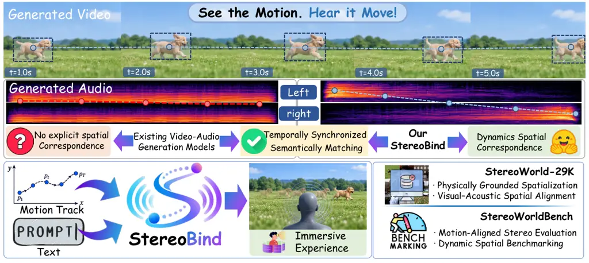
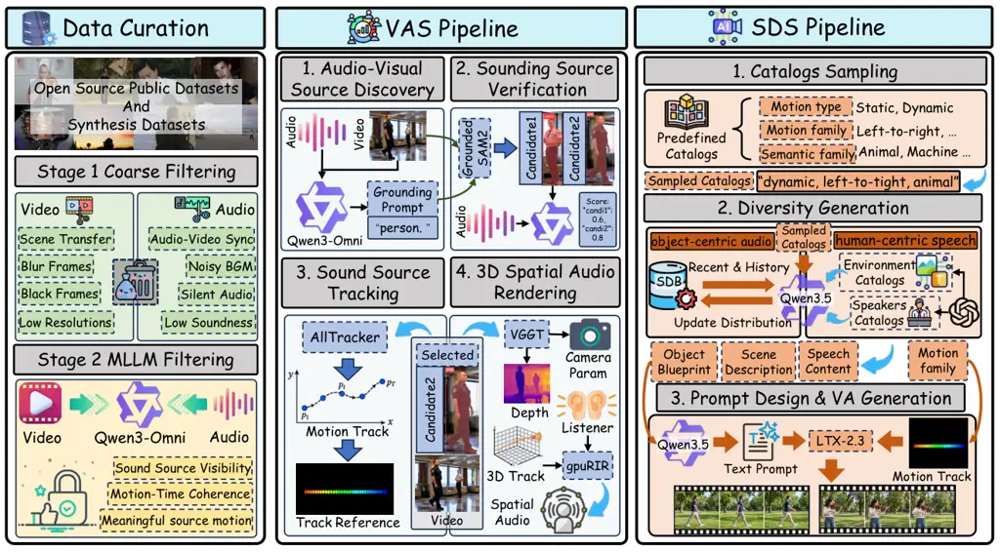
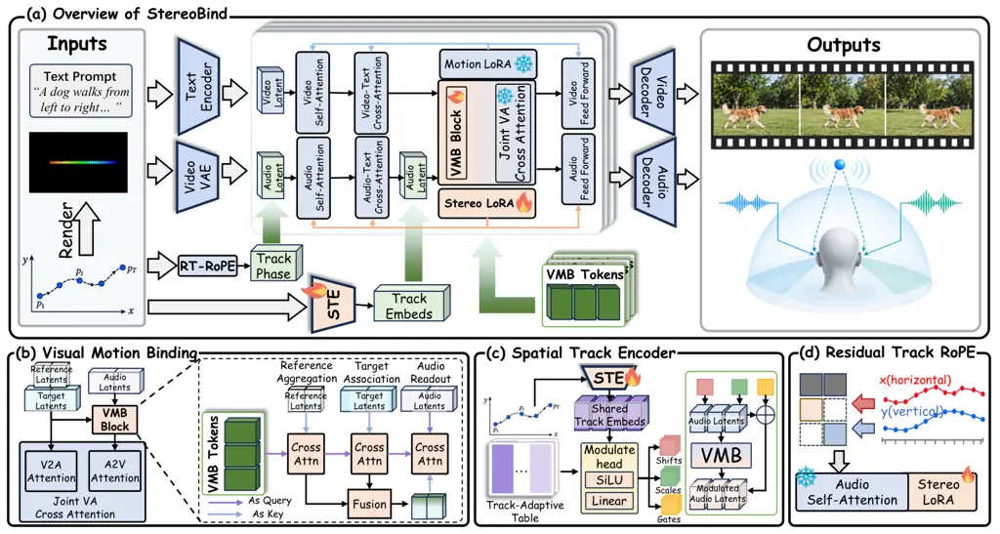
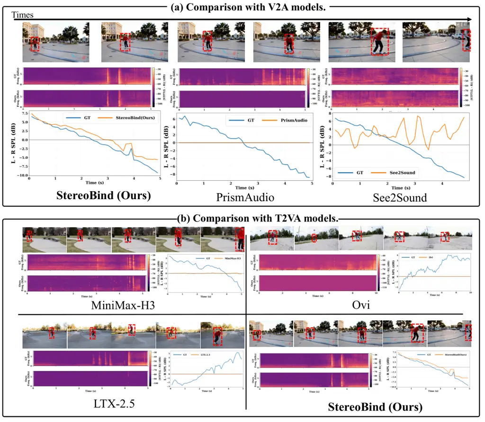
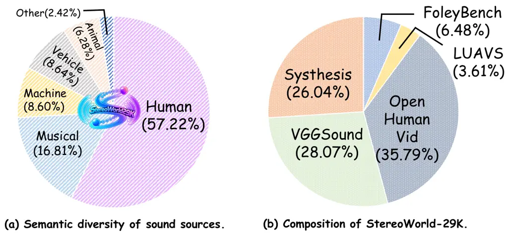
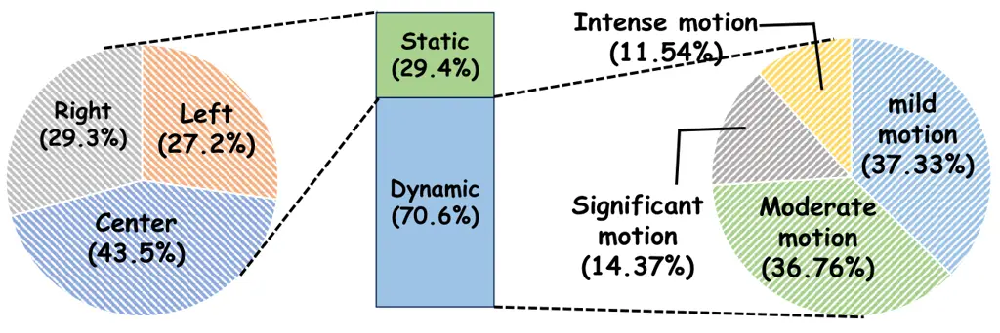
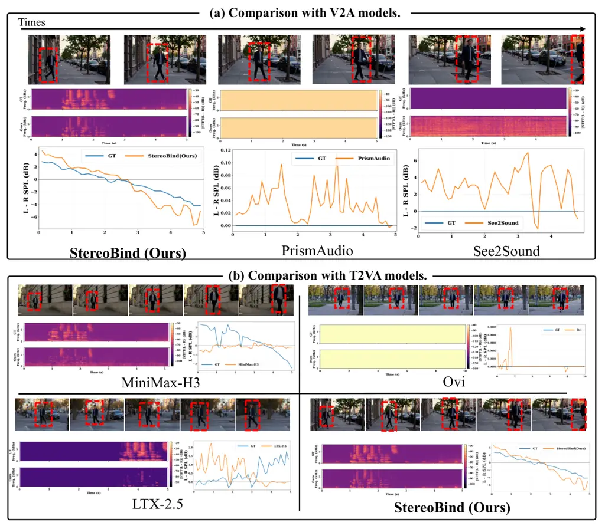
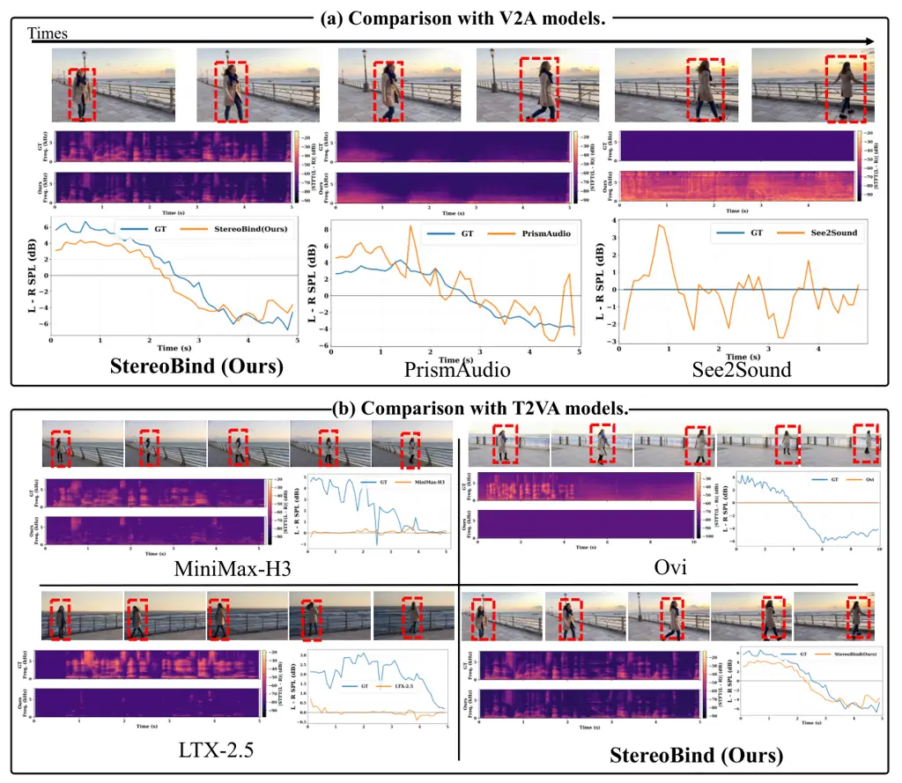

\]¹Xidian University \]  
²vivo BlueImage Lab, vivo Mobile Communication Co., Ltd. \]  
$`\dagger`$: Corresponding authors. \]  
^(∗) Equal contribution.
\projectpagehttps://vivocameraresearch.github.io/Stereo-Bind-Project/

# Hear the World in Stereo: Learning Dynamic Spatial Correspondence for Immersive Joint Video-Audio Generation

Hanmo Chen^(1,2∗)    Chengcheng Liu^(2∗)    Tianxiao Chen²    Zheyu
Zhang²    Siming Zheng²    Jinwei Chen²    Xu Yang^(1†)    Cheng Deng¹
   Bo Li²    Peng-Tao Jiang^(2†) Affiliation: \[ Affiliation: \[
Affiliation: \[ Affiliation: \[

###### Abstract

Recent joint video-audio generation models have achieved strong semantic
correspondence and temporal synchronization. However, applications such
as AR/VR and interactive gaming further require stereo audio to provide
an immersive sense, which remains largely overlooked. Effective stereo
audio requires the perceived sound location to evolve consistently with
the motion of its corresponding visual source. We refer to this property
as _Dynamic Spatial Correspondence_ and propose StereoBind, a framework
that binds visual source motion to stereo sound generation. StereoBind
uses motion tracks to coordinate visual motion and stereo audio through
three complementary mechanisms. Visual Motion Binding establishes
source-aware audiovisual correspondence, the Spatial Track Encoder
captures absolute source positions, and Residual Track RoPE models
relative motion. For supervision and evaluation, we construct
StereoWorld-29K, a large-scale stereo audio-video dataset with paired
motion tracks, and StereoWorldBench for measuring audiovisual spatial
consistency. Experiments show that StereoBind substantially improves
spatial alignment in stereo audio generation over existing models while
preserving overall audiovisual quality.



Figure 1: To the best of our knowledge, StereoBind is the first
framework for track-conditioned stereo VA generation, with
StereoWorld-29K as the first large-scale dataset and StereoWorldBench as
the first benchmark for this task.

## 1 Introduction

Joint video-audio (VA) generation is rapidly evolving toward coherent
audiovisual synthesis. Recent foundation models such as Seedance \[27\],
LTX-2 \[9\], MOVA \[31\], and Minimax-H3 focus primarily on _what_ is
heard through semantic correspondence and _when_ it occurs through
temporal synchronization. However, VR/AR and interactive games demand
not only semantic and temporal coherence but also emphasis immersive
entertainment \[43\]. Users should hear sounds from directions
consistent with visible sources, with perceived sound locations evolving
as the sources move \[35\]. This motivates us to investigate _where_
sounds originate and how their locations evolve over time, a property we
term _dynamic spatial correspondence_, which remains largely
underexplored in existing methods.

Although existing VA models \[9, 22\] support two-channel audio
generation, such outputs do not guarantee meaningful stereophonic
spatial cues. In stereo audio, spatial perception arises from structured
differences between the left and right channels \[20\]. This principle
mirrors human auditory perception, in which differences between the
signals received by the two ears provide cues about the location of a
sound source. In particular, horizontal sound localization relies
strongly on interaural time differences (ITDs) and interaural level
differences (ILDs) \[3\], which encode disparities in arrival time and
intensity between the two ears, enabling listeners to infer the
direction of a sound source. As a sound source moves, these binaural
cues should evolve consistently with the corresponding motion. We refer
to this consistency between sound source motion and perceived auditory
location over time as dynamic spatial correspondence. Establishing
dynamic spatial correspondence is challenging because a visual motion
track cannot be directly translated into stereo audio. The motion track
explicitly describes where a source moves in the video, while auditory
location is reflected indirectly through spatial cues such as ITDs and
ILDs. Bridging these heterogeneous representations requires establishing
a link between the visual source and its associated auditory cues \[5,
40\].

To address these challenges, we introduce StereoBind, which uses the
motion track to condition both video and stereo audio generation.
StereoBind comprises three complementary components. Visual Motion
Binding (VMB) serve as a cross-modal representation bridge that
aggregates the motion track with the corresponding visual entity and
transforms this information into a spatially informative representation.
The resulting representation is injected into the audio stream, allowing
visual motion to directly guide the spatial structure of the generated
audio. A Spatial Track Encoder (STE) maps the motion track into spatial
track embeddings, which are then used to modulate the audio latents,
providing explicit absolute spatial conditioning for audio generation.
Residual Track RoPE (RT-RoPE) incorporates relative track displacement,
providing relative spatial conditioning. Together, these components
enable spatially coherent audio generation aligned with visual motion.

Training StereoBind to capture dynamic spatial correspondence requires
VA data with reliable spatial supervision. Existing large-scale datasets
such as VGGSound \[4\] and OpenHumanVid \[17\] primarily support
semantic and temporal correspondence, but rarely provide reliable stereo
cues. Moreover, collecting large-scale real-world data with calibrated
spatial recording equipment is also costly. We therefore construct
StereoWorld-29K through two complementary pipelines. A Visual-Audio
Spatialization (VAS) Pipeline spatializes audio according to the
trajectories of sound sources in real videos, while a Spatial Data
Synthesis (SDS) Pipeline generates track-controlled scenes with diverse
configurations. Together, these two pipelines provide scalable and
interpretable supervision between sound source motion and stereo audio.

Beyond training supervision, spatial alignment also requires dedicated
evaluation. We therefore introduce StereoWorldBench (SWBench), which
measures the alignment between generated stereo audio and source motion
to complement conventional audiovisual quality metrics. Experiments
validate the effectiveness of our method. Our key contributions are
summarized as follows:

- •
  To the best of our knowledge, we present the first framework for
  track-conditioned stereo VA generation, modeling the consistency
  between source motion and acoustic location.
- •
  We construct StereoWorld-29K, the first large-scale stereo VA dataset
  with explicit spatial supervision, and introduce StereoWorldBench to
  evaluate dynamic spatial correspondence.
- •
  We propose StereoBind, which models source binding, absolute spatial
  position, and relative motion through VMB, STE, and RT-RoPE,
  respectively.

## 2 Related Work

### 2.1 Audio-Video Joint Generation

VA generation has evolved from diffusion models \[25\] toward Diffusion
Transformer (DiT) \[23\]. Early approaches such as MM-Diffusion \[26\]
couple audio and video through cross-modal attention, while AV-DiT
\[34\] adapts a pretrained image DiT with lightweight VA modules. More
recently, Ovi \[22\], LTX-2 \[9\], and MOVA \[31\] adopt dual-stream
architectures to jointly model audio and video, while UniAVGen \[39\]
further incorporates face-aware modulation. Beyond architectural design,
JavisDiT \[21\] and Harmony \[11\] strengthen audiovisual correspondence
through mechanisms such as spatiotemporal priors, modality-specific
modeling, and synchronization-aware training \[21, 11\]. Other
conditional generation methods, including Syncphony \[29\], DreamID-Omni
\[8\] and Hallo-Live \[16\], further explore explicit cross-modal
conditioning and binding. These advances improve semantic correspondence
and temporal synchronization, yet the alignment between motion and
auditory location remains largely unexplored.

### 2.2 Stereo Audio Generation

Stereo audio research has increasingly focused on controllable and
scene-aware synthesis \[43\]. A growing body of work incorporates
spatial attributes as explicit generation conditions. SpatialSonic
\[30\] models directional states for stereo synthesis, while ISDrama
\[40\] extends such control to multi-speaker speech. Visual information
has also been exploited to guide stereo audio generation. ViSAGe \[15\]
generates directional First-Order Ambisonics (FOA) audio from visual
content, and FoleyDesigner \[18\] couples scene analysis with
controllable stereo Foley generation. Recent methods incorporate
explicit scene geometry, with SonoWorld \[14\] constructing spatially
consistent 3D audiovisual scenes and Sonic4D \[36\] combining source
localization and physics-based spatialization. In parallel, OWL \[2\]
and BAT \[41\] explore stereo audio understanding with large language
models. Despite these advances, dynamic spatial correspondence between
sound source motion and auditory spatial cues remains underexplored in
VA generation.



Figure 2: Construction pipeline of StereoWorld-29K. We combine curated
real-world videos with synthetic audiovisual data. The VAS Pipeline
localizes and tracks sound sources and renders track-guided stereo
audio, while the SDS Pipeline generates diverse track-controlled scenes.

## 3 StereoWorld-29K Dataset

StereoWorld-29K consists of two data branches, with the overall
construction pipeline shown in Figure 2. The real-world branch draws
from large-scale public datasets, preserving natural audiovisual content
but offering limited motion diversity. The synthetic branch generates
diverse audiovisual scenes with controllable source motion to support
stereo audio generation. Reliable sound-source trajectories are required
to provide spatial supervision for both branches. However, existing
Audio-Visual Segmentation (AVS) models trained on curated datasets often
generalize poorly to unconstrained scenes. We therefore develop the VAS
Pipeline to robustly localize and track sound sources for stereo
rendering. Detailed statistics and analysis are provided in Appendix D.

### 3.1 Data Curation

We collect videos from VGGSound \[4\], OpenHumanVid \[17\], FoleyBench
\[7\], and LU-AVS \[19\], and apply a two-stage filtering pipeline.
First, we filter out low-quality samples based on video duration and
resolution, audio decodability, silence ratio, and signal-to-noise
ratio. Second, we use Qwen3-Omni \[37\] for motion-aware semantic
filtering. We retain clips in which the audio originates from a
spatially identifiable source whose motion is temporally coherent
relative to the camera. This process focuses the dataset on dynamic
sound-source motion relevant to dynamic spatial correspondence.

### 3.2 Visual-Audio Spatialization Pipeline

Given an audiovisual clip, we first use Qwen3-Omni \[37\] to identify
potential visible sound sources and generate grounding prompts, which
are then passed to Grounded SAM \[24\] to obtain masks and bounding
boxes. Since grounding may return multiple candidate instances, we
perform candidate-level audiovisual verification. For each candidate, we
construct a candidate-centric visual clip and pair it with the original
audio, allowing Qwen3-Omni \[37\] to assess whether the candidate is
consistent with the audible content. The candidate with the strongest
audiovisual correspondence is selected, after which we use AllTracker
\[10\] to track the selected source throughout the video and obtain its
motion track.

We then use VGGT \[33\] to estimate scene depth and camera parameters.
By combining the 2D source track with its estimated depth and camera
intrinsics, we back-project the source into a camera-centered 3D
coordinate system. Treating the camera as a virtual listener, we place
left and right virtual receivers with a fixed interaural separation and
use gpuRIR \[6\] to compute a sequence of Room Impulse Responses (RIRs)
along the source track. Convolving these RIRs with the mono source audio
produces stereo signals whose spatial cues evolve consistently with the
modeled source geometry and room acoustics. In this way, the VAS
Pipeline provides explicit, geometry-aware spatial supervision for
stereo video-audio generation.

### 3.3 Spatial Data Synthesis Pipeline

Our SDS Pipeline follows a two-stage design. Stage 1 emphasizes
diversity by stochastically sampling diverse spatial scene
specifications, while Stage 2 converts these specifications into
generation-ready prompts for VA synthesis.

In Stage 1, we first sample a stereo configuration that defines the
motion and semantic attributes of each synthetic example, including
motion type (static or dynamic), motion family, and semantic family.
Qwen3.5 \[38\] generates and translated a corresponding motion track
into a textual description. Subsequently, we instantiate this
configuration through two complementary branches: an object-centric
branch and a human-centric branch. In the object-centric branch, Qwen3.5
\[38\] takes the sampled configuration together with statistics from a
continuously updated Scene Distribution Bank (SDB) to generate a
structured blueprint describing the source appearance, sound, motion,
and scene context. The SDB maintains statistics over previously accepted
scene specifications to reduce repetition in subsequent samples. In the
human-centric branch, we first use GPT-5.6 to construct a predefined
catalog comprising 47 speaker profiles and 41 concrete environments.
Given the identity of the sampled speaker profile, action, and scene
context, Qwen3.5 then generates a natural spoken sentence tailored to
the scene.

In stage 2, the branch-specific outputs are then passed to separate
Qwen3.5 prompt generators, which convert them into prompts for VA
models. We use a higher sampling temperature in Stage 1 to encourage
semantic and scene diversity, and a lower temperature in Stage 2 to
faithfully preserve the details of the planned scene specifications
during prompt generation.



Figure 3: Overview of the StereoBind framework. StereoBind introduces
VMB for audiovisual source binding, STE for absolute track conditioning,
and RT-RoPE for relative motion modeling.

## 4 Method

### 4.1 Problem Formulation and Overview

Given a text description $`c`$ and a normalized motion track with
$`T_{p}`$ frames $`P=(\mathbf{p}_{i})_{i=1}^{T_{p}}`$, where
$`\mathbf{p}_{i}=(x_{i},y_{i})\in[0,1]^{2},`$, we model the conditional
joint distribution

```math
p_{\theta}(V,\mathbf{A}\mid c,P,\mathcal{R}(P)), \tag{1}
```

where $`V`$ denotes the generated video, $`\mathbf{A}=(A^{L},A^{R})`$
the corresponding stereo audio, and $`R_{P}=\mathcal{R}(P)`$ the visual
reference rendered from the motion track $`P`$. Our goal is to enforce
dynamic spatial correspondence, such that the visible sound-producing
source in $`V`$ follows the prescribed track $`P`$, while the perceived
sound location in $`\mathbf{A}`$ evolves consistently with the resulting
visual source motion. As illustrated in Figure 3(a), StereoBind builds
on the LTX-2.3 \[9\] backbone and consists of three complementary
components. VMB bridges the visual and audio modalities by transferring
source-aware motion context to the audio stream. STE provides absolute
spatial conditioning, while RT-RoPE models relative motion with a
trainable Stereo LoRA for spatial adaptation. Together, these components
enable stereo audio generation aligned with visual source motion without
explicitly estimating ITDs or ILDs.

### 4.2 Visual Motion Binding

The motion reference specifies _how_ the source should move, whereas the
evolving target-video state provides the visual context of _what_ is
being generated. Neither alone explicitly establishes dynamic spatial
correspondence between visual source motion and perceived sound
location. We therefore introduce Visual Motion Binding (VMB), consisting
of $`N_{\text{VMB}}=64`$ learnable VMB Tokens in each VMB Blocks. As
illustrated in Figure 3(b), the VMB Block is placed before the Joint VA
Attention in each transformer block and progressively integrates the
motion reference, target-video state, and audio stream through a
_reference–target–audio_ pathway. Starting from learnable tokens
$`S_{0}^{\ell}`$ at blcok $`\ell`$, the VMB Block first aggregates the
motion-reference representation $`X_{\mathrm{ref}}^{\ell}`$ to encode
the prescribed track. The resulting tokens then attend to the current
target-video representation $`X_{\mathrm{tar}}^{\ell}`$, contextualizing
the prescribed motion with the visual entity and scene being
synthesized. We further retain the residual
$`S_{t}^{\ell}-S_{r}^{\ell}`$ to characterize how the target-video
context modifies the reference-conditioned representation. The audio
stream then attends to the fused representation through cross-attention:

```math
\displaystyle S_{r}^{\ell} \displaystyle=S_{0}^{\ell}+\mathcal{A}_{\ell}^{r}\!\left(\operatorname{LN}(S_{0}^{\ell}),\operatorname{LN}(X_{\mathrm{ref}}^{\ell})\right), \tag{2}
```

```math
\displaystyle S_{t}^{\ell} \displaystyle=S_{r}^{\ell}+\mathcal{A}_{\ell}^{t}\!\left(\operatorname{LN}(S_{r}^{\ell}),\operatorname{LN}(X_{\mathrm{tar}}^{\ell})\right),
```

```math
\displaystyle S^{\ell} \displaystyle=\mathcal{F}_{\ell}\!\left([S_{r}^{\ell},S_{t}^{\ell},S_{t}^{\ell}-S_{r}^{\ell}]\right),
```

```math
\displaystyle D_{s}^{\ell} \displaystyle=\mathcal{A}_{\ell}^{a}\!\left(\operatorname{LN}({X}_{a}^{\ell}),\operatorname{LN}(S^{\ell})\right).
```

Here, $`\mathcal{A}_{\ell}^{r}`$, $`\mathcal{A}_{\ell}^{t}`$, and
$`\mathcal{A}_{\ell}^{a}`$ denote cross-attention for reference
aggregation, target association, and audio readout, respectively, while
$`\mathcal{F}_{\ell}`$ denotes a MLP projection applied to the
concatenated features $`[\cdot]`$. $`X_{\mathrm{ref}}^{\ell}`$
represents the motion-reference features, $`X_{\mathrm{tar}}^{\ell}`$
denotes the video state during denoising, and $`X_{a}^{\ell}`$ denotes
the audio representation at block $`\ell`$. Finally, $`D_{s}^{\ell}`$
denotes the spatially conditioned audio feature produced by the VMB
Block, which is subsequently fed into the Joint VA Cross-Attention.

### 4.3 Spatial Track Encoder

VMB provides source-aware visual context but lacks token-wise temporal
spatial alignment. Consequently, we introduce a STE shared across
Transformer blocks that maps the motion track $`P`$ into a temporally
structured representation. Since audio representations evolve across
Transformer layers, directly applying the same track embedding at every
block may introduce a representation mismatch. We therefore further
introduce layer-specific Track-Adaptive modulation to adapt the shared
track representation to each block. As shown in Figure 3(c), given
$`P\in\mathbb{R}^{T_{p}\times 2}`$, the overall process is

```math
\begin{gathered}H=\operatorname{LN}\!\left(\operatorname{TemporalTransformer}\!\left(\operatorname{Linear}_{p}(P)\right)\right),\\
[\beta_{\ell},\gamma_{\ell},g_{\ell}]=\mathcal{U}_{3}\!\left(\operatorname{Linear}_{u}(\operatorname{SiLU}(H))+B_{\ell}\right).\end{gathered} \tag{3}
```

The shared representation $`H`$ captures temporal motion context. At
block $`\ell`$, the learnable Track-Adaptive table
$`B_{\ell}\in\mathbb{R}^{1\times 3D_{a}}`$ adapts $`H`$ to the
layer-specific audio representation. The operator
$`\mathcal{U}3(\cdot)`$ splits the feature dimension into three equal
parts, yielding shift $`\beta\ell`$, scale $`\gamma_{\ell}`$, and gate
$`g_{\ell}`$, where $`\beta_{\ell}`$ and $`\gamma_{\ell}`$ modulate the
audio queries for VMB retrieval, while $`g_{\ell}`$ controls the
strength of the retrieved update. Here, $`{X}_{a}^{\ell}`$ denotes the
audio representation at block $`\ell`$ before VMB.

```math
\begin{gathered}\widetilde{X}_{a}^{\ell}=\operatorname{RMSNorm}(X_{a}^{\ell})\odot(1+\gamma_{\ell})+\beta_{\ell},\\
X_{a,+}^{\ell}=\widetilde{X}_{a}^{\ell}+g_{\ell}\odot D_{s}^{\ell}.\end{gathered} \tag{4}
```

This design confines track conditioning to the VMB pathway while
retaining the pretrained audio residual pathway and injecting
track-dependent information through a gated residual update. The motion
track thus governs how source-aware context is queried and incorporated
into the audio representation. Together, STE and Track-Adaptive
modulation bridge explicit motion tracks and latent audio
representations.

### 4.4 Residual Track RoPE

The STE provides absolute spatial conditioning, while dynamic spatial
correspondence further requires relative source motion. We therefore
introduce Residual Track RoPE (RT-RoPE), which augments the pretrained
temporal RoPE with track-dependent residual phases. As illustrated in
Figure 3(d), given a motion track $`P`$, we linearly resample it to the
audio-token length and normalize it as
$`\bar{P}=\bigl((\bar{x}_{j},\bar{y}_{j})\bigr)_{j=1}^{N_{a}}`$, where
$`(\bar{x}_{j},\bar{y}_{j})\in[-1,1]^{2}`$. For each attention head, the
rotary pairs are divided evenly into horizontal and vertical subsets
$`\mathcal{I}_{x}`$ and $`\mathcal{I}_{y}`$. Let $`n_{rp}`$ denote the
number of rotary pairs per head. For each spatial axis $`d\in{x,y}`$, we
construct a logarithmically spaced rotary-frequency grid as
$`\omega_{k}^{d}=\frac{\pi}{2}\theta_{\mathrm{track}}^{\frac{k}{n_{rp}/2-1}}`$,
where $`k=0,\ldots,n_{rp}/2-1`$. We set $`\theta_{\mathrm{track}}=2`$ to
provide a compact low-frequency spatial spectrum that matches the
normalized track range and avoids overly rapid phase variation. The
residual phase is defined as

```math
\phi_{hjr}=\begin{cases}\tanh(a_{x})\,\omega_{r}^{x}\,\bar{x}_{j},&r\in\mathcal{I}_{x},\\
\tanh(a_{y})\,\omega_{r}^{y}\,\bar{y}_{j},&r\in\mathcal{I}_{y}.\end{cases} \tag{5}
```

Here, $`a_{x}`$ and $`a_{y}`$ are learnable parameters controlling the
strength of modulation, while $`r`$ denotes the local rotary-pair index
within each subset. The $`\tanh`$ parameterization bounds the modulation
coefficients, preventing excessive perturbation of the pretrained RoPE.
The residual phase is added to the original RoPE as
$`\theta_{hjr}=\theta_{hjr}^{\mathrm{time}}+\phi_{hjr}`$. Since RT-RoPE
modifies the rotary geometry applied to the attention queries and keys,
we augment the audio self-attention with a lightweight LoRA adapter
while keeping the pretrained weights frozen. The adapter is jointly
optimized with RT-RoPE, allowing the attention projections to adapt to
the modified positional geometry. This construction also reveals how
RT-RoPE encodes relative source motion through phase differences between
audio tokens. For a horizontal pair $`r\in\mathcal{I}_{x}`$, the
relative phase between audio tokens $`i`$ and $`j`$ becomes

```math
\theta_{hjr}-\theta_{hir}=\left(\theta_{hjr}^{\mathrm{time}}-\theta_{hir}^{\mathrm{time}}\right)+\tanh(a_{x})\omega_{r}^{x}\left(\bar{x}_{j}-\bar{x}_{i}\right),\qquad r\in\mathcal{I}_{x}. \tag{6}
```

The same formulation applies to the vertical subset $`\mathcal{I}_{y}`$.
RT-RoPE therefore augments audio self-attention with signed relative
motion displacement.

## 5 Experiments

### 5.1 Experimental Settings.

#### Experimental Implementation.

StereoBind is built upon LTX-2.3, a VA generation model with separate
video and audio branches. We incorporate a frozen Motion Track IC-LoRA
\[1\] into the video branch and inject trainable LoRA into the attention
and feed-forward of the audio branch, with rank $`32`$, scaling factor
$`32`$. We employ Qwen-3.5-35B-A3B in the SDS Pipeline and
Qwen3-Omni-30B in the VAS Pipeline. StereoBind is trained on our
StereoWorld-29K dataset for 8K iterations on 8 NVIDIA H20 GPUs,
requiring approximately two days. We adopt the original LTX-2.3 training
objective without modification. We use AdamW with a learning rate of
$`2\times 10^{-4}`$, $`\beta_{1}=0.9`$, and $`\beta_{2}=0.999`$,
together with a linear learning-rate scheduler. Each training sample
contains 121 frames at a resolution of $`640\times 384`$.

#### Evaluation Protocol.

We compare StereoBind with representative VA generation baselines,
including Ovi \[22\], MiniMax-H3, LTX-2.5 and LTX-2.3 \[9\], as well as
video-to-spatial-audio (V2SA) models PrismAudio \[20\] and See2Sound
\[5\]. Since the VA baselines do not support motion inputs, we augment
their prompts with directional motion descriptions to encourage the
sound source to follow the desired motion. Since V2SA models do not
generate videos, we use StereoBind to produce the input videos, then use
the generated videos as inputs to each V2SA model to synthesize their
audio outputs. We assess generation performance from three aspects:
visual quality using VBench \[12\], audio quality using Audiobox
Aesthetics \[32\] and AVGen-Bench \[42\], and stereo spatial fidelity
using our SWBench. Further details of SWBench are provided in Appendix
H.

#### Evaluation Metrics.

For visual quality, we report Subject Consistency, Motion Smoothness,
and Imaging Quality from VBench \[12\]. Audio quality is evaluated using
audio Production Quality (PQ) from Audiobox Aesthetics \[32\] and AV
Sync from Synchformer \[13\] from AVGen-Bench \[42\]. For stereo spatial
fidelity, we first downmix the generated audio to mono and re-spatialize
it with our VAS Pipeline to construct the reference stereo audio. We
report Interaural Level Difference Wasserstein Distance (ILD-W) for
interaural level-difference consistency, Sound Event Localization and
Detection Accuracy (SELD-Acc) from SAVGBench \[28\] for audiovisual
spatial alignment, Stereo Magnitude Ratio Error (SMR-Err) for stereo
spatial balance, and Spatial-AST Angular Consistency (AST-Ang) and
Spatial-AST Calibration (AST-Cal) based on Spatial-AST \[41\] for
learned stereo consistency. Detailed metrics definitions are provided in
Appendix H.

|             |                   |                            |                             |                            |                       |                        |                         |                        |                         |                       |                       |
| ----------- | ----------------- | -------------------------- | --------------------------- | -------------------------- | --------------------- | ---------------------- | ----------------------- | ---------------------- | ----------------------- | --------------------- | --------------------- |
|             |                   | Visual Quality             |                             |                            | Audio Quality         |                        | Stereo Spatial Fidelity |                        |                         |                       |                       |
| Model Type  | Method            | Subject Cons. $`\uparrow`$ | Motion Smooth. $`\uparrow`$ | Imaging Qual. $`\uparrow`$ | Audio PQ $`\uparrow`$ | AV Sync $`\downarrow`$ | ILD -W $`\downarrow`$   | SELD -Acc $`\uparrow`$ | SMR -Err $`\downarrow`$ | AST -Ang $`\uparrow`$ | AST -Cal $`\uparrow`$ |
| VA Models   | Ovi \[22\]        | 0.962                      | 0.993                       | 0.681                      | 5.70                  | 0.278                  | 3.744                   | 0.571                  | 65.58                   | 0.196                 | 0.0261                |
|             | MiniMax-H3        | 0.968                      | 0.996                       | 0.690                      | 6.81                  | 0.301                  | 3.435                   | 0.725                  | 24.64                   | 0.257                 | 0.131                 |
|             | LTX-2.5 \[9\]     | 0.950                      | 0.995                       | 0.655                      | 6.70                  | 0.367                  | 3.565                   | 0.571                  | 37.62                   | 0.237                 | 0.122                 |
|             | LTX-2.3 \[9\]     | 0.953                      | 0.995                       | 0.653                      | 6.68                  | 0.374                  | 3.574                   | 0.617                  | 39.34                   | 0.221                 | 0.119                 |
| V2SA Models | PrismAudio \[20\] | –                          | –                           | –                          | 6.02                  | 0.479                  | 3.426                   | 0.473                  | 44.55                   | 0.189                 | 0.036                 |
|             | See2Sound \[5\]   | –                          | –                           | –                          | 5.10                  | 0.406                  | 6.30                    | 0.375                  | 30.48                   | 0.292                 | 0.119                 |
| Ours        | StereoBind        | 0.955                      | 0.996                       | 0.697                      | 6.86                  | 0.262                  | 2.754                   | 0.757                  | 14.86                   | 0.465                 | 0.314                 |

Table 1: Comparison results on joint video-audio generation. Best
results are highlighted in bold, and second-best results are underlined.

|                                       |                       |                        |                         |                       |                       |
| ------------------------------------- | --------------------- | ---------------------- | ----------------------- | --------------------- | --------------------- |
| Variant                               | ILD -W $`\downarrow`$ | SELD -Acc $`\uparrow`$ | SMR -Err $`\downarrow`$ | AST -Ang $`\uparrow`$ | AST -Cal $`\uparrow`$ |
| w/o Residual Track RoPE               | 2.800                 | 0.653                  | 19.28                   | 0.308                 | 0.219                 |
| w/o Spatial Track Encoder             | 3.336                 | 0.669                  | 27.38                   | 0.282                 | 0.198                 |
| w/o VMB                               | 3.079                 | 0.506                  | 31.16                   | 0.256                 | 0.216                 |
| VMB Tokens ($`N_{\mathrm{VMB}}=16`$)  | 2.785                 | 0.627                  | 18.65                   | 0.322                 | 0.245                 |
| VMB Tokens ($`N_{\mathrm{VMB}}=32`$)  | 2.751                 | 0.691                  | 20.47                   | 0.311                 | 0.246                 |
| VMB Tokens ($`N_{\mathrm{VMB}}=128`$) | 2.756                 | 0.747                  | 13.47                   | 0.471                 | 0.321                 |
| StereoBind (Full, $`N_{VMB}=64`$)     | 2.754                 | 0.757                  | 14.86                   | 0.465                 | 0.314                 |

Table 2: Ablation study of StereoBind on StereoWorldBench (SWBench).
Best results are highlighted in bold, and second-best results are
underlined.

### 5.2 Experimental Results.

#### Quantitative Results.

We compare StereoBind with joint VA generation models and V2SA methods
in Table 1. StereoBind achieving the best Motion Smoothness, Imaging
Quality, Audio PQ, and AV Sync while maintaining comparable Subject
Consistency and audio quality. More importantly, it outperforms all
baselines on stereo spatial fidelity metrics, achieving an ILD-W of
2.754, SELD-Acc of 0.757, SMR-Err of 14.86, AST-Ang of 0.465, and
AST-Cal of 0.314. These gains demonstrate improved dynamic spatial
correspondence without compromising generation quality. Our method also
achieves the best human perceptual results, as reported in Appendix E.

#### Qualitative Results.

We conduct qualitative comparisons using two visualizations, Signed
Inter-channel Level Difference (SILD) and Inter-channel Differential
Spectrogram (IDS). SILD visualizes the signed inter-channel level
difference over time, where positive and negative values indicate left-
and right-channel dominance, respectively. IDS visualizes the
time-frequency structure of the inter-channel difference using the
Short-Time Fourier Transform (STFT). Detailed formulations are provided
in Appendix G. As shown in Fig. 4, existing methods exhibit limited
dynamic spatial correspondence. Their SILD trajectories often deviate
from the reference spatial evolution, while their IDS patterns show
inconsistent structures. In contrast, StereoBind produces coherent
stereo dynamics that closely follow the source motion, demonstrating
stronger dynamic spatial correspondence. For more qualitative results,
please refer to Appendix F and Supplementary Material.

### 5.3 Ablation Study.

To assess the contribution of key components in StereoBind, we conduct
ablation experiments focusing on four factors: (1) RT-RoPE, (2) STE, (3)
VMB, and (4) the number of VMB Tokens. All ablation experiments are
conducted on SWBench. As summarized in Table 2, each factor contributes
to stereo spatial fidelity, with the full StereoBind achieving the
strongest overall performance.

The Impact of Residual Track RoPE. We evaluate the contribution of
RT-RoPE by removing the track-dependent residual phases. As shown in
Table 2, removing RT-RoPE reduces AST-Ang and AST-Cal, indicating
degraded learned spatial representations. This suggests that augmenting
RoPE with relative source displacement is important for capturing
relative spatial dynamics.

The Impact of Spatial Track Encoder. We remove the STE, which provides
absolute spatial conditioning through Track-Adaptive modulation. This
variant substantially increases SMR-Err and degrades both AST-Ang and
AST-Cal, confirming the importance of absolute source-position
information for spatially coherent stereo generation.

The Impact of VMB. Removing VMB degrades overall spatial fidelity,
demonstrating its importance in integrating motion and visual context
for audio generation. We further study the capacity of VMB Tokens by
varying $`N_{\mathrm{VMB}}`$. Although the effect is not strictly
monotonic across individual metrics, a larger token budget generally
provides greater capacity to preserve source-aware visual and motion
context. Performance largely saturates at $`N_{\mathrm{VMB}}=64`$ and
further increasing the token number to 128 yields marginal gains while
introducing higher memory overhead. Considering the trade-off between
spatial fidelity and computational cost, we adopt
$`N_{\mathrm{VMB}}=64`$ in the final model.



Figure 4: Qualitative experimental results on SWBench. We compare
StereoBind with open-source VA models and V2SA models. The sound source
is highlighted with a red bounding box.

## 6 Conclusion

We introduce StereoBind, a framework that extends stereo video-audio
generation from semantic and temporal correspondence to dynamic spatial
correspondence. StereoBind combines VMB for cross-modal motion
conditioning, STE for absolute spatial conditioning, and RT-RoPE for
relative motion modeling. We further construct StereoWorld-29K for
training and StereoWorldBench for evaluating dynamic spatial
correspondence. Experiments show that StereoBind improves spatial
consistency with visual source motion while preserving overall
audiovisual generation quality. Future work will extend dynamic spatial
correspondence to richer 3D scenes, multiple sound sources, and more
complex source–listener dynamics.

## References

- \[1\] M. Ben-Yosef, T. Halperin, N. K. Korem, M. Salama, H. Cain, A.
  Joseph, A. Chen, U. Jelercic, and O. Bibi (2026) Avcontrol: efficient
  framework for training audio-visual controls. arXiv preprint
  arXiv:2603.24793. Cited by: §5.1.
- \[2\] S. Biswas, M. Khan, and B. Islam (2026) Owl: geometry-aware
  spatial reasoning for audio large language models. In International
  Conference on Learning Representations, Vol. 2026, pp. 20685–20710.
  Cited by: §2.2.
- \[3\] J. Blauert (1996) Spatial hearing: the psychophysics of human
  sound localization. The MIT press. Cited by: §1.
- \[4\] H. Chen, W. Xie, A. Vedaldi, and A. Zisserman (2020) Vggsound: a
  large-scale audio-visual dataset. In ICASSP 2020-2020 IEEE
  International Conference on Acoustics, Speech and Signal Processing
  (ICASSP), pp. 721–725. Cited by: §1, §3.1.
- \[5\] R. Dagli, S. Prakash, R. Wu, and H. Khosravani (2025)
  See-2-sound: zero-shot spatial environment-to-spatial sound. In
  Proceedings of the Special Interest Group on Computer Graphics and
  Interactive Techniques Conference Posters, pp. 1–2. Cited by: Table 5,
  Appendix E, §1, §5.1, Table 1.
- \[6\] D. Diaz-Guerra, A. Miguel, and J. R. Beltran (2021) GpuRIR: a
  python library for room impulse response simulation with gpu
  acceleration. Multimedia Tools and Applications 80 (4), pp. 5653–5671.
  Cited by: §B.4, §3.2.
- \[7\] S. Dixit, K. Saito, Z. Zhong, Y. Mitsufuji, and C.
  Donahue (2026) Foleybench: a benchmark for video-to-audio models. In
  ICASSP 2026-2026 IEEE International Conference on Acoustics, Speech
  and Signal Processing (ICASSP), pp. 14512–14516. Cited by: §3.1.
- \[8\] X. Guo, F. Ye, Q. Sun, L. Chen, B. Li, P. Zhang, J. Liu, S.
  Zhao, Q. He, and X. Hou (2026) Dreamid-omni: unified framework for
  controllable human-centric audio-video generation. arXiv preprint
  arXiv:2602.12160. Cited by: §2.1.
- \[9\] Y. HaCohen, B. Brazowski, N. Chiprut, Y. Bitterman, A.
  Kvochko, A. Berkowitz, D. Shalem, D. Lifschitz, D. Moshe, E. Porat, et
  al. (2026) Ltx-2: efficient joint audio-visual foundation model. arXiv
  preprint arXiv:2601.03233. Cited by: Table 5, Appendix E, §1, §1,
  §2.1, §4.1, §5.1, Table 1, Table 1.
- \[10\] A. W. Harley, Y. You, X. Sun, Y. Zheng, N. Raghuraman, Y.
  Gu, S. Liang, W. Chu, A. Dave, S. You, et al. (2025) Alltracker:
  efficient dense point tracking at high resolution. In 2025 IEEE/CVF
  International Conference on Computer Vision (ICCV), pp. 5253–5262.
  Cited by: §B.3, §3.2.
- \[11\] T. Hu, Z. Yu, G. Zhang, Z. Su, Z. Zhou, Y. Zhang, Y. Zhou, Q.
  Lu, and R. Yi (2026) Harmony: harmonizing audio and video generation
  through cross-task synergy. In Proceedings of the IEEE/CVF Conference
  on Computer Vision and Pattern Recognition, pp. 16085–16095. Cited by:
  §2.1.
- \[12\] Z. Huang, Y. He, J. Yu, F. Zhang, C. Si, Y. Jiang, Y. Zhang, T.
  Wu, Q. Jin, N. Chanpaisit, et al. (2024) Vbench: comprehensive
  benchmark suite for video generative models. In 2024 IEEE/CVF
  Conference on Computer Vision and Pattern Recognition (CVPR),
  pp. 21807–21818. Cited by: §5.1, §5.1.
- \[13\] V. Iashin, W. Xie, E. Rahtu, and A. Zisserman (2024)
  Synchformer: efficient synchronization from sparse cues. In ICASSP
  2024-2024 IEEE International Conference on Acoustics, Speech and
  Signal Processing (ICASSP), pp. 5325–5329. Cited by: §5.1.
- \[14\] D. Jin, X. Chen, M. C. Lin, and R. Gao (2026) SonoWorld: from
  one image to a 3d audio-visual scene. arXiv preprint arXiv:2603.28757.
  Cited by: §2.2.
- \[15\] J. Kim, H. Yun, and G. Kim (2025) Visage: video-to-spatial
  audio generation. In International Conference on Learning
  Representations, Vol. 2025, pp. 46404–46424. Cited by: §2.2.
- \[16\] C. Li, J. Li, R. Mei, H. Xia, H. Zhu, J. Wang, and S.
  Zhu (2026) Hallo-live: real-time streaming joint audio-video avatar
  generation with asynchronous dual-stream and human-centric preference
  distillation. arXiv preprint arXiv:2604.23632. Cited by: §2.1.
- \[17\] H. Li, M. Xu, Y. Zhan, S. Mu, J. Li, K. Cheng, Y. Chen, T.
  Chen, M. Ye, J. Wang, et al. (2025) Openhumanvid: a large-scale
  high-quality dataset for enhancing human-centric video generation. In
  2025 IEEE/CVF Conference on Computer Vision and Pattern Recognition
  (CVPR), pp. 7752–7762. Cited by: §1, §3.1.
- \[18\] M. Li, K. Dai, Y. Ding, R. Ni, Y. Zhang, W. Wang, and Z.
  Xie (2026) FoleyDesigner: immersive stereo foley generation with
  precise spatio-temporal alignment for film clips. arXiv preprint
  arXiv:2604.05731. Cited by: §2.2.
- \[19\] C. Liu, P. P. Li, Q. Yu, H. Sheng, D. Wang, L. Li, and X.
  Yu (2024) Benchmarking audio visual segmentation for long-untrimmed
  videos. In 2024 IEEE/CVF Conference on Computer Vision and Pattern
  Recognition (CVPR), pp. 22712–22722. Cited by: §3.1.
- \[20\] H. Liu, K. Luo, W. Wang, Q. Chen, P. Sun, R. Huang, X. Li, J.
  Ye, and W. Xue (2026) PrismAudio: decomposed chain-of-thought and
  multi-dimensional rewards for video-to-audio generation. In
  International Conference on Learning Representations, Vol. 2026,
  pp. 25176–25204. Cited by: Table 5, Appendix E, §1, §5.1, Table 1.
- \[21\] K. Liu, W. Li, L. Chen, S. Wu, Y. Zheng, J. Ji, F. Zhou, J.
  Luo, Z. Liu, H. S. Fei, et al. (2026) Javisdit: joint audio-video
  diffusion transformer with hierarchical spatio-temporal prior
  synchronization. In International Conference on Learning
  Representations, Vol. 2026, pp. 139160–139194. Cited by: §2.1.
- \[22\] C. Low, W. Wang, and C. Katyal (2025) Ovi: twin backbone
  cross-modal fusion for audio-video generation. arXiv preprint
  arXiv:2510.01284. Cited by: Table 5, Appendix E, §1, §2.1, §5.1, Table
  1.
- \[23\] W. Peebles and S. Xie (2023) Scalable diffusion models with
  transformers. In 2023 IEEE/CVF International Conference on Computer
  Vision (ICCV), pp. 4172–4182. Cited by: §2.1.
- \[24\] T. Ren, S. Liu, A. Zeng, J. Lin, K. Li, H. Cao, J. Chen, X.
  Huang, Y. Chen, F. Yan, et al. (2024) Grounded sam: assembling
  open-world models for diverse visual tasks. arXiv preprint
  arXiv:2401.14159. Cited by: §3.2.
- \[25\] R. Rombach, A. Blattmann, D. Lorenz, P. Esser, and B.
  Ommer (2022) High-resolution image synthesis with latent diffusion
  models. In 2022 IEEE/CVF conference on computer vision and pattern
  recognition (CVPR), pp. 10674–10685. Cited by: §2.1.
- \[26\] L. Ruan, Y. Ma, H. Yang, H. He, B. Liu, J. Fu, N. J. Yuan, Q.
  Jin, and B. Guo (2023) Mm-diffusion: learning multi-modal diffusion
  models for joint audio and video generation. In 2023 IEEE/CVF
  Conference on Computer Vision and Pattern Recognition (CVPR),
  pp. 10219–10228. Cited by: §2.1.
- \[27\] T. Seedance, D. Chen, L. Chen, X. Chen, Y. Chen, Z. Chen, Z.
  Chen, F. Cheng, T. Cheng, Y. Cheng, et al. (2026) Seedance 2.0:
  advancing video generation for world complexity. arXiv preprint
  arXiv:2604.14148. Cited by: §1.
- \[28\] K. Shimada, C. Simon, T. Shibuya, S. Takahashi, and Y.
  Mitsufuji (2026) Savgbench: benchmarking spatially aligned audio-video
  generation. In ICASSP 2026-2026 IEEE International Conference on
  Acoustics, Speech and Signal Processing (ICASSP), pp. 11977–11981.
  Cited by: §H.2, §5.1.
- \[29\] J. Song, M. Kwon, J. Jeong, and Y. Uh (2026) Syncphony:
  synchronized audio-to-video generation with diffusion transformers. In
  International Conference on Learning Representations, Vol. 2026,
  pp. 45373–45398. Cited by: §2.1.
- \[30\] P. Sun, S. Cheng, X. Li, Z. Ye, H. Liu, H. Zhang, W. Xue,
  and Y. Guo (2025) Both ears wide open: towards language-driven spatial
  audio generation. In International Conference on Learning
  Representations, Vol. 2025, pp. 42606–42649. Cited by: §2.2.
- \[31\] O. Team, D. Yu, M. Chen, Q. Chen, Q. Luo, Q. Wu, Q. Cheng, R.
  Li, T. Liang, W. Zhang, et al. (2026) Mova: towards scalable and
  synchronized video-audio generation. arXiv preprint arXiv:2602.08794.
  Cited by: §1, §2.1.
- \[32\] A. Tjandra, Y. Wu, B. Guo, J. Hoffman, B. Ellis, A. Vyas, B.
  Shi, S. Chen, M. Le, N. Zacharov, et al. (2025) Meta audiobox
  aesthetics: unified automatic quality assessment for speech, music,
  and sound. arXiv preprint arXiv:2502.05139. Cited by: §5.1, §5.1.
- \[33\] J. Wang, M. Chen, N. Karaev, A. Vedaldi, C. Rupprecht, and D.
  Novotny (2025) Vggt: visual geometry grounded transformer. In 2025
  IEEE/CVF Conference on Computer Vision and Pattern Recognition (CVPR),
  pp. 5294–5306. Cited by: §B.4, §3.2.
- \[34\] K. Wang, S. Deng, J. Shi, D. Hatzinakos, and Y. Tian (2024)
  Av-dit: efficient audio-visual diffusion transformer for joint audio
  and video generation. arXiv preprint arXiv:2406.07686. Cited by: §2.1.
- \[35\] M. L. Wang, R. Sawata, S. Clarke, R. Gao, S. Wu, and J.
  Wu (2024) Hearing anything anywhere. In 2024 IEEE/CVF Conference on
  Computer Vision and Pattern Recognition (CVPR), pp. 11790–11799. Cited
  by: §1.
- \[36\] S. Xie, H. Zhu, X. Chen, T. He, X. Li, and Z. Chen (2026)
  Sonic4d: spatial audio generation for immersive 4d scene exploration.
  In Proceedings of the AAAI Conference on Artificial Intelligence, Vol.
  40, pp. 11087–11095. Cited by: §2.2.
- \[37\] J. Xu, Z. Guo, H. Hu, Y. Chu, X. Wang, J. He, Y. Wang, X.
  Shi, T. He, X. Zhu, et al. (2025) Qwen3-omni technical report. arXiv
  preprint arXiv:2509.17765. Cited by: §3.1, §3.2.
- \[38\] A. Yang, A. Li, B. Yang, B. Zhang, B. Hui, B. Zheng, B. Yu, C.
  Gao, C. Huang, C. Lv, et al. (2025) Qwen3 technical report. arXiv
  preprint arXiv:2505.09388. Cited by: §3.3.
- \[39\] G. Zhang, Z. Zhou, T. Hu, Z. Peng, Y. Zhang, Y. Chen, Y.
  Zhou, Q. Lu, and L. Wang (2026) Uniavgen: unified audio and video
  generation with asymmetric cross-modal interactions. In Proceedings of
  the IEEE/CVF Conference on Computer Vision and Pattern Recognition,
  pp. 1950–1960. Cited by: §2.1.
- \[40\] Y. Zhang, W. Guo, C. Pan, Z. Zhu, T. Jin, and Z. Zhao (2025)
  Isdrama: immersive spatial drama generation through multimodal
  prompting. In Proceedings of the 33rd ACM International Conference on
  Multimedia, pp. 9618–9627. Cited by: §1, §2.2.
- \[41\] Z. Zheng, P. Peng, Z. Ma, X. Chen, E. Choi, and D.
  Harwath (2024) Bat: learning to reason about spatial sounds with large
  language models. arXiv preprint arXiv:2402.01591. Cited by: §H.2,
  §2.2, §5.1.
- \[42\] Z. Zhou, Z. Lai, R. Wang, Y. Yang, Y. Yang, Q. Dai, L. Qiu,
  and C. Luo (2026) AVGen-bench: a task-driven benchmark for
  multi-granular evaluation of text-to-audio-video generation. In
  Forty-third International Conference on Machine Learning, Cited by:
  §5.1, §5.1.
- \[43\] Z. Zhu, Y. Zhang, W. Guo, C. Pan, and Z. Zhao (2025) Asaudio: a
  survey of advanced spatial audio research. In Proceedings of the 14th
  International Joint Conference on Natural Language Processing and the
  4th Conference of the Asia-Pacific Chapter of the Association for
  Computational Linguistics, pp. 417–442. Cited by: §1, §2.2.

## Appendix A Detailed Architecture of the Spatial Track Encoder

The Spatial Track Encoder (STE) converts a frame-wise 2D motion track
into temporally aligned spatial conditioning for the audio branch. Given
a motion track $`P\in\mathbb{R}^{T_{p}\times 2}`$, each coordinate is
first projected into a latent motion space $`H_{0}=W_{\mathrm{in}}P,`$
where $`W_{\mathrm{in}}`$ denotes the input projection layer. In our
implementation, the track sequence contains $`T_{p}=121`$ temporal
positions, and the latent dimension is set to $`d_{s}=256`$. To capture
temporal dependencies of the source motion, the projected track features
are processed by a temporal Transformer encoder followed by LayerNorm:

```math
H=\operatorname{LN}\left(\operatorname{TemporalTransformer}(H_{0})\right). \tag{7}
```

The resulting representation contains frame-level motion context. Since
the audio branch operates on a different temporal resolution, we further
resample the track representation to the audio token sequence length
$`\widetilde{H}=\mathcal{R}_{N_{a}}(H)`$, where
$`\mathcal{R}_{N_{a}}(\cdot)`$ denotes linear temporal interpolation and
$`N_{a}`$ is the number of audio tokens. The shared representation
$`\widetilde{H}`$ is computed once during each forward pass and provides
temporally aligned geometric information for subsequent Transformer
blocks. To adapt the shared spatial representation to different
Transformer layers, we introduce a layer-specific Track-Adaptive
modulation mechanism. For each Transformer block $`\ell`$, a learnable
adaptive table $`B_{\ell}\in\mathbb{R}^{1\times 3D_{a}}`$ is added to
the projected track features:

```math
[\beta_{\ell},\gamma_{\ell},g_{\ell}]=\mathcal{U}_{3}\left(\operatorname{Linear}_{u}(\operatorname{SiLU}(\widetilde{H}))+B_{\ell}\right), \tag{8}
```

where $`\mathcal{U}_{3}(\cdot)`$ splits the feature dimension into three
equal groups. The resulting parameters
$`\beta_{\ell},\gamma_{\ell},g_{\ell}\in\mathbb{R}^{N_{a}\times D_{a}}`$
represent the layer-specific spatial modulation signals. Specifically,
$`\beta_{\ell}`$ and $`\gamma_{\ell}`$ modulate the audio queries during
VMB retrieval, enabling the audio branch to access motion-aware visual
context, while $`g_{\ell}`$ controls the strength of the retrieved
spatial update. Through this design, STE provides explicit geometric
conditioning while allowing each Transformer layer to dynamically adapt
the shared motion representation to its evolving audio feature space.

## Appendix B Additional Details of Visual-Audio Spatialization Pipeline

The VAS Pipeline converts an existing audio-video clip into a spatially
supervised stereo example. The complete pipeline consists of four
stages: sound-source identification, candidate grounding and audiovisual
verification, motion-track extraction, and geometry-aware stereo
rendering.

### B.1 Visual-Audio Source Discovery

Given an input video and its original audio, we first extract a 16-kHz
mono waveform and jointly provide the video and audio to
Qwen3-Omni-30B-A3B-Instruct. The model is instructed to identify the
dominant audible event and associate it with a concrete visible physical
source, outputting a short grounding phrase, such as guitar, dog,
person, for Grounded-SAM localization. The core instruction used for
sound-source identification is shown in Figure 5.

### B.2 Souding Source Verification

The generated grounding phrase is passed to GroundingDINO and SAM2 to
obtain candidate bounding boxes and segmentation masks. We preserve
multiple plausible instances whenever the same semantic category appears
more than once. For each candidate, we construct a verification view in
which the candidate remains visible, preserving contextual information
while clearly indicating the entity to be assessed. We then perform
candidate-wise audiovisual verification using
Qwen3-Omni-30B-A3B-Instruct. Each candidate video is paired with the
original mono audio, and the model evaluates whether the entity produces
the dominant sound. The verifier explicitly evaluates four complementary
aspects: semantic consistency, action–acoustic consistency, temporal
synchronization, and physical causal plausibility. The corresponding
scores are aggregated through a weighted average to obtain an overall
confidence score, and the candidate with the highest confidence is
selected as the final sound source. The core verification instruction is
shown in Figure 5.

### B.3 Sound Source Tracking

After selecting the sound source, we apply AllTracker \[10\] to its
verified mask sequence to obtain a sparse motion track, which is further
smoothed using Gaussian filtering for the horizontal coordinates and
third-order polynomial fitting for the vertical coordinates before being
used as spatial supervision. This produces a normalized
$`T_{p}\times 2`$ motion track that is subsequently used both for
spatial-audio construction and as motion conditioning during model
training.

### B.4 VGGT-Based Dynamic Stereo Rendering

The 2D motion track does not directly provide physical source-listener
geometry. We therefore use VGGT \[33\] to recover scene geometry and
camera parameters. Let $`(u_{t},v_{t})`$ denote the image position of
the tracked source and $`z_{t}`$ its estimated depth. Given the camera
intrinsic matrix $`\mathbf{K}_{t}`$, the source is back-projected to
camera coordinates as

```math
\mathbf{p}^{\mathrm{cam}}_{t}=z_{t}\mathbf{K}^{-1}_{t}\begin{bmatrix}u_{t}\ v_{t}\ 1\end{bmatrix}. \tag{9}
```

Since monocular geometry contain a global scale ambiguity, we use a
median-distance anchoring strategy to map the recovered geometry to a
physically plausible metric scale. The default anchor places the median
source distance at $`1.5`$ m. The reconstructed camera is treated as a
virtual listener. Two virtual listener are placed symmetrically around
the listener center along the horizontal listener axis. This converts
the source-camera geometry into two time-varying propagation paths. For
source position $`\mathbf{s}_{t}`$, listener center $`\mathbf{r}_{t}`$,
normalized left-to-right direction $`\mathbf{d}_{t}`$, and interaural
distance $`d_{e}`$, the virtual receiver locations are

```math
\displaystyle\mathbf{r}^{L}_{t} \displaystyle=\mathbf{r}_{t}-\frac{d_{e}}{2}\mathbf{d}_{t}, \tag{10}
```

```math
\displaystyle\mathbf{r}^{R}_{t} \displaystyle=\mathbf{r}_{t}+\frac{d_{e}}{2}\mathbf{d}_{t}.
```

The expected direct-path interaural delay is therefore

```math
\Delta\tau_{t}=\frac{\left\lVert\mathbf{s}_{t}-\mathbf{r}^{R}_{t}\right\rVert_{2}-\left\lVert\mathbf{s}_{t}-\mathbf{r}^{L}_{t}\right\rVert_{2}}{c}. \tag{11}
```

where $`c=343`$ m/s is the speed of sound. We then use gpuRIR \[6\] to
simulate the room impulse response from the moving source to both
virtual receivers. The base scene configuration uses a
$`10\times 10\times 4`$ m room with $`T_{60}=0.25`$ s. We use an 8 ms
early-response window, an 8 ms transition interval, a $`0`$-dB early
gain, and a $`-6`$-dB late-reverberation gain. Given mono waveform
$`a(\tau)`$ and time-varying left/right impulse responses $`h_{t}^{L}`$
and $`h_{t}^{R}`$, stereo rendering can be written conceptually as

```math
a_{t}^{L}=a*h_{t}^{L},\qquad a_{t}^{R}=a*h_{t}^{R}, \tag{12}
```

These operations allows ITD, level differences, and reverberant cues to
evolve consistently with the reconstructed visual-source track.

|                           |        |
| ------------------------- | ------ |
| Motion family             | Weight |
| Horizontal left-to-right  | 0.20   |
| Horizontal right-to-left  | 0.20   |
| Diagonal left-to-right    | 0.12   |
| Diagonal right-to-left    | 0.12   |
| Curved left-to-right      | 0.12   |
| Curved right-to-left      | 0.12   |
| Vertical upward           | 0.04   |
| Vertical downward         | 0.04   |
| Stop-and-go left-to-right | 0.02   |
| Stop-and-go right-to-left | 0.02   |

Table 3: Sampling weights for dynamic motion families.

|         |            |                                                                                                       |
| ------- | ---------- | ----------------------------------------------------------------------------------------------------- |
| Motion  | Extent     | Semantic families                                                                                     |
| Static  | Point-like | stationary animal, small household device, public device, small mechanical device, tonal object       |
| Static  | Area-like  | large household appliance, water source, large mechanical machine, airflow machine, fire/flame source |
| Dynamic | Point-like | moving animal, wheeled object, compact vehicle, mobile robot, small mobile machine                    |
| Dynamic | Area-like  | large vehicle, floor-cleaning machine, outdoor machine, industrial mobile machine                     |

Table 4: Semantic-family groups used for different spatial
configurations.

## Appendix C Additional Details of Spatial Data Synthesis Pipeline

The SDS Pipeline follows a two-stage design: the first stage samples a
diverse structured scene specification, while the second stage converts
the specification into a generation prompt while preserving the sampled
constraints.

### C.1 Spatial Configuration Space

For the object-centric branch, each sample is first assigned a
structured spatial configuration consisting of
$`\mathcal{C}=\{m,f,e,s\}`$, where $`m`$ denotes the motion type, $`f`$
the motion family, $`e`$ the source extent, and $`s`$ the semantic
family. Details are shown in Table 4. The default proportions for
static-left and static-right sources are both $`0.15`$, leaving $`0.70`$
of samples for dynamic motion. Source extent is sampled as point-like
with probability $`0.65`$ and area-like with probability $`0.35`$. For
dynamic examples, the motion-family distribution is shown in Table 3.
The semantic family is conditioned jointly on motion type and source
extent. Based on the sampled configuration, we instantiate a concrete
motion track that satisfies the selected motion type and motion family,
while the source extent and semantic family constrain the physical
identity and spatial characteristics of the sound-producing object. Each
sampled motion track is provided to Qwen3.5-35B-A3B, which converts the
track into an explicit textual motion description. The generated
description is subsequently incorporated into the VA-generation prompt
to maintain consistency between textual conditioning and motion-track
conditioning.

### C.2 Scene Distribution Bank

A purely independent sampling strategy tends to repeatedly generate
common categories and scenes. We therefore maintain a Scene Distribution
Bank (SDB) that records statistics over accepted synthetic samples. SDB
maintains online counts for source and scene category, semantic family,
motion family and sound events. When selecting among semantic families,
underrepresented categories receive larger sampling probability. For a
candidate category $`c`$ with current count $`n_{c}`$, its unnormalized
sampling weight is

```math
w(c)=\frac{1}{\left(1+n_{c}\right)^{1.25}}. \tag{13}
```

This mechanism favors underrepresented categories while retaining
stochasticity. In addition to global frequency statistics, the most
recent 5 accepted samples are passed to the Stage 1 as negative
diversity context. The model is explicitly instructed to avoid repeating
their sound source events and scene configurations.

### C.3 Object-Centric Scene Generation

For object-centric scenes, Stage 1 utilizes a uses Qwen3.5-35B-A3B to
generate a structured semantic blueprint. The model receives the sampled
motion type, motion family, motion description, source extent, semantic
family, SDB statistics, and recent examples to avoid. The required
blueprint contains the source phrase, source category, scene, scene
category, visual appearance, source action, recognizable sound events,
physical sound-production mechanism, background ambience, acoustic
extent, and a short explanation of why the target is visually
segmentable. Stage 2 receives the validated blueprint and then converts
them into an LTX-2.3-compatible VA-generation prompt. The core
instruction is shown in Figure 5

### C.4 Human-Centric Scene Generation

Since speech generation introduces additional constraints on speech
content and speaker identity, we use a dedicated synthesis branch with
two-stage procedure similar to object-centric scene generation for
human-speaking scenes. We construct a predefined catalog containing 47
human-speaking profiles and 41 concrete environments by GPT-5.6.
Profiles describe plausible speaker identities, actions, sound-producing
interactions, and scene types. Environments cover diverse categories
including offices, schools, university interiors, etc.. Moving human
sources use simple horizontal motion to improve subject stability and
facial consistency.

In Stage 1, the Qwen3.5 serve as a speech planner to generates a fresh
spoken sentence conditioned on the sampled speaker role, environment.
Spoken content is constrained to approximately 15 English words so that
it can be naturally produced within a five-second clip. Stage 2 converts
the complete scene specification and generated speech content into an
LTX-2.3 VA prompt. The final prompt must contain the exact spoken
sentence unchanged, explicitly associate the voice with the speaker.


Figure 5: Instructions and output formats of the Qwen-based modules used
in StereoWorld-29K construction.

## Appendix D Distribution Analysis of StereoWorld-29K

To characterize the diversity of StereoWorld-29K, we analyze the dataset
from three complementary perspectives: data sources, semantic
categories, and motion characteristics. StereoWorld-29K is constructed
from multiple real-world and synthetic data sources, providing broad
coverage across diverse audio-visual scenarios, which is demonstrated in
Figure 6(b). Additionally, as shown in Figure 6(a), its semantic
distribution further spans a wide range of visible sound-producing
entities, demonstrating substantial semantic diversity. For motion
analysis, we observe that stereo spatial perception is primarily
reflected along the horizontal axis, where left-right movements induce
more salient inter-channel variations. Therefore, we divide each video
frame horizontally into five equal-width regions and categorize motion
intensity according to the number of regions traversed by the sound
source. Specifically, as shown in Figure 7, motion crossing one region
are categorized as mild motion, two regions as moderate motion, three
regions as significant motion, and four regions as intense motion. These
motion levels correspond to different degrees of stereo audio variation,
where larger horizontal displacement generally leads to more pronounced
temporal changes in stereo cues. For static samples, sound sources are
distributed across the left, center, and right portions of the frame,
providing broad spatial coverage of different source locations.



Figure 6: Dataset statistics of StereoWorld-29K. (a) Distribution of
semantic categories of visible sound-producing entities. (b) Composition
of real-world and synthetic data sources.



Figure 7: Motion and spatial statistics of StereoWorld-29K. Dynamic
samples are categorized into four motion levels according to horizontal
source displacement, while static samples are grouped by left, center,
and right source locations.

## Appendix E Human Perceptual Evaluation

To complement the quantitative evaluation, we conduct a human perceptual
study to assess whether the proposed dynamic spatial correspondence
translates into a perceptible improvement in immersive audiovisual
experience. In particular, this study evaluates whether the generated
stereo audio remain consistent with the corresponding visible sound
source over time. Specifically, We compare StereoBind with VA generation
models Ovi \[22\], MiniMax-H3, and LTX-2.5 \[9\], as well as V2SA models
PrismAudio \[20\] and See2Sound \[5\]. We recruit 25 volunteers and
randomly sample 15 comparison groups from SWBench. Each comparison group
contains outputs generated from the same input condition by all
evaluated methods, allowing participants to directly compare their
perceptual differences. The presentation order of the methods is
randomized to reduce ordering bias, and all participants are instructed
to wear headphones during evaluation. Participants rate each sample
using a five-point Likert scale according to its overall _immersion_,
jointly considering (1) audiovisual correspondence, (2) whether the
perceived motion naturally follow the visible source, (3) the realism of
the stereo spatial effect, and (4) the overall sense of presence. The
rating criteria are defined as follows:

- •
  1 – Very Poor: Almost no sense of immersion. Audio and visual content
  are clearly inconsistent, with unnatural spatial positioning or motion
  and a strongly disconnected overall experience.
- •
  2 – Poor: Weak immersion. Some audiovisual correspondence can be
  perceived, but noticeable inconsistencies, unnatural spatial behavior,
  or insufficient spatial perception remain.
- •
  3 – Fair: Basic immersion. Audio and visual content are generally
  consistent, but spatial realism, motion naturalness, or the sense of
  presence still have clear room for improvement.
- •
  4 – Good: Strong immersion. Audio is well aligned with the visual
  content, spatial position and motion are natural, and the stereo
  experience is realistic, with only minor perceptual imperfections.
- •
  5 – Excellent: Very strong immersion. Audio and visual content are
  highly coherent, sound position and motion evolve naturally with the
  visible source, and the stereo rendering provides a convincing sense
  of spatial presence and immersion.

Table 5 reports the mean perceptual scores, while StereoBind achieves
the highest mean score. These results indicate that explicitly modeling
dynamic spatial correspondence leads to a stronger perceived consistency
between visible sound source and stereo audio, resulting in a more
immersive audiovisual experience.

|                   |                              |
| ----------------- | ---------------------------- |
| Method            | Immersion Score $`\uparrow`$ |
| Ovi \[22\]        | 1.2                          |
| MiniMax-H3        | 2.1                          |
| LTX-2.5 \[9\]     | 2.3                          |
| PrismAudio \[20\] | 1.5                          |
| See2Sound \[5\]   | 1.1                          |
| StereoBind (Ours) | 4.2                          |

Table 5: Human perceptual evaluation on SWBench. Participants rate the
overall immersive experience on a five-point Likert scale, considering
audiovisual correspondence, spatial motion consistency, stereo realism,
and sense of presence. Higher is better.

## Appendix F Additional Qualitative Results

In this section, we provide additional qualitative comparisons for
stereo VA generation in Figure 8 and Figure 9. The results demonstrate
that our method generates spatially coherent stereo audio that
consistently follows the motion of visible sound sources. Compared with
existing approaches, StereoBind better preserves audio-visual
correspondence and produces more temporally consistent spatial
transitions. It is worth noting that some spectrograms in Figure 8
appear as nearly uniform color regions. This is because the generated
audio in these cases corresponds to stationary white noise, whose
spectral energy remains approximately constant over time, resulting in
visually homogeneous spectrogram representations.



Figure 8: Qualitative experimental results on SWBench. We compare
StereoBind with open-source VA models and V2SA models. The sound source
is highlighted with a red bounding box.



Figure 9: Qualitative experimental results on SWBench. We compare
StereoBind with open-source VA models and V2SA models. The sound source
is highlighted with a red bounding box.

## Appendix G Details of Qualitative Visualization

To provide an intuitive analysis of dynamic spatial correspondence, we
complement the quantitative evaluation with two audio-side
visualizations: Signed Inter-channel Level Difference (SILD) and
Inter-channel Differential Spectrogram (IDS). The former characterizes
the temporal evolution of left–right dominance, while the latter reveals
the time–frequency structure of inter-channel discrepancies. For all
compared methods, the stereo audio are first resampled to a common
sampling rate of $`f_{s}=16\,\mathrm{kHz}`$ and truncated to the same
duration.

### G.1 Signed Inter-channel Level Difference

#### Computation.

Let $`x_{L}[n]`$ and $`x_{R}[n]`$ denote the left- and right-channel
waveforms, respectively. We first compute short-time root-mean-square
(RMS) amplitudes independently for the two channels. For channel
$`c\in\{L,R\}`$ and temporal window $`t`$, the RMS amplitude is

```math
A_{c}(t)=\sqrt{\frac{1}{N_{w}}\sum_{n=0}^{N_{w}-1}x_{c}^{2}[tH+n]+\epsilon}, \tag{14}
```

where $`N_{w}`$ denotes the window length, $`H`$ is the temporal hop
size, and $`\epsilon`$ is a small constant for numerical stability. In
our implementation, we use a $`200\,\mathrm{ms}`$ analysis window and a
$`100\,\mathrm{ms}`$ hop. The RMS amplitudes are then converted into the
logarithmic domain to represent the relative channel energy level:

```math
L_{c}(t)=20\log_{10}\left(A_{c}(t)+\epsilon\right), \tag{15}
```

where $`L_{c}(t)`$ denotes the short-time logarithmic RMS level of
channel $`c`$. The Signed Inter-channel Level Difference (SILD) is
computed as the difference between the two channel levels:

```math
\mathrm{SILD}(t)=L_{L}(t)-L_{R}(t). \tag{16}
```

Positive and negative values indicate stronger acoustic energy in the
left and right channels, respectively, providing an intuitive
representation of the temporal evolution of stereo directionality.

#### Interpretation.

The sign of SILD directly represents instantaneous stereo dominance. A
positive value, $`\mathrm{SILD}(t)>0`$, indicates that the left channel
contains stronger acoustic energy, whereas a negative value,
$`\mathrm{SILD}(t)<0`$, indicates stronger energy in the right channel.
Values around zero correspond to approximately balanced left–right
energy. This signed representation is particularly suitable for
analyzing moving sound sources. For example, when a visible source moves
from the left side of the scene toward the right, a spatially consistent
stereo signal is expected to exhibit a corresponding transition from
positive toward negative SILD values. Conversely, a nearly constant SILD
track may indicate insufficient temporal spatialization. SILD therefore
converts the stereo signal into an intuitive one-dimensional temporal
track that can be directly compared with the horizontal motion of the
visible source. In our qualitative figures, we plot the ground truth and
different generation methods on the same temporal axis, allowing
differences in stereo directionality and temporal transitions to be
observed directly.

### G.2 Inter-channel Differential Spectrogram

#### Computation.

While SILD summarizes the stereo relation into a broadband level
difference, it does not reveal how inter-channel discrepancies are
distributed across time and frequency. We therefore additionally
visualize the Inter-channel Differential Spectrogram (IDS). Given the
stereo waveform, we first construct the differential signal
$`d[n]=x_{L}[n]-x_{R}[n].`$ This operation suppresses signal components
that are identical in the two channels and emphasizes components that
differ between them. The constant factor does not affect the qualitative
time–frequency structure considered here. We then apply the Short-Time
Fourier Transform (STFT) to the differential signal:

```math
D(t,k)=\sum_{n=0}^{N_{\mathrm{FFT}}-1}d[tH+n]\,w[n]\,\exp\left(-j\frac{2\pi kn}{N_{\mathrm{FFT}}}\right), \tag{17}
```

where $`w[n]`$ is the analysis window, $`N_{\mathrm{FFT}}`$ is the FFT
size, and $`H`$ denotes the hop size. The implementation uses a Hann
window with $`N_{\mathrm{FFT}}=1024`$ and $`H=256`$ samples. At
$`16\,\mathrm{kHz}`$ sampling rate, these correspond to approximately
$`64\,\mathrm{ms}`$ analysis windows and $`16\,\mathrm{ms}`$ temporal
hops. The displayed IDS is the logarithmic magnitude of this
differential STFT:

```math
\mathrm{IDS}(t,k)=20\log_{10}\left[\max\left(|D(t,k)|,10^{F_{\mathrm{floor}}/20}\right)\right], \tag{18}
```

where $`F_{\mathrm{floor}}=-80\,\mathrm{dB}`$ is used to suppress
extremely weak components. Importantly, all methods within the same
comparison use a shared color scale. The upper bound is determined by
the maximum differential spectral magnitude among all compared signals,
while the displayed dynamic range is shared across methods.
Consequently, stronger or weaker inter-channel structures cannot be
artificially amplified through independent per-method normalization.

#### Interpretation.

IDS visualizes where and when the two stereo channels differ in the
time–frequency domain. If the generated signal approaches duplicated
mono audio, i.e., $`x_{L}[n]\approx x_{R}[n]`$, then $`d[n]`$ becomes
small and the differential spectrogram contains little energy. In
contrast, pronounced stereo differences produce stronger structures in
the IDS. The visualization also reveals whether stereo discrepancies
evolve continuously over time. Unlike SILD, however, IDS uses the
magnitude $`|D(t,k)|`$ and therefore does not preserve the directional
sign of the stereo difference. A strong IDS response indicates a
substantial inter-channel discrepancy but does not determine whether the
acoustic energy is biased toward the left or right channel. For
qualitative presentation, uniformly sampled video keyframes are placed
above the IDS maps. This makes it possible to visually compare changes
in source position with the corresponding evolution of stereo difference
patterns.

## Appendix H Details of StereoWorldBench

### H.1 StereoWorldBench Sample Composition

StereoWorldBench contains 95 evaluation samples with each sample
consists of a motion track paired with a corresponding textual prompt.
The benchmark is constructed independently from the training set.
Specifically, GPT-5.6 is used to generate both the scene prompt and its
associated sparse motion track, then the generated sparse track is
subsequently interpolated to a dense track of size $`121\times 2`$. No
prompt–track pair in StereoWorldBench is reused from StereoWorld-29K.

#### Spatial and Motion Distribution.

Among the 95 samples, 37 are static and 58 are dynamic. The static
subset contains 15 left-positioned and 22 right-positioned sources.
Their normalized horizontal coordinates occupy clearly separated
regions: left-side sources lie within $`x\in[0.08,0.35]`$, with a mean
position of 0.197, whereas right-side sources lie within
$`x\in[0.64,0.92]`$, with a mean of 0.785. All dynamic samples are
designed to exhibit intense source motion. Among them, 27 follow
left-to-right motion, 22 follow right-to-left motion, and the remaining
9 contain other non-static track. Across all dynamic samples, the track
collectively cover approximately $`x\in[0.059,0.939]`$ of the normalized
image width.

#### Semantic Composition.

StereoWorldBench covers diverse visible sound-producing entities while
maintaining a clear dominant audiovisual source in each sample. Human
subjects constitute the largest category, with 74 samples (77.89%),
including pedestrians, workers, performers, and other interacting
people. Machine or object sources account for 12 samples (12.63%),
including drones, vehicles, appliances, and robots, while animal sources
contribute the remaining 9 samples (9.47%).

#### Acoustic Composition.

The benchmark also spans multiple types of sound-producing events.
Speech, dialogue, and broadcast audio form the largest group with 47
samples (49.47%). Motion- and contact-related sounds account for 16
samples (16.84%), while mechanical, electronic, or stationary-object
sounds account for 13 samples (13.68%). Musical or non-speech vocal
performances and animal-related sounds each contribute 9 samples
(9.47%), with one additional sample containing an artificial signal
sound. This distribution provides a broad range of acoustic structures
while retaining explicit correspondence between the visible source and
its emitted sound.

### H.2 Spatial-Audio Evaluation Metrics

We evaluate generated stereo audio against its reference using
complementary criteria. The generated audio are resampled to
$`16\,\mathrm{kHz}`$, trimmed to their common duration, and divided into
$`100\,\mathrm{ms}`$ windows with a $`100\,\mathrm{ms}`$ hop.

#### Interaural Level Difference Wasserstein Distance (ILD-W).

ILD-W measures the consistency of interaural level cues between the
generated and reference stereo audio. Given the short-time Fourier
spectra of the left and right channels, denoted by $`A_{L,t}(f)`$ and
$`A_{R,t}(f)`$ at window $`t`$, the interaural level difference is
defined as

```math
\mathrm{ILD}_{t}(f)=20\log_{10}\left(\frac{|A_{L,t}(f)|+\epsilon}{|A_{R,t}(f)|+\epsilon}\right), \tag{19}
```

where a positive value indicates stronger energy in the left channel,
while a negative value indicates stronger energy in the right channel.
Following the high-frequency regime in which interaural level
differences provide informative spatial cues, we compute ILD over the
$`1.7`$–$`4.6\,\mathrm{kHz}`$ frequency band. For each window, we apply
a Hann window before Fourier analysis and use the combined binaural
magnitude $`w_{t}(f)=|A_{L,t}(f)|+|A_{R,t}(f)|`$ to weight individual
frequency bins. We discard low-energy components, clip the remaining ILD
values to $`[-24,24]\,\mathrm{dB}`$, and construct a normalized weighted
histogram with $`K=400`$ bins. The resulting histogram $`H_{t}`$
represents the distribution of interaural level differences within each
temporal window. The corresponding cumulative distribution function is
obtained by cumulatively summing the normalized histogram probabilities:

```math
F_{t}(x)=\sum_{k:\,c_{k}\leq x}H_{t}(k), \tag{20}
```

where $`c_{k}`$ denotes the center of the $`k`$-th ILD bin. Applying
this definition to the reference and generated histograms yields
$`F_{t}^{\mathrm{ref}}`$ and $`F_{t}^{\mathrm{gen}}`$, respectively. We
then measure the discrepancy between the reference and generated ILD
distributions at each temporal window using the first Wasserstein
distance:

```math
d_{t}^{\mathrm{ILD}}=W_{1}\left(F_{t}^{\mathrm{ref}},F_{t}^{\mathrm{gen}}\right)=\int_{-\infty}^{+\infty}\left|F_{t}^{\mathrm{ref}}(x)-F_{t}^{\mathrm{gen}}(x)\right|\,\mathrm{d}x. \tag{21}
```

Finally, ILD-W for each sample is obtained by averaging the time-aligned
Wasserstein distances over all valid reference-active windows:

```math
\mathrm{ILD\mbox{-}W}=\frac{1}{|\mathcal{T}|}\sum_{t\in\mathcal{T}}d_{t}^{\mathrm{ILD}}, \tag{22}
```

where $`\mathcal{T}`$ denotes the set of valid reference-active windows.
A window is considered reference-active when the reference audio
contains sufficient energy within the analyzed frequency band, ensuring
that the ILD distribution is computed only from meaningful acoustic
events. Since the Wasserstein distance is computed over the ILD
distribution support, ILD-W is reported in decibels. A lower value
indicates greater consistency between the generated and reference
interaural level-difference distributions over time.

#### Sound Event Localization and Detection Accuracy (SELD-Acc).

We evaluate whether the spatial location encoded in the generated stereo
audio aligns with the visible sound source using the stereo Sound Event
Localization and Detection (SELD) model from SAVGBench \[28\]. Given a
generated stereo waveform, the SELD model predicts the horizontal
direction of the dominant sound source at $`10\,\mathrm{Hz}`$. Each
prediction is represented as a normalized horizontal coordinate
$`x_{t}^{a}\in[0,1]`$. Since the visual source occupies a spatial region
rather than a single point, we represent the visible sound source at
time $`t`$ using the normalized horizontal interval of its bounding box:

```math
I_{t}^{v}=[x_{0,t}^{v},x_{1,t}^{v}]. \tag{23}
```

Following SAVGBench, we extend the predicted horizontal position into an
interval with a tolerance of $`h`$ in the original image resolution.

```math
I_{t}^{a}=\left[x_{t}^{a}-h,x_{t}^{a}+h\right], \tag{24}
```

For each reference-active window, the localization is considered correct
if the predicted audio interval overlaps with the visible sound-source
interval. Otherwise, the localization is considered incorrect, including
cases where the SELD model produces no valid prediction. The final
SELD-Acc is computed as the ratio of correctly localized windows:

```math
\mathrm{SELD\mbox{-}Acc}=\frac{N_{\mathrm{correct}}}{N_{\mathrm{active}}}, \tag{25}
```

where $`N_{\mathrm{correct}}`$ denotes the number of reference-active
windows with successful audiovisual spatial matching, and
$`N_{\mathrm{active}}`$ is the total number of reference-active windows.
A higher SELD-Acc indicates stronger spatial consistency between the
generated stereo audio and the visible sound source. Additionally, We
note that the SELD model adopted from SAVGBench is primarily validated
on speech and musical-instrument sounds, while its localization
reliability for other sound categories is less established. Therefore,
its predictions should not be interpreted as a universally reliable
localization measure across all sound categories in SWBench.
Nevertheless, we retain SELD-Acc as a complementary metric because it
provides an existing model-based measure of audiovisual spatial
alignment, and a substantial portion of SWBench consists of
speech-related samples that fall within the evaluation domain considered
by SAVGBench. We therefore interpret SELD-Acc together with the other
spatial metrics.

#### Stereo Magnitude Ratio Error (SMR-Err).

SMR-Err evaluates whether the generated stereo audio preserves the
relative amount of differential stereo energy present in the reference
audio. Specifically, the mid component captures the common signal shared
by the left and right channels, which primarily represents the
underlying acoustic content, while the side component captures their
differential signal, which primarily reflects stereo spatial effects and
inter-channel spatial variation. For each temporal window $`t`$, we
transform the left and right channels into mid and side components:

```math
M_{t}(n)=\frac{L_{t}(n)+R_{t}(n)}{2},\qquad S_{t}(n)=\frac{L_{t}(n)-R_{t}(n)}{2}. \tag{26}
```

Their corresponding energies are computed as

```math
E_{t}^{M}=\frac{1}{N_{t}}\sum_{n=1}^{N_{t}}M_{t}(n)^{2},\qquad E_{t}^{S}=\frac{1}{N_{t}}\sum_{n=1}^{N_{t}}S_{t}(n)^{2}. \tag{27}
```

The stereo magnitude ratio is then defined in the logarithmic domain as

```math
\mathrm{SMR}_{t}=10\log_{10}\left(\frac{E_{t}^{S}+\epsilon}{E_{t}^{M}+\epsilon}\right). \tag{28}
```

A larger side component indicates stronger inter-channel differences,
whereas duplicated or nearly mono audio produces a very small
side-to-mid ratio. We compare the generated and reference ratios at each
reference-active window and define

```math
\mathrm{SMR\mbox{-}Err}=\frac{1}{|\mathcal{T}|}\sum_{t\in\mathcal{T}}\left|\mathrm{SMR}_{t}^{\mathrm{gen}}-\mathrm{SMR}_{t}^{\mathrm{ref}}\right|, \tag{29}
```

where $`\mathcal{T}`$ denotes the set of valid reference-active windows.
SMR-Err is measured in decibels, and a lower value indicates that the
generated audio more faithfully preserves the stereo spatial balance of
the reference audio.

#### Spatial-AST Angular Consistency (AST-Ang).

We further employ the pretrained Spatial-AST model \[41\] to evaluate
spatial correspondence in a learned representation space. Following its
evaluation protocol, both reference and generated stereo audio are
resampled to $`32\,\mathrm{kHz}`$ and padded or truncated to a fixed
duration before being fed into Spatial-AST. The model produces dedicated
representations for source direction and distance. Let
$`\mathbf{z}_{\mathrm{ang}}^{\mathrm{ref}}`$ and
$`\mathbf{z}_{\mathrm{ang}}^{\mathrm{gen}}`$ denote the
direction-of-arrival representations extracted from the reference and
generated audio, respectively. We define Spatial-AST Angular Consistency
as their cosine similarity:

```math
\mathrm{AST\mbox{-}Ang}=\frac{\left\langle\mathbf{z}_{\mathrm{ang}}^{\mathrm{ref}},\mathbf{z}_{\mathrm{ang}}^{\mathrm{gen}}\right\rangle}{\left\|\mathbf{z}_{\mathrm{ang}}^{\mathrm{ref}}\right\|_{2}\left\|\mathbf{z}_{\mathrm{ang}}^{\mathrm{gen}}\right\|_{2}}. \tag{30}
```

A higher AST-Ang indicates stronger agreement between the reference and
generated audio in the learned spatial-direction representation.

#### Spatial-AST Calibration (AST-Cal).

Raw Spatial-AST similarity may be influenced by both the acoustic
content and the spatial cues. To evaluate the contribution of spatial
information alone, we further construct a duplicated-mono version of
each generated sample as a non-spatial baseline:

```math
A^{\mathrm{mono}}=\left[\frac{L^{\mathrm{gen}}+R^{\mathrm{gen}}}{2},\frac{L^{\mathrm{gen}}+R^{\mathrm{gen}}}{2}\right]. \tag{31}
```

We extract both angular and distance representations from the generated
stereo signal and its duplicated-mono counterpart. For
$`q\in\{\mathrm{ang},\mathrm{dis}\}`$, let

```math
s_{q}=\mathrm{cos}\left(\mathbf{z}_{q}^{\mathrm{ref}},\mathbf{z}_{q}^{\mathrm{gen}}\right),\qquad b_{q}=\mathrm{cos}\left(\mathbf{z}_{q}^{\mathrm{ref}},\mathbf{z}_{q}^{\mathrm{mono}}\right), \tag{32}
```

where $`s_{q}`$ denotes the stereo similarity and $`b_{q}`$ denotes the
corresponding duplicated-mono baseline. We calibrate each similarity
relative to this baseline as

```math
c_{q}=\mathrm{clip}\left(\frac{s_{q}-b_{q}}{\max(1-b_{q},\epsilon)},-1,1\right). \tag{33}
```

The final calibrated score combines the angular and distance components:

```math
\mathrm{AST\mbox{-}Cal}=\frac{1}{2}\left(c_{\mathrm{ang}}+c_{\mathrm{dis}}\right). \tag{34}
```

This calibration measures the improvement of the generated stereo
representation over its spatially collapsed mono counterpart. A score of
$`1`$ corresponds to perfect agreement with the reference
representation, while $`0`$ indicates no improvement over the
duplicated-mono baseline. Higher AST-Cal therefore indicates stronger
preservation of spatial information that specifically arises from the
stereo structure.

## Appendix I Analysis of Visual Motion–Track Direction Inconsistency

To examine how StereoBind exploits different spatial conditions, we
conduct a controlled track-reversal experiment that introduces an
explicit conflict between the numerical track and its visual motion
reference. Given an input track $`P\in\mathbb{R}^{121\times 2}`$, we
render its sparse motion reference $`R_{P}`$ and reverse only the
numerical track $`P`$ to obtain $`P_{\mathrm{rev}}`$, while keeping
$`R_{P}`$ unchanged. The resulting pair $`(P_{\mathrm{rev}},R_{P})`$
therefore encodes opposite motion directions and is compared against the
standard spatially consistent setting. As shown in Table 6, introducing
this conflict consistently degrades both signal-level and learned
spatial metrics. This confirms that StereoBind is sensitive to the
consistency of its spatial conditions. Notably, the degradation remains
moderate rather than causing complete stereo collapse. The audiovisual
backbone and learned stereo prior can still maintain inter-channel
variation. Overall, the track-reversal intervention shows that
generating stereo differences alone is insufficient for dynamic spatial
correspondence. The latter additionally requires those inter-channel
differences to evolve consistently with the motion of the visible sound
source.

|                               |                       |                        |                         |                       |                       |
| ----------------------------- | --------------------- | ---------------------- | ----------------------- | --------------------- | --------------------- |
| Setting                       | ILD -W $`\downarrow`$ | SELD -Acc $`\uparrow`$ | SMR -Err $`\downarrow`$ | AST -Ang $`\uparrow`$ | AST -Cal $`\uparrow`$ |
| Consistent Spatial Conditions | 2.754                 | 0.757                  | 14.86                   | 0.465                 | 0.314                 |
| Reversed Track Conflict       | 2.925                 | 0.651                  | 20.78                   | 0.416                 | 0.322                 |

Table 6: Conflicting spatial condition analysis on SWBench. We reverse
the numerical motion track while keeping its sparse visual motion
reference unchanged, creating contradictory spatial conditions.
$`\uparrow`$ indicates higher is better, while $`\downarrow`$ indicates
lower is better.

## Appendix J Future Work

Future work will extend stereoscopic audiovisual generation toward more
complex and interactive settings. A key direction is multi-source stereo
audio generation, where multiple visible sound sources must be jointly
associated with distinct acoustic events and spatial trajectories.
Beyond conventional generation, dynamic audiovisual correspondence could
also be integrated into world models to support joint prediction of
scene evolution, physical interactions, and viewpoint-dependent acoustic
responses. Improving generalization to unconstrained real-world scenes,
including camera motion, occlusion, off-screen sources, rapid dynamics,
and reverberant environments, remains another important challenge.
