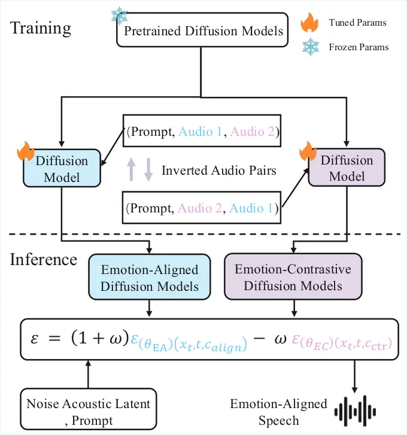
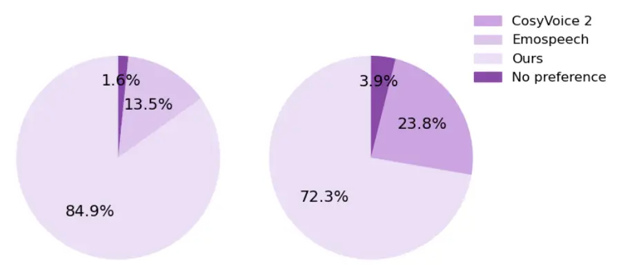
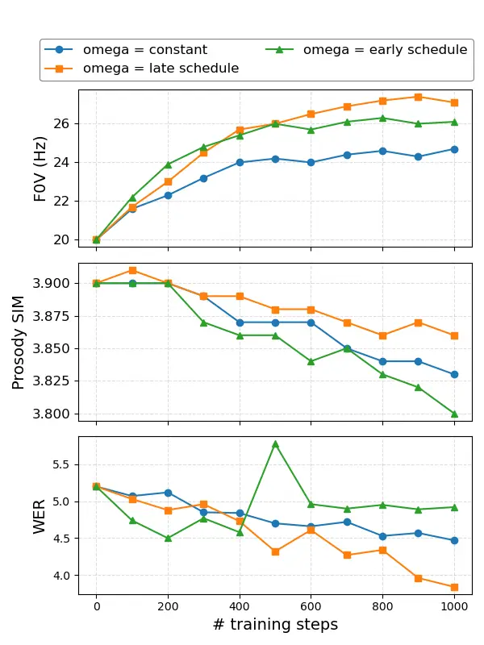

Shi Du Song Hong Zhang Gao

# Emo-BPO: Emotion Bidirectional Preference Optimization for Diffusion-based Emotional TTS

Jiacheng    Hongfei    Xinyuan    Y. Alicia    Yanfu    Ye

###### Abstract

Diffusion-based TTS has demonstrated strong capability in emotional
speech generation. However, existing emotion alignment methods primarily
reinforce target emotional expressions while overlooking modeling of
competing emotional modes, limiting fine-grained controllability. This
issue becomes more pronounced under classifier-free guidance (CFG),
which relies on contrasting conditional trajectories to shape
generation. We propose Emotion Bidirectional Preference Optimization
(Emo-BPO), a simple effective framework that jointly learns
emotion-aligned and emotion-contrastive score functions from reordered
same-text emotional pairs. Our method requires neither auxiliary reward
models nor additional annotations, and can be seamlessly integrated into
existing diffusion-based TTS systems to improve emotional
controllability and expressiveness.

###### keywords

Speech Synthesis, Diffusion Model, Emotional Text-To-Speech (Emo-TTS)

^(†)^(†)address: ¹ College of William & Mary, USA, ² Emory University,
USA  
³ George Mason University, USA ^(†)^(†)email: {jshi12, hdu02, yzhang105,
ygao18}@wm.edu, xinyuan.song@emory.edu, yhong22@gmu.edu

## 1 Introduction

Emotional text-to-speech synthesis (TTS) seeks to generate speech that
is both intelligible and affectively expressive. Fine-grained emotional
control is critical for applications such as conversational agents \[1,
2\], expressive narration \[3, 4\], and human machine interaction \[5,
6\]. Achieving this requires modeling stress, intonation, rhythm, and
their interactions within an emotional space, rendering emotional TTS a
multi-dimensional generation problem.

Early neural TTS architectures established the foundations of
high-quality synthesis. Tacotron \[7\] introduced end-to-end
sequence-to-sequence acoustic modeling, FastSpeech \[8\] improved
efficiency via non-autoregressive duration prediction, and VITS \[9\]
unified acoustic and waveform modeling in a variational framework.
Emotional control in these systems is achieved through categorical
embeddings or conditioning vectors, which limits fine-grained
expressiveness and structured emotion manipulation. Recent advances
adopt large language model (LLM)-based architectures and diffusion
modeling to improve controllability and generalization. LLM-based
TTS \[10, 11, 12, 13, 14\] demonstrates strong zero-shot capability and
synthesis quality. Diffusion approaches, such as EmoMix \[15\] and
EmoDiff \[16\], incorporate emotion conditioning into the denoising
process for controllable generation. However, these methods rely on
predefined labels or heuristic conditioning and do not optimize human
perceptual preference.

Preference-based optimization reframes emotional alignment as a learning
problem defined by human judgments. Emo-DPO \[17\] performs direct
preference optimization on paired samples without reward modeling.
EMORL-TTS \[18\] formulates emotional alignment as reinforcement
learning with composite reward functions. EASPO \[19\] incorporates
stepwise preference signals to guide the diffusion denoising process.
Despite these advances, a structural limitation persists in
diffusion-based preference alignment. Diffusion models commonly rely on
classifier-free guidance (CFG) \[20\], which combines conditional and
unconditional predictions at each denoising step. While existing methods
optimize the conditional trajectory toward preferred outputs, they do
not explicitly model divergence from non-preferred emotional modes. This
asymmetric optimization underutilizes the contrastive mechanism inherent
in CFG and may weaken inter-emotion discrimination. This raises a
central question: Can diffusion-based emotional TTS benefit from
explicitly modeling both preference-aligned and preference-contrastive
trajectories?

We propose Emotion Bidirectional Preference Optimization (Emo-BPO), a
structured framework for diffusion-based emotional TTS. Emo-BPO
constructs reordered same-text emotional pairs to jointly learn
emotion-aligned and emotion-contrastive score functions. During
inference, these branches are integrated through a contrastive guidance
formulation compatible with CFG, strengthening target emotional
trajectories while suppressing competing modes. Emo-BPO does not require
auxiliary reward models or additional annotations and can be seamlessly
integrated into existing diffusion-based TTS systems. Our contributions
are as follows: (1) We identify a structural asymmetry in existing
diffusion-based preference alignment methods, namely the absence of
explicit modeling of emotion-contrastive trajectories under
classifier-free guidance. (2) We propose Emo-BPO, a bidirectional
diffusion framework that jointly learns emotion-aligned and
emotion-contrastive score functions from reordered same-text pairs,
enabling improved emotional controllability without auxiliary reward
models or additional datasets.

## 2 Related Work

Emotion Alignment in Diffusion-based TTS. Prior emotion-controllable TTS
methods rely on explicit conditioning or structured emotion
representations. EmoSpeech \[8\] augments FastSpeech2 with emotion
embeddings and conditional attention for token-level intensity modeling.
EmoSphere++\[21\] introduces a VAD-based spherical emotion vector for
controllable zero-shot style modulation. EmoVoice\[22\] adopts an
LLM-based framework for natural language emotion prompting with
phoneme-token co-generation. CosyVoice \[10\] proposes an
instruction-conditioned LLM-TTS model for controllable zero-shot
synthesis, while CosyVoice2 \[11\] scales this approach through
large-scale instruction tuning to unify controllability and
generalization in a single autoregressive system. Recent studies explore
preference-driven optimization to better align synthesized speech with
human perception. Emo-DPO \[17\] applies direct preference optimization
on paired samples, EMORL \[18\] employs reinforcement learning with
multi-objective rewards, and EASPO \[19\] leverages stepwise preference
signals for diffusion-based generation. However, these methods reinforce
target emotions without modeling separation from competing emotional
modes, limiting controllability in diffusion processes where multiple
emotional trajectories coexist. We address this limitation with Emo-BPO,
which learns complementary emotion-aligned and emotion-contrastive score
functions from reordered same-text pairs without auxiliary reward
models.

| Models             | Emo SIM | Prosody SIM | Intelligibility | UTMOS | Speech Emotion Recognition |       |       |      |          |      |
| ------------------ | ------- | ----------- | --------------- | ----- | -------------------------- | ----- | ----- | ---- | -------- | ---- |
|                    |         |             |                 |       | Neutral                    | Angry | Happy | Sad  | Surprise | Mean |
| emospeech \[8\]    | 96.35   | 3.39        | 7.13            | 4.24  | 0.71                       | 0.64  | 0.58  | 0.60 | 0.52     | 0.61 |
| cosyvoice \[10\]   | 97.07   | 3.64        | 4.32            | 4.41  | 0.69                       | 0.76  | 0.61  | 0.74 | 0.65     | 0.69 |
| cosyvoice2 \[11\]  | 98.47   | 3.78        | 3.77            | 4.43  | 0.88                       | 0.87  | 0.72  | 0.83 | 0.78     | 0.82 |
| Emosphere++ \[21\] | 98.16   | 3.69        | 4.94            | 4.35  | 0.79                       | 0.81  | 0.67  | 0.77 | 0.69     | 0.75 |
| EmoVoice \[22\]    | 98.59   | 3.67        | 4.16            | 4.39  | 0.87                       | 0.85  | 0.76  | 0.80 | 0.79     | 0.81 |
| Emo-BPO            | 99.23   | 3.85        | 3.84            | 4.52  | 0.91                       | 0.89  | 0.82  | 0.87 | 0.84     | 0.87 |

Table 1: Objective evaluation: Comparison of Emo-BPO with representative
emotional TTS baselines in terms of emotion similarity (Emo SIM),
prosody similarity (Prosody SIM), intelligibility, naturalness (UTMOS),
and speech emotion recognition accuracy. Emo-BPO achieves the best
performance on Emo SIM, Prosody SIM, UTMOS, and mean emotion recognition
accuracy while maintaining competitive intelligibility. Results are
averaged over three independent runs.

| Models             | MOS  | Emo MOS | MOS EC | Speech Emotion Recognition |       |       |      |          |      |
| ------------------ | ---- | ------- | ------ | -------------------------- | ----- | ----- | ---- | -------- | ---- |
|                    |      |         |        | Neutral                    | Angry | Happy | Sad  | Surprise | Mean |
| emospeech \[8\]    | 2.55 | 2.79    | 2.83   | 0.66                       | 0.34  | 0.25  | 0.58 | 0.57     | 0.47 |
| cosyvoice2 \[11\]  | 3.61 | 3.93    | 3.75   | 0.81                       | 0.58  | 0.63  | 0.71 | 0.73     | 0.68 |
| Emosphere++ \[21\] | 3.46 | 3.47    | 3.28   | 0.69                       | 0.78  | 0.58  | 0.72 | 0.58     | 0.66 |
| EmoVoice \[22\]    | 3.39 | 3.64    | 3.42   | 0.71                       | 0.57  | 0.55  | 0.59 | 0.65     | 0.61 |
| Emo-BPO            | 3.93 | 4.25    | 3.92   | 0.86                       | 0.78  | 0.70  | 0.78 | 0.85     | 0.79 |

Table 2: Subjective evaluation: Emo-BPO outperforms representative
baselines in MOS, Emo MOS, MOS EC, and mean human-recognized emotion
accuracy.

| Model                       | Emo SIM | Pro. SIM | WER  | UTMOS |
| --------------------------- | ------- | -------- | ---- | ----- |
| Emo-BPO                     | 99.23   | 3.85     | 3.84 | 4.52  |
| Grad-TTS w/ finetune        | 96.68   | 3.42     | 6.71 | 4.18  |
|    w/out Contrastive Branch | 97.41   | 3.67     | 4.48 | 4.32  |
|    w/out Late-Step Schedule | 98.76   | 3.82     | 4.29 | 4.45  |

Table 3: Ablation study: Removing the contrastive branch or scheduling
strategy consistently degrades performance across all metrics,
validating the essential contributions of both components.

## 3 Proposed Method



Figure 1: Overview of Emo-BPO. Training constructs inverted same-text
emotional pairs to jointly learn emotion-aligned (EA) and
emotion-contrastive (EC) diffusion branches while partially fine-tuning
a pretrained backbone. At inference, EA and EC predictions are combined
via contrastive guidance under classifier-free guidance, reinforcing
target emotional trajectories and suppressing competing emotional modes.

### 3.1 Preliminaries: Classifier-Free Guidance

To ground our formulation in a principled probabilistic framework, we
briefly revisit classifier-free guidance (CFG) from the perspective of
score-based diffusion models. Consider a conditional diffusion model
parameterized by an epsilon prediction network
$`\epsilon_{\theta}(x_{t},c,t)`$, where $`x_{t}`$ denotes the noisy
acoustic representation at timestep $`t`$ and $`c`$ denotes the
conditioning variable (e.g., text, speaker identity, and emotion). Under
the standard variance-preserving diffusion formulation, the predicted
noise is proportional to the conditional score function:

```math
\nabla_{x_{t}}\log p_{\theta}(x_{t}\mid c)=-\frac{1}{\sigma_{t}}\epsilon_{\theta}(x_{t},c,t). \tag{1}
```

Thus, denoising can be interpreted as iteratively transporting samples
along the conditional score field, moving them toward regions of higher
probability under $`p(x\mid c)`$. Classifier-free guidance modifies this
score field by introducing a contrastive correction between two
conditions. Specifically, instead of relying solely on
$`\nabla_{x_{t}}\log p_{\theta}(x_{t}\mid c)`$, CFG replaces it with

```math
\nabla_{x_{t}}\log p_{\theta}(x_{t}\mid c)+\omega\nabla_{x_{t}}\log\frac{p_{\theta}(x_{t}\mid c)}{p_{\theta}(x_{t}\mid c^{\prime})}, \tag{2}
```

where $`c’`$ denotes a reference (e.g., unconditional) condition and
$`\omega\geq 0`$ controls the guidance strength. This expression reveals
that CFG performs gradient ascent on a log-likelihood ratio, increasing
the probability under target condition $`c`$ and decreasing it under
reference condition $`c’`$. In epsilon parameterization, the above
contrastive score formulation yields

```math
\epsilon_{\theta}^{\omega}(x_{t},t)=(1+\omega)\epsilon_{\theta}(x_{t},c,t)-\omega\epsilon_{\theta}(x_{t},c^{\prime},t), \tag{3}
```

which induces a directional shift of the denoising trajectory in
acoustic space. This log-ratio view of CFG provides a natural basis for
emotion control. In conventional CFG, the reference condition $`c’`$ is
typically unconditional. However, emotional speech synthesis often
requires stronger separation between competing prosodic modes. This
motivates our bidirectional preference formulation, where the reference
condition is replaced with an emotion-contrastive condition to
explicitly model inter-emotion gradients.

### 3.2 Emotion Bidirectional Preference Optimization

Existing preference-based emotional TTS methods typically optimize only
the emotion-aligned direction, increasing likelihood under the target
emotion without explicitly separating competing emotional modes, which
limits controllability. Motivated by the log-likelihood ratio view of
classifier-free guidance, we propose Emo-BPO, a contrastive diffusion
framework that models directional preference between emotional
conditions. Emo-BPO jointly learns (i) an emotion-aligned objective that
increases likelihood under the desired emotion and (ii) an
emotion-contrastive objective that suppresses alternative emotions.
Intuitively, the aligned branch forms an attractive energy basin, while
the contrastive branch induces repulsive gradients, enlarging
inter-emotion margins. The bidirectional formulation is realized through
preference-based optimization during training and contrastive guidance
at inference.

#### 3.2.1 Train with Emo-BPO

An important observation of Emo-BPO is that bidirectional emotional
supervision can be realized without introducing additional annotations
or auxiliary objectives. Given standard emotion-labeled corpora,
complementary training signals naturally arise by reordering audio
samples that share identical linguistic content but differ in emotion.
Specifically, for a text condition $`c`$, we construct pairs of speech
samples $`(a_{1},a_{2})`$ with identical text but different emotion
labels. Without loss of generality, let $`a_{1}`$ express the target
emotion and $`a_{2}`$ express an alternative emotion. The ordered tuple
$`(c,a_{1},a_{2})`$ defines the emotion-aligned direction, while
reversing the order to $`(c,a_{2},a_{1})`$ produces the complementary
contrastive direction. This reordering provides supervision for both
emotional attraction and emotional separation under matched linguistic
conditions. To capture these two opposing directions, we optimize two
dedicated diffusion branches. The emotion-aligned branch models the
conditional score field associated with the target emotion. For a clean
audio sample $`a_{1}`$, we follow the standard forward diffusion process
to obtain its noisy version $`x_{t}`$, and minimize the denoising
objective

```math
\mathcal{L}_{\mathrm{align}}=\mathbb{E}_{t,\epsilon}\Big[\lVert\epsilon-\epsilon_{\theta_{\mathrm{EA}}}(x_{t},c_{\mathrm{align}},t)\rVert_{2}^{2}\Big]. \tag{4}
```

where $`\epsilon`$ denotes Gaussian noise, $`t`$ is the diffusion
timestep, $`c_{\mathrm{align}}`$ represents the target-emotion
condition, and $`\epsilon_{\theta_{\mathrm{EA}}}`$ is the score
predictor of the aligned branch. Symmetrically, the emotion-contrastive
branch models score directions associated with competing emotional
characteristics. Using the alternative-emotion sample $`a_{2}`$, we
minimize

```math
\mathcal{L}_{\mathrm{ctr}}=\mathbb{E}_{t,\epsilon}\Big[\lVert\epsilon-\epsilon_{\theta_{\mathrm{EC}}}(x_{t},c_{\mathrm{ctr}},t)\rVert_{2}^{2}\Big]. \tag{5}
```

where $`c_{\mathrm{ctr}}`$ denotes the alternative-emotion condition and
$`\epsilon_{\theta_{\mathrm{EC}}}`$ is the corresponding score
predictor. Although both branches share the same diffusion architecture,
they correspond to distinct optimization objectives: the aligned branch
increases likelihood under the target emotion, while the contrastive
branch models separation from competing emotional modes. Optimizing a
single parameterization to satisfy both directions may result in a
compromised update that weakens emotional controllability. Emo-BPO
therefore maintains separate parameterizations for the aligned and
contrastive directions, enabling clearer inter-emotion gradient
estimation exploited during inference.

#### 3.2.2 Inference with Emo-BPO

During inference, the emotion-aligned and emotion-contrastive score
predictors are combined via contrastive guidance to form the final noise
estimate. At diffusion timestep $`t`$, we compute

```math
\epsilon^{\omega}(x_{t},t)=(1+\omega(t))\,\epsilon_{\theta_{\mathrm{EA}}}(x_{t},c_{\mathrm{align}},t)-\omega(t)\,\epsilon_{\theta_{\mathrm{EC}}}(x_{t},c_{\mathrm{ctr}},t), \tag{6}
```

where $`\epsilon_{\theta_{\mathrm{EA}}}`$ and
$`\epsilon_{\theta_{\mathrm{EC}}}`$ denote the aligned and contrastive
branches, respectively. The subtraction term suppresses competing
emotional characteristics, while the amplified aligned term strengthens
the target emotion, resulting in a bidirectional emotional steering
effect. To progressively refine emotional expression during denoising,
we adopt a late-step guidance schedule defined as
$`\omega(t)=1-\frac{t}{T}`$, where $`T`$ denotes the total number of
diffusion steps. This schedule applies weaker emotional guidance at
early timesteps to preserve coarse acoustic structure and gradually
increases guidance strength at later timesteps to enhance fine-grained
prosodic and emotional cues. Such late-stage amplification stabilizes
generation while improving emotional controllability.

## 4 Experiments

### 4.1 Datasets and Experimental Setup

We train our model on two English emotional speech corpora: the
Emotional Speech Database (ESD) \[23\] and EmoVoiceDB \[22\]. EmoVoiceDB
contains approximately 22,100 emotion-labeled utterances (about 40 hours
of speech) from multiple speakers, covering diverse expressive patterns
and prosodic variations. We adopt the official train/test split provided
by the dataset. The English subset of ESD comprises 10 speakers
expressing five emotions (Angry, Happy, Sad, Surprise, and Neutral),
with 350 utterances per speaker per emotion, totaling 17,500 utterances
(approximately 12 hours of speech). We follow the official 8:1:1
train/validation/test split protocol per speaker–emotion \[24, 25\]. We
construct preference pairs using utterances with identical text content,
following the text-matched pairing strategy of Emo-DPO \[17\]. For each
text prompt, audio samples expressing the target emotion are treated as
preferred, while samples with other emotion labels are treated as
dis-preferred.

Our backbone TTS system is Grad-TTS \[26\] operating on 80-dimensional
mel-spectrograms. We freeze the text encoder and duration predictor and
update only the diffusion decoder (score network). The model is
initialized from the Grad-TTS pre-training configuration and optimized
using Adam with a learning rate of $`1\times 10^{-4}`$ and a batch size
of 16. Training is performed on randomly cropped 2-second
mel-spectrogram segments \[27\]. Waveforms are synthesized using a
pretrained HiFi-GAN vocoder \[28\]. During inference, we employ a
late-step guidance coefficient defined as $`\omega(t)=1-\frac{t}{T}`$,
where $`T`$ denotes the total number of diffusion steps. This schedule
applies weaker guidance at early denoising stages to preserve coarse
acoustic structure and gradually increases the guidance strength at
later stages to refine fine-grained emotional prosody.



Figure 2: Comparison of subjective evaluation results from AB preference
tests: 1) left: Emospeech vs. Emo-BPO and 2) right: CosyVoice2 vs.
Emo-BPO



Figure 3: Ablation on guidance scheduling. Late scheduling yields higher
F0V, better prosody similarity, and lower WER, while early scheduling
causes prosody degradation and transient instability.

### 4.2 Evaluation Metrics

We evaluate the proposed system using both objective and subjective
metrics to assess intelligibility, prosodic consistency, emotional
accuracy, and perceptual quality.

Objective Evaluation. Speech intelligibility is measured by applying
Whisper-Large-v3 to transcribe generated audio and computing word error
rate (WER) against reference transcripts. Prosodic similarity is
quantified using AutoPCP \[29\], which estimates utterance-level
similarity between generated and ground-truth speech; scores are
averaged over the test set. Emotional similarity is evaluated by
extracting embeddings with emotion2vec-base \[30\] from generated and
reference speech, computing cosine similarity, and reporting the mean
value (EMO SIM). For automatic emotion recognition \[31, 32\], a
pretrained speech emotion classifier predicts labels from generated
utterances; accuracy is computed by averaging correctness across
samples. Perceptual naturalness is further assessed using UTMOS \[33\],
an automatic mean opinion score estimator.

Subjective Evaluation. Subjective experiments involve 30 participants
and include Mean Opinion Score (MOS), Emotion MOS, Emotional
consistency, AB preference testing, and an Emotion Accuracy Test
(EAT-EMO). In MOS, listeners rate overall speech naturalness on a
5-point scale (1: poor, 5: excellent). Emotion MOS measures the
perceived similarity between generated and target emotions on the same
scale. MOS EC measures consistency between the generated audio and the
instruction (emotion + text). In AB tests, listeners select the
preferred sample between two systems based on quality and emotional
expressiveness, with balanced emotion categories across comparisons. In
Emotion Accuracy Test participants identify the perceived emotion of
each sample, and accuracy is computed against the target labels. All
subjective evaluations use emotion-balanced samples.

Results and Discussion. Tabs. 1 and 3 report objective and subjective
results. Emo-BPO achieves the best performance in emotion similarity,
prosody similarity, UTMOS, and mean emotion recognition accuracy,
indicating stronger emotional alignment and perceptual quality. Fig. 3
further shows clear listener preference over EmoSpeech and CosyVoice2.
These gains are consistent with the bidirectional score shaping of
Emo-BPO, which enlarges inter-emotion margins through complementary
attractive and repulsive gradients while preserving naturalness.
Although CosyVoice2 attains the lowest WER due to its autoregressive
LLM-based design prioritizing linguistic fidelity, Emo-BPO maintains
competitive intelligibility and substantially improves emotional
expressiveness. Overall, combining emotional attraction and separation
with progressive guidance scheduling enables more controllable emotional
TTS. Audio samples are available online.¹¹ 1
[https://jiachengqaq.github.io/emo-bpo/](https://jiachengqaq.github.io/emo-bpo/)

### 4.3 Ablation Study.

Ablation on Model Components. As shown in Tab. 3. We conduct an ablation
study to evaluate the roles of the contrastive branch and late-step
scheduling. Removing the contrastive branch reduces emotion similarity,
indicating weaker inter-emotion discrimination. Eliminating the
scheduling mechanism degrades prosody similarity and increases WER,
reflecting unstable guidance during denoising. Overall, both components
are essential for achieving strong emotional alignment while preserving
speech quality.

Ablation on Guidance Scheduling. As shown in Fig. 3.We compare constant,
early, and late guidance schedules in terms of emotional strength (F0V),
prosody similarity, and intelligibility. Late scheduling achieves the
highest F0V at convergence while maintaining higher prosody similarity
and the lowest WER. In contrast, early scheduling, defined as
$`\omega(t)=\frac{t}{T}`$, increases F0V rapidly at early stages but
leads to prosody degradation and a transient WER spike, indicating
structural instability under strong guidance in high-noise denoising.
Overall, progressively strengthening guidance at later stages better
balances emotional expressiveness and speech fidelity.

## 5 Conclusion

We introduced Emo-BPO, a diffusion-based framework for emotional TTS
that addresses a key limitation of existing preference-driven
approaches: they reinforce target emotions but do not explicitly model
separation from competing emotional tendencies under classifier-free
guidance. Emo-BPO learns complementary emotion-aligned and
emotion-contrastive score functions from reordered same-text pairs and
combines them with progressive guidance scheduling during inference.
Experiments demonstrate improvements in emotional alignment, prosodic
control, and perceptual quality while maintaining competitive
intelligibility. These results indicate that jointly modeling emotional
attraction and separation leads to controllable and expressive emotional
speech generation.

## 6 Generative AI Use Disclosure

The authors used generative AI tools only for grammar correction,
polishing, and readability improvement. These tools were not used to
generate research ideas, methodology, experimental results, analyses, or
conclusions, nor to produce a significant portion of the manuscript. All
authors reviewed and approved the final manuscript and take full
responsibility for its content.

## References

- \[1\] A. Zeng, Z. Du, M. Liu, K. Wang, S. Jiang, L. Zhao, Y. Dong,
  and J. Tang (2024) Glm-4-voice: towards intelligent and human-like
  end-to-end spoken chatbot. arXiv preprint arXiv:2412.02612. Cited by:
  §1.
- \[2\] K. Luo, Z. Zhou, L. Wang, L. Lin, Y. Xiao, T. Shao, Y. Zhang, Y.
  Li, M. Yu, K. Lyu, et al. (2026) A survey of large audio language
  models: generalization, trustworthiness, and outlook. arXiv preprint
  arXiv:2605.20266. Cited by: §1.
- \[3\] C. Wang, S. Chen, Y. Wu, Z. Zhang, L. Zhou, S. Liu, Z. Chen, Y.
  Liu, H. Wang, J. Li, et al. (2023) Neural codec language models are
  zero-shot text to speech synthesizers. arXiv preprint
  arXiv:2301.02111. Cited by: §1.
- \[4\] Y. Chen\*, Y. Xiao\*, H. Yin\*, X. Liu, J. Huang, and T.
  Dang (2026) PolyBench: a benchmark for compositional reasoning in
  polyphonic audio. INTERSPEECH 2026. Cited by: §1.
- \[5\] X. Li, Z. Cheng, J. He, J. Chen, X. Fan, X. Peng, and A. G.
  Hauptmann (2025) UMETTS: a unified framework for emotional
  text-to-speech synthesis with multimodal prompts. In ICASSP 2025-2025
  IEEE International Conference on Acoustics, Speech and Signal
  Processing (ICASSP), pp. 1–5. Cited by: §1.
- \[6\] J. Sun\*, Y. Xiao\*, S. K. Chung, Q. Hu, G. Huang, E. Holden,
  and T. Dang (2026) Activation steering for accent adaptation in speech
  foundation models. In INTERSPEECH 2026, Cited by: §1.
- \[7\] X. Li, Z. Cheng, J. He, X. Peng, and A. G. Hauptmann (2024)
  Mm-tts: a unified framework for multimodal, prompt-induced emotional
  text-to-speech synthesis. arXiv preprint arXiv:2404.18398 2. Cited by:
  §1.
- \[8\] D. Diatlova and V. Shutov (2023) Emospeech: guiding fastspeech2
  towards emotional text to speech. arXiv preprint arXiv:2307.00024.
  Cited by: §1, Table 1, Table 3, §2.
- \[9\] W. Zhao and Z. Yang (2023) An emotion speech synthesis method
  based on vits. Applied Sciences 13 (4), pp. 2225. Cited by: §1.
- \[10\] Z. Du, Q. Chen, S. Zhang, K. Hu, H. Lu, Y. Yang, H. Hu, S.
  Zheng, Y. Gu, Z. Ma, et al. (2024) Cosyvoice: a scalable multilingual
  zero-shot text-to-speech synthesizer based on supervised semantic
  tokens. arXiv preprint arXiv:2407.05407. Cited by: §1, Table 1, §2.
- \[11\] Z. Du, Y. Wang, Q. Chen, X. Shi, X. Lv, T. Zhao, Z. Gao, Y.
  Yang, C. Gao, H. Wang, et al. (2024) Cosyvoice 2: scalable streaming
  speech synthesis with large language models. arXiv preprint
  arXiv:2412.10117. Cited by: §1, Table 1, Table 3, §2.
- \[12\] X. Wang, M. Jiang, Z. Ma, Z. Zhang, S. Liu, L. Li, Z. Liang, Q.
  Zheng, R. Wang, X. Feng, et al. (2025) Spark-tts: an efficient
  llm-based text-to-speech model with single-stream decoupled speech
  tokens. arXiv preprint arXiv:2503.01710. Cited by: §1.
- \[13\] H. Guo, Y. Hu, K. Liu, F. Shen, X. Tang, Y. Wu, F. Xie, K. Xie,
  and K. Xu (2024) Fireredtts: a foundation text-to-speech framework for
  industry-level generative speech applications. arXiv preprint
  arXiv:2409.03283. Cited by: §1.
- \[14\] Y. Lin, H. Chou, T. Wei, K. Chen, and H. Lee (2026) Do you hear
  what i mean? quantifying the instruction-perception gap in
  instruction-guided expressive text-to-speech systems. In ICASSP
  2026-2026 IEEE International Conference on Acoustics, Speech and
  Signal Processing (ICASSP), pp. 16472–16476. Cited by: §1.
- \[15\] H. Tang, X. Zhang, J. Wang, N. Cheng, and J. Xiao (2023)
  Emomix: emotion mixing via diffusion models for emotional speech
  synthesis. arXiv preprint arXiv:2306.00648. Cited by: §1.
- \[16\] Y. Guo, C. Du, X. Chen, and K. Yu (2023) Emodiff: intensity
  controllable emotional text-to-speech with soft-label guidance. In
  ICASSP 2023-2023 IEEE International Conference on Acoustics, Speech
  and Signal Processing (ICASSP), pp. 1–5. Cited by: §1.
- \[17\] X. Gao, C. Zhang, Y. Chen, H. Zhang, and N. F. Chen (2025)
  Emo-dpo: controllable emotional speech synthesis through direct
  preference optimization. In ICASSP 2025-2025 IEEE International
  Conference on Acoustics, Speech and Signal Processing (ICASSP),
  pp. 1–5. Cited by: §1, §2, §4.1.
- \[18\] H. Li, Y. Liu, Y. Sun, H. Shi, L. Qu, and T. Li (2025)
  EMORL-tts: reinforcement learning for fine-grained emotion control in
  llm-based tts. arXiv preprint arXiv:2510.05758. Cited by: §1, §2.
- \[19\] J. Shi, H. Du, Y. He, Y. A. Hong, and Y. Gao (2025)
  Emotion-aligned generation in diffusion text to speech models via
  preference-guided optimization. arXiv preprint arXiv:2509.25416. Cited
  by: §1, §2.
- \[20\] J. Ho and T. Salimans (2022) Classifier-free diffusion
  guidance. arXiv preprint arXiv:2207.12598. Cited by: §1.
- \[21\] D. Cho, H. Oh, S. Kim, and S. Lee (2025) EmoSphere++:
  emotion-controllable zero-shot text-to-speech via emotion-adaptive
  spherical vector. IEEE Transactions on Affective Computing. Cited by:
  Table 1, Table 3, §2.
- \[22\] G. Yang, C. Yang, Q. Chen, Z. Ma, W. Chen, W. Wang, T. Wang, Y.
  Yang, Z. Niu, W. Liu, et al. (2025) Emovoice: llm-based emotional
  text-to-speech model with freestyle text prompting. In Proceedings of
  the 33rd ACM International Conference on Multimedia, pp. 10748–10757.
  Cited by: Table 1, Table 3, §2, §4.1.
- \[23\] K. Zhou, B. Sisman, R. Liu, and H. Li (2022) Emotional voice
  conversion: theory, databases and esd. Speech Communication 137,
  pp. 1–18. Cited by: §4.1.
- \[24\] J. Shi, Y. Zhang, and Y. Gao (2025) Clep-dg: contrastive
  learning for speech emotion domain generalization via soft prompt
  tuning. arXiv preprint arXiv:2507.04048. Cited by: §4.1.
- \[25\] Y. Xiao and R. K. Das (2025) Listen, analyze, and adapt to
  learn new attacks: an exemplar-free class incremental learning method
  for audio deepfake source tracing. In INTERSPEECH 2025, Cited by:
  §4.1.
- \[26\] V. Popov, I. Vovk, V. Gogoryan, T. Sadekova, and M.
  Kudinov (2021) Grad-tts: a diffusion probabilistic model for
  text-to-speech. In International conference on machine learning,
  pp. 8599–8608. Cited by: §4.1.
- \[27\] Y. Xiao and R. K. Das (2025) XLSR-mamba: a dual-column
  bidirectional state space model for spoofing attack detection. IEEE
  Signal Processing Letters. Cited by: §4.1.
- \[28\] D. Yang, S. Liu, R. Huang, J. Tian, C. Weng, and Y. Zou (2023)
  Hifi-codec: group-residual vector quantization for high fidelity audio
  codec. arXiv preprint arXiv:2305.02765. Cited by: §4.1.
- \[29\] L. Barrault, Y. Chung, M. C. Meglioli, D. Dale, N. Dong, M.
  Duppenthaler, P. Duquenne, B. Ellis, H. Elsahar, J. Haaheim, et
  al. (2023) Seamless: multilingual expressive and streaming speech
  translation. arXiv preprint arXiv:2312.05187. Cited by: §4.2.
- \[30\] Z. Ma, Z. Zheng, J. Ye, J. Li, Z. Gao, S. Zhang, and X.
  Chen (2024) Emotion2vec: self-supervised pre-training for speech
  emotion representation. In Findings of the Association for
  Computational Linguistics: ACL 2024, pp. 15747–15760. Cited by: §4.2.
- \[31\] Y. Lin, H. Chou, Y. L. Liang, and H. Lee (2025) Emo-debias:
  benchmarking gender debiasing techniques in multi-label speech emotion
  recognition. arXiv preprint arXiv:2506.04652. Cited by: §4.2.
- \[32\] Y. Lin, H. Chou, and H. Lee (2025) Mitigating subgroup
  disparities in multi-label speech emotion recognition: a
  pseudo-labeling and unsupervised learning approach. In Proc.
  Interspeech 2025, pp. 2053–2057. Cited by: §4.2.
- \[33\] T. Saeki, D. Xin, W. Nakata, T. Koriyama, S. Takamichi, and H.
  Saruwatari (2022) Utmos: utokyo-sarulab system for voicemos challenge 2022. arXiv preprint arXiv:2204.02152. Cited by: §4.2.
