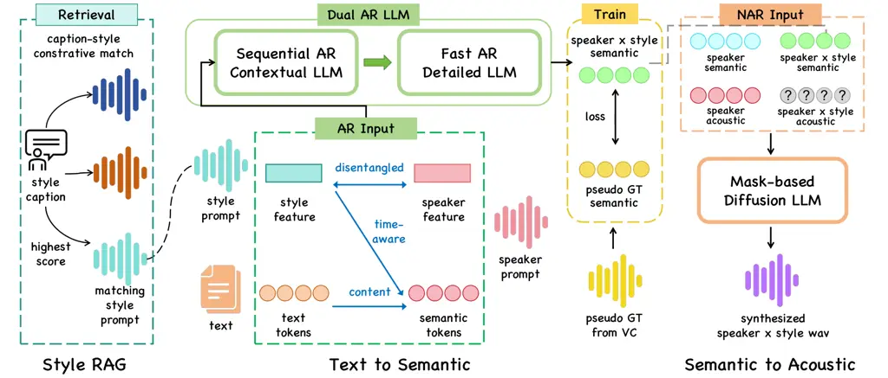
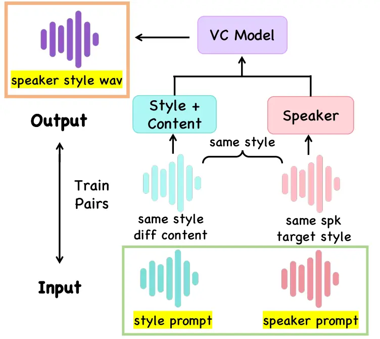
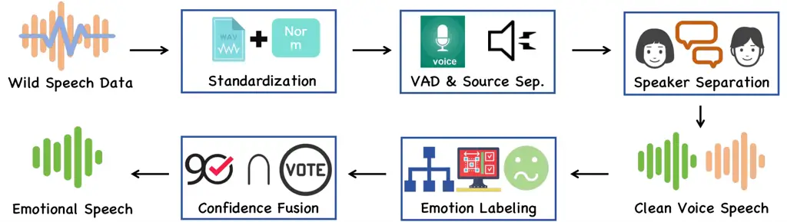

# E3-System: Expressive EmoData, Explicitly Controllable, Easy-to-Use TTS

###### Abstract

Recent zero-shot Text-to-Speech (TTS) systems can clone unseen speakers,
yet controllable expressiveness remains limited by a gap between
semantic intent and acoustic realization. Text descriptions offer a
natural control interface but provide weak acoustic grounding, whereas
speech style prompts provide concrete prosody but entangle style with
the prompt speaker’s timbre. To bridge this gap, we propose E3-System, a
unified intent-to-speech framework for expressive zero-shot TTS that
couples three requirements: Expressive style modeling, Explicit
timbre-style control, and Easy-to-use natural-language interaction.
Given a target speaker and either a natural-language style description
or a speech style prompt, E3-System generates expressive speech while
preserving the target timbre. The key idea is to close the full control
loop: building a large expressive style space, grounding user intent
into usable acoustic style references, and synthesizing speech with
disentangled timbre and style. To realize this loop, EmoData provides a
thousand-hour multilingual emotional speech dataset, Style-RAG grounds
text descriptions into high-quality acoustic style prompts from these
data, and Dual-TTS transfers the grounded style to arbitrary target
speakers through VC-augmented timbre-style disentanglement. Experiments
show that E3-System achieves strong speech quality, speaker
preservation, and explicit expressive controllability.

Yiqiao Huang^(1,∗), Xiaolong Lin^(2,∗,†), Zhenpeng Zhan², Zhizheng Wu³

¹Harvard University, Cambridge, MA, USA  
²Baidu Inc., Shenzhen, China  
³The Chinese University of Hong Kong, Shenzhen, China

linxiaolong01@baidu.com

¹¹footnotetext: Equal contribution.  $`\dagger`$ Corresponding author.

## 1 Introduction

Recent advances in zero-shot Text-to-Speech (TTS) have not only achieved
near-human naturalness but also explored controllability for timbre and
style. \[1, 2, 3, 4, 5\] However, they typically face trade-offs between
synthesis expressiveness and control flexibility, or rely on speech
references, lacking the ease of explicit natural language control. Thus,
a practical expressive TTS system must bridge the gap between high-level
user intent and faithful acoustic realization, while preserving speaker
identity and supporting arbitrary style transfer.

Achieving this goal requires a complete control loop: a rich expressive
style space, reliable grounding from user intent to acoustic style, and
synthesis that disentangles style from speaker identity. A key
bottleneck lies in the expressive training data. Current large-scale TTS
corpora are primarily derived from audiobooks or podcasts \[6, 7, 8,
9\]. These datasets are clean and extensive, but mostly neutral in
style. In contrast, studio emotional speech datasets \[10, 11, 12\]
contain strong emotional expression but are much smaller in scale and
may contain semantic-emotion mismatches (e.g., sad text acted with angry
prosody). More recent resources \[13, 14\] partially address this gap,
yet remain limited in scale and multilingual coverage.

Another challenge is controllable modeling of timbre and style. Recent
state-of-the-art zero-shot TTS systems \[15, 16, 17, 18, 19, 20\] have
achieved remarkable fidelity in reconstructing both timbre and style
from a single reference speech. However, this capability relies on the
inherent coupling of speaker identity and prosody within the prompt.
Consequently, they lack the flexibility to arbitrarily combine different
timbres and styles. While disentanglement-based methods \[3, 21, 22\]
attempt to decouple these attributes, they often suffer from trade-offs
between controllability and quality, manifesting as timbre, style, or
content leakage. Ideally, a system should offer explicit disentanglement
without compromising the generation quality seen in coupled SOTA
baselines. E3-System addresses this requirement through Dual-TTS, which
enables explicit timbre-style control while maintaining strong zero-shot
performance.

Instruction paradigms also pose challenges. Text-instruct methods \[23,
24, 25\] are easy to use, as users can simply describe desired timbre or
style in natural language. However, pure text instructions inherently
lack the acoustic reference required for zero-shot voice cloning.
Moreover, they cannot convey fine-grained acoustic details such as
emotional intensity or rhythm, leading to high generation variance and
instability. The same textual description often yields inconsistent
prosodic outcomes across attempts. Wav-instruct methods can preserve
these acoustic details, but they rely on users to manually select
appropriate reference speech. For non-expert users, this process is
costly and error prone. Previous work has shown that inappropriate
reference can severely degrade synthesis quality \[26\]. Recent studies
on multimodal prompting and retrieval-augmented approaches \[26, 27\]
partially address this problem, but they still struggle to balance
usability and synthesis quality.

Therefore, we propose E3-System, a unified intent-to-speech framework
that closes the full control loop from expressive style-space
construction, to intent-based acoustic grounding, to timbre-style
disentangled synthesis.

1.  (1)
    Expressive style dataset: We introduce EmoData, to our knowledge the
    first thousand-hour multilingual dataset of highly expressive
    emotional speech. Built via a scalable automated pipeline, EmoData
    bridges the gap between the scale and diversity of in-the-wild data,
    and the quality and expressiveness of studio recordings.
2.  (2)
    Explicit timbre-style synthesis: We propose Dual-TTS, a dual-prompt
    architecture trained with a novel VC-augmented disentanglement
    strategy. This approach effectively disentangles timbre from style,
    enabling “timbre $`\times`$ style” zero-shot synthesis while
    minimizing the leakage issues inherent in previous disentanglement
    methods.
3.  (3)
    Easy-to-use Style-RAG: We design a retrieval-augmented module that
    maps natural language intents to high-quality style references from
    the expressive style space. This aligns abstract user intent with
    fine-grained acoustic control.

In summary, E3-System unifies expressive style-space construction,
intent-based acoustic grounding, and timbre-style disentangled synthesis
into a single intent-to-speech framework for expressive zero-shot TTS.

## 2 System Architecture

We present E3-System, a dual-reference intent-to-speech framework for
expressive zero-shot TTS. It turns user style intent into
timbre-preserving expressive speech through a unified pipeline: EmoData
provides a large expressive style space, Style-RAG retrieves acoustic
style references from this space, and Dual-TTS transfers the retrieved
style to arbitrary target speakers with disentangled timbre and style
control.

Figure 1: An illustration of the proposed Dual-TTS.

### 2.1 Dual-TTS: Timbre-Preserving Style Transfer

As the synthesis engine of E3-System, Dual-TTS takes two references as
input: a speaker prompt for target timbre and a style prompt for
expressive control. As shown in Fig 1, it contains two stages:
text-to-semantic generation and semantic-to-acoustic generation.

#### 2.1.1 Text-to-Semantic Generation

We construct conditional inputs for the generation of semantic tokens
using input text, a style prompt, and a speaker prompt. The speaker
prompt is encoded as a global embedding to control timbre. Meanwhile,
the style prompt is encoded into a style vector and injected into
reference semantic tokens to guide the speaking style. Unlike GRL-based
disentanglement methods \[28\], we adopt a data-driven decoupling
strategy described below. To advance efficiency and consistency, we
adopt a Dual AutoRegressive (Dual-AR) architecture specifically for the
Text-to-Semantic stage, comprising a Contextual AR and a Fast AR. The
Contextual-AR progressively captures long-range dependencies to maintain
semantic consistency. The Fast-AR performs lightweight refinement,
thereby accelerating inference while retaining local detail. Dual-TTS
uses a 12-layer Contextual-AR, a 12-layer Fast-AR with 2$`\times`$
downsampling, all with 4096 hidden dimensions and 16 attention heads.

#### 2.1.2 Semantic-to-Acoustic Generation

The model maps semantic tokens to acoustic tokens, which are then
converted into waveforms by a decoder. We adopt a mask-based diffusion
framework following SoundStorm\[29\]. Specifically, the inputs consist
of the semantic and acoustic token extracted from the speaker prompt,
and the speaker style semantic tokens predicted from the first stage.
During training, a subset layers of acoustic tokens is randomly masked,
and the model predicts masked parts conditioned on the semantic and
unmasked acoustic tokens. This enables the model to learn both the
mapping from semantics to acoustics and the recovery of fine-grained
details. Our training schedule yields coarse-to-fine acoustic
generation: the model first predicts the coarse acoustic pattern and
then progressively refines it with local details to form a complete
acoustic sequence. All models are pretrained on compliant,
enterprise-licensed speech data, then fine-tuned on EmoData as
described.

#### 2.1.3 Disentangle Training Paradigm

To enable arbitrary “timbre × style” synthesis, paired ground-truth
speech is inherently scarce. We therefore construct pseudo ground-truth
via VC and adopt a data-driven training framework to disentangle style
and timbre (Fig. 2).

The construction implements three leakage-prevention mechanisms: (a)
Avoid timbre leakage: After selecting the speaker prompt (timbre),
reusing the same speaker prompt for the style prompt leaks timbre; we
instead select a different speaker for the style prompt. (b) Avoid
content leakage: Since the VC model preserves linguistic content, using
the same utterance as both style prompt and VC target causes content
leakage. Instead, we choose another utterance from the same speaker with
high style similarity be the VC target, preventing textual/content
leakage. (c) Avoid style leakage: To prevent style leakage, where the
model acquires style from the speaker prompt, we take speech of the same
speaker but a different style as the VC timbre reference.

Table 1 compares retrieved real speech with our VC-constructed pseudo
targets. Our construction substantially improves SIM-Style while
enabling arbitrary timbre-style combinations. SIM-Spk and SIM-Style are
computed against the speaker and style prompts, respectively. We further
filter pseudo targets by WER and speaker similarity.

Figure 2: An illustration of the training paradigm.

| Dataset         | SIM-Spk | SIM-Style |
| --------------- | ------- | --------- |
| Real Speaker GT | 82.50   | 71.20     |
| Our Pseudo GT   | 77.60   | 92.85     |

Table 1: Comparison between Same-Speaker Real Ground Truth and Our
Constructed Pseudo Ground Truth.

Figure 3: An illustration of the proposed dataset pipeline to create the
EmoData dataset.

### 2.2 EmoData: Expressive Large-Scale Benchmark

To support expressive and multilingual TTS, we construct EmoData, the
first thousand-hour multilingual dataset as a large expressive style
space for multilingual emotional speech. It is constructed via a fully
automated and scalable pipeline, covering six emotions: happy, angry,
sad, surprised, disgusted, and neutral. With large-scale data and
diverse expressive variations for each emotion, EmoData enables both
coarse-grained (category) and fine-grained (intensity/prosody) control
over emotional expression in synthesis. Compared with existing emotional
speech resources \[10, 11, 12, 13, 14\], EmoData offers significant
improvements in scale, naturalistic (wild data), and multilingual
coverage. It also achieves semantic–prosodic consistency and emotional
intensity comparable to studio recordings.

The overall construction process as shown in Figure 3 adopts a
coarse-to-fine cascaded filtering strategy. We begin by applying
loudness normalization and resampling to the raw audio. To handle
complex background noise in wild scenarios, we employ industrial-grade
source separation models to isolate clean speech, followed by a robust
speaker diarization system to cluster and filter speakers by duration.
For emotion labeling, we introduce a confidence-aware ensemble
mechanism. Instead of relying on a single tagger, we fuse predictions
from multiple state-of-the-art SER models \[30, 31, 32\] with our
internal validators. The recognition models are fine-tuned in multiple
languages, improving accuracy and robustness for better cross-lingual
performance. To ensure high expressiveness, we implement a dual-check
strategy: samples are retained only if (1) the acoustic emotion
confidence exceeds a high threshold, and (2) the linguistic sentiment
aligns with the acoustic prosody. The pipeline uses automated filtering
tuned by human feedbacks, using sample reviews to determine the best
thresholds. This pipeline effectively eliminates semantic-prosodic
mismatches while scaling to thousands of hours without manual
annotation.

To ensure compliance and privacy, all speech were collected from
publicly available sources and subjected to rigorous automated
de-identification to remove personally identifiable information in
accordance with ethical research standards.

| Dataset       | Language Num       | Num Speakers | Dur (hrs) | SR (kHz) | Wild/ Studio |
| ------------- | ------------------ | ------------ | --------- | -------- | ------------ |
| IEMOCAP\[10\] | EN                 | 10           | 12.6      | 48       | S            |
| EMOV-DB\[11\] | EN,FR              | 5            | 7.2 (E.)  | 16       | S            |
| ESD\[14\]     | EN,ZH              | 20           | 30 (E.)   | 16       | S            |
| KazEmo\[13\]  | KA                 | 3            | 74.85     | 44.1     | S            |
| JVNV\[12\]    | JA                 | 4            | 3.94      | 44.1     | S            |
| EmoData       | EN,ZH,JA, KO,GE,FR | 5681         | 1012      | 44.1     | W            |

(E.) indicates value estimated from the paper based on average.

Table 2: Comparison of publicly emotional datasets.

### 2.3 Style-RAG: Intent-Based Acoustic Grounding

While EmoData provides the style space, users still need a practical way
to select style prompts. Style-RAG addresses this by grounding
natural-language style intent into acoustic references from the EmoData
style space. We build a high-quality caption–wav database that pairs
aligned text descriptions and style speech. All style utterances are
preprocessed and validated for expressiveness, so they can be directly
used for inference without extra user effort. The Style-RAG module
utilizes the contrastive score \[33\] to compute both cross-modal
similarity and automatically retrieves the most suitable style speech
for user-provided style caption. This delivers accurate, diverse style
prompts while reducing manual selection, and enables the system to
flexibly adapt synthesis style.

## 3 Experiments

### 3.1 Evaluation Metrics

We evaluate both objective and subjective metrics.

Objective Metrics: We report Word Error Rate (WER) for intelligibility,
Speaker Similarity (SIM-Spk) \[34\] for timbre consistency against the
target prompt. And Style Similarity (SIM-Style) calculates the cosine
similarity of style embeddings \[30\] between the synthesized audio and
reference style.

Subjective Metrics: We use Speech-Naturalness MOS (SN-MOS) to rate
naturalness and style-semantics alignment. For perceptual similarity, we
conduct Speaker-Similarity MOS (SS-MOS) to assess speaker resemblance in
single-prompt settings, and Style-Matching MOS (SM-MOS) for
timbre-independent style evaluation in dual-prompt settings.

### 3.2 Dataset Evaluation

We evaluate EmoData through both subjective perception tests and
objective fine-tuning ablation tests.

Subjective Quality and Expressiveness. First, we verify whether our
mined wild data can match the quality of traditional studio recordings.
We conducted A/B preference tests on 180 clips (30 per emotion category)
with 15 native speakers. Fig 4 shows that EmoData achieves perceptual
quality comparable to studio datasets. Furthermore, the high style
matching rates across all categories in Table 3 confirm precise
alignment between semantics and prosody. These results demonstrate that
our automated pipeline successfully extracts expressive, studio-grade
speech from wild sources.

Objective Utility and Dataset Ablation. We fine-tune strong TTS baseline
\[1\] to assess the practical value of EmoData. Table 4 reveals a
critical insight: fine-tuning on raw data degrades speech
intelligibility due to noise and misalignment. In contrast, training
with EmoData significantly improves style similarity while preserving
high intelligibility and timbre consistency. This validates EmoData as a
high-quality, highly expressive resource, demonstrating its substantial
practical contribution to advancing TTS performance.

Figure 4: AB Test Between Studio and EmoData

|         |       |       |       |           |           |
| ------- | ----- | ----- | ----- | --------- | --------- |
| Neutral | Happy | Angry | Sad   | Surprised | Disgusted |
| 95.20   | 91.75 | 92.30 | 90.45 | 85.10     | 78.65     |

Table 3: Style Matching Rate(%)

| Dataset           | WER(%)$`\downarrow`$ | SIM-Spk$`\uparrow`$ | SIM-Style$`\uparrow`$ |
| ----------------- | -------------------- | ------------------- | --------------------- |
| CosyVoice \[1\]   | 3.05                 | 70.68               | 72.51                 |
| Finetuned w/ Raw  | 3.21                 | 71.33               | 71.21                 |
| Finetuned w/ Ours | 2.98                 | 73.04               | 78.63                 |

Table 4: Finetuned Results on EmoData.

### 3.3 Style-Timbre Disentangled Synthesis

We evaluate our framework on the LibriTTS test \[7\] by randomly
sampling 300 speaker prompts and style prompts. The evaluation is
conducted across two distinct scenarios: standard single-prompt
zero-shot synthesis and dual-prompt disentangled synthesis with
ablations.

Zero-Shot Synthesis. Table 5 presents the results where timbre and style
are conditioned on the same speaker prompt, even for models supporting
dual inputs. The columns Wav P. and Text P. denote style controllability
via speech prompts and text prompts, respectively. Our pre-trained
baseline demonstrates superior performance compared to SOTA models,
where E3-System also demonstrates robust foundational TTS capabilities.
It performs on par with strong state-of-the-art baselines \[1, 2, 18,
19, 20\] in terms of intelligibility and overall naturalness, while
slightly outperforming them in speaker similarity. Note that RAG is
designed for retrieval-based style conditioning and is therefore not
evaluated in the single-prompt setting. Ablation results shows a
downsampling factor of 2 yields a  1.8x speedup and slight quality gains
over the single-AR baseline, whereas larger factors degrade performance.

Disentangled Synthesis and Ablation. Table 6 evaluates dual-prompt
disentangled synthesis, enabling arbitrary timbre $`\times`$ style
combinations with distinct speaker and style prompts. This scenario
highlights a common trade-off: intense emotion transfer often degrades
speaker identity. While competitive dual-prompt baselines \[3, 5\]
achieve strong style matching, they often suffer from source timbre
leakage. In contrast, E3-System enforces stricter disentanglement
through our disentangled codec and data-driven strategy, achieving an
superior balance between style alignment and speaker preservation,
outperforming SOTA baselines in both speaker and style similarity.

Ablation studies further validate our designs. Replacing our
disentangled strategy with a standard adversarial approach causes a
sharp decline in style similarity, proving the necessity of our strict
leakage-prevention construction. Finally, comparing Ours w/ RAG against
the oracle setting (Ours w/o RAG) reveals that while direct speech
prompts yield higher stylistic accuracy, our RAG module achieves
comparable style similarity and speech quality. This proves Style-RAG
offers intuitive, manual-free text control without sacrificing synthesis
quality.

|                                                                             |        |        |                             |                 |                    |                    |
| --------------------------------------------------------------------------- | ------ | ------ | --------------------------- | --------------- | ------------------ | ------------------ |
| Model                                                                       | Wav P. | Txt P. | WER$`\downarrow`$           | SIM$`\uparrow`$ | SS-MOS$`\uparrow`$ | SN-MOS$`\uparrow`$ |
| Text-Prompted TTS (w/o Zero-Shot Voice Cloning)                             |        |        |                             |                 |                    |                    |
| PromptTTS \[23\]                                                            | ✗      | ✓      | 4.25                        | NA              | NA                 | 3.51$`\pm`$0.12    |
| InstructTTS \[24\]                                                          | ✗      | ✓      | 6.78                        | NA              | NA                 | 3.47$`\pm`$0.13    |
| Zero-Shot TTS (w/o Disentangled Style)                                      |        |        |                             |                 |                    |                    |
| FireRedTTS \[18\]                                                           | ✗      | ✗      | 3.79                        | 60.02           | 3.51$`\pm`$0.09    | 3.72$`\pm`$0.10    |
| MaskGCT \[19\]                                                              | ✗      | ✗      | 2.63                        | 69.70           | 3.75$`\pm`$0.16    | 3.74$`\pm`$0.12    |
| SparkTTS \[20\]                                                             | ✗      | ✗      | 2.56                        | 65.54           | 3.66$`\pm`$0.11    | 3.78$`\pm`$0.14    |
| CosyVoice \[1\]                                                             | ✗      | ✗      | 2.96                        | 71.30           | 3.79$`\pm`$0.13    | 3.70$`\pm`$0.12    |
| CosyVoice2\[2\]                                                             | ✗      | ✗      | 2.48                        | 74.65           | 3.89$`\pm`$0.13    | 3.95$`\pm`$0.13    |
| Our Pretrained                                                              | ✗      | ✗      | 2.41                        | 73.88           | 3.81$`\pm`$0.15    | 3.87$`\pm`$0.13    |
| Explicitly Controllable TTS (Zero-Shot Voice Cloning w/ Disentangled Style) |        |        |                             |                 |                    |                    |
| Ours w/o RAG                                                                | ✓      | ✗      | 2.33                        | 74.82           | 3.87$`\pm`$0.14    | 3.96$`\pm`$0.11    |
| Ours w/ RAG                                                                 | ✓      | ✓      | NA in single-prompt setting |                 |                    |                    |

Table 5: Evaluation of zero-shot synthesis and style controllability in
single-prompt setting. NA indicates “Not applicable” in a single-prompt
setting.

[TABLE]

Table 6: Evaluation of explicit style control and disentanglement in
dual-prompt setting.

## 4 Conclusion

This paper presents E3-System, a unified framework for expressive
zero-shot TTS that integrates large-scale expressive data, intent-based
acoustic grounding, and timbre-style disentangled synthesis. Experiments
demonstrate competitive intelligibility and speaker preservation while
achieving strong style consistency and naturalness. Future work will
extend E3-System to broader multimodal control.

## References

- \[1\] Z. Du, Q. Chen, S. Zhang, K. Hu, H. Lu, Y. Yang, H. Hu, S.
  Zheng, Y. Gu, Z. Ma, Z. Gao, and Z. Yan (2024) CosyVoice: a scalable
  multilingual zero-shot text-to-speech synthesizer based on supervised
  semantic tokens. External Links: 2407.05407,
  [Link](https://arxiv.org/abs/2407.05407) Cited by: §1, §3.2, §3.3,
  Table 4, Table 5.
- \[2\] Z. Du, Y. Wang, Q. Chen, X. Shi, X. Lv, T. Zhao, Z. Gao, Y.
  Yang, C. Gao, H. Wang, F. Yu, H. Liu, Z. Sheng, Y. Gu, C. Deng, W.
  Wang, S. Zhang, Z. Yan, and J. Zhou (2024) CosyVoice 2: scalable
  streaming speech synthesis with large language models. External Links:
  2412.10117, [Link](https://arxiv.org/abs/2412.10117) Cited by: §1,
  §3.3, Table 5.
- \[3\] X. Zhang, X. Zhang, K. Peng, Z. Tang, V. Manohar, Y. Liu, J.
  Hwang, D. Li, Y. Wang, J. Chan, Y. Huang, Z. Wu, and M. Ma (2025)
  Vevo: controllable zero-shot voice imitation with self-supervised
  disentanglement. External Links: 2502.07243,
  [Link](https://arxiv.org/abs/2502.07243) Cited by: §1, §1, §3.3, Table 6.
- \[4\] S. Zhou, Y. Zhou, Y. He, X. Zhou, J. Wang, W. Deng, and J.
  Shu (2025) IndexTTS2: a breakthrough in emotionally expressive and
  duration-controlled auto-regressive zero-shot text-to-speech. External
  Links: 2506.21619, [Link](https://arxiv.org/abs/2506.21619) Cited by:
  §1, Table 6.
- \[5\] T. Li, W. Ge, Z. Wang, Z. Cui, Y. Ma, Y. Gao, C. Deng, S. Zhang,
  and J. Feng (2026) DisCo-speech: controllable zero-shot speech
  generation with a disentangled speech codec. External Links:
  2512.13251, [Link](https://arxiv.org/abs/2512.13251) Cited by: §1,
  §3.3, Table 6.
- \[6\] R. Langman, X. Yang, P. Neekhara, S. Hussain, E. Casanova, E.
  Bakhturina, and J. Li (2025) HiFiTTS-2: a large-scale high bandwidth
  speech dataset. External Links: 2506.04152,
  [Link](https://arxiv.org/abs/2506.04152) Cited by: §1.
- \[7\] H. Zen, V. Dang, R. Clark, Y. Zhang, R. J. Weiss, Y. Jia, Z.
  Chen, and Y. Wu (2019) LibriTTS: a corpus derived from librispeech for
  text-to-speech. External Links: 1904.02882,
  [Link](https://arxiv.org/abs/1904.02882) Cited by: §1, §3.3.
- \[8\] L. Ma, D. Guo, K. Song, Y. Jiang, S. Wang, L. Xue, W. Xu, H.
  Zhao, B. Zhang, and L. Xie (2024) WenetSpeech4TTS: a 12,800-hour
  mandarin tts corpus for large speech generation model benchmark.
  External Links: 2406.05763, [Link](https://arxiv.org/abs/2406.05763)
  Cited by: §1.
- \[9\] H. He, Z. Shang, C. Wang, X. Li, Y. Gu, H. Hua, L. Liu, C.
  Yang, J. Li, P. Shi, Y. Wang, K. Chen, P. Zhang, and Z. Wu (2024)
  Emilia: an extensive, multilingual, and diverse speech dataset for
  large-scale speech generation. External Links: 2407.05361,
  [Link](https://arxiv.org/abs/2407.05361) Cited by: §1.
- \[10\] C. Busso, M. Bulut, C. Lee, A. Kazemzadeh, E. Mower, S.
  Kim, J. N. Chang, S. Lee, and S. S. Narayanan (2008) IEMOCAP:
  interactive emotional dyadic motion capture database. Lang. Resour.
  Evaluation 42 (4), pp. 335–359. External Links:
  [Link](https://doi.org/10.1007/s10579-008-9076-6) Cited by: §1, §2.2,
  Table 2.
- \[11\] A. Adigwe, N. Tits, K. E. Haddad, S. Ostadabbas, and T.
  Dutoit (2018) The emotional voices database: towards controlling the
  emotion dimension in voice generation systems. arXiv preprint
  arXiv:1806.09514. Cited by: §1, §2.2, Table 2.
- \[12\] D. Xin, J. Jiang, S. Takamichi, Y. Saito, A. Aizawa, and H.
  Saruwatari (2024) JVNV: a corpus of japanese emotional speech with
  verbal content and nonverbal expressions. IEEE Access 12,
  pp. 19752–19764. External Links: ISSN 2169-3536,
  [Link](http://dx.doi.org/10.1109/ACCESS.2024.3360885),
  [Document](https://dx.doi.org/10.1109/access.2024.3360885) Cited by:
  §1, §2.2, Table 2.
- \[13\] A. Abilbekov, S. Mussakhojayeva, R. Yeshpanov, and H. A.
  Varol (2024) KazEmoTTS: a dataset for kazakh emotional text-to-speech
  synthesis. External Links: 2404.01033,
  [Link](https://arxiv.org/abs/2404.01033) Cited by: §1, §2.2, Table 2.
- \[14\] K. Zhou, B. Sisman, R. Liu, and H. Li (2022) Emotional voice
  conversion: theory, databases and esd. External Links: 2105.14762,
  [Link](https://arxiv.org/abs/2105.14762) Cited by: §1, §2.2, Table 2.
- \[15\] C. Wang, S. Chen, Y. Wu, Z. Zhang, L. Zhou, S. Liu, Z. Chen, Y.
  Liu, H. Wang, J. Li, L. He, S. Zhao, and F. Wei (2023) Neural codec
  language models are zero-shot text to speech synthesizers. External
  Links: 2301.02111, [Link](https://arxiv.org/abs/2301.02111) Cited by:
  §1.
- \[16\] Z. Ju, Y. Wang, K. Shen, X. Tan, D. Xin, D. Yang, Y. Liu, Y.
  Leng, K. Song, S. Tang, Z. Wu, T. Qin, X. Li, W. Ye, S. Zhang, J.
  Bian, L. He, J. Li, and S. Zhao (2024) NaturalSpeech 3: zero-shot
  speech synthesis with factorized codec and diffusion models. External
  Links: 2403.03100, [Link](https://arxiv.org/abs/2403.03100) Cited by:
  §1.
- \[17\] P. Anastassiou, J. Chen, J. Chen, Y. Chen, Z. Chen, Z. Chen, J.
  Cong, L. Deng, C. Ding, L. Gao, M. Gong, P. Huang, Q. Huang, Z.
  Huang, Y. Huo, D. Jia, C. Li, F. Li, H. Li, J. Li, X. Li, X. Li, L.
  Liu, S. Liu, S. Liu, X. Liu, Y. Liu, Z. Liu, L. Lu, J. Pan, X.
  Wang, Y. Wang, Y. Wang, Z. Wei, J. Wu, C. Yao, Y. Yang, Y. Yi, J.
  Zhang, Q. Zhang, S. Zhang, W. Zhang, Y. Zhang, Z. Zhao, D. Zhong,
  and X. Zhuang (2024) Seed-tts: a family of high-quality versatile
  speech generation models. External Links: 2406.02430,
  [Link](https://arxiv.org/abs/2406.02430) Cited by: §1.
- \[18\] H. Guo, Y. Hu, K. Liu, F. Shen, X. Tang, Y. Wu, F. Xie, K. Xie,
  and K. Xu (2025) FireRedTTS: a foundation text-to-speech framework for
  industry-level generative speech applications. External Links:
  2409.03283, [Link](https://arxiv.org/abs/2409.03283) Cited by: §1,
  §3.3, Table 5.
- \[19\] Y. Wang, H. Zhan, L. Liu, R. Zeng, H. Guo, J. Zheng, Q.
  Zhang, X. Zhang, S. Zhang, and Z. Wu (2024) MaskGCT: zero-shot
  text-to-speech with masked generative codec transformer. External
  Links: 2409.00750, [Link](https://arxiv.org/abs/2409.00750) Cited by:
  §1, §3.3, Table 5.
- \[20\] X. Wang, M. Jiang, Z. Ma, Z. Zhang, S. Liu, L. Li, Z. Liang, Q.
  Zheng, R. Wang, X. Feng, W. Bian, Z. Ye, S. Cheng, R. Yuan, Z.
  Zhao, X. Zhu, J. Pan, L. Xue, P. Zhu, Y. Chen, Z. Li, X. Chen, L.
  Xie, Y. Guo, and W. Xue (2025) Spark-tts: an efficient llm-based
  text-to-speech model with single-stream decoupled speech tokens.
  External Links: 2503.01710, [Link](https://arxiv.org/abs/2503.01710)
  Cited by: §1, §3.3, Table 5.
- \[21\] G. Zhang, Y. Qin, W. Zhang, J. Wu, M. Li, Y. Gai, F. Jiang,
  and T. Lee (2023) IEmoTTS: toward robust cross-speaker emotion
  transfer and control for speech synthesis based on disentanglement
  between prosody and timbre. External Links: 2206.14866,
  [Link](https://arxiv.org/abs/2206.14866) Cited by: §1.
- \[22\] Y. Huang, Y. Wang, J. Li, H. Guo, H. He, S. Zhang, and Z.
  Wu (2024) Debatts: zero-shot debating text-to-speech synthesis.
  External Links: 2411.06540, [Link](https://arxiv.org/abs/2411.06540)
  Cited by: §1.
- \[23\] Z. Guo, Y. Leng, Y. Wu, S. Zhao, and X. Tan (2022) PromptTTS:
  controllable text-to-speech with text descriptions. External Links:
  2211.12171, [Link](https://arxiv.org/abs/2211.12171) Cited by: §1,
  Table 5.
- \[24\] D. Yang, S. Liu, R. Huang, C. Weng, and H. Meng (2023)
  InstructTTS: modelling expressive tts in discrete latent space with
  natural language style prompt. External Links: 2301.13662,
  [Link](https://arxiv.org/abs/2301.13662) Cited by: §1, Table 5.
- \[25\] Y. Leng, Z. Guo, K. Shen, X. Tan, Z. Ju, Y. Liu, Y. Liu, D.
  Yang, L. Zhang, K. Song, L. He, X. Li, S. Zhao, T. Qin, and J.
  Bian (2023) PromptTTS 2: describing and generating voices with text
  prompt. External Links: 2309.02285,
  [Link](https://arxiv.org/abs/2309.02285) Cited by: §1.
- \[26\] D. Luo, C. Ma, W. Li, J. …. Wang, and Z. Wu (2025)
  AutoStyle-tts: retrieval-augmented generation based automatic style
  matching text-to-speech synthesis. arXiv preprint arXiv:2504.10309.
  Cited by: §1.
- \[27\] W. Guan, Y. Li, T. Li, H. Huang, F. Wang, J. Lin, L. Huang, L.
  Li, and Q. Hong (2024) MM-tts: multi-modal prompt based style transfer
  for expressive text-to-speech synthesis. External Links: 2312.10687,
  [Link](https://arxiv.org/abs/2312.10687) Cited by: §1.
- \[28\] H. Huang, L. Wang, J. Yang, Y. Hu, and L. He (2023) W2VC: wavlm
  representation based one-shot voice conversion with gradient reversal
  distillation and ctc supervision. EURASIP Journal on Audio, Speech,
  and Music Processing 2023 (1), pp. 45. Cited by: §2.1.1.
- \[29\] Z. Borsos, M. Sharifi, D. Vincent, E. Kharitonov, N. Zeghidour,
  and M. Tagliasacchi (2023) SoundStorm: efficient parallel audio
  generation. External Links: 2305.09636,
  [Link](https://arxiv.org/abs/2305.09636) Cited by: §2.1.2.
- \[30\] Z. Ma, Z. Zheng, J. Ye, J. Li, Z. Gao, S. Zhang, and X.
  Chen (2023) Emotion2vec: self-supervised pre-training for speech
  emotion representation. External Links: 2312.15185,
  [Link](https://arxiv.org/abs/2312.15185) Cited by: §2.2, §3.1.
- \[31\] X. Geng, K. Wei, Q. Shao, S. Liu, Z. Lin, Z. Zhao, G. Li, W.
  Tian, P. Chen, Y. Li, P. Guo, M. Shao, S. Wang, Y. Cao, C. Wang, T.
  Xu, Y. Dai, X. Zhu, Y. Li, L. Zhang, and L. Xie (2025) OSUM: advancing
  open speech understanding models with limited resources in academia.
  External Links: 2501.13306, [Link](https://arxiv.org/abs/2501.13306)
  Cited by: §2.2.
- \[32\] K. An, Q. Chen, C. Deng, Z. Du, C. Gao, Z. Gao, Y. Gu, T.
  He, H. Hu, K. Hu, S. Ji, Y. Li, Z. Li, H. Lu, H. Luo, X. Lv, B. Ma, Z.
  Ma, C. Ni, C. Song, J. Shi, X. Shi, H. Wang, W. Wang, Y. Wang, Z.
  Xiao, Z. Yan, Y. Yang, B. Zhang, Q. Zhang, S. Zhang, N. Zhao, and S.
  Zheng (2024) FunAudioLLM: voice understanding and generation
  foundation models for natural interaction between humans and llms.
  External Links: 2407.04051, [Link](https://arxiv.org/abs/2407.04051)
  Cited by: §2.2.
- \[33\] Y. Wu, K. Chen, T. Zhang, Y. Hui, M. Nezhurina, T.
  Berg-Kirkpatrick, and S. Dubnov (2024) Large-scale contrastive
  language-audio pretraining with feature fusion and keyword-to-caption
  augmentation. External Links: 2211.06687,
  [Link](https://arxiv.org/abs/2211.06687) Cited by: §2.3.
- \[34\] S. Chen, C. Wang, Z. Chen, Y. Wu, S. Liu, Z. Chen, J. Li, N.
  Kanda, T. Yoshioka, X. Xiao, J. Wu, L. Zhou, S. Ren, Y. Qian, Y.
  Qian, J. Wu, M. Zeng, X. Yu, and F. Wei (2022) WavLM: large-scale
  self-supervised pre-training for full stack speech processing. IEEE
  Journal of Selected Topics in Signal Processing 16 (6), pp. 1505–1518.
  External Links: ISSN 1941-0484,
  [Link](http://dx.doi.org/10.1109/JSTSP.2022.3188113),
  [Document](https://dx.doi.org/10.1109/jstsp.2022.3188113) Cited by:
  §3.1.
