# Hearing’s Blind Spots: Toward Perceptual Compute Allocation in Neural Text-to-Speech

Aayush Gupta Affiliation: Deployment Inc.
Email: [aayush@deployment.inc](mailto:)

October 2026

###### Abstract

A speech synthesizer produces a detailed waveform, but a listener need
not hear every detail. Strong sounds can mask weaker neighbors, creating
context-dependent “blind spots” in hearing. Could neural text-to-speech
(TTS) spend less computation on those details? We investigate a first
step: how the placement of spectral degradation affects completed speech
from Piper and Kokoro. At matched time–frequency bin-removal budgets, a
simple low-energy-first policy achieves higher mean wideband PESQ than
random deletion and the tested psychoacoustic masking criteria. At 50%
removal in the spreading-matrix comparison, energy, masking, and random
policies score 4.46, 3.60, and 1.19 on Piper, and 3.42, 2.10, and 1.22
on Kokoro. Spectrograms and masking maps expose where these
perturbations fall and why a model’s below-threshold regions cannot
automatically be treated as inaudible. Calibration diagnostics show
substantial threshold sensitivity, while a small single-listener pilot
establishes no transparent removal budget. CPU profiles identify
waveform decoding as the main measured kernel cost, but a tested
dynamic-INT8 Kokoro decoder runs slower than FP32 on both CPUs. The
results establish energy ranking as a strong oracle baseline and
motivate testing perceptual allocation inside a decoder. They do not yet
demonstrate saved computation: the decisions here use already
synthesized audio, and quality metrics are evaluated at 16 kHz. We
release scripts, results, audio examples, and a listening-study
instrument.

## 1 Introduction

Why spend the same synthesis effort on a detail a listener can detect
and one hidden by another sound? A strong component can make a weaker
neighbor harder to hear. These context-dependent gaps in detectability
are what we call hearing’s “blind spots” (Figure 1). The phrase
describes auditory masking, not a fixed missing frequency range or a
listener’s hearing impairment. The same weak component can become
detectable when its masking context changes.

Conventional neural waveform decoders nevertheless apply a fixed network
structure across output positions. This motivates _perceptual compute
allocation_: reserving detailed synthesis for perceptually consequential
content and approximating less consequential content more cheaply.
Whether this reduces latency depends on the decoder, hardware, routing
overhead, and granularity of the work that can actually be skipped.

Perceptual audio codecs already exploit auditory masking to allocate
bits \[1, 2, 3\]. Psychoacoustic criteria have also been used in
neural-audio training losses \[7, 8\]. Perceptual sensitivity has also
motivated giving more synthesis resources to low-frequency subbands in
an LPCNet-based vocoder \[41\]. These precedents motivate asking whether
the changing audibility of content could guide runtime synthesis
decisions. Foveated rendering provides a related example of allocating
work according to sensory sensitivity \[36, 37, 38\].

We examine a prerequisite for this idea: how does the placement of a
fixed amount of output degradation affect reference-based quality
scores? Our oracle harness uses the fully synthesized waveform to choose
perturbations. It therefore tests output sensitivity after synthesis,
not the feasibility or cost of an online allocation policy. In
particular, a fraction of removed spectral bins is neither a fraction of
decoder operations nor a measured compute saving.

The strongest finding is a baseline result. Energy-ranked deletion
exceeds the mean PESQ of the tested masking-based criteria at each
reported removal budget, and both exceed random deletion. The size of
the advantage depends on the model and budget. At 50% removal, Piper
retains a mean PESQ of 4.46 under energy ranking, whereas Kokoro falls
to 3.42. These differences caution against a single removal percentage
applying to all TTS systems. Human transparency remains unresolved: the
author-only listening pilot is too limited to establish it.

Our contributions are:

1.  1.  An oracle comparison of energy, masking, and random deletion
        policies in two TTS model families, with matched spectral-bin
        budgets and explicit limits on the inference that can be drawn from
        PESQ.
2.  2.  Calibration diagnostics and operator-design observations that help
        explain why model-declared masking fractions should not be treated
        as perceptually removable output.
3.  3.  CPU profiling and an implementation-specific negative result for
        dynamic-INT8 decoder quantization, separating output redundancy from
        realized computation savings.
4.  4.  A release of scripts, result files, and a listening-study instrument
        for reproducible follow-up work at
        [https://github.com/Deployment-inc/deep-perceptual-compute-allocation](https://github.com/Deployment-inc/deep-perceptual-compute-allocation).


Figure 1: The intuition behind hearing’s blind spots. A strong component
can raise the detection threshold for nearby weaker components. The two
orange components have the same level but different masking contexts.
This drawing is a schematic, not a measured threshold or a result from
our listener pilot.

## 2 Background and Research Questions

A psychoacoustic model (PAM) estimates how signal-dependent spectral and
temporal masking, together with an absolute hearing threshold, affect
the detectability of other components \[1, 3, 4\]. We write its
threshold as $`T(t,f)`$ and define headroom as signal level minus
threshold on a compatible decibel scale. Negative headroom is a _model
prediction_; it does not establish inaudibility for a particular
listener, playback level, or simultaneous set of deletions.

The original research questions concerned (H1) perceptually redundant
output, (H2) reduced end-to-end CPU time at transparent quality, and
(H3) whether masking-guided allocation improves quality over energy and
random allocation at matched compute budgets. The experiments here
address narrower, exploratory questions: whether placement improves
metric scores at matched _output-removal_ budgets, how sensitive the
masking estimates are to calibration, and what limits arise in one
candidate reduced-precision implementation. H1 remains unresolved as a
quantitative human-perception claim; H2 is not demonstrated; and the
oracle comparison provides no support for the anticipated masking
advantage in H3.

The repository includes planning and amendment documents. We treat them
as research provenance, not evidence of an independently timestamped
preregistration. The amendment records changes after early results; this
paper does not characterize its revised framing or future
listening-study analysis as preregistered confirmatory research.
Transparency, wherever discussed as a future target, means perceptual
indistinguishability from the full-compute output of the same model,
text, and seed.

## 3 Testbed and Method

### 3.1 Models, hardware, and corpus

We use the CPU execution provider of ONNX Runtime \[24\]. The
Piper \[22\] voice is en_US-lessac-medium, a VITS \[16\] system with a
HiFi-GAN decoder \[17\] at 22.05 kHz. Kokoro v1.0 \[23\], using voice
af_sarah, has a StyleTTS2-related architecture \[18\] with an iSTFTNet
decoder \[19\] at 24 kHz. The reported hardware is an Apple M5 Pro
(aarch64) and an Intel Xeon Platinum 8488C (Sapphire Rapids, AVX-VNNI,
eight vCPUs on AWS c7i.2xlarge).

The corpus contains 45 texts: 15 conversational-agent prompts with
digits and entities, 15 narration passages, and 15 romanized
Hindi–English (Hinglish) prompts. Synthesizing each text with both
models produces 90 waveforms. Hinglish is processed with English voices
and English grapheme-to-phoneme models; these results do not establish
performance for native Hindi synthesis. Subsets are described for each
experiment. The spreading-matrix deletion experiment uses the first
eight texts per domain (24 per model); the noise-shaping and
mel-resolution experiments use the first five (15 per model).

### 3.2 Psychoacoustic implementations

We compare a from-scratch Model-1-lineage implementation \[1, 4\],
including tonal/noise maskers, an absolute-threshold
approximation \[5\], and forward masking, with a spreading-matrix
implementation adapted from reference audio-coding code \[6\]. The
analysis uses a 1024-sample Hann window and 512-sample hop. Model-1
inclusive and leave-self-out variants are variants of one
implementation, not independent validated listener models. The later
spreading-matrix comparison uses a global $`-16`$ dB threshold offset.
Section 4.4 distinguishes this engineering setting from perceptual
calibration.

### 3.3 Oracle deletion and noise shaping

The deletion experiment ranks (frame, Bark-band) cells and zeros
selected STFT bins before waveform reconstruction. Policies rank by
increasing band energy, increasing signal-minus-exclusive-threshold
headroom, or a fixed-seed random permutation. The budget is the targeted
fraction of time–frequency bins removed. Bark bands have unequal widths,
so cells are accumulated by their bin counts rather than by cell count.
This is a discrete output-degradation budget, not an equal-compute
constraint. Random deletion is a control for placement, not a baseline
synthesis architecture. Figure 2 makes this distinction visible in a
released listening example: the two policies target the same nominal
removal fraction but distribute it differently across the spectrum.

The separate noise experiment matches _total allocated spectral noise
power_, expressed as a noise-to-signal ratio (NSR). It distributes this
power in proportion to signal power (energy), to the Model-1 threshold
power (masking), or equally over bins (uniform). Thus noise shaping and
deletion use different budget definitions. Neither perturbation
reproduces all errors that a cheaper decoder or quantized kernel would
produce.

Quality is scored against the original waveform with wideband PESQ \[10,
11\] and STOI \[12\], after resampling both signals to 16 kHz. PESQ is
the primary reported comparison; it does not establish transparency or
intelligibility on its own. In particular, content above 8 kHz in the
native-rate waveforms is outside the scored bandwidth, while the
deletion budget is defined on the native-rate spectral grid. The results
therefore need a bandwidth-matched control before being interpreted as
full-band redundancy. The reported unmodified analysis/synthesis round
trip has 232 dB SNR and PESQ approximately 4.64; this checks the
numerical reconstruction path only.

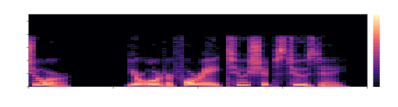


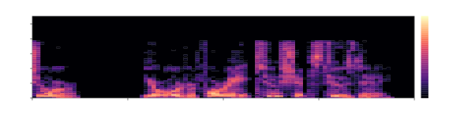

Figure 2: Where deletion lands matters. Native-rate spectrograms of the
released Piper listening example, “Sure, your order 4 8 2 ships
Tuesday.” All panels use the same display scale in dB relative to the
reference STFT peak. Display pixels average power over neighboring bins
and frames. The processed files are the released 30% energy and random
conditions, not newly synthesized examples. Visible similarity is not a
test of audibility; these plots show how the perturbations differ.

### 3.4 Criterion/operator matching and self-masking

A deletion criterion concerns whether existing content is dispensable; a
noise criterion concerns whether added error is detectable.
Interchanging them can bias a comparison. A second issue is
self-masking: a component may contribute to the threshold used to
justify its own deletion. The reported deletion comparisons use
leave-self-out thresholds. This mitigates self-masking but does not
guarantee that all selected cells remain masked when removed together,
because different cells can mask one another. Threshold estimates and
metric scores remain hypotheses about perception pending listening
tests.

## 4 Results

### 4.1 CPU cost distribution

Per-node ONNX Runtime profiling identifies the waveform decoder as the
largest measured kernel-time component in both systems (Table 1;
Figure 3). It is therefore a useful optimization target; profiling alone
does not establish that it is gateable. Reported corpus RTF summaries
are 0.018/0.023 for Piper and 0.156/0.194 for Kokoro on Apple/Intel
respectively. The synthesis harness takes the median of three timed runs
per waveform; the Intel result file reports mean RTF summaries.
Kernel-time shares exclude unprofiled pipeline overhead and should not
be substituted for end-to-end time shares without checking that
overhead.

|                    |                    |              |                  |
| ------------------ | ------------------ | ------------ | ---------------- |
| Model              | Stage              | Apple M5 Pro | Intel Xeon 8488C |
| Piper (VITS)       | HiFi-GAN decoder   | 69.5%        | 63.3%            |
|                    | normalizing flow   | 10.9%        | 12.5%            |
|                    | text encoder       | 9.9%         | 12.8%            |
|                    | duration predictor | 7.0%         | 8.1%             |
| Kokoro (StyleTTS2) | iSTFTNet decoder   | 95.6%        | 93.9%            |
|                    | encoder + prosody  | 4.3%         | 5.9%             |

Table 1: Share of ONNX kernel time by stage, from six utterances
spanning the three domains. Listed stages do not exhaust all kernel
time.

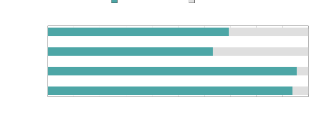

Figure 3: The decoder dominates the measured kernel time in both model
families. The remainder includes all other kernels, not only the named
stages in Table 1. These shares identify a useful target but do not
measure the fraction of computation that can safely be skipped.

### 4.2 Deletion-policy comparison

Table 2 reports mean PESQ for the Model-1 leave-self-out criterion and
the spreading-matrix criterion with the $`-16`$ dB offset. Comparisons
between policies within each block use the same utterances and target
budgets. The blocks use different subsets and band mappings, so
differences between blocks cannot be attributed to the PAM alone. Energy
has higher mean PESQ at all tabulated settings. The masking
implementations also exceed random deletion at those settings.

For the spreading-matrix comparison, energy minus masking ranges from
approximately 0.009 PESQ points (Piper, 10% deletion) to 1.316 (Kokoro,
50%). The logged paired Wilcoxon tests give $`p=1.2\times 10^{-6}`$ for
Piper at 10% and approximately $`1.2\times 10^{-7}`$ for the other five
comparisons ($`n=24`$ paired utterances each). The six Model-1
comparisons have logged $`p\approx 5.7\times 10^{-14}`$ ($`n=45`$ each).
These are exploratory, unadjusted tests on the fixed corpus, not
evidence of perceptual equivalence or generalization to arbitrary
voices. Mean differences should be read alongside their practical
magnitude, particularly near the PESQ ceiling.

| PAM                        | Model  | Budget | energy | masking | random |
| -------------------------- | ------ | ------ | ------ | ------- | ------ |
| Model-1 (90 utt.)          | Kokoro | 0.1    | 4.57   | 4.32    | 2.30   |
|                            |        | 0.3    | 4.12   | 3.21    | 1.29   |
|                            |        | 0.5    | 2.98   | 1.71    | 1.09   |
|                            | Piper  | 0.1    | 4.64   | 4.56    | 2.32   |
|                            |        | 0.3    | 4.59   | 4.04    | 1.28   |
|                            |        | 0.5    | 4.40   | 2.69    | 1.09   |
| Spreading matrix (48 utt.) | Kokoro | 0.1    | 4.59   | 4.39    | 2.87   |
|                            |        | 0.3    | 4.30   | 3.19    | 1.63   |
|                            |        | 0.5    | 3.42   | 2.10    | 1.22   |
|                            | Piper  | 0.1    | 4.64   | 4.63    | 2.76   |
|                            |        | 0.3    | 4.62   | 4.42    | 1.62   |
|                            |        | 0.5    | 4.46   | 3.60    | 1.19   |

Table 2: Mean wideband PESQ after deletion at matched target bin
fractions. Model-1 uses 45 utterances per model; the spreading-matrix
implementation uses 24 per model and a $`-16`$ dB offset. Masking
rankings use leave-self-out thresholds. Significance varies by
comparison; see text.

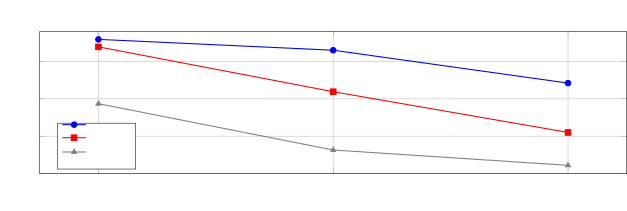

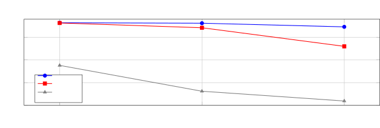

Figure 4: Deletion-policy comparison on 24 utterances per model. Energy
achieves higher mean PESQ than the tested masking criterion, and both
exceed random deletion. These are metric scores, not listener
transparency judgments.

The result supports energy ranking as a strong baseline for this oracle
task. It does not establish energy as a sufficient statistic of
audibility, nor rule out improved masking models, different distortions,
or perceptual verifiers applied to actual decoder errors. Fixed
low-pass, frequency-only, and silence-removal baselines remain necessary
to isolate the value of content adaptation.

### 4.3 Noise-shaping comparison

Figure 5 visualizes the noise-shaping comparison. At matched allocated
noise power, energy shaping also has higher mean PESQ than Model-1
threshold shaping in the reported sweep from $`-45`$ to $`-20`$ dB NSR
(15 utterances per model). The size and statistical evidence of the
difference vary. On Kokoro at $`-45`$ dB, mean PESQ is 4.635 versus
4.632, with an unadjusted paired Wilcoxon $`p\approx 0.064`$; this does
not establish a difference at a 0.05 threshold. At $`-20`$ dB, the
corresponding means are 4.285 versus 4.049. For Piper, these pairs are
4.636 versus 4.605 at $`-45`$ dB and 4.235 versus 3.636 at $`-20`$ dB.
Uniform noise shaping scores lower in each reported setting. The
released noise sweep tests Model-1; it does not establish the same
comparison for every PAM variant. STOI remains near its ceiling
(approximately 0.993–1.000 across the logged conditions), so it adds
little discrimination in this sweep.

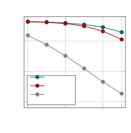

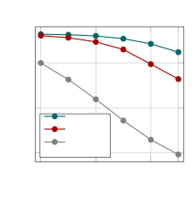

Figure 5: Noise placement at equal allocated spectral noise power. Means
are replotted from the released Model-1 noise sweep, with 15 utterances
per model. Increasing NSR adds more noise. Energy-shaped and
threshold-shaped noise both outperform uniform shaping in the reported
means, while the energy-versus-masking gap is small at low noise levels.
These are not deletion or compute budgets.

### 4.4 Masking calibration diagnostics

The $`\Delta`$-probe injects noise shaped by the PAM threshold, scaled
by $`\Delta`$ dB, and records the resulting PESQ. This is a diagnostic
of agreement with a chosen metric under a specified perturbation. A PESQ
reference level, such as 4.4, is an engineering screen and is not a
validated human-transparency threshold for these distortions.
Threshold-shaped random noise also differs from a codec’s actual
reconstruction error; the reported LAME MP3 scores of 4.54–4.64 are
contextual anchors, not proof that the PAM is perceptually calibrated.

The Model-1 calibration diagnostic indicates that substantially negative
offsets, approximately $`-30`$ to $`-40`$ dB, were needed to reach its
metric screen. Band-summed noise maskers were identified as a source of
excessive threshold estimates. Figure 7 shows four stages of this
analysis: signal energy, threshold, headroom, and below-threshold
decisions. It shows what the model computes, rather than where
computation is known to be wasted. The corresponding high
below-threshold corpus fractions remain diagnostic outputs in
Appendix A, not evidence of inaudibility or harvestable compute.

Figure 6 shows the spreading-matrix sweep. None of its sampled offsets
reaches PESQ 4.4. The subsequent deletion harness fixes
$`\Delta=-16`$ dB, outside the plotted range; this figure does not
establish a crossing at that value. With that offset, the reported mean
below-threshold bin fractions are 0.291 for Piper and 0.116 for Kokoro
(24 utterances per model). They are properties of the model and setting,
not estimates of listener transparency. The corresponding logged
fully-below-threshold frame fractions are zero on this subset.

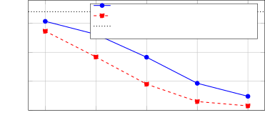

Figure 6: Reported spreading-matrix $`\Delta`$-probe on 18 utterances.
Capped noise uses the signal magnitude as a cap before offset scaling.
No displayed sample reaches the 4.4 reference level. The later
$`-16`$ dB setting lies outside this sweep; no unmeasured crossing is
drawn.

The informal listening reports differ from the ordering and magnitude of
some PESQ scores (Section 4.7). Their sample size does not validate or
invalidate PESQ for this distortion class. We use PESQ descriptively and
leave both absolute perceptual calibration and listener agreement with
policy rankings unresolved.

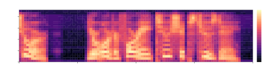

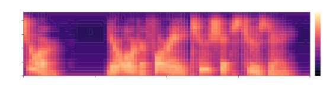

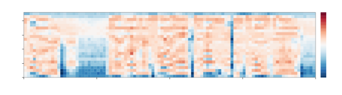

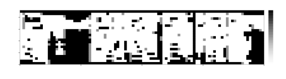

Figure 7: Masking diagnostic for the released, level-normalized Piper
reference stimulus. Top to bottom: band energy, Model-1 threshold, model
headroom, and the fraction of frames below threshold within each display
cell. Positive headroom means above the model threshold; negative means
below it. Dark cells in the last panel indicate model predictions, not
proven inaudibility or wasted compute. The uncorrected Model-1
calibration is unreliable (Section 4.4); the figure explains the
analysis and must not be used to estimate savings.

### 4.5 Mel-resolution reconstruction diagnostic

The released mel-proxy script starts from the _completed waveform’s_
power spectrum, averages it into 80 mel bands, redistributes that energy
onto the linear-frequency grid, and recomputes Model-1 thresholds.
Moreover, both sets of band decisions are compared against the original
waveform’s band energy. This is a diagnostic of sensitivity to spectral
smoothing, not a predictor evaluated on pre-synthesis decoder features.

Across 30 waveforms, threshold RMSE is 2.78 dB for Piper and 2.73 dB for
Kokoro, with decision agreement of 96.4% and 95.9%. Of cells classified
as below threshold using the smoothed estimate, 11.4% and 12.5%,
respectively, are above threshold under the unsmoothed calculation.
These are disagreements between two computations, not measured rates of
audible error. The reference Model-1 calculation itself has the
calibration limitations discussed above. Actual predictive gating would
require held-out evaluation using features available before waveform
generation, along with the cost and quality effects of conservative
decision margins.

### 4.6 Dynamic-INT8 decoder experiment

A separate experiment applies dynamic INT8 quantization to a Kokoro
decoder split at five encoder/decoder boundary tensors. The unquantized
split was reported as bit-exact against the monolithic model;
supporting-data availability is described in Appendix C. Table 3 and
Figure 8 show the measured timing comparison: this INT8 configuration is
8.1 times slower than FP32 on Intel and 4.8 times slower on Apple. It is
a whole-decoder reduced-precision experiment, not an
audibility-conditioned allocation policy.

Unsupported integer operators and conversion overhead are plausible
contributors, but the timing table alone does not identify the cause.
Establishing it requires inspecting the transformed graph and profiling
individual kernels and conversions. Dynamic activation-parameter
calculation can itself add inference overhead \[42\]. These results do
not rule out static quantization, mixed precision, other runtimes, or
architecture-specific kernels. The reported whole-model quantization
attempt also shifted output durations; the tested decoder-only split
preserves the upstream duration path. This observation does not make all
whole-model draft approaches impossible.

| Hardware                    | fp32   | dynamic INT8 | INT8 speed-up  |
| --------------------------- | ------ | ------------ | -------------- |
| Intel Xeon 8488C (AVX-VNNI) | 4.78 s | 38.56 s      | $`0.12\times`$ |
| Apple M5 Pro                | 3.87 s | 18.62 s      | $`0.21\times`$ |

Table 3: Reported Kokoro decoder wall-clock for five utterances, best of
three runs after warm-up, single process. Speedup is FP32 time divided
by INT8 time; values below one indicate a slowdown.


Figure 8: Fewer bits did not mean less time in this implementation. The
tested dynamic-INT8 Kokoro decoder was slower on both CPUs. Values
reproduce Table 3; they do not compare every quantization scheme or
runtime.

### 4.7 Human evaluation

The author, who had heard related clips in an earlier informal session,
completed a blind ABX pilot \[13\] using eight utterances from the two
models. There were two practice rounds, 30 energy-condition trials (six
each at 30/50/60/75/90% deletion), and six random-deletion anchor trials
at 30%. The listener identified all six anchors correctly, showing that
this listener and playback setup detected that control degradation.
Table 4 reports the pilot counts as accuracies and Figure 9 shows their
uncertainty using Wilson intervals \[14\].

| Condition           | $`n`$ | accuracy | Wilson 95% CI  |
| ------------------- | ----- | -------- | -------------- |
| energy 30%          | 6     | 0.83     | \[0.44, 0.97\] |
| energy 50%          | 6     | 0.17     | \[0.03, 0.56\] |
| energy 60%          | 6     | 0.33     | \[0.10, 0.70\] |
| energy 75%          | 6     | 0.83     | \[0.44, 0.97\] |
| energy 90%          | 6     | 0.67     | \[0.30, 0.90\] |
| random 30% (anchor) | 6     | 1.00     | \[0.61, 1.00\] |

Table 4: Single-listener ABX pilot, six trials per condition. Chance
accuracy is 0.50. Intervals describe this small pilot under a binomial
model and do not support population-level transparency claims.

Accuracy pooled across energy conditions is 17/30 (0.57), but this
pooling does not establish a transparent budget. The condition-wise
pattern is nonmonotonic: 5/6 correct at both 30% and 75%, compared with
1/6 at 50%. Every energy-condition interval includes chance. Four extend
above 0.60; the 50% interval has an upper bound of 0.56. The latter
numerical bound must not be presented as a confirmatory result: this was
an exploratory, single, non-naive listener with six trials per
condition. No removal budget is established as transparent.

An earlier informal session by the same listener reported “same”,
“slight”, or “clear” differences, with a hidden reference and
random-deletion control. Those observations are summarized in
Appendix B; they neither independently corroborate the ABX pilot nor
validate PESQ rankings. A larger study with independent listeners and
prespecified analysis is required. The repository’s study/ directory
provides the instrument and audio; Appendix D distinguishes the existing
pilot protocol from proposed future analysis.

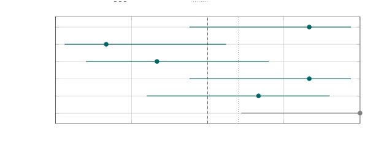

Figure 9: The listening pilot is too small to establish a transparent
deletion budget. Points show six-trial accuracies for one listener;
lines show the reported Wilson 95% intervals. The nonmonotonic pattern
and wide intervals are visible directly. The 0.60 line is the archived
proposed discrimination margin, not an established perceptual boundary.

## 5 Implications for Adaptive Decoding

Possible mechanisms include frame-level cheap/full decoder switching,
band-limited synthesis, and students trained to condition capacity on
predicted output sensitivity. These are research directions, not
implemented results. They must preserve state and boundary continuity,
make decisions from available inputs, and include routing, verification,
and fallback costs in end-to-end timing.

For an illustrative cost model, let $`d`$ be the decoder’s fraction of
baseline time and suppose its cost falls in direct proportion to an
output fraction $`f`$ skipped, with no additional overhead. Overall
speedup is then

```math
S=\frac{1}{(1-d)+d(1-f)}=\frac{1}{1-df}.
```

Substituting the Intel kernel-time shares (approximately 0.63 and 0.94)
and $`f=0.5`$ gives roughly 1.5 and 1.9 times speedup. These are
conditional kernel-time projections, not end-to-end measurements or
general upper bounds for future architectures. The assumptions that bin
removal corresponds to skipped decoder cost and that kernel shares
represent the full pipeline have not been demonstrated \[15\].

## 6 Related Work

Perceptual codecs allocate bits using auditory models \[1, 2, 4\].
Neural audio work also uses psychoacoustic loss weighting and multiband
reconstruction \[7, 8, 9\]. Cui et al. \[41\] explicitly use auditory
sensitivity to motivate greater modeling resources for a low-frequency
synthesis subband. Thus perceptually motivated nonuniform synthesis
resources are an existing idea. Our experiments examine
content-dependent post-synthesis perturbation placement as a possible
prerequisite for inference allocation; they do not implement dynamic
inference allocation.

Adaptive computation includes early exits and learned routing \[25, 26,
27, 29\], with speech-representation examples \[30\]. Synthesis-side
efficiency includes speculative decoding \[31, 32, 33\], dynamic chunk
prediction \[34\], and scheduled early exit \[35\]. Other approaches
improve synthesis architecture or reduce sampling steps \[20, 21, 28\].
These methods motivate comparisons for a future implemented allocator;
this paper makes no exhaustive priority claim over adaptive speech
synthesis.

In vision, foveated rendering and reconstruction allocate work according
to visual sensitivity \[36, 37, 38\], with related work on spatially
adaptive diffusion \[39\]. Perceptually guided acoustic rendering is
another relevant precedent \[40\]. The proposed TTS direction draws on
these ideas, while its computational benefit remains untested here.

## 7 Limitations and Next Experiments

The corpus is small, fixed, and limited to two model configurations,
with Hinglish processed through English voices. The listening evidence
comes from one non-naive author. No population-level transparency,
independent perceptual policy ranking, conditional-compute
implementation, or end-to-end speedup is established. The masking
calculations depend on playback-level conventions and implementation
choices; leave-self-out thresholds do not resolve all
simultaneous-removal effects.

PESQ and STOI score resampled 16 kHz audio, whereas native-rate bin
budgets extend above 8 kHz. The next controls should restrict
degradation and scoring to a common bandwidth and compare energy ranking
with low-pass, frequency-only, and silence-removal policies. They should
report removed signal energy and actual removed-bin fractions alongside
target budgets. Separate calibration and evaluation sets are needed for
any selected threshold setting.

The paired tests describe this corpus; they are unadjusted for multiple
comparisons, and the displayed mean-score curves do not include
uncertainty intervals. More voices, texts, random placements, and paired
uncertainty estimates are needed to assess stability. Timing uses only
three repeats and, for decoder microbenchmarks, selects the best repeat;
it does not characterize latency tails or production throughput. The
source release documents substantial parts of the workflow but does not
establish that every manuscript-only measurement is independently
reproducible from the committed files.

A future multi-listener study should prespecify its population, playback
conditions, screening, equivalence margin, sample size, and treatment of
repeated listeners and utterances. A subsequent compute experiment
should compare an implemented allocator against a full decoder and
relevant simpler baselines under the same quality evaluation, with all
overhead included.

## 8 Conclusion

Hearing’s blind spots suggest a useful question for synthesis: which
details deserve computation? In two neural TTS systems, energy-ranked
spectral deletion yields higher mean PESQ than the tested masking
criteria and random deletion at matched target bin budgets. This
supports energy ranking as a strong baseline for oracle perturbation
studies. Calibration diagnostics, an inconclusive author-only listening
pilot, and a slow dynamic-INT8 decoder configuration identify limits of
the current evidence. Perceptual transparency and conversion of output
sensitivity into inference savings remain open. The released experiments
provide a basis for testing those questions without treating removed
spectral output as measured compute reduction.

## Acknowledgments

The reported experiments used an Apple M5 Pro and an AWS c7i.2xlarge. We
thank an external reviewer for feedback on claim scope.

_Use of AI tools._ Anthropic Claude assisted with portions of the
experiment-harness code, analysis scripts, manuscript drafting, and
identification of candidate related work. OpenAI Codex assisted with
manuscript preparation, including checks against released scripts and
logs, methodological descriptions, reference-metadata checks, and
visualizations of released audio and reported results. These tools are
not authors and their involvement does not constitute independent
experimental validation. The author is responsible for the final
content, citations, and interpretation.

## References

- \[1\] ISO/IEC 11172-3:1993. Information technology – Coding of moving
  pictures and associated audio for digital storage media at up to about
  1.5 Mbit/s – Part 3: Audio. International Organization for
  Standardization, 1993.
  [https://www.iso.org/standard/22412.html](https://www.iso.org/standard/22412.html).
- \[2\] Painter, T., & Spanias, A. (2000). Perceptual coding of digital
  audio. Proceedings of the IEEE, 88(4), 451–515. DOI:
  [10.1109/5.842996](https://doi.org/10.1109/5.842996).
- \[3\] Fastl, H., & Zwicker, E. (2007). Psychoacoustics: Facts and
  Models (3rd ed.), Springer Series in Information Sciences, vol. 22.
  Springer, Berlin/Heidelberg. DOI:
  [10.1007/978-3-540-68888-4](https://doi.org/10.1007/978-3-540-68888-4).
- \[4\] Bosi, M., & Goldberg, R. E. (2003). Introduction to Digital
  Audio Coding and Standards. Kluwer Academic Publishers, Boston. DOI:
  [10.1007/978-1-4615-0327-9](https://doi.org/10.1007/978-1-4615-0327-9).
- \[5\] Terhardt, E. (1979). Calculating virtual pitch. Hearing
  Research, 1(2), 155–182. DOI:
  [10.1016/0378-5955(79)90025-X](<https://doi.org/10.1016/0378-5955(79)90025-X>).
- \[6\] Schuller, G. (2020). Filter Banks and Audio Coding: Compressing
  Audio Signals Using Python. Springer, Cham. DOI:
  [10.1007/978-3-030-51249-1](https://doi.org/10.1007/978-3-030-51249-1).
- \[7\] Zhen, K., Sivaraman, A., Sung, J., & Kim, M. (2018). On
  psychoacoustically weighted cost functions towards resource-efficient
  deep neural networks for speech denoising. arXiv preprint
  [arXiv:1801.09774](https://arxiv.org/abs/1801.09774).
- \[8\] Zhen, K., Lee, M. S., Sung, J., Beack, S., & Kim, M. (2020).
  Psychoacoustic calibration of loss functions for efficient end-to-end
  neural audio coding. IEEE Signal Processing Letters, 27, 2159–2163.
  DOI:
  [10.1109/LSP.2020.3039765](https://doi.org/10.1109/LSP.2020.3039765).
  [arXiv:2101.00054](https://arxiv.org/abs/2101.00054).
- \[9\] Ng, D., Zhou, K., Chao, Y.-W., Xiong, Z., Ma, B., & Chng, E. S.
  (2025). Multi-band frequency reconstruction for neural psychoacoustic
  coding. arXiv preprint
  [arXiv:2505.07235](https://arxiv.org/abs/2505.07235).
- \[10\] ITU-T Recommendation P.862 (2001), Perceptual evaluation of
  speech quality (PESQ): An objective method for end-to-end speech
  quality assessment of narrow-band telephone networks and speech
  codecs; and ITU-T Recommendation P.862.2 (2005, rev. 2007), Wideband
  extension to Recommendation P.862 for the assessment of wideband
  telephone networks and speech codecs. International Telecommunication
  Union. (Withdrawn January 2024, superseded by P.863.)
  [https://www.itu.int/rec/T-REC-P.862](https://www.itu.int/rec/T-REC-P.862);
  [https://www.itu.int/rec/T-REC-P.862.2](https://www.itu.int/rec/T-REC-P.862.2).
- \[11\] Rix, A. W., Beerends, J. G., Hollier, M. P., & Hekstra, A. P.
  (2001). Perceptual evaluation of speech quality (PESQ) – a new method
  for speech quality assessment of telephone networks and codecs. In
  Proceedings of ICASSP, vol. 2, 749–752. DOI:
  [10.1109/ICASSP.2001.941023](https://doi.org/10.1109/ICASSP.2001.941023).
- \[12\] Taal, C. H., Hendriks, R. C., Heusdens, R., & Jensen, J.
  (2011). An algorithm for intelligibility prediction of time–frequency
  weighted noisy speech. IEEE Transactions on Audio, Speech, and
  Language Processing, 19(7), 2125–2136. DOI:
  [10.1109/TASL.2011.2114881](https://doi.org/10.1109/TASL.2011.2114881).
- \[13\] Clark, D. (1982). High-resolution subjective testing using a
  double-blind comparator. Journal of the Audio Engineering Society,
  30(5), 330–338. [AES E-Library
  3839](https://aes.org/publications/elibrary-page/?id=3839).
- \[14\] Wilson, E. B. (1927). Probable inference, the law of
  succession, and statistical inference. Journal of the American
  Statistical Association, 22(158), 209–212. DOI:
  [10.1080/01621459.1927.10502953](https://doi.org/10.1080/01621459.1927.10502953).
- \[15\] Amdahl, G. M. (1967). Validity of the single processor approach
  to achieving large scale computing capabilities. In Proceedings of the
  AFIPS Spring Joint Computer Conference, vol. 30, 483–485. DOI:
  [10.1145/1465482.1465560](https://doi.org/10.1145/1465482.1465560).
- \[16\] Kim, J., Kong, J., & Son, J. (2021). Conditional variational
  autoencoder with adversarial learning for end-to-end text-to-speech.
  In Proceedings of ICML.
  [arXiv:2106.06103](https://arxiv.org/abs/2106.06103).
- \[17\] Kong, J., Kim, J., & Bae, J. (2020). HiFi-GAN: Generative
  adversarial networks for efficient and high fidelity speech synthesis.
  In Advances in Neural Information Processing Systems (NeurIPS).
  [arXiv:2010.05646](https://arxiv.org/abs/2010.05646).
- \[18\] Li, Y. A., Han, C., Raghavan, V., Mischler, G., & Mesgarani, N.
  (2023). StyleTTS 2: Towards human-level text-to-speech through style
  diffusion and adversarial training with large speech language models.
  In Advances in Neural Information Processing Systems (NeurIPS).
  [arXiv:2306.07691](https://arxiv.org/abs/2306.07691).
- \[19\] Kaneko, T., Tanaka, K., Kameoka, H., & Seki, S. (2022).
  iSTFTNet: Fast and lightweight mel-spectrogram vocoder incorporating
  inverse short-time Fourier transform. In Proceedings of ICASSP.
  [arXiv:2203.02395](https://arxiv.org/abs/2203.02395).
- \[20\] Valin, J.-M., & Skoglund, J. (2019). LPCNet: Improving neural
  speech synthesis through linear prediction. In Proceedings of ICASSP.
  [arXiv:1810.11846](https://arxiv.org/abs/1810.11846).
- \[21\] Ren, Y., Hu, C., Tan, X., Qin, T., Zhao, S., Zhao, Z., & Liu,
  T.-Y. (2021). FastSpeech 2: Fast and high-quality end-to-end text to
  speech. In International Conference on Learning Representations
  (ICLR). [arXiv:2006.04558](https://arxiv.org/abs/2006.04558).
- \[22\] Hansen, M. (2023). Piper: A fast, local neural text to speech
  system.
  [https://github.com/rhasspy/piper](https://github.com/rhasspy/piper)
  (MIT; repository archived October 2025, development continued at
  [https://github.com/OHF-Voice/piper1-gpl](https://github.com/OHF-Voice/piper1-gpl)).
  Accessed October 2026.
- \[23\] hexgrad (2025). Kokoro-82M (v1.0), Apache-2.0. Hugging Face
  model repository,
  [https://huggingface.co/hexgrad/Kokoro-82M](https://huggingface.co/hexgrad/Kokoro-82M);
  ONNX runtime package kokoro-onnx (MIT),
  [https://github.com/thewh1teagle/kokoro-onnx](https://github.com/thewh1teagle/kokoro-onnx).
  Accessed October 2026.
- \[24\] ONNX Runtime developers. ONNX Runtime documentation.
  [https://onnxruntime.ai/docs/](https://onnxruntime.ai/docs/). Accessed
  October 2026.
- \[25\] Teerapittayanon, S., McDanel, B., & Kung, H. T. (2016).
  BranchyNet: Fast inference via early exiting from deep neural
  networks. In Proceedings of ICPR. DOI:
  [10.1109/ICPR.2016.7900006](https://doi.org/10.1109/ICPR.2016.7900006).
  [arXiv:1709.01686](https://arxiv.org/abs/1709.01686).
- \[26\] Schuster, T., Fisch, A., Gupta, J., Dehghani, M., Bahri, D.,
  Tran, V. Q., Tay, Y., & Metzler, D. (2022). Confident adaptive
  language modeling. In Advances in Neural Information Processing
  Systems (NeurIPS).
  [arXiv:2207.07061](https://arxiv.org/abs/2207.07061).
- \[27\] Han, Y., Huang, G., Song, S., Yang, L., Wang, H., & Wang, Y.
  (2022). Dynamic neural networks: A survey. IEEE Transactions on
  Pattern Analysis and Machine Intelligence, 44(11), 7436–7456. DOI:
  [10.1109/TPAMI.2021.3117837](https://doi.org/10.1109/TPAMI.2021.3117837).
- \[28\] Zheng, Q., Chen, Y., Niu, Z., Ma, Z., Wang, X., Yu, K., &
  Chen, X. (2025). Accelerating flow-matching-based text-to-speech via
  empirically pruned step sampling. arXiv preprint
  [arXiv:2505.19931](https://arxiv.org/abs/2505.19931).
- \[29\] Raposo, D., Ritter, S., Richards, B., Lillicrap, T.,
  Humphreys, P. C., & Santoro, A. (2024). Mixture-of-Depths: Dynamically
  allocating compute in transformer-based language models. arXiv
  preprint [arXiv:2404.02258](https://arxiv.org/abs/2404.02258).
- \[30\] Lin, T.-Q., Lee, H.-y., & Tang, H. (2024). DAISY: Data adaptive
  self-supervised early exit for speech representation models. In
  Proceedings of Interspeech.
  [arXiv:2406.05464](https://arxiv.org/abs/2406.05464).
- \[31\] Leviathan, Y., Kalman, M., & Matias, Y. (2023). Fast inference
  from transformers via speculative decoding. In Proceedings of ICML.
  [arXiv:2211.17192](https://arxiv.org/abs/2211.17192).
- \[32\] Chen, C., Borgeaud, S., Irving, G., Lespiau, J.-B., Sifre, L.,
  & Jumper, J. (2023). Accelerating large language model decoding with
  speculative sampling. arXiv preprint
  [arXiv:2302.01318](https://arxiv.org/abs/2302.01318).
- \[33\] Lin, Z., Zhang, Y., Yuan, Y., Yan, Y., Liu, J., Wu, Z., Hu, P.,
  & Yu, Q. (2025). Accelerating autoregressive speech synthesis
  inference with speech speculative decoding. In Proceedings of
  Interspeech. [arXiv:2505.15380](https://arxiv.org/abs/2505.15380).
- \[34\] Li, B., Li, Z., Wang, H., Zhang, H., Guo, Y., Wang, H., Chen,
  X., & Yu, K. (2025). Robust and efficient autoregressive speech
  synthesis with dynamic chunk-wise prediction policy. arXiv preprint
  [arXiv:2506.22023](https://arxiv.org/abs/2506.22023).
- \[35\] Huang, H.-Y., Chiang, C.-H., & Lee, H.-y. (2026). SPAR-K:
  Scheduled periodic alternating early exit for spoken language models.
  arXiv preprint [arXiv:2603.09215](https://arxiv.org/abs/2603.09215).
- \[36\] Guenter, B., Finch, M., Drucker, S., Tan, D., & Snyder, J.
  (2012). Foveated 3D graphics. ACM Transactions on Graphics, 31(6),
  Article 164. DOI:
  [10.1145/2366145.2366183](https://doi.org/10.1145/2366145.2366183).
- \[37\] Patney, A., Salvi, M., Kim, J., Kaplanyan, A., Wyman, C.,
  Benty, N., Luebke, D., & Lefohn, A. (2016). Towards foveated rendering
  for gaze-tracked virtual reality. ACM Transactions on Graphics, 35(6),
  Article 179. DOI:
  [10.1145/2980179.2980246](https://doi.org/10.1145/2980179.2980246).
- \[38\] Kaplanyan, A. S., Sochenov, A., Leimkühler, T., Okunev, M.,
  Goodall, T., & Rufo, G. (2019). DeepFovea: Neural reconstruction for
  foveated rendering and video compression using learned statistics of
  natural videos. ACM Transactions on Graphics, 38(6). DOI:
  [10.1145/3355089.3356557](https://doi.org/10.1145/3355089.3356557).
- \[39\] Chao, B., Yariv, L., Xiao, H., & Wetzstein, G. (2026). Foveated
  diffusion: Efficient spatially adaptive image and video generation.
  arXiv preprint [arXiv:2603.23491](https://arxiv.org/abs/2603.23491).
- \[40\] Peng, X., Chen, K., Roman, I., Bello, J. P., Sun, Q., &
  Chakravarthula, P. (2025). Perceptually-guided acoustic “foveation”.
  In Proceedings of the IEEE Conference on Virtual Reality and 3D User
  Interfaces (VR), 450–460. DOI:
  [10.1109/VR59515.2025.00069](https://doi.org/10.1109/VR59515.2025.00069).
- \[41\] Cui, Y., Wang, X., He, L., & Soong, F. K. (2020). An efficient
  subband linear prediction for LPCNet-based neural synthesis. In
  Proceedings of Interspeech, 3555–3559. DOI:
  [10.21437/Interspeech.2020-1463](https://doi.org/10.21437/Interspeech.2020-1463).
- \[42\] ONNX Runtime developers. Quantize ONNX models.
  [https://onnxruntime.ai/docs/performance/model-optimizations/quantization.html](https://onnxruntime.ai/docs/performance/model-optimizations/quantization.html).
  Accessed October 2026.

## Appendix A Diagnostic Outputs from the Original Masking Analysis

The first four rows of Table 5 show Model-1 outputs at the 96 dB
full-scale convention (45 utterances per model). Because subsequent
diagnostics found excessive thresholds, these values are not estimates
of inaudible fractions or feasible frame skipping. The last row comes
from a different implementation and subset with a chosen offset, so the
table is not a controlled before/after calibration comparison. Figure 7
shows the four-panel diagnostic computed from the released
level-normalized listening stimulus and labeled as a model calculation
rather than a validated audibility map.

| Metric                                                     | Piper           | Kokoro          |
| ---------------------------------------------------------- | --------------- | --------------- |
| Model-1: bins below threshold                              | 0.977           | 0.977           |
| Frames with $`\geq`$95% of bins below threshold            | 0.90–0.91       | 0.86–0.88       |
| Frames fully below threshold                               | 0.10–0.16       | 0.14–0.15       |
| Signal energy below threshold                              | $`\approx`$0.16 | $`\approx`$0.18 |
| Spreading matrix: bins below threshold ($`\Delta=-16`$ dB) | 0.291           | 0.116           |

Table 5: Diagnostic model outputs only. Original Model-1 rows: 45
utterances per model. Spreading-matrix row: 24 per model. No row
establishes human transparency or saved compute.

## Appendix B Earlier Informal Listening Observations

Table 6 summarizes the earlier subjective reports from the same author,
listening on speakers in a quiet setting. “Same” means the listener
reported no difference in that informal comparison. It is not an
equivalence-test outcome, and these observations do not justify a
general 60–75% transparency claim.

| Condition                | Piper         | Kokoro         | PESQ (Piper) | PESQ (Kokoro) |
| ------------------------ | ------------- | -------------- | ------------ | ------------- |
| energy 60% / masking 60% | same / same   | same / same    | 4.48 / 3.06  | 3.08 / 1.80   |
| energy 75% / masking 75% | same / same   | same / slight  | 3.70 / 2.53  | 2.01 / 1.40   |
| energy 90% / masking 90% | same / slight | slight / clear | 1.88 / 1.64  | 1.24 / 1.14   |
| random 30% (anchor)      | clear         | clear          | 1.58         | 1.74          |
| hidden reference         | same          | same           | n/a          | n/a           |

Table 6: Original informal single-listener observations (speakers,
quiet). Entries are reports of same/slight/clear difference, not
validated transparency labels.

## Appendix C Reproducibility and Provenance

The recorded software environment is Python 3.12.13; ONNX Runtime 1.28.0
(Apple) and 1.29.0 (Intel); piper-tts 1.6.1; kokoro-onnx 0.5.0; pesq
0.0.4; pystoi 0.4.1; and onnx 1.22.0. Model files are
en_US-lessac-medium.onnx, kokoro-v1.0.onnx, and voices-v1.0.bin. The
reported random seed is 1234. These versions describe the experimental
runs.

The scripts and archived results correspond to repository commit
[b0394458](https://github.com/Deployment-inc/deep-perceptual-compute-allocation/tree/b0394458e38446b9b16cf60ca0153d0998827c0d)
(the hyperlink identifies the full immutable revision). The corpus is in
scripts/corpus.py; deletion comparisons are in results/h3_proxy3.json
and results/h3_pam2.json, with corresponding run logs; noise comparisons
are in results/h3_noise.json; and the mel diagnostic is in
scripts/rq3_mel_proxy.py and its result file. The Intel timing
comparison is in results/x86_results.json. The amendment is in
reports/amendment-1.md. A commit-pinned document makes its contents
identifiable; it does not establish that the document preceded the
experiments it describes.

The ABX counts, earlier informal listening observations, Apple decoder
microbenchmark, and spreading-matrix probe are aggregate results
recorded in the manuscript. Their complete trial-level records or
generating scripts were not verified in the pinned release. The
unquantized decoder split’s reported bit-exactness was not independently
rerun. These gaps limit independent reproduction of those results.
During manuscript preparation, descriptions and aggregate values were
checked against available scripts and logs; this process did not include
new synthesis, timing, or listening trials.

The spectrograms use the released piper_agent0_ref.wav,
piper_agent0_e30.wav, and piper_agent0_anchor.wav listening stimuli.
Display spectra use a 1024-sample Hann window and 512-sample hop,
average power into 96 time columns and 64 frequency rows, and share a
decibel reference equal to the original stimulus’s peak STFT power.
Figure 7 recomputes pam.analyze on the level-normalized reference with
the original 96 dB full-scale convention and forward masking enabled.
Its first three panels average decibel values in display-time bins; its
final panel shows the fraction of constituent frames classified below
threshold. The conceptual masking diagram is illustrative; the other
charts visualize existing reported results. These visualizations do not
constitute new synthesis, timing, or listening experiments.

## Appendix D Listening Protocol and Proposed Follow-Up

The pilot instrument uses level-normalized 16-bit PCM, two practice
rounds with feedback, 30 energy-condition rounds (six per budget), and
six anchor rounds, shuffled. An utterance–condition pair is not repeated
within a participant. Assignments to A/B and X are randomized per round.
The archived protocol specifies exclusion for anchor accuracy below 5/6
or median test-round response time below 1.5 s, and states consent,
anonymity, and withdrawal provisions.

The archived analysis pools trials by condition, computes Wilson 95%
intervals and one-sided binomial tests against 0.5, and proposes a
transparency rule requiring both $`p\geq 0.05`$ and an upper interval
bound at most 0.60. This describes the historical protocol; it is not
endorsed here as a sufficient population-level analysis. Failure to
reject chance is not evidence of equivalence, and pooling ignores
potential dependence within listeners and utterances. The pilot was not
a confirmatory application of this future-study rule.

Before new recruitment, a revised analysis plan should define a
practical discrimination margin and test whether the upper confidence
bound lies below it using an approach that accounts for listener and
utterance dependence, such as a prespecified hierarchical model or
suitable clustered resampling. Sample size should be justified for that
design, rather than treating all trials as independent. Per-model
results, control performance, exclusions, and all budget comparisons
should be reported. These recommendations concern future data
collection; they were not preregistered decisions governing the pilot.
