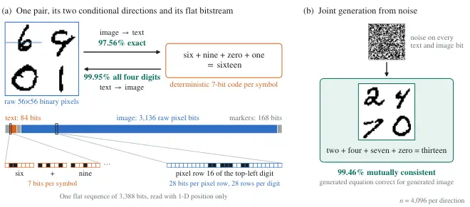
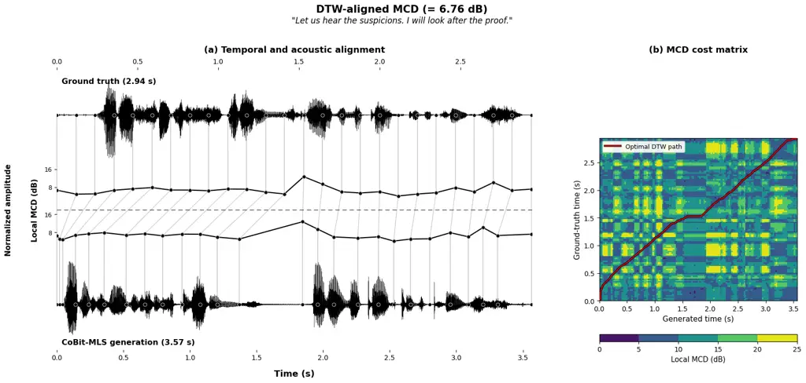
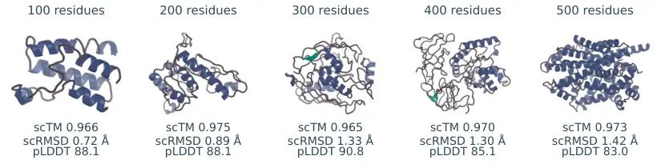
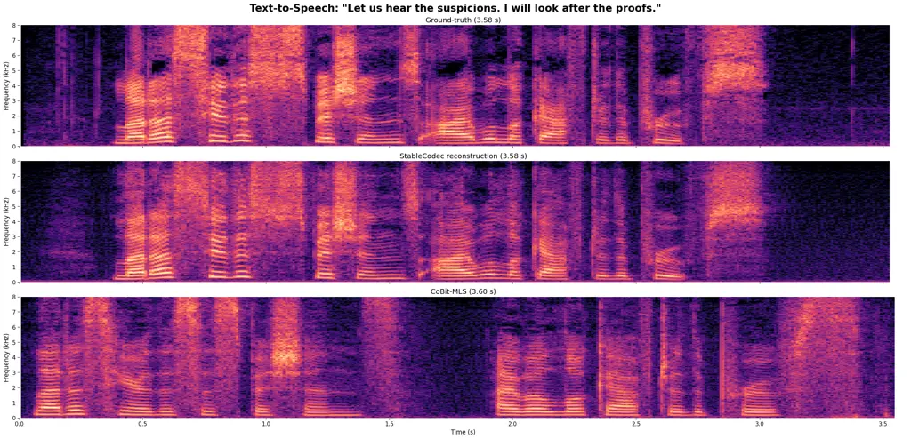
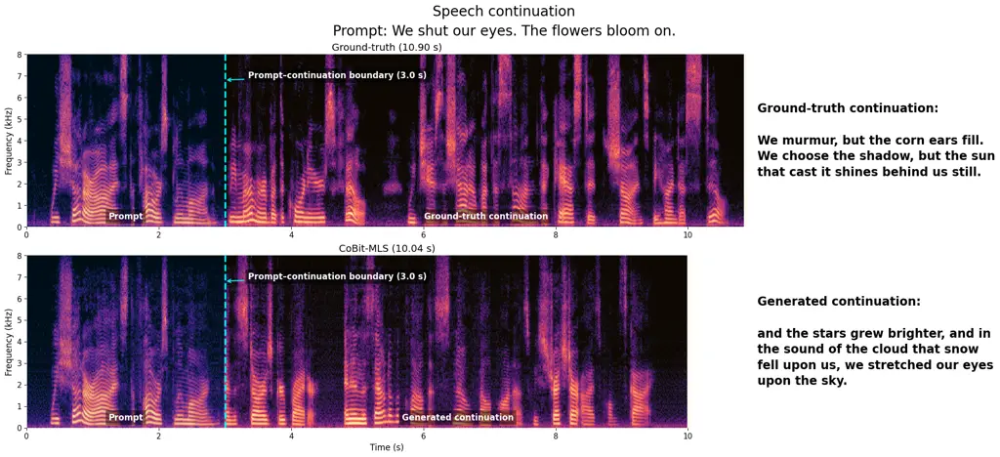
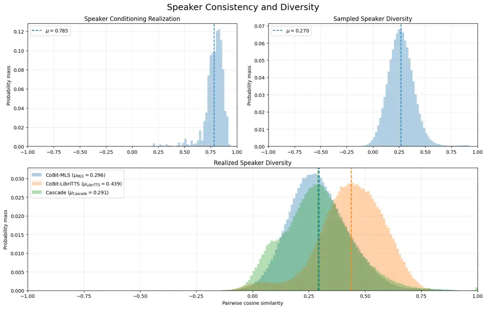
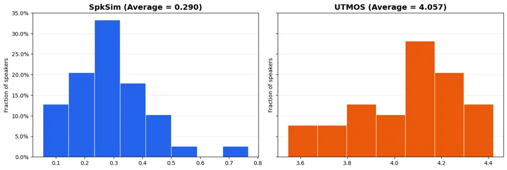
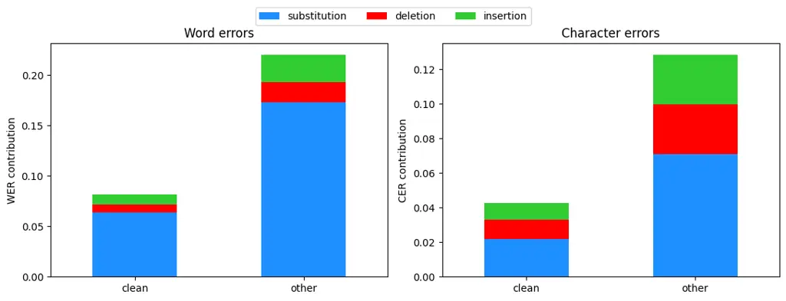
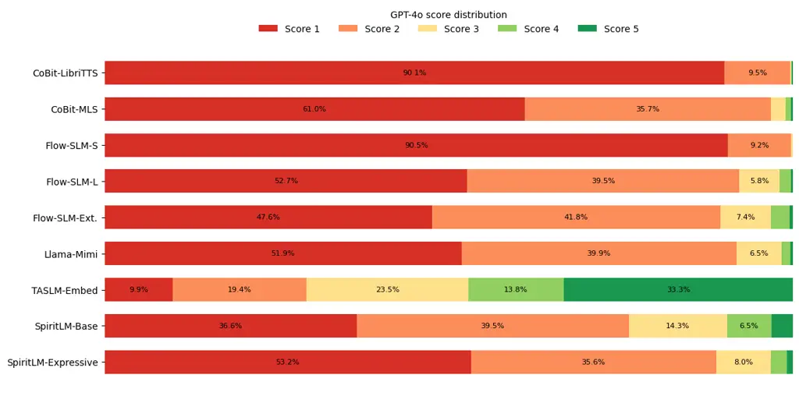

# Multimodal Co-Generation with Continuous Bitstream Diffusion

Georgios Batzolis^(\*)  
Devotion AI Labs Georgios Kontos^(\*)  
University of Cambridge Bruno Trentini^(\*)  
University of Oxford  
NVIDIA Pranam Chatterjee  
University of Pennsylvania Micha Livne  
NVIDIA Mark Girolami  
Devotion AI Labs  
University of Cambridge Luca Ambrogioni  
Radboud University

###### Abstract

We show that continuous bitstream diffusion (CoBit), originally
developed for language modeling, provides a unified framework for joint
and conditional multimodal generation using the same training and
sampling protocol. Across image–text, speech–text and protein
sequence–structure modeling, models are trained separately from scratch,
but each uses a single input projection, transformer backbone, bitwise
prediction head and binary score-matching objective shared across its
modalities. Within each setting, a single checkpoint supports joint
generation and the conditional directions included in training by
changing which parts of the bitstream are observed. We first validate
the approach on MNIST-Sum, a controlled image–text task pairing raw
binary images with equations encoded as text, achieving near-perfect
conditional accuracy and high joint consistency without learned
tokenizers. We then apply the same protocol at larger scale to
speech–text and protein sequence–structure modeling. Trained without
text pretraining, a single speech–text model performs speech synthesis,
recognition, continuation, and unconditional co-generation. Jointly
generated speech and text achieve 3.5% word error rate between the
generated text and automatic transcriptions of the generated speech. In
protein modeling, a single CoBit checkpoint supports forward folding,
inverse folding, and joint sequence–structure generation. For jointly
generated proteins spanning 100–500 residues, computational refolding of
CoBit’s sequences yields structures that agree with the generated
backbones at a mean self-consistency TM-score of $`0.911`$. Together,
these results show that CoBit provides a common generative framework for
substantially different modalities and forms of cross-modal dependence,
without introducing a domain-specific objective or sampling procedure.
³³ 3 Code available at
[https://github.com/GBATZOLIS/BitstreamDiffusion](https://github.com/GBATZOLIS/BitstreamDiffusion)

|     |
| --- |
|     |

⁰⁰footnotetext: ^(∗)Equal contribution.

## 1 Introduction

Multimodal generative models must reconcile data with very different
structures. Images and audio are commonly modelled through continuous
diffusion, whereas language and protein sequences are usually generated
autoregressively or with discrete corruption processes (Ho et al., 2020;
Song et al., 2021b; Austin et al., 2021; Sahoo et al., 2024; Wang
et al., 2024b). Existing systems bridge these choices through
modality-specific encoders, latent spaces, objectives or prediction
interfaces (Bao et al., 2023; Tang et al., 2023; Campbell et al., 2024;
Wang et al., 2025b). These designs are effective, but each new modality
pairing introduces another interface to design and calibrate.

In this work, we ask whether one denoising interface and objective can
instead model joint distributions over discrete codes from very
different modality pairs, with domain-specific choices confined to
tokenizers, layouts and inference settings. Bit sequences are the
fundamental language of digital computers: a fixed binary code needs no
learned embedding and its width grows only logarithmically with the
vocabulary, so codes from different vocabularies can share one input
projection and one prediction head. Our starting point is therefore
continuous bitstream diffusion (Batzolis et al., 2026), which writes
discrete codes as bits and applies continuous Gaussian diffusion to
them. Each modality is written as bits, directly or through a frozen,
domain-specific tokenizer, placed in a shared binary vocabulary and
arranged in a fixed sequence template. Inside the denoiser, every
position uses the same input projection, transformer backbone, bitwise
prediction head and loss. A partial-denoising objective then trains one
checkpoint to perform joint generation and every conditional direction
included in training: clean positions specify the conditioning signal,
and corrupted positions specify what to generate. To test whether the
denoiser itself needs modality-specific components, the architecture
contains no modality- or segment-specific parameters.

We test this question in three settings that differ in the kind of
cross-modal dependence they contain. MNIST-Sum pairs raw binary pixels
with symbolic equations and uses no learned tokenizer, so it isolates
whether visual and symbolic bits form one learnable joint distribution.
Speech and text are strongly asymmetric: speech carries acoustic and
speaker information absent from the transcript and reaches the model
through a lossy codec. Protein sequence and structure are aligned
residue by residue and physically coupled rather than semantically
related. Every experiment keeps CoBit’s objective and its training and
sampling protocol, developed for language modeling; our contribution is
evidence that this protocol learns joint distributions across these
three kinds of dependence.

## 2 Related Work

Continuous generation of discrete data. Beyond discrete corruption
(Austin et al., 2021; Sahoo et al., 2024), continuous methods differ in
the state they generate. Diffusion-LM (Li et al., 2022), continuous
categorical diffusion (Dieleman et al., 2022), LangFlow (Chen et al., 2026) and ELF (Hu et al., 2026) generate learned token embeddings and
map them back to tokens with a learned readout; Categorical Flow Maps
learn a flow map towards the probability simplex and distil it for
few-step categorical generation (Roos et al., 2026). Analog Bits writes
each token as a fixed binary code and diffuses its bits as real values
(Chen et al., 2023); CoBit develops this into a language model with a
binary score-matching objective, an analytic per-bit posterior term and
a data-derived noise schedule (Batzolis et al., 2026). Each targets a
single domain; we retain the binary core for multimodal co-generation.

|                   |               |                    |                       |            |                        |
| ----------------- | ------------- | ------------------ | --------------------- | ---------- | ---------------------- |
| Method            | Data          | Generated state    | Objective             | Shared I/O | Directions             |
| UniDiffuser       | image–text    | continuous latents | noise prediction      | ✗          | joint, cond., marginal |
| Show-o            | image–text    | discrete tokens    | AR + masked diffusion | ✓          | cond., mixed-modality  |
| Spirit-LM         | speech–text   | discrete tokens    | autoregressive        | ✓          | set by prompting       |
| DPLM-2            | protein       | discrete tokens    | discrete diffusion    | ✓          | joint, cond., marginal |
| CoBit (this work) | all three^(†) | fixed binary codes | binary score matching | ✓          | joint, cond.           |

Table 1: Representative multimodal generators. Shared I/O: one input
layer and one output head serve all modalities of a model. ^(†)One model
per pair, one shared training and sampling protocol.

Multimodal generation. UniDiffuser uses one diffusion transformer with
modality-specific times, while CoDi composes modality-specific latent
diffusion models (Bao et al., 2023; Tang et al., 2023). MUNI learns a
shared stochastic latent with modality-specific encoders and decoders
for subset-conditioned and unconditional joint generation (Yeo et al.,
2026). Other systems mix objectives, predict visual features or
autoregress over visual tokens for images and text (Xie et al., 2024; Ge
et al., 2024; Liu et al., 2024), use textless, text-pretrained or
flow-matched speech streams (Borsos et al., 2023; Hassid et al., 2023;
Nguyen et al., 2025; Défossez et al., 2024; Tseng et al., 2025; Chou
et al., 2025), or pair discrete sequence generation with geometric
flows, structure tokens or multi-track masking for proteins (Campbell
et al., 2024; Wang et al., 2025b; Hayes et al., 2025). Table 1 compares
representative systems. Show-o, Spirit-LM and DPLM-2 already share one
embedding table and softmax across modalities, with parameters per
token; CoBit shares one input projection and bitwise head over fixed
codes and keeps one training and sampling protocol across three domains.

Information-based scheduling. Entropic scheduling allocates steps
according to the rate at which diffusion destroys information, and
related estimators select training noise levels (Stancevic et al., 2025;
Raya et al., 2026; Trentini et al., 2026). CoBit estimates this profile
online. We reuse the estimator for each joint bitstream rather than
designing a separate schedule for each modality.

## 3 Method

We extend CoBit (Batzolis et al., 2026) to learn a joint distribution
over modalities represented as bits. The extension has two parts: a
layout that brings their representations into one bitstream, and a
training mixture in which the observed bits determine what the model
must generate. One denoiser can then generate paired observations
together or complete one from the other. We retain CoBit’s diffusion
process, denoiser parameterisation and scheduling rule; our contribution
is their use in a shared multimodal formulation, evaluated across
domains.

### 3.1 Representing modalities in one bitstream

Each example is encoded as $`{\bm{x}}_{0}\in\{0,1\}^{S}`$. Discrete
symbols are written as binary codes, while continuous observations first
pass through a frozen tokenizer. A fixed layout, that is a sequence
template chosen per modality pair, sets the order, position and token
budget of each modality’s segment or aligned channel and the marker and
padding positions; longer inputs are truncated, shorter ones padded, and
no learned module decides where a code is placed. Tokenizers and
decoders are modality-specific; the denoiser operates only on their
bits.

The layout can preserve different kinds of correspondence. For speech
and text, we concatenate segments of text, speaker and speech codes.
Their vocabularies occupy disjoint integer ranges and fit into a common
18-bit word. MNIST-Sum instead combines raw binary pixels with
deterministic 7-bit text codes, requiring no learned tokenizer. Protein
sequence and structure have a natural residue-level alignment: we
concatenate the five amino-acid bits and thirteen structure-code bits at
each residue.

Following CoBit, we group the stream into fixed-width patches and
project each patch into one transformer position. A patch can hold a
token, several symbols or aligned codes from two modalities. All
positions share one input projection, transformer trunk and bitwise
prediction head, with one-dimensional positional information. The layout
supplies modality identity through position and code assignment, without
a learned modality-specific embedding. Patch widths, encodings and
budgets are specified with the experiments.

### 3.2 Continuous denoising with CoBit

CoBit treats binary values as continuous during diffusion, applying
Gaussian corruption
$`{\bm{x}}_{\sigma}={\bm{x}}_{0}+\sigma\bm{\epsilon}`$, where
$`\bm{\epsilon}\sim\mathcal{N}({\bm{0}},\mathbf{I})`$. The denoiser
$`D_{\theta}({\bm{x}}_{\sigma},\sigma)\in(0,1)^{S}`$ estimates the
probability that each clean bit is one. Its logits combine an analytic
isolated-bit posterior with a learned residual that captures
dependencies across the stream. Here those dependencies include both the
structure within each modality and the correspondence between
modalities. Self-conditioning supplies a previous clean estimate as an
additional input; we suppress this argument in the notation.

We also reuse CoBit’s online entropy-derived schedule to allocate
training noise levels and sampling steps according to the measured
denoising error. All bits being generated share a noise level, and the
schedule is estimated for each checkpoint’s training mixture. Appendix A
gives the parameterisation and scheduling details.

### 3.3 Joint and conditional generation by partial denoising

For each training example, we sample a task and construct a mask
$`M\in\{0,1\}^{S}`$, with $`M_{i}=1`$ for observed bits and $`M_{i}=0`$
for bits to generate. Observed bits remain clean:

```math
{\bm{x}}_{\sigma}={\bm{x}}_{0}+(1-M)\odot\sigma\bm{\epsilon}. \tag{1}
```

We apply CoBit’s binary score-matching objective only to the generated
bits,

```math
\mathcal{L}(\theta)\propto\mathbb{E}\!\left[w(\sigma)\left\|(1-M)\odot\bigl(D_{\theta}({\bm{x}}_{\sigma},\sigma)-{\bm{x}}_{0}\bigr)\right\|^{2}\right],\qquad w(\sigma)=\frac{\sigma^{2}+\sigma_{\mathrm{data}}^{2}}{\sigma^{2}\sigma_{\mathrm{data}}^{2}}, \tag{2}
```

where $`\sigma_{\mathrm{data}}=1/2`$ and the expectation includes
examples, tasks, noise levels and Gaussian noise. The weighting follows
EDM (Karras et al., 2022); no separate loss is introduced for either
modality.

Leaving all content bits unobserved trains joint generation. Observing
one modality trains generation of the other, while observing a prefix
trains continuation. The mask acts on bits, so it can select an entire
segment or one channel within a protein patch. Fixed structural markers,
where used, remain observed even for joint generation. Each checkpoint
is trained on the task mixture specified for its experiment.

At inference, we initialise the unobserved bits with Gaussian noise and
hold the observed bits fixed throughout denoising. A first-order
probability-flow solver updates all generated bits in parallel,
optionally with stochastic churn. Conditional sampling can use
classifier-free guidance (Ho & Salimans, 2021), combining predictions
with the observed content present and replaced by a null value of
$`1/2`$. Guided steps use two denoiser evaluations; unguided steps use
one. Final predictions are converted back to codes and decoded with the
corresponding modality decoder.

## 4 Experiments

### 4.1 Experimental setup

We train a separate denoiser from scratch for each modality pair and use
the same checkpoint for all directions reported for that pair. All
experiments use CoBit’s training and sampling protocol (§3): Gaussian
corruption of the bitstream, the binary score-matching objective of
equation 2, an online entropy-derived schedule, self-conditioning and a
first-order sampler on the resulting grid. They differ only in their
frozen tokenizers and decoders, sequence layouts, task mixtures,
backbone sizes and training hyperparameters, training data and length,
and sampler settings. We report both integration steps and network
function evaluations (NFE). Evaluation instruments are domain-specific
and are described with each experiment.

### 4.2 Image and text: a controlled proof of concept



Figure 1: MNIST-Sum, a controlled image–text evaluation. (a) Four
binarised MNIST digits and their equation form one flat sequence of
3,388 bits (3,136 pixel, 84 text and 168 marker bits); the zoom-ins show
bits from the displayed pair. One denoiser serves both conditional
directions by observing one part of the stream and denoising the other.
(b) With nothing observed, the same weights co-generate an image and
equation from noise; a pair is correct only when the generated equation
matches the generated image. Rates use $`n{=}4{,}096`$ samples per
direction; the displayed examples illustrate, but do not estimate, those
rates.

MNIST-Sum is a controlled test of the multimodal interface, not a
natural-image benchmark. Each example pairs four binarised MNIST digits
(LeCun et al., 1998) with their ordered equation and sum. The model must
read and add a supplied image, draw the four digits named by a supplied
equation, or generate an image and equation that agree. Neither modality
uses a learned tokenizer, so there is no reconstruction floor.
Image$`\rightarrow`$text is scored by exact string match; image-emitting
directions are evaluated with a fixed, separately calibrated digit
classifier. The task therefore provides an unusually direct test of
whether raw visual bits and symbolic text bits can share one generative
space under a modality-agnostic 1-D denoiser.

One bitstream, no learned tokenizer. Images enter as raw binary pixels
and text uses a deterministic 40-symbol, 7-bit code. Each pair becomes a
sequence of 3,388 bits: 3,136 pixel bits, 84 text bits and 168 marker
bits, grouped into 28-bit positions. The denoiser receives this sequence
and its 1-D positions, but no pixel grid, 2-D attention pattern,
modality-specific embedding, encoder or prediction head. A single
63.0M-parameter model, trained for 500K steps, performs all three
directions; only the set of observed positions changes.

Result. At $`n{=}4{,}096`$ per direction, image$`\rightarrow`$text is
97.56% exact, text$`\rightarrow`$image places all four requested digits
correctly in 99.95% of samples, and joint co-generation from noise is
99.46% mutually consistent (Figure 1). Held-out digit tuples reach
97.85% image$`\rightarrow`$text, statistically indistinguishable from
seen tuples. The residual joint error splits roughly evenly between
cross-modal disagreement and arithmetic slips, each under 0.3%. Figure 1
illustrates the outputs, while Appendix B.1 reports classifier
calibration, confidence intervals and the error decomposition. With
CoBit’s language-modeling protocol, raw visual and symbolic bits thus
form one learnable joint distribution; learned tokenizers and open-ended
outputs enter with the speech–text (§4.3) and protein (§4.4)
experiments.

### 4.3 Audio and text

Joint text-audio modeling is precisely the kind of discrete-continuous
mismatch problem for which bitstream diffusion is well suited: text
represents an utterance as a discrete sequence and speech as a
continuous signal with richer information, including speaker identity,
emotion and background noise. The relationship between the two
modalities can be easily measured through the alignment of their
content. We follow the speech language modeling paradigm (Hassid et al.,
2023; Nguyen et al., 2025), where speech is tokenized into discrete
units and generation is performed over text and speech tokens. We
demonstrate how CoBit works as a non-autoregressive speech language
model (SLM) that supports joint generation, text-to-speech synthesis,
automatic speech recognition and speech continuation with a single set
of weights.

Setup. We train two models: CoBit-LibriTTS (134M, $`12\times 768`$) on
LibriTTS (Zen et al., 2019) (354K pairs, 140K steps) and CoBit-MLS
(633M, $`26\times 1152`$) on both LibriTTS and MLS-English (Pratap
et al., 2020) (11.2M pairs, $`1.2\times 10^{6}`$ steps). We quantize
audio with the FSQ-based StableCodec 1x46656, which produces 25 tokens
per second (budget of 800 and 500 tokens, respectively), combined with a
fixed-length (32) global speaker representation from BiCodec-global
(Wang et al., 2025a). Speaker tokens are included as a conditioning
signal for generation and are omitted during audio decoding. Using o200k
for text (budget of 168 and 100 tokens, respectively), the full
vocabulary fits into 18 bits. Training additionally includes a
prompt-conditional regime, with equal effort (0.25) allocated to each
setting. Evaluation is conducted on LibriSpeech-PC (Meister et al., 2023) and the SALMON benchmark. Text pre-training and speaker
conditioning on the decoder are omitted. Warm-initializing CoBit from a
pre-trained text checkpoint is straightforward in principle: it would
mainly require adapting the components that are tied to the sequence
length and the vocabulary bit-width. We expect both changes to close the
remaining performance gap and leave their implementation to a dedicated
line of work on text-audio CoBit.



Figure 2: Text-to-speech generation with CoBit-MLS. Given text and
speaker tokens (extracted from a held-out example), the model is tasked
with generating the speech part of the sequence. The similarity between
the reference and generated waveforms is measured in terms of
frame-level mel-cepstral distortion (MCD), aligned using dynamic time
warping (DTW). CoBit generates the same text, but with different speech
pacing and a longer pause between the two sentences. (Left) Temporal
alignment of waveform frames. CoBit introduces silence between the two
sentences. (Right) Pairwise MCD cost matrix and the optimal DTW path.
The horizontal segment between 1.5 and 2 seconds corresponds to
inter-sentence silence.

Results. Co-generation and conditional directions are reported in Table
2, using the same weights for all tasks. CoBit-MLS can co-generate text
and audio consistently, achieving a cross-modal WER of 3.5. A UTMOS
score of 3.77 suggests natural-sounding audio, despite sampling the
speaker identity from scratch. The content also remains highly plausible
and syntactically solid in terms of perplexity under an external LM.
Both models are considerably stronger in speech-emitting than
text-emitting generation. The similarity between ground truth and
generated text-to-speech samples is visualized in Figure 2. In speech
continuation, CoBit samples acoustically and linguistically grounded
audio, yet it struggles to preserve thematic content. StableCodec sets
an upper bound for audio performance, with CoBit-MLS recovering almost
reconstruction-level SpkSim for speech continuation.¹¹ 1 Inspect
text-audio-examples online:
[https://demo-2546.github.io/cobit-text-audio-samples/](https://demo-2546.github.io/cobit-text-audio-samples/).

|                                                                 |               |             |                   |                   |                   |                    |                   |                      |
| --------------------------------------------------------------- | ------------- | ----------- | ----------------- | ----------------- | ----------------- | ------------------ | ----------------- | -------------------- |
| Direction                                                       | $`n`$         | Steps (NFE) | WER$`\downarrow`$ | CER$`\downarrow`$ | UTMOS$`\uparrow`$ | SpkSim$`\uparrow`$ | FSD$`\downarrow`$ | GenPPL$`\downarrow`$ |
| _CoBit-LibriTTS — one set of weights (134M, 800 speech tokens)_ |               |             |                   |                   |                   |                    |                   |                      |
| text $`\rightarrow`$ speech                                     | 2,294         | 512 (1024)  | 11.7              | 8.1               | 3.31              | 0.19               | —                 | —                    |
| speech $`\rightarrow`$ text                                     | 2,294 / 2,813 | 512 (1024)  | 23.3 / 38         | 15.3 / 24.1       | —                 | —                  | —                 | —                    |
| speech continuation                                             | 1,936         | 512 (1024)  | —                 | —                 | 2.82              | 0.21               | 2,373 / 40.5      | 152.1                |
| joint                                                           | 1,024         | 256 (256)   | 19.9              | 13.3              | 3.02              | —                  | —                 | 509.6 / 377.2        |
| _CoBit-MLS — one set of weights (633M, 500 speech tokens)_      |               |             |                   |                   |                   |                    |                   |                      |
| text $`\rightarrow`$ speech                                     | 2,294         | 512 (1024)  | 5.3               | 4.1               | 4                 | 0.27               | —                 | —                    |
| speech $`\rightarrow`$ text                                     | 2,294 / 2,813 | 512 (1024)  | 8.2 / 22          | 4.3 / 13.1        | —                 | —                  | —                 | —                    |
| speech continuation                                             | 1,936         | 512 (1024)  | —                 | —                 | 3.89              | 0.34               | 2,386 / 13        | 83.6                 |
| joint                                                           | 1,024         | 512 (512)   | 3.5               | 1.8               | 3.77              | —                  | —                 | 252.4 / 133.3        |

Table 2: All text-audio generative directions from a single set of
weights per model. Each conditional row is quoted at the best step count
for that direction, evaluated on LibriSpeech-PC. Generated audio is
transcribed with Whisper-large. Per-direction guidance and churn are
listed in Appendix C.1; co-generation uses $`\gamma=0.175`$.
Text-to-speech and speech continuation evaluation is on test-clean; the
two scores for speech-to-text refer to test-clean and test-other,
respectively. For FSD, the two separate metrics refer to FSD-wlm and
FSD-e2v, respectively. For co-generation, generative perplexity is
reported for both the text (left) and the audio (right) streams.

Comparison to prior work. Appendix C.2 places CoBit among autoregressive
SLMs and other baselines for all tasks. The capabilities of bitstream
diffusion are best demonstrated in speech continuation, where CoBit-MLS
outperforms all baselines except TASLM-Embed across audio-quality based
metrics and generative perplexity. Modifying the sampler settings,
CoBit-MLS can surpass even TASLM-Embed in terms of expressiveness
(Appendix C.3). LLM-as-a-Judge is CoBit’s weakest overall evaluation
(see Appendix C.7 for further discussion). In SALMON-based evaluation,
CoBit-MLS scores better on average than all other text-speech SLMs, but
cannot match speech-only models. While it remains competitive on the
voice-related tasks, it is worse than Mimi-based models such as Flow-SLM
and Llama-Mimi on noise-related ones. In text-to-speech, CoBit-MLS
surpasses SpiritLM on CER (4.1 versus 6.7) and approaches Moshi on WER
(5.3 versus 4.7), despite being 10 times smaller. However, despite the
consistency and naturalness of generated audio, speaker characteristics
are not reproduced to the same level as by the ASR-TTS hybrid GPA-v1.5
(Cai et al., 2026) where the decoder is conditioned on the speaker.
Speech recognition is the task where the absence of text-only training
matters the most, with CoBit having the worst performance relative to
baselines.

Sampler: integration steps and guidance aid semantics. Additional NFE
are most critical when the model is tasked with producing novel
semantics (joint generation and speech continuation): generative
perplexity decreases near-monotonically as the step count increases. For
cross-modal tasks, on the other hand, performance plateaus at 32
integration steps, with higher counts offering mild improvements. The
same perplexity pattern for speech continuation is observed when
increasing the guidance scale as well. Guidance also plays a crucial
role for alignment in cross-modal directions, especially text-to-speech.
However, increasing the guidance scale has a negative effect on
frame-level fidelity and expressiveness: minimal and no guidance
settings score the lowest reported FSD-e2v figure surpassing all
baselines, along with improved FSD-wlm scores (Appendix C.3).

Limitations. Thematic extrapolation is the model’s worst aspect, with
CoBit continuations often receiving the lowest possible score. Speech
recognition is the overall weakest task, with a large portion of the
errors occurring at word-level (CoBit-MLS: WER $`\simeq 2\times`$ CER on
test-clean). These limitations are strongly tied to the lack of text
pre-training. Imprecise speaker replication is directly associated with
the low SpkSim ceiling of StableCodec reconstructions and, for
text-to-speech in particular, the lack of speaker conditioning on the
audio decoder. While such design choices are well-established in the SLM
literature, they are not included in this work to demonstrate what the
generalized bitstream diffusion framework can achieve off-the-shelf.

### 4.4 Protein sequence and structure

Unlike text, image, and audio multi-modality, whose correspondence is
primarily semantic, a protein sequence and its three-dimensional
structure are physically coupled descriptions. We ask whether the
bitstream formulation can learn the coupled modalities of protein
sequence and structure by training CoBit from scratch on 216,237
PDB/AFDB-SwissProt (Berman et al., 2000; Varadi et al., 2024) pairs with
20% sequence replay. Each residue aligns five amino-acid bits with
thirteen signs from the frozen DPLM-2 lookup-free quantiser (LFQ) (Wang
et al., 2024a). Decoding retains the 20 canonical amino acids and all
$`2^{13}`$ structural codes. The common binary interface lets one
denoiser learn sequence–structure dependencies while the frozen codec
recovers backbone coordinates. Data, splits, and tokenisation are
detailed in Appendices D.1 and D.2.

Figure 3: Backbone quality from denoised bits: (a) scTM by length, (b)
strict success by length, and (c) fold similarity versus coordinate
error. Colours denote length. 100 backbones (20 per length) each receive
one ProteinMPNN redesign and ESMFold refold. Intervals are 95%. Shading
marks both strict criteria.

Coverage. We test bidirectional learning through one shared bitstream
objective. Clamping either channel gives inverse or forward folding
while leaving both free enables joint generation, without task-specific
fine-tuning or multiple sequence alignments as input (Appendix D.3). Our
evaluations were based on entropic DDIM with $`50`$ grid points,
conditional CFG $`5`$ and no unconditional guidance. Under these
settings, mean recovery is $`44.10\%`$ on 128 CATH 4.3 validation
targets and forward TM is $`.554`$ on $`183`$ CAMEO targets (Sillitoe
et al., 2021; Haas et al., 2018; Zhang & Skolnick, 2004). For $`100`$
generated backbones ($`20`$ per length, 100–500), one ProteinMPNN
redesign and ESMFold refold give mean scTM $`.899`$ (Dauparas et al.,
2022; Lin et al., 2023). Figure 3 shows fold similarity across lengths
while Figure 4.4 shows the best backbones per length-bucket. We assess
backbone recovery after redesign and refolding using scTM $`\geq.9`$
($`D_{\mathrm{TM}}`$) for overall fold agreement and scRMSD $`\leq 2`$ Å
($`D_{\mathrm{RMSD}}`$) for close coordinate agreement. Full metrics and
sampling analysis are in Appendices D.3 and D.4.1.

Directly refolding CoBit’s own sequences for the same 100 pairs gives
mean scTM $`.911`$, with $`D_{\rm TM}=69\%`$ and $`D_{\rm RMSD}=41\%`$
(Table D.4; Appendix D.4). This supports sequence–structure consistency
at the fold level, despite lower coordinate-level success.



Figure 4: Selected CoBit backbones, rendered with PyMOL (Schrödinger,
LLC, 2026). Highest scTM among 20 samples at each displayed length with
scRMSD $`\leq 2`$ Å; scores use ProteinMPNN/ESMFold. pLDDT is refold
confidence.

Bitstream capability versus protein optimisation. We compare CoBit’s
bitstream formulation against protein-specific models. Table 4.4 places
CoBit alongside the models evaluated by Lu et al. (2026), following
their published one-redesign procedure with 100 samples. MultiFlow
(Campbell et al., 2024) leads on the strict criteria with a
21.8M-parameter model that uses explicit geometric learning and
designability distillation. On the other hand, CoBit tests the common
bit objective with an existing codec and paired-data recipe. Its
sequence replay supplies unpaired examples unlike MultiFlow’s
designability distillation and without direct geometric supervision.
Appendix D.5 explains the training differences and MultiFlow’s
distillation ablation in detail.

|                                                        |                             |       |       |                  |                |
| ------------------------------------------------------ | --------------------------- | ----- | ----- | ---------------- | -------------- |
| ID                                                     | Model                       | Scope | $`n`$ | $`D_{\rm RMSD}`$ | $`D_{\rm TM}`$ |
| _Our evaluation: joint bitstream generator_            |                             |       |       |                  |                |
| 1                                                      | CoBit                       | G     | 100   | 36.0             | 75.0           |
| _Published evaluation: Lu et al. (2026)_               |                             |       |       |                  |                |
| Joint generators: discrete structural codes            |                             |       |       |                  |                |
| 2                                                      | DPLM-2 (650M)               | P     | 100   | 31.0             | 48.0           |
| 3                                                      | ESM3 Open (sequence first)  | P     | 100   | 17.0             | 19.0           |
| 4                                                      | ESM3 Open (structure first) | P     | 100   | 3.0              | 4.0            |
| Joint generators: explicit / partially latent geometry |                             |       |       |                  |                |
| 5                                                      | MultiFlow                   | P     | 100   | 86.0             | 90.0           |
| 6                                                      | La-Proteina (no-triangle)   | P     | 100   | 84.0             | 86.0           |
| 7                                                      | La-Proteina (triangle)      | P     | 100   | 84.0             | 88.0           |
| 8                                                      | SimpleDesign                | P     | 100   | 44.0             | 63.0           |
| 9                                                      | ProtPardelle                | P     | 100   | 42.0             | 41.0           |
| 10                                                     | ProtPardelle-1c             | P     | 100   | 52.0             | 53.0           |
| 11                                                     | ProteinGenerator            | P     | 100   | 42.0             | 46.0           |
| Structure generators                                   |                             |       |       |                  |                |
| 12                                                     | Proteina                    | P     | 100   | 46.0             | 50.0           |
| 13                                                     | RFdiffusion                 | P     | 100   | 49.0             | 54.0           |
| 14                                                     | FrameFlow                   | P     | 100   | 46.0             | 49.0           |

Table 3: Backbone designability (%) with one ProteinMPNN redesign and
ESMFold. Training data and evaluation settings differ across studies.
Published PMPNN1 baselines: Lu et al. (2026); G: general bitstream
framework; P: protein-specific generator.

Figure 5: Visual representation of the rates from Table 4.4. CoBit
captures how proteins fold overall, but is less accurate on fine
structural detail.

Modeling quality versus biological function. A dedicated protein study
can further test scalability to biological tasks and the effectiveness
of physical coupling, for example in binder–linker design with
laboratory (wet-lab) validation. CoBit’s stronger fold-level
($`D_{\mathrm{TM}}`$) than coordinate-level ($`D_{\mathrm{RMSD}}`$)
success indicates that denoising structural bits captures useful protein
organization information and that geometric precision could be further
improved through dedicated protein training, including architectural
scaling, hyperparameter tuning, distillation, and additional data. In
this work, coordinate-level success varies with protein length as shown
in figure 3 and, although the present metrics indicate modeling quality,
establishing biological function is beyond the scope of this work.

## 5 Limitations

The experiments explore a limited part of the approach’s potential. We
train the denoisers from scratch, without the text pretraining used by
several competing speech–text systems. This may particularly affect
speech recognition and the semantic coherence of continuations, where
paired speech data must supply linguistic knowledge as well as
cross-modal alignment. Text-pretrained initialisation is therefore a
promising direction, although controlled comparisons are needed to
establish its contribution. Protein-sequence pretraining may offer
analogous benefits for sequence–structure modelling.

Our models are also generally smaller than the strongest systems for the
corresponding tasks, and the training datasets provide limited coverage
of the distributions we aim to model. For example, the speech
experiments rely on read speech, offering relatively narrow linguistic
and acoustic diversity. These choices restrict what the present results
can establish about performance at scale. Larger backbones and broader,
higher-quality datasets are plausible routes to improvement, but their
effects need to be measured within this formulation.

Continuous modalities introduce a further dependence on pretrained
tokenizers and decoders. Information discarded during tokenisation is
unavailable to the denoiser, while reconstruction errors can persist
even when codes are modelled accurately. The observed performance
therefore reflects both the bitstream model and its representation.
Codec reconstruction results help distinguish these effects, but do not
by themselves explain the remaining generation errors.

## 6 Discussion and conclusion

CoBit’s training and sampling protocol, developed for language modeling,
carries over to three distinct forms of cross-modal dependence without a
new objective or sampling procedure. On MNIST-Sum it learns
visual–symbolic dependence directly from raw bits, with near-perfect
conditional accuracy and 99.46% mutually consistent joint samples. On
speech and text it handles an asymmetric, codec-backed pair,
co-generating speech and text at 3.5% cross-modal WER, while speech
recognition and thematic continuation remain its weakest directions. On
protein sequence and structure it captures residue-aligned, physically
coupled channels: 69% of its generated pairs agree at the fold level
(scTM $`\geq`$ 0.9), against 41% at scRMSD $`\leq`$ 2 Å. Within each
setting, one checkpoint serves joint and conditional generation.

These results come from denoisers of 63M to 633M parameters trained from
scratch. We leave to future work how far pretraining, larger models,
broader data and better continuous-modality tokenizers can improve
performance within the same protocol.

## References

- Allal et al. (2025) Loubna Ben Allal, Anton Lozhkov, Elie Bakouch,
  Gabriel Martín Blázquez, Guilherme Penedo, Lewis Tunstall, Andrés
  Marafioti, Hynek Kydlíček, Agustín Piqueres Lajarín, Vaibhav
  Srivastav, Joshua Lochner, Caleb Fahlgren, Xuan-Son Nguyen, Clémentine
  Fourrier, Ben Burtenshaw, Hugo Larcher, Haojun Zhao, Cyril Zakka,
  Mathieu Morlon, Colin Raffel, Leandro von Werra, and Thomas Wolf.
  Smollm2: When smol goes big – data-centric training of a small
  language model, 2025. URL
  [https://arxiv.org/abs/2502.02737](https://arxiv.org/abs/2502.02737).
- Austin et al. (2021) Jacob Austin, Daniel D. Johnson, Jonathan Ho,
  Daniel Tarlow, and Rianne van den Berg. Structured denoising diffusion
  models in discrete state-spaces. In _Advances in Neural Information
  Processing Systems_, 2021. URL
  [https://arxiv.org/abs/2107.03006](https://arxiv.org/abs/2107.03006).
- Bao et al. (2023) Fan Bao, Shen Nie, Kaiwen Xue, Chongxuan Li, Shi Pu,
  Yaole Wang, Gang Yue, Yue Cao, Hang Su, and Jun Zhu. One transformer
  fits all distributions in multi-modal diffusion at scale. In
  _Proceedings of the 40th International Conference on Machine
  Learning_, 2023. URL
  [https://proceedings.mlr.press/v202/bao23a.html](https://proceedings.mlr.press/v202/bao23a.html).
- Batzolis et al. (2026) Georgios Batzolis, Mark Girolami, and Luca
  Ambrogioni. Cobit: Language modeling with bitstream diffusion. _arXiv
  preprint arXiv:2605.07013_, 2026.
- Berman et al. (2000) Helen M. Berman, John Westbrook, Zukang Feng,
  Gary Gilliland, T. N. Bhat, Helge Weissig, Ilya N. Shindyalov, and
  Philip E. Bourne. The protein data bank. _Nucleic Acids Research_,
  28(1):235–242, 2000. doi: 10.1093/nar/28.1.235.
- Borsos et al. (2023) Zalán Borsos, Raphaël Marinier, Damien Vincent,
  Eugene Kharitonov, Olivier Pietquin, Matt Sharifi, Dominik Roblek,
  Olivier Teboul, David Grangier, Marco Tagliasacchi, et al. Audiolm: a
  language modeling approach to audio generation. _IEEE/ACM transactions
  on audio, speech, and language processing_, 31:2523–2533, 2023.
- Cai et al. (2026) Runyuan Cai, Yu Lin, Yiming Wang, Chunlin Fu, and
  Xiaodong Zeng. Unifying speech recognition, synthesis and conversion
  with autoregressive transformers, 2026. URL
  [https://arxiv.org/abs/2601.10770](https://arxiv.org/abs/2601.10770).
- Campbell et al. (2024) Andrew Campbell, Jason Yim, Regina Barzilay,
  Tom Rainforth, and Tommi Jaakkola. Generative flows on discrete
  state-spaces: Enabling multimodal flows with applications to protein
  co-design. In _Proceedings of the 41st International Conference on
  Machine Learning_, 2024. URL
  [https://arxiv.org/abs/2402.04997](https://arxiv.org/abs/2402.04997).
- Chen et al. (2022) Sanyuan Chen, Chengyi Wang, Zhengyang Chen, Yu Wu,
  Shujie Liu, Zhuo Chen, Jinyu Li, Naoyuki Kanda, Takuya Yoshioka, Xiong
  Xiao, et al. Wavlm: Large-scale self-supervised pre-training for full
  stack speech processing. _IEEE Journal of Selected Topics in Signal
  Processing_, 16(6):1505–1518, 2022.
- Chen et al. (2023) Ting Chen, Ruixiang Zhang, and Geoffrey Hinton.
  Analog bits: Generating discrete data using diffusion models with
  self-conditioning. In _International Conference on Learning
  Representations_, 2023. URL
  [https://openreview.net/forum?id=3itjR9QxFw](https://openreview.net/forum?id=3itjR9QxFw).
- Chen et al. (2026) Yuxin Chen, Chumeng Liang, Hangke Sui, Ruihan Guo,
  Chaoran Cheng, Jiaxuan You, and Ge Liu. LangFlow: Continuous diffusion
  rivals discrete in language modeling, 2026. URL
  [https://arxiv.org/abs/2604.11748](https://arxiv.org/abs/2604.11748).
- Chou et al. (2025) Ju-Chieh Chou, Jiawei Zhou, and Karen Livescu.
  Flow-slm: Joint learning of linguistic and acoustic information for
  spoken language modeling. _arXiv preprint arXiv:2508.09350_, 2025.
- Dauparas et al. (2022) Justas Dauparas, Ivan Anishchenko, Nathaniel
  Bennett, Hua Bai, Robert J. Ragotte, Lukas F. Milles, Basile I. M.
  Wicky, Alexis Courbet, Rob J. de Haas, Neville Bethel, et al. Robust
  deep learning–based protein sequence design using ProteinMPNN.
  _Science_, 378(6615):49–56, 2022. doi: 10.1126/science.add2187.
- Défossez et al. (2024) Alexandre Défossez, Laurent Mazaré, Manu
  Orsini, Amélie Royer, Patrick Pérez, Hervé Jégou, Edouard Grave, and
  Neil Zeghidour. Moshi: a speech-text foundation model for real-time
  dialogue. _arXiv preprint arXiv:2410.00037_, 2024.
- Desplanques et al. (2020) Brecht Desplanques, Jenthe Thienpondt, and
  Kris Demuynck. Ecapa-tdnn: Emphasized channel attention, propagation
  and aggregation in tdnn based speaker verification. _arXiv preprint
  arXiv:2005.07143_, 2020.
- Dieleman et al. (2022) Sander Dieleman, Laurent Sartran, Arman
  Roshannai, Nikolay Savinov, Yaroslav Ganin, Pierre H. Richemond,
  Arnaud Doucet, Robin Strudel, Chris Dyer, Conor Durkan, Curtis
  Hawthorne, Rémi Leblond, Will Grathwohl, and Jonas Adler. Continuous
  diffusion for categorical data, 2022. URL
  [https://arxiv.org/abs/2211.15089](https://arxiv.org/abs/2211.15089).
- Ge et al. (2024) Yuying Ge, Sijie Zhao, Jinguo Zhu, Yixiao Ge, Kun Yi,
  Lin Song, Chen Li, Xiaohan Ding, and Ying Shan. Seed-x: Multimodal
  models with unified multi-granularity comprehension and generation.
  _arXiv preprint arXiv:2404.14396_, 2024.
- Haas et al. (2018) Jürgen Haas, Alessandro Barbato, Dario Behringer,
  Gabriel Studer, Steven Roth, Martino Bertoni, Khaled Mostaguir, Rafal
  Gumienny, and Torsten Schwede. Continuous automated model EvaluatiOn
  (CAMEO) complementing the critical assessment of structure prediction
  in CASP12. _Proteins: Structure, Function, and Bioinformatics_,
  86(Suppl. 1):387–398, 2018. doi: 10.1002/prot.25431. URL
  [https://pmc.ncbi.nlm.nih.gov/articles/PMC5820194/](https://pmc.ncbi.nlm.nih.gov/articles/PMC5820194/).
- Hassid et al. (2023) Michael Hassid, Tal Remez, Tu Anh Nguyen, Itai
  Gat, Alexis Conneau, Felix Kreuk, Jade Copet, Alexandre Defossez,
  Gabriel Synnaeve, Emmanuel Dupoux, et al. Textually pretrained speech
  language models. _Advances in Neural Information Processing Systems_,
  36:63483–63501, 2023.
- Hayes et al. (2025) Thomas Hayes, Roshan Rao, Halil Akin, Nicholas J.
  Sofroniew, Deniz Oktay, Zeming Lin, Robert Verkuil, Vincent Q. Tran,
  Jonathan Deaton, Alexander Rives, et al. Simulating 500 million years
  of evolution with a language model. _Science_, 2025. doi:
  10.1126/science.ads0018. URL
  [https://doi.org/10.1126/science.ads0018](https://doi.org/10.1126/science.ads0018).
- Ho & Salimans (2021) Jonathan Ho and Tim Salimans. Classifier-free
  diffusion guidance. In _NeurIPS 2021 Workshop on Deep Generative
  Models and Downstream Applications_, 2021.
- Ho et al. (2020) Jonathan Ho, Ajay Jain, and Pieter Abbeel. Denoising
  diffusion probabilistic models. In _Advances in Neural Information
  Processing Systems_, 2020. URL
  [https://arxiv.org/abs/2006.11239](https://arxiv.org/abs/2006.11239).
- Hsu et al. (2026) Chan-Jan Hsu, Liang-Hsuan Tseng, Yi-Cheng Lin,
  Yen-Chun Kuo, Ju-Chieh Chou, Kai-Wei Chang, Hung-yi Lee, and Carlos
  Busso. On the fallacy of global token perplexity in spoken language
  model evaluation. In _Findings of the Association for Computational
  Linguistics: ACL 2026_, pp. 37000–37020, 2026.
- Hu et al. (2026) Keya Hu, Linlu Qiu, Yiyang Lu, Hanhong Zhao, Tianhong
  Li, Yoon Kim, Jacob Andreas, and Kaiming He. ELF: Embedded language
  flows, 2026. URL
  [https://arxiv.org/abs/2605.10938](https://arxiv.org/abs/2605.10938).
- Karras et al. (2022) Tero Karras, Miika Aittala, Timo Aila, and Samuli
  Laine. Elucidating the design space of diffusion-based generative
  models. In _Advances in Neural Information Processing Systems
  (NeurIPS)_, 2022.
- Koluguri et al. (2022) Nithin Rao Koluguri, Taejin Park, and Boris
  Ginsburg. Titanet: Neural model for speaker representation with 1d
  depth-wise separable convolutions and global context. In _ICASSP
  2022-2022 IEEE international conference on acoustics, speech and
  signal processing (ICASSP)_, pp. 8102–8106. IEEE, 2022.
- La Quatra et al. (2024) Moreno La Quatra, Alkis Koudounas, Lorenzo
  Vaiani, Elena Baralis, Luca Cagliero, Paolo Garza, and Sabato Marco
  Siniscalchi. Benchmarking representations for speech, music, and
  acoustic events. In _2024 IEEE International Conference on Acoustics,
  Speech, and Signal Processing Workshops (ICASSPW)_, pp. 505–509, 2024.
  doi: 10.1109/ICASSPW62465.2024.10625960.
- LeCun et al. (1998) Yann LeCun, Léon Bottou, Yoshua Bengio, and
  Patrick Haffner. Gradient-based learning applied to document
  recognition. _Proceedings of the IEEE_, 86(11):2278–2324, 1998.
- Li et al. (2022) Xiang Lisa Li, John Thickstun, Ishaan Gulrajani,
  Percy Liang, and Tatsunori B. Hashimoto. Diffusion-LM improves
  controllable text generation. In _Advances in Neural Information
  Processing Systems_, 2022. URL
  [https://arxiv.org/abs/2205.14217](https://arxiv.org/abs/2205.14217).
- Lin et al. (2023) Zeming Lin, Halil Akin, Roshan Rao, Brian Hie,
  Zhongkai Zhu, Wenting Lu, et al. Evolutionary-scale prediction of
  atomic-level protein structure with a language model. _Science_,
  379:1123–1130, 2023. doi: 10.1126/science.ade2574.
- Liu et al. (2024) Hao Liu, Wilson Yan, Matei Zaharia, and Pieter
  Abbeel. World model on million-length video and language with
  blockwise ringattention. _arXiv preprint arXiv:2402.08268_, 2024.
- Lu et al. (2026) Jiarui Lu, Yuyang Wang, Yizhe Zhang, Jiatao Gu,
  Navdeep Jaitly, Joshua M. Susskind, and Miguel Ángel Bautista.
  SimpleDesign: A joint model for protein sequence and structure
  codesign. _Transactions on Machine Learning Research_, 2026. URL
  [https://arxiv.org/abs/2609.03377](https://arxiv.org/abs/2609.03377).
- Ma et al. (2024) Ziyang Ma, Zhisheng Zheng, Jiaxin Ye, Jinchao Li,
  Zhifu Gao, Shiliang Zhang, and Xie Chen. emotion2vec: Self-supervised
  pre-training for speech emotion representation. In _Findings of the
  Association for Computational Linguistics: ACL 2024_, pp.
  15747–15760, 2024.
- Maiti et al. (2024) Soumi Maiti, Yifan Peng, Shukjae Choi, Jee-weon
  Jung, Xuankai Chang, and Shinji Watanabe. Voxtlm: Unified decoder-only
  models for consolidating speech recognition, synthesis and speech,
  text continuation tasks. In _ICASSP 2024-2024 IEEE International
  Conference on Acoustics, Speech and Signal Processing (ICASSP)_, pp.
  13326–13330. IEEE, 2024.
- Meister et al. (2023) Aleksandr Meister, Matvei Novikov, Nikolay
  Karpov, Evelina Bakhturina, Vitaly Lavrukhin, and Boris Ginsburg.
  Librispeech-pc: Benchmark for evaluation of punctuation and
  capitalization capabilities of end-to-end asr models. In _2023 IEEE
  automatic speech recognition and understanding workshop (ASRU)_, pp.
  1–7. IEEE, 2023.
- Nguyen et al. (2025) Tu Anh Nguyen, Benjamin Muller, Bokai Yu, Marta R
  Costa-Jussa, Maha Elbayad, Sravya Popuri, Christophe Ropers,
  Paul-Ambroise Duquenne, Robin Algayres, Ruslan Mavlyutov, et al.
  Spirit-lm: Interleaved spoken and written language model.
  _Transactions of the Association for Computational Linguistics_,
  13:30–52, 2025.
- Pratap et al. (2020) Vineel Pratap, Qiantong Xu, Anuroop Sriram,
  Gabriel Synnaeve, and Ronan Collobert. Mls: A large-scale multilingual
  dataset for speech research. _arXiv preprint arXiv:2012.03411_, 2020.
- Radford et al. (2023) Alec Radford, Jong Wook Kim, Tao Xu, Greg
  Brockman, Christine McLeavey, and Ilya Sutskever. Robust speech
  recognition via large-scale weak supervision. In _International
  conference on machine learning_, pp. 28492–28518. PMLR, 2023.
- Raya et al. (2026) Gabriel Raya, Bac Nguyen, Georgios Batzolis, Yuhta
  Takida, Dejan Stancevic, Naoki Murata, Chieh-Hsin Lai, Yuki Mitsufuji,
  and Luca Ambrogioni. Noise scheduling as information-guided allocation
  in diffusion training, 2026. URL
  [https://arxiv.org/abs/2602.18647](https://arxiv.org/abs/2602.18647).
- Roos et al. (2026) Daan Roos, Oscar Davis, Floor Eijkelboom, Michael
  Bronstein, Max Welling, İsmail İlkan Ceylan, Luca Ambrogioni, and
  Jan-Willem van de Meent. Categorical flow maps, 2026. URL
  [https://arxiv.org/abs/2602.12233](https://arxiv.org/abs/2602.12233).
- Sahoo et al. (2024) Subham S. Sahoo, Marianne Arriola, Yair Schiff,
  Aaron Gokaslan, Edgar Marroquin, Justin T. Chiu, Alexander Rush, and
  Volodymyr Kuleshov. Simple and effective masked diffusion language
  models. In _Advances in Neural Information Processing Systems_, 2024.
  URL
  [https://proceedings.neurips.cc/paper_files/paper/2024/hash/eb0b13cc515724ab8015bc978fdde0ad-Abstract-Conference.html](https://proceedings.neurips.cc/paper_files/paper/2024/hash/eb0b13cc515724ab8015bc978fdde0ad-Abstract-Conference.html).
- Schrödinger, LLC (2026) Schrödinger, LLC. The PyMOL molecular graphics
  system. Version 3.2, open-source build, 2026. URL
  [https://pymol.org/](https://pymol.org/).
- Sillitoe et al. (2021) Ian Sillitoe, Nicola Bordin, Natalie Dawson,
  Vaishali P. Waman, Paul Ashford, Harry M. Scholes, Camilla S. M. Pang,
  Laurel Woodridge, Clemens Rauer, Neeladri Sen, et al. CATH: Increased
  structural coverage of functional space. _Nucleic Acids Research_,
  49(D1):D266–D273, 2021. doi: 10.1093/nar/gkaa1079. URL
  [https://pmc.ncbi.nlm.nih.gov/articles/PMC7778904/](https://pmc.ncbi.nlm.nih.gov/articles/PMC7778904/).
- Song et al. (2021a) Jiaming Song, Chenlin Meng, and Stefano Ermon.
  Denoising diffusion implicit models. In _International Conference on
  Learning Representations (ICLR)_, 2021a.
- Song et al. (2021b) Yang Song, Jascha Sohl-Dickstein, Diederik P.
  Kingma, Abhishek Kumar, Stefano Ermon, and Ben Poole. Score-based
  generative modeling through stochastic differential equations. In
  _International Conference on Learning Representations_, 2021b. URL
  [https://arxiv.org/abs/2011.13456](https://arxiv.org/abs/2011.13456).
- Stancevic et al. (2025) Dejan Stancevic, Florian Handke, and Luca
  Ambrogioni. Entropic time schedulers for generative diffusion models.
  In _Advances in Neural Information Processing Systems_, 2025. URL
  [https://proceedings.neurips.cc/paper_files/paper/2025/hash/3ed10616ecdd776be283c0a45cf9332d-Abstract-Conference.html](https://proceedings.neurips.cc/paper_files/paper/2025/hash/3ed10616ecdd776be283c0a45cf9332d-Abstract-Conference.html).
- Sugiura et al. (2025) Issa Sugiura, Shuhei Kurita, Yusuke Oda, and
  Ryuichiro Higashinaka. Llama-mimi: Speech language models with
  interleaved semantic and acoustic tokens. _arXiv preprint
  arXiv:2509.14882_, 2025.
- Suzek et al. (2007) Baris E. Suzek, Hongzhan Huang, Peter McGarvey,
  Raja Mazumder, and Cathy H. Wu. UniRef: comprehensive and
  non-redundant UniProt reference clusters. _Bioinformatics_,
  23(10):1282–1288, 2007. doi: 10.1093/bioinformatics/btm098.
- Tang et al. (2023) Zineng Tang, Ziyi Yang, Chenguang Zhu, Michael
  Zeng, and Mohit Bansal. Any-to-any generation via composable
  diffusion. In _Advances in Neural Information Processing
  Systems_, 2023. URL
  [https://proceedings.neurips.cc/paper_files/paper/2023/hash/33edf072fe44f19079d66713a1831550-Abstract-Conference.html](https://proceedings.neurips.cc/paper_files/paper/2023/hash/33edf072fe44f19079d66713a1831550-Abstract-Conference.html).
- Trentini et al. (2026) Bruno Trentini, Dejan Stancevic, Michael M.
  Bronstein, Alexander Tong, and Luca Ambrogioni. Entropy across the
  bridge: Conditional-marginal discretization for flow and schrödinger
  samplers, 2026. URL
  [https://arxiv.org/abs/2605.16126](https://arxiv.org/abs/2605.16126).
- Tseng et al. (2025) Liang-Hsuan Tseng, Yi-Chang Chen, Kuan-Yi Lee,
  Da-Shan Shiu, and Hung-yi Lee. Taste: Text-aligned speech tokenization
  and embedding for spoken language modeling. _arXiv preprint
  arXiv:2504.07053_, 2025.
- Varadi et al. (2024) Mihaly Varadi, Damian Bertoni, Paulyna Magana,
  et al. AlphaFold protein structure database in 2024: providing
  structure coverage for over 214 million protein sequences. _Nucleic
  Acids Research_, 52(D1):D368–D375, 2024. doi: 10.1093/nar/gkad1011.
- Wang et al. (2023) Hui Wang, Siqi Zheng, Yafeng Chen, Luyao Cheng, and
  Qian Chen. Cam++: A fast and efficient network for speaker
  verification using context-aware masking. _arXiv preprint
  arXiv:2303.00332_, 2023.
- Wang et al. (2025a) Xinsheng Wang, Mingqi Jiang, Ziyang Ma, Ziyu
  Zhang, Songxiang Liu, Linqin Li, Zheng Liang, Qixi Zheng, Rui Wang,
  Xiaoqin Feng, et al. Spark-tts: An efficient llm-based text-to-speech
  model with single-stream decoupled speech tokens. _arXiv preprint
  arXiv:2503.01710_, 2025a.
- Wang et al. (2024a) Xinyou Wang, Zaixiang Zheng, Fei Ye, Dongyu Xue,
  Shujian Huang, and Quanquan Gu. DPLM-2: A multimodal diffusion protein
  language model. _arXiv preprint arXiv:2410.13782_, 2024a. URL
  [https://arxiv.org/abs/2410.13782](https://arxiv.org/abs/2410.13782).
- Wang et al. (2024b) Xinyou Wang, Zaixiang Zheng, Fei Ye, Dongyu Xue,
  Shujian Huang, and Quanquan Gu. Diffusion language models are
  versatile protein learners. In _Proceedings of the 41st International
  Conference on Machine Learning_, 2024b. URL
  [https://proceedings.mlr.press/v235/wang24ct.html](https://proceedings.mlr.press/v235/wang24ct.html).
- Wang et al. (2025b) Xinyou Wang, Zaixiang Zheng, Fei Ye, Dongyu Xue,
  Shujian Huang, and Quanquan Gu. DPLM-2: A multimodal diffusion protein
  language model. In _International Conference on Learning
  Representations_, 2025b. URL
  [https://openreview.net/forum?id=5z9GjHgerY](https://openreview.net/forum?id=5z9GjHgerY).
- Xie et al. (2024) Jinheng Xie, Weijia Mao, Zechen Bai, David Junhao
  Zhang, Weihao Wang, Kevin Qinghong Lin, Yuchao Gu, Zhijie Chen,
  Zhenheng Yang, and Mike Zheng Shou. Show-o: One single transformer to
  unify multimodal understanding and generation. _arXiv preprint
  arXiv:2408.12528_, 2024.
- Yeo et al. (2026) Kyeongmin Yeo, Yunhong Min, and Minhyuk Sung. MUNI:
  Multimodal unified latent diffusion for coherent any-to-any
  generation, 2026. URL
  [https://arxiv.org/abs/2606.16408](https://arxiv.org/abs/2606.16408).
- Zen et al. (2019) Heiga Zen, Viet Dang, Rob Clark, Yu Zhang, Ron J
  Weiss, Ye Jia, Zhifeng Chen, and Yonghui Wu. Libritts: A corpus
  derived from librispeech for text-to-speech. _arXiv preprint
  arXiv:1904.02882_, 2019.
- Zhang & Skolnick (2004) Yang Zhang and Jeffrey Skolnick. Scoring
  function for automated assessment of protein structure template
  quality. _Proteins: Structure, Function, and Bioinformatics_,
  57(4):702–710, 2004. doi: 10.1002/prot.20264. URL
  [https://pubmed.ncbi.nlm.nih.gov/15476259/](https://pubmed.ncbi.nlm.nih.gov/15476259/).

## Appendix A Additional method details

This appendix records implementation details inherited from text-only
CoBit (Batzolis et al., 2026). The main paper focuses on the multimodal
representation and partial-denoising objective used in this work.

### A.1 Continuous bitstream diffusion

CoBit uses a variance-exploding Gaussian diffusion with, by default,
$`\sigma\in[0.002,80]`$ (CoBit-MLS trains with
$`\sigma_{\text{min}}=0.01`$), data centre $`1/2`$ and
$`\sigma_{\mathrm{data}}=1/2`$. The analytic posterior logit of an
isolated bit under a uniform prior,
$`({\bm{x}}_{\sigma}-\tfrac{1}{2})/\sigma^{2}`$, is clipped to
$`\pm 30`$ and added to a learned contextual residual. The network
therefore concentrates on dependencies between bits rather than
relearning the local binary denoising problem.

The entropy-derived schedule estimates the conditional entropy rate from
the unweighted per-example error,
$`\hat{h}(\sigma)\propto e(\sigma)/\sigma^{2}`$. Estimates are stored in
a FIFO buffer of $`8\times 10^{5}`$ examples and 128 log-spaced bins.
The training proposal and sampling grid use
$`q(\sigma)\propto g(\sigma;c,n)\hat{h}(\sigma)^{1/2}`$, where
$`g(\sigma;c,n)=\sigma^{n}/(\sigma^{n}+c^{n})`$ with $`c=0.1`$ and
$`n=3`$. Training begins with the EDM log-normal proposal
($`P_{\mathrm{mean}}=-1.2`$, $`P_{\mathrm{std}}=1.2`$), interpolates to
$`q`$ over steps $`4`$–$`5\times 10^{4}`$ by default (CoBit-LibriTTS
warms up over $`1`$–$`1.3\times 10^{4}`$ steps), and refreshes the
estimate every $`2\times 10^{3}`$ steps.

For self-conditioning, the denoiser receives a second input
$`\hat{\bm{x}}_{0}`$. With probability $`p_{\mathrm{sc}}=0.5`$, a
detached no-gradient pass supplies this estimate during training;
otherwise it is zero. At inference, carry mode passes the previous
prediction to the next step without another evaluation; the refined
mode, used for the protein evaluations, recomputes the estimate at the
new state and doubles the cost per step.

Sampling integrates the probability-flow ODE with a first-order
DDIM/Euler step on the entropy-derived grid, optionally with EDM-style
churn (Song et al., 2021a; Karras et al., 2022). Final probabilities are
thresholded at $`1/2`$ and regrouped into codes. The Sequence Diffusion
Transformer patches the $`m`$ bits at each position into one trunk
token, uses RoPE, SwiGLU and adaLN-zero noise conditioning, and combines
the trunk output with the raw noisy bits in a light skip-connection
head.

### A.2 Representation and partial denoising

Each frozen tokenizer maps its modality to integer codes and decodes
predicted codes after sampling. Per-modality vocabularies occupy
disjoint ranges of one integer code space together with padding and
structural markers. The bit width $`m`$ covers their union, so namespace
information is part of the same binary word as token content. Markers
remain clean throughout training and sampling. Fixed token budgets are
truncated or padded, and two-dimensional grids are flattened in the
order specified by the experiment.

Training draws a conditioning regime for each example. The mask $`M`$
marks clean conditioning bits and the loss is evaluated only on $`1-M`$.
When self-conditioning is active, clean conditioning bits are also
copied into $`\hat{\bm{x}}_{0}`$.

At inference, the task fixes $`M`$. Conditioned positions are clamped
before every denoiser call and their ODE velocity is set to zero.
Guidance combines conditional and unconditional predictions in
probability space as $`D_{g}=D_{u}+w(D_{c}-D_{u})`$. The two branches
are evaluated as one batch and carry separate self-conditioning
estimates. Joint generation uses one evaluation per step; guided
conditional generation uses two.

## Appendix B Image and text: MNIST-Sum details

### B.1 Protocol

Corpus and representation. Each example contains four native
$`28{\times}28`$ MNIST digits in raster order and the corresponding
equation, including its sum. We sample $`10^{6}`$ examples and hold out
10% of the $`10^{4}`$ possible digit tuples. Pixels are binarised and
flattened digit-major, then row-major within each digit, so every 28-bit
image position is one complete digit row. Text belongs to a closed
40-symbol language (number words 0–36, “$`+`$”, “$`=`$” and padding)
represented by deterministic 7-bit codes, four per 28-bit position. The
sequence has 121 positions of 28 bits (3 text, 112 image and 6 markers;
3,388 bits in total). Neither modality uses a learned tokenizer.

Training and evaluation. The $`12{\times}512`$ denoiser (63.0M
parameters) trains for 500K steps with the shared diffusion objective,
entropy controller and self-conditioning, on a task mixture of 35%
text$`\rightarrow`$image, 35% image$`\rightarrow`$text and 30% joint
generation, and receives only the flattened sequence and its 1-D
position. The positional settings are those of the speech–text models,
with four local Fourier features and an intra-patch period of $`P-1`$;
there is no segment embedding. Evaluation uses EMA weights and
$`n{=}4{,}096`$ independently sampled examples per direction and split.
All directions use 256 integration steps of the entropy-derived DDIM
sampler with carry self-conditioning. Image$`\rightarrow`$text and
text$`\rightarrow`$image use guidance scale 2, so each step evaluates
the denoiser twice (512 NFE); joint generation is unguided. Stochastic
churn is $`\gamma{=}0.175`$ for image$`\rightarrow`$text and joint
generation and 0 for text$`\rightarrow`$image. Confidence intervals are
95% Wilson intervals.

### B.2 Results, calibration and error decomposition

|                                              |             |                 |                   |
| -------------------------------------------- | ----------- | --------------- | ----------------- |
|                                              | Seen tuples | Held-out tuples | CI (seen)         |
| Image$`\rightarrow`$text, exact string match | 97.56       | 97.85           | $`[97.04,97.99]`$ |
| Text$`\rightarrow`$image, all four digits    | 99.95       | 99.93           | $`[99.82,99.99]`$ |
| Joint from noise, mutually consistent        | 99.46       | —               | $`[99.19,99.65]`$ |

Table 4: MNIST-Sum task accuracy (%), $`n{=}4{,}096`$ per direction and
split. “Held-out” uses digit tuples absent from training. Joint
generation is counted correct only when the generated equation is
arithmetically valid and names the four digits in the generated image.

Image$`\rightarrow`$text is scored by exact string equality, without a
learned instrument. The held-out interval $`[97.36,98.25]`$ overlaps the
seen interval almost entirely, so the generalisation gap is not
statistically distinguishable from zero. The seen result decomposes into
97.66% correct perception of all four digits, 99.90% correct arithmetic
given correct perception and no malformed output. Per slot, perception
is 99.41%, 99.12%, 99.58% and 99.49% for the top-left, top-right,
bottom-left and bottom-right digits. An image-blind model that always
answers the most common sum scores 6.52% on seen tuples and 7.80% on
held-out tuples.

Text$`\rightarrow`$image and the image half of joint generation are read
by one fixed quadrant classifier, which reads the requested digit in
99.99% of generated quadrants. As a reference for the instrument itself,
it identifies all four digits in 96.09% (validation) and 96.80%
(held-out) of real composites built from the MNIST test pool, from which
both splits are drawn, and in 99.78% of composites built from the train
pool it was fitted on. These figures are not upper bounds on the
generation scores: generated digits imitate the train pool and are often
more prototypical than real handwriting, so a generation score can
exceed them, as text$`\rightarrow`$image does (99.95%). We report them
as calibrations and do not use them to normalise the generation score.

Joint co-generation samples image and text from noise in one trajectory.
Of the 4,096 pairs, 100.00% have a well-formed equation, 99.71% name the
four digits that the classifier reads in the generated image and 99.76%
are arithmetically valid; the 99.46% that satisfy all three is the
reported rate. Cross-modal disagreement (0.29%) and arithmetic error
(0.24%) are of comparable size, so the residual failures cannot be
attributed mainly to either.

## Appendix C Audio and text experiments

### C.1 Protocol and Checkpoints

LibriVox-based corpora. LibriTTS, MLS-English, LibriSpeech-PC and part
of SALMON (background and room partitions) are extracted from the
LibriVox project, and thus consist of single-speaker, reading-style
audiobook recordings. The content CoBit sees during training is
exclusively story passages, which severely constrains its stylistic and
thematic exposure. Availability of in-the-wild text-audio pairs is very
limited at this scale for single-speaker samples, so audiobook data is
the natural alternative. For most speech models, semantic and stylistic
generality is inherited from the text pre-trained backbone. Note that
the training and test sets have no example or speaker overlap.

Linguistic evaluation. To assess the linguistic properties of generated
speech signals, we transcribe them using an external Whisper-large
(Radford et al., 2023) ASR model. For co-generation, error rates are
computed between the two generated sequences. The fluency of a text
sequence is measured by its perplexity under an external language model
(in this case Llama-3.2 1B), computed separately for each modality in
co-generation and for speech transcriptions in speech continuation. To
further determine the conceptual relevance of produced continuations,
GPT-4o is employed in an LLM-as-a-Judge setting, assigning each
continuation a score from 1 to 5. The system message is taken directly
from Tseng et al. (2025) and presented in Table 5.

|                                                                                                                |
| -------------------------------------------------------------------------------------------------------------- |
| The task is evaluating the relevance and likelihood of the predicted text continuation, given the text prompt. |
| You should also consider whether the meaning of the text continuation is making sense.                         |
| The text prompt is: ”prompt”, and the text continuation is: ”content”                                          |
| You must give an overall rating from 1 to 5. The rating guideline is as below:                                 |
| 1: The text continuation is very unlikely and irrelevant to the text prompt.                                   |
| 2: The text continuation is unlikely and marginally relevant to the text prompt.                               |
| 3: The text continuation is moderately likely and relevant to the text prompt.                                 |
| 4: The text continuation is likely and relevant to the text.                                                   |
| 5: The text continuation is very likely and highly relevant.                                                   |
| You should take the following steps to provide the score:                                                      |
| First: briefly analyse the sample with the above definition.                                                   |
| Second: MUST follow the output format as: I would rate the score as \_                                         |

Table 5: LLM-as-a-Judge prompt for thematic relevance evaluation of
speech continuation. GPT-4o is used as the judge model.

Acoustic evaluation. For TTS, voice replication is captured in terms of
speaker similarity (SpkSim), computed as the cosine similarity between
the outputs of an ECAPA-TDNN (Desplanques et al., 2020) speaker
verification model. For speech continuation, we are also interested in
how closely the generated audio follows the distribution of ground-truth
continuations. We thus measure Fréchet Speech Distance (FSD), an
adaptation of the FID metric to audio. Population statistics are
extracted from self-supervised representations of the true and generated
continuations, and the Fréchet distance between the resulting
distributions is calculated. Following previous work (Chou et al.,
2025), two variants are considered: FSD-wlm, which is based on
embeddings from the 6th layer of WavLM-large (Chen et al., 2022) to
measure frame-level match, and FSD-e2v, which is based on expressiveness
representations from Emotion2Vec (Ma et al., 2024). FSD metrics do not
evaluate the quality of the generated audio; they capture its
population-level resemblance to the original continuations. FSD metrics
are investigated in more detail in Appendix C.3.

Generation-based SALMON benchmark. The SALMON benchmark is used for
acoustic evaluation. In its original form, SALMON creates replicas of
short speech recordings where the start remains identical, but some
paralinguistic property (sentiment, speaker identity/gender, background,
room) is modified midway. SLMs receive an accuracy score based on how
often the positive example is assigned higher likelihood than the
negative one. We use the generation-based SALMON formulation (Hsu
et al., 2026) because our implementation does not provide the discrete
sequence likelihoods required by the original likelihood based protocol:
The examined SLM produces a continuation of the shared start of the two
examples, and a judge model calculates embeddings for the positive,
negative and generated continuations. The SLM then receives an accuracy
score based on how often the generated continuation is closer to the
positive example than to the negative one, in terms of cosine similarity
in the embedding space. TITANET (Koluguri et al., 2022) is used as the
judge for sentiment, speaker and gender tasks; HuBERT-large-audioset and
Wav2Vec2-large-audioset (La Quatra et al., 2024) are used for background
and room tasks, respectively.

Operating points. The sampler configurations (integration steps,
stochasticity and guidance scale) for each conditional task were
selected based on modality alignment (WER) on 500 samples from the
LibriTTS dev-clean set; the final settings are summarized in Table 6 and
full validation scores are reported in Tables 7, 8 and 9.

|                                                                 |             |            |     |
| --------------------------------------------------------------- | ----------- | ---------- | --- |
| Direction                                                       | Steps (NFE) | $`\gamma`$ | gs  |
| _CoBit-LibriTTS — one set of weights (134M, 800 speech tokens)_ |             |            |     |
| text $`\rightarrow`$ speech                                     | 512 (1024)  | 0.23       | 6   |
| speech $`\rightarrow`$ text                                     | 512 (1024)  | 0.37       | 5   |
| speech continuation                                             | 512 (1024)  | 0.15       | 5   |
| _CoBit-MLS — one set of weights (633M, 500 speech tokens)_      |             |            |     |
| text $`\rightarrow`$ speech                                     | 512 (1024)  | 0.27       | 5   |
| speech $`\rightarrow`$ text                                     | 512 (1024)  | 0.27       | 5   |
| speech continuation                                             | 512 (1024)  | 0.4        | 5   |

Table 6: Sampler operating points for text-audio experiments. Steps,
stochasticity and guidance settings were chosen based on validation
performance on 500 samples from LibriTTS dev-clean.

|                                   |                   |                   |                   |                   |                   |                   |
| --------------------------------- | ----------------- | ----------------- | ----------------- | ----------------- | ----------------- | ----------------- |
|                                   | CoBit-LibriTTS    |                   |                   | CoBit-MLS         |                   |                   |
| $`\gamma`$                        | WER$`\downarrow`$ | CER$`\downarrow`$ | UTMOS$`\uparrow`$ | WER$`\downarrow`$ | CER$`\downarrow`$ | UTMOS$`\uparrow`$ |
| _Steps=256 (NFE=512); gs=5/gs=6_  |                   |                   |                   |                   |                   |                   |
| 0.11                              | 11.4 / 12.3       | 8.2 / 8.7         | 3.29 / 3.27       | 7.2 / 7.4         | 5.7 / 6.1         | 3.96 / 3.94       |
| 0.13                              | 12.2 / 12.6       | 8.8 / 8.8         | 3.3 / 3.27        | 6.4 / 7.9         | 5 / 6.4           | 3.95 / 3.96       |
| 0.15                              | 11.4 / 11.9       | 8.2 / 8.7         | 3.32 / 3.27       | 6.8 / 7           | 5.5 / 5.4         | 3.97 / 3.95       |
| 0.17                              | 12.2/ 12          | 8.9 / 8.5         | 3.3 / 3.27        | 5.5 / 6.9         | 4.3 / 5.1         | 3.95 / 3.95       |
| 0.19                              | 11.6 / 11.3       | 8.2 / 8.2         | 3.3 / 3.27        | 5.4 / 6.6         | 4.2 / 5.2         | 3.96 / 3.94       |
| 0.22                              | 11.4 / 12         | 8 / 8.5           | 3.27 / 3.25       | 6.5 / 6.6         | 5 / 5.3           | 3.94 / 3.96       |
| 0.25                              | 12 / 13           | 8.2 / 9.8         | 3.28 / 3.29       | 5.4 / 6.3         | 4 / 4.9           | 3.95 / 3.97       |
| 0.28                              | 11.9 / 12.2       | 8.2 /8.6          | 3.27 / 3.26       | 6.1 / 7.4         | 4.7 / 6.3         | 3.95 /3.95        |
| _Steps=512 (NFE=1024); gs=5/gs=6_ |                   |                   |                   |                   |                   |                   |
| 0.15                              | 11.3 / 12         | 8 / 8.5           | 3.29 / 3.28       | 6.1 / 7           | 4.8 /5.6          | 3.92 / 3.98       |
| 0.19                              | 11.6 / 11.5       | 8.2 / 8.3         | 3.31 / 3.26       | 6.1 / 6.6         | 4.5 / 5.2         | 3.94 / 3.95       |
| 0.23                              | 11.4 / 10.9       | 8.2 / 7.7         | 3.27 / 3.25       | 5.6 / 6.4         | 4.2 / 5           | 3.96 / 3.93       |
| 0.27                              | 11 / 11           | 7.8 / 7.8         | 3.3 / 3.29        | 5 / 5.6           | 3.7 / 4           | 3.94 / 3.94       |
| 0.31                              | 11.3 / 11.3       | 7.8 / 8.1         | 3.31 / 3.27       | 6.2 / 5.6         | 3.7 / 4           | 3.95 / 3.96       |
| 0.34                              | 15.1 / 11.4       | 12.8 / 8.3        | 3.3 / 3.29        | 5.2 / 5.4         | 4.1 / 4.2         | 3.95 / 3.95       |
| 0.37                              | 11.4 / 11.4       | 7.7 / 8           | 3.28 / 3.27       | 6.1 / 5.8         | 4.6 / 4.3         | 3.94 / 3.93       |
| 0.4                               | 13 / 12.4         | 9.4 / 8.8         | 3.26 / 3.28       | 5.9 / 5.2         | 4.7 / 3.8         | 3.94 / 3.94       |

Table 7: Validation results for text-to-speech transfer, computed on 500
samples from LibriTTS dev-clean. Scores with guidance scales 5 and 6 are
reported for each $`\gamma`$-steps combination.

|                                   |                   |                   |                   |                   |
| --------------------------------- | ----------------- | ----------------- | ----------------- | ----------------- |
|                                   | CoBit-LibriTTS    |                   | CoBit-MLS         |                   |
| $`\gamma`$                        | WER$`\downarrow`$ | CER$`\downarrow`$ | WER$`\downarrow`$ | CER$`\downarrow`$ |
| _Steps=256 (NFE=512); gs=5/gs=6_  |                   |                   |                   |                   |
| 0.11                              | 20.1 / 20.5       | 13.5 / 13.5       | 8.2 / 8.2         | 4.8 / 4.9         |
| 0.13                              | 20.6 / 20.9       | 14 / 13.8         | 8.1 / 8.1         | 4.9 / 5           |
| 0.15                              | 20.2 / 20.6       | 13.5 / 13.8       | 8.3 / 8.1         | 4.8 / 4.8         |
| 0.17                              | 20.5 / 20.2       | 13.3 / 13.4       | 8.4 / 8.5         | 4.9 / 4.9         |
| 0.19                              | 20.9 / 20.6       | 13.9 / 13.5       | 8.2 / 8           | 4.8 / 4.7         |
| 0.22                              | 20 / 20.5         | 13.6 / 13.3       | 8.5 / 8.7         | 5.1 / 5.1         |
| 0.25                              | 19.8 / 20.3       | 13 / 13.4         | 8.1 / 8.6         | 5.1 / 5.2         |
| 0.28                              | 20.2 / 20.4       | 13.8 / 13.7       | 8.2 / 8.3         | 5 /5              |
| _Steps=512 (NFE=1024); gs=5/gs=6_ |                   |                   |                   |                   |
| 0.15                              | 20.3 / 20.1       | 13 / 13.2         | 8.2 / 8.3         | 4.8 / 4.9         |
| 0.19                              | 20 / 20.2         | 13.2 / 13.1       | 8.5 / 8.2         | 4.9 / 4.9         |
| 0.23                              | 20.1 / 20         | 12.9 / 13         | 8.3 / 8.4         | 4.8 /5            |
| 0.27                              | 20 / 20           | 13 / 13.2         | 7.8 / 8.1         | 4.6 / 4.9         |
| 0.31                              | 20.2 / 20.2       | 13 / 13.1         | 8.2 / 8.1         | 4.7 / 4.9         |
| 0.34                              | 19.8 / 20.2       | 12.8 /12.9        | 8.5 / 8.4         | 4.9 / 5           |
| 0.37                              | 19.4 / 20.1       | 12.7 / 13         | 8.3 / 8.2         | 4.8 / 4.8         |
| 0.4                               | 20.2 / 20.2       | 12.9 / 13.1       | 8.3 / 8.5         | 4.9 / 4.9         |

Table 8: Validation results for speech-to-text transfer, computed on 500
samples from LibriTTS dev-clean. Scores with guidance scales 5 and 6 are
reported for each $`\gamma`$-steps combination.

|                                   |                   |                   |                   |                              |                   |                   |                   |                              |
| --------------------------------- | ----------------- | ----------------- | ----------------- | ---------------------------- | ----------------- | ----------------- | ----------------- | ---------------------------- |
|                                   | CoBit-LibriTTS    |                   |                   |                              | CoBit-MLS         |                   |                   |                              |
| $`\gamma`$                        | WER$`\downarrow`$ | CER$`\downarrow`$ | UTMOS$`\uparrow`$ | GenPPL- Speech$`\downarrow`$ | WER$`\downarrow`$ | CER$`\downarrow`$ | UTMOS$`\uparrow`$ | GenPPL- Speech$`\downarrow`$ |
| _Steps=256 (NFE=512); gs=5/gs=6_  |                   |                   |                   |                              |                   |                   |                   |                              |
| 0.11                              | 24.7 / 25.4       | 16.9 / 17.5       | 2.48 / 2.4        | 138.1 / 123.4                | 5.3 / 5.6         | 2.9 / 3.2         | 3.89 / 3.93       | 77.9 / 79.5                  |
| 0.13                              | 23.7 / 23.8       | 16 / 16.2         | 2.48 / 2.42       | 122.7 / 121.5                | 5.6 / 5.2         | 3.4 / 2.9         | 3.89 / 3.91       | 77.1 / 76                    |
| 0.15                              | 23.8 / 23.5       | 16.1 / 16.4       | 2.46 / 2.43       | 123.7 / 116.4                | 5.6 / 5.6         | 3.1 / 3.3         | 3.91 / 3.91       | 76 / 75.4                    |
| 0.17                              | 22.2 / 23.3       | 15 / 16           | 2.46 / 2.41       | 117.9 / 117.6                | 5.5 / 5.4         | 3 / 3.1           | 3.89 / 3.89       | 78.2 / 74                    |
| 0.19                              | 22.3 / 23.5       | 15.5 / 16.1       | 2.47 / 2.4        | 117.4 / 121.1                | 5.4 / 5.5         | 3.1 / 3           | 3.89 / 3.9        | 77.4 / 71.4                  |
| 0.22                              | 22.6 / 22.8       | 15.8 / 15.9       | 2.45 / 2.41       | 112.7 / 110.9                | 6.3 / 5.8         | 3.8 / 3.4         | 3.89 / 3.94       | 76.3 / 74.5                  |
| 0.25                              | 22.6 / 24.2       | 15.5 / 17         | 2.45 / 2.42       | 112.3 / 108.2                | 5.2 / 5.6         | 3 / 3.1           | 3.9 / 3.89        | 71.5 / 70.3                  |
| 0.28                              | 22.4 / 24.4       | 15.5 / 18.7       | 2.45 / 2.39       | 106.9 / 107.3                | 6 / 5             | 3.7 / 2.8         | 3.92 / 3.91       | 73.6 / 70                    |
| _Steps=512 (NFE=1024); gs=5/gs=6_ |                   |                   |                   |                              |                   |                   |                   |                              |
| 0.15                              | 19 / 22.1         | 12.8 / 15.3       | 2.51 / 2.45       | 102.8 / 100.7                | 5.4 / 5.5         | 3.1 / 3.4         | 3.93 / 3.91       | 70.6 / 67.5                  |
| 0.19                              | 19.9 / 22         | 13.4 / 15.5       | 2.51 / 2.45       | 100.5 / 101.6                | 5.2 / 5.3         | 2.9 / 3.1         | 3.92 / 3.91       | 67 / 65.9                    |
| 0.23                              | 21 / 22.6         | 16.7 / 15.5       | 2.51 / 2.44       | 93.5 / 92.7                  | 7.1 / 5.5         | 3.9 / 3.4         | 3.92 / 3.9        | 66.8 / 64.5                  |
| 0.27                              | 22.5 / 23.2       | 15.9 / 16.7       | 2.49 / 2.46       | 93.7 / 92.7                  | 4.9 / 5.4         | 2.8 / 3           | 3.9 / 3.89        | 66 / 66.6                    |
| 0.31                              | 20.9 / 23.6       | 14.7 / 16.7       | 2.47 / 2.43       | 87.8 / 93.5                  | 5.3 / 5.7         | 3 / 3.4           | 3.91 / 3.89       | 63.7 / 61.9                  |
| 0.34                              | 21.2 / 25.1       | 15.2 / 18.5       | 2.47 / 2.42       | 89 / 87.7                    | 5.6 / 5           | 3.3 / 2.8         | 3.91 / 3.9        | 63.4 / 58.8                  |
| 0.37                              | 23.5 / 25         | 17 / 18.1         | 2.46 / 2.42       | 84 / 86.7                    | 5.3 / 6           | 3.2 / 3.7         | 3.9 / 3.9         | 63.4 / 61.5                  |
| 0.4                               | 21.7 / 24.6       | 15.3 / 17.8       | 2.43 / 2.39       | 82.8 / 86.2                  | 4.9 / 4.9         | 2.7 / 2.8         | 3.9 / 3.91        | 61.3 / 58.7                  |

Table 9: Validation results for speech continuation, computed on 500
samples from LibriTTS dev-clean. Scores with guidance scales 5 and 6 are
reported for each $`\gamma`$-steps combination.

### C.2 Complete Results

Tables 10, 11 and 12 contain extensive evaluation metrics and baseline
comparisons for co-generation, cross-modal directions and continuation,
respectively; Table 13 details per-task SALMON accuracy. Mel-spectrogram
examples for text-to-speech and speech continuation are visualized in
Figures 6 and 7.

|                                                                   |        |                   |                   |                   |                           |                             |
| ----------------------------------------------------------------- | ------ | ----------------- | ----------------- | ----------------- | ------------------------- | --------------------------- |
| Model                                                             | Params | WER$`\downarrow`$ | CER$`\downarrow`$ | UTMOS$`\uparrow`$ | GenPPL-Text$`\downarrow`$ | GenPPL-Speech$`\downarrow`$ |
| _CoBit (ours; from scratch, no text pretraining)_                 |        |                   |                   |                   |                           |                             |
| CoBit-LibriTTS                                                    | 134M   | 19.9              | 13.3              | 3.02              | 509.6                     | 377.2                       |
| CoBit-MLS                                                         | 633M   | 3.5               | 1.8               | 3.77              | 252.4                     | 133.3                       |
| _Autoregressive System (SmolLM+Speaker $`\rightarrow`$ SparkTTS)_ |        |                   |                   |                   |                           |                             |
| Cascade                                                           | 640M   | 3.2               | 3.1               | 4.23              | 122                       | 1,648                       |

Table 10: Joint generation performance, computed by generating $`1,024`$
samples. Speech perplexity for the cascade system is high, as SmolLM
produces multilingual sequences or web/code artifacts that are not
transferable to speech. We use the same NFE as in Table 2; 256 for
CoBit-LibriTTS and 512 for CoBit-MLS.

|                                                   |        |                   |                   |                   |                    |                         |                         |
| ------------------------------------------------- | ------ | ----------------- | ----------------- | ----------------- | ------------------ | ----------------------- | ----------------------- |
|                                                   |        | Text-to-Speech    |                   |                   |                    | Speech-to-Text          |                         |
| Model                                             | Params | WER$`\downarrow`$ | CER$`\downarrow`$ | UTMOS$`\uparrow`$ | SpkSim$`\uparrow`$ | WER$`\downarrow`$ Clean | WER$`\downarrow`$ Other |
| _CoBit (ours; from scratch, no text pretraining)_ |        |                   |                   |                   |                    |                         |                         |
| CoBit-LibriTTS                                    | 134M   | 11.7              | 8.1               | 3.31              | 0.19               | 23.3                    | 38                      |
| CoBit-MLS                                         | 633M   | 5.3               | 4.1               | 4                 | 0.27               | 8.2                     | 22                      |
| _Autoregressive SLMs/Hybrids_                     |        |                   |                   |                   |                    |                         |                         |
| GPA-v1.5 (Cai et al., 2026)                       | 505M   | 3.1               | 3.1               | 4.37              | 0.4                | 3.4                     | 6.3                     |
| SpiritLM-Base                                     | 7B     | —                 | 6.7               | —                 | —                  | 6                       | 11                      |
| Moshi (Défossez et al., 2024)                     | 7B     | 4.7               | —                 | —                 | —                  | 5.7                     | —                       |
| _StableCodec (reconstruction)_                    | —      | —                 | —                 | 4.3               | 0.52               | —                       | —                       |

Table 11: Text-to-speech and Speech-to-text performance on
LibriSpeech-PC. For text-to-speech, evaluation is conducted on the
test-clean partition. For each speaker in the dataset, one sample was
held out to extract speaker features. Speech-to-text evaluation is
conducted on test-clean and test-other partitions separately. As in
Table 2, Steps$`=`$512 for both CoBit-LibriTTS and CoBit-MLS.

|                                                                         |        |                   |                       |                       |                    |                              |                    |
| ----------------------------------------------------------------------- | ------ | ----------------- | --------------------- | --------------------- | ------------------ | ---------------------------- | ------------------ |
| Model                                                                   | Params | UTMOS$`\uparrow`$ | FSD-wlm$`\downarrow`$ | FSD-e2v$`\downarrow`$ | SpkSim$`\uparrow`$ | GenPPL- Speech$`\downarrow`$ | GPT-4o$`\uparrow`$ |
| _CoBit (ours; from scratch, no text pretraining)_                       |        |                   |                       |                       |                    |                              |                    |
| CoBit-LibriTTS                                                          | 134M   | 2.82              | 2,373                 | 40.5                  | 0.21               | 152.1                        | 1.11               |
| CoBit-MLS                                                               | 633M   | 3.89              | 2,386                 | 13                    | 0.34               | 83.6                         | 1.44               |
| _Trained on MLS-English (same corpus as CoBit-MLS, excluding LibriTTS)_ |        |                   |                       |                       |                    |                              |                    |
| Flow-SLM-S (Chou et al., 2025)                                          | 395M   | 2.47              | 3,391                 | 35.7                  | 0.21               | 242.8                        | 1.1                |
| Flow-SLM-L                                                              | 1.25B  | 3.48              | 3,476                 | 35.4                  | 0.41               | 131.7                        | 1.57               |
| _Speech-only SLMs_                                                      |        |                   |                       |                       |                    |                              |                    |
| Flow-SLM-Ext.                                                           | 1.25B  | 3.47              | 3,445.1               | 33                    | 0.42               | 122.4                        | 1.67               |
| Llama-Mimi (Sugiura et al., 2025)                                       | 1.3B   | 3.18              | 3,621                 | 14.1                  | 0.35               | 98.5                         | 1.58               |
| _Text+Speech SLMs_                                                      |        |                   |                       |                       |                    |                              |                    |
| TASLM-Embed (Tseng et al., 2025)                                        | 1.3B   | 4.16              | 1,410                 | 9.9                   | 0.49               | 38.6                         | 3.42               |
| SpiritLM-Base (Nguyen et al., 2025)                                     | 7B     | 3.2               | 7,325                 | 26.8                  | 0.02               | 101.4                        | 2                  |
| SpiritLM-Expressive                                                     | 7B     | 3.17              | 6,293.6               | 16.9                  | 0.08               | 153.2                        | 1.62               |
| _StableCodec (reconstruction)_                                          | —      | 4.33              | 1,191.6               | 1.26                  | 0.36               | —                            | —                  |

Table 12: Continuation-based evaluation for text-audio experiments
against published SLMs. All figures are evaluated using publicly
available checkpoints. GPT-4o refers to LLM-as-a-Judge score with the
prompt shown in Table 5. We use Steps$`=`$512 for both CoBit models. The
last row reports the tokenizer performance ceiling.

|                                                                         |           |         |        |             |             |      |       |
| ----------------------------------------------------------------------- | --------- | ------- | ------ | ----------- | ----------- | ---- | ----- |
| Model                                                                   | Sentiment | Speaker | Gender | Bg.- Domain | Bg.- Random | Room | Avg.  |
| _CoBit (ours; from scratch, no text pretraining)_                       |           |         |        |             |             |      |       |
| CoBit-LibriTTS                                                          | 86        | 88.5    | 88.5   | 66          | 71          | 71   | 78.5  |
| CoBit-MLS                                                               | 90.5      | 93      | 93.5   | 73.5        | 80          | 75.5 | 84.3  |
| _Trained on MLS-English (same corpus as CoBit-MLS, excluding LibriTTS)_ |           |         |        |             |             |      |       |
| Flow-SLM-S                                                              | 85        | 87      | 92.5   | 77          | 86          | 69.5 | 82.83 |
| Flow-SLM-L                                                              | 92.5      | 99.5    | 99     | 77          | 84.5        | 77   | 88.25 |
| _Speech-only SLMs_                                                      |           |         |        |             |             |      |       |
| Flow-SLM-Ext.                                                           | 93        | 98      | 100    | 77          | 86.5        | 85.5 | 90    |
| Llama-Mimi                                                              | 93        | 90      | 95     | 81          | 90          | 78.5 | 87.92 |
| _Text+Speech SLMs_                                                      |           |         |        |             |             |      |       |
| TASLM-Embed                                                             | 95        | 100     | 100    | 61.5        | 54.5        | 57.5 | 78    |
| SpiritLM-Base                                                           | 47.5      | 52      | 50.5   | 50.5        | 52.5        | 50   | 50.5  |
| SpiritLM-Expressive                                                     | 72        | 54      | 56     | 58.5        | 55.5        | 54.5 | 58.41 |
| _StableCodec (reconstruction)_                                          | 99.5      | 99      | 100    | 75.5        | 82          | 95   | 91.83 |

Table 13: Speech continuation performance across the consistency tasks
of the SALMON benchmark for generation-based evaluation. Each model
generates a continuation for each prompt, and accuracy scores are
computed for each task by comparing the cosine similarity of the
generated continuation with the positive and negative examples.
Different embedding models are used for each task, specified in Appendix
C.1. Steps$`=`$512 is used for both CoBit-LibriTTS and CoBit-MLS, with
the operating points selected for speech continuation.



Figure 6: Text-to-speech generation with CoBit-MLS. Given text and
speaker tokens (extracted from a held-out example), the model is tasked
with generating the speech part of the sequence. The top mel-spectrogram
corresponds to the ground truth waveform, the middle one to the
StableCodec reconstruction, and the bottom mel-spectrogram to the
generated audio by the 633M parameter bitstream diffusion model. The
tokenizer introduces visible artifacts, especially at high frequencies.
CoBit generation spreads the utterance across a longer time span,
without leading and trailing silence, replicating similar frequency
patterns. The only exception is the gap between 1.7 and 1.9 seconds,
which corresponds to the boundary between sentences.



Figure 7: Speech continuation with CoBit-MLS. Given speaker and speech
tokens extracted from a 3-second audio prompt, the model is tasked with
generating its own continuation. The top mel-spectrogram corresponds to
the ground truth continuation, and the bottom mel-spectrogram to the
continuation generated by the 633M parameter bitstream diffusion model.
The generated spectrogram blends well with the audio prompt, introducing
minimal artifacts at the prompt-continuation boundary. Speech
continuation is scored not only in terms of acoustic consistency, but
also for the semantic relevance and intelligibility of the generated
content, shown on the right.

### C.3 Sampler Characterisation

Few-step regimes survive only when generating a single modality.
CoBit-MLS step count sweeps for co-generation, cross-modal directions
and continuation are reported in Tables 14, 15 and 16, respectively,
with fixed stochasticity ($`\gamma=0.175`$) and guidance (gs=5 for
conditional tasks) settings. For text-to-speech, outputs become
well-formed from 16 integration steps and approach the model’s best
performance with 32 steps, particularly on the acoustic elements (UTMOS
and SpkSim). Even less compute is required for speech recognition, with
strongly sensible transcriptions being produced with as few as 8 steps.
Different behavior is observed for joint generation, where all metrics
improve near-monotonically with higher NFEs. In few-step regimes,
co-generated samples are inaudible; as the step count increases,
naturalness improves and the content becomes semantically plausible for
both streams, with decreasing perplexity. The same perplexity pattern is
observed for speech continuation as well. The model appears to reach an
expressiveness optimum at 32 steps, at the expense of semantic
degradation. Beyond that point, CoBit continuations already match the
tokenizer’s speaker similarity ceiling.

|       |                   |                   |                   |                           |                             |
| ----- | ----------------- | ----------------- | ----------------- | ------------------------- | --------------------------- |
| Steps | WER$`\downarrow`$ | CER$`\downarrow`$ | UTMOS$`\uparrow`$ | GenPPL-Text$`\downarrow`$ | GenPPL-Speech$`\downarrow`$ |
| 4     | 367               | 250.5             | 1.28              | 20,101.9                  | 1,132.5                     |
| 8     | 267.8             | 181.4             | 1.31              | 16,791.8                  | 708.2                       |
| 16    | 173.4             | 120.5             | 1.51              | 9,002.5                   | 303.4                       |
| 24    | 100               | 70.4              | 1.94              | 5,377.7                   | 440.5                       |
| 32    | 68                | 47.4              | 2.3               | 3,665.2                   | 391.4                       |
| 48    | 41.7              | 28.6              | 2.88              | 1,857.4                   | 359.5                       |
| 64    | 27.8              | 18.5              | 3.12              | 1,267                     | 313.3                       |
| 128   | 9.8               | 6.1               | 3.61              | 397.1                     | 207.8                       |
| 256   | 4.8               | 2.6               | 3.75              | 250.4                     | 147.2                       |
| 512   | 3.5               | 1.8               | 3.77              | 252.4                     | 133.3                       |

Table 14: CoBit-MLS joint generation performance at different step
counts, computed by generating $`1,024`$ samples. All rows inject
stochasticity at $`\gamma=0.175`$. Unconditional generation does not use
classifier-free guidance, so each integration step corresponds to a
single function evaluation.

|       |                   |                   |                   |                    |                         |                         |
| ----- | ----------------- | ----------------- | ----------------- | ------------------ | ----------------------- | ----------------------- |
|       | Text-to-Speech    |                   |                   |                    | Speech-to-Text          |                         |
| Steps | WER$`\downarrow`$ | CER$`\downarrow`$ | UTMOS$`\uparrow`$ | SpkSim$`\uparrow`$ | WER$`\downarrow`$ Clean | WER$`\downarrow`$ Other |
| 4     | 184.2             | 133.3             | 1.51              | 0.05               | 15.4                    | 34.9                    |
| 8     | 32                | 21.1              | 3.03              | 0.19               | 9                       | 23.9                    |
| 16    | 6.6               | 4.5               | 3.85              | 0.25               | 8.6                     | 23                      |
| 24    | 6.7               | 4.8               | 3.96              | 0.26               | 8.4                     | 22.8                    |
| 32    | 5.7               | 4                 | 3.99              | 0.26               | 8.3                     | 22.7                    |
| 48    | 5.5               | 3.9               | 4.02              | 0.27               | 8.3                     | 22.9                    |
| 64    | 6                 | 4.1               | 4.03              | 0.27               | 8.3                     | 22.5                    |
| 128   | 6.3               | 4.1               | 4.03              | 0.27               | 8.1                     | 22.3                    |
| 256   | 5.4               | 5.2               | 4.03              | 0.27               | 8.2                     | 22.4                    |
| 512   | 5.3               | 4.1               | 4.01              | 0.26               | 8.2                     | 22.2                    |

Table 15: CoBit-MLS cross-modal performance at different step counts,
computed by generating $`1,024`$ samples. All rows inject stochasticity
at $`\gamma=0.175`$. Classifier-free guidance with gs=5 is used
throughout the table.

|       |                   |                       |                       |                    |                             |                    |
| ----- | ----------------- | --------------------- | --------------------- | ------------------ | --------------------------- | ------------------ |
| Steps | UTMOS$`\uparrow`$ | FSD-wlm$`\downarrow`$ | FSD-e2v$`\downarrow`$ | SpkSim$`\uparrow`$ | GenPPL-Speech$`\downarrow`$ | SALMON$`\uparrow`$ |
| 4     | 1.44              | 6,001                 | 156.2                 | 0.05               | 375.1                       | 74.58              |
| 8     | 1.82              | 3,409.6               | 42.1                  | 0.14               | 262.6                       | 80.08              |
| 16    | 3.12              | 2,236.3               | 8.9                   | 0.3                | 232                         | 84.41              |
| 24    | 3.53              | 2,176.6               | 7.1                   | 0.33               | 200.9                       | 84.41              |
| 32    | 3.7               | 2,117.6               | 6.8                   | 0.34               | 178.3                       | 84.25              |
| 48    | 3.83              | 2,127.4               | 7.5                   | 0.34               | 150.6                       | 85.08              |
| 64    | 3.88              | 2,127.4               | 8.1                   | 0.35               | 130.2                       | 84.75              |
| 128   | 3.9               | 2,108.2               | 9.2                   | 0.34               | 111.6                       | 85.58              |
| 256   | 3.91              | 2,108.4               | 10.6                  | 0.34               | 94.7                        | 84.41              |
| 512   | 3.91              | 2,179.3               | 11.8                  | 0.34               | 85.8                        | 83.92              |

Table 16: CoBit-MLS speech continuation performance at different step
counts, computed by generating $`1,024`$ samples. All rows inject
stochasticity at $`\gamma=0.175`$. Classifier-free guidance with gs=5 is
used throughout the table.

Stochasticity is crucial for co-generation. In Table 17, we examine the
use of a deterministic sampler for CoBit-MLS. For conditional tasks,
deterioration compared to a stochastic sampler is minimal, and only
apparent in the generative perplexity of speech continuation. In fact,
text-to-speech CER, FSD-e2v and SALMON accuracy improve. In joint
generation, however, stochasticity is essential: alignment loosens with
error rates more than doubling, and the content becomes far less
intelligible, especially in the text stream.

|                                              |                   |                   |                   |                    |                   |                      |                    |
| -------------------------------------------- | ----------------- | ----------------- | ----------------- | ------------------ | ----------------- | -------------------- | ------------------ |
| Direction                                    | WER$`\downarrow`$ | CER$`\downarrow`$ | UTMOS$`\uparrow`$ | SpkSim$`\uparrow`$ | FSD$`\downarrow`$ | GenPPL$`\downarrow`$ | SALMON$`\uparrow`$ |
| _Deterministic Sampler_                      |                   |                   |                   |                    |                   |                      |                    |
| text $`\rightarrow`$ speech                  | 5.9               | 4.1               | 3.97              | 0.26               | —                 | —                    | —                  |
| speech $`\rightarrow`$ text                  | 8.6 / 23.4        | 4.7 / 14          | —                 | —                  | —                 | —                    | —                  |
| speech continuation                          | —                 | —                 | 3.85              | 0.33               | 2,130.4 / 8.2     | 136.9                | 85.41              |
| joint                                        | 11.3              | 7.3               | 3.54              | —                  | —                 | 413.9 / 204.2        | —                  |
| _Stochastic sampler, $`\gamma`$=0.175, gs=5_ |                   |                   |                   |                    |                   |                      |                    |
| text $`\rightarrow`$ speech                  | 5.3               | 5.2               | 4.03              | 0.27               | —                 | —                    | —                  |
| speech $`\rightarrow`$ text                  | 8.2 / 22.4        | 4.3 / 13          | —                 | —                  | —                 | —                    | —                  |
| speech continuation                          | —                 | —                 | 3.91              | 0.34               | 2,108.4 / 10.6    | 94.7                 | 84.41              |
| joint                                        | 4.8               | 2.6               | 3.75              | —                  | —                 | 250.4 / 147.2        | —                  |

Table 17: CoBit-MLS scores with a deterministic sampler across all four
tasks. Integration steps are fixed to 256 and the conditional task use
classifier-free guidance with strength 5.

FSD deteriorates with guidance. Tables 18 and 19 report guidance sweeps
for CoBit-MLS, keeping 256 integration steps and stochasticity
$`\gamma=0.175`$ throughout. While guidance improves modality alignment
and generative perplexity, reducing the guidance strength or even
shifting to the plain conditional setting improves both FSD metrics,
with FSD-e2v surpassing TASLM-Embed for gs=1 and gs=2. Table 20 breaks
down FSD calculation. For FSD-wlm, stronger guidance leads to a mean
shift; this is natural, as guidance steers generation towards
MLS-English, whose pre-processing and frame-level noise may differ
substantially from LibriSpeech-PC. For FSD-e2v, only the variance is
affected; both datasets consist of reading-style speech and hence
contain similar expressiveness.

|     |                   |                   |                   |                    |                         |                         |
| --- | ----------------- | ----------------- | ----------------- | ------------------ | ----------------------- | ----------------------- |
|     | Text-to-Speech    |                   |                   |                    | Speech-to-Text          |                         |
| gs  | WER$`\downarrow`$ | CER$`\downarrow`$ | UTMOS$`\uparrow`$ | SpkSim$`\uparrow`$ | WER$`\downarrow`$ Clean | WER$`\downarrow`$ Other |
| 1   | 8.6               | 6                 | 3.77              | 0.25               | 9.3                     | 23.8                    |
| 2   | 5.8               | 4.9               | 3.99              | 0.26               | 8.2                     | 22.1                    |
| 3   | 6.5               | 5.2               | 4.01              | 0.26               | 8.1                     | 22.2                    |
| 4   | 5.4               | 4.5               | 4.03              | 0.27               | 8.1                     | 22.2                    |
| 5   | 5.4               | 5.2               | 4.03              | 0.27               | 8.2                     | 22.4                    |

Table 18: CoBit-MLS cross-modal performance at different guidance
scales. All rows use 256 integration steps (256 function evaluations at
gs=1; 512 for gs $`>`$ 1) and stochasticity at $`\gamma=0.175`$.

|     |                   |                       |                       |                    |                             |                    |
| --- | ----------------- | --------------------- | --------------------- | ------------------ | --------------------------- | ------------------ |
| gs  | UTMOS$`\uparrow`$ | FSD-wlm$`\downarrow`$ | FSD-e2v$`\downarrow`$ | SpkSim$`\uparrow`$ | GenPPL-Speech$`\downarrow`$ | SALMON$`\uparrow`$ |
| 1   | 3.88              | 1,953.7               | 5.1                   | 0.33               | 172.1                       | 83.41              |
| 2   | 3.94              | 2,054.1               | 7.8                   | 0.34               | 116                         | 85                 |
| 3   | 3.92              | 2,073.1               | 9.1                   | 0.34               | 116                         | 85                 |
| 4   | 3.92              | 2,140.3               | 10                    | 0.34               | 96.1                        | 84.83              |
| 5   | 3.91              | 2,108.4               | 10.6                  | 0.34               | 94.7                        | 84.41              |

Table 19: CoBit-MLS speech continuation performance at different
guidance scales. All rows use 256 integration steps (256 function
evaluations at gs=1; 512 for gs $`>`$ 1) and stochasticity at
$`\gamma=0.175`$.

|                                |           |                 |         |           |                 |       |
| ------------------------------ | --------- | --------------- | ------- | --------- | --------------- | ----- |
|                                | FSD-wlm   |                 |         | FSD-e2v   |                 |       |
| gs                             | Mean Term | Covariance Term | Total   | Mean Term | Covariance Term | Total |
| 1                              | 684.5     | 1,269.1         | 1,953.7 | 0.19      | 4.86            | 5.05  |
| 2                              | 748.7     | 1,305.4         | 2,054.1 | 0.3       | 7.51            | 7.81  |
| 3                              | 756.3     | 1,316.8         | 2,073.1 | 0.33      | 8.78            | 9.11  |
| 4                              | 792.7     | 1,347.6         | 2,140.3 | 0.36      | 9.65            | 10.01 |
| 5                              | 777.2     | 1,331.3         | 2,108.5 | 0.37      | 10.24           | 10.61 |
| _StableCodec (reconstruction)_ | 238.5     | 953.1           | 1,191.6 | 0.07      | 1.19            | 1.26  |

Table 20: Breakdown of FSD-wlm and FSD-e2v metrics across the mean term
$`\|\mu-\mu^{\prime}\|^{2}`$ and the covariance term
$`\text{trace}\{\Sigma+\Sigma^{\prime}-2(\Sigma\Sigma^{\prime})^{\frac{1}{2}}\}`$
for guidance sweeps. All rows use 256 integration steps (256 function
evaluations at gs=1; 512 for gs $`>`$ 1) and stochasticity at
$`\gamma=0.175`$.

### C.4 Effect of Model and Corpus Scale

Increasing the model scale and adding MLS-English to the training set
improves performance across all tasks and metrics. The only exception is
FSD-wlm, where CoBit-LibriTTS benefits from its training set being a
subset of the LibriSpeech-PC training partition, and is threrefore more
similar to the reference population. MLS-English is much larger (45k
hours versus 580), preserves reading-style audio and is part of
StableCodec’s training corpus as well, reducing the risk of
distributional shifts during tokenization. CoBit-MLS is better at
aligning text and speech sequences during co-generation, yet
CoBit-LibriTTS achieves its best error rates when given the text as
input. The performance gap is small for SALMON accuracy, as the smaller
model can still capture acoustic properties of the speech prompt.
Despite its linguistic fluency and frame-level realism, the main
limitation of CoBit-LibriTTS is producing natural-sounding audio,
observed across all speech-emitting tasks in terms of UTMOS. In
generative perplexity, UTMOS, FSD-wlm and SpkSim for speech
continuation, CoBit-LibriTTS matches or even outperforms the 395M
parameter Flow-SLM version. For LLM-as-a-Judge, however, CoBit-LibriTTS
produces almost exclusively irrelevant continuations. In SALMON, similar
to CoBit-MLS, it scores right between multimodal autoregressive SLMs and
speech-only models, except its average accuracy is lower than that of
Flow-SLM-S.

### C.5 Speech tokenization and Speaker Features

StableCodec performance ceiling. The last rows of Tables 11, 12 and 13
report the evaluation of test set reconstruction with the StableCodec
configuration used throughout the text-audio experiments, for all
metrics where tokenization determines the best obtainable performance.
StableCodec alters the speaker identity and frame-level distribution of
the test set substantially, restricting the SpkSim and FSD-wlm scores
the model can reach. For speech continuation, CoBit-MLS matches the
SpkSim ceiling, while a large portion of its reported FSD-wlm is related
to the tokenizer’s fidelity. StableCodec’s limitated ability to
reproduce fine-grained details to the same extent as other tokenizers,
such as Mimi, is further observed in the SALMON background-related
tasks, where StableCodec reconstruction receives even worse accuracy
than all Flow-SLM and Llama-Mimi continuations.

Training-inference mismatch. For all three conditional tasks,
BiCodec-global speaker tokens are part of the condition. For ASR,
speaker tokens are extracted from the full speech signal, which is
always provided as input. Inference-time speaker tokens are extracted
from the audio prompt for continuation and from a held-out recording for
TTS to rule out information leakage. This is standard practice for
zero-shot TTS. During training, however, speaker features from the full
ground-truth audio samples are used for all tasks. This forces CoBit to
learn a tighter relationship between speaker features and speech tokens,
simultaneously accounting for the variability in BiCodec-global, which
does not guarantee that all recordings of the same speaker produce
identical outputs. A training-inference mismatch is therefore introduced
to facilitate unified training. Table 21 documents the change in
performance if the same type of ground-truth speaker tokens are used
during inference (note that this is conducted solely to quantify the
effect of ground-truth speaker tokens; it includes information leakage
and cannot be considered a valid evaluation for CoBit). Speaker
similarity increases from 0.27 to 0.32, still well below GPA-v1.5. The
held-out samples themselves are much more similar to the ground truth
test examples, with SpkSim well beyond StableCodec’s ceiling.

|                                               |                   |                   |                   |                    |
| --------------------------------------------- | ----------------- | ----------------- | ----------------- | ------------------ |
|                                               | WER$`\downarrow`$ | CER$`\downarrow`$ | UTMOS$`\uparrow`$ | SpkSim$`\uparrow`$ |
| _CoBit-MLS, Steps=512, $`\gamma=0.27`$, gs=5_ |                   |                   |                   |                    |
| held-out features                             | 5.3               | 4.1               | 4                 | 0.27               |
| ground-truth features                         | 5.2               | 3.6               | 4.03              | 0.32               |
| _Held-out vs. ground truth samples_           | —                 | —                 | —                 | 0.65               |

Table 21: Effect of speaker tokens on text-to-speech performance. Both
CoBit-MLS rows are obtained from text-to-speech generation.

Co-generation: Speaker Realization. During joint generation, CoBit
samples speaker tokens, yet it does not use them for waveform decoding.
To measure how speaker conditioning is realized to audio, we compare the
sampled speaker tokens to the ones BiCodec-global extracts from the
decoded waveform for CoBit-MLS; results are shown in Table 22. Sampled
and realized token sequences agree on 7.62% of the total tokens, which
corresponds to 2-3 tokens per example. Since BiCodec-global is
FSQ-based, disagreement in a single latent dimension produces an
entirely different token, and thus the token agreement rate is highly
sensitive to StableCodec artifacts, that, as already discussed for
SpkSim, are recognizable for ECAPA-TDNN, which BiCodec-global is also
based on. For this reason, we also examine the relationship between
latent BiCodec-global representations that correspond to the FSQ codes,
in terms of RMSE and cosine similarity (because FSQ bounds each latent
dimension, RMSE can be normalized with respect to the highest attainable
value). Sampled and realized continuous latents are closely aligned,
showing that CoBit-MLS learns to realize its speaker conditioning,
despite not reproducing exact BiCodec-global sequences. The top left
panel of Figure 8 also verifies that this behavior is observed for the
majority of the samples and is not driven by outliers.

|          |                    |                     |                     |                      |
| -------- | ------------------ | ------------------- | ------------------- | -------------------- |
|          | Token Agreement(%) | Position RMSE(%)    | Sequence RMSE(%)    | Cosine Similarity    |
| Paired   | 7.62               | 5.08                | 5.69                | 0.785                |
| Shuffled | 0.26 ($`\pm`$0.03) | 10.58 ($`\pm`$0.03) | 10.99 ($`\pm`$0.03) | 0.222 ($`\pm`$0.005) |

Table 22: Speaker conditioning realization for CoBit-MLS co-generation.
Comparisons are drawn between BiCodec-global representations CoBit-MLS
samples directly (speaker positions in its generated sequence) and
BiCodec-global representations extracted from the waveforms CoBit-MLS
generates. RMSE and cosine similarity metrics are computed on
BiCodec-global’s latent space by transforming each FSQ code into its
underlying latent vector. The first row computes paired sample
correspondence (generated and realized representations for the same
sequence); the second row gives a shuffled baseline for shuffled
examples, averaged over 100 draws. Cosine similarity is averaged across
32 sequence positions and 1024 samples.

Co-generation: speaker diversity. For co-generation, we are also
interested in whether CoBit can actually learn to draw random voices,
instead of repeating a small set of identities. To test this, we
calculate the similarity among generated populations under an external
speaker verification system that is unrelated to ECAPA-TDNN and BiCodec,
namely CAM++ (Wang et al., 2023). We compare CoBit-LibriTTS and
CoBit-MLS with the cascaded joint generation pipeline (Appendix C.8),
which learns to autoregressively sample speaker tokens using the same
training set and representation as CoBit-MLS and realizes speaker
conditioning via the BiCodec decoder. Results are reported in Table 23
and the distributions of within-distribution pairwise cosine similarity
are visualized in the bottom panel of Figure 8. CoBit-MLS generates as
diverse speakers as the baseline on average, with significant overlap in
their similarity distributions; CoBit-LibriTTS, having been trained on a
much narrower speaker collection, is heavily limited in the range of
voices it can reproduce.

|                                                                   |                    |                             |                              |
| ----------------------------------------------------------------- | ------------------ | --------------------------- | ---------------------------- |
|                                                                   | BiCodec-global     |                             | CAM++                        |
| Model                                                             | Entropy(bits)      | Cosine Similarity (sampled) | Cosine Similarity (realized) |
| _CoBit (ours; from scratch, no text pretraining)_                 |                    |                             |                              |
| CoBit-LibriTTS                                                    | —                  | —                           | 0.439                        |
| CoBit-MLS                                                         | 8.64               | 0.27                        | 0.295                        |
| _Autoregressive System (SmolLM+Speaker $`\rightarrow`$ SparkTTS)_ |                    |                             |                              |
| Cascade                                                           | —                  | —                           | 0.29                         |
| _LibriTTS+MLS-English_                                            |                    |                             |                              |
| Matched Population                                                | 8.75 ($`\pm`$0.01) | 0.3 ($`\pm`$0.002)          | —                            |
| Full                                                              | 9.97               | —                           | —                            |

Table 23: Co-generation speaker diversity, measured in terms of
speaker-token entropy and cosine similarity of the sampled
BiCodec-global latents and the extracted CAM++ embeddings. Matched
population statistics for the training set are computed using 100 random
draws.



Figure 8: Speaker consistency and diversity distribution for
co-generation, in terms of latent space cosine similarity. Top left:
Per-sample embedding similarity between BiCodec-global FSQ components
sampled by CoBit-MLS (Steps=512, $`\gamma=0.175`$) during co-generation
and BiCodec-global FSQ components extracted from the generated waveforms
(decoded StableCodec tokens). Top right: Embedding similarity of
BiCodec-global FSQ components across the 1,024 BiCodec-global sequences
sampled by CoBit-MLS. Both plots are averaged over sequence positions.
Bottom: realized speaker diversity among the generated populations of
CoBit-MLS, CoBit-LibriTTS (Steps=256, $`\gamma=0.175`$) and the
SmolLM-Speaker-SparkTTS autoregressive cascade (Appendix C.8), measured
in terms of embeddings from the speaker verification CAM++ checkpoint.

Text-to-speech: speaker realization. We also evaluate the model’s
ability to realize different voices in text-to-speech transfer, by
generating audio for the same 10 text prompts with all 39 speakers of
LibriSpeech-PC test-clean, using CoBit-MLS. Figure 9 shows how SpkSim
and UTMOS scores are distributed across the different speakers. For some
speakers, the BiCodec-global representation translates better than
others, with speaker similarities ranging from 0.1 to 0.8; UTMOS values
further verify samples for all speakers maintain natural sound.



Figure 9: (Left) SpkSim and (Right) UTMOS score distributions for
text-to-speech for the 39 speakers in LibriSpeech-PC test-clean. For 10
text prompts, we generate audio with CoBit-MLS using held-out speaker
tokens from all speakers in the test set. We use Steps=512,
$`\gamma=0.27`$ and gs=5, as selected for standard text-to-speech
evaluation.

### C.6 Speech Recognition Error Breakdown

Speech-to-text is the task where cold initialization is the most
apparent, as it contradicts the design of ASR-specific systems, which
typically recognize speech at character, token, or phoneme level, and
then employ a text language model to decode the output into
well-structured sentences. For SLMs, the textually pretrained
transformer trunk implicitly plays a similar role, leading to more
coherent transcriptions, as previously demonstrated by Maiti et al.
(2024). Figure 10 separates CoBit-MLS speech-to-text errors into
substitutions, insertions and deletions. The vast majority of word-level
errors are substitutions: the model very rarely hallucinates additional
words or skips existing ones; it just lacks the language modeling
capacity to leverage character- and word-level context to achieve more
accurate recognition.



Figure 10: Breakdown of speech-to-text WER and CER for CoBit-MLS, using
the selected setting in Table 6.

### C.7 LLM-as-a-Judge Score Distributions

Per-model distributions of LLM-as-a-Judge scores are shown in Figure 11.
CoBit-MLS produces relevant continuations 39% of the time, yet even then
relevance to the prompt’s theme is only marginal. CoBit-LibriTTS
produces almost exclusively irrelevant continuations. Nonetheless, both
models score on average higher than Flow-SLM-S, which receives the worst
score of any studied SLM. CoBit is trained from scratch and only sees
storybook passages, whose content is very difficult to generalize, even
to other stories. Text pretraining effectively exposes SLMs to much
richer semantics, as text-only corpora are typically more diverse. Even
warm initialization, however, appears to be insufficient for semantic
extrapolation; thematically accurate speech is only achieved by
TASLM-Embed, which uses text-aligned speech representations that close
the semantic gap between text and speech modeling.



Figure 11: LLM-as-a-Judge score distribution for CoBit and
autoregressive SLMs. CoBit-LibriTTS almost always receives the lowest
possible score. A large portion of CoBit-MLS samples perform moderately
better, but neither of the model can consistently achieve scores of 3 or
higher.

### C.8 Baseline Systems

The SLM baselines considered in this work are autoregressive; diffusion
models in speech generation are mostly limited to TTS systems or ASR-TTS
hybrids.

Multimodal SLMs and Hybrids. The most comparable text-audio baselines
for CoBit are models that learn to generate both text and speech. TASLM
(Tseng et al., 2025) generates the two modalities jointly, leveraging
continuous text-aligned speech representations from the TASTE encoder
and implementing separate prediction heads. The semantic equivalence of
text units and speech embeddings bridges the gap between audio and text
generation, producing linguistically fluent and conceptually consistent
audio. Other approaches focus on systems that can be extended to
cross-modal tasks. SpiritLM (Nguyen et al., 2025) is trained on
interleaved text-audio sequences, and has an expressive variant with
additional control over pitch and style. SpiritLM models can perform TTS
and ASR via task-specific fine-tuning and few-shot prompting. Moshi
(Défossez et al., 2024) is a spoken dialogue system that produces text
alongside speech as an inner monologue that steers generation towards
intelligible sentences. Its cross-modal capabilities arise from a time
delay on the generated stream and inference-time teacher-forcing on the
conditioning stream. GPA (Cai et al., 2026) is a multi-task
autoregressive hybrid that treats TTS and ASR as conditional language
modelling problems. It is the closest method to CoBit in terms of scale,
multi-task joint training and initialization from scratch, but it is
limited to cross-conditional tasks and cannot perform speech language
modelling. However, all of these models require task-specific design and
modifications for TTS and ASR, in contrast to CoBit.

Speech-only SLMs. In the context of speech generation, additional
comparisons can be drawn to textless SLMs, which mainly rely on the
powerful Mimi tokenizer to balance semantic information with
fine-grained acoustic detail. Llama-Mimi (Sugiura et al., 2025)
autoregressively predicts each Mimi layer, leveraging RVQ’s conditional
nature: the generation of each code is conditioned on both the previous
tokens and the earlier codebooks of the same token. Flow-SLM (Chou
et al., 2025) exploits Mimi’s semantic-acoustic combination for cascaded
prediction, breaking the strictly autoregressive paradigm: a causal
transformer predicts the semantically distilled first RVQ layer; then,
unquantized Mimi embeddings are inferred with flow matching, conditional
on look-ahead semantic tokens.

Cascaded Co-generation. None of the multimodal systems are evaluated on
unconditional co-generation. TASLM-Embed and Moshi are the only
baselines that are, in theory, capable of true parallel generation, but
they are not trained for such a task. Matching the autoregressive nature
of all other baselines, we instead compare CoBit to a cascaded pipeline:
text is generated unconditionally with a text LM and speaker identity is
sampled from a small transformer; a TTS system then uses the text and
speaker features to synthesize the speech sequence. This cascade system
effectively targets the same distribution as CoBit for joint generation,
factorized as
$`p(\text{text, speaker, speech})=p(\text{text})p(\text{speaker})p(\text{speech}|\text{text, speaker})`$.
To match the $`630`$M parameter scale of CoBit, SmolLM2-135M (Allal
et al., 2025) is used for text generation and Spark-TTS (Wang et al.,
2025a) is used for speech synthesis. Speaker features are sampled by a
transformer with 1M parameters in the form of BiCodec-global tokens and
passed to the Spark-TTS decoder. We train the speaker transformer on
LibriTTS and MLS-English. All three components of the cascade are
autoregressive. A known drawback is that unconditional generation with a
generic text LM can lead to web or code artifacts that cannot be
synthesized naturally as speech, causing very high GenPPL-Speech, as
observed in Table 10.

### C.9 Measurement Comparability

For speech continuation and co-generation, we evaluate all baselines
under the same protocol as CoBit using publicly available checkpoints.
For cross-modal transfer, we only evaluate GPA-v1.5. While public
SpiritLM and Moshi models do exist, their TTS and ASR performance relies
on task-specific fine-tuning and engineering modifications (C.8) that
cannot be reproduced exactly from public checkpoints; we therefore
report results from their respective papers. All generation-based SALMON
scores are taken directly from Hsu et al. (2026). However, the exact
protocol documented in the original work is replicated, using the same
checkpoints for the judge models.

## Appendix D Protein sequence and structure experiments

This appendix documents the checkpoint, sampling configuration and
evaluations reported in §4.4. All joint-generation settings use 100
pairs, with 20 at each length in $`\{100,200,300,400,500\}`$.

### D.1 Data and splits

We begin by merging DPLM-2 train and validation groups and obtaining its
structural codes before constructing our own partitions from the
PDB/AFDB-SwissProt sequence–structure pairs (Wang et al., 2024a; Berman
et al., 2000; Varadi et al., 2024). For consistency and correctness, we
reject empty sequences, unparseable codes and sequence/code length
mismatches. To keep the a comparable protocol, long chains retain their
first 512 residues. Segments with over 10% noncanonical residues are
removed. Remaining noncanonical residues and out-of-range codes are
masked. Despite strong validation checks, only seven records have been
removed and $`21{,}574`$ were truncated. No additional resolution or
pLDDT filter is applied.

Whole clusters with sequences were assigned deterministically to
training or validation. We reserve 128 CAMEO/CASP-labelled sequences and
hash the remaining cluster IDs with SHA-256, using a 2% validation
threshold. This gives us $`216{,}237`$ training and $`4{,}110`$
validation records with disjoint cluster IDs. This was done before the
training loader’s 40–512 residues restrictions were applied. PDB:AFDB
sampling ratio is 2:1.

Sequence replay. The March-2020 EvoDiff UniRef50 training partition
supplied $`400{,}000`$ sequences (Suzek et al., 2007). A NumPy Generator
(seed 0) permutes source indices and chooses fixed contiguous
512-residue crops for the long chains. Replay supplies $`20\%`$ of
training batches with structure channels masked.

Evaluation sets. We use established validation sets in our runs. For
CATH 4.3 topology validation (Sillitoe et al., 2021) we retain each
chain’s longest contiguous segment with finite N/C$`\alpha`$/C/O
coordinates, canonical residues. NumPy (seed 20260827) selects 128 of
the $`1{,524}`$ eligible chains without replacement. Indices are sorted.
These targets also determine sampler selection, so the scores are
validation results. Forward folding uses all 183 DPLM-2.1 CAMEO 2022
targets, thus preserving the released modelled-residue selection and
scoring complete finite backbones (Haas et al., 2018; Wang et al.,
2024a).

### D.2 Training and Sampling

For each residue we combine five amino-acid bits (most significant bit
first) and thirteen LFQ sign bits. Sequence decoding maximises bit
likelihood over the 20 canonical amino acids. All 8192 structural codes
remain available. The frozen DPLM-2 decoder returns N/C$`\alpha`$/C/O
coordinates. We train the 396.23M-parameter denoiser from scratch for
300,000 steps (Table D.2) and use the validation-selected checkpoint at
step 245,000 for every task.

Thirteen structural bits. The DPLM-2 codec quantises a 13-dimensional
latent vector by testing whether each of the 13 learned values is
greater than zero. These bits inform each residue position with one of
DPLM-2’s $`2^{13}=8192`$ possible structural codes (Wang et al., 2024a).
CoBit preserves these codes by representing each one of them as a bit,
making the conversion between a stored code and its thirteen bits exact,
also preserving the codec’s full vocabulary. The frozen decoder
reconstructs backbone coordinates from the sequence structural codes,
and for that reason thirteen bits are sufficient to encode each codec
output, although this does not imply lossless encoding of arbitraty
coordinates (the learned structural codec itself is lossy).

Figure D.2 shows the 20-residue excerpt of a retained 100-residue sample
as a sequence, backbone and matrix of bits. Each row represents one
residue, combining five amino-acid bits with thirteen structural bits
(ordered most significant bit first). The figure also separates the
observed-channel choices for forward folding, inverse folding and joint
generation from the sampling loop. At noise level $`\sigma_{k}`$, the
same denoiser $`D_{\theta}`$ maps a noisy continuous state $`Y_{k}`$ to
clean-bit probabilities $`P_{k}`$. A DDIM update produces $`Y_{k+1}`$,
which is passed through the denoiser again at the next noise level to
obtain $`P_{k+1}`$.

Figure 12: Protein representation and denoising. The displayed equation
describes the deterministic, unguided DDIM core. (a) Residue-aligned
sequence and LFQ bits. (b) Task conditioning and successive DDIM updates
with the same denoiser.

|                      |                                                                          |
| -------------------- | ------------------------------------------------------------------------ |
| Component            | Setting                                                                  |
| Transformer          | 20 layers; width 1024; 16 heads; FFN 4096; RoPE; SwiGLU                  |
| Optimisation         | AdamW; $`\beta=(.9,.95)`$; weight decay .01; gradient clip 1             |
| Learning rate        | $`1.1\!\times\!10^{-4}`$; 10k warm-up; cosine decay to $`10^{-6}`$       |
| Batch / precision    | Effective batch 512; accumulation 2; 8 GPUs; FP32; TF32 allowed          |
| Regularisation       | Dropout .1; EMA .9999; self-conditioning probability .5                  |
| Noise / loss         | Log-normal warm-up, then entropy-derived (App. A); EDM-weighted bit loss |
| Noise / conditioning | $`\sigma\in[.002,80]`$; $`\sigma_{\rm data}=.5`$; condition dropout .1   |
| Conditioning / seed  | Length conditioning; seed 42                                             |

Table 24: Training configuration of the reported protein run.

Sampling configuration. All protein results in §4.4 use entropic DDIM
with $`G=50`$ noise-grid points, classifier-free guidance of 5 for
conditional tasks, and no guidance for joint generation. The grid is
built from the checkpoint’s entropy profile (Appendix A) with weight
$`[\sigma^{3}/(\sigma^{3}+0.1^{3})]\sqrt{e(\sigma)/\sigma^{2}}`$. Noise
levels range from 0.002 to 80 and we keep structure-noise scale=1.
Stochastic sampling uses churn 10 and we keep noise multiplier fixed at
1, applied between the 10th and 90th percentiles of the entropy-based
cumulative distribution.

For all protein evaluations, we use CoBit’s existing refined
self-conditioning mode (Appendix A). This mode refreshes the
self-conditioning estimate at the current noisy state instead of reusing
the previous prediction (which would require additional denoiser
passes). The 50-point grid therefore requires 99 denoiser calls for 49
integration updates. 99 branch evaluations for joint generation and 198
for conditional generation with classifier-free guidance. These counts
are derived from the sampler implementation and exclude encoding,
decoding, and evaluation. Appendix D.4.1 describes how this
configuration was selected and compares it with the other sampling
settings

### D.3 Evaluation.

For inverse folding, we generate four sequences per CATH target.
Amino-acid recovery (AAR) averages residue identity over candidates,
then targets. Only the first sequence is refolded while forward metrics
average four predictions per CAMEO target, then targets. Joint
generation uses 20 pairs at each length in $`\{100,200,\,...\,,500\}`$,
retaining all 100 draws without quality filtering or replacement. Seeds
are derived deterministically from campaign seed 20260911 and sample IDs
and none of the aggregate scores use reference-based candidate
selection, MSA or retrieved homologues. This cohort has 76 distinct
generated sequences (repeated sequences remain in the denominator). Each
joint sweep setting uses the same 100 length/seed assignments.

One-redesign protocol. We follow the published PMPNN1 procedure of Lu
et al. (2026) by redesigning each generated backbone with proteinMPNN
and refold that sequence with ESMFold. We use full N/C$`\alpha`$/C/O
backbones and temperature $`.1`$. Only the first ProteinMPNN sequence
(candidate zero) is refolded, without selection by refolding score.
ESMFold uses the Hugging Face implementation with num_recycles=3, an
FP16 trunk and chunk size 128 (reduced to 64 or 32 only on memory
exhaustion). Aggregate scores use no reference-based candidate
selection, multiple sequence alignments or retrieved homologues
(Dauparas et al., 2022; Lin et al., 2023).

##### Metrics and uncertainty.

Native structures were used to calculate forward TM, lDDT, and RMSD.
Self-consistency compares refolds with conditioned or generated
backbones. We report $`D_{\rm TM}=100\,\Pr(\mathrm{scTM}\geq.9)`$ and
$`D_{\rm RMSD}=100\,\Pr(\mathrm{scRMSD}\leq 2\,\text{\AA})`$ separately.
AAR is undefined for unconditional pairs. For all joint settings, the
100-pair cohort, compiled TM-align (seed 20240303) is normalised by the
generated reference length, and Kabsch RMSD uses every corresponding
C$`\alpha`$ atom, rather than TM-align’s aligned subset. All 2,000
direct/redesign refolds and 100 direct refolds pass coordinate-hash and
sequence checks and rerunning TM-align and recomputing RMSD reproduces
every saved score. No fallback or failed refold enters this cohort.
Conditional scores retain the original TM-align/Kabsch-fallback
implementation although per-score fallback use was not recorded.

Mean-score 95% intervals use 10,000 bootstrap resamples: conditional
targets with within-target averaging (seed 20260909), and generated
pairs resampled within each length group to preserve the 20-per-length
allocation (seed 20260924). Success-rate intervals use the Wilson
method. Table D.3 gives aggregate results.

Figure D.3 shows scTM, scRMSD and refold pLDDT for all 100 redesigned
backbones, with 20 samples at each length. Coordinate-level success is
higher at 100–200 residues. Meanwhile, at 500 residues, 17/20 backbones
pass the strict TM criterion, but only 2/20 pass strict RMSD (Figure 3).
This pattern is consistent with reduced geometric precision at longer
lengths, although this evaluation does not isolate its cause. Refold
pLDDT measures ESMFold confidence, not agreement with the generated
backbone.

|                                         |                                                    |                           |
| --------------------------------------- | -------------------------------------------------- | ------------------------- |
| Task and sample count                   | Metric                                             | Estimate \[95% interval\] |
| Inverse: 128 targets, 512 sequences     | AAR (%) $`\uparrow`$                               | 44.10 \[40.21, 48.21\]    |
| First sequence: 128 refolds             | scTM $`\uparrow`$                                  | .739 \[.704, .770\]       |
|                                         | scRMSD (Å) $`\downarrow`$                          | 6.104 \[5.251, 7.020\]    |
|                                         | $`D_{\rm TM}`$ / $`D_{\rm RMSD}`$ (%) $`\uparrow`$ | 25.00 / 23.44             |
| Forward: 183 targets, 732 predictions   | TM $`\uparrow`$                                    | .554 \[.516, .591\]       |
|                                         | lDDT $`\uparrow`$                                  | .541 \[.508, .575\]       |
|                                         | RMSD (Å) $`\downarrow`$                            | 11.316 \[10.173, 12.492\] |
| Joint: 100 backbones, one redesign each | scTM $`\uparrow`$                                  | .899 \[.878, .917\]       |
|                                         | scRMSD (Å) $`\downarrow`$                          | 3.417 \[2.817, 4.106\]    |
|                                         | $`D_{\rm TM}`$ (%) $`\uparrow`$                    | 75.00 \[65.70, 82.45\]    |
|                                         | $`D_{\rm RMSD}`$ (%) $`\uparrow`$                  | 36.00 \[27.27, 45.76\]    |

Table 25: Task results under the reported sampling configuration;
brackets give 95% intervals. Joint rows use ProteinMPNN redesign.

Figure 13: Backbone evaluation by length for the 100 reported samples
(20 per length), each with one ProteinMPNN redesign and ESMFold refold.
Left to right: scTM, scRMSD and mean C$`\alpha`$ pLDDT of the refold.
Points show every sample and boxes show the median and interquartile
range, with whiskers extending to the most extreme values within 1.5
interquartile ranges. pLDDT is predicted refold confidence.

### D.4 Direct consistency of reported pairs

We refold CoBit’s own sequences for the same 100 pairs reported in §4.4,
using the identical ESMFold, TM-align and all-C$`\alpha`$ RMSD settings
as the one-redesign evaluation. This measures consistency of the
generated sequence–structure pairs directly. Both evaluations retain all
20 samples at each length.

|                   |       |                   |                           |                |                  |
| ----------------- | ----- | ----------------- | ------------------------- | -------------- | ---------------- |
| Refolded sequence | $`n`$ | scTM $`\uparrow`$ | scRMSD (Å) $`\downarrow`$ | $`D_{\rm TM}`$ | $`D_{\rm RMSD}`$ |
| CoBit             | 100   | .911              | 3.060                     | 69.0           | 41.0             |

Table 26: Direct refolding of CoBit’s sequences for the 100 pairs
reported in the main text. Success rates are percentages.

The 95% scTM interval is \[.894, .926\] and the scRMSD interval is
\[2.594, 3.644\] Å under the length-stratified bootstrap. Wilson
intervals are \[59.4, 77.2\]% for $`D_{\rm TM}`$ and \[31.9, 50.8\]% for
$`D_{\rm RMSD}`$. Direct and redesigned sequences share the same scoring
protocol, but their results measure different aspects of consistency and
neither dominates on both strict criteria.

#### D.4.1 Sampler selection and cost

We sweep CFG $`\in\{0,1,2,3,4,5\}`$, $`G\in\{50,100,150,200\}`$ and
Karras fraction $`\alpha\in\{0,.1,.2,.5,1\}`$, with
$`\sigma_{i}=(1-\alpha)\sigma_{i}^{\rm entropic}+\alpha\sigma_{i}^{\rm Karras}`$.
The reported configuration was selected on CATH validation from the 16
pure-entropic settings with CFG 2–5. After requiring full target
coverage and exact clamping, settings are ranked by maximising success
(scRMSD $`<2`$ Å or scTM $`>.5`$), scTM and pLDDT, then minimising
scRMSD, maximising diversity and AAR, and preferring fewer steps.

We observed that at $`G=50`$, increasing entropic CFG from 0 to 5 raises
inverse scTM from .708 to .739 while diversity (one minus mean pairwise
identity among four designs) falls from .392 to .145. Strict success
does not improve consistently (Figure D.4.1). The matched 100-pair joint
sweep reaches its highest mean scTM of $`.907`$ at $`\alpha=.1`$,
$`G=50`$, versus $`.899`$ for the reported $`\alpha=0`$, $`G=50`$
configuration. Within that sweep, scTM rises from .899 at the reported
configuration to .903 at $`\alpha=.1`$, $`G=200`$, which costs roughly
four times as many denoiser evaluations (Figure D.4.1). All main results
use the fixed 50-point entropic configuration.

Figure 14: CFG sweep at $`G=50`$: inverse success rates on 128 targets
and mean forward TM on 183 targets. Curves show point estimates. CFG 0
costs 99 branch evaluations; positive CFG costs 198.

Figure 15: Quality–cost trade-offs across all settings. Lines join
non-dominated point estimates. Diamonds mark the reported configuration.
Each joint setting uses 100 pairs with matched length/seed assignments
and one ProteinMPNN redesign per backbone. Conditional target sets are
unchanged.

### D.5 Comparison context and limits

We present table 4.4 with the PMPNN1 column of Lu et al. (2026). We
match its sample count ($`n=100`$), length ladder (100–500),
one-candidate redesign/refolding procedure, strict thresholds, TM-align
scoring and all-C$`\alpha`$ RMSD definition. In that study, it was not
possible to find the exact allocation across lengths, ProteinMPNN
sampling temperature and evaluator checkpoint, ESMFold recycling count
and evaluator versions, or which TM-align length normalisation is
retained.

Considering the best-perfoming model in Table 4.4, MultiFlow’s
designability distillation raises its one-redesign designability from
71% to 88% in its own ablation (Campbell et al., 2024). CoBit does not
leverage distillation and uses unpaired sequence replay without a direct
geometric loss. Cross-study comparisons therefore do not isolate
representation or training effects, and computational consistency alone
does not establish biological function.
