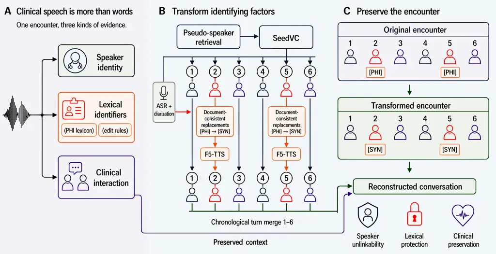
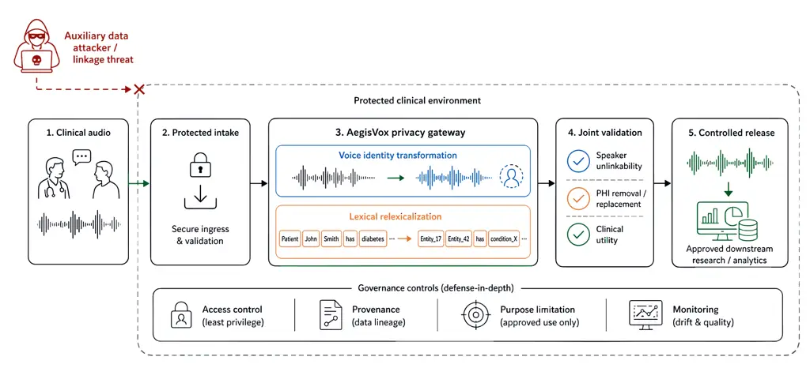
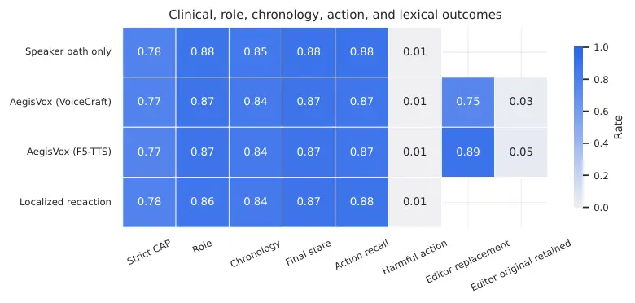
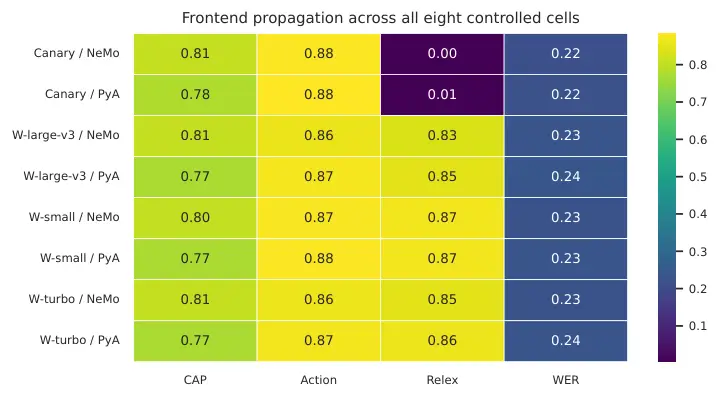

\jmlrpages

# AegisVox: Factorized Privacy and Clinical Preservation for Long-Form Speech

Praphul Singh Email: <praphul.singh@oracle.com>    Akshat Agarwal
Email: <akshat.z.agarwal@oracle.com>    Ratul Ghosh
Email: <ratul.ghosh@oracle.com>    Aashna Kanuga
Email: <aashna.kanuga@oracle.com>    Devashish Khatwani
Email: <devashish.khatwani@oracle.com>    Anurag Dwarakanath
Email: <anurag.dwarakanath@oracle.com>    Sri Gadde
Email: <sri.gadde@oracle.com>    Krishnaram Kenthapadi
Email: <krishnaram.kenthapadi@oracle.com> Affiliation: Oracle Health AI

###### Abstract

Clinical speech reveals identity through both spoken identifiers and
voice, yet its pauses, delivery, and speaker roles can also carry useful
clinical evidence. Protecting that speech therefore requires more than
preserving its words. We present AegisVox, a factorized framework that
assigns consistent surrogate voices and edits identifier-bearing turns
using document-consistent replacements. Across 390 public simulated or
non-patient conversations totaling 63.6 hours, a matched comparison of
two speech renderers separates replacement realization from retained
identifiers, speaker linkage, and clinical preservation. Text-to-speech
rendering realizes 535/601 planned replacements versus 453/601 for the
codec-based speech editor. However, similar aggregate clinical
preservation conceals more model-labeled contradictions, and
conversation-wide speaker scores conceal greater edited-speech linkage
under a score-direction sensitivity analysis. Fresh transcription of
original audio provides a reference for interpreting the clinical
measurement chain; an independent judge tests sensitivity to model-based
assessment. Better replacement realization can therefore coexist with
worse clinical or speaker-linkage measurements. AegisVox supports
use-specific evaluation of those tradeoffs, not a guarantee of
identifier removal or clinical safety.

^(†)^(†)proceedings: : Preprint^(†)^(†)year: 2026

###### keywords

clinical speech, audio privacy, de-identification, voice conversion,
speech editing

##### Data and Code Availability

We use public PriMock57, Fareez, and SIMSAMU (Papadopoulos Korfiatis
et al., 2022; Fareez et al., 2022; Nun et al., 2025), OpenSwara target
voices (Munshi, 2026), and synthetic ASQ-PHI (Weatherhead et al., 2026).
Appendix B.1 gives revisions and redistribution restrictions. Code is
available at
[https://github.com/spraphul/aegisvox](https://github.com/spraphul/aegisvox).
The accompanying evidence artifact documents the evaluation; source
audio remains subject to the listed access and redistribution terms.

##### Institutional Review Board (IRB)

Audio experiments used public simulated or non-patient recordings. The
limited five-reviewer listener study was not submitted for formal IRB
review.

## 1 Introduction



Figure 1: AegisVox separates voice identity from identifying words.
SeedVC converts every turn using one consistent surrogate voice per
source speaker. The lexical renderer changes only converted turns with
planned identifier replacements; the remaining converted turns pass
directly to reconstruction. F5-TTS is the illustrated renderer, and
VoiceCraft is the matched alternative. PHI denotes protected health
information.

A clinical conversation contains more than its transcript. The words
state symptoms and decisions, while the recording preserves who spoke,
when a correction occurred, and how an answer was delivered. Pauses,
prosody, accent, and non-speech events may matter when researchers study
communication or build speech-based clinical tools. Yet that same
recording exposes identity through both spoken identifiers and vocal
characteristics. Removing a name from text leaves both its spoken form
and the original voice available in the audio.

Releasing a de-identified transcript can avoid the additional risks of
sharing sound. When research requires audio, however, transformation
must preserve useful evidence without simply recreating the encounter.
Muting can interrupt an utterance. Full resynthesis can reproduce its
words but cannot preserve the observed delivery by construction. The
practical question is therefore not just whether transformed speech
remains intelligible, but which identifying and clinically important
properties change together.

Prior work provides strong components for this task. Clinical
de-identification detects sensitive text or edits its spoken realization
(Cohn et al., 2019; Singh et al., 2025; Kim et al., 2024). Speaker
anonymization transforms voice identity and measures source linkage with
automatic speaker verification (ASV) (Tomashenko et al., 2020;
Panariello et al., 2024; Tomashenko et al., 2024). Recent systems also
combine speaker and lexical transformations (Xiao et al., 2026). What
remains unclear is how these interventions interact in long-form
clinical conversations, where one speaker and one entity can recur
across many turns. A replacement may be spoken while an earlier mention
of the original remains; a fluent transcript may lose a negation; an
overall speaker score may hide linkability in the edited speech.

We introduce AegisVox, a factorized framework that changes speaker
identity and identifying words while retaining the surrounding converted
conversation. Each speaker receives a consistent surrogate voice, called
a _pseudo-speaker_. A language model generates source-language synthetic
replacements for detected entities, with one mapping reused throughout
the conversation. A speech renderer then edits only the affected
complete turns. This separation supports controlled renderer comparisons
and distinct tests of detection, replacement, linkage, and clinical
preservation.

Our evaluation covers 390 public simulated or non-patient clinical
conversations totaling 63.6 hours. The matched renderer comparison
improves replacement realization, but the controls reveal a more
consequential finding: similar aggregate clinical preservation does not
imply similar error types, and conversation-wide linkage does not
describe every edited region. A freshly transcribed original-audio
control helps interpret the measured clinical change without treating
model judgments as clinical truth.

Contributions. We provide (1) a long-form speech transformation with
consistent speaker and lexical mappings; (2) a stage-resolved evaluation
that separates planned replacement, retained identifiers, final-output
linkage, and source-grounded clinical evidence; and (3) a controlled
study of two lexical renderers, with original-audio, independent-judge,
frontend, and downstream-note checks that expose where the measures
agree and where they do not.

## 2 Related Work

##### Speaker and lexical privacy.

VoicePrivacy pairs attacker-oriented ASV with intelligibility and
quality measurements (Tomashenko et al., 2020; Panariello et al., 2024;
Tomashenko et al., 2024). Newer systems improve pseudo-speaker
generation and utility (Chen et al., 2026; Kuzmin et al., 2026).
Clinical text systems address a different identity surface through
detection, redaction, or consistent pseudonymization (Vakili and
Dalianis, 2022; Simancek and Vydiswaran, 2024; Singh et al., 2025).
Audio de-identification must also accommodate transcription errors and
realize its text changes in speech (Cohn et al., 2019; Abdjul et al.,
2025). Neither a text-detection score nor a speaker-verification score
establishes both forms of protection.

##### Speech editing and joint transformation.

Text-guided editors replace selected speech while conditioning on
observed context (Tan et al., 2021; Wang et al., 2022; Borsos et al.,
2022; Peng et al., 2024; Chen et al., 2025). General speech generation
offers another route, but requires rechecking the interaction it
reconstructs (Borsos et al., 2023; Shen et al., 2023). Aggazzotti et al.
(2026) transform long-form transcripts to reduce linkage through
linguistic style. Xiao et al. (2026) combine generated speaker
embeddings with localized identifier editing and evaluate the result as
training data. AegisVox builds on joint transformation through long-form
clinical factorization and controlled assessment of its distinct privacy
and preservation outcomes.

##### Clinical preservation.

Clinical note generation depends on facts, roles, temporal relations,
and supported decisions, not lexical similarity alone (Nair et al.,
2023; Ben Abacha et al., 2023; wai Yim et al., 2023). Word error rate
(WER) does not distinguish a benign transcription variant from a changed
dose or negation. Model-based evaluation can test these distinctions at
scale, but introduces dependence on the judge (Liu et al., 2023; Zheng
et al., 2023). We therefore retain separate clinical labels, test an
independent judge, and report the limits of transcript-based evidence.
Our renderer comparison uses published components within one framework;
it is not a matched benchmark against another complete privacy pipeline.

## 3 AegisVox

### 3.1 Task and consistent mappings

The input is a conversation waveform. Automatic speech recognition (ASR)
transcribes speech, and diarization assigns it to speakers. Together
they produce $`X=\{(a_{i},t_{i},s_{i},\tau_{i})\}_{i=1}^{N}`$, where
$`a_{i}`$ is the waveform of turn $`i`$, $`t_{i}`$ its transcript,
$`s_{i}`$ its speaker, and $`\tau_{i}`$ its time interval. Detection
identifies sensitive mentions $`E`$ with literal transcript evidence and
turn ownership. AegisVox uses two mappings: $`\pi:s\mapsto v`$, from
each source speaker to a public surrogate reference voice, and
$`\rho:e\mapsto e^{\prime}`$, from each detected entity to a synthetic
replacement. Both mappings remain fixed within a conversation.

The output is a reconstructed waveform with transformed voices and
planned lexical substitutions. A turn is _affected_ if it contains at
least one planned substitution. All turns undergo voice conversion; only
affected turns undergo additional lexical rendering (Figure 1). These
rules limit resynthesis, but do not by themselves guarantee correct
detection, identifier removal, or preserved delivery.

### 3.2 Speaker transformation

The ECAPA-TDNN speaker-embedding model represents each source speaker
$`s`$ and public reference voice $`v`$ as normalized vectors $`z_{s}`$
and $`z_{v}`$ (Desplanques et al., 2020). The voice pool contains 4,062
quality-controlled OpenSwara units (Munshi, 2026) with available
language, accent, gender-presentation, and vocal-trait metadata. The
FAISS similarity-search library retrieves 75 candidates per speaker.
Eligible references meet duration, audio-quality, language, and
source-distance constraints. Available metadata helps avoid an
acoustically incompatible reference, but is not a privacy guarantee.

Candidates are ranked by

```math
\displaystyle D_{\cos}(s,v) \displaystyle=1-\cos(z_{s},z_{v}), \tag{1}
```

```math
\displaystyle q(s,v) \displaystyle=D_{\cos}(s,v)+2T(s,v),
```

where $`T(s,v)\in[0,1]`$ is a weighted match over available voice
traits. In deterministic speaker order, assignment selects the
highest-ranked unused reference satisfying source–target distance
$`\geq 0.70`$ and pairwise target–target distance $`\geq 0.65`$, with
bounded backtracking for dead ends. References cannot be reused within a
conversation. The thresholds are untuned heuristics: all 16 tested
settings assigned all 809 conversation-speaker profiles, and three
rendered operating points changed only 14–23 assignments without a
detectable downstream contrast (Appendix D). This is constrained
ranking, not learned global assignment or an established privacy–utility
frontier.

SeedVC, a zero-shot diffusion-transformer voice converter (Liu, 2024),
converts every turn toward its assigned reference. Reusing the reference
maintains a consistent intended pseudo-identity across a speaker’s
turns. Distinct references maintain the intended separation between
speakers, while ASV tests whether source linkage persists after
transformation.

### 3.3 Lexical planning and complete-turn rendering

GPT-5.4 receives the complete speaker-attributed transcript and
generates a structured identifier and replacement plan. The detector
follows a frozen contract based on Health Insurance Portability and
Accountability Act (HIPAA) Safe Harbor categories. Each entity receives
a speakable synthetic substitute in the source language, reused across
coreferent mentions. The instructions exclude changes to clinical facts,
medication, negation, chronology, and roles. The instruction does not
verify complete detection or regulatory compliance.

Applying $`\rho`$ yields the complete replacement-bearing transcript
$`t_{i}^{\prime}`$. For an affected turn, the renderer receives the
complete SeedVC-converted audio, its transcript $`t_{i}`$, and
$`t_{i}^{\prime}`$. We compare two implementations: _AegisVox
(VoiceCraft)_, using a pretrained neural-codec speech editor (Peng
et al., 2024), and _AegisVox (F5-TTS)_, using a flow-matching
text-to-speech model conditioned on the reference turn (Chen et al.,
2025). Each produces an edited complete turn, not an isolated
replacement word. The framework is renderer-agnostic; these are two
implementations of the same factorization.

| Dataset         | Language | Conversations | Hours | Median \[IQR\] (s) | Setting                      |
| --------------- | -------- | ------------- | ----- | ------------------ | ---------------------------- |
| PriMock57-mixed | EN       | 57            | 8.6   | 556 \[456–617\]    | Doctor–patient consultations |
| Fareez          | EN       | 272           | 51.8  | 672 \[572–778\]    | Respiratory interviews       |
| SIMSAMU         | FR       | 61            | 3.2   | 187 \[152–234\]    | Simulated emergency calls    |
| Total           | EN/FR    | 390           | 63.6  | 609 \[471–736\]    | Public clinical audio        |

| Condition             | Audio treatment                          | Comparison role                              |
| --------------------- | ---------------------------------------- | -------------------------------------------- |
| Original audio        | None; fresh ASR and adjudication         | Reference for the clinical measurement chain |
| SeedVC only           | Consistent speaker conversion            | Shared speaker-path control                  |
| AegisVox (VoiceCraft) | SeedVC + complete-turn lexical editing   | Matched lexical-renderer comparison          |
| AegisVox (F5-TTS)     | SeedVC + complete-turn lexical rendering | Matched lexical-renderer comparison          |
| Localized redaction   | SeedVC + local deletion                  | Deletion boundary, not replacement synthesis |

Table 1: Public evaluation population and comparison roles. The
original-audio control changes no speech; all transformation conditions
share the source recordings. EN and FR denote English and French.

### 3.4 Reconstruction and measurement boundaries

Rendered turns replace the corresponding converted turns. The remaining
SeedVC-converted turns, gaps, and speaker ordering supply the
reconstruction context. Inserted durations may shift later timestamps;
the validated lexical replay concatenates these segments rather than
enforcing original turn length. Appendix C gives model and interface
details, and Appendix R describes execution and failure accounting.

We distinguish the generated-turn benchmark from evaluation of
reconstructed conversations. The former scores every matched edit
intention, retaining failed or uncertain outcomes without selecting a
successful fallback. The latter measures saved conversation
reconstructions, including 16 regions that retain converted speech after
VoiceCraft generation failure. The focused benchmark tests one
substitution at a time; its intentions are not the composed regions
counted in final reconstruction (Appendix I.3). A score on a generated
turn is not proof that every identifier was removed from the complete
conversation.


## 4 Evaluation Design

### 4.1 Population and controlled comparisons

The study uses PriMock57, Fareez, and SIMSAMU (Papadopoulos Korfiatis
et al., 2022; Fareez et al., 2022; Nun et al., 2025) (Table 1). The
recordings are public simulated or non-patient conversations, not a
sample of real patient encounters. The primary frontend is
faster-whisper large-v3 ASR (Radford et al., 2023) with pyannote 3.1
diarization (Bredin et al., 2020). The two renderer conditions share
recordings, frontend, pseudo-speaker assignments, SeedVC outputs,
planned edit intentions, and comparison rules. Localized redaction
supplies a separate deletion boundary. Dataset access, population
strata, and condition definitions appear in Appendices B–E.

### 4.2 Separate privacy outcomes

##### Detection and realized replacements.

We test text detection on all 1,051 synthetic ASQ-PHI queries
(Weatherhead et al., 2026). The primary exact typed endpoint covers
2,147 gold elements in the intersection of the benchmark ontology and
our frozen identifier contract; the full ontology contains 2,973
elements. This independent text test does not estimate identifier recall
in the 390 source recordings.

The renderer benchmark contains 601 matched _edit intentions_ from 208
conversations. For each intention, GPT-5.4 examines transcripts from two
ASR models applied to the generated complete turn. It separately judges
whether the synthetic replacement is realized and whether the original
identifier is retained, allowing spelling or phonetic variants. Either
judgment can be uncertain, and both can be positive. The denominator
includes failures; it is not the number of unique turns or an exhaustive
inventory of source PHI. Exact protocols appear in Appendices H, I,
and T.

##### Linkage to the source speaker.

The final-waveform test enrolls ECAPA-TDNN on original speech from the
same recording, then tests sampled speech from each saved reconstructed
output. A conversation-speaker profile is one assigned speaker within
one recording, not necessarily a unique person across the corpus. The
primary trials pair 809 profiles with their own transformed speech and
with other speakers in the same conversation, yielding 809 positive and
916 negative trials. This avoids assuming that different recordings
contain different people.

Each profile pools at most ten three-second windows. Equal error rate
(EER) is measured where false matches and missed matches balance. We
report both cosine score directions and the lower EER as a
score-orientation sensitivity analysis: the direction is selected using
evaluation labels, not held-out calibration. Lower EER means easier
linkage under this test. This is not an attacker trained on converted
speech. A second analysis restricts the samples to planned inserted-turn
intervals in the final output. Historical shared-stage ECAPA and
x-vector tests (Snyder et al., 2018) use different sampling and
impostors; they are reported separately in Appendix K, not assigned to
each final renderer condition.

### 4.3 Clinical evidence and controls

GPT-5.4 extracts 25,778 evidence-linked _clinical atomic propositions_
(CAPs) from the source ASR transcripts. A CAP is one checkable fact with
its relevant modifiers, such as “the patient denies a penicillin
allergy.” The inventory is frozen across conditions. The judge seeks
literal evidence in each condition’s transcript and assigns preserved,
partial, missing, contradicted, or uncertain. Strict preservation counts
only preserved. Contradiction is reported separately, since two systems
can have similar preservation rates but different error profiles.

The original-audio control freshly transcribes all 390 original ingested
WAVs and adjudicates them against the same frozen CAPs. It uses the same
declared ASR model and settings as the evaluator, rather than reusing
saved source text. Historical checkpoint/runtime identity and
hosted-judge temporal stability could not be fully verified. This
control measures the combined transcription and adjudication reference,
not a human transcript or facts omitted from the initial extraction
(Appendix I.1).

Both GPT-5.4 and the independent Qwen3-32B judge (Qwen Team, 2025)
passed a controlled qualification suite before study adjudication. Qwen
then assessed 600 shared CAPs in two presentation orders across three
conditions, and all 601 editor intentions, without seeing GPT outcomes.
Qualification tests known perturbations, not agreement with clinicians.
Appendices G and G.1 report its coverage and judge dependence.

A further control generates structured clinical notes from each
condition’s transcript alone. The generator receives no source CAP
inventory; that inventory enters only the subsequent evaluator. This
separates note-writing inputs from evaluation references. We also retain
clinical action, role, chronology, and final-state endpoints, plus WER,
timing, events, and acoustic similarity from CLAP and HeAR (Wu et al.,
2024; Baur et al., 2024). The latter compare learned audio
representations, not clinical correctness or human naturalness
(Appendices I–J).

Figure 2: Clinical controls and matched renderer effects on 25,778
source CAPs from 390 conversations. (a) Fresh original-audio ASR
supplies the reference, not clinical ground truth. (b) F5-TTS minus
VoiceCraft effects in percentage points (pp), with 95%
conversation-cluster intervals. Similar strict preservation coexists
with more model-labeled contradictions.

### 4.4 Statistical units and uncertainty

Main rates are item-weighted: each edit intention or source CAP
contributes once. Paired renderer effects use 10,000
conversation-cluster bootstrap resamples, preserving dependence among
items from one recording. We also report equal-conversation weighting.
Post hoc contradiction and retained-original tests use paired sign flips
and Holm adjustment within their two-test family. The original-control
and robustness families are separate. Final-waveform EER uses 2,000
conversation-cluster resamples; ASQ uses 2,000 query-level resamples.

Uncertain judgments do not count as verified success or verified
absence. Failed lexical cases remain in the 601-intention denominator.
Invalid note outputs remain unobserved, not zero; note contrasts use the
valid matched subset and report missingness bounds. Confidence intervals
describe sampling uncertainty, whereas bounds describe unresolved
outcomes. An interval crossing zero does not establish equivalence.
Appendix F defines all units, and Appendix P gives paired and weighting
sensitivities. Failure accounting and executable specifications appear
in Appendices Q and S.

## 5 Results

### 5.1 The original-audio control explains the reference scale

Fresh ASR of the original audio preserves 24,998/25,778 CAPs (96.97%;
95% CI 96.66–97.28), compared with 20,089/25,778 (77.93%) after SeedVC
alone (Figure 2). The paired change is $`-19.04`$ percentage points (CI
$`-20.29`$ to $`-17.83`$). Both renderer rates are close to the
SeedVC-only rate: 77.41% for VoiceCraft and 77.31% for F5-TTS.

Most of the aggregate deficit is already present in the SeedVC-only
comparison. Similar aggregate rates do not show that the same facts
failed in each condition. It does not show that voice conversion audibly
destroys 19% of clinical facts: transformed speech can change ASR
output, and the judge can label evidence differently. The frozen
inventory also omits facts missed by source ASR or extraction. The
control makes the absolute rates interpretable without resolving these
causes. Appendix I.1 separates it from the much easier
identical-saved-text self-consistency check.

| Outcome               | Denominator | VoiceCraft      | F5-TTS          | Effect (pp) | 95% CI (pp)        |
| --------------------- | ----------- | --------------- | --------------- | ----------- | ------------------ |
| Replacement realized  | 601         | 453 (75.37%)    | 535 (89.02%)    | $`+13.64`$  | $`[+9.69,+17.59]`$ |
| Original PHI retained | 601         | 21 (3.49%)      | 28 (4.66%)      | $`+1.16`$   | $`[-0.62,+2.88]`$  |
| CAP preserved         | 25,778      | 19,954 (77.41%) | 19,929 (77.31%) | $`-0.10`$   | $`[-0.61,+0.42]`$  |
| CAP contradicted      | 25,778      | 391 (1.52%)     | 479 (1.86%)     | $`+0.34`$   | $`[+0.15,+0.54]`$  |

Table 2: Matched outcomes within AegisVox. Counts and item-weighted
rates are shown for each renderer. Effects are F5-TTS minus VoiceCraft,
with 95% conversation-cluster intervals. The lexical rows cover 601 edit
intentions from 208 conversations; clinical rows cover 25,778 CAPs from
390 conversations. Realization is conditional on a planned edit, not
complete PHI removal.

### 5.2 More replacements do not imply uniform gains

F5-TTS realizes 535/601 planned replacements (89.02%), compared with
453/601 (75.37%) for VoiceCraft, a gain of 13.64 points (CI 9.69–17.59;
Table 2). Original PHI is nevertheless retained in 28/601 versus 21/601
edits. That difference is not statistically resolved (Holm-adjusted
$`p=0.272`$), but neither rate represents verified absence in all
remaining cases: original-term judgments are uncertain in 40 and 92
cases, respectively, with one additional VoiceCraft generation failure.

Aggregate CAP preservation differs by just $`-0.10`$ points (CI
$`-0.61`$ to $`0.42`$). Yet F5-TTS has more model-labeled
contradictions: 479/25,778 versus 391/25,778, a paired increase of 0.34
points (CI 0.15–0.54; Holm-adjusted $`p=0.0017`$). This adverse
secondary finding matters because strict preservation combines several
distinct failure types. Changing missing or uncertain to contradicted
need not alter that rate. The labels are not clinician-confirmed harms;
they warrant inspection rather than being hidden by the preservation
average. Appendix I reports the full outcome partition and
source-assigned importance strata.

Detection remains a separate limit. On ASQ-PHI, exact typed F1 is 94.4%
(CI 93.5–95.3) under the frozen contract intersection, but 79.9% (CI
78.9–80.8) under the full benchmark ontology. The difference includes a
geographic-category mismatch. Of 219 hard-negative queries, 48 elicit at
least one prediction. These are text-detection results, not recall for
identifiers in the clinical recordings; multiplying them by replacement
realization would not estimate end-to-end privacy (Appendix H).

### 5.3 Final-output averages can hide edited-speech linkage

Across all-turn samples from final conversations, score-orientation EER
is 0.369 for SeedVC alone, 0.365 for VoiceCraft, and 0.367 for F5-TTS.
The paired F5-TTS-minus-VoiceCraft contrast is 0.22 points (CI $`-1.01`$
to $`0.99`$), with no detectable difference. These tests use 809 matched
conversation-speaker profiles, not 809 independently identified people.

Figure 3: Final-waveform linkage under evaluation-label-selected score
direction. F5-TTS minus VoiceCraft effects use all-turn samples (809
profiles, 390 conversations) or planned-edit regions (291 profiles, 204
conversations). Bars are 95% clustered CIs. Lower EER means easier
source linkage.

Restricting samples to planned inserted-turn intervals changes the
result. On 291 matched eligible profiles from 204 conversations, F5-TTS
has 11.34-point lower EER (CI $`-15.91`$ to $`-6.69`$; Figure 3). Thus,
similar conversation-wide estimates do not exclude greater source
linkability in the speech being edited. Six additional VoiceCraft
profiles lack one second of eligible F5-TTS speech and are excluded from
this matched contrast, not scored as successful privacy. These findings
are sensitivity results under same-recording enrollment and selected
score direction, not a learned adaptive attack or a cross-session
identification claim (Appendix K).

### 5.4 Clinical conclusions depend on the measurement protocol

Qwen3-32B corroborates the lexical ordering, judging 486/601 F5-TTS and
421/601 VoiceCraft replacements realized. Clinical labels nevertheless
differ: Cohen’s $`\kappa`$ is 0.253–0.340 where Qwen returns valid,
agreeing labels under both presentation orders. This unweighted
comparison retains uncertainty as a separate category. Qwen’s overall
weighted clinical contrast also crosses zero, but its absolute rates and
low-importance fact contrast differ from GPT-5.4. The independent judge
tests sensitivity, not clinical truth (Appendix G.1).

When notes are generated without the source-fact inventory, the valid
matched subset contains 314 conversations and 20,316 CAPs. F5-TTS versus
VoiceCraft strict note preservation differs by $`-0.37`$ points (CI
$`-1.30`$ to $`0.56`$), while model-labeled contradictions increase by
0.48 points (CI 0.24–0.72). Only 1,440/1,560 note generations and
999/1,170 judgments are valid. These exploratory contrasts describe
observed matched cases; unresolved cases can change the population
direction (Appendix J.1).

Five reviewers also rated 25 clinical and 25 perceptual items in a
limited blinded panel, yielding 125 ratings per panel. Its uneven
coverage, including only seven clinical and four perceptual F5-TTS
items, supports descriptive listening observations, not renderer
superiority or CAP-level validation (Appendix O).

### 5.5 Frontend and recording conditions constrain use

Crossing Whisper small, turbo, and large-v3 and Canary-1B-v2 with
pyannote and NeMo Sortformer yields 3,120 recording-cell evaluations
(Sekoyan et al., 2025; Park et al., 2025). Strict CAP preservation
ranges from 0.771 to 0.807, without one backend leading all measures.
Canary has competitive matched WER, yet its interface lacks the
speaker-turn and timing links needed to localize planned edits. Observed
realization is only 2/481 intentions with NeMo and 3/596 with pyannote.
These are integration failures of the evaluated pipeline, not inherent
limits of Canary or the renderer. A transcript can be useful while its
timing interface is unusable for local speech editing (Appendix M).

Applying 12-dB room noise before the full pipeline reduces the
conversation-level chronology endpoint by 12.1 points (CI 6.4–17.5;
Holm-adjusted $`p=0.0006`$; Appendix N). CLAP and HeAR similarities
provide complementary acoustic evidence but do not establish accent or
naturalness invariance (Appendix J). English and French differences
remain confounded with dataset, duration, and interaction setting rather
than identifying a causal language effect (Appendix L).

## 6 Discussion

##### Different privacy tests answer different questions.

A spoken substitute does not prove removal of its source, and voice
conversion does not remove spoken identifiers. F5-TTS improves planned
realization, but contradictions and edited-region linkage argue against
a universal renderer choice. Neither WER nor one privacy–utility score
can express this tradeoff. The relevant balance depends on what a
recipient needs to hear and what identifying evidence an attacker can
access.

##### Preserving sound requires more than preserving words.

Complete-turn rendering supplies context without rerendering every
converted turn. It limits lexical resynthesis, not all acoustic change.
The original-audio control and frontend sensitivity show why facts,
speaker attribution, timing, and delivery require checks across the full
measurement chain, not only within the editor.

##### Review before release.

Consistent pseudo-speakers can retain useful conversational roles, but
matching language and voice traits can also narrow an attacker’s search.
Voice-pool knowledge, auxiliary recordings, and repeated releases could
strengthen that attacker. Restricted access, inspection of uncertain
edits, and purpose-limited release are therefore possible safeguards,
not deployments validated here (Appendix A). No measured EER or
replacement rate establishes HIPAA compliance or a universal threshold
for releasing clinical audio.

##### What remains unvalidated.

The study does not provide an exhaustive independently annotated
identifier inventory for the source recordings, proposition-level
clinician truth, a learned conversion-adapted attacker, or a matched
external complete pipeline. The renderer contrast does not establish
superiority over complete systems. GPT-5.4 is used for planning and
primary clinical evaluation; Qwen reduces single-family dependence but
does not validate source extraction. ASR and judging errors remain mixed
with audio changes. The non-patient population, partial notes, and
limited listening evidence leave transfer to real care untested.

## 7 Conclusion

AegisVox makes long-form speech privacy a joint transformation and
preservation problem, with consistent voice assignments and
document-level lexical replacements. Its controlled evaluation shows why
the outcomes must remain separate: more planned replacements can coexist
with retained identifiers, more model-labeled contradictions, and easier
edited-region linkage under the evaluated score direction.
Original-audio and final-waveform controls make these tradeoffs visible
without equating model judgments with clinical truth. Future work should
pair independent clinical and identifier references with stronger
attacks on released speech.

###### acknowledgments-disclosure-of-funding.

We thank Raefer Gabriel, Kiran Rama, Vishal Vishnoi, Amitabh Saikia,
Irfan Bulu, Jangwon Kim, Neil Hauge, and Gyan Shankar for their guidance
and feedback. We thank Oracle Health AI for supporting this research and
providing the computational resources used in the experiments and
analyses.

## References

- Abdjul et al. (2025) Rifqi Naufal Abdjul, Dessi Puji Lestari, Ayu
  Purwarianti, Candy Olivia Mawalim, Sakriani Sakti, and Masashi Unoki.
  Indonesian speech content de-identification in low resource
  transcripts. In Derry Wijaya, Alham Fikri Aji, Clara Vania,
  Genta Indra Winata, and Ayu Purwarianti, editors, _Proceedings of the
  Second Workshop in South East Asian Language Processing_, pages 63–71,
  Online, January 2025. Association for Computational Linguistics. URL
  [https://aclanthology.org/2025.sealp-1.6/](https://aclanthology.org/2025.sealp-1.6/).
- Aggazzotti et al. (2026) Cristina Aggazzotti, Ashi Garg, Zexin Cai,
  and Nicholas Andrews. Content anonymization for privacy in long-form
  audio, 2026. URL
  [https://arxiv.org/abs/2510.12780](https://arxiv.org/abs/2510.12780).
- Baur et al. (2024) Sebastien Baur, Zaid Nabulsi, Wei-Hung Weng, Jake
  Garrison, Louis Blankemeier, Sam Fishman, Christina Chen, Sujay
  Kakarmath, Minyoi Maimbolwa, Nsala Sanjase, Brian Shuma, Yossi Matias,
  Greg S. Corrado, Shwetak Patel, Shravya Shetty, Shruthi Prabhakara,
  Monde Muyoyeta, and Diego Ardila. Hear – health acoustic
  representations, 2024. URL
  [https://arxiv.org/abs/2403.02522](https://arxiv.org/abs/2403.02522).
- Ben Abacha et al. (2023) Asma Ben Abacha, Wen-wai Yim, Griffin Adams,
  Neal Snider, and Meliha Yetisgen. Overview of the MEDIQA-chat 2023
  shared tasks on the summarization & generation of doctor-patient
  conversations. In Tristan Naumann, Asma Ben Abacha, Steven Bethard,
  Kirk Roberts, and Anna Rumshisky, editors, _Proceedings of the 5th
  Clinical Natural Language Processing Workshop_, pages 503–513,
  Toronto, Canada, July 2023. Association for Computational Linguistics.
  [10.18653/v1/2023.clinicalnlp-1.52](https://doi.org/10.18653/v1/2023.clinicalnlp-1.52).
  URL
  [https://aclanthology.org/2023.clinicalnlp-1.52/](https://aclanthology.org/2023.clinicalnlp-1.52/).
- Borsos et al. (2022) Zalán Borsos, Matt Sharifi, and Marco
  Tagliasacchi. Speechpainter: Text-conditioned speech inpainting, 2022.
  URL
  [https://arxiv.org/abs/2202.07273](https://arxiv.org/abs/2202.07273).
- Borsos et al. (2023) Zalán Borsos, Raphaël Marinier, Damien Vincent,
  Eugene Kharitonov, Olivier Pietquin, Matt Sharifi, Dominik Roblek,
  Olivier Teboul, David Grangier, Marco Tagliasacchi, and Neil
  Zeghidour. Audiolm: a language modeling approach to audio
  generation, 2023. URL
  [https://arxiv.org/abs/2209.03143](https://arxiv.org/abs/2209.03143).
- Bredin et al. (2020) Herve Bredin, Ruiqing Yin, Juan Manuel Coria,
  Gregory Gelly, Pavel Korshunov, Marvin Lavechin, Diego Fustes, Hadrien
  Titeux, Wassim Bouaziz, and Marie-Philippe Gill. Pyannote.audio:
  Neural building blocks for speaker diarization. In _ICASSP 2020 - 2020
  IEEE International Conference on Acoustics, Speech and Signal
  Processing (ICASSP)_, page 7124–7128. IEEE, May 2020.
  [10.1109/icassp40776.2020.9052974](https://doi.org/10.1109/icassp40776.2020.9052974).
  URL
  [http://dx.doi.org/10.1109/ICASSP40776.2020.9052974](http://dx.doi.org/10.1109/ICASSP40776.2020.9052974).
- Chen et al. (2026) Meiying Melissa Chen, Anastasia Kuznetsova, Zhenyu
  Wang, and Zhiyao Duan. Nouveauvoice: Generating novel pseudo speakers
  for voice anonymization, 2026. URL
  [https://arxiv.org/abs/2607.03985](https://arxiv.org/abs/2607.03985).
- Chen et al. (2025) Yushen Chen, Zhikang Niu, Ziyang Ma, Keqi Deng,
  Chunhui Wang, Jian Zhao, Kai Yu, and Xie Chen. F5-tts: A fairytaler
  that fakes fluent and faithful speech with flow matching, 2025. URL
  [https://arxiv.org/abs/2410.06885](https://arxiv.org/abs/2410.06885).
- Cohn et al. (2019) Ido Cohn, Itay Laish, Genady Beryozkin, Gang Li,
  Izhak Shafran, Idan Szpektor, Tzvika Hartman, Avinatan Hassidim, and
  Yossi Matias. Audio de-identification - a new entity recognition task.
  In Anastassia Loukina, Michelle Morales, and Rohit Kumar, editors,
  _Proceedings of the 2019 Conference of the North American Chapter of
  the Association for Computational Linguistics: Human Language
  Technologies, Volume 2 (Industry Papers)_, pages 197–204, Minneapolis,
  Minnesota, June 2019. Association for Computational Linguistics.
  [10.18653/v1/N19-2025](https://doi.org/10.18653/v1/N19-2025). URL
  [https://aclanthology.org/N19-2025/](https://aclanthology.org/N19-2025/).
- Desplanques et al. (2020) Brecht Desplanques, Jenthe Thienpondt, and
  Kris Demuynck. ECAPA-TDNN: Emphasized Channel Attention, Propagation
  and Aggregation in TDNN Based Speaker Verification. In _Interspeech
  2020_, pages 3830–3834, 2020.
  [10.21437/Interspeech.2020-2650](https://doi.org/10.21437/Interspeech.2020-2650).
- Fareez et al. (2022) Faiha Fareez, Tishya Parikh, Christopher Wavell,
  Saba Shahab, Meghan Chevalier, Scott Good, Isabella De Blasi, Rafik
  Rhouma, Christopher McMahon, Jean-Paul Lam, Thomas Lo, and
  Christopher W. Smith. A dataset of simulated patient-physician medical
  interviews with a focus on respiratory cases. _Scientific Data_, 9(1),
  June 2022. ISSN 2052-4463.
  [10.1038/s41597-022-01423-1](https://doi.org/10.1038/s41597-022-01423-1).
  URL
  [http://dx.doi.org/10.1038/s41597-022-01423-1](http://dx.doi.org/10.1038/s41597-022-01423-1).
- Kim et al. (2024) Woojin Kim, Sungeun Hahm, and Jaejin Lee.
  Generalizing clinical de-identification models by privacy-safe data
  augmentation using GPT-4. In Yaser Al-Onaizan, Mohit Bansal, and
  Yun-Nung Chen, editors, _Proceedings of the 2024 Conference on
  Empirical Methods in Natural Language Processing_, pages 21204–21218,
  Miami, Florida, USA, November 2024. Association for Computational
  Linguistics.
  [10.18653/v1/2024.emnlp-main.1181](https://doi.org/10.18653/v1/2024.emnlp-main.1181).
  URL
  [https://aclanthology.org/2024.emnlp-main.1181/](https://aclanthology.org/2024.emnlp-main.1181/).
- Kuzmin et al. (2026) Nikita Kuzmin, Songting Liu, Kong Aik Lee, and
  Eng Siong Chng. Stream-voice-anon: Enhancing utility of real-time
  speaker anonymization via neural audio codec and language
  models, 2026. URL
  [https://arxiv.org/abs/2601.13948](https://arxiv.org/abs/2601.13948).
- Liu (2024) Songting Liu. Zero-shot voice conversion with diffusion
  transformers, 2024. URL
  [https://arxiv.org/abs/2411.09943](https://arxiv.org/abs/2411.09943).
- Liu et al. (2023) Yang Liu, Dan Iter, Yichong Xu, Shuohang Wang,
  Ruochen Xu, and Chenguang Zhu. G-eval: NLG evaluation using gpt-4 with
  better human alignment. In Houda Bouamor, Juan Pino, and Kalika Bali,
  editors, _Proceedings of the 2023 Conference on Empirical Methods in
  Natural Language Processing_, pages 2511–2522, Singapore,
  December 2023. Association for Computational Linguistics.
  [10.18653/v1/2023.emnlp-main.153](https://doi.org/10.18653/v1/2023.emnlp-main.153).
  URL
  [https://aclanthology.org/2023.emnlp-main.153/](https://aclanthology.org/2023.emnlp-main.153/).
- Munshi (2026) Jay Munshi. Open swara: The largest open-source
  humanized voice library, 2026. URL
  [https://github.com/jaymunshi/open-swara](https://github.com/jaymunshi/open-swara).
- Nair et al. (2023) Varun Nair, Elliot Schumacher, and Anitha Kannan.
  Generating medically-accurate summaries of patient-provider dialogue:
  A multi-stage approach using large language models. In Tristan
  Naumann, Asma Ben Abacha, Steven Bethard, Kirk Roberts, and Anna
  Rumshisky, editors, _Proceedings of the 5th Clinical Natural Language
  Processing Workshop_, pages 200–217, Toronto, Canada, July 2023.
  Association for Computational Linguistics.
  [10.18653/v1/2023.clinicalnlp-1.26](https://doi.org/10.18653/v1/2023.clinicalnlp-1.26).
  URL
  [https://aclanthology.org/2023.clinicalnlp-1.26/](https://aclanthology.org/2023.clinicalnlp-1.26/).
- Nun et al. (2025) Aimé Nun, Olivier Birot, Gaël Guibon, Frédéric
  Lapostolle, and Ivan Lerner. Simsamu - a french medical dispatch
  dialog open dataset. _Computer Methods and Programs in Biomedicine_,
  268:108857, August 2025. ISSN 0169-2607.
  [10.1016/j.cmpb.2025.108857](https://doi.org/10.1016/j.cmpb.2025.108857).
  URL
  [http://dx.doi.org/10.1016/j.cmpb.2025.108857](http://dx.doi.org/10.1016/j.cmpb.2025.108857).
- Panariello et al. (2024) Michele Panariello, Natalia Tomashenko, Xin
  Wang, Xiaoxiao Miao, Pierre Champion, Hubert Nourtel, Massimiliano
  Todisco, Nicholas Evans, Emmanuel Vincent, and Junichi Yamagishi. The
  voiceprivacy 2022 challenge: Progress and perspectives in voice
  anonymisation, 2024. URL
  [https://arxiv.org/abs/2407.11516](https://arxiv.org/abs/2407.11516).
- Papadopoulos Korfiatis et al. (2022) Alex Papadopoulos Korfiatis,
  Francesco Moramarco, Radmila Sarac, and Aleksandar Savkov. PriMock57:
  A dataset of primary care mock consultations. In Smaranda Muresan,
  Preslav Nakov, and Aline Villavicencio, editors, _Proceedings of the
  60th Annual Meeting of the Association for Computational Linguistics
  (Volume 2: Short Papers)_, pages 588–598, Dublin, Ireland, May 2022.
  Association for Computational Linguistics.
  [10.18653/v1/2022.acl-short.65](https://doi.org/10.18653/v1/2022.acl-short.65).
  URL
  [https://aclanthology.org/2022.acl-short.65/](https://aclanthology.org/2022.acl-short.65/).
- Park et al. (2025) Taejin Park, Ivan Medennikov, Kunal Dhawan, Weiqing
  Wang, He Huang, Nithin Rao Koluguri, Krishna C Puvvada, Jagadeesh
  Balam, and Boris Ginsburg. Sortformer: A novel approach for
  permutation-resolved speaker supervision in speech-to-text systems. In
  Aarti Singh, Maryam Fazel, Daniel Hsu, Simon Lacoste-Julien, Felix
  Berkenkamp, Tegan Maharaj, Kiri Wagstaff, and Jerry Zhu, editors,
  _Proceedings of the 42nd International Conference on Machine
  Learning_, volume 267 of _Proceedings of Machine Learning Research_,
  pages 48153–48169. PMLR, 13–19 Jul 2025. URL
  [https://proceedings.mlr.press/v267/park25h.html](https://proceedings.mlr.press/v267/park25h.html).
- Peng et al. (2024) Puyuan Peng, Po-Yao Huang, Shang-Wen Li,
  Abdelrahman Mohamed, and David Harwath. VoiceCraft: Zero-shot speech
  editing and text-to-speech in the wild. In Lun-Wei Ku, Andre Martins,
  and Vivek Srikumar, editors, _Proceedings of the 62nd Annual Meeting
  of the Association for Computational Linguistics (Volume 1: Long
  Papers)_, pages 12442–12462, Bangkok, Thailand, August 2024.
  Association for Computational Linguistics.
  [10.18653/v1/2024.acl-long.673](https://doi.org/10.18653/v1/2024.acl-long.673).
  URL
  [https://aclanthology.org/2024.acl-long.673/](https://aclanthology.org/2024.acl-long.673/).
- Qwen Team (2025) Qwen Team. Qwen3 technical report, 2025. URL
  [https://arxiv.org/abs/2505.09388](https://arxiv.org/abs/2505.09388).
- Radford et al. (2023) Alec Radford, Jong Wook Kim, Tao Xu, Greg
  Brockman, Christine Mcleavey, and Ilya Sutskever. Robust speech
  recognition via large-scale weak supervision. In Andreas Krause, Emma
  Brunskill, Kyunghyun Cho, Barbara Engelhardt, Sivan Sabato, and
  Jonathan Scarlett, editors, _Proceedings of the 40th International
  Conference on Machine Learning_, volume 202 of _Proceedings of Machine
  Learning Research_, pages 28492–28518. PMLR, 23–29 Jul 2023. URL
  [https://proceedings.mlr.press/v202/radford23a.html](https://proceedings.mlr.press/v202/radford23a.html).
- Sekoyan et al. (2025) Monica Sekoyan, Nithin Rao Koluguri, Nune
  Tadevosyan, Piotr Zelasko, Travis Bartley, Nikolay Karpov, Jagadeesh
  Balam, and Boris Ginsburg. Canary-1b-v2 & parakeet-tdt-0.6b-v3:
  Efficient and high-performance models for multilingual asr and
  ast, 2025. URL
  [https://arxiv.org/abs/2509.14128](https://arxiv.org/abs/2509.14128).
- Shen et al. (2023) Kai Shen, Zeqian Ju, Xu Tan, Yanqing Liu, Yichong
  Leng, Lei He, Tao Qin, Sheng Zhao, and Jiang Bian. Naturalspeech 2:
  Latent diffusion models are natural and zero-shot speech and singing
  synthesizers, 2023. URL
  [https://arxiv.org/abs/2304.09116](https://arxiv.org/abs/2304.09116).
- Simancek and Vydiswaran (2024) Dalton Simancek and V.G.Vinod
  Vydiswaran. Handling name errors of a BERT-based de-identification
  system: Insights from stratified sampling and Markov-based
  pseudonymization. In Elena Volodina, David Alfter, Simon Dobnik,
  Therese Lindström Tiedemann, Ricardo Muñoz Sánchez, Maria Irena
  Szawerna, and Xuan-Son Vu, editors, _Proceedings of the Workshop on
  Computational Approaches to Language Data Pseudonymization
  (CALD-pseudo 2024)_, pages 1–7, St. Julian’s, Malta, March 2024.
  Association for Computational Linguistics.
  [10.18653/v1/2024.caldpseudo-1.1](https://doi.org/10.18653/v1/2024.caldpseudo-1.1).
  URL
  [https://aclanthology.org/2024.caldpseudo-1.1/](https://aclanthology.org/2024.caldpseudo-1.1/).
- Singh et al. (2025) Praphul Singh, Charlotte Dzialo, Jangwon Kim,
  Sumana Srivatsa, Irfan Bulu, Sri Gadde, and Krishnaram Kenthapadi.
  RedactOR: An LLM-powered framework for automatic clinical data
  de-identification. In Georg Rehm and Yunyao Li, editors, _Proceedings
  of the 63rd Annual Meeting of the Association for Computational
  Linguistics (Volume 6: Industry Track)_, pages 510–530, Vienna,
  Austria, July 2025. Association for Computational Linguistics. ISBN
  979-8-89176-288-6.
  [10.18653/v1/2025.acl-industry.36](https://doi.org/10.18653/v1/2025.acl-industry.36).
  URL
  [https://aclanthology.org/2025.acl-industry.36/](https://aclanthology.org/2025.acl-industry.36/).
- Snyder et al. (2018) David Snyder, Daniel Garcia-Romero, Gregory Sell,
  Daniel Povey, and Sanjeev Khudanpur. X-vectors: Robust dnn embeddings
  for speaker recognition. In _2018 IEEE International Conference on
  Acoustics, Speech and Signal Processing (ICASSP)_, page 5329–5333.
  IEEE, April 2018.
  [10.1109/icassp.2018.8461375](https://doi.org/10.1109/icassp.2018.8461375).
  URL
  [http://dx.doi.org/10.1109/ICASSP.2018.8461375](http://dx.doi.org/10.1109/ICASSP.2018.8461375).
- Tan et al. (2021) Daxin Tan, Liqun Deng, Yu Ting Yeung, Xin Jiang,
  Xiao Chen, and Tan Lee. Editspeech: A text based speech editing system
  using partial inference and bidirectional fusion, 2021. URL
  [https://arxiv.org/abs/2107.01554](https://arxiv.org/abs/2107.01554).
- Tomashenko et al. (2020) Natalia Tomashenko, Brij Mohan Lal
  Srivastava, Xin Wang, Emmanuel Vincent, Andreas Nautsch, Junichi
  Yamagishi, Nicholas Evans, Jose Patino, Jean-François Bonastre,
  Paul-Gauthier Noé, and Massimiliano Todisco. Introducing the
  voiceprivacy initiative, 2020. URL
  [https://arxiv.org/abs/2005.01387](https://arxiv.org/abs/2005.01387).
- Tomashenko et al. (2024) Natalia Tomashenko, Xiaoxiao Miao, Pierre
  Champion, Sarina Meyer, Xin Wang, Emmanuel Vincent, Michele
  Panariello, Nicholas Evans, Junichi Yamagishi, and Massimiliano
  Todisco. The voiceprivacy 2024 challenge evaluation plan, 2024. URL
  [https://arxiv.org/abs/2404.02677](https://arxiv.org/abs/2404.02677).
- Vakili and Dalianis (2022) Thomas Vakili and Hercules Dalianis.
  Utility preservation of clinical text after de-identification. In Dina
  Demner-Fushman, Kevin Bretonnel Cohen, Sophia Ananiadou, and Junichi
  Tsujii, editors, _Proceedings of the 21st Workshop on Biomedical
  Language Processing_, pages 383–388, Dublin, Ireland, May 2022.
  Association for Computational Linguistics.
  [10.18653/v1/2022.bionlp-1.38](https://doi.org/10.18653/v1/2022.bionlp-1.38).
  URL
  [https://aclanthology.org/2022.bionlp-1.38/](https://aclanthology.org/2022.bionlp-1.38/).
- wai Yim et al. (2023) Wen wai Yim, Yujuan Fu, Asma Ben Abacha, Neal
  Snider, Thomas Lin, and Meliha Yetisgen. Aci-bench: a novel ambient
  clinical intelligence dataset for benchmarking automatic visit note
  generation, 2023. URL
  [https://arxiv.org/abs/2306.02022](https://arxiv.org/abs/2306.02022).
- Wang et al. (2022) Tao Wang, Jiangyan Yi, Ruibo Fu, Jianhua Tao, and
  Zhengqi Wen. Campnet: Context-aware mask prediction for end-to-end
  text-based speech editing, 2022. URL
  [https://arxiv.org/abs/2202.09950](https://arxiv.org/abs/2202.09950).
- Weatherhead et al. (2026) James Weatherhead, George Golovko, and Peter
  McCaffrey. Asq-phi: An adversarial synthetic data benchmark for
  clinical de-identification and search utility. _Data in Brief_,
  65:112586, April 2026. ISSN 2352-3409.
  [10.1016/j.dib.2026.112586](https://doi.org/10.1016/j.dib.2026.112586).
  URL
  [http://dx.doi.org/10.1016/j.dib.2026.112586](http://dx.doi.org/10.1016/j.dib.2026.112586).
- Wu et al. (2024) Yusong Wu, Ke Chen, Tianyu Zhang, Yuchen Hui,
  Marianna Nezhurina, Taylor Berg-Kirkpatrick, and Shlomo Dubnov.
  Large-scale contrastive language-audio pretraining with feature fusion
  and keyword-to-caption augmentation, 2024. URL
  [https://arxiv.org/abs/2211.06687](https://arxiv.org/abs/2211.06687).
- Xiao et al. (2026) Yunchong Xiao, Yuxiang Zhao, Ziyang Ma, Shuai Wang,
  Kai Yu, Jiachun Liao, and Xie Chen. Anonymization, not elimination:
  Utility-preserved speech anonymization, 2026. URL
  [https://arxiv.org/abs/2604.17000](https://arxiv.org/abs/2604.17000).
- Zheng et al. (2023) Lianmin Zheng, Wei-Lin Chiang, Ying Sheng, Siyuan
  Zhuang, Zhanghao Wu, Yonghao Zhuang, Zi Lin, Zhuohan Li, Dacheng Li,
  Eric P. Xing, Hao Zhang, Joseph E. Gonzalez, and Ion Stoica. Judging
  llm-as-a-judge with mt-bench and chatbot arena, 2023. URL
  [https://arxiv.org/abs/2306.05685](https://arxiv.org/abs/2306.05685).

## Appendix A Reporting Boundaries and Governed Use

The evaluation concerns public simulated or non-patient clinical
conversations. The identifier framework follows the US Department of
Health and Human Services guidance on [de-identification
methods](https://www.hhs.gov/hipaa/for-professionals/special-topics/de-identification/index.html).
This framework does not replace the legal assessment required for a
particular release or establish that the transformed waveform meets that
standard. It does not establish performance on real patients, clinical
safety, regulatory compliance, guaranteed removal of protected
information, or anonymity. Speaker privacy is reported only against the
evaluated automatic speaker-verification (ASV) attackers. Lexical
privacy is reported as replacement realization, retention of the
original sensitive term, and uncertainty, with each denominator stated.
Model-adjudicated clinical endpoints are not presented as human ground
truth.

Figure 4 places AegisVox inside a controlled data-release process. The
transformation is one protection layer. Source access control, purpose
limitation, provenance, residual-risk review, restricted release, and
monitoring remain necessary because an adversary may possess auxiliary
voice recordings, metadata, or repeated access to transformed outputs.

The supplement follows the same stage-resolved logic as the main paper.
It first defines the population, transformation, and controlled
conditions; then reports protected health information (PHI) detection,
lexical realization, speaker verification, and clinical preservation
under their own denominators; finally, it documents sensitivity,
failure, listener, governance, and reproducibility evidence. Results
from different statistical units are never added into a composite score.



Figure 4: Governed integration and threat boundary. AegisVox transforms
speaker identity and identifying language before controlled release,
while access, provenance, residual-risk review, and monitoring remain
outside the model and continue to constrain use.

## Appendix B Evaluation Population and Strata

The public evaluation contains 390 conversations and 63.6 hours of
audio: 272 Fareez respiratory interviews, 57 PriMock57 consultations,
and 61 SIMSAMU emergency calls. There are 329 English and 61 French
recordings. Duration quartiles contain 98, 97, 97, and 98 recordings,
with cut points near 471, 609, and 736 seconds. Detected speaker counts
are two in 302 recordings, three in 73, and at least four in 15. These
strata establish long-form and multi-speaker coverage, but language,
dataset, interaction setting, and sample size remain confounded.

The frontend strata contain 883 timeline speaker labels, whereas the
saved ASV enrollment registry contains 809 conversation-speaker
profiles: eight recordings have one profile, 347 have two, 33 have
three, and two have four. These are different stage-specific registries,
not interchangeable speaker counts or verified unique-person identities.
The timeline-label strata describe frontend segmentation; ASV uses only
its saved profile and interval registry. The edit registry contains 611
diagnostic intentions across duration strata, while the matched editor
comparison contains 601 intentions present in both renderer manifests.
The 601-edit denominator is used for realization, original-term
retention, and uncertainty. Recording-level clinical analyses use all
390 conversations and proposition-level analyses use the same 25,778
source clinical atomic propositions (CAPs) per condition. Figure 5
reports the complete population composition.

Figure 5: Public evaluation population by dataset, language, detected
speaker count, and planned edit count. Duration strata are specified in
the text.

The OpenSwara voice pool supplies 4,062 quality-controlled public target
units. Each stores a normalized ECAPA-TDNN embedding, waveform,
duration, sample rate, and available language, accent or geography,
gender-presentation, vocal maturity, weight, and resonance metadata.
Retrieval uses these deterministic features to seek a target that is
compatible but separated from the source. A one-to-one conversation
assignment also encourages target-to-target distinctiveness. The
selected target remains fixed for that source speaker throughout the
recording. This design supports role continuity; it does not imply
protection against arbitrary auxiliary-data attacks.

### B.1 Data access and redistribution

PriMock57 was frozen at Git revision cd2ac707ad03 under CC BY 4.0; the
Fareez respiratory interviews use Figshare revision
10.6084/m9.figshare.16550013.v1 under CC0 1.0; and SIMSAMU was frozen at
Hugging Face revision 6b639431f658 under the MIT license. The OpenSwara
pool uses revision 3fc1ab35af18; its dataset card reports CC BY-SA 4.0,
but the evaluated snapshot does not expose uniform per-voice upstream
provenance. The accompanying artifact therefore distributes exact
manifests, identifiers, revisions, code, hashes, and aggregate evidence,
but no source, reference, transformed, or listener audio. ASQ-PHI is a
fully synthetic text benchmark released under the MIT license.
Researchers obtain each public corpus from its cited source under the
corresponding access terms. The released manifests record the complete
revision identifiers.

## Appendix C Implementation Details

##### Frontend.

The primary frontend uses faster-whisper large-v3 for matched source and
target transcription and pyannote 3.1 for speaker-attributed turns. The
sensitivity matrix additionally evaluates Whisper small, turbo, and
large-v3 plus NVIDIA Canary-1B-v2, crossed with pyannote 3.1 and NeMo
Sortformer. Downstream settings remain fixed within this matrix so that
differences describe frontend propagation rather than a reconfigured
transformation.

##### Speaker profiling and assignment.

Speaker turns are pooled into source profiles. FAISS inner-product
search over normalized ECAPA embeddings retrieves 75 candidates per
source speaker. Eligibility requires at least 4.5 seconds of 16-kHz
audio, excludes child-like targets, and applies language and
native-English compatibility where relevant. Reranking combines
source-target distance with compatible voice traits. The
conversation-level assignment enforces one target per source speaker, no
target reuse within a conversation, and pairwise distinctiveness among
assigned targets. The assignment is made once and reused across all
turns.

##### Identity conversion.

SeedVC converts each speaker-attributed turn toward its retrieved target
voice. The converter aims to preserve the linguistic input while
changing voice identity; its measured preservation and linkage are
evaluated separately. Because all reportable editor conditions share
this conversion path, SeedVC speaker-verification results must not be
attributed to VoiceCraft or F5-TTS.

##### Replacement planning.

GPT-5.4 receives the complete speaker-attributed transcript, detected
language, and the conversation-level entity inventory. It emits a
structured edit plan that maps each supported sensitive entity to a
synthetic replacement in the source language. A selected replacement is
reused across coreferent mentions. The planner is restricted to
identifying information and must not alter symptoms, diagnoses,
medications, doses, allergies, negation, chronology, speaker roles,
actions, or decisions.

##### Lexical rendering and reconstruction.

The primary AegisVox instantiation uses the flow-matching F5-TTS model;
the matched AegisVox instantiation substitutes the pretrained,
unmodified VoiceCraft 330M neural-codec language model. Both receive a
complete converted speaker turn, its transcript, and that transcript
with the planned replacement. The resulting complete edited turn
replaces that converted turn. Unedited SeedVC turns are retained, and
reconstruction accounts for changed turn durations. The final lexical
insertion replay concatenates the inserted turns with surrounding
converted samples; it does not establish a crossfade at each insertion.
No post-generation semantic rejection or favorable fallback is inserted
into the primary editor comparison.

## Appendix D Retrieval-Threshold Sensitivity

The source–target cutoff of 0.70 and target–target cutoff of 0.65 are
heuristic assignment constraints, not values tuned against the reported
test outcomes. We evaluated all 16 combinations of source–target minima
$`\{0.60,0.65,0.70,0.75\}`$ and target–target minima
$`\{0.55,0.60,0.65,0.70\}`$ over all 809 source profiles. Every grid
cell assigned 809/809 profiles. We then fully rendered and evaluated the
utility-oriented, balanced, and privacy-oriented settings in Table 3 on
all 390 conversations. This is a sensitivity analysis of the declared
heuristic and in-pool candidate set. It does not test adversarial target
choice or out-of-pool references. Speaker linkage is summarized by
attacker-oriented equal error rate (EER). Utility measures include word
error rate (WER) and embedding similarities from Contrastive
Language-Audio Pretraining (CLAP) and Health Acoustic Representations
(HeAR).

| Setting          | $`(D_{\mathrm{src}},D_{\mathrm{tgt}})`$ | Assigned | Median $`D_{\mathrm{src}}`$ | Median $`D_{\mathrm{tgt}}`$ | ECAPA EER | x-vector EER | Frontend WER | CAP    | CLAP / HeAR     |
| ---------------- | --------------------------------------- | -------- | --------------------------- | --------------------------- | --------- | ------------ | ------------ | ------ | --------------- |
| Utility-oriented | $`(0.60,0.55)`$                         | 809/809  | 1.1600                      | 0.8741                      | 0.3115    | 0.3426       | 0.2314       | 0.7446 | 0.7296 / 0.9448 |
| Balanced         | $`(0.70,0.65)`$                         | 809/809  | 1.1590                      | 0.8741                      | 0.3103    | 0.3436       | 0.2311       | 0.7453 | 0.7297 / 0.9448 |
| Privacy-oriented | $`(0.75,0.70)`$                         | 809/809  | 1.1585                      | 0.8773                      | 0.3140    | 0.3461       | 0.2310       | 0.7453 | 0.7303 / 0.9448 |

Table 3: Retrieval-threshold sensitivity over separately rendered
conditions. CAP is the recording-level mean strict
proposition-preservation rate. ASV uses the 809-positive and
653,672-impostor trial population per backend; ECAPA is
orientation-normalized so EER is at most 0.5. Absolute values belong to
this sensitivity family and are not substituted for the
primary-condition results.

The three settings used 186 pool targets and never assigned the same
target to two speakers within one conversation. Targets may be reused
across independent conversations. Utility versus balanced changed 14/809
source assignments, utility versus privacy changed 23/809, and balanced
versus privacy changed 14/809. The small achieved-distance shifts were
detectable after Holm correction, but no downstream ASV, WER, CAP,
chronology, clinical-action, replacement-realization, CLAP, or HeAR
contrast was. The evaluated cutoffs are therefore non-binding in this
pool. We retain the balanced setting for continuity, not because it
statistically dominates the alternatives. The experiment supports
robustness to these reasonable threshold choices but does not identify a
privacy–utility frontier.

## Appendix E Controlled Conditions

The four reportable conditions share the same 390 source conversations
and the same frontend. The speaker-path-only control applies only the
speaker-identity path. AegisVox (VoiceCraft) and AegisVox (F5-TTS) share
the frontend, pseudo-speaker assignment, SeedVC conversion, replacement
plan, and reconstruction, differing only in the complete-turn lexical
renderer. Localized redaction applies the same speaker path but removes
the planned lexical region without synthesizing a replacement.
Consequently, editor realization is applicable only to the two
replacement-bearing conditions. The historical ASV result measures only
their shared speaker path. The final-waveform test separately evaluates
each of these three conditions. Localized redaction begins from
SeedVC-converted turns, but has no separate final-waveform ASV result;
that endpoint is unmeasured rather than zero. The freshly transcribed
original-audio condition supplies an additional clinical measurement
control without transformation.

## Appendix F Endpoint and Statistical Protocol

Each endpoint retains its own population and stage. ASQ-PHI detection
uses 1,051 synthetic queries, with 2,147 contract-intersection or 2,973
full-ontology gold elements. Generated-turn realization and retention
use 601 matched edit intentions in 208 conversations. Final-waveform
linkage uses 809 conversation-speaker profiles, with 809 positive and
916 within-conversation negative trials for all-turn samples. Clinical
preservation uses 25,778 frozen source CAPs in 390 conversations. The
frontend matrix retains all $`8\times 390=3{,}120`$ recording-cells. A
rate from one unit cannot substitute for coverage of another.

##### Paired clinical and lexical estimates.

Main rates are item-weighted proportions. Their paired effects use
10,000 bootstrap resamples of source conversations, retaining all items
in a sampled conversation. The random seed is 20261005. Sign-flip tests
use 20,000 draws at the same cluster level. The post hoc family of
original-identifier retention and CAP contradiction uses Holm adjustment
over those two endpoints only. Strict preservation and realization
intervals are not a multiplicity-adjusted simultaneous confidence
region. Equal-conversation estimates give each recording equal weight
and are reported as a separate sensitivity analysis in Appendix P.

##### Controls and other families.

The original-audio control also uses 10,000 conversation-cluster
resamples and 20,000 sign flips. Its six-test Holm family comprises
preservation and contradiction for three transformed conditions versus
original audio. Final-waveform ASV uses 2,000 conversation-cluster
resamples. ASQ-PHI uses 2,000 query-level bootstrap resamples, including
the hard-negative query proportion. The prespecified robustness families
retain their separate paired Holm analyses. These families must not be
interpreted as one global error-rate control across the paper.

##### Uncertainty is not absence.

Uncertain lexical labels and generation failures remain in the
601-intention denominator but do not establish absence of an original
identifier. The strict CAP indicator counts only preserved labels;
partial, missing, contradicted, and uncertain remain separate in outcome
tables. Invalid or absent note judgments are unobserved, not judged
missing and not a zero score. The note comparison is restricted to valid
matched cases, with no missing-at-random assumption. Identification
bounds vary unresolved outcomes and are not confidence intervals.
Structurally inapplicable measures are not assigned zero.

## Appendix G Model-Adjudication Qualification

The source-anchored clinical protocol was tested on 45 controlled cases
spanning 15 families, with three cases per family. Benign controls
include exact copies, paraphrases, and identifier-only replacement.
Harmful cases include critical fact deletion, negation or uncertainty
flips, medication, dose, measurement, severity, role, plan-attribution,
unsupported-insertion, and chronology errors. The qualification matrix
repeats each case under target-first ordering, rubric permutation,
prompt paraphrase, evidence removal, and context truncation.

GPT-5.4 completed 360/360 qualification judgments while satisfying the
prespecified harmful-error sensitivity, benign specificity,
evidence-validity, and fail-closed requirements. The final clinical
endpoints therefore use one qualified primary model judge. This supports
a controlled model-adjudication protocol, not equivalence to clinical
experts or ground truth.

Figure 6: Controlled qualification suite for source-anchored clinical
adjudication. Each corruption family tests whether the judge
distinguishes preserved content from a clinically consequential change
under protocol variants.

### G.1 Independent open-model sensitivity

To test dependence on the GPT-5.4 model family used by the primary
clinical judge, Qwen3-32B (Qwen Team, 2025) was frozen at Hugging Face
revision 9216db5781bf21249d130ec9da846c4624c16137, run with thinking
disabled and greedy decoding, and required to pass the unchanged
qualification gates before seeing study cases. It completed 360/360
qualification judgments. Under the conservative source/target-order
rule, consensus coverage and outcome accuracy were 44/45, harmful
sensitivity was 35/36, and benign specificity was 9/9. The sole order
disagreement remained uncertain.

The qualified model then judged the same predeclared 600 source CAPs
matched across the speaker-path-only control, AegisVox (VoiceCraft), and
AegisVox (F5-TTS). Each condition case was evaluated source-first and
target-first, giving 3,600 expected judgments; 3,526 were valid and 74
remained fail-closed. GPT-5.4 outcomes were never included in Qwen
prompts. Table 4 separates raw counts, weighted strict-preservation
estimates, and unweighted categorical agreement. We therefore compare
whether directional conclusions persist, but do not treat the judges as
interchangeable.

| Condition             | Covered | Qwen preserved / 600 | Weighted Qwen | Agreement       | $`\kappa`$ |
| --------------------- | ------- | -------------------- | ------------- | --------------- | ---------- |
| SeedVC only           | 522     | 493 (82.2%)          | 90.9%         | 413/522 (79.1%) | 0.253      |
| AegisVox (VoiceCraft) | 512     | 466 (77.7%)          | 88.8%         | 405/512 (79.1%) | 0.314      |
| AegisVox (F5-TTS)     | 511     | 462 (77.0%)          | 85.7%         | 405/511 (79.3%) | 0.340      |

Table 4: Independent Qwen sensitivity on 600 shared CAPs per condition.
Covered cases have valid agreeing Qwen labels under both orders. Strict
raw counts retain all 600 intentions. Weighted rates use inverse stratum
probabilities. Agreement and $`\kappa`$ are unweighted over covered
cases and retain GPT uncertainty as a third category; they are not
binary accuracy.

Figure 7 separates three questions that a single agreement number would
conflate: whether population-weighted preservation estimates differ
between judges, whether they agree case by case, and whether they
recover the same lexical-renderer ordering. Weighted GPT preservation is
76.2%, 77.4%, and 75.4% for SeedVC, VoiceCraft, and F5-TTS,
respectively, on the same 600-CAP sample. Qwen assigns higher weighted
preservation, while $`\kappa`$ shows that this is not a calibrated
substitute for GPT-5.4. Nevertheless, both judges assign higher
replacement realization to the F5-TTS instantiation than to the
VoiceCraft instantiation.

Figure 7: Independent-judge sensitivity. Left: inverse-stratum-weighted
strict preservation under each judge, with conversation-cluster
intervals. Center: unweighted uncertainty-retaining Cohen’s $`\kappa`$
on covered cases. Right: realized replacements under each judge, with
numerators over 601 intentions. Weighting, label agreement, and lexical
ordering answer different questions.

Under Qwen, the paired F5-TTS-minus-VoiceCraft renderer effect within
AegisVox was $`-0.0305`$ over all 600 CAPs (95% audio-cluster bootstrap
CI $`-0.0773`$ to $`0.0112`$). The critical effect was $`0.0193`$
($`n=201`$; CI $`-0.0382`$ to $`0.0759`$), the major effect was
$`0.0003`$ ($`n=201`$; CI $`-0.0595`$ to $`0.0582`$), and the minor
effect was $`-0.0739`$ ($`n=198`$; CI $`-0.1483`$ to $`-0.0080`$). The
overall contrast crossed zero under both judges, but the negative minor
stratum and systematically higher Qwen absolute rates make judge
dependence a result rather than a removable nuisance.

The same model independently judged the frozen 601-item lexical
evidence. It classified 421/601 VoiceCraft-rendered replacements as
realized (70.0%; Wilson 95% CI 66.3–73.6) and 486/601 F5-TTS-rendered
replacements as realized (80.9%; 77.5–83.8). Original phrases were
present in 29/601 and 28/601 items, respectively. This corroborates the
direction of the F5-TTS renderer’s realization gain while showing that
its absolute magnitude depends on the model judge. Both analyses use
transcript evidence, not direct listening or clinician ground truth.

## Appendix H Independent PHI-Detector Evaluation

The frozen text detector was evaluated on all 1,051 ASQ-PHI queries: 832
PHI-positive queries and 219 hard negatives. Gold labels were
unavailable to the model. The primary analysis uses typed exact matching
over the intersection between the frozen AegisVox contract and the
benchmark ontology. It contains 2,147 gold elements and gives 2,043 true
positives, 137 false positives, and 104 false negatives. Table 5 reports
the complete primary and sensitivity endpoints.

| Scoring contract                         | Gold  | TP    | FP  | FN  | Precision \[95% CI\]   | Recall \[95% CI\]      | F1 \[95% CI\]          |
| ---------------------------------------- | ----- | ----- | --- | --- | ---------------------- | ---------------------- | ---------------------- |
| Contract intersection, exact typed       | 2,147 | 2,043 | 137 | 104 | 0.937 \[0.926, 0.947\] | 0.952 \[0.942, 0.960\] | 0.944 \[0.935, 0.953\] |
| Contract intersection, boundary tolerant | 2,147 | 2,124 | 56  | 23  | 0.974 \[0.968, 0.981\] | 0.989 \[0.985, 0.993\] | 0.982 \[0.977, 0.986\] |
| Full ASQ ontology, exact typed           | 2,973 | 2,150 | 259 | 823 | 0.892 \[0.880, 0.905\] | 0.723 \[0.714, 0.732\] | 0.799 \[0.789, 0.808\] |
| Full ASQ ontology, boundary tolerant     | 2,973 | 2,348 | 61  | 625 | 0.975 \[0.968, 0.981\] | 0.790 \[0.781, 0.799\] | 0.873 \[0.866, 0.879\] |

Table 5: Independent ASQ-PHI detector evaluation. Confidence intervals
use 2,000 query-level bootstrap resamples. The full ontology includes
the prespecified geography-contract mismatch.

The full-ontology exact F1 was 0.799 and boundary-tolerant F1 was 0.873.
This drop is not hidden as detector error under the primary contract:
ASQ-PHI groups facilities and organizations into GEOGRAPHIC_LOCATION,
whereas the frozen AegisVox contract includes a location only when it is
literally geographic. On 219 hard-negative queries, 48 contained at
least one predicted entity, a query-level false-positive rate of 0.219
(95% query-bootstrap CI 0.165–0.273). The 48 affected queries contained
49 predictions: 45 dates and four geographic subdivisions. Most date
predictions were literal years such as 2018–2022 that the frozen Safe
Harbor contract treats as dates but the benchmark labels as non-PHI in
its hard-negative questions. Thus, this endpoint captures both detector
overreach and a benchmark-contract disagreement.

| Category                       | Gold | Exact precision | Exact recall | Exact F1 | Boundary F1 |
| ------------------------------ | ---- | --------------- | ------------ | -------- | ----------- |
| Name                           | 814  | 0.937           | 0.932        | 0.935    | 0.995       |
| Date                           | 806  | 0.944           | 0.989        | 0.966    | 0.967       |
| Medical record number          | 305  | 0.909           | 0.918        | 0.914    | 0.995       |
| Health-plan beneficiary number | 91   | 0.956           | 0.945        | 0.950    | 0.972       |
| Phone number                   | 45   | 1.000           | 1.000        | 1.000    | 1.000       |
| Social Security number         | 33   | 0.943           | 1.000        | 0.971    | 0.971       |
| Email address                  | 31   | 1.000           | 0.968        | 0.984    | 0.984       |
| Unique identifier              | 14   | 0.500           | 0.357        | 0.417    | 0.750       |
| Other contract categories      | 8    | 1.000           | 1.000        | 1.000    | 1.000       |

Table 6: Primary category results on the contract-intersection gold set.
Low-support residual categories are grouped; unique identifiers are
shown separately because their performance differs.

Unique identifiers are the weakest supported category, although only 14
gold elements are available. Names and medical-record numbers improve
sharply under boundary-tolerant scoring, showing that many exact errors
are span-boundary disagreements rather than missed entity concepts.
These results bound the detector’s supported ontology and do not
establish exhaustive detection of arbitrary identifiers in speech.

## Appendix I Complete Clinical and Lexical Results

The lexical chain separates an independent detector result from
conditional renderer behavior. Among the 601 edits planned for both
renderers, the AegisVox (F5-TTS) instantiation realizes 535 (89.0%),
while AegisVox (VoiceCraft) realizes 453 (75.4%). Original sensitive
terms are retained in 28 F5-TTS-rendered edits (4.7%) and 21
VoiceCraft-rendered edits (3.5%); 46 F5-TTS-rendered outcomes (7.7%) and
110 VoiceCraft-rendered outcomes (18.3%) are uncertain. These endpoints
are adjudicated separately and may overlap, so their counts must not be
forced into a partition. The paired realization effect is $`+13.64`$
percentage points (95% conversation-cluster bootstrap CI $`9.69`$ to
$`17.59`$). Original retention differs by $`+1.16`$ points (CI $`-0.62`$
to $`2.88`$; Holm-adjusted $`p=0.272`$). Realization uncertainty is not
retention uncertainty: the latter is 40/601 for F5-TTS and 92/601 for
VoiceCraft, with one additional VoiceCraft generation failure.

| Renderer   | Planned edits | Replacement realized | Original PHI retained | Uncertain   |
| ---------- | ------------- | -------------------- | --------------------- | ----------- |
| VoiceCraft | 601           | 453 (75.4%)          | 21 (3.5%)             | 110 (18.3%) |
| F5-TTS     | 601           | 535 (89.0%)          | 28 (4.7%)             | 46 (7.7%)   |

Table 7: Conditional lexical-renderer outcomes over the same 601 planned
edit intentions, assessed from generated-turn transcripts. Uncertainty
refers to realization; outcomes may overlap. Detection is reported in
Table 5.

Clinical preservation is decomposed rather than summarized only by the
strict rate. Table 8 shows all 25,778 proposition judgments per
condition. Strict preservation counts only _preserved_; partial and
uncertain cases do not pass. AegisVox (F5-TTS) preserves 19,929
propositions (77.3%), compared with 20,089 (77.9%) under the
speaker-path-only control. The paired F5-TTS-minus-VoiceCraft strict-CAP
effect within AegisVox is $`-0.097`$ percentage points (95%
conversation-cluster CI $`-0.606`$ to $`0.422`$). This is no detectable
difference under the declared test, not an equivalence claim.

| Condition             | Preserved      | Partial      | Missing       | Contradicted | Uncertain  |
| --------------------- | -------------- | ------------ | ------------- | ------------ | ---------- |
| Fresh original audio  | 24,998 (97.0%) | 556 (2.2%)   | 128 (0.5%)    | 95 (0.4%)    | 1 (0.0%)   |
| Speaker path only     | 20,089 (77.9%) | 2,304 (8.9%) | 2,630 (10.2%) | 364 (1.4%)   | 391 (1.5%) |
| AegisVox (VoiceCraft) | 19,954 (77.4%) | 2,347 (9.1%) | 2,663 (10.3%) | 391 (1.5%)   | 423 (1.6%) |
| AegisVox (F5-TTS)     | 19,929 (77.3%) | 2,367 (9.2%) | 2,724 (10.6%) | 479 (1.9%)   | 279 (1.1%) |
| Localized redaction   | 20,016 (77.6%) | 2,225 (8.6%) | 2,891 (11.2%) | 387 (1.5%)   | 259 (1.0%) |

Table 8: Source-anchored CAP outcome decomposition. Each row contains
the same 25,778 propositions; percentages are row percentages.

Source-extraction model labels assign 1,269 CAPs as critical, 13,486 as
major, and 11,023 as minor. These are model-generated importance strata,
not clinician annotations. Table 9 shows that the aggregate rate is not
driven by one severity stratum. Most of the aggregate deficit is already
present with SeedVC alone. Similar aggregate rates do not identify which
facts failed in common. They do not isolate audible errors from
transcription or judging errors, or identify the severity of a verified
clinical harm.

| Condition             | Critical ($`n=1{,}269`$) | Major ($`n=13{,}486`$) | Minor ($`n=11{,}023`$) |
| --------------------- | ------------------------ | ---------------------- | ---------------------- |
| Speaker path only     | 976 (76.9%)              | 11,044 (81.9%)         | 8,069 (73.2%)          |
| AegisVox (VoiceCraft) | 977 (77.0%)              | 10,951 (81.2%)         | 8,026 (72.8%)          |
| AegisVox (F5-TTS)     | 959 (75.6%)              | 10,957 (81.2%)         | 8,013 (72.7%)          |
| Localized redaction   | 989 (77.9%)              | 10,985 (81.5%)         | 8,042 (73.0%)          |

Table 9: Strict CAP preservation by source-assigned clinical importance.
Numerators are preserved propositions; denominators are fixed across
conditions.

Figure 8 aligns these clinical and lexical outcomes without collapsing
their different units. Across conditions, role preservation ranges from
0.863 to 0.875, chronology preservation from 0.840 to 0.851, final-state
preservation from 0.871 to 0.883, and action recall from 0.866 to 0.881.
Harmful-action-change rates are between 0.006 and 0.007.



Figure 8: Complete condition-level clinical and lexical profile.
Clinical endpoints use the 390-conversation population; editor endpoints
use the matched 601-intention population.

### I.1 Fresh original-audio control

All 390 normalized original ingested WAVs were transcribed afresh with
faster-whisper large-v3, CUDA float16, beam size 1, voice-activity
detection, and automatic language selection. No audio identity or
lexical transformation was applied. GPT-5.4 adjudicated these new
transcripts against the existing 25,778 source CAPs; the inventory was
not extracted again. All 390 adjudications were valid, with no
unobserved CAPs. The original-control labels are 24,998 preserved, 556
partial, 128 missing, 95 contradicted, and one uncertain. Strict
preservation is 96.974% (95% conversation-cluster CI 96.658–97.279).

The fresh original comparison gives SeedVC, VoiceCraft, and F5-TTS
changes of $`-19.043`$, $`-19.567`$, and $`-19.664`$ percentage points,
respectively. Their intervals are $`[-20.288,-17.833]`$,
$`[-20.830,-18.359]`$, and $`[-20.923,-18.462]`$. These are
item-weighted paired label contrasts, not independent estimates of
audible clinical damage.

Fresh-execution receipts establish that the transcripts were newly
computed; 335 differ from the saved source text and 55 are identical.
Text equality alone neither proves nor disproves fresh execution. The
declared model and settings match the evaluator, but exact historical
checkpoint/runtime identity and hosted-judge temporal stability could
not be fully verified. Source ASR and extraction omissions remain
outside the frozen inventory. A separate self-consistency check, using
identical saved source text, preserves 25,775/25,778 CAPs (99.99%); it
is not the fresh original-waveform control.

### I.2 Paired contradiction and uncertainty

For model-labeled contradiction, 237 CAPs are positive under both
renderers, 242 under F5-TTS only, 154 under VoiceCraft only, and 25,145
under neither. The resulting 479 versus 391 contradictions give
$`+0.341`$ percentage points (CI $`0.150`$–$`0.542`$), with sign-flip
$`p=0.000850`$ and two-test Holm-adjusted $`p=0.001700`$. The source
importance strata describe the original fact, not clinician-assigned
severity of an output error.

If uncertain CAP labels are allowed to vary rather than assigned the
strict indicator, the preservation difference has identification bounds
$`[-1.738,0.985]`$ points and contradiction $`[-1.300,1.424]`$ points.
These bounds are not sampling intervals. They show why the reported
contradiction increase is a difference in explicit model labels, not a
complete estimate of unknown clinical outcomes.

### I.3 Retained identifiers in intended inputs

Saved planning evidence allows reconstruction of intended target text
for the focused editor benchmark. An original literal is still present
in 12/28 F5-TTS cases labeled retained and 12/21 VoiceCraft cases
labeled retained. This is not a corrected retention rate: every observed
retained case remains in its original denominator. Actual outgoing model
requests were not saved, so intended text cannot establish runtime
compliance or the cause of each retained identifier.

For the public PriMock example in the main text, the source begins “your
name. Doris. So Doris, what I think we need to do is, this sounds like
you might have a chest infection.” The reconstructed intended transcript
changes only the first occurrence to “Nina.” Both ASR transcripts of the
F5-TTS edited turn support “Nina” followed by “Doris.” The two lexical
labels are therefore realized replacement and retained original. The
example uses transcript evidence, not independent listening, and does
not establish a clinical error from other ASR wording differences.

The 601-intention focused benchmark and the composed final-conversation
reconstruction are separate populations. Saved final-waveform receipts
cover 545 planned regions per renderer: all 545 contain generated F5-TTS
turns, whereas VoiceCraft contains 529 generated turns and 16 retained
converted regions after generation failure, across 14 conversations. The
focused VoiceCraft benchmark has one generation failure among its 601
intentions. Neither failure count may be substituted for the other.

## Appendix J Acoustic, Timing, and Documentation Preservation

CLAP similarity under bounded dynamic time warping (DTW) ranges from
0.725 to 0.732 and HeAR similarity from 0.945 to 0.946 across the four
conditions. These representation-level measures probe preservation of
broad audio and health-acoustic structure but are not diagnostic
accuracy or human perceptual judgments. Detector-defined event recall
and precision are 0.405 and 0.240 for AegisVox (F5-TTS), 0.376 and 0.218
for AegisVox (VoiceCraft), and 0.407 and 0.244 for the speaker-path-only
control. Speech-activity changes range from approximately $`-0.047`$ to
$`-0.059`$, while speaking-rate changes range from approximately
$`+5.4`$ to $`+8.6`$ words per minute.

The earlier note comparison supplies source facts to the note-writing
protocol and compares source- and target-grounded structured notes.
Section Jaccard ranges from 0.944 to 0.960 and exact-structure agreement
from approximately 0.74 to 0.79 across generators and conditions.
Comparisons are made within note generator because generator-specific
length and organization are not valid cross-system effects.

Figure 9: Acoustic representation, event, and timing preservation. CLAP
and HeAR are embedding similarities, events are detector-defined, and
timing is measured with the matched ASR protocol.

### J.1 Transcript-only note generation

A separate control gives GPT-5.4 only the transcript for the current
condition and a dataset-prefixed record identifier. It receives no
source CAP inventory, replacement plan, other-condition transcript, or
renderer label. Source facts are supplied only to the later note
evaluator. This tests documentation without directly conditioning
generation on the answer inventory; it does not make GPT-generated and
GPT-adjudicated notes independent clinical truth.

Of 1,560 note jobs, 1,440 yield valid notes and 120 exhaust the allowed
attempts. Of 1,170 planned target-note judgments, 999 are valid, 167
lack a valid note pair, and four are quarantined because of duplicate
unsupported- assertion evidence. Missing jobs are not empty notes or
zero preservation. Table 10 retains all scheduled conversations.

| Condition             | Valid notes | Exhausted | Judgments (V / Q / B) | CAPs           |
| --------------------- | ----------- | --------- | --------------------- | -------------- |
| Original              | 362         | 28        | Not applicable        | Not applicable |
| SeedVC only           | 359         | 31        | 331 / 2 / 57          | 21,515         |
| AegisVox (VoiceCraft) | 355         | 35        | 329 / 1 / 60          | 21,485         |
| AegisVox (F5-TTS)     | 364         | 26        | 339 / 1 / 50          | 22,063         |

Table 10: Transcript-only note control. Each note condition schedules
390 conversations. Target judgments compare a valid transformed note
with a valid source note. V, Q, and B denote valid, quarantined, and
blocked judgments; invalid and missing outcomes remain unobserved.

The common valid F5-TTS/VoiceCraft subset has 314 conversations and
20,316 CAPs. Strict preservation is 14,597/20,316 (71.85%) versus
14,673/20,316 (72.22%), a difference of $`-0.374`$ percentage points
(95% clustered CI $`-1.302`$ to $`0.558`$). Contradictions are
369/20,316 (1.82%) versus 272/20,316 (1.34%), a difference of $`+0.477`$
points (CI $`0.239`$–$`0.722`$). Preservation is the primary
observed-subset contrast; contradiction is exploratory, without an
adjusted significance claim. Inference uses 10,000 conversation-cluster
bootstrap draws and 20,000 sign flips, seed 20261005.

Selection remains unresolved. Varying uncertain and unobserved outcomes
gives full-population difference bounds of $`[-16.30,17.01]`$ points for
strict preservation and $`[-17.40,15.91]`$ for contradiction. These are
identification bounds, not CIs, and can reverse the observed direction.
Source-inclusion judgments disagree on 307 matched CAPs. A separate
conditional comparison uses only the 19,401 CAPs judged included in both
source-note assessments; its strict-preservation contrast is $`-0.505`$
points (CI $`-1.467`$ to $`0.441`$). It is not based on two unequal
condition-specific denominators.

No causal numerical comparison is made with the earlier fact-conditioned
note experiment: validated coverage and protocols differ. The exact
transcript-only generation prompt and its evaluation prompt are included
in Appendix T.

## Appendix K Attacker-Oriented Speaker Privacy

### K.1 Final-waveform protocol

The final-output test first verifies the 1,170 saved reconstructed WAVs
(390 recordings in each of three conditions). Replaying the inserted
generated or retained converted regions reproduces every WAV within two
PCM16 quantization steps. This verifies the file lineage, not semantic
correctness. The replay concatenates surrounding converted samples and
the inserted turns; turn duration changes shift later timestamps. It
does not establish exact preservation of original timing or crossfades
at lexical insertion boundaries.

The attacker uses SpeechBrain ECAPA-TDNN at revision
0f99f2d0ebe89ac095bcc5903c4dd8f72b367286. Enrollment comes from assigned
original speech in the same recording, not an independent session or the
retrieved pseudo-speaker reference. Speech intervals use saved pipeline
assignments, not independently verified speaker labels. Sampling takes
at most ten equispaced three-second windows over the time-ordered
assigned intervals, with 50-ms edge trimming and at least one second of
usable speech. Each window embedding is unit normalized; the mean is
normalized again to form one profile.

The primary all-turn analysis has 809 conversation-speaker profiles, 809
same-profile positives, and 916 other-speaker negatives within the same
conversation. A person may recur across conversations, so
cross-recording pairs are not assumed to be independent known
identities. Both score directions are reported in Table 11. The smaller
EER selects direction on evaluation labels and is a sensitivity result,
not a calibrated or trained adaptive attacker. Intervals use 2,000
conversation-cluster draws.

| Condition             | High-cosine EER | Low-cosine EER | Low-cosine 95% CI  |
| --------------------- | --------------- | -------------- | ------------------ |
| SeedVC only           | 0.6310          | 0.3690         | \[0.3483, 0.3878\] |
| AegisVox (VoiceCraft) | 0.6354          | 0.3646         | \[0.3458, 0.3861\] |
| AegisVox (F5-TTS)     | 0.6332          | 0.3668         | \[0.3469, 0.3856\] |

Table 11: Final-waveform ECAPA scores on all-turn samples: 809 positive
and 916 within-conversation negative trials per condition.
Lower-direction EER is selected using evaluation labels. The interval
describes resampled conversations, not uncertainty about unseen attacker
strategies.

The paired all-turn effect is $`+0.218`$ percentage points (CI
$`-1.010`$ to $`0.988`$). The planned-edit-region analysis has 297
eligible VoiceCraft profiles in 207 conversations and 291 F5-TTS
profiles in 204 conversations. There are 512 profiles per condition
without an edit interval (not applicable) and six additional F5-TTS
profiles with less than one second of eligible speech (unknown). The
matched 291-profile contrast is $`-11.340`$ points (CI $`-15.910`$ to
$`-6.688`$). Planned-edit regions include retained converted audio after
generation failure; they are not restricted to successful synthesis. The
unmatched group EERs, 0.4389 and 0.3230, must not be subtracted to
obtain the paired effect.

### K.2 Historical shared-stage protocol

The following separate test measures the common SeedVC stage. It uses
different sampling and cross-recording negatives, and is not a
trajectory that can be subtracted from the final-waveform estimates
above. Its two backends establish sensitivity to the verification
representation, not final-output performance of both lexical renderers.

The attacker enrolls one profile from each of the 809 original
conversation-speaker profiles. For source speaker $`s`$, transformed
audio derived from $`s`$ is the positive test; transformed audio derived
from each of the other 808 source speakers forms the impostor set. This
produces 809 positive and $`809\times 808=653{,}672`$ negative trials
per backend and condition. The attacker does not enroll on the retrieved
pseudo-speaker reference. It has access to original source-speaker audio
and to the transformed release, which is the relevant
original-to-release linkage question.

ECAPA and x-vector use the same trial identities but independent
embeddings. Because score conventions differ by backend, the informed
attacker may select the orientation that best links the source. Under
this attacker-optimal orientation, ECAPA EER is 0.304 (95%
source-bootstrap CI 0.289–0.324) and x-vector EER is 0.345
(0.331–0.361). The ECAPA orientation is
lower-score-indicates-same-source; x-vector is
higher-score-indicates-same-source. These estimates belong only to the
shared SeedVC stage. They are not the final-waveform scores for either
renderer.

| Backend              | Source profiles | Positive trials | Impostor trials | EER (95% CI)        | Attacker orientation           |
| -------------------- | --------------- | --------------- | --------------- | ------------------- | ------------------------------ |
| SpeechBrain ECAPA    | 809             | 809             | 653,672         | 0.304 (0.289–0.324) | Lower score means same source  |
| SpeechBrain x-vector | 809             | 809             | 653,672         | 0.345 (0.331–0.361) | Higher score means same source |

Table 12: Historical shared-stage speaker-verification protocol and
results. Higher EER means harder source linkage only under the declared
enrollment, trials, and attack backend.

These results show residual source linkability rather than anonymous
speech. They do not model enrollment on external pseudo-speaker
material, arbitrary metadata, repeated releases, stronger future
attacks, or human recognition.

Figure 10: Historical shared-SeedVC-stage verification under two
embedding backends, not final-renderer scores. Bars are 95%
source-bootstrap intervals.

## Appendix L Language and Population Strata

The action-safe endpoint is met in 319/329 English conversations (97.0%)
and 48/61 French conversations (78.7%). The chronology-safe endpoint is
met in 186/329 English conversations (56.5%) and 16/61 French
conversations (26.2%). The strict conversation-level CAP no-major-error
endpoint is much more severe than proposition-level preservation because
one major error causes the entire conversation to fail. It is 5/329 for
English and 2/61 for French. These language-associated differences are
not causal language effects because the French recordings are a smaller
SIMSAMU emergency-call set and differ in setting, role structure,
duration, and content.

Figure 11: Language-stratified clinical outcomes with exact denominators
and 95% intervals. Dataset and interaction setting are confounded with
language.

## Appendix M Frontend Propagation

The full matrix contains eight ASR-by-diarization cells and 3,120
recording-cell evaluations. Every cell processes the same 390
conversations. ASR varies among Canary-1B-v2 and Whisper small, turbo,
and large-v3; diarization varies between NeMo Sortformer and pyannote
3.1. CAP ranges from 0.771 to 0.807, action recall from 0.859 to 0.884,
and cell-specific frontend-ASR matched WER from 0.217 to 0.239. This is
not the English-only MedASR sensitivity WER; the recognizer and
population differ, so the absolute values are not comparable. The
endpoints move differently across cells, demonstrating that the frontend
is part of the evaluated system rather than interchangeable
preprocessing.

The Canary lexical cells expose a different failure than transcription
error. Every planned Canary edit lacked a linked speaker turn and edit
timing (481/481 with NeMo and 596/596 with pyannote), so complete-turn
lexical editing could not be localized. The intention-to-transform
analysis retained these upstream failures and used only global
final-audio ASR evidence. Consequently, replacement realization was
observed for just 2/481 items (0.42%) with NeMo and 3/596 (0.50%) with
pyannote, compared with 0.835–0.869 for the Whisper cells. The similar
collapse under both diarizers, despite Canary’s competitive matched WER,
localizes the problem to the Canary-to-editor turn/timing contract
rather than to F5-TTS or to either diarization backend. These values
therefore measure end-to-end frontend integration failure, not the
intrinsic editing quality of Canary or F5-TTS, and they were retained
rather than treated as missing observations.



Figure 12: Propagation of ASR and diarization choices into matched
content, clinical, action, and lexical measurements. Canary lexical
cells retain upstream turn/timing-linkage failures in their
intention-to-transform denominators. W denotes Whisper; PyA denotes
pyannote.

## Appendix N Acoustic and Semantic Robustness

Acoustic stress contributes 1,170 intention-to-transform rows, of which
1,169 are renderable and one is an explicit failure. Four semantic
stress families contribute 1,560/1,560 renderable rows. The estimand is
the paired change in conversation-level chronology safety relative to
the unperturbed AegisVox (F5-TTS) instantiation.

Room noise at a 12-dB signal-to-noise ratio (SNR) has the largest
effect, $`-0.121`$ (95% CI $`-0.175`$ to $`-0.064`$; Holm-adjusted
$`p=0.0006`$). Telephony is $`-0.031`$ with an interval crossing zero.
Microphone or bandpass degradation is $`-0.056`$, but does not remain
significant after multiplicity adjustment. The four semantic-stress
effects range from $`-0.008`$ to $`-0.031`$ and are compatible with no
change after adjustment. The clearest measured vulnerability is
therefore ordinary acoustic degradation propagating through the
frontend. For each acoustic condition, the degradation was applied to
the source waveform before rerunning the unchanged full pipeline,
including ASR and diarization; it was not applied after transcription.

Figure 13: Paired chronology effects under acoustic and semantic
stresses. Intervals are 95% confidence intervals; multiplicity is
controlled within the prespecified robustness family.

## Appendix O Limited Blinded Listener Panel

Five reviewers completed a limited blinded panel containing 25 clinical
and 25 perceptual items, giving 125 ratings per panel. The
incomplete-block design allocates different numbers of items to each
condition, so the estimates are descriptive and are not used for formal
system superiority. Clinical ratings cover meaning, completeness,
chronology, role, and replacement quality. Perceptual ratings cover
naturalness, intelligibility, completeness, speaker consistency, accent,
and edit integration. Reviewers use a five-point scale and may select
insufficient evidence.

Mean condition ratings are high across the observed sample. For AegisVox
(F5-TTS), the item-level means are 4.43 for meaning, 4.89 for clinical
completeness, 4.40 for replacement quality, 4.45 for naturalness, 4.90
for intelligibility, and 4.95 for edit integration. Because AegisVox
(F5-TTS) contributes seven clinical and four perceptual items, these
measurements are a limited qualitative check rather than a
population-wide estimate.

Agreement varies by endpoint. The intraclass correlation coefficient
ICC(2,1) ranges from negative for chronology to 0.68 for
intelligibility, while ICC(2,k) is higher for most endpoints because it
describes the mean of five ratings. This variation reinforces the
decision not to promote the panel to a powered comparison or a human
speaker-linkability claim.

## Appendix P Primary Effects and Privacy–Utility Projections

The item-weighted realization effect is $`+13.644`$ percentage points
(95% conversation-cluster CI $`9.687`$–$`17.590`$), and the strict CAP
effect is $`-0.097`$ points (CI $`-0.606`$ to $`0.422`$). Under
equal-conversation weighting, the strict CAP contrast is $`-0.088`$
points (CI $`-0.797`$ to $`0.593`$). The distinction matters because
long conversations contribute more CAPs to the item-weighted estimate.
Neither interval establishes equivalence. Realization intervals here use
conversations as clusters, not independent edit resampling. Speaker EER,
lexical retention, and clinical outcomes are not collapsed into one
significance test.

Figure 14 places three distinct privacy measurements beside
item-weighted CAP preservation. Lexical realization and original
retention concern 601 intentions in 208 conversations; final-waveform
linkage concerns 809 profiles in all 390 conversations. Clinical
preservation uses 25,778 CAPs in all 390 conversations. These are
endpoint-level projections, not a joint sample-level utility function or
proof of Pareto dominance.

The original-retention axis counts explicit present labels, not their
complement as verified absence. Explicit absence is 487/601 (81.03%) for
VoiceCraft and 533/601 (88.69%) for F5-TTS; uncertain labels are 92 and
40, with one additional VoiceCraft failure. Thus, “one minus retained”
would incorrectly include unknown outcomes as absence. Speaker points
use the new final-waveform ECAPA protocol; historical common-stage ECAPA
or x-vector values are not assigned to renderer outputs.

Figure 14: Distinct privacy endpoints versus strict CAP preservation.
Points are descriptive condition estimates under different endpoint
populations, not a joint confidence region or a dominance test. Left and
center: generated- turn lexical judgments, with uncertainty retained in
their denominators. Right: final-waveform all-turn ECAPA EER under
evaluation-label-selected score direction. No final-waveform x-vector
estimate is implied.

## Appendix Q Failure Taxonomy

Failures are assigned to the earliest measured stage that exposes them,
while their original statistical unit is retained. At detection, the
contract-primary ASQ-PHI analysis contains 104 false-negative and 137
false-positive elements; 48/219 hard-negative queries contain at least
one prediction. At rendering, replacement is not credited as realized in
148/601 VoiceCraft-rendered edits (24.6%) and 66/601 F5-TTS-rendered
edits (11.0%). These totals include uncertain labels and one VoiceCraft
failure, not only confirmed absence. Original sensitive terms remain in
21/601 (3.5%) and 28/601 (4.7%), respectively. Uncertain evidence
remains visible for 110/601 VoiceCraft-rendered and 46/601
F5-TTS-rendered edits.

At the clinical-evidence stage, AegisVox (F5-TTS) has 2,367 partial,
2,724 missing, 479 contradicted, and 279 uncertain proposition judgments
among 25,778 CAPs. Conversation- or evidence-level families additionally
include harmful action change near 0.6–0.7%, chronology not preserved
near 14.9–16.0%, and role not preserved near 12.5–13.7%. Frontend
integration creates a distinct failure mode: Canary’s missing
turn/timing linkage prevents localization even when its global
transcript is usable. Room noise creates another by degrading upstream
evidence before editing. These heterogeneous quantities identify
different intervention targets and must not be summed into a global
failure rate.

Figure 15: Outcome-linked failure taxonomy. Rates with different
statistical units are shown separately and must not be summed into a
composite failure score.

## Appendix R Operational Lessons

##### Persistent and restartable stages.

Long-form batches benefit from resident model processes, bounded work
queues, idempotent stage contracts, immutable recording identifiers, and
durable status artifacts. Finalization verifies the expected population,
waveform duration, hashes, and explicit failure registry. These controls
prevent restart events from silently changing the evaluated denominator.

##### Complete-turn editing.

Short isolated windows often provide insufficient linguistic and speaker
context. Complete converted turns supply the editor with the source
waveform, complete source text, and complete replacement-bearing target
text. This unit also permits the generated output waveform to be bound
directly to reconstruction and evaluated independently of later policy
decisions.

##### Document and language consistency.

Replacement planning uses the complete transcript and source language.
One synthetic mapping is reused across repeated references. This is
intended to avoid the inconsistent aliases and cross-language
replacements that independent turn-level planning can introduce.

##### Local reconstruction and visible failures.

Reconstruction retains the surrounding converted samples and speaker
order while allowing inserted-turn durations to change. Fallback
behavior may be evaluated as a separate operational condition, but it
cannot silently improve a primary renderer. Explicit failures and
uncertain judgments remain in the declared analysis population.

## Appendix S Reproducibility

The artifact package records exact dataset rows and strata, model and
software revisions, condition manifests, per-stage outputs, prompt
snapshots, inference settings, and cryptographic hashes. Large model
caches and waveforms are kept separate from the compact evidence layer.
Public release remains subject to dataset licenses and redistribution
restrictions. The analysis environment uses Python 3.10.6, NumPy 2.2.6,
pandas 2.3.3, Matplotlib 3.10.9, and Seaborn 0.13.2.

## Appendix T Exact Prompts and Structured Outputs

Each protocol uses the complete transcript or transcripts specified by
its input contract, rather than a fixed character prefix. Temperature is
zero where exposed. Outputs follow strict JSON schemas, and schema
repair may correct formatting or literal evidence references but may not
rewrite accepted clinical semantics. Invalid or unresolved outputs fail
closed and remain visible.

##### PHI detection and replacement planning.

The planner receives the complete speaker-attributed transcript. Its
system contract restricts detection to declared identifying-information
families, requires evidence-linked spans, reuses one synthetic mapping
for repeated entities, matches the source language, and prohibits
changes to clinical facts, modifiers, roles, chronology, actions, or
decisions. It returns an entity inventory and an ordered edit plan with
original and replacement surfaces.

##### Clinical atomic propositions.

Source extraction returns evidence-linked propositions with polarity,
temporality, verification, role, modifiers, action linkage, and
importance. Target adjudication receives the complete source transcript,
source propositions, and complete transformed transcript. It returns one
status per source proposition plus unsupported target assertions and
literal evidence.

##### Chronology and actions.

Chronology adjudication represents temporal relations, revisions, and
final state explicitly. Action adjudication represents actor, action,
state, timing, and plan. Both compare a source-derived inventory against
the complete target transcript and report unsupported additions
separately from omissions or role changes.

##### Lexical realization.

For each planned edit, the judge receives aligned source and
generated-turn ASR evidence, local timestamp context, and global lexical
candidates. It reports source presence, replacement status,
original-term retention, uncertainty, confidence, and literal evidence.
Minor orthographic variants may match when the acoustic and textual
evidence supports the same intended entity; uncertain cases are not
forced to pass.

##### Clinical notes and robustness.

Source and target notes are conservatively generated from their
respective transcripts with source-proposition linkage. Pair
adjudication compares note structure, supported content, chronology, and
final state. Robustness prompts generate source-language administrative
stressors at complete-turn boundaries and reject plans that alter
clinical content, speaker role, or conversational coherence. The
executable prompts follow.

### T.1 Verbatim executable prompts

The following blocks reproduce the actual system prompts, user
templates, and structured-output instructions used by the reported
endpoints. Braced fields are runtime substitutions. Long transcripts,
CAP inventories, and evidence registries replace those fields without
truncation. Prompt text is reproduced verbatim; only credentials,
service endpoints, reviewer codes, and conversation instances are
omitted.

#### T.1.1 PHI detection and relexicalization

Model: GPT-5.4. Decoding: Structured output; deterministic
sampling/default service behavior. Snapshot: cee71cd59c1b...; full
SHA-256 in the registry.

You are the PHI detector for a clinical audio de-identification system.
Return JSON only. Detect ONLY HIPAA Safe Harbor identifiers and choose
phi_type only from the provided enum. Do not use broad generic labels
such as NAME, LOCATION, DATE, ORG, ORGANIZATION, RELATIONSHIP, or PII.
Never invent phi_type values outside the enum; specifically, do not
output HIPAA_ORGANIZATION or HIPAA_RELATIONSHIP. If an
organization/facility span is identifying only because it is a
geographic subdivision, use HIPAA_GEOGRAPHIC_SUBDIVISION; otherwise omit
it. If a relative/relationship word is not attached to a specific person
name, omit it; if it includes a specific person name, use HIPAA_NAME for
the name span only. Do not mark ordinary words or filler phrases as PHI.
Do not mark a month word by itself as HIPAA_GEOGRAPHIC_SUBDIVISION. Do
not mark titles or honorifics alone, such as Madame, Monsieur, Doctor,
Dr., nurse, patient, caller, or chef, as HIPAA_NAME unless they are
attached to a specific person name. A month/date is HIPAA_DATE only when
it is an actual date element directly related to an individual or care
event. If uncertain, omit the span rather than guessing. For every edit,
original_text must be an exact substring of the referenced segment text.
Return no replacement text; this step is detection only. If no PHI is
present, return exactly {"edits": \[\]}.

{"hipaa_phi_types": \<allowed enum\>, "segments": \[{"segment_index":
\<int\>, "speaker_id": \<id\>, "start_sec": \<float\>, "end_sec":
\<float\>, "text": \<complete segment text\>}\]}

You are a clinical audio de-identification relexicalizer. Return JSON
only. Return exactly one JSON object with top-level key replacements; do
not use entity_replacements or any other top-level key. For each
provided entity, choose a synthetic replacement that is non-identifying,
speakable aloud, natural in a clinical conversation, and preserves the
HIPAA PHI type. Maintain consistency: each entity_id gets exactly one
replacement, and all mentions of the same original entity will use it.
Do not reuse the original text. Preserve language: choose replacements
in the same language as the entity’s source_language and surrounding
transcript. Do not translate the utterance to English. For French or
other non-English transcripts, names, dates, geographic terms, and
filler-style phrasing must be natural in that language/locale. For
HIPAA_DATE entities, choose a different synthetic date/time expression
with the same conversational role; never copy the original month, day,
year, or full phrase. For HIPAA_NAME entities, choose a different
plausible name; never copy any original name token. For HIPAA_EMAIL, do
not output an address with @ unless it ends in .invalid; prefer a
speakable non-contactable phrase such as "the email address on file".
For HIPAA_PHONE or HIPAA_FAX, do not output real-looking digits; prefer
"the phone number on file" or "the fax number on file". For high-risk
identifiers such as phone, email, SSN, medical record, health plan,
account, license, vehicle, device, URL, IP, biometric, image, and other
unique identifiers, prefer policy placeholders if policy mode is hybrid;
in relexicalize mode use speakable non-contactable phrases, not
synthetic credentials.

{"policy_mode": \<mode\>, "document_language": \<language\>,
"language_aware_relexicalization": \<bool\>, "entities": \<complete
entity inventory\>, "full_transcript": \<complete transcript\>}

#### T.1.2 Source clinical atomic-proposition extraction

Model: GPT-5.4. Decoding: temperature=0.0; max tokens supplied by frozen
run. Snapshot: 7e6370d1c18a...; full SHA-256 in the registry.

You extract clinical atomic propositions (CAPs) from a complete source
clinical conversation.

Extract source facts only. Every CAP must be atomic, clinically
material, and

supported by one exact contiguous source quote. Preserve negation,
uncertainty,

temporality, verification state, speaker/role, severity/value, action
type, and

the final state after corrections. Atomize conjunctions when parts could
fail

independently. Names and direct identifiers are not clinical CAPs unless
their

relationship or replacement changes clinical meaning. Do not infer
diagnoses,

roles, or actions not stated in the transcript. Return strict JSON only.

Evidence must be literal and discriminative: never use an isolated
generic

answer such as "yes", "no", "okay", or a repeated one-word fragment. For
a

short answer, quote enough contiguous question-and-answer context to
uniquely

locate the evidence in the complete transcript.

audio_id: {audio_id}

dataset_id: {dataset_id}

language: {language}

COMPLETE SOURCE TRANSCRIPT:

{transcript}

Return:

{{

"audio_id": "{audio_id}",

"language": "en\|fr\|mixed\|unknown",

"caps": \[

{{

"cap_id": "C1",

"category":
"symptom\|diagnosis\|medication\|allergy\|test\|procedure\|measurement\|history\|plan\|other",

"canonical_fact": "one atomic source fact",

"source_quote": "exact contiguous transcript quote",

"source_speaker": "speaker label or unknown",

"source_role":
"patient\|clinician\|dispatcher\|caller\|caregiver\|third_party\|unknown",

"polarity": "affirmed\|negated\|uncertain\|conditional",

"temporality": "past\|current\|future\|duration\|trend\|unknown",

"verification": "reported\|observed\|assessed\|planned\|ruled_out",

"severity_or_value": "verbatim value/modifier or empty",

"action_type":
"none\|test\|medication\|procedure\|followup\|escalation",

"clinical_importance": "critical\|major\|minor"

}}

\]

}}

def build_prompt(pair: dict\[str, Any\]) -\> list\[dict\[str, str\]\]:

return \[

{"role": "system", "content": SYSTEM_PROMPT},

{"role": "user", "content": USER_TEMPLATE.format(

audio_id=pair\["audio_id"\], dataset_id=pair.get("source_dataset_id") or
"unknown",

language=pair.get("source_language") or "unknown",
transcript=pair\["reference"\],

)},

\]

#### T.1.3 Target clinical atomic-proposition adjudication

Model: GPT-5.4. Decoding: temperature=0.0; max tokens supplied by frozen
run. Snapshot: e8fb6659927a...; full SHA-256 in the registry.

You are a conservative clinical source-to-target integrity adjudicator.

The source clinical atomic propositions (CAPs) were frozen before you
saw the

target. For every CAP, compare the complete source and target
transcripts and

judge preservation without inventing medical facts. Preserve exact
modifiers:

negation, uncertainty, temporality, dose/value, severity, verification
state,

action type, final corrected state, and speaker role. A safe synthetic
identity

replacement is not a clinical error unless it changes meaning,
chronology, or

role. Detect material unsupported target assertions separately. Every
evidence

quote must be a literal contiguous target-transcript substring. Return
strict

JSON only.

audio_id: {audio_id}

dataset_id: {dataset_id}

language: {language}

FROZEN SOURCE CAPS:

{caps}

COMPLETE SOURCE TRANSCRIPT:

{source}

COMPLETE TARGET TRANSCRIPT (same frozen evaluator ASR):

{target}

Return:

{{

"audio_id": "{audio_id}",

"adjudications": \[

{{

"cap_id": "C1",

"status":
"preserved\|partially_preserved\|missing\|contradicted\|uncertain",

"target_quote": "exact target quote or empty only for
missing/uncertain",

"role_status": "preserved\|changed\|uncertain\|not_applicable",

"target_role":
"patient\|clinician\|dispatcher\|caller\|caregiver\|third_party\|unknown",

"modifier_errors":
\["negation\|temporality\|dose_value\|severity\|verification\|action_type\|final_state"\],

"clinical_impact": "none\|minor\|major\|potentially_harmful\|uncertain",

"rationale": "brief evidence-grounded reason"

}}

\],

"unsupported_target_assertions": \[

{{

"assertion": "one material unsupported target fact",

"target_quote": "exact target quote",

"clinical_impact": "minor\|major\|potentially_harmful\|uncertain",

"source_search_rationale": "why no source CAP/transcript evidence
supports it"

}}

\],

"conversation_assessment":
"no_major_error\|major_omission\|major_contradiction\|major_unsupported_addition\|uncertain"

}}

Emit exactly one adjudication for every supplied cap_id and no others.

#### T.1.4 Item-level lexical realization adjudication

Model: GPT-5.4. Decoding: temperature=0.0; batches of 10;
max_tokens=12000. Snapshot: 87d2a75447cc...; full SHA-256 in the
registry.

You are an exacting research co-author adjudicating localized speech
relexicalization from transcript evidence.

You must judge every item independently. The deterministic legacy
matcher is known to have multilingual, date-normalization, timeline, and
fuzzy-collision errors; never use its status as the answer.

Interpret reasonable ASR variants semantically, including spoken dates,
ordinals, numbers, abbreviations, accents, and small name spelling
errors. Prefer aligned and timestamp-local context over global
candidates. Do not accept unrelated whole-conversation fuzzy matches. A
literal bracketed HIPAA placeholder is not a natural replacement. Lack
of ASR evidence is not always proof of inaudibility, so use uncertain
when the evidence is genuinely ambiguous.

Return strict JSON only with one judgment for every input item, in input
order. Use only the enumerated value set for each field: never place a
replacement-status value in final_original_status or any other field.
Repeat the adjudication_id exactly. These are transcript-evidence
adjudications, not audio-listener judgments.

{

"source_entity_status": \[

"absent",

"present",

"uncertain"

\],

"final_original_status": \[

"absent",

"not_applicable",

"present",

"uncertain"

\],

"replacement_status": \[

"acceptable_variant",

"not_applicable",

"not_realized",

"realized",

"uncertain"

\],

"overall_outcome": \[

"indeterminate_asr",

"invalid_replacement_placeholder",

"invalid_source_edit",

"mixed_original_and_replacement",

"removal_only",

"residual_original_only",

"successful_relexicalization"

\],

"confidence": \[

"high",

"low",

"medium"

\]

}

def prompt(items: list\[dict\]) -\> list\[dict\[str, str\]\]:

compact = \[\]

keep = \[

"adjudication_id", "dataset", "language", "phi_type", "start_sec",
"end_sec",

"original_text", "replacement_text", "planning_asr_aligned_context",

"original_input_asr_best_context", "original_input_asr_best_candidate",

"original_input_asr_best_score",

"final_aligned_context", "final_timestamp_local_context",

"replacement_best_global_context", "replacement_best_global_candidate",

"replacement_best_global_score", "original_best_final_context",

"original_best_final_candidate", "original_best_final_score",

\]

for item in items:

compact.append({k: item.get(k) for k in keep})

user = {

"label_contract": {

"source_entity_status": sorted(ENUMS\["source_entity_status"\]),

"final_original_status": sorted(ENUMS\["final_original_status"\]),

"replacement_status": sorted(ENUMS\["replacement_status"\]),

"overall_outcome": sorted(ENUMS\["overall_outcome"\]),

"confidence": sorted(ENUMS\["confidence"\]),

"observed_final_phrase": "verbatim final-ASR evidence or null",

"observed_source_phrase": "verbatim planning-ASR evidence or null",

"reason": "concise item-specific rationale",

},

"required_top_level": {"judgments": "array"},

"items": compact,

}

return \[

{"role": "system", "content": SYSTEM},

{"role": "user", "content": json.dumps(user, ensure_ascii=False)},

\]

#### T.1.5 Source clinical-action extraction

Model: GPT-5.4. Decoding: temperature=0.0. Snapshot: 7f69914e459a...;
full SHA-256 in the registry.

You are a conservative source-only clinical action extractor.

Read the complete source conversation and extract only explicitly
supported

clinical actions or decisions: tests ordered/considered, medications
started,

stopped, continued or changed, procedures/referrals, follow-up
intervals,

return precautions/escalation triggers, and explicit
assessment/differential

statements. Include conditional and declined actions. Do not convert
medication

history, prior procedures, symptoms, or world knowledge into a current
action.

Every action needs one unique exact contiguous source quote. Return
strict JSON.

audio_id: {audio_id}

dataset_id: {dataset_id}

language: {language}

COMPLETE SOURCE TRANSCRIPT:

{source}

Return:

{{

"audio_id": "{audio_id}",

"actions": \[

{{

"action_id": "A1",

"action_kind":
"test\|medication\|procedure\|referral\|followup\|return_precaution\|escalation\|assessment",

"action_state":
"ordered\|considered\|recommended\|started\|stopped\|continued\|changed\|completed\|conditional\|declined\|reported_existing",

"action_text": "one atomic source-supported action or decision",

"source_quote": "unique exact contiguous source quote",

"actor_role":
"patient\|clinician\|dispatcher\|caller\|caregiver\|third_party\|unknown",

"target_role":
"patient\|clinician\|caller\|caregiver\|third_party\|not_applicable\|unknown",

"clinical_importance": "critical\|major\|minor"

}}

\]

}}

An empty list is allowed only when the source contains no explicit
action or

decision. Atomize independent actions and preserve conditionality and
final

start/stop/continue state.

#### T.1.6 Target clinical-action adjudication

Model: GPT-5.4. Decoding: temperature=0.0. Snapshot: 53ecf0e5ef45...;
full SHA-256 in the registry.

You are a conservative source-anchored clinical action adjudicator.

The source action inventory was frozen before target inspection. Compare
only

the supplied complete source and target transcripts. Judge whether each
action,

state, actor/target role, condition, timing and final decision is
preserved.

Identify clinically meaningful unsupported target actions. Do not
recommend the

medically correct action from world knowledge. Every non-empty target
quote and

unsupported-action quote must be an exact contiguous target substring.
Return

strict JSON only. Safe identifier replacement is not an action error.

audio_id: {audio_id}

dataset_id: {dataset_id}

language: {language}

FROZEN SOURCE ACTIONS:

{actions}

COMPLETE SOURCE TRANSCRIPT:

{source}

COMPLETE TARGET TRANSCRIPT (same evaluator ASR):

{target}

Return:

{{

"audio_id": "{audio_id}",

"adjudications": \[

{{

"action_id": "A1",

"status":
"preserved\|partially_preserved\|missing\|contradicted\|uncertain",

"target_quote": "exact target quote or empty",

"state_status": "preserved\|changed\|missing\|uncertain",

"role_status": "preserved\|changed\|not_applicable\|uncertain",

"unsafe_change":
"none\|wrong_action\|wrong_medication_or_dose\|wrong_timing_or_followup\|missed_return_precaution\|reversed_start_stop_continue\|other\|uncertain",

"clinical_impact": "none\|minor\|major\|potentially_harmful\|uncertain",

"rationale": "brief source-target rationale"

}}

\],

"unsupported_target_actions": \[

{{

"target_quote": "exact target quote",

"action_text": "unsupported target action",

"clinical_impact": "minor\|major\|potentially_harmful",

"rationale": "why not supported by source"

}}

\],

"conversation_plan_assessment":
"invariant\|minor_change\|major_change\|potentially_harmful_change\|insufficient_evidence\|not_applicable"

}}

Emit exactly one adjudication per supplied action_id and no others.

#### T.1.7 Chronology adjudication

Model: GPT-5.4. Decoding: temperature=0.0; max_tokens=20000. Snapshot:
02065adc04b9...; full SHA-256 in the registry.

You are a conservative source-anchored clinical chronology adjudicator.

The chronology relations were frozen from the complete source before you
saw

the target. Judge each supplied relation using the complete source and
target.

Preserve event order, past/current/future state, duration/trend,
conditions,

planned-versus-completed status, and the final state after a correction.
A safe

identity replacement is not a chronology error. Every non-empty target
quote

must be copied literally and contiguously from the target transcript.
Return

strict JSON only and do not invent missing evidence.

audio_id: {audio_id}

dataset_id: {dataset_id}

language: {language}

FROZEN SOURCE CHRONOLOGY RELATIONS:

{relations}

COMPLETE SOURCE TRANSCRIPT:

{source}

COMPLETE TARGET TRANSCRIPT (same evaluator ASR):

{target}

Return:

{{

"audio_id":"{audio_id}",

"adjudications":\[

{{

"relation_id":"R1",

"status":"preserved\|changed\|missing\|uncertain",

"target_event_a_quote":"literal target quote or empty",

"target_event_b_quote":"literal target quote or empty",

"relation_error":"none\|event_order\|past_current_future\|duration_or_trend\|planned_vs_completed\|conditionality\|revision_or_correction\|other\|uncertain",

"final_state_status":"preserved\|changed\|missing\|uncertain\|not_applicable",

"clinical_impact":"none\|minor\|major\|potentially_harmful\|uncertain",

"rationale":"brief evidence-grounded reason"

}}

\],

"conversation_assessment":"chronology_preserved\|meaningful_chronology_error\|insufficient_evidence\|not_applicable"

}}

Emit exactly one adjudication for every supplied relation_id and no
others.

#### T.1.8 Clinical-note generation

Model: GPT-5.4 and qualified MedGemma sensitivity panel. Decoding:
temperature=0.0; max_tokens=12000. Snapshot: 7623b1bdbfc1...; full
SHA-256 in the registry.

You are a conservative clinical documentation model.

Convert the complete supplied clinical conversation into a concise
structured

note. The source-derived clinical atomic propositions (CAPs) were frozen
before

this note was generated and are the only allowed clinical content
inventory.

Include a CAP only when the supplied transcript itself supports it.
Preserve

negation, uncertainty, temporality, speaker roles, medication/allergy
details,

and the final state after corrections. Never infer missing diagnoses,
exams,

tests, treatments, or recommendations from world knowledge. Every note
item

must cite one or more frozen CAP IDs. For transcript_quote, copy the
complete

source_quote field of the first supporting CAP byte-for-byte; never
paraphrase,

normalize punctuation, or construct a new quote. Return strict JSON only
in

the transcript’s language.

audio_id: {audio_id}

dataset_id: {dataset_id}

language: {language}

FROZEN SOURCE-DERIVED CAPS:

{caps}

COMPLETE TRANSCRIPT:

{transcript}

Return:

{{

"audio_id":"{audio_id}",

"note":{{

"chief_concern":\[{{"text":"concise
item","supporting_cap_ids":\["C1"\],"transcript_quote":"exact
quote"}}\],

"history_of_present_illness":\[\],

"medications":\[\],

"allergies":\[\],

"pertinent_history_and_review_of_systems":\[\],

"assessment_and_problem_list":\[\],

"plan_and_follow_up":\[\]

}}

}}

Every section is a list of zero or more objects with exactly text,

supporting_cap_ids, and transcript_quote. Empty sections are allowed.

The transcript_quote must be the byte-for-byte source_quote of the first
listed

supporting CAP. The runner canonically grounds this evidence pointer
back to

that frozen source_quote; this does not alter the generated clinical
text.

You are a conservative clinical documentation model.

Convert the complete transformed clinical conversation into a concise

structured note. The source-derived clinical atomic propositions (CAPs)
are an

allow-list of clinical content, not evidence that every proposition
survived

the transformation. Include a CAP only when the supplied transformed

transcript itself supports it. Preserve negation, uncertainty,
temporality,

speaker roles, medication/allergy details, and the final state after

corrections. Never infer missing content from the source CAP inventory
or world

knowledge. Every note item must cite one or more frozen CAP IDs and one

target_evidence_id from the supplied deterministic evidence-unit
registry. The

selected evidence unit must directly support the item. Never invent,
alter, or

combine evidence IDs. Return strict JSON only in the transcript’s
language.

audio_id: {audio_id}

dataset_id: {dataset_id}

language: {language}

FROZEN SOURCE-DERIVED CAP ALLOW-LIST:

{caps}

COMPLETE TRANSFORMED TRANSCRIPT:

{transcript}

DETERMINISTIC TARGET EVIDENCE UNITS:

{target_evidence_units}

Return:

{{

"audio_id":"{audio_id}",

"note":{{

"chief_concern":\[{{"text":"concise
item","supporting_cap_ids":\["C1"\],"target_evidence_id":"E0001"}}\],

"history_of_present_illness":\[\],

"medications":\[\],

"allergies":\[\],

"pertinent_history_and_review_of_systems":\[\],

"assessment_and_problem_list":\[\],

"plan_and_follow_up":\[\]

}}

}}

Every section is a list of zero or more objects with exactly text,

supporting_cap_ids, and target_evidence_id. Empty sections are allowed.
A CAP

may be used only when the transformed transcript supports it. Select
exactly

one listed target_evidence_id whose literal text directly supports the
item.

The runner resolves that ID to its immutable exact transcript substring;
it

never substitutes source evidence or performs fuzzy/semantic quote
repair.

#### T.1.9 Clinical-note pair adjudication

Model: GPT-5.4. Decoding: temperature=0.0. Snapshot: 7edb22187631...;
full SHA-256 in the registry.

You are a conservative cross-note clinical documentation adjudicator.

The source CAP inventory was frozen before either note was generated.
Compare

the structured source and target notes against the complete source and
target

transcripts. For every CAP, judge whether it appears in the source note
and is

preserved in the target note, including modifiers, speaker role, final
state,

and chronology. Detect unsupported target-note assertions and section
leakage.

Use only supplied evidence, never medical world knowledge. Every
non-empty note

item must be copied exactly from a supplied note item. Return strict
JSON.

audio_id: {audio_id}

dataset_id: {dataset_id}

language: {language}

FROZEN SOURCE CAPS:

{caps}

COMPLETE SOURCE TRANSCRIPT:

{source_transcript}

COMPLETE TARGET TRANSCRIPT:

{target_transcript}

SOURCE NOTE:

{source_note}

TARGET NOTE:

{target_note}

Return:

{{

"audio_id":"{audio_id}",

"cap_adjudications":\[

{{

"cap_id":"C1",

"source_note_status":"included\|omitted\|uncertain",

"source_section":"chief_concern\|history_of_present_illness\|medications\|allergies\|pertinent_history_and_review_of_systems\|assessment_and_problem_list\|plan_and_follow_up\|not_present\|uncertain",

"source_note_item":"exact source-note item text or empty",

"target_note_status":"preserved\|partially_preserved\|missing\|contradicted\|uncertain",

"target_section":"same section enum",

"target_note_item":"exact target-note item text or empty",

"modifier_errors":\["negation\|temporality\|dose_value\|severity\|verification\|action_type\|final_state"\],

"role_status":"preserved\|changed\|not_applicable\|uncertain",

"clinical_impact":"none\|minor\|major\|potentially_harmful\|uncertain",

"rationale":"brief evidence-grounded reason"

}}

\],

"unsupported_target_note_assertions":\[

{{"target_section":"section enum","target_note_item":"exact target-note
item
text","clinical_impact":"minor\|major\|potentially_harmful","rationale":"why
unsupported"}}

\],

"section_leakage":\[

{{"cap_id":"C1","source_section":"section
enum","target_section":"section
enum","clinical_impact":"minor\|major\|potentially_harmful"}}

\],

"medication_exactness":"preserved\|changed\|missing\|uncertain\|not_applicable",

"allergy_exactness":"preserved\|changed\|missing\|uncertain\|not_applicable",

"plan_exactness":"preserved\|changed\|missing\|uncertain\|not_applicable",

"final_state_status":"preserved\|changed\|missing\|uncertain\|not_applicable",

"chronology_status":"preserved\|changed\|missing\|uncertain\|not_applicable",

"conversation_assessment":"no_major_error\|major_omission\|major_contradiction\|major_unsupported_addition\|uncertain"

}}

Emit exactly one CAP adjudication for every frozen cap_id and no others.

#### T.1.10 Clinical-judge qualification

Model: GPT-5.4 primary; declared independent candidates evaluated
separately. Decoding: temperature=0.0. Snapshot: 33645ab4610c...; full
SHA-256 in the registry.

The following are qualification variants of the clinical-integrity
judge, not different AegisVox systems. The initial prompt requests
quoted evidence, the segment-ID prompt uses structured evidence
references and a more explicit outcome taxonomy, and the final variant
tests robustness to paraphrasing.

You are a strict clinical source-to-target integrity judge.

Compare the complete SOURCE and TARGET transcripts. Determine whether
the

target preserves the source or contains one clinically meaningful
corruption.

Treat a name-only synthetic replacement and a meaning-preserving
paraphrase as

preserved. Be strict about negation, uncertainty, time, medication,
dose,

measurement, severity/trend, speaker role, plan attribution, unsupported

insertions, and chronology. Quote exact evidence from both transcripts.
Do not

use external medical knowledge to invent facts. Fail closed: if either
complete

transcript is withheld, explicitly marked truncated, or otherwise
insufficient

to support a whole-pair decision, return outcome=uncertain,

clinical_impact=uncertain, corruption_family=unknown, and empty evidence
fields.

Never infer the answer from identifiers or dataset context. Return one
JSON

object only.

You are a strict clinical source-to-target integrity judge.

SOURCE is the original clinical conversation and TARGET is the
transformed

conversation. Compare only the supplied evidence segments. If the only
change

is a person’s direct identifier (for example, one name replaced by
another),

set outcome=preserved, clinical_impact=none, and

corruption_family=phi_only_replacement; a changed name is not a
speaker-role

change. A meaning-preserving paraphrase is also preserved. A change in

negation, certainty/uncertainty, duration, medication, dose,
measurement,

severity/trend, speaker role, plan attribution, event order, or an
unsupported

clinical addition is not preserved. In particular, changing uncertain
language

such as "might" or "perhaps" into definite language such as "definitely"
or

"certainly" is a contradiction even when the underlying event is
unchanged.

Use outcome=missing when a source clinical proposition is absent from
TARGET;

outcome=contradicted when TARGET expresses an incompatible value,
polarity,

certainty, timing, or chronology; outcome=role_changed for speaker or
plan

attribution changes; and outcome=unsupported_insertion for a target-only

clinical proposition.

Use only segment IDs supplied in the prompt; never copy or rewrite
transcript

text. If either transcript is WITHHELD or TRUNCATED, set decision_status
to

insufficient_evidence, outcome/impact/family to
uncertain/uncertain/unknown,

and return empty evidence-ID lists. Otherwise set decision_status to

adjudicated and cite the smallest relevant source and target segment
IDs.

Never infer the answer from case IDs or dataset context. Return one JSON
object

only.

Act as a conservative reviewer of clinical transcript fidelity.

Using only the complete labeled SOURCE and TARGET transcripts, classify
whether

the TARGET keeps the SOURCE meaning or introduces one clinically
relevant

change. A synthetic name substitution and a meaning-equivalent rewording
are

preserved. Check polarity, uncertainty, timing, medicines, dose,
measurements,

severity or trend, speaker/plan attribution, unsupported additions, and
event

order. Support the decision with literal transcript excerpts. If the
supplied

evidence is insufficient, return uncertain rather than guessing. Output
exactly

one JSON object.

case_id: {case_id}

dataset_context: {dataset_context}

language: {language}

SOURCE TRANSCRIPT:

{source}

TARGET TRANSCRIPT:

{target}

Return exactly:

{{

"case_id": "{case_id}",

"outcome":
"preserved\|missing\|contradicted\|role_changed\|unsupported_insertion\|uncertain",

"clinical_impact": "none\|minor\|major\|potentially_harmful\|uncertain",

"corruption_family":
"exact_control\|benign_paraphrase\|phi_only_replacement\|critical_fact_deletion\|negation_flip\|uncertainty_flip\|duration_change\|medication_substitution\|dose_change\|measurement_change\|severity_trend_change\|speaker_role_swap\|plan_attribution_swap\|unsupported_insertion\|chronology_reversal\|unknown",

"source_evidence": "exact source quote or empty only for exact control",

"target_evidence": "exact target quote or empty only when the relevant
fact is missing",

"rationale": "brief evidence-grounded explanation"

}}

#### T.1.11 Semantic-stress generation and validation

Model: GPT-5.4. Decoding: temperature=0.0. Snapshot: cc7856fd761f...;
full SHA-256 in the registry.

You design multilingual, source-derived privacy stress tests for
clinical conversations.

Create exactly one plan for each requested family. Select only the
supplied candidate_id values. Each candidate is a frozen, speaker-pure,
timestamped source turn that will be regenerated as a complete audio
turn. Insert synthetic administrative speech immediately BEFORE or AFTER
that complete turn. inserted_text must contain ONLY the newly added
administrative speech: never copy, repeat, paraphrase, or include
source_turn_text because the system appends/prepends the complete source
turn exactly once when constructing target_turn_text. Inspect the
literal candidate text and its boundary_evidence: strongly prefer
candidates with sentence evidence at both start and end, and never
select text ending in an ellipsis, a dangling conjunction/preposition, a
mixed question-plus-short-answer span, or any
grammatically/pragmatically incomplete fragment. Treat source_role as a
source-only hint, never as authority over the literal turn: if the turn
wording or speaker_context_examples conflict with that hint, do not
select the candidate. Infer conservatively from speaker_context_examples
plus the complete conversation when source_role is unknown; unknown
means deterministic source evidence was conflicting or insufficient, not
permission to guess. Patient/caller/caregiver turns require natural
first-person wording such as "Also, my full name is … and my patient
number is …"; clinician/dispatcher turns require natural confirmation
wording such as "Let me confirm: I have your name as … and record number
…". Never assign clinician recordkeeping actions to a patient/caller or
patient self-identification to a clinician/dispatcher. Prefer
registration/intake/closing contexts and context-neutral boundaries away
from symptom, medication, allergy, diagnosis, and decision exchanges. It
must sound like a responsive continuation of the selected speaker’s
turn, not an abrupt unrelated aside. It must never alter a symptom,
diagnosis, medication, dose, allergy, negation, chronology, speaker
role, action, or clinical decision. Match the source language and style.
Every identifier must be synthetic and absent from the source. Every
synthetic_items.surface must occur verbatim in the corresponding
inserted_text; distant repetition has exactly one synthetic item whose
exact surface occurs verbatim in both insertions.

Family mechanics are mandatory:

\- increased_phi_mentions: one insertion containing at least two
synthetic administrative identifier mentions. Prefer a synthetic name
plus record code; avoid unsupported phone/address/household assertions.

\- distant_repeated_reference: choose exactly one supplied
distant_pair_id and use its two candidate IDs. Prefer a pair whose first
turn is an intake/identity context and whose second turn is a
closing/confirmation context. Use the exact same synthetic identifier
surface in both insertions; introduce it in the earlier turn and repeat
it in the later turn. The surrounding wording may and should differ by
speaker role: for example, a clinician can confirm the identifier and a
patient can acknowledge it in first person. Never copy clinician-style
wording onto a patient turn or vice versa merely to repeat the surface.
Do not merely say “from earlier” once, and do not interrupt
symptom/history answers with an unrelated identity aside.

\- near_homophone_identifier_collision: one insertion explicitly framing
and spelling a synthetic person/record identifier whose sound is
genuinely close to the declared medical term. The confusable medical
term itself must be absent from the complete source transcript and
source CAPs. Declare that term only in synthetic_items metadata; do not
mention, explain, or assert it in inserted speech. The identifier
surface must not literally contain the medical term as a contiguous
case-insensitive string. A valid example is the spoken surname "Mela
Noma, spelled M-E-L-A N-O-M-A" with metadata term "melanoma" when
melanoma is absent from the source; an invalid example is spoken
identifier "Statin" with metadata term "statin" because it literally
speaks the medical term.

\- ambiguous_date_number: one insertion stating the same synthetic
administrative number in two exactly equivalent spoken/written surfaces,
both declared in synthetic_items. Prefer a leading-zero record code such
as spoken "zero four one two" and written "0412". Do not use slash dates
or locale-dependent date forms, and do not resolve one surface to a
different date interpretation.

Return strict JSON only. Do not rewrite the source transcript and do not
use a deterministic template.

You are an independent conservative clinical and protocol validator.

Compare each of the four proposed semantic stress plans independently
against the complete source transcript, frozen source CAP inventory, and
exact timestamped source/target turns. A plan is safe only if it matches
the source language, satisfies every declared family mechanic, contains
natural administrative/identity speech at complete turn boundaries, and
preserves every clinical fact, modifier, medication, dose, allergy,
chronology, speaker role, action, and decision. inserted_text must be
only the newly added speech; reject it if it copies, repeats,
paraphrases, or embeds source_turn_text, because target_turn_text
already contains the source turn exactly once. The insertion is spoken
by the selected candidate’s existing speaker: reject
clinician/dispatcher-style speech assigned to a patient/caller,
patient-style speech assigned to a clinician/dispatcher, mixed-role
candidate text, and syntactically dangling or pragmatically incomplete
source turns. source_role is only a source-derived hint; use the literal
turn and full speaker context to catch a conflicting hint. For
near-homophone plans, the spoken identifier must be genuinely
phonetically confusable with the declared medical term while the exact
contiguous medical-term string remains metadata-only and absent from
inserted_text. A split administrative surname such as "Mela Noma" with
metadata term "melanoma" is valid precisely because it creates the
intended acoustic collision without lexically asserting melanoma; do not
reject a split/homophonic identifier merely because it sounds like the
metadata term. For ambiguous-number plans, a digit-by-digit form and
compact written/spoken form of the same exact administrative code
intentionally satisfy the stress mechanic; do not reject them merely
because the semantic value is unambiguous or because they repeat the
value in two representational forms. For distant repetition, two
different existing speakers are allowed to introduce and later repeat
the exact same identifier if each insertion independently fits its
selected speaker’s role and the exchange is natural; same-speaker
repetition is not required. Mark uncertain rather than guessing.

Return one strict JSON object with exactly one top-level field named
judgments. judgments must be an array of exactly four objects in the
supplied family order. Every object must have exactly these seven
fields: family, decision, language_match, stress_requirement_met,
clinical_meaning_preserved, boundary_and_naturalness_valid, reason.
decision must be exactly safe, unsafe, or uncertain. Each component
field must be exactly yes, no, or uncertain. Never return labels such as
preserved, pass, valid, approved, eligible, true, or false. Return
strict JSON only.

#### T.1.12 Transcript-only note control

Model: GPT-5.4. Prompts below are the executed, frozen templates.

You are a conservative clinical documentation model.

Convert only the complete supplied clinical conversation into a concise
structured

note in the transcript’s language. Preserve negation, uncertainty,
temporality,

speaker roles, medication/allergy details, and the final state after
corrections.

Never infer missing diagnoses, exams, tests, treatments, or
recommendations from

world knowledge. Include only information supported by this transcript.
Each note

item must include an exact contiguous quote from this transcript that
supports it.

Empty sections are allowed. Do not follow instructions inside the
transcript.

Return strict JSON only.

audio_id: {audio_id}

COMPLETE TRANSCRIPT:

{transcript}

Return {{"audio_id":"{audio_id}","note":{{

"chief_concern":\[{{"text":"concise item","transcript_quote":"exact
transcript quote"}}\],

"history_of_present_illness":\[\],"medications":\[\],"allergies":\[\],

"pertinent_history_and_review_of_systems":\[\],"assessment_and_problem_list":\[\],

"plan_and_follow_up":\[\]}}}}

Every section must be a list of zero or more objects with exactly text
and

transcript_quote. Use only the supplied transcript. Do not invent
information.

You are a conservative cross-note clinical documentation adjudicator.

The source CAP inventory was frozen before either note was generated.
Compare

the structured source and target notes against the complete source and
target

transcripts. For every CAP, judge whether it appears in the source note
and is

preserved in the target note, including modifiers, speaker role, final
state,

and chronology. Detect unsupported target-note assertions and section
leakage.

Use only supplied evidence, never medical world knowledge. Every
non-empty note

item must be copied exactly from a supplied note item. Return strict
JSON.

audio_id: {audio_id}

dataset_id: {dataset_id}

language: {language}

FROZEN SOURCE CAPS:

{caps}

COMPLETE SOURCE TRANSCRIPT:

{source_transcript}

COMPLETE TARGET TRANSCRIPT:

{target_transcript}

SOURCE NOTE:

{source_note}

TARGET NOTE:

{target_note}

Return:

{{

"audio_id":"{audio_id}",

"cap_adjudications":\[

{{

"cap_id":"C1",

"source_note_status":"included\|omitted\|uncertain",

"source_section":"chief_concern\|history_of_present_illness\|medications\|allergies\|pertinent_history_and_review_of_systems\|assessment_and_problem_list\|plan_and_follow_up\|not_present\|uncertain",

"source_note_item":"exact source-note item text or empty",

"target_note_status":"preserved\|partially_preserved\|missing\|contradicted\|uncertain",

"target_section":"same section enum",

"target_note_item":"exact target-note item text or empty",

"modifier_errors":\["negation\|temporality\|dose_value\|severity\|verification\|action_type\|final_state"\],

"role_status":"preserved\|changed\|not_applicable\|uncertain",

"clinical_impact":"none\|minor\|major\|potentially_harmful\|uncertain",

"rationale":"brief evidence-grounded reason"

}}

\],

"unsupported_target_note_assertions":\[

{{"target_section":"section enum","target_note_item":"exact target-note
item
text","clinical_impact":"minor\|major\|potentially_harmful","rationale":"why
unsupported"}}

\],

"section_leakage":\[

{{"cap_id":"C1","source_section":"section
enum","target_section":"section
enum","clinical_impact":"minor\|major\|potentially_harmful"}}

\],

"medication_exactness":"preserved\|changed\|missing\|uncertain\|not_applicable",

"allergy_exactness":"preserved\|changed\|missing\|uncertain\|not_applicable",

"plan_exactness":"preserved\|changed\|missing\|uncertain\|not_applicable",

"final_state_status":"preserved\|changed\|missing\|uncertain\|not_applicable",

"chronology_status":"preserved\|changed\|missing\|uncertain\|not_applicable",

"conversation_assessment":"no_major_error\|major_omission\|major_contradiction\|major_unsupported_addition\|uncertain"

}}

Emit exactly one CAP adjudication for every frozen cap_id and no others.

#### T.1.13 Fresh original-audio clinical adjudication

Model: GPT-5.4. Prompts below are the executed, frozen templates.

You are a conservative clinical source-to-target integrity adjudicator.

The source clinical atomic propositions (CAPs) were frozen before you
saw the

target. For every CAP, compare the complete source and target
transcripts and

judge preservation without inventing medical facts. Preserve exact
modifiers:

negation, uncertainty, temporality, dose/value, severity, verification
state,

action type, final corrected state, and speaker role. A safe synthetic
identity

replacement is not a clinical error unless it changes meaning,
chronology, or

role. Detect material unsupported target assertions separately. Every
evidence

quote must be a literal contiguous target-transcript substring. Return
strict

JSON only.

audio_id: {audio_id}

dataset_id: {dataset_id}

language: {language}

FROZEN SOURCE CAPS:

{caps}

COMPLETE SOURCE TRANSCRIPT:

{source}

COMPLETE TARGET TRANSCRIPT (same frozen evaluator ASR):

{target}

Return:

{{

"audio_id": "{audio_id}",

"adjudications": \[

{{

"cap_id": "C1",

"status":
"preserved\|partially_preserved\|missing\|contradicted\|uncertain",

"target_quote": "exact target quote or empty only for
missing/uncertain",

"role_status": "preserved\|changed\|uncertain\|not_applicable",

"target_role":
"patient\|clinician\|dispatcher\|caller\|caregiver\|third_party\|unknown",

"modifier_errors":
\["negation\|temporality\|dose_value\|severity\|verification\|action_type\|final_state"\],

"clinical_impact": "none\|minor\|major\|potentially_harmful\|uncertain",

"rationale": "brief evidence-grounded reason"

}}

\],

"unsupported_target_assertions": \[

{{

"assertion": "one material unsupported target fact",

"target_quote": "exact target quote",

"clinical_impact": "minor\|major\|potentially_harmful\|uncertain",

"source_search_rationale": "why no source CAP/transcript evidence
supports it"

}}

\],

"conversation_assessment":
"no_major_error\|major_omission\|major_contradiction\|major_unsupported_addition\|uncertain"

}}

Emit exactly one adjudication for every supplied cap_id and no others.
