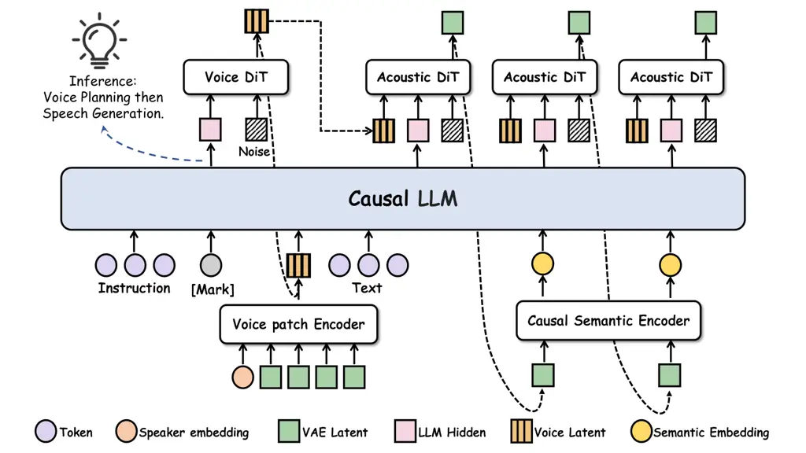

# VoTSpeech: Decoupling Voice Design from Speech Generation in Instruction-Following TTS

Wenbing Yang    Qihang Lu    Zihan Sun    Peilei Jia    Yingming Gao   
Ya Li    Jun Gao ^(†)^(†)thanks: \*Corresponding author.

###### Abstract

Instruction-following text-to-speech (TTS) typically leaves voice design
implicit, as conventional speaker embeddings encode reference audio
rather than text-driven targets. We propose VoTSpeech, which decouples
voice design from speech generation via an explicit intermediate voice
latent. Built on a shared language model backbone, VoTSpeech first
predicts a continuous voice latent from text instructions using a
flow-based module. This latent serves as a shared condition for both the
language model and the Acoustic DiT, guiding autoregressive sequence
modeling and acoustic latent generation, respectively, before an audio
VAE decoder converts the acoustic latents into waveforms. To capture
speaker identity and complementary acoustic nuances, the voice latent is
jointly supervised by speaker embeddings and temporally pooled audio VAE
features. With task-specific adaptation, VoTSpeech performs strongly on
InstructTTSEval-ZH, demonstrating competitive capabilities against
strong open-source models while maintaining high naturalness. These
results confirm that explicit voice latent design and its conditioning
interface effectively empower text-driven voice design for controllable
speech synthesis. Code, model, and audio samples are available at
[https://github.com/ywbn/VoTSpeech](https://github.com/ywbn/VoTSpeech).

###### Index Terms: 

instruction-following TTS, voice design, decoupled voice modeling, flow
matching.

^(†)^(†)address: ¹Beijing University of Posts and Telecommunications,
Beijing, China  
²Hello Group, Beijing, China

## 1 Introduction

Natural-language voice design enables personalized speech synthesis
directly from textual descriptions without reference audio \[9, 25,
11\]. Despite recent advances in instruction-following TTS \[24, 10, 8,
29\], most existing models simply feed voice instructions as textual
context directly into TTS systems. Without an explicit voice latent,
target voice creation remains implicit within utterance generation. This
coupling obscures explicit control, motivating a principled separation
between what voice to create and what that voice says.

An explicit continuous voice latent bridges text prompts and speech
generation. While reference-based TTS reliably extracts speaker
representations from audio \[13, 5, 28\], text-driven synthesis must
construct target representations without audio references. Prior studies
have explored generative speaker embeddings \[18, 27\] or
description-conditioned voice representations \[14, 26, 19\]. Yet, many
existing representations focus primarily on static speaker identity,
neglecting dynamic acoustic nuances crucial for expressive synthesis.
Consequently, an effective intermediate latent must balance semantic
description alignment with fine-grained acoustic richness. Predicting
such a multi-faceted voice latent and integrating it effectively into
speech generation within a unified architecture remains a non-trivial
challenge.

To address this challenge, we propose VoTSpeech (Voice-of-Thought
Speech), which decouples voice design from speech generation via an
explicit continuous voice latent. Adopting a “think-before-speaking”
paradigm, a shared large language model (LLM) first interprets
instructions to predict a target voice latent via a flow-based module.
This latent then conditions both the LLM and the Acoustic Diffusion
Transformer (DiT), guiding sequence prosody planning and acoustic
rendering, respectively. For balanced supervision, the target latent is
jointly trained on speaker embeddings and temporally pooled audio
Variational Autoencoder (VAE) features. Evaluations on
InstructTTSEval-ZH \[12\] show that VoTSpeech achieves highly
competitive performance against strong open-source baselines, notably
excelling in descriptive-style and role-play tasks. Our contributions
are summarized as follows:

- •
  We propose VoTSpeech, a framework decoupling instruction-guided voice
  design from speech generation via an explicit continuous voice latent.
- •
  We design a dual-path conditioning interface supervised by a hybrid
  target combining speaker embeddings and pooled audio VAE features to
  empower both LLM prosody planning and DiT acoustic rendering.
- •
  We develop a consistency-controlled annotation pipeline and
  demonstrate VoTSpeech’s competitive performance on InstructTTSEval-ZH,
  with ablations validating the core design choices.



Figure 1: Overview of VoTSpeech. Voice DiT predicts a continuous voice
latent from an instruction-derived LLM state. The resulting latent
conditions both the LLM and Acoustic DiT through dual pathways and is
trained against a speech-derived target combining speaker embeddings and
pooled audio VAE features.

## 2 Method

VoTSpeech decouples voice design from speech generation via an explicit
continuous voice latent. Supported by an automated, quality-controlled
instruction annotation pipeline, a shared Causal LLM interprets
instructions to predict the voice latent via a Voice DiT, which
subsequently conditions both LLM prosody planning and Acoustic DiT
rendering (Fig. 1). Building upon dots.tts \[15\], VoTSpeech introduces
a Voice Patch Encoder and Voice DiT for explicit voice modeling.

### 2.1 Instruction Data Construction

To distinguish persistent voice identity from dynamic speech delivery,
we construct instruction–speech pairs across two complementary
annotation levels:

Speaker-Level Inherent Trait Annotation: Multiple recordings from the
same speaker are grouped and processed together to capture persistent
attributes (e.g., perceived age, gender, pitch register, vocal texture,
and accent), following ParaSpeechCaps \[4\]. The resulting verified
description is assigned to all utterances belonging to that speaker.

Utterance-Level Dynamic Style Annotation: Individual recordings are
annotated as free-form, actionable control instructions detailing
localized delivery dynamics. Rather than relying on rigid templates,
these descriptions highlight salient acoustic attributes, including
pitch range, stress and volume placement, tempo progression, and
emotional trajectory.

PromptDialog \[2\] and Genshin \[1\] recordings provide source data for
these annotations, complemented by rewritten tag descriptions from
ISCSLP2026-CoT-TTS \[23\]. To improve annotation quality and reduce
semantic drift in LLM-generated text \[7\], Qwen3-Omni \[22\] directly
processes the audio inputs (multi-utterance groups for speaker-level and
single recordings for utterance-level) to sample two candidate
descriptions per instance. DeepSeek-V4 \[21\] then evaluates
attribute-level consistency between candidates: instances with major
contradictions are discarded, whereas localized conflicts are resolved
by pruning ambiguous attributes and retaining consensus content.

### 2.2 Model Architecture

Sequence organization. VoTSpeech introduces a voice-design stage before
synthesis text processing, with the sequence organized as:

```math
[\,c,\ \langle v\rangle,\ e_{v},\ x,\ \ell_{1:T}\,], \tag{1}
```

where $`c`$ denotes the voice instruction, $`\langle v\rangle`$ the
special voice-generation marker, $`e_{v}`$ the continuous voice
embedding, $`x`$ the synthesis text, and $`\ell_{1:T}`$ the
speech-latent sequence, represented in the LLM by Causal Semantic
Encoder outputs. Under causal attention, the hidden state $`h_{c}`$ at
$`\langle v\rangle`$ summarizes the instruction prefix without accessing
target text $`x`$ and conditions the flow-based voice latent prediction.
Inserting $`e_{v}`$ before $`x`$ allows text processing and subsequent
speech generation to attend to the designed voice, while the instruction
context remains accessible for expressive control.

Voice Patch Encoder. While reference-conditioned frameworks \[24, 10,
15\] rely solely on a speaker embedding $`E_{\mathrm{spk}}(y)`$ to
represent voice identity, text-driven voice design requires capturing
both speaker identity and global acoustic nuances without reference
audio. To construct a multi-faceted target latent $`z^{*}`$ without
extra disentanglement objectives \[17, 16\], the Voice Patch Encoder
augments speaker identity with temporally pooled acoustic features from
waveform $`y`$:

```math
z^{*}=\operatorname{norm}\!\left(\left[E_{\mathrm{spk}}(y);\operatorname{pool}\!\left(E_{\mathrm{vae}}(y)\right)\right]\right), \tag{2}
```

where $`E_{\mathrm{spk}}`$ is the CAM++ encoder \[20\],
$`E_{\mathrm{vae}}`$ is the audio VAE encoder, $`\operatorname{pool}`$
denotes temporal mean-pooling over valid frames, and
$`\operatorname{norm}`$ applies per-dimension standardization using
dataset statistics. Conditioned on instruction context $`h_{c}`$, the
flow-matching Voice DiT predicts continuous voice latent $`z`$ from
Gaussian noise using $`z^{*}`$ as its training target.

Dual-path Voice Conditioning. The original architecture injects voice
representations solely into the acoustic decoder, leaving language model
prosody planning without explicit voice guidance. VoTSpeech overcomes
this limitation by leveraging the instruction-predicted latent $`z`$ to
establish a dual-path conditioning interface, guiding both LLM sequence
modeling and Acoustic DiT rendering simultaneously:

```math
\displaystyle e_{v} \displaystyle=P_{z}(z)+P_{h}(h_{c}), \tag{3}
```

```math
\displaystyle g_{v} \displaystyle=G_{s}(\tilde{s})+G_{a}(\tilde{a})+G_{h}(h_{c}),
```

where $`[\tilde{s};\tilde{a}]=\operatorname{norm}^{-1}(z)`$ recovers
speaker and acoustic components, and $`P_{z},P_{h},G_{s},G_{a},G_{h}`$
are learned linear projections. The prefix embedding $`e_{v}`$ prepends
synthesis text $`x`$ in the LLM, while $`g_{v}`$ conditions the Acoustic
DiT, ensuring unified voice guidance across sequence modeling and
acoustic rendering. Zero-initialized residuals $`P_{h}`$ and $`G_{h}`$
provide direct instruction context for additional stability.

### 2.3 Training and Inference

Joint Optimization and Gradient Decoupling. We train Voice DiT and the
speech generation model jointly while keeping encoders
$`E_{\mathrm{spk}}`$ and $`E_{\mathrm{vae}}`$ frozen. Voice DiT learns a
conditional vector field mapping Gaussian noise
$`\epsilon\sim\mathcal{N}(0,\mathbf{I})`$ to the target voice latent
$`z^{*}`$. For time step $`t\sim\mathcal{U}(0,1)`$ and interpolated
state $`z_{t}=(1-t)\epsilon+tz^{*}`$, the voice prior objective is
defined as:

```math
\mathcal{L}_{\mathrm{voice}}=\mathbb{E}\!\left[\left\|v_{\theta}\!\left(z_{t},t,\operatorname{sg}(h_{c})\right)-(z^{*}-\epsilon)\right\|_{w}^{2}\right], \tag{4}
```

where $`\operatorname{sg}(\cdot)`$ denotes the stop-gradient operator.
Crucially, $`\operatorname{sg}(h_{c})`$ prevents
$`\mathcal{L}_{\mathrm{voice}}`$ from altering the Causal LLM
representations, ensuring that LLM optimization remains strictly driven
by speech generation gradients through the conditioning pathways. The
weighted norm $`\|\cdot\|_{w}^{2}`$ separately averages errors across
speaker identity and pooled acoustic feature slices, assigned weights of
$`1.0`$ and $`0.25`$, respectively. Furthermore, to mitigate exposure
bias between ground-truth targets $`z^{*}`$ during training and
generated latents $`z`$ at inference, we apply a scheduled sampling
strategy that progressively increases the probability of conditioning on
generated voice latents across both pathways (without backpropagation
through sampling). The total objective is
$`\mathcal{L}=\mathcal{L}_{\mathrm{speech}}+\mathcal{L}_{\mathrm{voice}}`$,
where $`\mathcal{L}_{\mathrm{speech}}`$ covers acoustic generation and
sequence termination.

Two-Stage Inference Workflow. VoTSpeech executes inference via a
two-stage prefill procedure with prefix key-value (KV) cache reuse.
First, the Causal LLM processes the instruction prefix
$`[c,\langle v\rangle]`$ to extract $`h_{c}`$, allowing Voice DiT to
sample the voice latent $`z`$—serving as a brief intermediate step to
establish the voice tone. Next, after prepending $`e_{v}`$, the LLM
resumes prefill over the target text $`x`$ leveraging cached instruction
KV states, followed by autoregressive speech latent generation. By
reusing prefix KV states, this setup seamlessly integrates voice
prediction into the generation pipeline as a lightweight pre-computation
step.

## 3 Experiments

|                             |                      |      |      |                    |                              |                              |                              |
| --------------------------- | -------------------- | ---- | ---- | ------------------ | ---------------------------- | ---------------------------- | ---------------------------- |
|                             | Objective Evaluation |      |      |                    | Subjective Evaluation        |                              |                              |
| Model                       | APS                  | DSD  | RP   | CER $`\downarrow`$ | NMOS                         | EMOS                         | AMOS                         |
| Ming-Omni-TTS-0.5B          | 84.9                 | 72.2 | 53.9 | 2.48               | $`3.71\pm 0.27`$             | $`3.71\pm 0.24`$             | $`3.75\pm 0.25`$             |
| Qwen3-TTS-12Hz-1.7B-VD      | 87.1                 | 76.0 | 55.2 | 2.99               | $`\underline{4.08}\pm 0.21`$ | $`4.10\pm 0.19`$             | $`\underline{4.06}\pm 0.20`$ |
| MOSS-VoiceGenerator         | 73.1                 | 70.2 | 58.9 | 5.03               | $`3.86\pm 0.22`$             | $`3.72\pm 0.18`$             | $`3.70\pm 0.19`$             |
| VoxCPM2                     | 84.7                 | 71.8 | 56.8 | 2.58               | $`3.80\pm 0.25`$             | $`3.82\pm 0.18`$             | $`3.82\pm 0.17`$             |
| dots.tts-soar (fine-tuning) | 85.3                 | 75.0 | 64.3 | 2.71               | $`3.87\pm 0.23`$             | $`\underline{4.12}\pm 0.18`$ | $`3.96\pm 0.19`$             |
| VoTSpeech (Ours)            | 84.8                 | 78.5 | 66.9 | 2.58               | $`\mathbf{4.12}\pm 0.22`$    | $`\mathbf{4.30}\pm 0.18`$    | $`\mathbf{4.26}\pm 0.19`$    |

Table 1: Comparison with existing systems and direct fine-tuning. Bold
and underline mark the best and second-best means.

| Variant                         | APS  | DSD  | RP   |
| ------------------------------- | ---- | ---- | ---- |
| VoTSpeech (Full)                | 84.8 | 78.5 | 66.9 |
| w/o LLM-side Voice Conditioning | 83.8 | 76.7 | 63.9 |
| w/o VAE Target Features         | 85.1 | 77.7 | 63.6 |

Table 2: Ablation of dual-path voice conditioning and target design.
Bold marks the best result in each column.

### 3.1 Experimental Setup

Baselines and Setup. We compare VoTSpeech with established
instruction-guided TTS systems, including Ming-Omni-TTS-0.5B \[24\],
Qwen3-TTS-12Hz-1.7B-VD \[10\], MOSS-VoiceGenerator \[8\], and VoxCPM2
\[29\]. Built upon the same pre-trained dots.tts \[15\] backbone, we
additionally construct a direct fine-tuning baseline, denoted as
dots.tts-soar (fine-tuning). This baseline treats instruction $`c`$ as
ordinary textual context preceding synthesis text $`x`$ and directly
optimizes instruction-to-speech generation without an explicit voice
target, Voice DiT, or intermediate voice latent. Its LLM hidden states
condition the Acoustic DiT through the original sequence pathway, while
setting the separate speaker-conditioning vector to zero.

Dataset and Implementation Details. Models are trained on the Chinese
corpus presented in Sec. 2.1, comprising 1,543.52 hours of unique audio
recordings (each file counted once regardless of multiple instruction
annotations). Training uses 8 $`\times`$ NVIDIA A100 GPUs for 20k steps
($`\approx 17`$ epochs). Initial learning rates are $`10^{-5}`$ for the
backbone LLM and $`10^{-4}`$ for voice-design modules. The Voice DiT
features a 4-layer Transformer with hidden dimension 512 and 8 attention
heads. For scheduled sampling during synthesis training, the probability
of conditioning on generated voice latents is 0 for the first 6k steps,
increases linearly to 0.75 over the subsequent 3k steps, and remains
fixed at 0.75 thereafter. Voice latent sampling uses 2 integration steps
during training and 16 at inference.

Evaluation Metrics. For instruction compliance on the InstructTTSEval
Chinese (ZH) subset \[12\], all systems—including baselines—are
uniformly re-evaluated using a single Gemini 2.5 Pro \[3\] judge setup
with fixed prompts to ensure strict fairness. Accuracy (%) is reported
across Acoustic-Parameter Specification (APS), Descriptive-Style
Directive (DSD), and Role-Play (RP). Speech intelligibility is measured
by Character Error Rate (CER) using a pretrained Paraformer-ZH ASR
model \[6\]. For subjective evaluation, 24 listeners rate 10 randomly
selected samples per system on a 5-point scale. We report Mean Opinion
Scores (MOS) for naturalness (NMOS), expressiveness (EMOS), and
instruction adherence (AMOS), assessing perceived audio quality,
delivery style fit, and instruction compliance, respectively. Subjective
scores are reported with 95% confidence intervals (CIs) in Table 1.
Higher values indicate better performance for all metrics except CER.

### 3.2 Experimental Results

Main Results. Table 1 summarizes overall performance. VoTSpeech achieves
leading DSD (78.5%) and RP (66.9%) accuracy while maintaining
competitive APS (84.8%) and low CER (2.58%). Subjectively, it also
secures top scores in naturalness (4.12), expressiveness (4.30), and
instruction adherence (4.26). Compared to direct fine-tuning, VoTSpeech
yields marked gains in high-level tasks like DSD (+3.5 percentage
points) and RP (+2.6 percentage points). These quantitative
improvements, along with subjective gains in instruction adherence
(+0.30), demonstrate the clear advantage of explicitly predicting a
voice latent over implicit instruction fine-tuning, while low CER
confirms that speech intelligibility remains well-preserved.

Ablation Study. Table 2 examines _where_ the voice latent is injected
and _what_ its target encodes via two variants: (1) w/o LLM-side Voice
Conditioning, which removes $`e_{v}`$ while Acoustic DiT receives both
$`h_{c}`$ and $`z`$ via $`g_{v}`$. Performance degrades across all tasks
(notably a 3.0 percentage-point drop in RP), proving that Acoustic DiT
conditioning alone is insufficient and LLM-side injection is vital for
sequence-level prosody planning. (2) w/o VAE Target Features, which
retains full dual-path interface (with residuals $`P_{h},G_{h}`$) but
trains target $`z^{*}`$ using only static speaker embeddings. Despite a
marginal APS gain (+0.3 percentage points), DSD and RP decline by 0.8
and 3.3 percentage points, confirming that dynamic acoustic supervision
beyond speaker identity is essential for expressive style and role-play
control. Overall, the full model achieves superior performance across
complex scenarios through dual-path exposure and hybrid target design.

Discussion. Comparing our main results against direct fine-tuning and
ablations highlights two core strengths of VoTSpeech. First,
incorporating dynamic VAE features provides a richer acoustic
representation than static identity embeddings alone. Second, routing
this predicted latent through dual-path conditioning equips both the LLM
and Acoustic DiT with explicit voice guidance, drastically boosting
instruction adherence and expressiveness. Nevertheless, our current
voice latent design remains an utterance-level global descriptor.
Because temporal pooling removes frame-level details, $`z`$ itself does
not perform sequence modeling; fine-grained temporal dynamics—such as
localized pitch contours and pacing—still rely on the sequence modeling
capacity of the LLM backbone rather than the latent itself. Furthermore,
without explicit disentanglement, pooled VAE features can occasionally
encode environmental recording traits alongside target timbre.
Developing voice latents with fine-grained temporal sequence modeling
and explicit factor disentanglement represents an important direction
for future work.

## 4 Conclusion

VoTSpeech decouples text-driven voice design from speech generation via
an explicit continuous voice latent. By combining a hybrid target latent
with dual-path conditioning, it seamlessly unifies LLM prosody planning
and DiT acoustic rendering. Comprehensive evaluations show that this
paradigm significantly improves instruction adherence and expressiveness
while maintaining high speech quality, establishing explicit voice
modeling as a viable pathway for controllable speech synthesis.

## 5 Compliance with Ethical Standards

The anonymous listening test was voluntary and followed the Declaration
of Helsinki. Informed consent was obtained, no personally identifiable
information was collected, and only aggregate ratings are reported.

## References

- \[1\] AI-Hobbyist (2026) Genshin Datasets for SVC/SVS/TTS. Note:
  ModelScope dataset. Available:
  [https://modelscope.cn/datasets/aihobbyist/Genshin_Dataset](https://modelscope.cn/datasets/aihobbyist/Genshin_Dataset)
  Cited by: §2.1.
- \[2\] alphappp PromptDialog. Note: Hugging Face dataset. Available:
  [https://huggingface.co/datasets/alphappp/PromptDialog](https://huggingface.co/datasets/alphappp/PromptDialog)
  Cited by: §2.1.
- \[3\] G. Comanici et al. (2025) Gemini 2.5: pushing the frontier with
  advanced reasoning, multimodality, long context, and next generation
  agentic capabilities. arXiv preprint arXiv:2507.06261. Cited by: §3.1.
- \[4\] A. Diwan, Z. Zheng, D. Harwath, and E. Choi (2025) Scaling rich
  style-prompted text-to-speech datasets. In Proceedings of the 2025
  Conference on Empirical Methods in Natural Language Processing,
  pp. 3639–3659. Cited by: §2.1.
- \[5\] Z. Du et al. (2024) CosyVoice: a scalable multilingual zero-shot
  text-to-speech synthesizer based on supervised semantic tokens. arXiv
  preprint arXiv:2407.05407. Cited by: §1.
- \[6\] Z. Gao, S. Zhang, I. Mcloughlin, and Z. Yan (2022) Paraformer:
  fast and accurate parallel transformer for non-autoregressive
  end-to-end speech recognition. In Interspeech, Cited by: §3.1.
- \[7\] Y. Geng et al. (2026) Stabilizing instruction supervision for
  instruct-tts via controllable diversification and drift filtering.
  arXiv preprint arXiv:2609.08204. Cited by: §2.1.
- \[8\] Y. Gong et al. (2026) MOSS-TTS technical report. arXiv preprint
  arXiv:2603.18090. Cited by: §1, §3.1.
- \[9\] Z. Guo, Y. Leng, Y. Wu, S. Zhao, and X. Tan (2023) PromptTTS:
  controllable text-to-speech with text descriptions. In ICASSP 2023 -
  2023 IEEE International Conference on Acoustics, Speech and Signal
  Processing (ICASSP), Vol. , pp. 1–5. External Links:
  [Document](https://dx.doi.org/10.1109/ICASSP49357.2023.10096285) Cited
  by: §1.
- \[10\] H. Hu et al. (2026) Qwen3-TTS technical report. arXiv preprint
  arXiv:2601.15621. Cited by: §1, §2.2, §3.1.
- \[11\] J. Hu et al. (2026) VoiceSculptor: your voice, designed by you.
  arXiv preprint arXiv:2601.10629. Cited by: §1.
- \[12\] K. Huang et al. (2025) InstructTTSEval: benchmarking complex
  natural-language instruction following in text-to-speech systems.
  arXiv preprint arXiv:2506.16381. Cited by: §1, §3.1.
- \[13\] Y. Jia et al. (2018) Transfer learning from speaker
  verification to multispeaker text-to-speech synthesis. Advances in
  neural information processing systems 31. Cited by: §1.
- \[14\] Y. Leng et al. (2024) PromptTTS 2: describing and generating
  voices with text prompt. In International Conference on Learning
  Representations, Vol. 2024, pp. 57672–57688. Cited by: §1.
- \[15\] S. Lian et al. (2026) Dots.tts technical report. arXiv preprint
  arXiv:2606.07080. Cited by: §2.2, §2, §3.1.
- \[16\] H. Lu, D. Wang, X. Wu, Z. Wu, X. Liu, and H. Meng (2023)
  Disentangled speech representation learning for one-shot cross-lingual
  voice conversion using ß-VAE. In 2022 IEEE Spoken Language Technology
  Workshop (SLT), pp. 814–821. Cited by: §2.2.
- \[17\] K. Qian, Y. Zhang, S. Chang, X. Yang, and M.
  Hasegawa-Johnson (2019) Autovc: zero-shot voice style transfer with
  only autoencoder loss. In International Conference on Machine
  Learning, pp. 5210–5219. Cited by: §2.2.
- \[18\] D. Stanton, M. Shannon, S. Mariooryad, R. Skerry-Ryan, E.
  Battenberg, T. Bagby, and D. Kao (2022) Speaker generation. In ICASSP
  2022-2022 IEEE International Conference on Acoustics, Speech and
  Signal Processing (ICASSP), pp. 7897–7901. Cited by: §1.
- \[19\] X. Su, Z. Sun, P. Jia, and J. Gao (2026) CapTalk: unified voice
  design for single-utterance and dialogue speech generation. ArXiv
  abs/2604.08363. Cited by: §1.
- \[20\] H. Wang, S. Zheng, Y. Chen, L. Cheng, and Q. Chen (2023) CAM++:
  a fast and efficient network for speaker verification using
  context-aware masking. In Interspeech 2023, pp. 5301–5305. External
  Links: [Document](https://dx.doi.org/10.21437/Interspeech.2023-1513),
  ISSN 2958-1796 Cited by: §2.2.
- \[21\] A. Xu et al. (2026) DeepSeek-V4: towards highly efficient
  million-token context intelligence. arXiv preprint arXiv:2606.19348.
  Cited by: §2.1.
- \[22\] J. Xu et al. (2025) Qwen3-Omni technical report. arXiv preprint
  arXiv:2509.17765. Cited by: §2.1.
- \[23\] W. Xue et al. (2026) ISCSLP 2026 CoT-TTS Challenge:
  chain-of-thought reasoning for context-aware text-to-speech. arXiv
  preprint arXiv:2606.21933. Cited by: §2.1.
- \[24\] C. Yan et al. (2025) Ming-uniaudio: speech llm for joint
  understanding, generation and editing with unified representation.
  arXiv preprint arXiv:2511.05516. Cited by: §1, §2.2, §3.1.
- \[25\] D. Yang, S. Liu, R. Huang, C. Weng, and H. Meng (2024)
  InstructTTS: modelling expressive tts in discrete latent space with
  natural language style prompt. IEEE/ACM Transactions on Audio, Speech,
  and Language Processing 32 (), pp. 2913–2925. Cited by: §1.
- \[26\] B. Zhang et al. (2025) Minimax-speech: intrinsic zero-shot
  text-to-speech with a learnable speaker encoder. arXiv preprint
  arXiv:2505.07916. Cited by: §1.
- \[27\] Y. Zhang et al. (2023) PromptSpeaker: speaker generation based
  on text descriptions. In 2023 IEEE Automatic Speech Recognition and
  Understanding Workshop (ASRU), pp. 1–7. Cited by: §1.
- \[28\] S. Zhou, Y. Zhou, Y. He, X. Zhou, J. Wang, W. Deng, and J.
  Shu (2026) IndexTTS2: a breakthrough in emotionally expressive and
  duration-controlled auto-regressive zero-shot text-to-speech. In
  Proceedings of the AAAI Conference on Artificial Intelligence, Vol.
  40, pp. 35139–35148. Cited by: §1.
- \[29\] Y. Zhou et al. (2026) VoxCPM2 technical report. arXiv preprint
  arXiv:2606.06928. Cited by: §1, §3.1.
