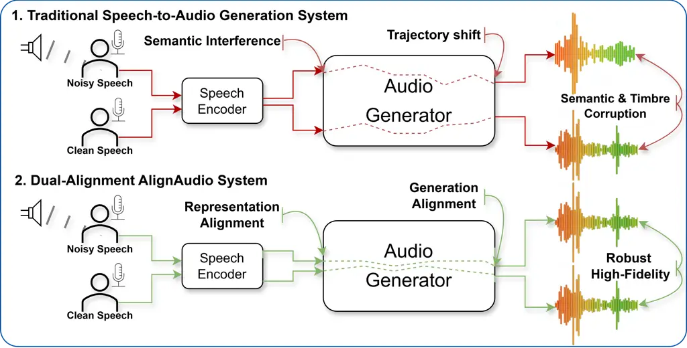
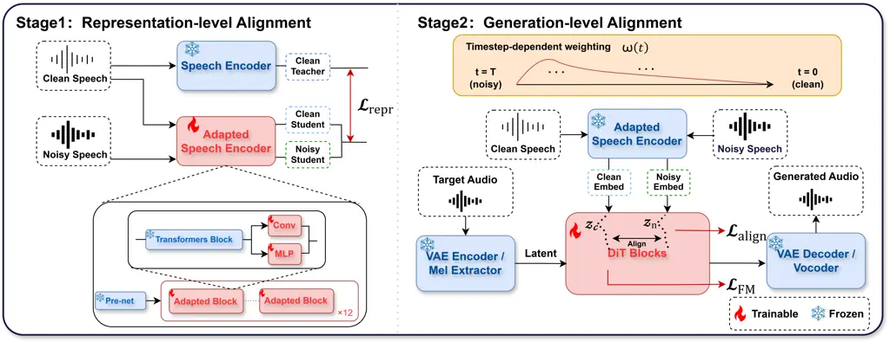

# AlignAudio: A Unified Dual-Alignment Framework for Noise-Robust Speech-Conditioned Generation

Yixuan Li    Xuenan Xu    Zeyu Xie    Mengyue Wu\sthanks Corresponding
author

###### Abstract

Speech-conditioned generation maps speech signals to target audio
outputs. Prior end-to-end speech-conditioned generative models achieve
high fidelity in clean acoustic conditions, but their performance
degrades substantially under environmental noise. While prior
noise-robust approaches have achieved significant success in
feature-level purification, maintaining consistent generation under
clean and noisy conditioning remains a key challenge. To address this,
we propose AlignAudio, a noise-robust generative framework based on dual
alignment: (i) aligning the representations of clean and noisy speech to
preserve semantic cues, and (ii) enforcing generation-level consistency
within a flow matching paradigm to improve conditioning fidelity.
Experiments on speech-to-audio (STA) and voice conversion (VC) tasks
demonstrate that AlignAudio maintains performance comparable to
baselines on clean speech while significantly outperforming them across
various noisy conditions. Furthermore, the proposed dual-alignment
strategy is applicable to both single- and multi-stream speech
conditioning and can be integrated into different flow matching-based
generation frameworks and post-training settings. Audio demonstrations
and qualitative comparisons:
[https://alignaudio.github.io/AlignAudio](https://alignaudio.github.io/AlignAudio).

###### Index Terms: 

speech-to-audio generation, voice conversion, noise-robust,
dual-alignment

^(†)^(†)address: ¹ X-LANCE Lab, Shanghai Jiao Tong University, China   ²
Shanghai AI Lab, China  
³ KlingAI Research, China   ⁴ Peking University, Shenzhen, China

## 1 Introduction

Recent years have witnessed remarkable progress in speech and audio
generation, driven by advances in diffusion models \[9\], flow matching
\[16\], and language modeling approaches \[4\]. These generative
techniques have enabled a new paradigm of speech-conditioned generation,
where spoken input is directly mapped to diverse audio outputs,
encompassing tasks such as speech-to-audio (STA) generation that
synthesizes environmental sounds from spoken descriptions \[29\], and
voice conversion (VC) that transforms speaker identity while preserving
linguistic content \[18, 15\].

However, most studies in speech-conditioned audio generation assume
ideal clean-speech conditions, where both training and evaluation are
conducted on carefully curated datasets with minimal environmental
interference. In real-world scenarios, speech signals are inevitably
corrupted by background noise, reverberation, and competing acoustic
events. Previous studies on voice conversion have shown that noisy
source or reference speech significantly degrades speaker similarity and
speech naturalness \[8, 12\]. Our preliminary experiments on
speech-to-audio generation also demonstrate that environmental noise
significantly degrades generation performance, increasing Fréchet Audio
Distance (FAD) by approximately 33% and reducing Contrastive
Language-Audio Pretraining (CLAP) score by around 18%, indicating
degraded audio quality and weaker semantic alignment. As a result,
speech-conditioned generation under realistic acoustic interference
remains insufficiently studied, motivating the need for noise-robust
speech-conditioned generation.



Figure 1: AlignAudio generates audio with better noise robustness,
preserved acoustic events, and higher semantic fidelity compared to
traditional speech-conditioned generation systems that suffer from
semantic interference and trajectory shifts under noise.



Figure 2: Overview of the AlignAudio architecture. Representation-level
alignment (Stage 1) uses lightweight adapters in a pre-trained speech
encoder to distill noisy speech embeddings toward clean ones via
$`L_{2}`$ loss, while generation-level alignment (Stage 2) regularizes
the noisy-conditioned velocity field in DiT blocks toward the clean one
using directional similarity.

Several lines of research have addressed noise robustness in
speech-conditioned generation, primarily through front-end speech
enhancement (SE) \[19, 25\] or noise-invariant representation learning
inspired by robust automatic speech recognition (ASR) \[21, 3\]. These
methods improve the robustness of conditioning signals and have proven
effective for tasks such as noise-robust voice conversion \[32, 11\].
Noro \[8\] improves robustness to noisy speaker references through
dual-branch reference encoding and a noise-agnostic contrastive speaker
loss. REF-VC \[12\] addresses noisy source speech by combining ASR and
self-supervised features with random erasing to balance noise robustness
and expressiveness, while implicit input–output alignment reduces
reconstruction of irrelevant source information.

Despite these advances, these methods primarily address corruption in a
specific conditioning stream. As speech-conditioned generation
increasingly relies on multiple heterogeneous conditioning signals
(e.g., the source content and target speaker reference in voice
conversion), perturbations from different inputs can jointly propagate
through the shared generation trajectory, making representation-level
robustness alone insufficient. Moreover, neither method explicitly
enforces consistency between clean- and noisy-conditioned generation
dynamics. Even with noise-robust conditioning features, the conditional
generation dynamics (e.g., the velocity field in flow matching models)
can remain sensitive to residual perturbations. These perturbations can
accumulate throughout the generation process, resulting in degraded
acoustic quality, reduced conditioning fidelity, and inaccurate semantic
generation.

Instead of solely enhancing noisy speech inputs or learning noise-robust
conditioning representations, we propose AlignAudio, a dual-alignment
framework that explicitly regularizes both conditioning representations
and conditional generation dynamics. Representation-level alignment
reduces the distribution gap between clean and noisy conditioning
signals through lightweight adapters in the speech encoder or
multi-input fusion module, providing robust features for both single-
and multi-stream speech conditioning. Building upon these robust
representations, generation-level alignment further constrains the
conditional trajectory to follow consistent dynamics under clean and
noisy settings. By jointly improving robustness at both levels,
AlignAudio mitigates trajectory instability while naturally generalizing
to diverse conditioning configurations (Fig. 1). We validate its
effectiveness on two tasks: STA and VC.

Overall, our contributions are summarized as follows:

- •
  We propose AlignAudio, a dual-alignment framework for noise-robust
  speech-conditioned generation. It accommodates both single-stream
  (STA) and multi-stream (VC) speech conditioning, mitigating noise at
  both the representation and generation levels.
- •
  We demonstrate the flexibility of AlignAudio across different
  flow-based generation paradigms, showing that it extends from standard
  Flow Matching to efficient MeanFlow training and further integrates
  with Flow-GRPO post-training for improved content preservation.
- •
  Extensive experiments show that AlignAudio achieves substantial
  improvements over strong baselines on both STA and VC in conditioning
  fidelity under noisy conditions. It exhibits strong noise robustness
  and robust generalization to challenging out-of-domain (OOD)
  conditions, while maintaining competitive performance on clean speech.

## 2 Noise-Robust Generation via Dual-Alignment

As illustrated in Fig. 2, AlignAudio consists of two complementary
modules: representation-level alignment and generation-level alignment,
which improve robustness by aligning conditioning representations and
generation trajectories, respectively.

### 2.1 Preliminaries

Following recent advancements in efficient audio generation \[30\], we
adopt flow matching as our base generative framework. Standard flow
matching trains a model to predict the instantaneous velocity
$`v_{\theta}(x_{t},t)`$ to transport a simple prior $`x_{0}\sim p_{0}`$
to the target data $`x_{1}\sim p_{1}`$ via a linear path
$`x_{t}=(1-t)x_{0}+tx_{1}`$. The base objective is:

```math
\mathcal{L}_{\text{FM}}(\theta)=\mathbb{E}_{t,x_{1},x_{t}}\left[\lVert v_{\theta}(x_{t},t)-(x_{1}-x_{0})\rVert_{2}^{2}\right]. \tag{1}
```

For an interval $`[r,t]`$, MeanFlow \[6\] defines the average velocity
as the displacement divided by the interval length, and derives the
intrinsic identity

```math
\bar{\mathbf{v}}_{r,t}(\mathbf{z})=\mathbf{v}_{t}(\mathbf{z})-(t-r)\frac{d}{dt}\bar{\mathbf{v}}_{r,t}(\mathbf{z}) \tag{2}
```

which yields a principled training target through a Jacobian-Vector
Product (JVP) term. By directly predicting this interval-averaged field,
MeanFlow enables single- or few-step sampling with strong generation
quality. The corresponding predictor is denoted by
$`u_{\theta}(x_{t},r,t)`$.

### 2.2 Representation-level Alignment

Drawing on parameter-efficient adaptation \[10, 22, 23\], we introduce
lightweight adapters into the conditioning pathways rather than
fine-tuning the entire network. These adapters are trained via knowledge
distillation, using representations from clean speech as soft targets.

Formally, let $`E(\cdot)`$ denote the frozen, clean-trained conditioning
network (the teacher), and $`A(\cdot)`$ the corresponding network
augmented with trainable adapters (the student). To extract
noise-invariant features, we minimize the $`L_{2}`$ distance between the
adapter outputs on noisy ($`x_{\mathrm{n}}`$) and clean
($`x_{\mathrm{c}}`$) inputs, and the clean teacher embeddings
$`E(x_{\mathrm{c}})`$:

```math
\displaystyle\mathcal{L}_{\mathrm{repr}}={} \displaystyle(1-\lambda)\,\lVert E(x_{\mathrm{c}})-A(x_{\mathrm{n}})\rVert_{2}^{2} \tag{3}
```

```math
\displaystyle+\lambda\,\lVert E(x_{\mathrm{c}})-A(x_{\mathrm{c}})\rVert_{2}^{2}.
```

where $`\lambda\in[0,1]`$ controls the trade-off between noisy and clean
adaptation.

Adapter placement (e.g., within the frontend encoder or multi-input
fusion module) is tailored to the specific downstream architecture. The
adapted conditioning network is frozen during generation-level
alignment.

### 2.3 Generation-level Alignment

Trajectory Alignment. Let
$`f_{\theta}\in\{v_{\theta}(x_{t},t),\allowbreak u_{\theta}(x_{t},r,t)\}`$
denote the predicted field depending on the chosen backbone. We observe
that even with representation-level alignment, noisy conditioning
vectors can still induce subtle deviations in the generated
trajectories. A straightforward pointwise $`L_{2}`$ alignment between
the noisy-conditioned output $`f_{\theta}^{\text{n}}`$ and
clean-conditioned output $`f_{\theta}^{\text{c}}`$ would enforce strict
magnitude agreement, which can overly constrain the trajectory dynamics
and degrade fine-grained acoustic details.

To preserve trajectory scale while ensuring directional consistency, we
instead adopt a cosine directional alignment. We treat the clean flow as
a fixed reference (with stop-gradient, $`\textrm{sg}(\cdot)`$) to
prevent noisy samples from corrupting the clean generation capabilities:

```math
\mathcal{L}_{\mathrm{cos}}=\mathbb{E}\!\left[\omega(t)\left(1-\frac{\langle f_{\theta}^{\mathrm{n}},\operatorname{sg}(f_{\theta}^{\mathrm{c}})\rangle}{\lVert f_{\theta}^{\mathrm{n}}\rVert_{2}\,\lVert\operatorname{sg}(f_{\theta}^{\mathrm{c}})\rVert_{2}}\right)\right]. \tag{4}
```

The clean and noisy predictions share the same state and time samples,
with their arguments omitted for brevity.

Timestep-Dependent Weighting. For standard flow matching, early
timesteps ($`t\approx 0`$) require stronger regularization to stabilize
the coarse trajectory, while late timesteps ($`t\approx 1`$) demand
reduced intervention to avoid over-regularization. Therefore, we
introduce a timestep-dependent weighting strategy $`\omega(t)`$ to
adaptively attenuate the alignment strength:
$`\omega(t)=\frac{1}{1+\exp(-(b-t)k)},\quad t\in[0,1]`$. Here, $`b`$ and
$`k`$ control the inflection point and slope of the weighting curve.
When utilizing MeanFlow, the temporal weighting is disabled.
($`\omega(t)\equiv 1`$).

The overall supervised generation loss integrates the generative base
loss ($`\mathcal{L}_{\text{FM}}`$ or $`\mathcal{L}_{\text{MeanFlow}}`$),
computed under clean conditioning, with the alignment regularization:

```math
\mathcal{L}_{\mathrm{gen}}=\mathcal{L}_{\mathrm{base}}^{\mathrm{c}}+\alpha\mathcal{L}_{\mathrm{cos}}, \tag{5}
```

where $`\alpha>0`$ scales the alignment loss. Here,
$`\mathcal{L}_{\mathrm{base}}^{\mathrm{c}}`$ uses the clean condition
$`A(x_{\mathrm{c}})`$; stop-gradient is applied to the clean reference
only in $`\mathcal{L}_{\mathrm{cos}}`$.

### 2.4 Task Instantiations

To comprehensively validate the effectiveness of AlignAudio under
different conditioning complexities, we consider two representative
speech-conditioned generation tasks: STA and VC, corresponding to
single- and multi-stream speech conditioning, respectively.

STA. The input $`x`$ denotes a single speech sequence. We instantiate
the conditioning network using the pre-trained SpeechT5 encoder \[1\].
To implement the representation-level alignment, we insert our
lightweight dual-path adapters (comprising depthwise temporal
convolutions and channel-wise bottleneck MLPs) directly after the final
Transformer layers of SpeechT5. Following EzAudio \[7\], we employ a
variational autoencoder (VAE) to map the target audio waveform into a
compact continuous latent space. The generative core is a Diffusion
Transformer (DiT). Conditioned on the noise-invariant representations
from the speech encoder, it predicts the velocity field via flow
matching.

VC. Unlike STA, the input $`x`$ is a dual-stream composition consisting
of a source utterance $`x_{\text{src}}`$ and a target prompt
$`x_{\text{tgt}}`$ (providing the desired timbre). The core architecture
adopts the framework of MeanVC \[20\], where source bottleneck features
are fused with reference timbre information and, together with speaker
embeddings, condition a MeanFlow-based DiT decoder to generate the
converted mel-spectrogram. For VC, adapters are applied to the
multi-input fusion module.

VC post-training. We further adapt Flow-GRPO \[17\] after the two-stage
training. We optimize a composite reward that jointly encourages content
preservation, speaker similarity, and perceptual naturalness. We use the
Mega-ASR \[28\] reward as the content-consistency signal, combining Word
Error Rate (WER)-aware feedback with dynamic granularity for hard
samples. We complement it with Speaker Encoder Cosine Similarity (SECS)
to measure speaker similarity, and UTMOSv2 \[2\] as a proxy for
utterance-level naturalness. Following this design, the final reward is
written as

```math
R=\lambda_{\text{asr}}R_{\text{Mega-ASR}}+\lambda_{\text{spk}}R_{\text{SECS}}+\lambda_{\text{mos}}R_{\text{UTMOSv2}}.
```

## 3 Experiments and results

|                             |                   |                  |                  |                   |                  |                  |                   |                  |                  |                   |                  |
| --------------------------- | ----------------- | ---------------- | ---------------- | ----------------- | ---------------- | ---------------- | ----------------- | ---------------- | ---------------- | ----------------- | ---------------- |
| System                      | Clean             |                  |                  | Noisy             |                  |                  | OOD               |                  |                  | Recorded          |                  |
| STA                         | FAD$`\downarrow`$ | CLAP$`\uparrow`$ | OVL$`\uparrow`$  | FAD$`\downarrow`$ | CLAP$`\uparrow`$ | OVL$`\uparrow`$  | FAD$`\downarrow`$ | CLAP$`\uparrow`$ | OVL$`\uparrow`$  | FAD$`\downarrow`$ | CLAP$`\uparrow`$ |
| STAR \[29\]                 | 2.23              | 0.422            | 2.68             | 2.23              | 0.382            | 2.36             | 2.16              | 0.386            | 2.54             | 1.98              | 0.394            |
| ST5 + FM                    | 1.72              | 0.412            | 2.54             | 2.28              | 0.339            | 1.92             | 1.76              | 0.387            | 2.32             | 2.23              | 0.367            |
| SE $`\rightarrow`$ ST5 + FM | 1.92              | 0.405            | 2.51             | 2.35              | 0.367            | 2.90             | 1.79              | 0.403            | 2.72             | 1.85              | 0.402            |
| AlignAudio-STA              | 1.96              | 0.418            | 2.86             | 1.88              | 0.421            | 3.12             | 1.84              | 0.421            | 2.62             | 1.78              | 0.414            |
| EzAudio \[7\] (GT text)     | 1.68              | 0.427            | 3.02             | –                 | –                | –                | –                 | –                | –                | –                 | –                |
| VC                          | WER$`\downarrow`$ | SECS$`\uparrow`$ | NMOS$`\uparrow`$ | WER$`\downarrow`$ | SECS$`\uparrow`$ | NMOS$`\uparrow`$ | WER$`\downarrow`$ | SECS$`\uparrow`$ | NMOS$`\uparrow`$ | WER$`\downarrow`$ | SECS$`\uparrow`$ |
| FreeVC \[15\]               | 5.21              | 54.62            | 4.20             | 36.36             | 34.45            | 3.26             | 33.74             | 36.02            | 3.34             | 37.84             | 35.46            |
| SE $`\rightarrow`$ FreeVC   | 5.81              | 52.88            | 4.12             | 31.84             | 40.71            | 3.48             | 29.62             | 42.15            | 3.54             | 28.49             | 43.25            |
| DiffVC \[24\]               | 8.27              | 62.49            | 4.08             | 84.57             | 42.61            | 2.11             | 78.95             | 44.83            | 2.56             | 57.42             | 42.49            |
| Noro \[8\]                  | 5.12              | 55.23            | 4.39             | 45.27             | 50.52            | 3.04             | 42.18             | 53.13            | 3.08             | 45.84             | 54.13            |
| MeanVC \[20\]               | 4.69              | 57.49            | 4.42             | 108.93            | 28.77            | 2.08             | 101.47            | 30.52            | 2.14             | 78.50             | 31.59            |
| AlignAudio-VC\*             | 5.25              | 58.12            | 4.55             | 32.36             | 53.44            | 3.51             | 29.41             | 54.76            | 3.36             | 28.48             | 56.14            |
| AlignAudio-VC               | 4.26              | 54.83            | 4.43             | 27.56             | 49.82            | 3.07             | 24.93             | 50.91            | 3.13             | 25.76             | 53.46            |

Table 1: Speech-to-audio (STA) and voice conversion (VC) results. Bold
and underlined entries indicate the best and second-best
speech-conditioned results for each task, condition, and metric,
excluding EzAudio with ground-truth (GT) text. AlignAudio-VC is the full
model with Flow-GRPO; \* denotes its variant without GRPO. Recorded uses
a separate test set of AudioCaps captions read by participants in
real-world scenarios. WER and SECS are reported in percent;
$`\downarrow`$/$`\uparrow`$ indicate lower/higher is better. – denotes
unavailable results.

### 3.1 Experimental Setup

Datasets. For STA, we generate synthetic speech versions of
AudioCaps \[13\] captions using the SpeechT5 text-to-speech model,
following the official AudioCaps splits ($`\sim`$50k clips in total).
For VC, we use LibriTTS \[31\] for training ($`\sim`$585 hours) and
evaluate on test-clean, whose speakers are completely disjoint from the
training set. For real-world evaluation, we record speech from a speaker
reading AudioCaps captions under five acoustic conditions: clean, room,
street, cafe, and subway. Ten utterances are randomly recorded for each
condition. The same recordings are used as speech conditions for STA and
source speech for VC.

Noise conditions. We evaluate robustness under both synthetic and
real-world noise conditions. MUSAN \[26\] and RIRS_NOISES \[14\] are
used to simulate music, environmental noise, and reverberation during
training, where each augmentation type is applied with a probability of
0.3 and SNRs are randomly sampled from 5–20 dB. For VC, augmentation is
applied to the source speech, target reference speech, or both with
probabilities of 0.3, 0.3, and 0.4, respectively. For OOD evaluation,
DEMAND \[27\] noises are added to the test sets with randomly sampled
SNRs from -5–20 dB. The real-world recordings are directly evaluated
without additional noise mixing to reflect uncontrolled acoustic
variations.

Implementation. For STA, the generative core is a 24-layer DiT with 16
attention heads and a hidden dimension of 1024. The weighting
coefficient $`\lambda`$ is set to 0.9 to prioritize the stabilization of
clean speech representations. The alignment coefficient is
$`\alpha=0.05`$, and the scheduling function $`\omega(t)`$ uses $`k=20`$
and $`b=0.3`$. For VC, the core architecture adopts the framework of
MeanVC \[20\]. Since only a few steps are used for sampling,
timestep-dependent weighting is disabled ($`\omega(t)\equiv 1`$). We
further adapt Flow-GRPO \[17\] after the two-stage training and report
results with and without GRPO.

Baselines. We compare AlignAudio with representative open-source
baselines for both STA and VC tasks. For STA, we include
speech-conditioned generation systems (STAR and ST5 + FM) and an
enhancement-assisted pipeline (SE $`\rightarrow`$ ST5 + FM). EzAudio
with ground-truth text is additionally included as an oracle
text-conditioned reference. For VC, we compare with representative
systems including FreeVC, DiffVC, Noro, and MeanVC, covering
non-diffusion, diffusion-based, and noise-robust voice conversion
approaches; an enhancement-assisted FreeVC pipeline (SE $`\rightarrow`$
FreeVC) is also considered. All baselines are evaluated using their
official implementations without retraining.

Metrics. For STA, we report FAD and CLAP score as objective metrics, and
Overall Audio Quality (OVL) as the subjective metric. For VC, we report
WER computed using Whisper \[radford2023robust\], SECS using
ECAPA-TDNN \[5\] to evaluate timbre similarity, and Naturalness Mean
Opinion Score (NMOS) as the subjective metric. The subjective evaluation
was carried out by 10 listeners for each task.

### 3.2 Main Results

STA. Table 1 shows that ST5 + FM’s CLAP drops from 0.412 to 0.339 under
noise. Front-end SE partially recovers it to 0.367, whereas
AlignAudio-STA reaches 0.421 and achieves the best noisy FAD and OVL
among speech-conditioned systems. AlignAudio-STA’s CLAP remains stable
across clean (0.418), noisy (0.421), and OOD (0.421) conditions,
supporting semantic robustness beyond the training noise sources. These
improvements support explicit robustness training within the generation
system to preserve both semantic fidelity and perceptual quality.

VC. FreeVC and MeanVC show substantial degradation in both content
preservation and speaker similarity under noisy and OOD conditions.
Front-end SE improves both metrics for FreeVC, while Noro preserves
speaker similarity well. AlignAudio-VC\* achieves the highest SECS under
both conditions, exceeding SE $`\rightarrow`$ FreeVC by 12.73 and 12.61
percentage points, respectively, with comparable WER. Compared with
Noro, AlignAudio-VC\* achieves lower WER under noisy (32.36% vs. 45.27%)
and OOD (29.41% vs. 42.18%) conditions, while also attaining higher
SECS. These results support dual alignment for jointly preserving
linguistic content and target-speaker fidelity. Adding Flow-GRPO further
yields the lowest WER across all four conditions, while AlignAudio-VC\*
retains higher speaker similarity and naturalness.

Recorded speech. The recorded evaluation examines whether gains obtained
under simulated corruption persist in real acoustic environments. On the
same human recordings, AlignAudio-STA leads in FAD and CLAP, while the
full AlignAudio-VC achieves the lowest WER and AlignAudio-VC\* the
highest SECS. Their advantage over the SE pipelines supports the
usefulness of the framework under naturally recorded interference in
both tasks.

### 3.3 Ablation Studies

|                     |                   |                  |                   |                  |
| ------------------- | ----------------- | ---------------- | ----------------- | ---------------- |
| Configuration       | STA               |                  | VC                |                  |
|                     | FAD$`\downarrow`$ | CLAP$`\uparrow`$ | WER$`\downarrow`$ | SECS$`\uparrow`$ |
| Full dual-alignment | 1.88              | 0.421            | 32.36             | 53.44            |
| w/o Stage 1         | 2.24              | 0.384            | 76.55             | 30.57            |
| w/o Stage 2         | 2.28              | 0.387            | 87.54             | 32.89            |
| w/o both stages     | 2.28              | 0.339            | 108.93            | 28.77            |
| Noisy augmentation  | 2.11              | 0.398            | 56.28             | 40.16            |
| Joint training      | 2.07              | 0.403            | 35.16             | 46.29            |
| Uniform             | 1.98              | 0.424            | –                 | –                |
| Mid-$`t`$           | 2.36              | 0.422            | –                 | –                |
| Late-$`t`$          | 1.90              | 0.418            | –                 | –                |

Table 2: Ablation under noisy conditions; VC uses AlignAudio-VC\*
(without GRPO). Stages 1/2: representation/generation alignment. Full
STA uses Early-$`t`$; weighting variants apply only to STA. Bold/italics
mark the best/second-best per column.

Table 2 demonstrates the complementary roles of the two alignment
stages. Adding generation-level alignment reduces VC WER from 87.54% to
32.36% and increases STA CLAP from 0.387 to 0.421. Removing
representation-level alignment also degrades both tasks. Full dual
alignment further outperforms noisy augmentation and joint training,
supporting sequential adaptation of conditioning representations and
generation dynamics.

Early-$`t`$ achieves the lowest FAD (1.88) among the evaluated weighting
schedules, while CLAP varies within 0.418–0.424. These results support
the early-weighted configuration for improving acoustic fidelity while
preserving semantic alignment.

## 4 Conclusion

In this paper, we propose AlignAudio, a framework that improves the
noise robustness of speech-conditioned generation by aligning
conditioning representations and generation dynamics. The framework
supports single- and multi-stream speech conditioning with flow matching
and MeanFlow, and integrates Flow-GRPO for VC post-training. Experiments
on STA and VC demonstrate improved conditioning fidelity under synthetic
noise and real-world recorded interference. Future work will incorporate
larger and more diverse real-world noisy datasets, including spontaneous
speech, and extend our framework to a wider array of downstream audio
applications.

## 5 Compliance with Ethical Standards

This study involved subjective evaluation of audio samples by human
listeners. No personally identifiable information was collected, and the
evaluation was conducted anonymously. Ethical approval was not required
according to the policy of the authors’ institution.

## References

- \[1\] J. Ao, R. Wang, L. Zhou, C. Wang, S. Ren, Y. Wu, et al. (2022)
  Speecht5: unified-modal encoder-decoder pre-training for spoken
  language processing. In Proc. ACL, Cited by: §2.4.
- \[2\] K. Baba, W. Nakata, Y. Saito, and H. Saruwatari (2024) UTMOSv2:
  integrated use of spectrogram and self-supervised learning features
  for naturalness mos prediction. In Proceedings of the Acoustical
  Society of Japan Autumn Meeting, Cited by: §2.4.
- \[3\] A. Baevski, Y. Zhou, A. Mohamed, and M. Auli (2020) Wav2vec 2.0:
  a framework for self-supervised learning of speech representations.
  Proc. NIPS. Cited by: §1.
- \[4\] Z. Borsos, R. Marinier, D. Vincent, E. Kharitonov, O.
  Pietquin, M. Sharifi, et al. (2023) Audiolm: a language modeling
  approach to audio generation. IEEE/ACM TASLP.. Cited by: §1.
- \[5\] B. Desplanques, J. Thienpondt, and K. Demuynck (2020)
  ECAPA-tdnn: emphasized channel attention, propagation and aggregation
  in tdnn based speaker verification. In Proc. Interspeech, Cited by:
  §3.1.
- \[6\] Z. Geng, M. Deng, X. Bai, J. Z. Kolter, and K. He (2025) Mean
  flows for one-step generative modeling. In Proc. NIPS, Cited by: §2.1.
- \[7\] J. Hai, Y. Xu, H. Zhang, C. Li, H. Wang, M. Elhilali, et
  al. (2024) Ezaudio: enhancing text-to-audio generation with efficient
  diffusion transformer. arXiv:2409.10819. Cited by: §2.4, Table 1.
- \[8\] H. He, Y. Song, Y. Wang, H. Li, X. Zhang, L. Wang, et al. (2025)
  Noro: noise-robust one-shot voice conversion with hidden speaker
  representation learning. In Proc. APSIPA ASC, Cited by: §1, §1, Table
  1.
- \[9\] J. Ho, A. Jain, and P. Abbeel (2020) Denoising diffusion
  probabilistic models. Proc. NIPS. Cited by: §1.
- \[10\] N. Houlsby, A. Giurgiu, S. Jastrzebski, B. Morrone, Q. De
  Laroussilhe, A. Gesmundo, et al. (2019) Parameter-efficient transfer
  learning for nlp. In Proc. ICML, Cited by: §2.2.
- \[11\] W.-N. Hsu, Y. Zhang, R. J. Weiss, Y.-A. Chung, Y. Wang, Y. Wu,
  et al. (2019) Disentangling correlated speaker and noise for speech
  synthesis via data augmentation and adversarial factorization. In
  Proc. ICASSP, Cited by: §1.
- \[12\] Y. Jiang, Z. Ning, S. Wang, C. Wang, M. Bi, P. Zhu, et
  al. (2025) REF-vc: robust, expressive and fast zero-shot voice
  conversion with diffusion transformers. In Proc. ASRU, Cited by: §1,
  §1.
- \[13\] C. D. Kim, B. Kim, H. Lee, and G. Kim (2019) Audiocaps:
  generating captions for audios in the wild. In Proc. NAACL, Cited by:
  §3.1.
- \[14\] T. Ko, V. Peddinti, D. Povey, M. L. Seltzer, and S.
  Khudanpur (2017) A study on data augmentation of reverberant speech
  for robust speech recognition. In Proc. ICASSP, Cited by: §3.1.
- \[15\] J. Li, W. Tu, and L. Xiao (2023) Freevc: towards high-quality
  text-free one-shot voice conversion. In Proc. ICASSP, Cited by: §1,
  Table 1.
- \[16\] Y. Lipman, R. T. Q. Chen, H. Ben-Hamu, M. Nickel, and M.
  Le (2023) Flow matching for generative modeling. In Proc. ICLR, Cited
  by: §1.
- \[17\] J. Liu, G. Liu, J. Liang, Y. Li, J. Liu, X. Wang, et al. (2025)
  Flow-grpo: training flow matching models via online rl.
  arXiv:2505.05470. Cited by: §2.4, §3.1.
- \[18\] S. Liu (2024) Zero-shot voice conversion with diffusion
  transformers. arXiv:2411.09943. Cited by: §1.
- \[19\] Y.-J. Lu, Z.-Q. Wang, S. Watanabe, A. Richard, C. Yu, and Y.
  Tsao (2022) A study on speech enhancement based on diffusion
  probabilistic model. IEEE/ACM TASLP.. Cited by: §1.
- \[20\] G. Ma, J. Yao, Z. Ning, Y. Jiang, L. Xiong, L. Xie, et
  al. (2025) MeanVC: lightweight and streaming zero-shot voice
  conversion via mean flows. arXiv:2510.08392. Cited by: §2.4, §3.1,
  Table 1.
- \[21\] D. S. Park, W. Chan, Y. Zhang, C.-C. Chiu, B. Zoph, E. D.
  Cubuk, et al. (2019) SpecAugment: a simple data augmentation method
  for automatic speech recognition. In Proc. Interspeech, Cited by: §1.
- \[22\] J. Pfeiffer, A. Rücklé, C. Poth, A. Kamath, I. Vulic, S. Ruder,
  et al. (2020) AdapterHub: a framework for adapting transformers. Proc.
  EMNLP. Cited by: §2.2.
- \[23\] J. Pfeiffer, I. Vulić, I. Gurevych, and S. Ruder (2020) Mad-x:
  an adapter-based framework for multi-task cross-lingual transfer. In
  Proc. EMNLP, Cited by: §2.2.
- \[24\] V. Popov, I. Vovk, V. Gogoryan, T. Sadekova, M. Kudinov, and J.
  Wei (2022) Diffusion-based voice conversion with fast maximum
  likelihood sampling scheme. In Proc. ICLR, Cited by: Table 1.
- \[25\] J. Richter, S. Welker, J.-M. Lemercier, B. Lay, and T.
  Gerkmann (2023) Speech enhancement and dereverberation with
  diffusion-based generative models. IEEE/ACM TASLP.. Cited by: §1.
- \[26\] D. Snyder, G. Chen, and D. Povey (2015) Musan: a music, speech,
  and noise corpus. arXiv:1510.08484. Cited by: §3.1.
- \[27\] J. Thiemann, N. Ito, and E. Vincent (2013) The diverse
  environments multi-channel acoustic noise database (demand): a
  database of multichannel environmental noise recordings. In
  Proceedings of Meetings on Acoustics, Cited by: §3.1.
- \[28\] Z. Xie, K. Pang, H. Zhang, D. Ye, X. Hu, S. Yan, et al. (2026)
  Mega-asr: towards in-the-wild$`{}^{2}`$ speech recognition via scaling
  up real-world acoustic simulation. arXiv:2605.19833. Cited by: §2.4.
- \[29\] Z. Xie, X. Xu, Y. Li, M. Wu, and Y. Zou (2025) STAR:
  speech-to-audio generation via representation learning. Cited by: §1,
  Table 1.
- \[30\] X. Xu, J. Mei, Z. Zheng, Y. Tao, Z. Xie, Y. Zhang, et
  al. (2025) Uniflow-audio: unified flow matching for audio generation
  from omni-modalities. arXiv:2509.24391. Cited by: §2.1.
- \[31\] H. Zen, V. Dang, R. A. J. Clark, Y. Zhang, R. J. Weiss, Y. Jia,
  et al. (2019) LibriTTS: a corpus derived from librispeech for
  text-to-speech. In Proc. Interspeech, Cited by: §3.1.
- \[32\] C. Zhang, Y. Ren, X. Tan, J. Liu, K. Zhang, T. Qin, et
  al. (2021) DenoiSpeech: denoise text to speech with frame-level noise
  modeling. In Proc. ICASSP, Cited by: §1.
