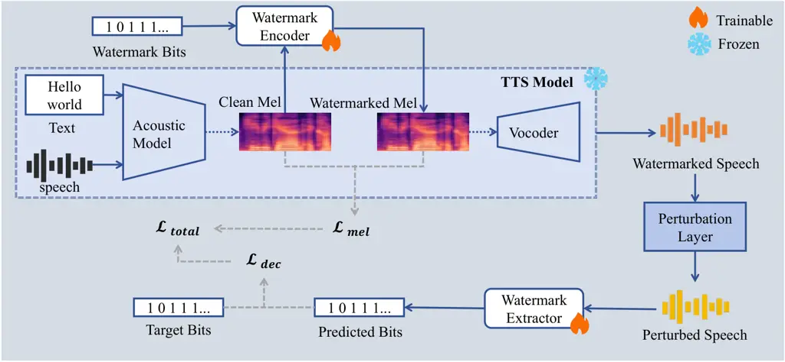
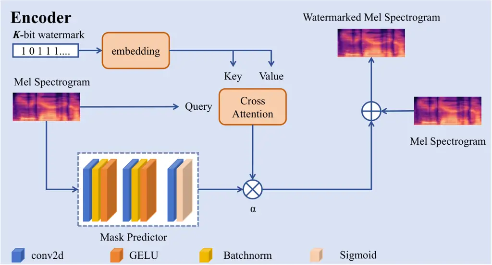
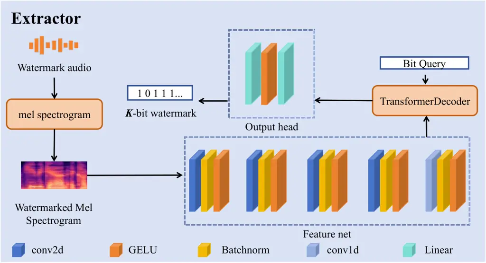
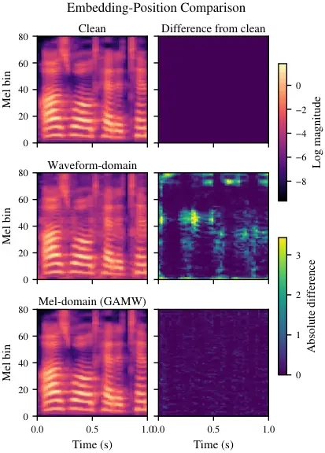

# GAMW: Generation-Aware Mel-Domain Watermarking for TTS Traceability

Yihang Zhang Affiliation: Zhejiang University
Email: <zhangyihang112@zju.edu.cn>    Weicai Yan Affiliation: Zhejiang
University Email: <jintzju@zju.edu.cn>    Qifei Zhang
Affiliation: Zhejiang University    Yangyang Wu Affiliation: Zhejiang
University    Tao Jin ^(†)^(†)thanks: Corresponding author.
Affiliation: Zhejiang University

###### Abstract

As text-to-speech (TTS) systems continue to advance, provenance tracking
and security verification of synthesized speech have become increasingly
important. Audio watermarking provides active provenance by embedding
imperceptible, machine-recoverable information into speech. However,
existing post-hoc methods typically modify the waveform after synthesis,
leaving the watermark vulnerable to compound perturbations. To address
this limitation, we propose GAMW, a watermark injection framework
integrated into the TTS generation process. Before waveform synthesis,
GAMW embeds a content-adaptive multi-bit watermark residual into the
generated representation, and its decoding objective combines focal
modulation with dynamic per-bit weighting. We train and evaluate GAMW
separately on two TTS backbones. With a 16-bit payload, GAMW improves
decoding accuracy over the strongest baseline by 9.2 and 23.5 percentage
points under individual and compound perturbations, respectively, while
maintaining competitive speech quality. Reliable clean-speech decoding
is also retained at higher payloads.Code is available at
[https://github.com/ZConJugaTe/GAMW](https://github.com/ZConJugaTe/GAMW).

## 1 Introduction

Recent advances in text-to-speech (TTS) enable high-quality speech
synthesis in a target voice from only a short reference utterance Du et
al. (2024b); Cui et al. (2025), but also raise security and privacy
concerns, including deepfake audio fraud and challenges in copyright
protection Wenger et al. (2021); Ren et al. (2024). Regulators therefore
require traceability mechanisms to oversee synthetic speech. Passive
detection is one of the most common approaches to traceability Lu et al.
(2023); Yan et al. (2022); Xie et al. (2023), but alone cannot provide
every utterance with a persistent, verifiable source identifier. An
active provenance mechanism is therefore needed.

Figure 1: Audio quality–robustness trade-off with a 16-bit payload. The
horizontal axis reports ViSQOL between clean and watermarked speech, and
the vertical axis reports the average decoding accuracy under individual
perturbations. Circles and triangles denote separately trained and
evaluated settings on CosyVoice2 and GLM-TTS, respectively.

Audio watermarking enables active provenance by embedding messages that
are imperceptible yet algorithmically recoverable. Traditional methods
rely on hand-crafted signal-processing rules Hua et al. (2016), whose
fixed embedding and detection procedures are vulnerable to removal,
desynchronization, and related attacks and often require attack-specific
countermeasures Arnold (2003). Deep methods instead jointly learn
content-adaptive embedding and extraction. WavMark Chen et al. (2023)
and AudioSeal Roman et al. (2024) are representative post-hoc methods
that embed watermarks after speech generation. Although flexible to
deploy, such methods remain independent of the target TTS acoustic
generation process; evaluations reveal robustness limitations under
watermark removal, forgery, transformation-based attacks, and neural
audio codec compression Liu et al. (2024a); O’Reilly et al. (2025); Özer
et al. (2025).

Recent studies have therefore moved watermark insertion into audio
generation. GROOT encodes watermarks in the input latent of a frozen
diffusion audio generator so that they are written into the output
during generation Liu et al. (2024b), but such approaches depend on
generator-specific latents or mechanisms. In contrast, the
mel-spectrogram is a common intermediate representation between the
acoustic model and vocoder in neural TTS Shen et al. (2018); Ren et al.
(2020). It provides an explicit time–frequency structure and uses a
nonlinear mel scale that approximates human frequency perception Stevens
et al. (1937); Davis and Mermelstein (1980), allowing watermarks to
follow speech content across time and frequency and be rendered with the
acoustic representation by the vocoder. MelShield demonstrates the
feasibility of pre-vocoder mel watermarking, but requires a clean mel
reference and leaves the fidelity–robustness trade-off unresolved Jin et
al. (2026). Thus, choosing the mel domain alone guarantees neither
property; content-adaptive embedding remains necessary.

To address this challenge, we propose Generation-Aware Mel-Domain
Watermarking (GAMW), a learned mel-spectrogram watermarking framework
for TTS provenance. GAMW embeds a content-adaptive multi-bit residual
into the TTS-generated mel-spectrogram, which the frozen vocoder renders
into a waveform. The extractor recovers the payload from speech under
verification without the original mel reference. Its objective comprises
decoding and mel-fidelity losses. The former combines focal
modulation Lin et al. (2017) with dynamic per-bit weighting to emphasize
low-confidence sample–bit instances and weak bit positions in the
current mini-batch, respectively; the latter constrains deviations
between watermarked and clean spectrograms, balancing recovery and
spectral fidelity. The TTS backbone remains frozen during training. As
shown in Fig. 1, GAMW achieves a favorable empirical trade-off between
speech quality and post-perturbation watermark recovery.

Our main contributions are as follows:

- •
  We propose a learned mel-spectrogram watermarking framework for TTS
  provenance that embeds multi-bit watermarks with the TTS backbone
  frozen, allowing synthesized speech to carry the watermark.
- •
  We design a decoding objective combining focal modulation and dynamic
  per-bit weighting to address unequal recovery difficulty across
  sample–bit instances and bit positions.
- •
  We validate GAMW on two TTS backbones across audio quality, payload
  capacity, individual and compound perturbations, and embedding-domain
  and loss-function ablations.

## 2 Related Work

### 2.1 Text-to-Speech Models

Neural TTS commonly separates acoustic-representation generation from
waveform synthesis. Tacotron 2 predicts mel-spectrograms
autoregressively, FastSpeech and FastSpeech 2 use parallel
non-autoregressive generation Shen et al. (2018); Ren et al. (2019); Ren
et al. (2020), and vocoders such as WaveNet, HiFi-GAN, and HiFTNet
convert acoustic representations into waveforms Van Den Oord et al.
(2016); Kong et al. (2020); Li et al. (2023). With discrete speech
representations, the VALL-E series formulates zero-shot TTS as
conditional language modeling over codec tokens Wang et al. (2023); Chen
et al. (2024). Both the CosyVoice series and GLM-TTS employ speech-token
generation, flow-based mel-spectrogram generation, and neural vocoding,
retaining a mel-to-waveform synthesis stage Du et al. (2024a); Du et al.
(2024b); Du et al. (2025); Cui et al. (2025). GAMW embeds watermarks in
the mel domain, allowing the synthesized speech to carry the watermark
after waveform generation.

### 2.2 Audio Watermarking

Traditional audio watermarking relies mainly on hand-crafted
signal-processing techniques, including least-significant-bit
modification Cvejic and Seppanen (2004), echo hiding Cho et al. (2003),
spread spectrum Kirovski and Malvar (2003), and quantization index
modulation Chen and Wornell (2001). Their embedding rules are designed
to trade off fidelity, capacity, and robustness.

Deep watermarking instead learns content-adaptive embedding and recovery
jointly. WavMark uses invertible networks for watermark embedding and
extraction Chen et al. (2023), while AudioSeal supports localized
watermark detection Roman et al. (2024). SilentCipher combines
psychoacoustic constraints with pseudo-differentiable compression Singh
et al. (2024), and TimbreWM introduces timbre watermarking to resist
voice-cloning attacks Liu et al. (2023b). Related studies also consider
re-recording distortions and cross-attention-based recovery Pavlović et
al. (2022); Liu et al. (2023a); Liu et al. (2025). These methods can be
applied to existing audio, but watermark insertion remains separate from
the target TTS generation process. Other methods move insertion into
generation: GROOT encodes watermarks in diffusion latents Liu et al.
(2024b), TraceableSpeech writes them frame by frame during TTS
generation Zhou et al. (2024), and SOLIDO modifies diffusion models
through low-rank adaptation Li et al. (2025). MelShield further uses a
pre-vocoder mel representation, but requires a clean mel reference and
metadata for verification Jin et al. (2026). GAMW also embeds watermarks
at the mel interface while enabling reference-free multi-bit recovery
with a frozen TTS backbone.

## 3 Method

### 3.1 Overall Framework



Figure 2: Overview of GAMW. The trainable watermark encoder embeds a
multi-bit payload into the clean mel-spectrogram generated by the frozen
TTS model, and the frozen vocoder synthesizes the watermarked speech.
During training, perturbations are applied before payload recovery by
the trainable extractor, while the objective jointly optimizes decoding
accuracy and mel-domain fidelity.

As illustrated in Fig. 2, given an input text, a pre-trained TTS model
generates a clean mel-spectrogram $`M\in\mathbb{R}^{C\times T}`$, where
$`C`$ and $`T`$ denote the numbers of mel bands and time frames,
respectively. The watermark encoder embeds a $`K`$-bit binary sequence
$`w\in\{0,1\}^{K}`$ into $`M`$ to obtain the watermarked mel-spectrogram
$`\tilde{M}`$, which is synthesized into watermarked speech by the
frozen vocoder. During training, random perturbations are applied to
this speech, and the watermark extractor recovers the payload from the
perturbed waveform. The TTS backbone and vocoder remain frozen
throughout, while only the watermark encoder and extractor are jointly
optimized.

Unlike post-processing methods, GAMW operates on the mel acoustic
representation before waveform generation, allowing the watermark and
speech content to be jointly rendered into the final waveform by the
vocoder. The explicit time–frequency structure of the mel-spectrogram
enables content-aware allocation of watermark signals, preserving
recoverable embedding strength while limiting perceptual distortion.
This design provides a learnable way to balance speech quality and
perturbation robustness, as evaluated in our experiments.

### 3.2 Watermark Encoder

As illustrated in Fig. 3, the watermark encoder embeds the binary
sequence $`w`$ into the clean mel-spectrogram $`M`$ and outputs the
watermarked mel-spectrogram $`\tilde{M}`$, enabling the subsequently
synthesized speech to carry the corresponding watermark.



Figure 3: Watermark encoder. Cross-attention fuses the watermark
representation with the mel content, while the mask predictor and
learnable global strength jointly modulate the watermark residual before
it is added to the clean mel-spectrogram.

The watermark bits are mapped through a learnable embedding layer and
combined with positional encodings, yielding
$`E_{w}\in\mathbb{R}^{K\times d_{\text{emb}}}`$, which represents both
bit values and their positions. We set the embedding dimension
$`d_{\text{emb}}`$ equal to the number of mel bands $`C`$.

Multi-head cross-attention Vaswani et al. (2017) then maps the watermark
representation into the mel-spectrogram space. Mel frames serve as
queries, while $`E_{w}`$ provides the keys and values, allowing each
frame to aggregate watermark information conditioned on its acoustic
content and producing a content-dependent raw residual
$`S_{\text{raw}}\in\mathbb{R}^{C\times T}`$:

```math
S_{\text{raw}}=\text{CrossAttn}\bigl(Q=M^{\top},\,K=E_{w},\,V=E_{w}\bigr)^{\top} \tag{1}
```

To adapt the watermark distribution to speech content, a lightweight 2D
convolutional network predicts a time–frequency soft mask
$`M_{\text{mask}}`$ from $`M`$ and adjusts the relative watermark
strength of each time–frequency bin according to local acoustic
structure. A learnable global factor $`\alpha`$ controls the overall
embedding strength. Together, they regulate the spatial distribution and
magnitude of the watermark, enabling the encoder to adaptively balance
recoverability and spectral fidelity. The watermarked mel-spectrogram is
given by

```math
\tilde{M}=M+\alpha\cdot M_{\text{mask}}\odot S_{\text{raw}} \tag{2}
```

where $`\odot`$ denotes element-wise multiplication. This residual
formulation preserves a direct path for the original mel-spectrogram and
expresses the watermark as an additive modification jointly regulated by
the mask and global strength.

### 3.3 Watermark Extractor



Figure 4: Watermark extractor. The input speech is converted into a
mel-spectrogram, from which a convolutional feature network extracts
time–frequency features. A Transformer decoder with a learnable query
aggregates the features, and an output head recovers the multi-bit
payload.

The watermark extractor recovers the payload from audio that may have
undergone perturbations. A fixed-parameter mel transform converts the
input waveform into a time–frequency representation. A 2D convolutional
backbone then progressively downsamples the frequency axis while
preserving temporal structure, producing a feature sequence
$`F\in\mathbb{R}^{T^{\prime}\times d_{\text{feat}}}`$. The Transformer
decoder uses a learnable query
$`Q\in\mathbb{R}^{1\times d_{\text{feat}}}`$ shared across all samples
to aggregate global watermark evidence from $`F`$:

```math
h=\text{TransformerDecoder}\bigl(\text{tgt}=Q,\;\text{memory}=F\bigr) \tag{3}
```

The prediction head maps the aggregated representation
$`h\in\mathbb{R}^{1\times d_{\text{feat}}}`$ to the probabilities
$`p\in[0,1]^{K}`$ of the $`K`$ watermark bits, which are thresholded to
obtain the final binary payload. This process uses only the suspect
audio and requires neither the original speech nor the clean
mel-spectrogram as a reference.

### 3.4 Training Objective

The training objective is a weighted combination of the decoding loss
and the mel-domain fidelity loss:

```math
\mathcal{L}_{\text{total}}=\lambda_{\text{dec}}\cdot\mathcal{L}_{\text{dec}}+\lambda_{\text{mel}}\cdot\mathcal{L}_{\text{mel}} \tag{4}
```

where $`\lambda_{\text{dec}}`$ and $`\lambda_{\text{mel}}`$ are
hyperparameters that balance payload recovery and spectral fidelity.

Multi-bit watermark recovery is imbalanced at two levels: sample–bit
instances within a mini-batch have different prediction confidence, and
bit positions may exhibit different recovery difficulty. To address both
forms of imbalance, we augment focal binary cross-entropy Lin et al.
(2017) with dynamic per-bit weighting. Focal modulation reduces the loss
contribution of high-confidence, easy instances, while the per-bit
weights emphasize harder positions according to their decoding accuracy
in the current mini-batch:

```math
\mathcal{L}_{\text{dec}}=\frac{1}{BK}\sum_{i=1}^{B}\sum_{k=1}^{K}\omega_{k}(1-p_{t,ik})^{\gamma}\text{BCE}(p_{ik},w_{ik}) \tag{5}
```

```math
\omega_{k}=1+\lambda_{w}\cdot(1-\text{acc}_{k}) \tag{6}
```

Here, $`B`$ denotes the mini-batch size; $`p_{ik}`$ and $`w_{ik}`$ are
the predicted probability and ground-truth label for bit $`k`$ of sample
$`i`$, respectively; and $`p_{t,ik}=p_{ik}w_{ik}+(1-p_{ik})(1-w_{ik})`$
is the probability assigned to the correct class. The accuracy
$`\text{acc}_{k}`$ is computed from thresholded predictions over the
current mini-batch and detached when constructing the weights. The
hyperparameter $`\gamma`$ controls the suppression of easy instances,
while $`\lambda_{w}`$ controls the strength of per-bit reweighting. The
two weighting terms therefore act on instance-level confidence and
bit-position-level difficulty, respectively. By directing optimization
toward both low-confidence instances and weakly recovered bit positions
within the current mini-batch, this design facilitates faster learning
of the decoding task.

The mel-domain fidelity loss uses mean squared error to directly
constrain the deviation between the watermarked mel-spectrogram
$`\tilde{M}`$ and the original clean mel-spectrogram $`M`$:

```math
\mathcal{L}_{\text{mel}}=\frac{1}{CT}\bigl\|\tilde{M}-M\bigr\|_{\mathrm{F}}^{2} \tag{7}
```

## 4 Experiments

We evaluate GAMW in terms of audio quality, payload capacity,
robustness, and ablation studies.

### 4.1 Experimental Setup

Datasets. The experimental data consist of LibriSpeech Panayotov et al.
(2015) and LJSpeech Ito and Johnson (2017). We use the official
LibriSpeech test set and a manually held-out test split from LJSpeech.
All test samples are excluded from training.

Evaluation Metrics. Speech quality is evaluated using PESQ Rix et al.
(2001), ViSQOL Hines et al. (2015), and MOS. PESQ and ViSQOL are
full-reference metrics that compare watermarked speech with its clean
synthetic counterpart to quantify watermark-induced perceptual
degradation. MOS is estimated by the no-reference UTMOS model Saeki et
al. (2022) and reflects overall perceptual quality. Watermark recovery
is measured by bitwise decoding accuracy (ACC). Higher values are better
for all metrics.

TTS Backbones. We train GAMW separately on CosyVoice2 Du et al. (2024b)
and GLM-TTS Cui et al. (2025) using the same data and training protocol.
Detailed implementation settings are provided in Appendix A.

Baselines. We evaluate four speech watermarking baselines: WavMark Chen
et al. (2023), AudioSeal Roman et al. (2024), SilentCipher Singh et al.
(2024), and TimbreWM Liu et al. (2023b), with payloads of 32, 16, 40,
and 10 bits, respectively.

### 4.2 Audio Quality Evaluation

We evaluate the impact of watermark embedding on synthetic speech
quality under clean conditions and report clean watermark decoding
accuracy for reference.

| Method       | PESQ   | ViSQOL | MOS    | ACC    |
| ------------ | ------ | ------ | ------ | ------ |
| CosyVoice2   |        |        |        |        |
| WavMark      | 4.3008 | 4.8340 | 4.0628 | 1.0000 |
| AudioSeal    | 4.3672 | 4.8884 | 4.0592 | 1.0000 |
| SilentCipher | 4.5701 | 4.9352 | 4.0745 | 0.8654 |
| TimbreWM     | 3.8464 | 4.6662 | 3.9354 | 1.0000 |
| GAMW (ours)  | 4.3001 | 4.9726 | 4.0775 | 1.0000 |
| GLM-TTS      |        |        |        |        |
| WavMark      | 4.2259 | 4.5085 | 3.7017 | 1.0000 |
| AudioSeal    | 4.3529 | 4.8080 | 3.6893 | 1.0000 |
| SilentCipher | 4.5729 | 4.7806 | 3.7197 | 0.8512 |
| TimbreWM     | 3.8114 | 4.2841 | 3.5633 | 1.0000 |
| GAMW (ours)  | 4.2970 | 4.9512 | 3.7245 | 1.0000 |

Table 1: Audio quality comparison under the no-perturbation condition.
MOS is predicted by UTMOS. Higher is better for all metrics.

Table 1 shows that GAMW achieves the highest ViSQOL on both TTS
backbones while maintaining competitive PESQ. Its MOS also exceeds those
of all four baselines on both backbones, indicating limited
watermark-induced perceptual degradation and well-preserved overall
speech quality. GAMW achieves an ACC of 1.0000 on both backbones under
clean conditions; all baselines except SilentCipher also achieve 1.0000.

### 4.3 Capacity Evaluation

We evaluate the effects of different watermark payload sizes under clean
conditions in terms of speech quality and decoding accuracy.

| $`K`$ (bits) | PESQ   | ViSQOL | MOS    | ACC    |
| ------------ | ------ | ------ | ------ | ------ |
| CosyVoice2   |        |        |        |        |
| 16           | 4.3001 | 4.9726 | 4.0775 | 1.0000 |
| 32           | 4.2518 | 4.9614 | 4.0766 | 0.9976 |
| 50           | 4.2332 | 4.9562 | 4.0763 | 0.9992 |
| 100          | 4.0607 | 4.9205 | 4.0266 | 0.9978 |
| GLM-TTS      |        |        |        |        |
| 16           | 4.2970 | 4.9512 | 3.7245 | 1.0000 |
| 32           | 4.2042 | 4.9316 | 3.7223 | 0.9996 |
| 50           | 4.1435 | 4.9122 | 3.7143 | 0.9991 |
| 100          | 4.0676 | 4.8823 | 3.6708 | 0.9903 |

Table 2: Capacity evaluation at different watermark lengths. MOS is
predicted by UTMOS. Higher is better for all metrics.

As shown in Table 2, PESQ, ViSQOL, and MOS generally decrease gradually
as the payload increases from 16 to 100 bits on both TTS backbones,
indicating greater watermark-induced distortion at higher capacities.
Nevertheless, with a 100-bit payload, GAMW retains ACCs of 0.9978 and
0.9903 on CosyVoice2 and GLM-TTS, respectively, while PESQ remains above
4.06 and ViSQOL above 4.88. These results show that GAMW can scale to a
100-bit payload under clean conditions while maintaining reliable
decoding and limited perceptual degradation.

### 4.4 Robustness Evaluation

Robustness is evaluated using the primary 16-bit setting under
individual and compound perturbations. Individual perturbations are
selected based on the categories in AudioMarkBench Liu et al. (2024a),
while compound perturbations chain multiple operations in predefined
orders to simulate complex transmission and editing. Detailed
perturbation settings are provided in Appendix B.

#### 4.4.1 Single Perturbation

| Perturbation                   | WavMark | AudioSeal | SilentCipher | TimbreWM | GAMW   |
| ------------------------------ | ------- | --------- | ------------ | -------- | ------ |
| CosyVoice2                     |         |           |              |          |        |
| Gaussian noise (SNR = 10 dB)   | 0.5008  | 0.6711    | 0.1669       | 0.6777   | 0.9837 |
| Gaussian noise (SNR = 20 dB)   | 0.5946  | 0.8911    | 0.1751       | 0.9054   | 0.9977 |
| Gaussian noise (SNR = 30 dB)   | 0.8572  | 0.9876    | 0.2370       | 0.9922   | 0.9996 |
| Background noise (SNR = 10 dB) | 0.6176  | 0.7256    | 0.2343       | 0.7224   | 0.9663 |
| Background noise (SNR = 20 dB) | 0.8580  | 0.8991    | 0.2635       | 0.8918   | 0.9963 |
| Background noise (SNR = 30 dB) | 0.9817  | 0.9842    | 0.3327       | 0.9900   | 0.9995 |
| Low-pass filtering             | 0.9875  | 1.0000    | 0.8191       | 0.9976   | 0.9997 |
| High-pass filtering            | 0.9999  | 0.3253    | 0.3108       | 0.9672   | 0.9575 |
| MP3 compression                | 0.7123  | 0.9850    | 0.2273       | 0.9858   | 0.9716 |
| Opus compression               | 0.7809  | 0.8323    | 0.2115       | 0.9822   | 0.9709 |
| EnCodec Défossez et al. (2022) | 0.4454  | 0.3691    | 0.1698       | 0.6045   | 0.9670 |
| Smoothing                      | 0.8953  | 0.8750    | 0.2701       | 0.9081   | 0.9951 |
| Echo                           | 0.8332  | 0.9608    | 0.2012       | 0.9988   | 0.9967 |
| Quantization                   | 0.4673  | 0.7189    | 0.1835       | 0.7637   | 0.9816 |
| Time stretching                | 0.9600  | 0.9980    | 0.3081       | 0.9998   | 0.9981 |
| Average                        | 0.7661  | 0.8149    | 0.2740       | 0.8925   | 0.9854 |

Table 3: Decoding accuracy under individual perturbations on CosyVoice2
with a 16-bit payload. The Average row is computed over all 15
conditions. Complete results for both backbones are provided in Appendix
Table 8. Higher is better.

Table 3 reports all 15 individual-perturbation results for GAMW and four
baselines on CosyVoice2, with the average computed equally over the 15
conditions. Complete results for CosyVoice2 and GLM-TTS are provided in
Appendix Table 8.

As shown in Table 3, GAMW achieves an average ACC of 0.9854 on
CosyVoice2 and ranks first in nine of the fifteen conditions. Appendix
Table 8 shows the same trend on GLM-TTS, where GAMW reaches an average
ACC of 0.9820 and again ranks first in nine conditions. Its advantage is
concentrated on the more challenging conditions: GAMW ranks first under
every additive-noise setting and retains ACCs of 0.9670 and 0.9420 after
EnCodec re-synthesis on CosyVoice2 and GLM-TTS, respectively, compared
with 0.6045 and 0.5971 for the strongest baseline. It also leads under
smoothing and quantization. Under the remaining filtering, conventional
compression, echo, and time-stretching conditions, individual baselines
perform slightly better, but GAMW still maintains ACCs of at least
0.9575 and 0.9622 on the two backbones. These results show that GAMW
combines competitive performance under common processing with stronger
overall robustness to noise, quantization, and EnCodec re-synthesis.

#### 4.4.2 Compound Perturbation

Figure 5 compares GAMW with four baselines under eight compound
perturbations on CosyVoice2. Complete numerical results for CosyVoice2
and GLM-TTS are reported in Appendix Table 9, with each average computed
equally over the eight conditions.

Figure 5: Watermark decoding accuracy under eight compound perturbations
on CosyVoice2 with a 16-bit payload. Complete numerical results for
CosyVoice2 and GLM-TTS are provided in Appendix Table 9. Higher is
better.

As shown in Fig. 5, GAMW ranks first in all eight compound conditions on
CosyVoice2, achieving an average ACC of 0.9145 and outperforming the
strongest baseline by 23.71 percentage points. Appendix Table 9 shows
the same trend on GLM-TTS: GAMW again ranks first in every condition,
with an average ACC of 0.9071 and a 23.31-point advantage over the
strongest baseline. Even under the three-stage EnCodec, Opus, and
quantization cascade, GAMW retains ACCs of 0.8332 and 0.8218 on the two
backbones. These results demonstrate strong payload recoverability after
sequential multi-step processing.

### 4.5 Ablation Study

Ablation experiments analyze two design choices in GAMW: the decoding
loss formulation and the embedding position. Both studies use CosyVoice2
with a 16-bit watermark.

#### 4.5.1 Loss Function

To examine the roles of focal modulation and per-bit weighting (PBW) in
early optimization, we use a $`2\times 2`$ design comparing standard
BCE, focal BCE, BCE+PBW, and the complete focal+PBW objective. The four
variants use the same model architecture, training data, and training
environment, differing only in the loss function. During the first
epoch, we evaluate each variant on the same validation set every 100
training steps and also record the epoch-end result.

Figure 6: Validation performance of different decoding objectives during
the first clean warm-up epoch. (a) Overall watermark decoding accuracy
on a fixed validation set. (b) Minimum per-bit accuracy across the 16
watermark bits. Evaluation is performed on the same validation set every
100 training steps, with the epoch-end result also included.

As shown in Fig. 6, removing either focal modulation or PBW delays the
simultaneous improvement of overall validation accuracy and minimum
per-bit accuracy. Using an overall validation ACC of at least 0.99 and a
minimum per-bit ACC of at least 0.95 as a common criterion, the complete
objective reaches this level at step 700, whereas the variants without
focal modulation and without PBW reach it at steps 1,500 and 1,700,
respectively. Standard BCE does not satisfy the criterion within the
first epoch. These results show that both components contribute to early
optimization, and their joint use achieves the fastest balanced
convergence of overall performance and difficult-bit recovery.

#### 4.5.2 Embedding Position

To compare mel- and waveform-domain embedding, we use
representation-specific encoders and extractors on CosyVoice2 with a
16-bit watermark, while keeping the training data and evaluation
protocol aligned. The waveform variant replaces mel-domain MSE with
waveform L1 loss. Table 4 reports quality and robustness, where
$`\mathrm{ACC}_{\mathrm{rob}}`$ averages ACC equally over 15 individual
perturbations.

| Position   | PESQ   | ViSQOL | MOS    | ACC$`\mathbf{{}_{\text{clean}}}`$ | ACC$`\mathbf{{}_{\text{rob}}}`$ |
| ---------- | ------ | ------ | ------ | --------------------------------- | ------------------------------- |
| Waveform   | 2.1911 | 3.8863 | 3.2943 | 0.9991                            | 0.9048                          |
| Mel (ours) | 4.2914 | 4.9721 | 4.0790 | 0.9999                            | 0.9795                          |

Table 4: Ablation of embedding position on CosyVoice2 with a 16-bit
watermark.

Table 4 shows nearly perfect clean recovery for both variants.
Waveform-domain embedding attains 0.9048 post-perturbation ACC, but only
2.1911 PESQ, 3.8863 ViSQOL, and 3.2943 MOS. Mel-domain embedding raises
ACC to 0.9795 while maintaining these quality metrics at 4.2914, 4.9721,
and 4.0790, providing a better imperceptibility–robustness trade-off
between the two evaluated implementations.



Figure 7: Spectral comparison of waveform-domain and mel-domain
embedding on CosyVoice2. The figure shows the mel-spectrograms of clean
and watermarked speech together with the absolute differences from the
clean spectrogram.

We further visualize mel-spectrograms of clean and watermarked speech.
The waveform-domain spectrogram is re-extracted from its output audio;
absolute differences from the clean spectrogram are shown with
consistent color ranges across each panel type.

Figure 7 shows that both methods preserve the dominant time–frequency
structure, but waveform-domain embedding causes larger spectral
deviations, whereas GAMW makes weaker, content-dependent modifications.
This agrees with the quality and robustness results in Table 4.

## 5 Conclusion

This paper presented GAMW, a reference-free multi-bit mel-spectrogram
watermarking framework for TTS provenance. GAMW inserts content-adaptive
watermark residuals between the acoustic model and vocoder, allowing the
watermark and speech content to be rendered jointly by a frozen vocoder,
and combines focal modulation with dynamic per-bit weighting to
facilitate early decoding optimization. Results from separately trained
models on CosyVoice2 and GLM-TTS show that GAMW maintains speech quality
and reliable clean decoding at higher payloads while achieving high
average decoding accuracy under individual and compound perturbations.
The embedding-position ablation shows that mel-domain insertion provides
a better empirical balance between speech fidelity and post-perturbation
watermark recovery than waveform-domain insertion. These findings
support the feasibility of using the mel interface for active provenance
of TTS-generated speech.

## Limitations

This study has several limitations. GAMW is evaluated only on CosyVoice2
and GLM-TTS, both of which include mel-spectrogram generation and neural
vocoding, and the watermark model is trained separately for each
backbone. The results therefore do not establish direct applicability to
TTS architectures without a mel interface or cross-backbone
generalization of a single watermark model. Although the evaluation
covers diverse individual and predefined compound perturbations, EnCodec
is the only neural audio codec tested, and broader codec families,
unseen perturbations, and adaptive removal, forgery, or overwriting
attacks targeting the extractor remain unexplored. Audio quality is
assessed mainly through objective metrics and UTMOS predictions, so
subjective listening tests are still needed to confirm perceptual
transparency. Future work will extend evaluation to more TTS pipelines
and vocoders and investigate efficient backbone adaptation and security
training against adaptive attacks.

## References

- Arnold (2003) M. Arnold Attacks on digital audio watermarks and
  countermeasures. In Proceedings Third International Conference on WEB
  Delivering of Music, pp. 55–62. Cited by: §1.
- Chen and Wornell (2001) B. Chen and G. W. Wornell Quantization index
  modulation: a class of provably good methods for digital watermarking
  and information embedding. IEEE Transactions on Information theory 47
  (4), pp. 1423–1443. Cited by: §2.2.
- Chen et al. (2023) G. Chen, Y. Wu, S. Liu, T. Liu, X. Du, and F. Wei
  Wavmark: watermarking for audio generation. arXiv preprint
  arXiv:2308.12770. Cited by: §1, §2.2, §4.1.
- Chen et al. (2024) S. Chen, S. Liu, L. Zhou, Y. Liu, X. Tan, J. Li, S.
  Zhao, Y. Qian, and F. Wei Vall-e 2: neural codec language models are
  human parity zero-shot text to speech synthesizers. arXiv preprint
  arXiv:2406.05370. Cited by: §2.1.
- Cho et al. (2003) J. Cho, H. Park, Y. Huh, H. Chung, and H. Jung Echo
  watermarking in sub-band domain. In International Workshop on Digital
  Watermarking, pp. 447–455. Cited by: §2.2.
- Cui et al. (2025) J. Cui, Z. Yang, N. Li, J. Tian, X. Ma, Y. Zhang, G.
  Chen, R. Yang, Y. Cheng, Y. Zhou, et al. Glm-tts technical report.
  arXiv preprint arXiv:2512.14291. Cited by: §1, §2.1, §4.1.
- Cvejic and Seppanen (2004) N. Cvejic and T. Seppanen Increasing
  robustness of lsb audio steganography using a novel embedding method.
  In International Conference on Information Technology: Coding and
  Computing, 2004. Proceedings. ITCC 2004., Vol. 2, pp. 533–537. Cited
  by: §2.2.
- Davis and Mermelstein (1980) S. Davis and P. Mermelstein Comparison of
  parametric representations for monosyllabic word recognition in
  continuously spoken sentences. IEEE transactions on acoustics, speech,
  and signal processing 28 (4), pp. 357–366. Cited by: §1.
- Défossez et al. (2022) A. Défossez, J. Copet, G. Synnaeve, and Y. Adi
  High fidelity neural audio compression. arXiv preprint
  arXiv:2210.13438. Cited by: Table 3.
- Du et al. (2024a) Z. Du, Q. Chen, S. Zhang, K. Hu, H. Lu, Y. Yang, H.
  Hu, S. Zheng, Y. Gu, Z. Ma, et al. Cosyvoice: a scalable multilingual
  zero-shot text-to-speech synthesizer based on supervised semantic
  tokens. arXiv preprint arXiv:2407.05407. Cited by: §2.1.
- Du et al. (2025) Z. Du, C. Gao, Y. Wang, F. Yu, T. Zhao, H. Wang, X.
  Lv, H. Wang, C. Ni, X. Shi, et al. Cosyvoice 3: towards in-the-wild
  speech generation via scaling-up and post-training. arXiv preprint
  arXiv:2505.17589. Cited by: §2.1.
- Du et al. (2024b) Z. Du, Y. Wang, Q. Chen, X. Shi, X. Lv, T. Zhao, Z.
  Gao, Y. Yang, C. Gao, H. Wang, et al. Cosyvoice 2: scalable streaming
  speech synthesis with large language models. arXiv preprint
  arXiv:2412.10117. Cited by: §1, §2.1, §4.1.
- Hines et al. (2015) A. Hines, J. Skoglund, A. C. Kokaram, and N. Harte
  ViSQOL: an objective speech quality model. EURASIP Journal on Audio,
  Speech, and Music Processing 2015 (1), pp. 13. Cited by: §4.1.
- Hua et al. (2016) G. Hua, J. Huang, Y. Q. Shi, J. Goh, and V. L. Thing
  Twenty years of digital audio watermarking—a comprehensive review.
  Signal processing 128, pp. 222–242. Cited by: §1.
- Ito and Johnson (2017) K. Ito and L. Johnson The lj speech dataset.
  Note:
  [https://keithito.com/LJ-Speech-Dataset/](https://keithito.com/LJ-Speech-Dataset/)
  Cited by: §4.1.
- Jin et al. (2026) Y. Jin, Q. Li, L. Liu, and J. Ni MelShield: robust
  mel-domain audio watermarking for provenance attribution of ai
  generated synthesized speech. In Australasian Conference on
  Information Security and Privacy, pp. 264–284. Cited by: §1, §2.2.
- Kirovski and Malvar (2003) D. Kirovski and H. S. Malvar
  Spread-spectrum watermarking of audio signals. IEEE transactions on
  signal processing 51 (4), pp. 1020–1033. Cited by: §2.2.
- Kong et al. (2020) J. Kong, J. Kim, and J. Bae Hifi-gan: generative
  adversarial networks for efficient and high fidelity speech synthesis.
  Advances in neural information processing systems 33, pp. 17022–17033.
  Cited by: §2.1.
- Li et al. (2023) Y. A. Li, C. Han, X. Jiang, and N. Mesgarani Hiftnet:
  a fast high-quality neural vocoder with harmonic-plus-noise filter and
  inverse short time fourier transform. arXiv preprint arXiv:2309.09493.
  Cited by: §2.1.
- Li et al. (2025) Y. Li, W. Liu, and D. Lin SOLIDO: a robust
  watermarking method for speech synthesis via low-rank adaptation.
  arXiv preprint arXiv:2504.15035. Cited by: §2.2.
- Lin et al. (2017) T. Lin, P. Goyal, R. Girshick, K. He, and P. Dollár
  Focal loss for dense object detection. In Proceedings of the IEEE
  international conference on computer vision, pp. 2980–2988. Cited by:
  §1, §3.4.
- Liu et al. (2023a) C. Liu, J. Zhang, H. Fang, Z. Ma, W. Zhang, and N.
  Yu Dear: a deep-learning-based audio re-recording resilient
  watermarking. In Proceedings of the AAAI Conference on Artificial
  Intelligence, Vol. 37, pp. 13201–13209. Cited by: §2.2.
- Liu et al. (2023b) C. Liu, J. Zhang, T. Zhang, X. Yang, W. Zhang,
  and N. Yu Detecting voice cloning attacks via timbre watermarking.
  arXiv preprint arXiv:2312.03410. Cited by: §2.2, §4.1.
- Liu et al. (2024a) H. Liu, M. Guo, Z. Jiang, L. Wang, and N. Z. Gong
  Audiomarkbench: benchmarking robustness of audio watermarking.
  Advances in Neural Information Processing Systems 37, pp. 52241–52265.
  Cited by: §1, §4.4.
- Liu et al. (2024b) W. Liu, Y. Li, D. Lin, H. Tian, and H. Li Groot:
  generating robust watermark for diffusion-model-based audio synthesis.
  In Proceedings of the 32nd ACM International Conference on Multimedia,
  pp. 3294–3302. Cited by: §1, §2.2.
- Liu et al. (2025) Y. Liu, L. Lu, J. Jin, L. Sun, and A. Fanelli
  Xattnmark: learning robust audio watermarking with cross-attention.
  arXiv preprint arXiv:2502.04230. Cited by: §2.2.
- Lu et al. (2023) J. Lu, Y. Zhang, Z. Li, Z. Shang, W. Wang, and P.
  Zhang Detecting unknown speech spoofing algorithms with nearest
  neighbors.. In DADA@ IJCAI, pp. 89–94. Cited by: §1.
- Özer et al. (2025) Y. Özer, W. Choi, J. Serrà, M. K. Singh, W. Liao,
  and Y. Mitsufuji A comprehensive real-world assessment of audio
  watermarking algorithms: will they survive neural codecs?. arXiv
  preprint arXiv:2505.19663. Cited by: §1.
- O’Reilly et al. (2025) P. O’Reilly, Z. Jin, J. Su, and B. Pardo Deep
  audio watermarks are shallow: limitations of post-hoc watermarking
  techniques for speech. arXiv preprint arXiv:2504.10782. Cited by: §1.
- Panayotov et al. (2015) V. Panayotov, G. Chen, D. Povey, and S.
  Khudanpur Librispeech: an asr corpus based on public domain audio
  books. In 2015 IEEE international conference on acoustics, speech and
  signal processing (ICASSP), pp. 5206–5210. Cited by: §4.1.
- Pavlović et al. (2022) K. Pavlović, S. Kovačević, I. Djurović, and A.
  Wojciechowski Robust speech watermarking by a jointly trained embedder
  and detector using a dnn. Digital Signal Processing 122, pp. 103381.
  Cited by: §2.2.
- Ren et al. (2024) J. Ren, H. Xu, P. He, Y. Cui, S. Zeng, J. Zhang, H.
  Wen, J. Ding, P. Huang, L. Lyu, et al. Copyright protection in
  generative ai: a technical perspective. arXiv preprint
  arXiv:2402.02333. Cited by: §1.
- Ren et al. (2020) Y. Ren, C. Hu, X. Tan, T. Qin, S. Zhao, Z. Zhao,
  and T. Liu Fastspeech 2: fast and high-quality end-to-end text to
  speech. arXiv preprint arXiv:2006.04558. Cited by: §1, §2.1.
- Ren et al. (2019) Y. Ren, Y. Ruan, X. Tan, T. Qin, S. Zhao, Z. Zhao,
  and T. Liu Fastspeech: fast, robust and controllable text to speech.
  Advances in neural information processing systems 32. Cited by: §2.1.
- Rix et al. (2001) A. W. Rix, J. G. Beerends, M. P. Hollier, and A. P.
  Hekstra Perceptual evaluation of speech quality (pesq)-a new method
  for speech quality assessment of telephone networks and codecs. In
  2001 IEEE international conference on acoustics, speech, and signal
  processing. Proceedings (Cat. No. 01CH37221), Vol. 2, pp. 749–752.
  Cited by: §4.1.
- Roman et al. (2024) R. S. Roman, P. Fernandez, A. Défossez, T.
  Furon, T. Tran, and H. Elsahar Proactive detection of voice cloning
  with localized watermarking. arXiv preprint arXiv:2401.17264. Cited
  by: §1, §2.2, §4.1.
- Saeki et al. (2022) T. Saeki, D. Xin, W. Nakata, T. Koriyama, S.
  Takamichi, and H. Saruwatari Utmos: utokyo-sarulab system for voicemos
  challenge 2022. arXiv preprint arXiv:2204.02152. Cited by: §4.1.
- Shen et al. (2018) J. Shen, R. Pang, R. J. Weiss, M. Schuster, N.
  Jaitly, Z. Yang, Z. Chen, Y. Zhang, Y. Wang, R. Skerrv-Ryan, et al.
  Natural tts synthesis by conditioning wavenet on mel spectrogram
  predictions. In 2018 IEEE international conference on acoustics,
  speech and signal processing (ICASSP), pp. 4779–4783. Cited by: §1,
  §2.1.
- Singh et al. (2024) M. K. Singh, N. Takahashi, W. Liao, and Y.
  Mitsufuji Silentcipher: deep audio watermarking. arXiv preprint
  arXiv:2406.03822. Cited by: §2.2, §4.1.
- Stevens et al. (1937) S. S. Stevens, J. Volkmann, and E. B. Newman A
  scale for the measurement of the psychological magnitude pitch. The
  journal of the acoustical society of america 8 (3), pp. 185–190. Cited
  by: §1.
- Van Den Oord et al. (2016) A. Van Den Oord, S. Dieleman, H. Zen, K.
  Simonyan, O. Vinyals, A. Graves, N. Kalchbrenner, A. Senior, K.
  Kavukcuoglu, et al. Wavenet: a generative model for raw audio. arXiv
  preprint arXiv:1609.03499 12 (1). Cited by: §2.1.
- Vaswani et al. (2017) A. Vaswani, N. Shazeer, N. Parmar, J.
  Uszkoreit, L. Jones, A. N. Gomez, Ł. Kaiser, and I. Polosukhin
  Attention is all you need. Advances in neural information processing
  systems 30. Cited by: §3.2.
- Wang et al. (2023) C. Wang, S. Chen, Y. Wu, Z. Zhang, L. Zhou, S.
  Liu, Z. Chen, Y. Liu, H. Wang, J. Li, et al. Neural codec language
  models are zero-shot text to speech synthesizers. arXiv preprint
  arXiv:2301.02111. Cited by: §2.1.
- Wenger et al. (2021) E. Wenger, M. Bronckers, C. Cianfarani, J.
  Cryan, A. Sha, H. Zheng, and B. Y. Zhao " Hello, it’s me": deep
  learning-based speech synthesis attacks in the real world. In
  Proceedings of the 2021 ACM SIGSAC Conference on Computer and
  Communications Security, pp. 235–251. Cited by: §1.
- Xie et al. (2023) Y. Xie, H. Cheng, Y. Wang, and L. Ye Domain
  generalization via aggregation and separation for audio deepfake
  detection. IEEE Transactions on Information Forensics and Security 19,
  pp. 344–358. Cited by: §1.
- Yan et al. (2022) X. Yan, J. Yi, J. Tao, C. Wang, H. Ma, T. Wang, S.
  Wang, and R. Fu An initial investigation for detecting vocoder
  fingerprints of fake audio. In Proceedings of the 1st international
  workshop on deepfake detection for audio multimedia, pp. 61–68. Cited
  by: §1.
- Zhou et al. (2024) J. Zhou, J. Yi, T. Wang, J. Tao, Y. Bai, C. Y.
  Zhang, Y. Ren, and Z. Wen Traceablespeech: towards proactively
  traceable text-to-speech with watermarking. arXiv preprint
  arXiv:2406.04840. Cited by: §2.2.

## Appendix A Implementation Details

### A.1 Data Preparation

Training and test manifests use JSONL records containing an utterance
identifier, text, a reference-speech path, and speaker information.
Preprocessing removes records with missing fields, unavailable audio, or
excessive duration, and excludes the official LibriSpeech test set and
the manually held-out LJSpeech test split from training. For each TTS
backbone, we use its own text frontend, speech-prompt encoding, and
acoustic model to generate 80-bin mel-spectrograms, which are cached as
tensors indexed by utterance identifier. CosyVoice2 and GLM-TTS
therefore use the same text–speech data split but separate mel caches
matched to their respective generation processes.

Watermark training uses short mel segments. During caching or loading,
we retain the first 50 frames of each generated mel-spectrogram; when
valid lengths differ within a mini-batch, the collator truncates all
samples to the shortest length before concatenation. This produces
shape-consistent batched inputs for the encoder, frozen vocoder, and
extractor, and focuses training on approximately one-second watermark
recovery. Complete utterances are retained for audio-quality evaluation
that requires full waveforms, avoiding direct comparison between
independently vocoded short mel prefixes and full-audio quality.

### A.2 Training Protocol

At each training step, an independent random multi-bit payload is
generated for every sample in the mini-batch. During training, each
payload and its bitwise complement are paired with the same mel input to
improve bit-value balance; this expansion is used only for training,
while validation and testing use random payloads directly. The TTS token
generator, acoustic model, and vocoder remain frozen, and only the
watermark encoder and extractor are optimized. GAMW is trained
separately for CosyVoice2 and GLM-TTS without sharing watermark-model
parameters.

Models are optimized for 50 epochs using AdamW with a cosine
learning-rate schedule, an initial learning rate of $`5\times 10^{-4}`$,
and a per-GPU batch size of 32. Training uses distributed data
parallelism across six NVIDIA RTX 3090 GPUs and two RTX 4090 GPUs. The
decoding and mel-fidelity loss weights are set to
$`\lambda_{\mathrm{dec}}=1.0`$ and $`\lambda_{\mathrm{mel}}=0.2`$,
respectively; the focal modulation parameter is set to $`\gamma=2`$, and
the per-bit weighting coefficient is set to $`\lambda_{w}=10`$. The
initial warm-up phase optimizes watermark recovery and mel fidelity on
clean speech. After warm-up, online augmentation is applied
independently to each sample with a probability of 0.7. At most one
perturbation is sampled from the predefined augmentation pool per
mini-batch, and a sample-level random mask determines which utterances
receive it. Table 5 lists the training-time parameters, and Appendix B
defines the perturbations. A straight-through estimator enables
non-differentiable operations to participate in end-to-end optimization.
Different payload capacities follow the same model and data pipeline,
with the watermark length and corresponding training configuration
adjusted as needed.

| Perturbation        | Training parameter                              |
| ------------------- | ----------------------------------------------- |
| Gaussian noise      | SNR $`\in\{10,20,30\}`$ dB                      |
| Background noise    | SNR $`\in\{10,20,30\}`$ dB                      |
| Low-pass filtering  | Normalized cutoff $`=0.20`$                     |
| High-pass filtering | Normalized cutoff $`=0.05`$                     |
| Smoothing           | Window $`\in\{6,10,14,18\}`$ samples            |
| Echo                | Delay $`\in[0.1,0.5]`$ s; gain $`\in[0.1,0.5]`$ |
| EnCodec             | Bandwidth $`=24`$ kbps                          |
| Time stretching     | Speed $`\in\{0.9,1.1\}`$                        |

Table 5: Training-time augmentation parameters. Sets denote discrete
sampling choices, and intervals denote uniform sampling ranges.

## Appendix B Perturbation Definitions and Parameters

This section specifies the implementation and reported parameters of the
perturbations used in the robustness evaluation. CosyVoice2 and GLM-TTS
use the same perturbation functions, parameters, and operation order.
Individual perturbations are applied separately to the same cache of
watermarked audio, whereas compound perturbations execute their
predefined pipelines from left to right. Outputs are cropped or
zero-padded to the input length before watermark extraction. The
evaluation code supports a wider auxiliary parameter sweep, but the
main-text and appendix result tables report only the settings listed in
Table 6.

| Perturbation        | Definition                                                                                                                 | Reported parameter(s)                   |
| ------------------- | -------------------------------------------------------------------------------------------------------------------------- | --------------------------------------- |
| Gaussian noise      | Add zero-mean Gaussian noise scaled according to the signal power and target SNR.                                          | SNR $`\in\{10,20,30\}`$ dB              |
| Background noise    | Repeat or truncate a real background-noise recording to the utterance length and scale it to the target SNR before mixing. | SNR $`\in\{10,20,30\}`$ dB              |
| Low-pass filtering  | Apply the Julius low-pass filter to the waveform.                                                                          | Normalized cutoff $`=0.2`$              |
| High-pass filtering | Apply the Julius high-pass filter to the waveform.                                                                         | Normalized cutoff $`=0.1`$              |
| MP3 compression     | Encode and decode the waveform using MP3 compression with a fixed bitrate.                                                 | Bitrate $`=16`$ kbps                    |
| Opus compression    | Encode and decode the waveform using Opus with a fixed bitrate and encoder complexity.                                     | Bitrate $`=16`$ kbps; complexity $`=1`$ |
| EnCodec             | Encode and decode the waveform using the 24-kHz EnCodec model.                                                             | Bandwidth $`=12`$ kbps                  |
| Smoothing           | Apply a moving-average filter to the waveform.                                                                             | Window size $`=22`$ samples             |
| Echo                | Add one delayed and attenuated copy of the waveform and normalize the result to the original amplitude range.              | Delay $`=0.3`$ s; amplitude $`=0.4`$    |
| Quantization        | Min–max normalize the waveform, uniformly quantize it, and map it back to its original amplitude range.                    | $`16`$ levels (4-bit)                   |
| Time stretching     | Perform pitch-preserving time stretching and crop or zero-pad the result to the original length.                           | Speed factor $`=1.1`$                   |

Table 6: Definitions and reported parameters of the individual
perturbations.

Gaussian noise is generated from the mean signal power of each
utterance. Background noise uses the VOiCES example recording
distributed through Torchaudio and is repeated or truncated before
mixing. The low- and high-pass parameters are normalized cutoff values
passed directly to the Julius filters. MP3 and Opus bitrates are passed
to their implementations in kbps and bps, respectively, and are both
reported in kbps in Table 6. EnCodec uses the facebook/encodec_24khz
model with a target bandwidth of 12 kbps. Quantization uses 16 uniform
levels, corresponding to a 4-bit representation, and time stretching
uses a factor of 1.1 while preserving the final sample count.

| Pipeline                                      | Ordered operations and parameters                                                                         |
| --------------------------------------------- | --------------------------------------------------------------------------------------------------------- |
| Gaussian noise + background noise             | Gaussian noise (20 dB) $`\rightarrow`$ background noise (20 dB)                                           |
| EnCodec + Opus                                | EnCodec (12 kbps) $`\rightarrow`$ Opus (16 kbps, complexity 1)                                            |
| Echo + Gaussian noise                         | Echo (0.3 s, amplitude 0.4) $`\rightarrow`$ Gaussian noise (20 dB)                                        |
| EnCodec + MP3                                 | EnCodec (12 kbps) $`\rightarrow`$ MP3 (16 kbps)                                                           |
| Time stretching + smoothing + Opus            | Time stretching (1.1) $`\rightarrow`$ smoothing (22 samples) $`\rightarrow`$ Opus (16 kbps, complexity 1) |
| Low-pass filtering + Gaussian noise + EnCodec | Low-pass filtering (0.2) $`\rightarrow`$ Gaussian noise (20 dB) $`\rightarrow`$ EnCodec (12 kbps)         |
| Echo + background noise + MP3                 | Echo (0.3 s, amplitude 0.4) $`\rightarrow`$ background noise (20 dB) $`\rightarrow`$ MP3 (16 kbps)        |
| EnCodec + Opus + quantization                 | EnCodec (12 kbps) $`\rightarrow`$ Opus (16 kbps, complexity 1) $`\rightarrow`$ quantization (16 levels)   |

Table 7: Definitions and parameters of the compound-perturbation
pipelines. Operations are applied from left to right.

Compound perturbations do not resample parameters; they use the fixed
values in Table 7 so that every method and both TTS backbones undergo
identical processing. Each operation receives the output of the
preceding operation, making the listed order part of the experimental
definition. The pipelines cover two- and three-stage combinations
involving additive noise, conventional compression, neural audio codec
processing, filtering, echo, smoothing, time stretching, and
quantization.

## Appendix C Complete Individual-Perturbation Results

This section provides the complete individual-perturbation results for
the 16-bit setting corresponding to Table 3 in the main text. The
evaluation covers additive Gaussian noise, background noise, filtering,
conventional lossy compression, neural audio codec re-synthesis with
EnCodec, and common signal processing. Gaussian and background noise are
each evaluated at SNRs of 10, 20, and 30 dB, while each remaining
perturbation uses the fixed parameter specified by the main experimental
protocol. All methods are evaluated using the same test audio,
perturbation parameters, and metric implementation. Table 8 reports ACC
on both CosyVoice2 and GLM-TTS, with each backbone average computed
equally over all 15 conditions.

| Perturbation                   | WavMark | AudioSeal | SilentCipher | TimbreWM | GAMW   |
| ------------------------------ | ------- | --------- | ------------ | -------- | ------ |
| CosyVoice2                     |         |           |              |          |        |
| Gaussian noise (SNR = 10 dB)   | 0.5008  | 0.6711    | 0.1669       | 0.6777   | 0.9837 |
| Gaussian noise (SNR = 20 dB)   | 0.5946  | 0.8911    | 0.1751       | 0.9054   | 0.9977 |
| Gaussian noise (SNR = 30 dB)   | 0.8572  | 0.9876    | 0.2370       | 0.9922   | 0.9996 |
| Background noise (SNR = 10 dB) | 0.6176  | 0.7256    | 0.2343       | 0.7224   | 0.9663 |
| Background noise (SNR = 20 dB) | 0.8580  | 0.8991    | 0.2635       | 0.8918   | 0.9963 |
| Background noise (SNR = 30 dB) | 0.9817  | 0.9842    | 0.3327       | 0.9900   | 0.9995 |
| Low-pass filtering             | 0.9875  | 1.0000    | 0.8191       | 0.9976   | 0.9997 |
| High-pass filtering            | 0.9999  | 0.3253    | 0.3108       | 0.9672   | 0.9575 |
| MP3 compression                | 0.7123  | 0.9850    | 0.2273       | 0.9858   | 0.9716 |
| Opus compression               | 0.7809  | 0.8323    | 0.2115       | 0.9822   | 0.9709 |
| EnCodec                        | 0.4454  | 0.3691    | 0.1698       | 0.6045   | 0.9670 |
| Smoothing                      | 0.8953  | 0.8750    | 0.2701       | 0.9081   | 0.9951 |
| Echo                           | 0.8332  | 0.9608    | 0.2012       | 0.9988   | 0.9967 |
| Quantization                   | 0.4673  | 0.7189    | 0.1835       | 0.7637   | 0.9816 |
| Time stretching                | 0.9600  | 0.9980    | 0.3081       | 0.9998   | 0.9981 |
| Average                        | 0.7661  | 0.8149    | 0.2740       | 0.8925   | 0.9854 |
| GLM-TTS                        |         |           |              |          |        |
| Gaussian noise (SNR = 10 dB)   | 0.5091  | 0.6198    | 0.1771       | 0.6839   | 0.9744 |
| Gaussian noise (SNR = 20 dB)   | 0.6053  | 0.8442    | 0.1753       | 0.9010   | 0.9944 |
| Gaussian noise (SNR = 30 dB)   | 0.8425  | 0.9699    | 0.2301       | 0.9862   | 0.9984 |
| Background noise (SNR = 10 dB) | 0.5964  | 0.6715    | 0.2334       | 0.7029   | 0.9603 |
| Background noise (SNR = 20 dB) | 0.8054  | 0.8421    | 0.2479       | 0.8596   | 0.9916 |
| Background noise (SNR = 30 dB) | 0.9542  | 0.9670    | 0.2878       | 0.9763   | 0.9983 |
| Low-pass filtering             | 0.9904  | 1.0000    | 0.7871       | 0.9987   | 0.9998 |
| High-pass filtering            | 1.0000  | 0.3318    | 0.3152       | 0.9731   | 0.9884 |
| MP3 compression                | 0.8038  | 0.9957    | 0.2533       | 0.9934   | 0.9814 |
| Opus compression               | 0.8227  | 0.8432    | 0.2272       | 0.9907   | 0.9622 |
| EnCodec                        | 0.4399  | 0.3712    | 0.1584       | 0.5971   | 0.9420 |
| Smoothing                      | 0.8619  | 0.8535    | 0.2892       | 0.9244   | 0.9799 |
| Echo                           | 0.7485  | 0.9561    | 0.2208       | 0.9998   | 0.9970 |
| Quantization                   | 0.4683  | 0.6623    | 0.2185       | 0.7634   | 0.9630 |
| Time stretching                | 0.9662  | 0.9998    | 0.3186       | 1.0000   | 0.9989 |
| Average                        | 0.7610  | 0.7952    | 0.2760       | 0.8900   | 0.9820 |

Table 8: Complete decoding accuracy under individual perturbations with
a 16-bit payload on CosyVoice2 and GLM-TTS. The Average row is computed
over all 15 conditions for each backbone. Higher is better.

## Appendix D Complete Compound-Perturbation Results

This section provides the complete compound-perturbation results for the
16-bit setting corresponding to Fig. 5 in the main text. Each pipeline
applies two or three operations sequentially in the order listed in the
table, simulating successive processing during speech transmission,
compression, and editing. All methods are evaluated using the same
audio, perturbation types, parameters, and operation order, and
performance is reported as watermark decoding accuracy (ACC). Table 9
reports results on both CosyVoice2 and GLM-TTS, with the average for
each backbone computed equally over its eight compound perturbations.

| Perturbation pipeline                         | WavMark | AudioSeal | SilentCipher | TimbreWM | GAMW   |
| --------------------------------------------- | ------- | --------- | ------------ | -------- | ------ |
| CosyVoice2                                    |         |           |              |          |        |
| Gaussian noise + background noise             | 0.5925  | 0.8136    | 0.1748       | 0.8192   | 0.9949 |
| EnCodec + Opus                                | 0.4694  | 0.3681    | 0.1756       | 0.5910   | 0.8981 |
| Echo + Gaussian noise                         | 0.5610  | 0.8170    | 0.1824       | 0.8693   | 0.9890 |
| EnCodec + MP3                                 | 0.4530  | 0.3666    | 0.1718       | 0.5656   | 0.8490 |
| Time stretching + smoothing + Opus            | 0.4968  | 0.5647    | 0.1787       | 0.7751   | 0.8865 |
| Low-pass filtering + Gaussian noise + EnCodec | 0.5029  | 0.3663    | 0.1801       | 0.5648   | 0.9575 |
| Echo + background noise + MP3                 | 0.4810  | 0.5296    | 0.1660       | 0.7084   | 0.9078 |
| EnCodec + Opus + quantization                 | 0.4704  | 0.4598    | 0.1891       | 0.5255   | 0.8332 |
| Average                                       | 0.5034  | 0.5357    | 0.1773       | 0.6774   | 0.9145 |
| GLM-TTS                                       |         |           |              |          |        |
| Gaussian noise + background noise             | 0.5991  | 0.7428    | 0.1793       | 0.8064   | 0.9947 |
| EnCodec + Opus                                | 0.4685  | 0.3590    | 0.1705       | 0.5823   | 0.8848 |
| Echo + Gaussian noise                         | 0.5525  | 0.7431    | 0.1938       | 0.8722   | 0.9858 |
| EnCodec + MP3                                 | 0.4628  | 0.3599    | 0.1578       | 0.5607   | 0.8397 |
| Time stretching + smoothing + Opus            | 0.4930  | 0.4958    | 0.1931       | 0.7774   | 0.8869 |
| Low-pass filtering + Gaussian noise + EnCodec | 0.5077  | 0.3641    | 0.1842       | 0.5551   | 0.9511 |
| Echo + background noise + MP3                 | 0.4774  | 0.4988    | 0.1628       | 0.7220   | 0.8919 |
| EnCodec + Opus + quantization                 | 0.4661  | 0.4524    | 0.2049       | 0.5155   | 0.8218 |
| Average                                       | 0.5034  | 0.5020    | 0.1808       | 0.6740   | 0.9071 |

Table 9: Complete decoding accuracy under compound perturbations with a
16-bit payload. ACC (higher is better).

## Appendix E Additional Payload–Robustness Analysis

To examine how a larger payload affects watermark robustness, we
additionally evaluate GAMW with a 32-bit payload and compare it with the
primary 16-bit setting. Both payloads use the same test samples,
perturbation parameters, and 15 individual-perturbation conditions. This
supplementary experiment compares GAMW across payload sizes; compound
perturbations are evaluated only under the primary 16-bit setting.

| Perturbation             | CosyVoice2 |        | GLM-TTS |        |
| ------------------------ | ---------- | ------ | ------- | ------ |
|                          | 16         | 32     | 16      | 32     |
| Gaussian noise (10 dB)   | 0.9837     | 0.9467 | 0.9744  | 0.9401 |
| Gaussian noise (20 dB)   | 0.9977     | 0.9896 | 0.9944  | 0.9844 |
| Gaussian noise (30 dB)   | 0.9996     | 0.9974 | 0.9984  | 0.9954 |
| Background noise (10 dB) | 0.9663     | 0.8655 | 0.9603  | 0.8713 |
| Background noise (20 dB) | 0.9963     | 0.9642 | 0.9916  | 0.9594 |
| Background noise (30 dB) | 0.9995     | 0.9921 | 0.9983  | 0.9897 |
| Low-pass filtering       | 0.9997     | 0.9986 | 0.9998  | 0.9991 |
| High-pass filtering      | 0.9575     | 0.9240 | 0.9884  | 0.9464 |
| MP3 compression          | 0.9716     | 0.9591 | 0.9814  | 0.9543 |
| Opus compression         | 0.9709     | 0.9569 | 0.9622  | 0.9450 |
| EnCodec                  | 0.9670     | 0.9157 | 0.9420  | 0.9092 |
| Smoothing                | 0.9951     | 0.9909 | 0.9799  | 0.9598 |
| Echo                     | 0.9967     | 0.9885 | 0.9970  | 0.9935 |
| Quantization             | 0.9816     | 0.9412 | 0.9630  | 0.9285 |
| Time stretching          | 0.9981     | 0.9953 | 0.9989  | 0.9984 |
| Average                  | 0.9854     | 0.9617 | 0.9820  | 0.9583 |

Table 10: Individual-perturbation ACC of GAMW with 16-bit and 32-bit
payloads. Higher is better.

As shown in Table 10, increasing the payload from 16 to 32 bits reduces
the average ACC by approximately 2.37 percentage points on both
CosyVoice2 and GLM-TTS, while the 32-bit setting still reaches 0.9617
and 0.9583, respectively. The degradation is concentrated under more
challenging conditions such as low-SNR background noise, high-pass
filtering, and EnCodec re-synthesis, whereas ACC remains close to 1
under low-pass filtering, higher-SNR noise, and time stretching. These
results show the expected robustness cost of a larger payload while
retaining approximately 0.96 average bit accuracy under the evaluated
individual perturbations.

## Appendix F Failure-Case Analysis

To examine error patterns obscured by average accuracy, we compare the
per-bit decoding accuracy of GAMW on CosyVoice2 under one relatively
easy compound perturbation and three challenging pipelines involving
neural audio coding and lossy compression. The values in parentheses in
Fig. 8 denote the mean ACC over the 16 watermark bits for each
condition.

Figure 8: Per-bit watermark decoding accuracy under representative
compound perturbations on CosyVoice2. Values in parentheses are mean
ACCs over the 16 watermark bits.

Under combined Gaussian and background noise, all watermark bits retain
ACCs close to 1, indicating little bit-specific degradation. In
contrast, compound perturbations involving EnCodec and low-bitrate
compression reduce the accuracy of most bits, with substantially larger
degradation at particular positions. For example, the ACC of Bit 4 falls
to approximately 0.66 under EnCodec followed by MP3, while the
three-stage EnCodec, Opus, and quantization pipeline particularly
affects Bits 13 and 15. Because the most vulnerable positions differ
across processing pipelines, successive lossy operations appear to both
weaken watermark evidence globally and induce pipeline-dependent,
non-uniform bit errors. This analysis characterizes failure patterns
under difficult compound perturbations rather than independently
validating the loss components or embedding position.

## Appendix G Use of AI Assistants

AI assistants were used for writing support, including sentence
polishing, grammar correction, and improvements to clarity and
expression. They were not involved in core research activities,
including method design, experiment execution, or result verification.
The authors reviewed and take responsibility for all research content
and final statements in the paper.
