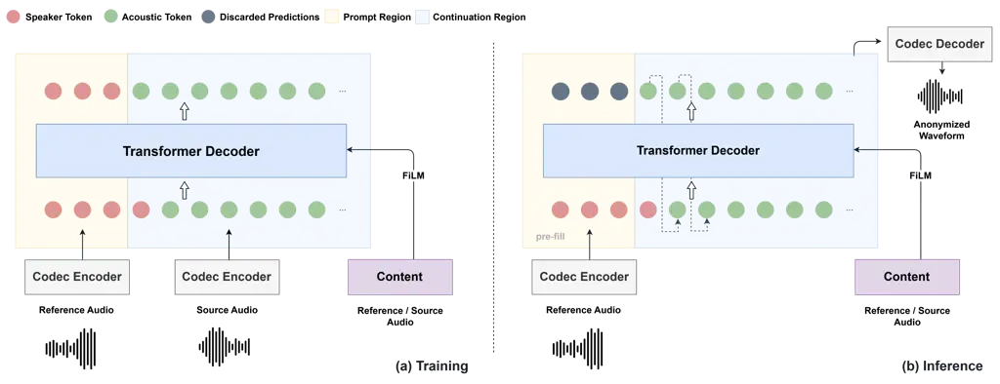
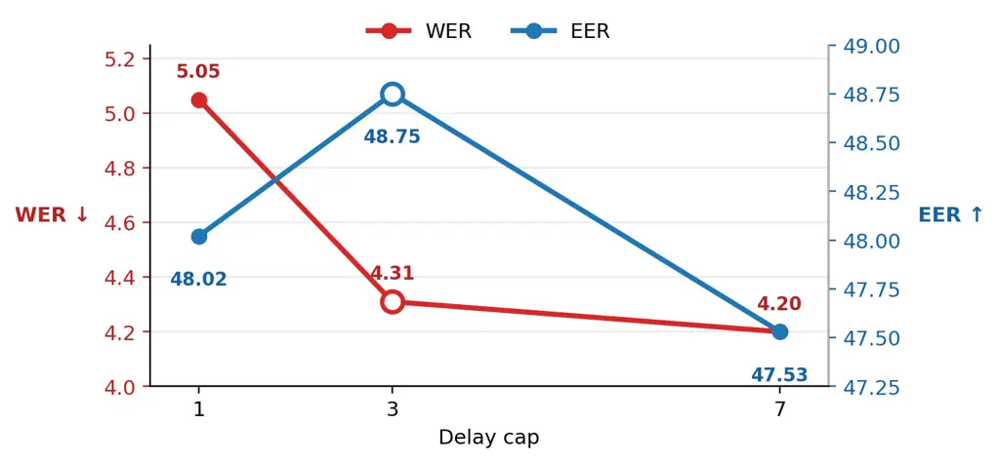

# LiveAnon: Improving Privacy and Utility in Streaming Speaker Anonymization with Codec Language Models

Yejin Kim^(\*)    Kyungsu Kim^(\*)    Seungu Han^(\*)    Kyogu Lee

###### Abstract

Speaker anonymization (SA) aims to conceal speaker identity while
preserving linguistic content and emotion, but existing streaming
systems often lose emotion information through discrete content
bottlenecks or require emotion-specific modeling. We present LiveAnon, a
voice-conversion-based streaming SA system that directly conditions an
autoregressive codec language model on hidden features from a pretrained
streaming ASR encoder, preserving emotion without emotion-specific
supervision. To reduce codec-generation latency, we introduce capped RVQ
decoding, which preserves dependencies among coarse codebooks while
predicting the remaining codebooks in parallel. Under VPC24, LiveAnon
improves intelligibility and emotion preservation over fixed-target
Stream-Voice-Anon (SVA), a strong prior streaming SA system, matches
emotion-prompted SVA in emotion preservation, and achieves the strongest
semi-informed privacy among streaming systems. Under VPC26, it ranks
second across all metrics among the evaluated anonymization systems,
demonstrating a strong privacy–utility balance.

###### Index Terms: 

streaming speaker anonymization, privacy preservation, voice conversion,
neural audio codec

^(†)^(†)address: ^(∗) Music and Audio Research Group (MARG)  
^(†) Department of Intelligence and Information, Seoul National
University  
^(‡) Interdisciplinary Program in Artificial Intelligence, Seoul
National University

## 1 Introduction

Speaker anonymization (SA) aims to conceal speaker identity while
retaining linguistic and paralinguistic information such as emotion
\[1\]. Since these attributes are jointly encoded in speech, suppressing
speaker identity often comes at the cost of preserving other speech
information, resulting in a privacy-utility trade-off, where utility
encompasses speech intelligibility and emotion preservation \[2, 3\].
Beyond offline processing, streaming anonymization is increasingly
important for privacy-sensitive interactive applications, including call
centers, voice assistants, medical conversations, and legal
communications \[4\]. Together, these considerations highlight two key
challenges for streaming SA: balancing latency with quality and privacy
with utility.

Existing SA systems generally follow two main approaches: cascaded
ASR-to-TTS \[5, 6\] and voice conversion (VC)-based anonymization \[7,
8, 9, 10\], with neural VC underlying most state-of-the-art systems
\[11\]. VC-based anonymization systems commonly rely on intermediate
content representations to separate source content from speaker
identity. Discrete or quantized bottlenecks can suppress speaker
information, but may also discard information important for emotion
preservation \[12\]. These challenges are further compounded in
streaming SA, where anonymization must operate with limited future
context and bounded latency.

Preserving emotion is important for maintaining the utility of
anonymized speech \[13\]. Various approaches have therefore incorporated
explicit prosodic cues \[14, 15, 16\] or emotion representations
distilled from pretrained models \[17, 18\] to improve emotion
preservation. However, such approaches require additional components for
prosody or emotion modeling in the anonymization pipeline. This
motivates investigating whether richer paralinguistic information can
instead be retained directly in the source content representation.

To this end, we propose LiveAnon, a VC-based streaming SA framework
using an autoregressive codec language model. LiveAnon directly
conditions acoustic generation on hidden representations from a
pretrained streaming Zipformer \[19\]. Our analysis shows that these
representations retain substantial emotion-related information while
exhibiting less speaker discriminability. Target identity is specified
through prefix codec prompt, in which a reference codec sequence is
directly continued within the same autoregressive acoustic stream
without requiring an explicit speaker encoder. To reduce codec
generation latency, we modify MusicGen’s delay pattern \[20\] with a
capped delay scheme that limits the delay to three codec frames and
parallelizes the remaining RVQ codebooks. LiveAnon improves across all
evaluation metrics under the VPC24 \[13\] fixed-target setting and
remains competitive with the offline VPC26 \[11\] baselines while
operating in a streaming setting.

The demo is available on:
[https://jin1025.github.io/LiveAnon/](https://jin1025.github.io/LiveAnon/).



Figure 1: Overview of LiveAnon during (a) training and (b) inference. A
3-s reference utterance provides codec tokens for acoustic prompting,
and features from a frozen streaming ASR encoder provide content
conditioning. Training uses teacher-forced codec sequences, whereas
inference pre-fills the reference prompt into the Transformer KV cache
and continues autoregressive generation with the capped RVQ delay
pattern.

## 2 Method

### 2.1 System Overview

Fig. 1 illustrates the overall architecture of LiveAnon. The system
consists of a pretrained streaming ASR encoder, a neural audio codec,
and a causal Transformer decoder. Given source speech and a reference
utterance from the target speaker, the ASR encoder extracts content
features from the source, while the codec converts the reference into
discrete acoustic tokens that serve as the speaker prompt. The decoder
autoregressively continues this prompt conditioned on the source
content, and the generated tokens are reconstructed into a waveform by
the codec decoder.

### 2.2 Pretrained ASR Content Representation

We use hidden representations from a frozen pretrained streaming
Zipformer ASR encoder¹¹ 1 We use the streaming Zipformer checkpoint
available at [Hugging
Face](https://huggingface.co/Zengwei/icefall-asr-librispeech-streaming-zipformer-2023-05-17/tree/main/exp).
as the source content representation. We extract the output of the final
encoder stage before the final downsampling, preserving a 50-Hz frame
rate that matches the codec tokens. The features are linearly projected
to the decoder conditioning dimension. A fixed temporal shift aligns the
ASR and codec representations, and its resulting lookahead is included
in the algorithmic latency reported in Sec. 4.3. The aligned content
sequence conditions every Transformer layer through feature-wise linear
modulation (FiLM) \[21\], where the content features predict per-layer
affine modulation parameters.

### 2.3 Codec Prompt Continuation and Acoustic Generation

We use JHCodec \[22\], a streaming neural audio codec that represents
speech with discrete acoustic tokens. Following VALL-E \[23\], we adapt
acoustic prompting to voice-to-voice anonymization by conditioning codec
continuation on source content features. Rather than using the reference
as a separate conditioning prefix, the reference and generated codec
tokens form a single autoregressive acoustic stream with shared codebook
embeddings. Each region is conditioned on its aligned content features.
With $`\mathbf{c}_{n}`$ denoting the aligned feature, we optimize
codec-token prediction over the full sequence with cross-entropy:

```math
\mathcal{L}_{\mathrm{CE}}=\sum_{n=1}^{N}\sum_{d=1}^{D}-\log p_{\theta}\left(a_{n,d}\mid\mathcal{H}_{n,d},\mathbf{c}_{n}\right), \tag{1}
```

where $`a_{n,d}`$ is the codec token at frame $`n`$ and RVQ depth $`d`$,
$`N`$ is the total number of codec frames, and $`D`$ is the number of
RVQ codebooks. $`\mathcal{H}_{n,d}`$ denotes the codec tokens available
when predicting $`a_{n,d}`$ under the RVQ delay pattern.

During training, both regions are teacher-forced, allowing the model to
learn acoustic continuation from the reference voice while following the
source content.

At inference, the reference codec tokens and their content features are
pre-filled into the Transformer KV cache, after which autoregressive
generation continues from the end of the prompt using source content.
The prompt is therefore processed only once and does not contribute to
the per-frame algorithmic latency. Generated RVQ tokens are decoded into
waveform by the JHCodec decoder.

### 2.4 Capped RVQ Decoding

To capture dependencies across RVQ codebooks, MusicGen uses a delay
pattern in which codebook $`k`$ is shifted by $`k`$ frames. However, the
resulting maximum delay increases with codebook depth. Building on its
partial delay variant, we introduce a capped delay that preserves
staggered dependencies up to a maximum offset $`\delta_{\max}`$:

```math
d_{k}=\min(k,\delta_{\max}),\qquad k=0,\ldots,D-1 \tag{2}
```

Thus, $`\delta_{\max}=0`$ gives fully parallel codebook prediction,
whereas $`\delta_{\max}=D-1`$ recovers the original full-delay pattern.
Intermediate values provide a controllable trade-off between
inter-codebook dependency and generation latency. For codec frame
duration $`\Delta`$, the resulting codebook latency is
$`\delta_{\max}\Delta`$.

## 3 Experimental Setup

### 3.1 Dataset

LiveAnon is trained on the train-clean-100 and train-clean-360 splits of
LibriTTS ($`\sim`$460 h) \[24\], resampled to 16 kHz. We retain
utterances of at least 6 s and split each into two contiguous 3 s
segments, using the first as the reference prompt and the second as the
target continuation.

### 3.2 Evaluation Protocol

We evaluate LiveAnon following the VoicePrivacy Challenge 2024 (VPC24)
\[13\] and 2026 (VPC26) \[11\] Track 1 protocols. We report word error
rate (WER$`\downarrow`$) for intelligibility, unweighted average recall
(UAR$`\uparrow`$) for emotion preservation, and equal error rate
(EER$`\uparrow`$) for speaker privacy. Following the VoicePrivacy
evaluation protocols, WER and EER are computed on LibriSpeech \[25\],
while emotion UAR is evaluated on IEMOCAP \[26\]. For both protocols, we
report EER with lazy-informed (EER-L) attackers trained on original
speech and semi-informed (EER-S) attackers trained on anonymized speech.
Because VPC26 uses a stronger attacker pretrained on large-scale
voice-converted speech, its EER values are not directly comparable with
those from VPC24 and are reported separately. For anonymization, we
adopt the fixed-target strategy of SVA’s vctk-1fix setting \[10\], using
a single utterance from a fixed VCTK \[27\] speaker as the target prompt
for all evaluation utterances. We crop the reference utterance to 3 s
for codec prompting.

### 3.3 Model Configuration

JHCodec operates at 16 kHz and 50 fps, producing 8 RVQ codebooks with a
codebook size of 1024. Content features are extracted from a frozen
streaming Zipformer ASR encoder trained on LibriSpeech. We extract the
512-dimensional representation before the final temporal downsampling,
retaining a 50-fps frame rate, and project it to 256 dimensions. The
Zipformer operates with a 16-frame (320-ms) streaming chunk. To align
the content and codec streams, the content features are shifted forward
by 6 frames.

The autoregressive codec decoder consists of 12 Transformer layers with
a hidden dimension of 768, 8 attention heads, a feed-forward dimension
of 3072, and a dropout rate of 0.1, using causal self-attention with
ALiBi positional biases. We use a 3 s codec prompt and set the capped
RVQ delay to $`\delta_{\max}=3`$. The model is trained for 400k
optimization steps on a single RTX 3080 Ti GPU using AdamW with a peak
learning rate of $`10^{-4}`$ and a cosine decay schedule.

## 4 Results and Discussion

### 4.1 Content Representation Analysis

To examine the information retained by the content representations, we
perform linear probing for speaker identity and emotion. For both
LiveAnon and SVA, frame-level features are summarized using mean and
standard-deviation pooling and classified with logistic regression.
Speaker information is evaluated on the held-out LibriSpeech dev-clean
split using 40 speakers. For each speaker, non-overlapping utterances
are split into 80% for training and 20% for testing. Emotion information
is evaluated on IEMOCAP using the speaker-independent five-fold split of
the VoicePrivacy protocol.

| System   | Speaker Acc.$`\downarrow`$ | Emotion UAR$`\uparrow`$ |
| -------- | -------------------------- | ----------------------- |
| SVA      | 32.50                      | 39.95                   |
| LiveAnon | 28.75                      | 55.17                   |

Table 1: Linear probing of content representations. Lower speaker
accuracy and higher emotion UAR are preferred.

As shown in Table 1, LiveAnon’s ASR representation achieves higher
emotion UAR than SVA’s content representation (55.17 vs. 39.95), while
yielding lower speaker classification accuracy (28.75 vs. 32.50). These
results suggest that LiveAnon’s ASR representation retains richer
emotion-related information while being less speaker-discriminative than
SVA’s content representation.

### 4.2 Speaker Anonymization Performance

| System                     | WER$`\downarrow`$ | UAR$`\uparrow`$ | EER-L$`\uparrow`$ | EER-S$`\uparrow`$ |
| -------------------------- | ----------------- | --------------- | ----------------- | ----------------- |
| Original                   | 1.83              | 70.07           | 5.16              | –                 |
| DarkStream \[28\]          | 8.75              | 34.73           | 47.26             | 21.83             |
| TVTSyn \[29\]              | 5.35              | 37.32           | 47.55             | 14.57             |
| SVA \[10\] cremad-emo-4rnd | 6.59              | 44.59           | 46.53             | 18.63             |
| SVA \[10\] vctk-1fix       | 4.54              | 39.71           | 47.19             | 15.92             |
| SVA+ \[18\] frame-distill  | 5.77              | 49.22           | 48.98             | 18.30             |
| LiveAnon vctk-1fix         | 4.31              | 44.09           | 48.75             | 32.28             |

Table 2: Comparison with streaming SA systems under the VPC24 protocol.

Table 2 compares LiveAnon with prior streaming SA systems under the
VPC24 protocol. Under the matched vctk-1fix setting, LiveAnon
outperforms SVA across all metrics, with a particularly large gain in
EER-S (32.28 vs. 15.92), while also achieving lower WER (4.31 vs. 4.54).
LiveAnon also achieves an emotion UAR of 44.09, comparable to SVA’s
emotion-prompted cremad-emo-4rnd setting (44.59), despite using only a
single fixed VCTK prompt. SVA+ attains the highest UAR through
frame-level emotion distillation, whereas LiveAnon requires no
emotion-specific training supervision and achieves lower WER and
substantially higher EER-S.

| System   | WER$`\downarrow`$ | UAR$`\uparrow`$ | EER-L$`\uparrow`$ | EER-S$`\uparrow`$ |
| -------- | ----------------- | --------------- | ----------------- | ----------------- |
| Original | 1.82              | 70.07           | 4.75              | –                 |
| B2       | 9.36              | 54.59           | 6.89              | 3.98              |
| B3       | 4.21              | 38.09           | 22.55             | 15.28             |
| B4       | 6.03              | 42.38           | 17.19             | 13.21             |
| B5       | 4.68              | 38.46           | 28.30             | 18.55             |
| LiveAnon | 4.30              | 44.09           | 26.08             | 17.99             |

Table 3: Comparison with VPC26 challenge baselines under the VPC26
evaluation protocol.

Table 3 compares LiveAnon with the offline VPC26 challenge baselines
under the VPC26 evaluation protocol. LiveAnon achieves the second-best
result across all four metrics: the second-lowest WER and the
second-highest UAR, EER-L, and EER-S among the compared anonymization
systems. These results show that LiveAnon maintains a competitive and
well-balanced privacy–utility performance against offline VPC26
baselines, while operating in a streaming setting.

### 4.3 Latency and RTF

We compute algorithmic latency as the sum of the content-encoder chunk
duration, content-alignment lookahead, and codebook delay:

```math
L_{\mathrm{alg}}=L_{\mathrm{chunk}}+L_{\mathrm{align}}+L_{\mathrm{codec}} \tag{3}
```

| Chunk  | Align. | Codec | Total  | RTF$`\downarrow`$ |
| ------ | ------ | ----- | ------ | ----------------- |
| 160 ms | 120 ms | 60 ms | 340 ms | 0.34              |
| 320 ms | 120 ms | 60 ms | 500 ms | 0.17              |

Table 4: Algorithmic latency and real-time factor (RTF) of LiveAnon.

With the default 320 ms Zipformer chunk, LiveAnon has an algorithmic
latency of 500 ms and achieves an RTF of 0.17 on an RTX 4090. The
content encoder constitutes the largest latency component. We
additionally evaluate a 160 ms chunk configuration, which reduces the
total algorithmic latency to 340 ms. This suggests that replacing the
current Zipformer with a content encoder designed for shorter streaming
chunks could further reduce latency.

### 4.4 Capped Delay Trade-off



Figure 2: Privacy–utility–latency trade-off under different capped-delay
settings. Delay cap 3 provides the best operating point.

We conduct an ablation study on the delay cap $`\delta_{\max}`$ to
identify its privacy–utility–latency trade-off, using a 320 ms chunk
size. We evaluate $`\delta_{\max}\in\{1,3,7\}`$, corresponding to codec
latencies of 20, 60, and 140 ms, respectively. As shown in Figure 2,
increasing the delay cap from 1 to 3 improves both privacy and utility.
Further increasing the cap to 7 provides only a marginal utility
improvement, while degrading privacy and increasing latency. Therefore,
$`\delta_{\max}=3`$ (60 ms codec latency) provides the best balance
between latency, privacy, and utility, and is used for all experiments
unless otherwise stated.

## 5 Conclusion and Future Work

We presented LiveAnon, a streaming speaker anonymization system that
directly conditions autoregressive codec generation on representations
from a pretrained streaming ASR encoder. LiveAnon preserves
emotion-related information without emotion-specific data or
supervision, while capped RVQ decoding balances codec latency and
generation quality. On VPC24, LiveAnon leads streaming systems in WER
and EER-S and matches emotion-prompted SVA in UAR without
emotion-specific modeling, while remaining competitive with offline
VPC26 baselines. While our fixed-target setting follows the VPC
protocol, prompt diversity and cross-utterance linkability remain
unexplored. Exploring diverse per-utterance target prompts and
lower-latency streaming ASR encoders remains for future work, as the
current latency largely depends on the encoder chunk size.

## References

- \[1\] Natalia Tomashenko, Xin Wang, Emmanuel Vincent, Jose Patino,
  Brij Mohan Lal Srivastava, Paul-Gauthier Noé, Andreas Nautsch,
  Nicholas Evans, Junichi Yamagishi, Benjamin O’Brien, et al., “The
  voiceprivacy 2020 challenge: Results and findings,” Comput. Speech
  Lang., vol. 74, pp. 101362, 2022.
- \[2\] Shaohu Zhang, Zhouyu Li, and Anupam Das, “Voicepm: A robust
  privacy measurement on voice anonymity,” in Proc. WiSec, 2023.
- \[3\] Zexin Cai, Henry Li Xinyuan, Ashi Garg, Leibny Paola
  García-Perera, Kevin Duh, Sanjeev Khudanpur, Nicholas Andrews, and
  Matthew Wiesner, “Privacy versus emotion preservation trade-offs in
  emotion-preserving speaker anonymization,” in Proc. SLT, 2024.
- \[4\] Sarina Meyer and Ngoc Thang Vu, “Use cases for voice
  anonymization,” arXiv preprint arXiv:2508.06356, 2025.
- \[5\] Sarina Meyer, Florian Lux, Pavel Denisov, Julia Koch, Pascal
  Tilli, and Ngoc Thang Vu, “Speaker anonymization with phonetic
  intermediate representations,” arXiv preprint arXiv:2207.04834, 2022.
- \[6\] Sarina Meyer, Pascal Tilli, Pavel Denisov, Florian Lux, Julia
  Koch, and Ngoc Thang Vu, “Anonymizing speech with generative
  adversarial networks to preserve speaker privacy,” in Proc. SLT, 2023.
- \[7\] Michele Panariello, Francesco Nespoli, Massimiliano Todisco, and
  Nicholas Evans, “Speaker anonymization using neural audio codec
  language models,” in Proc. ICASSP, 2024.
- \[8\] Jixun Yao, Nikita Kuzmin, Qing Wang, Pengcheng Guo, Ziqian Ning,
  Dake Guo, Kong Aik Lee, Eng-Siong Chng, and Lei Xie, “Npu-ntu system
  for voice privacy 2024 challenge,” arXiv preprint
  arXiv:2409.04173, 2024.
- \[9\] Fan Huang, Kun Zeng, and Wei Zhu, “Diffvc+: Improving
  diffusion-based voice conversion for speaker anonymization.,” in Proc.
  Interspeech, 2024.
- \[10\] Nikita Kuzmin, Songting Liu, Kong Aik Lee, and Eng Siong Chng,
  “Stream-voice-anon: Enhancing utility of real-time speaker
  anonymization via neural audio codec and language models,” in Proc.
  ICASSP, 2026.
- \[11\] Xiaoxiao Miao et al., “The voiceprivacy 2026 challenge
  evaluation plan,” Tech. Rep., VoicePrivacy Challenge, 2026.
- \[12\] Ünal Ege Gaznepoglu and Nils Peters, “Why disentanglement-based
  speaker anonymization systems fail at preserving emotions?,” in Proc.
  ICASSP, 2025.
- \[13\] Natalia Tomashenko, Xiaoxiao Miao, Pierre Champion, Sarina
  Meyer, Xin Wang, Emmanuel Vincent, Michele Panariello, Nicholas Evans,
  Junichi Yamagishi, and Massimiliano Todisco, “The voiceprivacy 2024
  challenge evaluation plan,” arXiv preprint arXiv:2404.02677, 2024.
- \[14\] Sarina Meyer, Florian Lux, Julia Koch, Pavel Denisov, Pascal
  Tilli, and Ngoc Thang Vu, “Prosody is not identity: A speaker
  anonymization approach using prosody cloning,” in Proc. ICASSP, 2023.
- \[15\] Carlos Franzreb, Arnab Das, Tim Polzehl, and Sebastian Möller,
  “Private knn-vc: Interpretable anonymization of converted speech,”
  arXiv preprint arXiv:2505.17584, 2025.
- \[16\] Jiabei He, Shiwan Zhao, Jiaming Zhou, Haoqin Sun, Hui Wang, and
  Yong Qin, “Emotion-preserving prosody anonymization network for voice
  privacy protection,” in Proc. ICASSP, 2025.
- \[17\] Jixun Yao, Hexin Liu, Eng Siong Chng, and Lei Xie, “Easy:
  Emotion-aware speaker anonymization via factorized distillation,”
  arXiv preprint arXiv:2505.15004, 2025.
- \[18\] Nikita Kuzmin, Kong Aik Lee, and Eng Siong Chng,
  “Streamvoiceanon+: Emotion-preserving streaming speaker anonymization
  via frame-level acoustic distillation,” arXiv preprint
  arXiv:2603.06079, 2026.
- \[19\] Zengwei Yao, Liyong Guo, Xiaoyu Yang, Wei Kang, Fangjun Kuang,
  Yifan Yang, Zengrui Jin, Long Lin, and Daniel Povey, “Zipformer: A
  faster and better encoder for automatic speech recognition,” in Proc.
  ICLR, 2024.
- \[20\] Jade Copet, Felix Kreuk, Itai Gat, Tal Remez, David Kant,
  Gabriel Synnaeve, Yossi Adi, and Alexandre Défossez, “Simple and
  controllable music generation,” Adv. Neural Inf. Process. Syst., vol.
  36, pp. 47704–47720, 2023.
- \[21\] Ethan Perez, Florian Strub, Harm De Vries, Vincent Dumoulin,
  and Aaron Courville, “Film: Visual reasoning with a general
  conditioning layer,” in Proc. AAAI, 2018.
- \[22\] Junhyeok Lee, Xiluo He, Jihwan Lee, Helin Wang, Shrikanth
  Narayanan, Thomas Thebaud, Laureano Moro-Velazquez, Jesús Villalba,
  and Najim Dehak, “Reconstruct! don’t encode: Self-supervised
  representation reconstruction loss for high-intelligibility and
  low-latency streaming neural audio codec,” arXiv preprint
  arXiv:2603.05887, 2026.
- \[23\] Chengyi Wang, Sanyuan Chen, Yu Wu, Ziqiang Zhang, Long Zhou,
  Shujie Liu, Zhuo Chen, Yanqing Liu, Huaming Wang, Jinyu Li, et al.,
  “Neural codec language models are zero-shot text to speech
  synthesizers,” arXiv preprint arXiv:2301.02111, 2023.
- \[24\] Heiga Zen, Viet Dang, Rob Clark, Yu Zhang, Ron J Weiss, Ye Jia,
  Zhifeng Chen, and Yonghui Wu, “Libritts: A corpus derived from
  librispeech for text-to-speech,” arXiv preprint
  arXiv:1904.02882, 2019.
- \[25\] Vassil Panayotov, Guoguo Chen, Daniel Povey, and Sanjeev
  Khudanpur, “Librispeech: an asr corpus based on public domain audio
  books,” in Proc. ICASSP, 2015.
- \[26\] Carlos Busso, Murtaza Bulut, Chi-Chun Lee, Abe Kazemzadeh,
  Emily Mower, Samuel Kim, Jeannette N Chang, Sungbok Lee, and
  Shrikanth S Narayanan, “Iemocap: Interactive emotional dyadic motion
  capture database,” Lang. Resour. Eval., vol. 42, no. 4, pp.
  335–359, 2008.
- \[27\] Junichi Yamagishi, Christophe Veaux, and Kirsten MacDonald,
  “CSTR VCTK Corpus: English multi-speaker corpus for CSTR voice cloning
  toolkit, version 0.92,” 2019.
- \[28\] Waris Quamer and Ricardo Gutierrez-Osuna, “Darkstream:
  real-time speech anonymization with low latency,” in Proc. ASRU, 2025.
- \[29\] Waris Quamer, Mu-Ruei Tseng, Ghady Nasrallah, and Ricardo
  Gutierrez-Osuna, “Tvtsyn: Content-synchronous time-varying timbre for
  streaming voice conversion and anonymization,” arXiv preprint
  arXiv:2602.09389, 2026.
