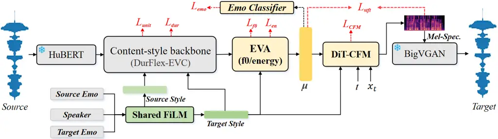

# Prime-EVC: One-Step Expressive Emotional Voice Conversion via Emotion-Primed Flow Matching

Yu Pan^(1†), Xiaojuan Cai¹, Liang Zhang², Yang Hou⁴, Tianjiao Zhang⁵,
Yuguang Yang³, Jixun Yao³, Hiroshi Koide¹, Lei Ma⁶, Jianjun Zhao¹
^(†)^(†)thanks: \$†\$˜Corresponding author.

###### Abstract

Recent diffusion- and conditional flow matching (CFM)-based emotional
voice conversion (EVC) systems achieve strong conversion quality.
However, they typically rely on multiple sampling steps, because the
conditioning specifies which emotion to impose while its acoustic
realization is left to the sampler. In this paper, we propose Prime-EVC,
a one-step expressive EVC architecture based on emotion-primed flow
matching. Our key idea is to reallocate the emotional conversion between
the conditioning and the sampler: a FiLM-fused speaker-emotion style, an
emotional variance adaptor, and direct emotion and spectro-temporal
supervision assemble an emotion-rich conditioning upstream, rendering
the residual conversion left to the CFM decoder attainable within one
Euler step. Experiments on the ESD corpus demonstrate that single-step
Prime-EVC surpasses five representative EVC systems on every quality
metric and exceeds $`4`$- and $`100`$-step DurFlex-EVC in subjective
naturalness and emotion while running $`3.4`$–$`50\times`$ faster than
both.

###### Index Terms: 

Emotional voice conversion, conditional flow matching, one-step
generation, emotion conditioning

^(†)^(†)address: ¹Kyushu University, Japan  ²Donghua University, China
 ³Tencent Hunyuan, China  
⁴National Institute of Informatics, Japan  ⁵Independent Researcher  ⁶The
University of Tokyo, Japan

## 1 Introduction

Emotional voice conversion (EVC) aims to transform the emotional state
of an utterance, a para-linguistic attribute, into a target emotion
while preserving its linguistic content and non-linguistic speaker
identity \[25\].

Early EVC builds on generative adversarial networks (GANs) \[4, 30\] or
sequence-to-sequence models \[1, 27\], while later works broaden the
repertoire via intensity control \[20, 29\] and textless formulations
that better decouple emotion from timbre and content \[9, 5\]. While
efficient, these objectives are prone to over-smoothing, leaving the
converted speech weakly or unnaturally emotional. To address this,
recent studies adopt diffusion- or flow-matching-based decoders \[12,
23, 14\]. DurFlex-EVC \[12\] pairs discrete-unit content modeling and
style conditioning with a diffusion decoder, attaining strong
performance but at the cost of many-step iterative denoising.
Conditional flow matching (CFM) \[7, 11\] decodes in fewer
ordinary-differential-equation (ODE) steps, i.e., a smaller number of
function evaluations (NFE), and is thus a natural replacement.
ClapFM-EVC \[14\] first validates CFM for EVC via CLAP \[2, 13\]-based
emotion control, yet operates any-to-one and still requires multiple ODE
evaluations. Efforts to accelerate such generation distill a multi-step
teacher \[8\] or train a one-step generator \[10\], but all target
efficiency rather than emotion conversion.

In this paper, we contend that leaving the acoustic realization of the
target emotion to the sampler is what obstructs low-NFE EVC. Emotion is
carried by fine-grained acoustic variation, which a single deterministic
ODE step smooths toward the conditional mean, and more steps sharpen the
sample without supplying what the conditioning leaves unspecified
(Sec. 4.3). We therefore present Prime-EVC, which _offloads_ emotion
modeling onto a directly supervised, emotion-rich conditioning, so that
the mean a single Euler step settles on is already expressive. To that
end, an emotional variance adaptor supplies the target-emotion pitch and
energy, a FiLM-fused style accounts for the speaker-dependent form the
emotion takes, and emotion and spectro-temporal losses supervise the
conditioning directly. A Diffusion-Transformer \[18\] (DiT)-based CFM
decoder then recovers the target mel-spectrogram features, vocoded by
BigVGAN \[6\], atop a text-free content/duration backbone \[12\].
Extensive experiments on ESD \[28\] dataset demonstrate that, with a
single ODE step, Prime-EVC outperforms five representative EVC systems
in objective quality and exceeds the best multi-step baseline in
subjective ratings.



Figure 1: Overview of Prime-EVC, an _encode–condition–render_ pipeline.

## 2 Proposed Method

### 2.1 Overview

As shown in Fig. 1, Prime-EVC follows an _encode–condition–render_
pipeline. The _encode_ stage disentangles speech into a speaker- and
emotion-agnostic content sequence, via a frozen HuBERT encoder \[3\] and
a duration predictor, following DurFlex-EVC \[12\]. The _condition_
stage assembles the emotion-rich _conditioning_ $`\mu`$ from a fused
speaker–emotion style and frame-level target-emotion prosody, under
direct supervision. The _render_ stage employs a DiT-CFM decoder
conditioned on the frame-level $`\mu`$ and the global style $`c`$ to
produce the target mel, followed by BigVGAN.

### 2.2 Style-Aware Emotion Conditioning

Emotion is inherently _speaker-dependent_, as the same target emotion
surfaces through different spectral and prosodic signatures across
voices \[17, 16\]. We therefore fuse the speaker code $`s`$ and a
learnable $`5`$-class emotion lookup $`e`$ via feature-wise linear
modulation (FiLM) \[19, 15\]:

```math
c=\gamma(e)\odot s+\beta(e), \tag{1}
```

where $`c`$ denotes the fused style, $`\gamma(\cdot)`$ and
$`\beta(\cdot)`$ are emotion-conditioned scale and shift functions. The
multiplicative term $`\gamma(e)\odot s`$ lets the target emotion
_re-weight_ each speaker dimension while $`\beta(e)`$ relocates it.
Applied to the source and target emotions, it yields source and target
styles that de-stylize and re-stylize the content. Training uses
source$`=`$target (reconstruction), while inference uses
source$`\neq`$target (conversion). To regularize this style, we scale
the emotion embedding by a stochastic intensity factor
$`\alpha\sim\mathcal{U}(0.2,1.2)`$, mildly extrapolating beyond full
intensity $`\alpha{=}1`$, before fusion during training, fixing
$`\alpha{=}1`$ at inference. Since $`e`$ encodes an emotion as a
_direction_ in embedding space, perturbing its magnitude exposes the
model to a continuum of emotion strengths and encourages correct
conversion across that range.

### 2.3 Emotional Variance Adaptation

While $`c`$ fixes _which_ emotion to impose, emotion is heard through
prosody, and nothing so far predicts the pitch and energy the target
emotion calls for, leaving the decoder to invent them while sampling. We
therefore relocate this generation upstream into the conditioning: a
FastSpeech-style \[21\] _emotional variance adaptor_ (EVA) predicts
frame-level target-emotion log-pitch $`\hat{p}`$ and energy $`\hat{n}`$
from $`z_{\mathrm{frame}}`$ conditioned on $`c`$, and embeds them back
into content stream:

```math
(\hat{p},\hat{n})=\mathrm{EVA}(z_{\mathrm{frame}},c), \tag{2}
```

```math
\tilde{z}_{\mathrm{frame}}=z_{\mathrm{frame}}+E_{p}(p^{\star})+E_{n}(n^{\star}) \tag{3}
```

from which the $`80`$-dim, mel-aligned conditioning follows as
$`\mu=\mathrm{Proj}_{\mu}(\tilde{z}_{\mathrm{frame}})`$, where
$`\mathrm{Proj}_{\mu}`$ is a linear layer and $`E_{p},E_{n}`$ are
learned $`1`$-D embeddings. The injected contours
$`(p^{\star},n^{\star})`$ follow teacher forcing: ground-truth $`(p,n)`$
in training and self-predicted $`(\hat{p},\hat{n})`$ at inference.
Moreover, the predictor is learned in parallel under
$`\mathcal{L}_{f_{0}}{=}\lVert\hat{p}-p\rVert_{2}^{2}`$ and
$`\mathcal{L}_{\mathrm{en}}{=}\lVert\hat{n}-n\rVert_{2}^{2}`$.

| Method            | nMOS$`\uparrow`$  | eMOS$`\uparrow`$  | UTMOS$`\uparrow`$ | CER$`\downarrow`$ | WER$`\downarrow`$ | EECS$`\uparrow`$ | SECS$`\uparrow`$ | RTF$`\downarrow`$ |
| ----------------- | ----------------- | ----------------- | ----------------- | ----------------- | ----------------- | ---------------- | ---------------- | ----------------- |
| GT                | 4.02 $`\pm 0.03`$ | 4.06 $`\pm 0.02`$ | 3.65              | 2.15              | 5.69              | 0.96             | 0.84             | \-                |
| GT (vocoded)      | 3.96 $`\pm 0.05`$ | 4.01 $`\pm 0.03`$ | 3.42              | 2.39              | 5.85              | 0.95             | 0.84             | \-                |
| StarGAN-EVC       | 2.05$`\pm 0.06`$  | 2.11 $`\pm 0.04`$ | 1.39              | 49.77             | 72.38             | 0.37             | 0.57             | 0.005             |
| Seq2seq-EVC       | 2.72 $`\pm 0.03`$ | 2.69 $`\pm 0.05`$ | 1.48              | 22.19             | 37.62             | 0.39             | 0.61             | 0.233             |
| Emovox            | 3.06 $`\pm 0.05`$ | 3.17 $`\pm 0.03`$ | 2.11              | 18.69             | 34.18             | 0.49             | 0.69             | 0.211             |
| Textless-EVC      | 3.43 $`\pm 0.06`$ | 3.39 $`\pm 0.04`$ | 2.84              | 15.17             | 26.73             | 0.65             | 0.66             | 0.434             |
| DurFlex (NFE=1)   | 2.01 $`\pm 0.05`$ | 2.09 $`\pm 0.06`$ | 1.32              | 17.98             | 29.25             | 0.32             | 0.47             | 0.077             |
| DurFlex (NFE=4)   | 3.63 $`\pm 0.05`$ | 3.79 $`\pm 0.05`$ | 3.09              | 5.59              | 11.90             | 0.85             | 0.71             | 0.132             |
| DurFlex (NFE=100) | 3.69 $`\pm 0.04`$ | 3.83 $`\pm 0.03`$ | 3.21              | 5.65              | 11.95             | 0.86             | 0.76             | 1.917             |
| Prime-EVC (NFE=1) | 3.77 $`\pm 0.03`$ | 3.90 $`\pm 0.04`$ | 3.37              | 4.40              | 9.61              | 0.87             | 0.80             | 0.038             |

Table 1: Overall comparison on the ESD corpus. Best among the conversion
systems in bold.

### 2.4 Conditioning-Level Supervision

To make the assembled $`\mu`$ an effective conditioning, we supervise it
directly along two complementary aspects: emotional expressiveness and
acoustic naturalness. A lightweight classifier $`g_{\phi}`$ on the
pooled $`\bar{\mu}{=}\frac{1}{T}\sum_{t}\mu_{t}`$, trained by
cross-entropy $`\mathcal{L}_{\mathrm{emo}}`$ against $`y_{e}`$, makes
$`\mu`$ emotion-discriminative. Since the conditioning is consumed in a
single evaluation and cannot be refined downstream, we regularize
$`\mu`$’s temporal dynamics by matching, per mel channel, the magnitude
of its *modulation spectrum* \[24\], a classical remedy for spectral
over-smoothing: each band’s Hann-windowed trajectory is matched to that
of the target mel $`x_{1}`$ through spectral-convergence
($`\mathcal{L}_{\mathrm{sc}}`$) and log-magnitude
($`\mathcal{L}_{\mathrm{mag}}`$) terms \[26\]:

```math
\mathcal{L}_{\mathrm{stft}}=\mathcal{L}_{\mathrm{sc}}(\mu,x_{1})+\mathcal{L}_{\mathrm{mag}}(\mu,x_{1}). \tag{4}
```

This gives $`\mu`$ a coarse spectro-temporal envelope rather than the
pointwise copy an $`\ell_{1}`$ mel loss would enforce.

### 2.5 DiT-based CFM Decoder

Given the assembled conditioning $`\mu`$, the decoder converts the
target mel-spectrogram via optimal-transport-based conditional flow
matching (OT-CFM) \[7, 11\]. For $`z\sim\mathcal{N}(0,I)`$, target
$`x_{1}`$, and $`\sigma_{\min}{=}10^{-6}`$, the optimal-transport path
and its target velocity field are:

```math
x_{t}=\bigl(1-(1-\sigma_{\min})t\bigr)z+t\,x_{1},\hskip 10.00002ptu=x_{1}-(1-\sigma_{\min})z. \tag{5}
```

The DiT module $`v_{\theta}(x_{t},t;\mu,c)`$ regresses this field: the
interpolated mel $`x_{t}`$ is concatenated with $`\mu`$ along the
feature axis and, with positional embeddings, forms the input tokens,
while the CFM time $`t`$ and the global style $`c`$ are injected via
adaptive layer normalization.

### 2.6 Training Objective

All modules of Prime-EVC are optimized jointly and end-to-end. The
decoder is trained with the OT-CFM loss
$`\mathcal{L}_{\mathrm{CFM}}=\mathbb{E}_{t,z,x_{1}}\lVert v_{\theta}(x_{t},t;\mu,c)-u\rVert_{2}^{2}`$.
The conditioning is shaped by the emotion and spectro-temporal
objectives of Secs. 2.3–2.4, and two backbone terms (the HuBERT-unit
cross-entropy $`\mathcal{L}_{\mathrm{unit}}`$ and the
stochastic-duration objective $`\mathcal{L}_{\mathrm{dur}}`$) inherited
unchanged from  \[12\]. Therefore, the overall objective of the proposed
Prime-EVC is:

```math
\displaystyle\mathcal{L}= \displaystyle~\mathcal{L}_{\mathrm{CFM}}+\lambda_{\mathrm{stft}}\mathcal{L}_{\mathrm{stft}}+\lambda_{\mathrm{unit}}\mathcal{L}_{\mathrm{unit}}+\lambda_{\mathrm{dur}}\mathcal{L}_{\mathrm{dur}}
```

```math
\displaystyle+\lambda_{f_{0}}\mathcal{L}_{f_{0}}+\lambda_{\mathrm{en}}\mathcal{L}_{\mathrm{en}}+\lambda_{\mathrm{emo}}\mathcal{L}_{\mathrm{emo}}, \tag{6}
```

where the auxiliary weights are empirically set to
$`\lambda_{\mathrm{stft}}{=}0.3`$ with the remainder fixed at $`0.1`$.

## 3 Experimental Setup

Dataset and protocol. All experiments are conducted on the English
portion of ESD \[28\], a parallel corpus of five emotions (Neutral,
Angry, Happy, Sad, Surprise). Using its official split and $`16`$ kHz
audio, and following DurFlex-EVC’s protocol, each test utterance is
converted to the four other emotions, yielding $`6000`$ conversions.

Baselines. We compare Prime-EVC against five representative EVC systems,
including: the GAN-based StarGAN-EVC¹¹ 1
[https://github.com/glam-imperial/EmotionalConversionStarGAN](https://github.com/glam-imperial/EmotionalConversionStarGAN) \[4\],
the sequence-to-sequence Seq2seq-EVC²² 2
[https://github.com/KunZhou9646/seq2seq-EVC](https://github.com/KunZhou9646/seq2seq-EVC) \[1\],
the intensity-controllable Emovox³³ 3
[https://github.com/KunZhou9646/Emovox](https://github.com/KunZhou9646/Emovox) \[29\],
the textless Textless-EVC⁴⁴ 4
[https://github.com/facebookresearch/fairseq/tree/main/examples/emotion_conversion](https://github.com/facebookresearch/fairseq/tree/main/examples/emotion_conversion) \[5\],
and the diffusion-based DurFlex-EVC⁵⁵ 5
[https://github.com/hs-oh-prml/DurFlexEVC](https://github.com/hs-oh-prml/DurFlexEVC) \[12\].
For a controlled comparison, all baselines are retrained on the same
split with their official implementations.

Evaluation metrics. For the subjective study, $`16`$ English-fluent
listeners rate $`100`$ converted speech per system on two 5-point MOS
scales, naturalness (nMOS) and emotion (eMOS), reported as means with
$`95\%`$ confidence intervals. Objectively, we assess five axes:
naturalness (UTMOS \[22\]), intelligibility (CER/WER from
Whisper-large-v3⁶⁶ 6
[https://huggingface.co/openai/whisper-large-v3](https://huggingface.co/openai/whisper-large-v3),
with its English text normalizer applied to both hypothesis and
reference), emotion conversion (EECS, emotion2vec⁷⁷ 7
[https://huggingface.co/emotion2vec](https://huggingface.co/emotion2vec)
cosine similarity to a same-speaker target-emotion reference), speaker
similarity (SECS, Resemblyzer cosine similarity to the same-speaker
target-emotion reference), and inference speed (RTF). The mel-based
systems (Textless-EVC, DurFlex-EVC, and Prime-EVC) share an identical
BigVGAN retrained at 16,kHz on LibriTTS and VCTK datasets, so
differences reflect the acoustic models. Its copy-synthesis topline is
reported in Table 1, where the GT rows use a different same-speaker,
same-emotion reference and thus mark each metric’s empirical upper
bound.

Implementation details. Prime-EVC comprises $`\sim`$98M parameters,
fewer than DurFlex-EVC’s $`\sim`$159M, and retains the HuBERT-unit
vocabulary of 200 from  \[12\]. The speaker code $`s`$ is a learnable
embedding over the ten ESD speakers. The CFM uses a $`12`$-layer DiT of
dimension $`512`$, $`8`$ attention heads, and MLP expansion ratio $`4`$,
while all acoustic models operate on $`80`$-dimensional mel-spectrograms
at hop size $`256`$ and a $`1024`$-point FFT. We optimize all modules
with AdamW ($`\beta_{1}{=}0.9`$, $`\beta_{2}{=}0.98`$) at learning rate
$`1\!\times\!10^{-4}`$, with dropout $`0.1`$ in the DiT decoder and
$`0.3`$ in the EVA. Prime-EVC is trained on a single NVIDIA A6000 GPU
with batch size $`16`$ for $`500`$K iterations. RTF is measured on the
same GPU at batch size $`1`$, covering the acoustic model and the
BigVGAN vocoder. Speech samples are available online⁸⁸ 8
[https://yupan0v0.github.io/prime-evc/](https://yupan0v0.github.io/prime-evc/).

## 4 Results and Analysis

### 4.1 Main Results

As shown in Table 1, the conventional GAN, sequence-to-sequence, and
intensity-controllable systems (StarGAN-EVC, Seq2seq-EVC, Emovox) trail
in naturalness and emotion conversion (UTMOS $`\leq 2.11`$, EECS
$`\leq 0.49`$), while Textless-EVC and DurFlex-EVC form a stronger tier
that still trails Prime-EVC. DurFlex-EVC is competitive only with
multi-step sampling, approaching full fidelity at $`100`$ steps (UTMOS
$`3.21`$, RTF $`1.917`$) but collapsing under single-step decoding
(UTMOS $`1.32`$, EECS $`0.32`$). By contrast, with a _single_ Euler step
Prime-EVC delivers the best objective quality on all evaluated axes
(UTMOS $`3.37`$, CER $`4.40\%`$, WER $`9.61\%`$, EECS $`0.87`$, SECS
$`0.80`$), cutting the remaining speaker-similarity gap to the vocoded
ground truth from $`0.08`$ to $`0.04`$, while running
$`3.4`$–$`50\times`$ faster (RTF $`0.038`$ vs. DurFlex-EVC’s
$`0.132`$–$`1.917`$). As Secs. 4.2 and 4.3 show, this margin stems from
constructing an emotion-rich conditioning before generation, so a single
step converts from an already-emotional target rather than
reconstructing expressiveness during sampling. The subjective ratings
corroborate this: Prime-EVC earns the highest nMOS ($`3.77`$) and eMOS
($`3.90`$), ahead of the $`100`$-step DurFlex-EVC ($`3.69`$/$`3.83`$).

### 4.2 Ablation Study

|                              |                   |                   |                  |                  |
| ---------------------------- | ----------------- | ----------------- | ---------------- | ---------------- |
| Model                        | WER$`\downarrow`$ | UTMOS$`\uparrow`$ | EECS$`\uparrow`$ | SECS$`\uparrow`$ |
| Prime-EVC                    | 9.61              | 3.37              | 0.87             | 0.80             |
|    w/o FiLM                  | 9.86              | 3.34              | 0.83             | 0.77             |
|    w/o intensity             | 9.55              | 3.35              | 0.82             | 0.80             |
|    w/o classifier            | 9.52              | 3.41              | 0.81             | 0.81             |
|    w/o STFT                  | 9.17              | 3.23              | 0.85             | 0.80             |
|    w/o EVA                   | 8.25              | 2.89              | 0.46             | 0.78             |
|    $`\mu`$ only (no decoder) | 196.4             | 1.48              | –                | –                |
|    w/o CFM (regression)      | 9.92              | 2.79              | 0.67             | 0.78             |
|    OT-CFM$`\to`$MeanFlow     | 13.76             | 1.89              | 0.77             | 0.73             |

Table 2: Ablation of Prime-EVC. Above the rule, each row removes one
conditioning component from the full model. Below the rule are the
conditioning alone and alternative decoder objectives.

As reported in Table 2, the EVA is decisive: its removal collapses EECS
from $`0.87`$ to $`0.46`$ and UTMOS from $`3.37`$ to $`2.89`$, even
close to the unenhanced-conditioning floor of the Global-cond. control
in Table 3. The remaining terms are smaller and complementary: FiLM
fusion, intensity scaling, and the classifier chiefly sharpen emotion
(EECS $`0.83`$/$`0.82`$/$`0.81\!\to\!0.87`$, with FiLM also lifting SECS
$`0.77\!\!\to\!\!0.80`$), while the spectro-temporal supervision
improves naturalness (UTMOS $`3.23\!\!\to\!\!3.37`$) at a small but
systematic intelligibility cost, as the full model favors emotion
similarity over any single quality metric. Below the rule, three
variants bound the decoder’s share of the work. Vocoding $`\mu`$
directly yields unintelligible audio (UTMOS $`1.48`$, WER $`>100\%`$). A
regression decoder (same DiT and conditioning) recovers only EECS
$`0.67`$ (UTMOS $`2.79`$). This variant keeps the full conditioning, the
EVA included, so the conditioning supplies the emotional content while
the decoder objective governs how faithfully that content survives into
the output. Finally, swapping OT-CFM for the mean-flow objective \[10\]
retains emotion (EECS $`0.77`$) but not quality (UTMOS $`1.89`$, WER
$`13.76\%`$).

### 4.3 Effect of Sampling Steps

As illustrated in Table 3, we sweep the NFE for Prime-EVC and for a
Global-cond. CFM control that disables all conditioning enhancements,
leaving the global style $`c`$ as the only emotion pathway. The sweep
confirms our design: Prime-EVC is already saturated at a single step,
with all metrics essentially constant from one to sixteen steps while
the RTF doubles ($`0.038\!\to\!0.078`$), making a single evaluation
Pareto-optimal. The control, in turn, isolates what extra steps actually
buy. It stays usable at a single step (UTMOS 2.80, WER 8.07), so
single-step decoding is not itself the bottleneck. As the NFE grows, its
signal fidelity improves (UTMOS $`2.80\!\to\!3.24`$), whereas the
para-linguistic emotion (EECS $`0.37\!\to\!0.44`$) and the
non-linguistic speaker identity (SECS $`0.77\!\to\!0.78`$) barely move.
Extra steps therefore buy signal fidelity rather than emotion or speaker
identity, so the sampling budget is not the lever for expressive EVC.

|                  |                   |                      |                  |                  |                   |
| ---------------- | ----------------- | -------------------- | ---------------- | ---------------- | ----------------- |
| NFE              | UTMOS$`\uparrow`$ | WER(%)$`\downarrow`$ | EECS$`\uparrow`$ | SECS$`\uparrow`$ | RTF$`\downarrow`$ |
| Prime-EVC        |                   |                      |                  |                  |                   |
| 1                | 3.37              | 9.61                 | 0.87             | 0.80             | 0.038             |
| 4                | 3.35              | 9.70                 | 0.88             | 0.80             | 0.045             |
| 16               | 3.37              | 9.64                 | 0.87             | 0.80             | 0.078             |
| Global-cond. CFM |                   |                      |                  |                  |                   |
| 1                | 2.80              | 8.07                 | 0.37             | 0.77             | 0.036             |
| 4                | 3.23              | 7.95                 | 0.43             | 0.78             | 0.044             |
| 16               | 3.24              | 7.87                 | 0.44             | 0.78             | 0.077             |

Table 3: Effect of NFE for Prime-EVC and the Global-cond. CFM, in which
the global style is the only emotion pathway.

## 5 Conclusion

In this paper, we present Prime-EVC, a one-step framework for expressive
emotional voice conversion via emotion-primed flow matching. Concretely,
Prime-EVC offloads emotion modeling onto a supervised, emotion-rich
conditioning built before CFM decoding, so a single ODE step suffices
for expressive conversion. Experiments on ESD show that Prime-EVC
surpasses strong multi-step baselines in objective and subjective
quality while running $`3.4`$$`\times`$ faster than DurFlex-EVC’s 4-step
setting, with a step-count analysis showing that expressiveness
primarily tracks the conditioning rather than the number of ODE steps.

## References

- \[1\] H. Choi and M. Hahn (2021) Sequence-to-sequence emotional voice
  conversion with strength control. IEEE Access 9, pp. 42674–42687.
  Cited by: §1, §3.
- \[2\] B. Elizalde, S. Deshmukh, M. Al Ismail, and H. Wang (2023) Clap
  learning audio concepts from natural language supervision. In ICASSP
  2023-2023 IEEE International Conference on Acoustics, Speech and
  Signal Processing (ICASSP), pp. 1–5. Cited by: §1.
- \[3\] W. Hsu, B. Bolte, Y. H. Tsai, K. Lakhotia, R. Salakhutdinov,
  and A. Mohamed (2021) HuBERT: self-supervised speech representation
  learning by masked prediction of hidden units. IEEE/ACM Transactions
  on Audio, Speech, and Language Processing. Cited by: §2.1.
- \[4\] H. Kameoka, T. Kaneko, K. Tanaka, and N. Hojo (2018) Stargan-vc:
  non-parallel many-to-many voice conversion using star generative
  adversarial networks. In 2018 IEEE Spoken language technology workshop
  (SLT), pp. 266–273. Cited by: §1, §3.
- \[5\] F. Kreuk, A. Polyak, J. Copet, E. Kharitonov, T. A. Nguyen, M.
  Rivière, W. Hsu, A. Mohamed, E. Dupoux, and Y. Adi (2022) Textless
  speech emotion conversion using discrete & decomposed representations.
  In Proceedings of the 2022 Conference on Empirical Methods in Natural
  Language Processing, pp. 11200–11214. Cited by: §1, §3.
- \[6\] S. Lee, W. Ping, B. Ginsburg, B. Catanzaro, and S. Yoon (2023)
  BigVGAN: a universal neural vocoder with large-scale training. In
  International Conference on Learning Representations (ICLR), Cited by:
  §1.
- \[7\] Y. Lipman, R. T. Q. Chen, H. Ben-Hamu, M. Nickel, and M.
  Le (2023) Flow matching for generative modeling. In International
  Conference on Learning Representations (ICLR), Cited by: §1, §2.5.
- \[8\] X. Liu, C. Gong, and Q. Liu (2023) Flow straight and fast:
  learning to generate and transfer data with rectified flow. In
  International Conference on Learning Representations (ICLR), Cited by:
  §1.
- \[9\] Z. Luo, S. Lin, R. Liu, J. Baba, Y. Yoshikawa, and H.
  Ishiguro (2022) Decoupling speaker-independent emotions for voice
  conversion via source-filter networks. IEEE/ACM Transactions on Audio,
  Speech, and Language Processing 31, pp. 11–24. Cited by: §1.
- \[10\] G. Ma, J. Yao, Z. Ning, Y. Jiang, L. Xiong, L. Xie, and P.
  Zhu (2026) Meanvc: lightweight and streaming zero-shot voice
  conversion via mean flows. In ICASSP 2026-2026 IEEE International
  Conference on Acoustics, Speech and Signal Processing (ICASSP),
  pp. 17347–17351. Cited by: §1, §4.2.
- \[11\] S. Mehta, R. Tu, J. Beskow, É. Székely, and G. E. Henter (2024)
  Matcha-tts: a fast tts architecture with conditional flow matching. In
  ICASSP 2024 - 2024 IEEE International Conference on Acoustics, Speech
  and Signal Processing (ICASSP), pp. 11341–11345. Cited by: §1, §2.5.
- \[12\] H. Oh, S. Lee, D. Cho, and S. Lee (2025) DurFlex-evc:
  duration-flexible emotional voice conversion leveraging discrete
  representations without text alignment. IEEE Transactions on Affective
  Computing 16 (3), pp. 1660–1674. Cited by: §1, §1, §2.1, §2.6, §3, §3.
- \[13\] Y. Pan, Y. Hu, Y. Yang, W. Fei, J. Yao, H. Lu, L. Ma, and J.
  Zhao (2024) Gemo-clap: gender-attribute-enhanced contrastive
  language-audio pretraining for accurate speech emotion recognition. In
  ICASSP 2024-2024 IEEE International Conference on Acoustics, Speech
  and Signal Processing (ICASSP), pp. 10021–10025. Cited by: §1.
- \[14\] Y. Pan, Y. Hu, Y. Yang, J. Yao, J. Ye, H. Zhou, L. Ma, and J.
  Zhao (2025) ClapFM-EVC: High-Fidelity and Flexible Emotional Voice
  Conversion with Dual Control from Natural Language and Speech. In
  Interspeech 2025, pp. 4583–4587. External Links: ISSN 2958-1796 Cited
  by: §1.
- \[15\] Y. Pan, X. Wu, Y. Yuguang, J. Yao, M. Cordy, L. Ma, and J.
  Zhao (2026) S2ST-omni: hierarchical language-aware speechllm
  adaptation for multilingual speech-to-speech translation. In Findings
  of the Association for Computational Linguistics: ACL 2026,
  pp. 20114–20124. Cited by: §2.2.
- \[16\] Y. Pan, Y. Yang, Y. Huang, T. Jin, J. Yin, Y. Hu, H. Lu, L. Ma,
  and J. Zhao (2024) GMP-tl: gender-augmented multi-scale pseudo-label
  enhanced transfer learning for speech emotion recognition. In 2024
  IEEE Spoken Language Technology Workshop (SLT), pp. 496–501. Cited by:
  §2.2.
- \[17\] Y. Pan, Y. Yang, Y. Huang, J. Yao, J. Yin, Y. Hu, H. Lu, L. Ma,
  and J. Zhao (2023) Msac: multiple speech attribute control method for
  reliable speech emotion recognition. arXiv preprint arXiv:2308.04025.
  Cited by: §2.2.
- \[18\] W. Peebles and S. Xie (2023) Scalable diffusion models with
  transformers. In Proceedings of the IEEE/CVF international conference
  on computer vision, pp. 4195–4205. Cited by: §1.
- \[19\] E. Perez, F. Strub, H. De Vries, V. Dumoulin, and A.
  Courville (2018) Film: visual reasoning with a general conditioning
  layer. In Proceedings of the AAAI conference on artificial
  intelligence, Vol. 32. Cited by: §2.2.
- \[20\] T. Qi, S. Wang, C. Lu, Y. Zhao, Y. Zong, and W. Zheng (2024)
  Towards Realistic Emotional Voice Conversion using Controllable
  Emotional Intensity. In Interspeech 2024, pp. 202–206. External Links:
  ISSN 2958-1796 Cited by: §1.
- \[21\] Y. Ren, C. Hu, X. Tan, T. Qin, S. Zhao, Z. Zhao, and T.
  Liu (2021) FastSpeech 2: fast and high-quality end-to-end text to
  speech. In International Conference on Learning Representations
  (ICLR), Cited by: §2.3.
- \[22\] T. Saeki, D. Xin, W. Nakata, T. Koriyama, S. Takamichi, and H.
  Saruwatari (2022) UTMOS: UTokyo-SaruLab System for VoiceMOS Challenge 2022. In Proc. Interspeech 2022, pp. 536–540. Cited by: §3.
- \[23\] X. Su, B. Yang, X. Yi, and Y. Cao (2025) DiffEmotionVC: a
  dual-granularity disentangled diffusion framework for any-to-any
  emotional voice conversion.. In Interspeech, Cited by: §1.
- \[24\] S. Takamichi, T. Toda, A. W. Black, G. Neubig, S. Sakti, and S.
  Nakamura (2016) Postfilters to modify the modulation spectrum for
  statistical parametric speech synthesis. IEEE/ACM Transactions on
  Audio, Speech, and Language Processing 24 (4), pp. 755–767. Cited by:
  §2.4.
- \[25\] A. Triantafyllopoulos, B. W. Schuller, G. İymen, M. Sezgin, X.
  He, Z. Yang, P. Tzirakis, S. Liu, S. Mertes, E. André, et al. (2023)
  An overview of affective speech synthesis and conversion in the deep
  learning era. Proceedings of the IEEE 111 (10), pp. 1355–1381. Cited
  by: §1.
- \[26\] R. Yamamoto, E. Song, and J. Kim (2020) Parallel wavegan: a
  fast waveform generation model based on generative adversarial
  networks with multi-resolution spectrogram. In ICASSP 2020-2020 IEEE
  International Conference on Acoustics, Speech and Signal Processing
  (ICASSP), pp. 6199–6203. Cited by: §2.4.
- \[27\] K. Zhou, B. Sisman, and H. Li (2021) Limited Data Emotional
  Voice Conversion Leveraging Text-to-Speech: Two-Stage
  Sequence-to-Sequence Training. In Interspeech 2021, pp. 811–815.
  External Links: ISSN 2958-1796 Cited by: §1.
- \[28\] K. Zhou, B. Sisman, R. Liu, and H. Li (2022) Emotional voice
  conversion: theory, databases and esd. Speech Communication. Cited by:
  §1, §3.
- \[29\] K. Zhou, B. Sisman, R. Rana, B. W. Schuller, and H. Li (2022)
  Emotion intensity and its control for emotional voice conversion. IEEE
  Transactions on Affective Computing 14 (1), pp. 31–48. Cited by: §1,
  §3.
- \[30\] K. Zhou, B. Sisman, M. Zhang, and H. Li (2020) Converting
  Anyone’s Emotion: Towards Speaker-Independent Emotional Voice
  Conversion. In Interspeech 2020, pp. 3416–3420. External Links: ISSN
  2958-1796 Cited by: §1.
