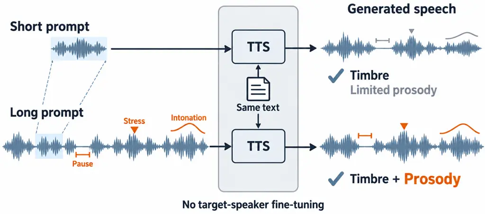
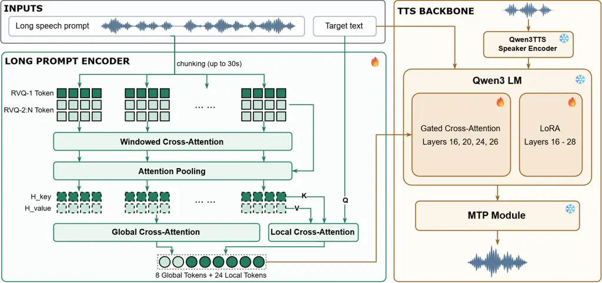
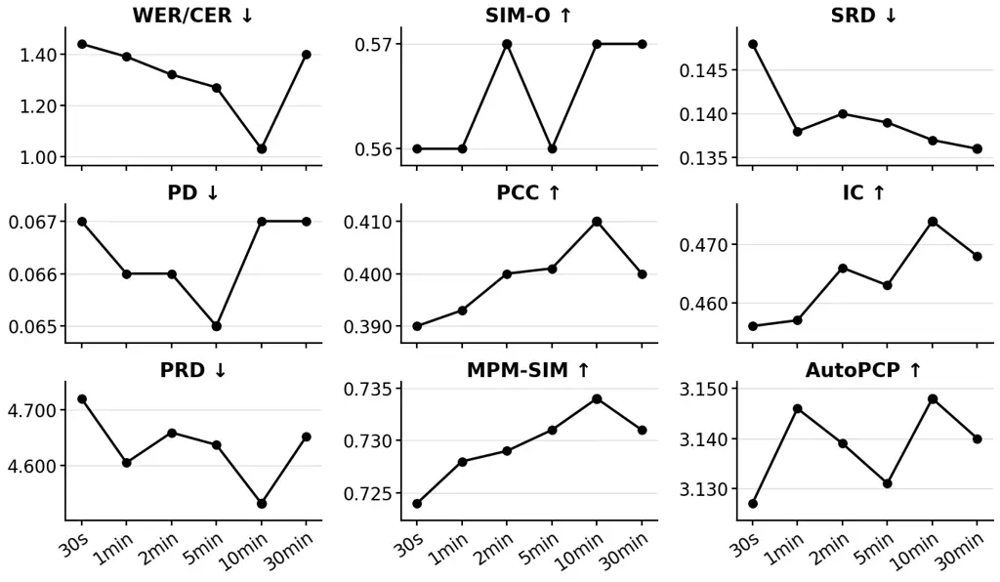

# Long-Prompt Zero-Shot TTS: Benchmarking Prosody Reproduction Beyond Voice Cloning

Dekun Chen    Renjie Xu    Yingda Shen    Qinke Ni    Zhizheng
Wu\sthanksCorresponding author

###### Abstract

Zero-shot text-to-speech (TTS) typically conditions on a short speech
prompt, which conveys timbre but provides only limited evidence of a
speaker’s prosodic patterns. We formulate _Long-Prompt Zero-Shot TTS_, a
task that uses long speech prompts at inference time to reproduce
speaker-specific prosody without target-speaker fine-tuning. We
introduce LP-TTS-Bench, a bilingual benchmark of 37 speakers with 63.95
prompt hours and 2,728 held-out test utterances. Beyond intelligibility
and timbre similarity, LP-TTS-Bench evaluates timing, prominence,
intonation, and model-based prosody metrics, enabling multidimensional
evaluation of prosody reproduction. As a reference system, we develop
LPTTS, whose hierarchical Long-Prompt Encoder compresses long speech
prompts into a fixed number of continuous prosody vectors. Experiments
show improvements in several prosodic dimensions over a short-prompt
baseline, with overall gains as prompt duration increases up to
approximately 10 minutes and saturation at longer durations.

###### Index Terms: 

Text-to-speech, long-prompt TTS, zero-shot synthesis, speaker-specific
prosody

^(†)^(†)address: ¹The Chinese University of Hong Kong, Shenzhen
  ²Amphion Technology Co., Ltd.

## 1 Introduction

Recent zero-shot text-to-speech (TTS) systems can reproduce a target
speaker’s voice from only a few seconds of speech, without
speaker-specific parameter updates \[21, 6, 8\]. Because timbre is
relatively stable within a speaker, such short prompts often capture
voice identity well. A speaker’s manner of speaking, however, is more
complex: speech rate, pauses, emphasis, and intonation vary with
communicative context and personal habits so that a short prompt reveals
only a local realization rather than recurring patterns across contexts.
Prior work has also treated speaker identity and prosody as distinct
attributes \[14\]. The improved prosody similarity observed from 3 to 10
seconds of prompt \[17\] further motivates using longer prompts to
estimate speaker-specific prosodic behavior.

When additional target-speaker recordings are available, speaker
adaptation can incorporate them into model parameters \[4\], but
requires extra training and management of configuration. Multi-utterance
prompting provides an alternative and has been explored in Mega-TTS 2
and PerTTS \[10, 12\], although their implementations are not publicly
available. Building on this direction, we formulate _Long-Prompt
Zero-Shot TTS_: synthesizing speech from minutes to tens of minutes of
prompt speech without updating target-speaker parameters. Our central
question is whether and how additional prompt material improves the
reproduction of speaker-specific prosody as prompt duration increases.



Figure 1: Illustration of _Long-Prompt Zero-Shot TTS_. Compared with a
short prompt, a long prompt provides richer evidence of speaker-specific
prosody, enabling the model to reproduce both timbre and prosody without
target-speaker fine-tuning.

Existing TTS evaluation has begun to move beyond intelligibility and
speaker similarity. ProsodyEval, for example, benchmarks prosody
diversity using human ratings and an objective metric \[24\]. Our focus
instead is speaker-specific prosody reproduction against matched
ground-truth utterances. We therefore introduce LP-TTS-Bench, a
Chinese–English benchmark of 37 speakers with a multidimensional
prosodic protocol.

To provide a reference system for this task and benchmark, we develop
LPTTS with a hierarchical Long-Prompt Encoder built on Qwen3TTS \[8\].
It compresses variable-length speech prompts into a fixed number of
global tokens and target-text-conditioned local tokens. Training
combines speech generation with a same-speaker contrastive ranking
objective and then applies on-policy distillation \[1\]. Experiments
show improvements in several prosodic dimensions, with overall gains up
to approximately 10 minutes and saturation at longer prompt durations.

Our contributions are threefold: we (1) formulate Long-Prompt Zero-Shot
TTS as a new task, (2) introduce LP-TTS-Bench and its multidimensional
evaluation protocol, and (3) provide LPTTS as an initial reference
system, together with analyses of prompt duration and text-speech
prosody relevance. LP-TTS-Bench, evaluation scripts, and audio samples
will be released upon acceptance.

## 2 LP-TTS-Bench



Figure 2: Overview of the LPTTS system. The Long-Prompt Encoder extracts
global and target-conditioned prosodic representations from long speech
prompt and injects them into Qwen3TTS by gated cross-attention. Timbre
conditioning is provided by the native speaker encoder.

### 2.1 Task Definition and Data

Long-Prompt Zero-Shot TTS aims to reproduce speaker-specific prosody
from extended speech prompts at inference time. Given target text $`x`$
and a prompt corpus $`P_{s}`$ from speaker $`s`$, the model synthesizes
$`\hat{y}=f_{\theta}(x,P_{s})`$ without target-speaker parameter
updates. We study how increasing the amount of prompt speech affects
prosody reproduction across utterances.

LP-TTS-Bench contains 17 Chinese speakers and 20 English speakers, with
63.95 prompt hours, 3,559 validation utterances, and 2,728 test
utterances in total. Each speaker has 57–80 held-out test utterances
longer than five seconds. The speaker corpus is used either to condition
long-prompt systems or to adapt speaker-fine-tuning baselines, while the
validation set supports training configuration for the latter. Each test
item pairs a target text with its ground-truth recording, enabling
controlled comparisons of prompting, fine-tuning, and prompt duration on
a fixed test set.

|               |                  |                        |                    |                    |                   |                  |                 |                    |                      |                      |                    |
| ------------- | ---------------- | ---------------------- | ------------------ | ------------------ | ----------------- | ---------------- | --------------- | ------------------ | -------------------- | -------------------- | ------------------ |
| Model         | Target Spk. SFT? | Conventional           |                    | Timing             |                   | Prominence       | Intonation      |                    | Prosody model        |                      | Subjective         |
|               |                  | WER/CER $`\downarrow`$ | SIM-O $`\uparrow`$ | SRD $`\downarrow`$ | PD $`\downarrow`$ | PCC $`\uparrow`$ | IC $`\uparrow`$ | PRD $`\downarrow`$ | MPM-SIM $`\uparrow`$ | AutoPCP $`\uparrow`$ | P-MOS $`\uparrow`$ |
| Chinese       |                  |                        |                    |                    |                   |                  |                 |                    |                      |                      |                    |
| Qwen3TTS-Base | $`\times`$       | 0.73                   | 0.56               | 0.155              | 0.074             | 0.389            | 0.437           | 5.017              | 0.721                | 3.128                | 2.941              |
| Qwen3TTS-SFT  | $`\checkmark`$   | 1.78                   | 0.57               | 0.139              | 0.065             | 0.395            | 0.463           | 4.764              | 0.733                | 3.216                | 3.471              |
| LPTTS-Base    | $`\times`$       | 1.29                   | 0.58               | 0.155              | 0.069             | 0.387            | 0.437           | 5.013              | 0.728                | 3.181                | 3.235              |
| LPTTS         | $`\times`$       | 1.03                   | 0.57               | 0.137              | 0.067             | 0.410            | 0.474           | 4.532              | 0.734                | 3.148                | 3.529              |
| English       |                  |                        |                    |                    |                   |                  |                 |                    |                      |                      |                    |
| Qwen3TTS-Base | $`\times`$       | 1.32                   | 0.77               | 0.124              | 0.076             | 0.516            | 0.303           | 3.668              | 0.659                | 3.368                | 3.133              |
| Qwen3TTS-SFT  | $`\checkmark`$   | 1.93                   | 0.78               | 0.111              | 0.069             | 0.527            | 0.318           | 3.345              | 0.677                | 3.443                | 3.267              |
| LPTTS-Base    | $`\times`$       | 1.95                   | 0.79               | 0.126              | 0.068             | 0.506            | 0.298           | 3.570              | 0.668                | 3.477                | 3.200              |
| LPTTS         | $`\times`$       | 1.64                   | 0.78               | 0.112              | 0.061             | 0.514            | 0.335           | 3.279              | 0.681                | 3.452                | 3.533              |

Table 1: Main results on LP-TTS-Bench. WER/CER is reported in percent.
Arrows indicate the preferred direction. The checkmark indicates
target-speaker fine-tuning. Bold and underlining denote the best and
second-best results within each language, respectively; tied values
share the same formatting.

### 2.2 Evaluation Protocol

We evaluate nine objective metrics covering intelligibility, speaker
similarity, timing, prominence, intonation, and model-based prosody
metrics. Each synthesized utterance is compared with the matched
ground-truth recording of the same target text.

Intelligibility and speaker similarity. We use Qwen3-ASR \[18\] to
compute WER for English and CER for Chinese. SIM-O measures the cosine
similarity between ERes2Net speaker embeddings \[5\] extracted from
synthesized and ground-truth speech.

Timing. Motivated by error-based evaluation of speech-rate
estimates \[7\], _Speech Rate Distance (SRD)_ measures the absolute
log-ratio of speaking rates:

```math
r=\frac{N}{t_{\mathrm{last}}^{\mathrm{end}}-t_{\mathrm{first}}^{\mathrm{start}}},\quad\mathrm{SRD}=\left|\log\frac{r_{\mathrm{syn}}}{r_{\mathrm{gt}}}\right|,
```

where $`N`$ is the number of text units, and the duration includes
internal pauses but excludes leading and trailing silence.

Following reference-based analysis of pause placement and duration in
synthetic speech \[3\], _Pause Distance (PD)_ compares pause strength at
corresponding unit boundaries:

```math
v_{i}=\log\left(1+\frac{\max(0,g_{i}-\tau)}{\tau}\right),\;\mathrm{PD}=\frac{1}{N-1}\sum_{i}|v_{i}^{\mathrm{syn}}-v_{i}^{\mathrm{gt}}|,
```

where $`g_{i}`$ is the nonnegative gap between adjacent units and
$`\tau=0.15`$ s. This penalizes missing, misplaced, and
mismatched-duration pauses.

Prominence. Following acoustic prominence models that combine $`F_{0}`$,
energy, and duration \[19\], _Prominence Contour Correlation (PCC)_
computes the Spearman correlation between unit-level scores that equally
combine energy, local pitch movement or peak, and relative log-duration
after clause-level median/MAD normalization.

Intonation. Following objective TTS evaluation using aligned
$`F_{0}`$-contour correlation \[13\], _Intonation Correlation (IC)_
compares smoothed semitone contours sampled at corresponding within-unit
positions to reduce duration-induced misalignment. After clause-level
centering and amplitude normalization, it averages the correlations of
the contours and their first-order differences:

```math
\mathrm{IC}=\frac{\operatorname{corr}(q^{\mathrm{syn}},q^{\mathrm{gt}})+\operatorname{corr}(\Delta q^{\mathrm{syn}},\Delta q^{\mathrm{gt}})}{2}.
```

Following robust percentile-based pitch-range analysis \[15\], _Pitch
Range Distance (PRD)_ measures the mean absolute difference between the
clause-level voiced-pitch ranges of the synthesized and ground-truth
utterances, where each range is the 90th–10th percentile span in
semitones.

Model-based prosody metrics. _MPM-SIM_ computes cosine similarity
between utterance representations obtained by mean and max pooling
Masked Prosody Model features \[20\]. *AutoPCP* \[16\] predicts
perceptual prosodic similarity on a 1–4 scale.

Qwen3-ForcedAligner \[18\] aligns each synthesized and ground-truth pair
to the shared target text for timing, prominence, and intonation
metrics. Chinese characters and English words serve as text units, while
punctuation defines clause boundaries. Pitch is expressed in semitones
relative to the speaker’s median voiced $`F_{0}`$, and relative duration
and normalized energy reduce sensitivity to speaking rate and recording
gain. For paired comparisons, the five alignment-based metrics are
computed on the common subset of test utterances for which all evaluated
systems achieve utterance-level WER/CER below 0.1, reducing interference
from content errors while preserving a matched evaluation set.

## 3 LPTTS System

Fig. 2 gives an overview of LPTTS, our reference system for
LP-TTS-Bench, including the hierarchical Long-Prompt Encoder and its
gated integration with the Qwen3TTS backbone.

### 3.1 Long-Prompt Encoder Design

Built on Qwen3TTS-Base \[8\], the Long-Prompt Encoder receives features
from all 16 RVQ codebooks of the native speech tokenizer. It divides the
long speech prompt into chunks of up to 30 seconds, compresses each
chunk, and aggregates the resulting representations into 32 fixed-length
conditioning vectors, independent of prompt duration. Of these vectors,
8 global tokens summarize overall prosodic patterns, while 24 local
tokens are retrieved using target-text queries and semantic keys from
the first RVQ codebook. Our design combines global style
representations \[22\], hierarchical prosody modeling \[9\], and
text-conditioned prompt retrieval \[23\], while using full-codebook
features to retain acoustic information. Section 4.4 provides empirical
support for this design by showing that textually similar utterances
tend to exhibit greater prosodic similarity.

Motivated by prior work that separates timbre from prosody or
style \[10, 11\], we use the native Qwen3TTS speaker encoder for timbre,
leaving the Long-Prompt Encoder to model prosody. We concatenate the
global and local tokens into $`Z`$ and inject them into Qwen3 LM using
gated cross-attention inspired by Flamingo \[2\]:

```math
H^{(\ell)}\leftarrow H^{(\ell)}+\gamma_{\ell}\operatorname{CrossAttn}_{\ell}\bigl(H^{(\ell)},Z,Z\bigr),
```

where $`H^{(\ell)}`$ denotes the Qwen3 LM hidden states at layer
$`\ell`$ and $`\gamma_{\ell}`$ is a learnable gate. The hidden states
supply the queries, while the 32 conditioning vectors supply the keys
and values. We insert these modules at layers 16, 20, 24, and 26, with
gates initialized to 0.01.

### 3.2 Training Objectives

Encoder training. We first train on a mixture of short and long speech
prompts: 30% of batches use prompts shorter than 30 seconds, and 70% use
prompts from one to 30 minutes. Alongside the cross-entropy (CE) loss,
we apply a same-speaker contrastive ranking objective to 40% of
long-prompt batches. For two long prompts $`P^{+}`$ and $`P^{-}`$ from
the same speaker, target utterances are sampled from the recording
associated with $`P^{+}`$. The target utterance and its surrounding
segment are excluded from $`P^{+}`$, ensuring that the ranking objective
cannot exploit direct acoustic or textual overlap between the prompt and
the target. Let $`\mathcal{L}^{+}`$ and $`\mathcal{L}^{-}`$ denote the
CE losses obtained by conditioning on the respective prompts while
keeping the target text and speaker embedding fixed. The ranking loss
and total training objective are

```math
\mathcal{L}_{\mathrm{rank}}=\max\bigl(0,0.05+\mathcal{L}^{+}-\mathcal{L}^{-}\bigr),\quad\mathcal{L}=\mathcal{L}_{\mathrm{CE}}+0.2\mathcal{L}_{\mathrm{rank}}.
```

Because $`P^{+}`$ and $`P^{-}`$ share speaker identity while the target
utterances are expected to be prosodically closer to $`P^{+}`$, this
objective holds timbre conditioning constant and encourages the encoder
to distinguish prompt-specific prosodic information. During this stage,
all parameters of the Long-Prompt Encoder and gated cross-attention
(GCA) modules are trained, while Qwen3 LM is adapted using LoRA in 16
layers; all remaining parameters are frozen.

On-policy distillation. During on-policy distillation (OPD) \[1\], a
Qwen3TTS teacher fine-tuned on approximately 20 hours from one
expressive speaker supervises a prompt-conditioned student initialized
from the encoder-training checkpoint. Long prompts are constructed by
randomly concatenating utterances from the same speaker. On
self-generated trajectories, the student minimizes the next-token
Jensen–Shannon divergence from the teacher, while only the Long-Prompt
Encoder and its injection modules are updated; all TTS-backbone
parameters, including LoRA, remain frozen.

## 4 Experiments and Analysis

### 4.1 Experimental Setup

We use Qwen3TTS-Base \[8\] as the backbone. Encoder training uses
approximately 50K hours of in-the-wild, speaker-paired Chinese and
English recordings with prompt durations from 30 seconds to 30 minutes.
OPD then follows Section 3.2, using an expressive game-voice speaker who
is absent from LP-TTS-Bench. Benchmark speakers are disjoint from the
50K-hour encoder-training data and the OPD speaker. Prompt, validation,
and test samples are mutually exclusive, and test utterances are never
included in the long prompts.

The baselines are Qwen3TTS-Base with a 10-second prompt and
Qwen3TTS-SFT. Encoder training produces LPTTS-Base and applying OPD to
this checkpoint produces LPTTS. Both LPTTS variants use 10-minute
prompts and require no target-speaker training. Qwen3TTS-SFT instead
comprises 37 checkpoints, each independently adapted via full
fine-tuning for five epochs on the corresponding LP-TTS-Bench speaker’s
complete training corpus, with checkpoint selection based on the
speaker-specific validation set and evaluation restricted to that
speaker. All systems synthesize the same test texts and use the metrics
in Section 2.2. For P-MOS, 100 test items balanced across languages and
speakers were evaluated in a randomized, system-blind test, with each
output rated for prosodic similarity to the matched ground-truth
recording on a 1–5 scale by three listeners proficient in the
corresponding language.



Figure 3: Effect of prompt length on intelligibility, speaker
similarity, and prosody reproduction for Chinese. English results show
similar trends and are omitted due to space limitations.

### 4.2 Main Results

Table 1 compares the four systems across the objective metrics and
P-MOS. Compared with Qwen3TTS-Base, LPTTS-Base achieves broadly similar
performance on the explicit prosodic metrics despite using a
substantially longer prompt. PD and the model-based prosody metrics
improve, whereas SRD, PCC, and IC show limited or inconsistent changes.
This suggests that encoder training primarily enables the model to
process and integrate long-prompt representations, while its ability to
extract useful prosodic information remains limited.

Qwen3TTS-SFT improves every prosody-related metric over Qwen3TTS-Base,
demonstrating the benefit of direct target-speaker adaptation. However,
WER/CER deteriorates from 0.73 to 1.78 in Chinese and from 1.32 to 1.93
in English. This trade-off suggests that fitting target-speaker
characteristics can reduce pretrained intelligibility and also requires
separate training for each speaker.

After OPD, LPTTS improves over LPTTS-Base across all five explicit
prosody metrics and MPM-SIM in both languages. It also outperforms
Qwen3TTS-Base on most prosody metrics. Because the OPD speaker is absent
from LP-TTS-Bench, these gains support generalization beyond the
training speaker. The results suggest that distillation strengthens the
encoder’s ability to extract prosodic information from long prompts
rather than merely accommodating their length. Although WER/CER remains
above Qwen3TTS-Base, OPD reduces recognition errors relative to
LPTTS-Base. Finally, P-MOS is broadly consistent with the objective
trends: LPTTS ranks highest, LPTTS-Base and Qwen3TTS-SFT form a
comparable middle tier, and Qwen3TTS-Base ranks lowest. Overall, without
target-speaker fine-tuning, LPTTS achieves better numerical scores than
Qwen3TTS-SFT on six of eight prosody metrics in each language, together
with lower WER/CER and comparable speaker similarity, offering a
single-model alternative to per-speaker adaptation.

### 4.3 Effect of Prompt Length

To isolate the effect of prompt duration from model and training
differences, we evaluate the same LPTTS checkpoint while varying only
the amount of prompt speech available at inference time. For each
speaker, shorter prompts are nested prefixes of the corresponding longer
prompts.

Fig. 3 summarizes how the evaluation metrics change as prompt duration
increases from 30 seconds to 30 minutes. Across prompt lengths, the
metrics related to speech rate, prominence, intonation, and MPM-SIM
improve overall, typically reaching their best values around 10 minutes
rather than increasing monotonically. Meanwhile, SIM-O remains
approximately stable, suggesting that the prosodic gains are not
accompanied by substantial changes in timbre similarity. This pattern is
consistent with the encoder’s intended focus on prosodic information.
Overall, increasing prompt duration provides additional prosodic
evidence, although the gains are non-monotonic and tend to saturate
beyond 10 minutes.

| Feature      | $`\Delta`$ \[95% CI\]                 | Closer Rate |
| ------------ | ------------------------------------- | ----------- |
| Pitch        | $`-0.054`$ \[$`-0.061`$, $`-0.040`$\] | 60.2%       |
| Energy       | $`-0.047`$ \[$`-0.060`$, $`-0.036`$\] | 56.4%       |
| Timing/pause | $`-0.065`$ \[$`-0.082`$, $`-0.063`$\] | 59.9%       |
| Overall      | $`-0.059`$ \[$`-0.067`$, $`-0.053`$\] | 62.6%       |

Table 2: Relationship between textual and prosodic similarity. Negative
$`\Delta`$ favors textually similar prompts.

### 4.4 Text–Prosody Relationship Analysis

To motivate target-text-conditioned retrieval, we conduct this analysis
on the 37-speaker LP-TTS-Bench and, for each anchor, select three
textually similar utterances and ten random utterances while matching
text length and audio duration. We then measure pitch, energy, and
timing/pause distances to the anchor. Table 2 reports
$`\Delta=d_{\mathrm{similar}}-d_{\mathrm{random}}`$ and the proportion
of comparisons in which the textually similar prompts are closer. Every
feature group has a negative difference with a 95% confidence interval
excluding zero ($`p<0.001`$ for all comparisons), and the overall Closer
Rate is 62.6%. These results show that textually similar utterances tend
to exhibit more similar prosody, supporting target-text-conditioned
retrieval as a meaningful way to extract prosodic evidence from long
prompts that is relevant to the target linguistic context.

## 5 Conclusion

We formulate Long-Prompt Zero-Shot TTS and introduce LP-TTS-Bench, a
bilingual 37-speaker benchmark for multidimensional evaluation of
speaker-specific prosody reproduction. Experiments with LPTTS show that
longer prompts, particularly up to 10 minutes, improve most prosody
metrics over short-prompt conditioning, while further increases exhibit
diminishing or non-monotonic gains. Together, these findings demonstrate
both the value of long-prompt conditioning and the need to evaluate
speaker-specific prosody beyond conventional intelligibility and
speaker-similarity measures. LP-TTS-Bench thus provides a testbed for
future research on long-context, speaker-specific prosody modeling.

## 6 Compliance with Ethical Standards

The listening evaluation involved human participants. All participants
provided informed consent, and no personally identifiable information
was collected. The study was conducted in accordance with the applicable
institutional guidelines.

## 7 Acknowledgments

This work is partially supported by the National Natural Science
Foundation of China under Grant 62376237, and the Program for Guangdong
Introducing Innovative and Enterpreneurial Teams (Grant No.
2023ZT10X044).

## References

- \[1\] R. Agarwal, N. Vieillard, Y. Zhou, P. Stanczyk, S. Ramos, M.
  Geist, and O. Bachem (2024) On-Policy Distillation of Language Models:
  Learning from Self-Generated Mistakes. In Proc. International
  Conference on Learning Representations (ICLR), External Links:
  [Link](https://arxiv.org/abs/2306.13649) Cited by: §1, §3.2.
- \[2\] J. Alayrac, J. Donahue, P. Luc, A. Miech, I. Barr, Y. Hasson, K.
  Lenc, A. Mensch, K. Millican, M. Reynolds, R. Ring, E. Rutherford, S.
  Cabi, T. Han, Z. Gong, S. Samangooei, M. Monteiro, J. L. Menick, S.
  Borgeaud, A. Brock, A. Nematzadeh, S. Sharifzadeh, M. Bińkowski, R.
  Barreira, O. Vinyals, A. Zisserman, and K. Simonyan (2022) Flamingo: A
  Visual Language Model for Few-Shot Learning. In Advances in Neural
  Information Processing Systems, Vol. 35. External Links:
  [Document](https://dx.doi.org/10.52202/068431-1723),
  [Link](https://proceedings.neurips.cc/paper_files/paper/2022/hash/960a172bc7fbf0177ccccbb411a7d800-Abstract-Conference.html)
  Cited by: §3.1.
- \[3\] C. Chan and J. Kuang (2024) Exploring the Accuracy of Prosodic
  Encodings in State-of-the-Art Text-to-Speech Models. In Proc. Speech
  Prosody, pp. 27–31. External Links:
  [Document](https://dx.doi.org/10.21437/SpeechProsody.2024-6),
  [Link](https://www.isca-archive.org/speechprosody_2024/chan24_speechprosody.html)
  Cited by: §2.2.
- \[4\] M. Chen, X. Tan, B. Li, Y. Liu, T. Qin, S. Zhao, and T.
  Liu (2021) AdaSpeech: Adaptive Text to Speech for Custom Voice. In
  Proc. International Conference on Learning Representations (ICLR),
  External Links: [Link](https://arxiv.org/abs/2103.00993) Cited by: §1.
- \[5\] Y. Chen, S. Zheng, H. Wang, L. Cheng, Q. Chen, and J. Qi (2023)
  An Enhanced Res2Net with Local and Global Feature Fusion for Speaker
  Verification. In Proc. Interspeech, pp. 2228–2232. External Links:
  [Document](https://dx.doi.org/10.21437/Interspeech.2023-1294),
  [Link](https://arxiv.org/abs/2305.12838) Cited by: §2.2.
- \[6\] Z. Du, Y. Wang, Q. Chen, X. Shi, X. Lv, T. Zhao, Z. Gao, Y.
  Yang, C. Gao, H. Wang, F. Yu, H. Liu, Z. Sheng, Y. Gu, C. Deng, W.
  Wang, S. Zhang, Z. Yan, and J. Zhou (2024) CosyVoice 2: Scalable
  Streaming Speech Synthesis with Large Language Models. arXiv preprint
  arXiv:2412.10117. External Links:
  [Document](https://dx.doi.org/10.48550/arXiv.2412.10117),
  [Link](https://arxiv.org/abs/2412.10117) Cited by: §1.
- \[7\] M. Farrús, W. Elvira-García, and J. M. Garrido-Almiñana (2024)
  Robust Evaluation Metrics for Automatic Speech Rate Computation. In
  Proc. Speech Prosody, pp. 136–140. External Links:
  [Document](https://dx.doi.org/10.21437/SpeechProsody.2024-28),
  [Link](https://www.isca-archive.org/speechprosody_2024/farrus24_speechprosody.html)
  Cited by: §2.2.
- \[8\] H. Hu, X. Zhu, T. He, D. Guo, B. Zhang, X. Wang, Z. Guo, Z.
  Jiang, H. Hao, Z. Guo, X. Zhang, P. Zhang, B. Yang, J. Xu, J. Zhou,
  and J. Lin (2026) Qwen3-TTS Technical Report. arXiv preprint
  arXiv:2601.15621. External Links:
  [Link](https://arxiv.org/abs/2601.15621) Cited by: §1, §1, §3.1, §4.1.
- \[9\] R. Huang, Y. Ren, J. Liu, C. Cui, and Z. Zhao (2022)
  GenerSpeech: Towards Style Transfer for Generalizable Out-Of-Domain
  Text-to-Speech. In Advances in Neural Information Processing Systems,
  Vol. 35, pp. 10970–10983. External Links:
  [Document](https://dx.doi.org/10.52202/068431-0797),
  [Link](https://proceedings.neurips.cc/paper_files/paper/2022/hash/4730d10b22261faa9a95ebf7497bc556-Abstract-Conference.html)
  Cited by: §3.1.
- \[10\] Z. Jiang, J. Liu, Y. Ren, J. He, Z. Ye, S. Ji, Q. Yang, C.
  Zhang, P. Wei, C. Wang, X. Yin, Z. Ma, and Z. Zhao (2024) Mega-TTS 2:
  Boosting Prompting Mechanisms for Zero-Shot Speech Synthesis. In Proc.
  International Conference on Learning Representations (ICLR), External
  Links: [Link](https://arxiv.org/abs/2307.07218) Cited by: §1, §3.1.
- \[11\] Y. Lee, H. Park, J. Park, and J. Lee (2026) FC-TTS: Style and
  Timbre Control in Zero-Shot Text-to-Speech with Disentangled Speech
  Representations. In Proc. 64th Annual Meeting of the Association for
  Computational Linguistics (ACL), pp. 3772–3791. External Links:
  [Document](https://dx.doi.org/10.18653/v1/2026.acl-long.173),
  [Link](https://aclanthology.org/2026.acl-long.173/) Cited by: §3.1.
- \[12\] W. Li, Q. Chen, D. Luo, T. Du, Y. Chen, Z. Wu, X. Wu, and H.
  Meng (2026) PerTTS: Personalized and Controllable Zero-Shot
  Spontaneous Style Text-to-Speech Synthesis. IEEE Transactions on
  Audio, Speech and Language Processing 34, pp. 545–556. External Links:
  [Document](https://dx.doi.org/10.1109/TASLPRO.2025.3639814) Cited by:
  §1.
- \[13\] Z. Liu, Z. Ling, Y. Hu, J. Pan, J. Wang, and Y. Wu (2023)
  Speech Synthesis with Self-Supervisedly Learnt Prosodic
  Representations. In Proc. Interspeech, pp. 7–11. External Links:
  [Document](https://dx.doi.org/10.21437/Interspeech.2023-1292),
  [Link](https://www.isca-archive.org/interspeech_2023/liu23n_interspeech.html)
  Cited by: §2.2.
- \[14\] F. Lux, J. Koch, and N. T. Vu (2023) Exact Prosody Cloning in
  Zero-Shot Multispeaker Text-to-Speech. In Proc. 2022 IEEE Spoken
  Language Technology Workshop (SLT), pp. 962–969. External Links:
  [Document](https://dx.doi.org/10.1109/SLT54892.2023.10022433),
  [Link](https://doi.org/10.1109/SLT54892.2023.10022433) Cited by: §1.
- \[15\] N. Ryant and M. Liberman (2016) Automatic Analysis of Phonetic
  Speech Style Dimensions. In Proc. Interspeech, pp. 77–81. External
  Links: [Document](https://dx.doi.org/10.21437/Interspeech.2016-1355),
  [Link](https://www.isca-archive.org/interspeech_2016/ryant16_interspeech.html)
  Cited by: §2.2.
- \[16\] Seamless Communication et al. (2023) Seamless: Multilingual
  Expressive and Streaming Speech Translation. arXiv preprint
  arXiv:2312.05187. External Links:
  [Link](https://arxiv.org/abs/2312.05187) Cited by: §2.2.
- \[17\] K. Shen, Z. Ju, X. Tan, Y. Liu, Y. Leng, L. He, T. Qin, S.
  Zhao, and J. Bian (2024) NaturalSpeech 2: Latent Diffusion Models are
  Natural and Zero-Shot Speech and Singing Synthesizers. In Proc.
  International Conference on Learning Representations (ICLR), External
  Links: [Link](https://openreview.net/forum?id=Rc7dAwVL3v) Cited by:
  §1.
- \[18\] X. Shi, X. Wang, Z. Guo, Y. Wang, P. Zhang, X. Zhang, Z.
  Guo, H. Hao, Y. Xi, B. Yang, J. Xu, J. Zhou, and J. Lin (2026)
  Qwen3-ASR Technical Report. arXiv preprint arXiv:2601.21337. External
  Links: [Link](https://arxiv.org/abs/2601.21337) Cited by: §2.2, §2.2.
- \[19\] A. Suni, J. Šimko, D. Aalto, and M. Vainio (2017) Hierarchical
  Representation and Estimation of Prosody Using Continuous Wavelet
  Transform. Computer Speech & Language 45, pp. 123–136. External Links:
  [Document](https://dx.doi.org/10.1016/j.csl.2016.11.001) Cited by:
  §2.2.
- \[20\] S. Wallbridge, C. Minixhofer, C. Lai, and P. Bell (2025)
  Prosodic Structure Beyond Lexical Content: A Study of Self-Supervised
  Learning. In Proc. Interspeech, pp. 4723–4727. External Links:
  [Document](https://dx.doi.org/10.21437/Interspeech.2025-2068),
  [Link](https://arxiv.org/abs/2506.02584) Cited by: §2.2.
- \[21\] C. Wang, S. Chen, Y. Wu, Z. Zhang, L. Zhou, S. Liu, Z. Chen, Y.
  Liu, H. Wang, J. Li, L. He, S. Zhao, and F. Wei (2023) Neural Codec
  Language Models are Zero-Shot Text to Speech Synthesizers. arXiv
  preprint arXiv:2301.02111. External Links:
  [Document](https://dx.doi.org/10.48550/arXiv.2301.02111),
  [Link](https://arxiv.org/abs/2301.02111) Cited by: §1.
- \[22\] Y. Wang, D. Stanton, Y. Zhang, R. Ryan, E. Battenberg, J.
  Shor, Y. Xiao, Y. Jia, F. Ren, and R. A. Saurous (2018) Style Tokens:
  Unsupervised Style Modeling, Control and Transfer in End-to-End Speech
  Synthesis. In Proc. 35th International Conference on Machine Learning
  (ICML), Proceedings of Machine Learning Research, Vol. 80,
  pp. 5180–5189. External Links:
  [Link](https://proceedings.mlr.press/v80/wang18h.html) Cited by: §3.1.
- \[23\] J. Xue, Y. Deng, Y. Gao, and Y. Li (2024) Retrieval Augmented
  Generation in Prompt-based Text-to-Speech Synthesis with Context-Aware
  Contrastive Language-Audio Pretraining. In Proc. Interspeech,
  pp. 1800–1804. External Links:
  [Document](https://dx.doi.org/10.21437/Interspeech.2024-980),
  [Link](https://www.isca-archive.org/interspeech_2024/xue24b_interspeech.html)
  Cited by: §3.1.
- \[24\] Y. Yang, B. Han, H. Wang, L. Zhou, W. Wang, M. Cui, X. Tan,
  and X. Chen (2026) Measuring Prosody Diversity in Zero-Shot TTS: A New
  Metric, Benchmark, and Exploration. In Proc. IEEE International
  Conference on Acoustics, Speech and Signal Processing (ICASSP),
  External Links:
  [Document](https://dx.doi.org/10.1109/ICASSP55912.2026.11463437),
  [Link](https://arxiv.org/abs/2509.19928) Cited by: §1.
