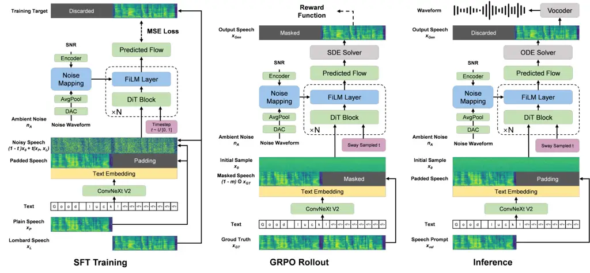
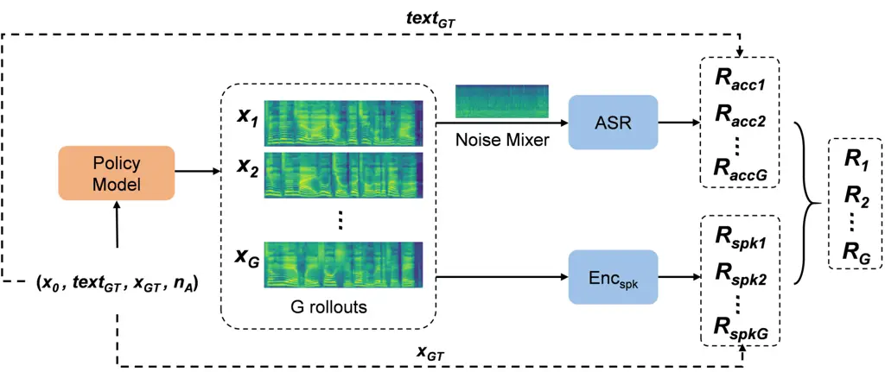
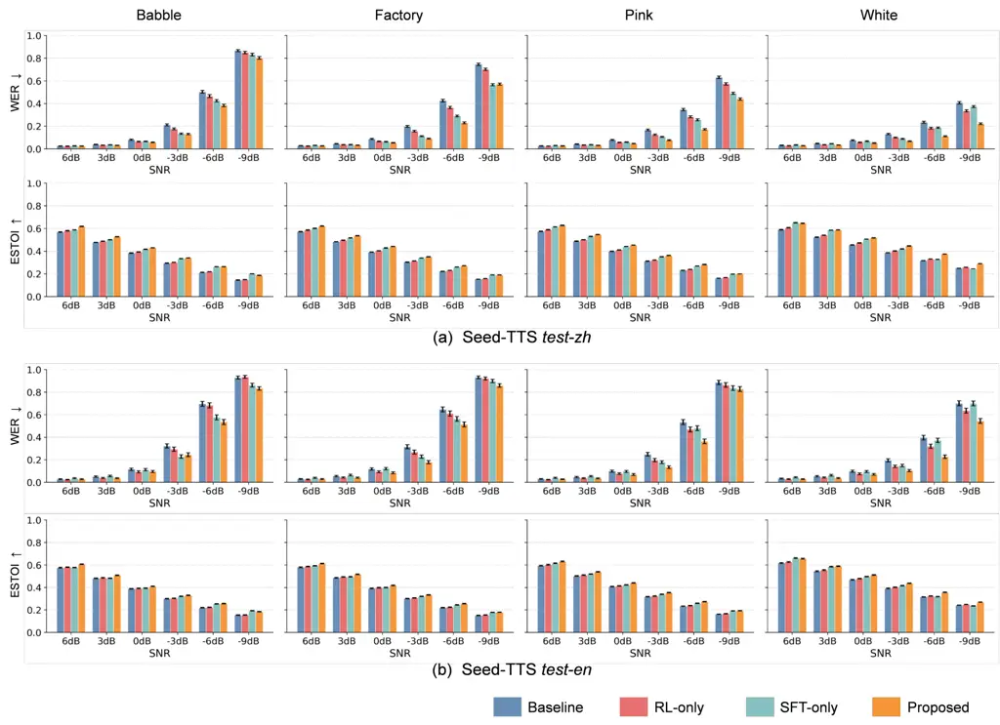
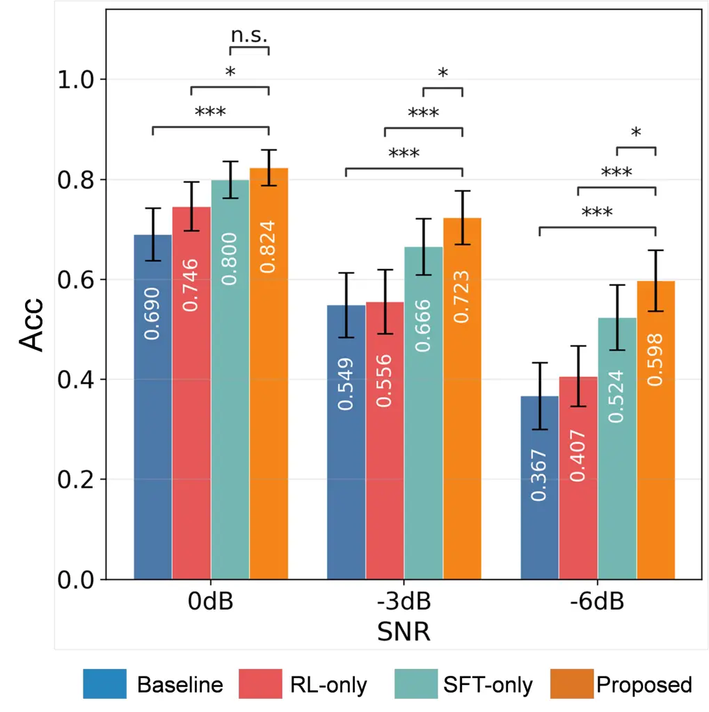
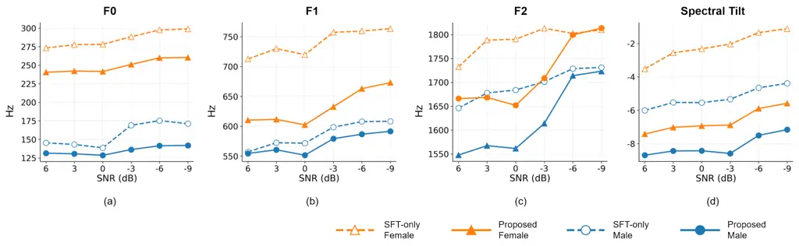
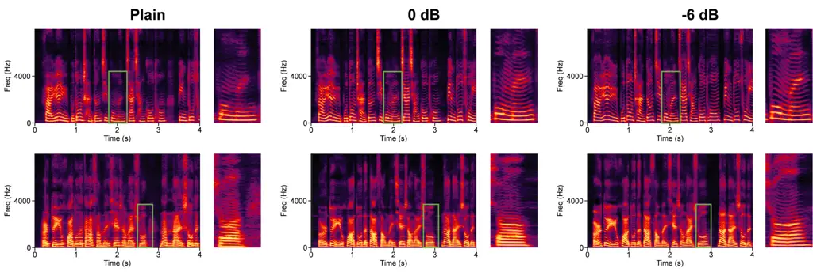

# Noise-Aware Lombard Speech Synthesis via Flow-GRPO for Intelligibility Optimization

Zhaoyang Wang    Dingding Yao    Chengzhong Wang    Junfeng Li
^(†)^(†)thanks: This research is partially supported by National Natural
Science Foundation of China (No. 12425413, 12574509), Beijing Natural
Science Foundation (L257001, L247022).^(†)^(†)thanks: Zhaoyang Wang,
Dingding Yao, Chengzhong Wang and Junfeng Li are with the Key Laboratory
of Speech Acoustics and Content Understanding, Institute of Acoustics,
Chinese Academy of Sciences, Beijing 100190, China, and also with
University of Chinese Academy of Sciences, Beijing 100049, China.
(Email: wangchaoyang@hccl.ioa.ac.cn, yaodingding@hccl.ioa.ac.cn,
wangchengzhong@hccl.ioa.ac.cn, lijunfeng@hccl.ioa.ac.cn)^(†)^(†)thanks:
Corresponding Author: Junfeng Li.

###### Abstract

Voice-based conversational agents are increasingly deployed in
real-world settings, where environmental noise often degrades the
interactive experience. Therefore, robust acoustic adaptability is
essential to maintain natural and intelligible human-computer
communication. However, most existing systems remain acoustically
insensitive and fail to emulate the human Lombard effect, in which
speakers involuntarily adjust their vocal production to preserve
intelligibility in the presence of noise. As a result, their
communicative reliability degrades under adverse acoustic conditions. To
remain intelligible in noisy environments, conversational agents require
a mechanism to emulate noise-induced adaptive behavior during synthesis.
We propose NIL-TTS, a noise-induced Lombard TTS framework. We integrate
a feature-wise linear modulation (FiLM) mechanism into a flow-matching
backbone for dynamic vocal adaptation. A two-stage training paradigm is
utilized: initial supervised fine-tuning on paired Lombard corpora,
followed by Flow-GRPO post-training to optimize for intelligibility.
Evaluations confirm that NIL-TTS autonomously adjusts its output in
response to varying noise conditions, exhibiting key correlates of the
human Lombard effect. Driven by these adaptive modulations, the
synthesized speech achieves significant intelligibility improvements
that scale proportionally with noise intensity. Ultimately, this work
presents a flow-matching and reinforcement learning-based advancement
within the adaptive Lombard speech synthesis paradigm for challenging
real-world scenarios.

###### Index Terms: 

Lombard effect, speech intelligibility, speech synthesis, reinforcement
learning.

## I Introduction

The emergence of high-fidelity speech synthesis with natural prosody has
accelerated the development of voice-based conversational agents (VCAs).
Driven by advances in speech-language models (SLMs), these agents are
transitioning toward increasingly lifelike interactive dialogues \[1,
2\]. Consequently, VCAs are evolving beyond static digital assistants
into embodied companions deployed in complex physical environments,
ranging from in-vehicle settings to noisy public spaces \[3\]. This
paradigm shift has rendered the need for environmental adaptability in
VCAs increasingly critical.

Despite strong linguistic capabilities exhibited by modern large
language models (LLMs), most existing conversational agents remain
acoustically insensitive to their surroundings. In contrast, human
communicative behavior is shaped not only by conversational partners but
also by the surrounding acoustic context \[4\]. A typical example is the
Lombard effect—a physiological feedback loop wherein speakers
involuntarily adjust their voice to preserve intelligibility in the
presence of noise \[5, 6, 7\]. This adaptive mechanism involves
coordinated acoustic and phonetic changes, including a higher
fundamental frequency ($`F_{0}`$), longer vowel durations, shifted
formant frequencies, and a flatter spectral tilt \[8, 9\]. This process
reflects an adaptive communicative strategy that ensures robust
information transmission \[10, 11\].

Due to the lack of such environment-driven regulatory mechanisms,
current VCAs suffer substantial degradation in intelligibility during
real-world deployment. To address this limitation, recent studies have
explored how to integrate Lombard characteristics into Text-to-Speech
(TTS) systems, investigating methodologies such as SNR-feedback-based
adaptation, online Lombard adaptation, and controllable vocal-effort
synthesis \[12, 13, 14, 15, 16, 17, 18, 19, 20\]. Existing paradigms
predominantly hinge on three strategies: supervised fine-tuning
utilizing dedicated Lombard corpora \[16, 18\], heuristic loudness
adjustment modulated by Signal-to-Noise Ratio (SNR) feedback \[14\], and
speaker-adaptive Lombard style embedding \[21, 20\]. However, these
approaches exhibit inherent constraints. First, the scarcity of
high-quality Lombard data often leads to rigid and static acoustic
mappings. As a result, models may manipulate the spectral structure in a
mechanistic fashion, neglecting natural biological variability and
exhibiting poor generalization to unseen speakers. Second, conventional
supervised learning and speaker-transition methodologies intrinsically
optimize for acoustic mimicry (i.e., $`L_{2}`$ similarity to training
data), while intelligibility—the goal of the Lombard effect—is rarely
posited as a direct optimization objective. Finally, the Lombard effect
is not a static style but a behavior shaped by environmental
interactions, acutely sensitive to the spectral properties and intensity
of ambient noise \[22, 23\]. Thus, the above approaches still cannot
model environment-dependent dynamics under real-world noise conditions.

Recently, Reinforcement Learning (RL) has emerged as an effective
post-training paradigm for aligning generative models with complex human
preferences and downstream objectives \[24, 25\]. Yet, its potential for
Lombard speech synthesis remains unexploited. RL optimizes its policy
through continuous environmental interaction \[26\]. This process
resembles the human auditory-vocal feedback loop, where speakers
dynamically adjust their voices to counter ambient noise.

Motivated by this mechanistic similarity between biological adaptation
and RL, we introduce Noise-Induced Lombard TTS (NIL-TTS), the first
RL-driven framework designed explicitly for noise-aware,
high-intelligibility speech synthesis. Specifically, we augment a
foundational flow-matching TTS model with a FiLM-based environmental
sensing pathway. To move beyond acoustic mimicry, we propose a two-stage
training paradigm: initial supervised fine-tuning (SFT) to establish
foundational style mappings, followed by an online Flow-GRPO
post-training stage that directly optimizes for intelligibility via
ASR-derived rewards. Audio samples are available on our demo page¹¹ 1
[https://kalenon.github.io/NIL-TTS-demo/](https://kalenon.github.io/NIL-TTS-demo/).
Our key contributions are summarized as follows:

1\) We propose a novel environment-driven synthesis framework (NIL-TTS)
that equips a TTS system with the capability for autonomous acoustic
adaptation to ambient noise.

2\) We empirically validate the mechanistic synergy between
reinforcement learning and the biological Lombard effect, demonstrating
RL’s efficacy in achieving fine-grained control over prosodic and
acoustic compensatory strategies.

3\) We demonstrate that NIL-TTS discovers and implements complex
acoustic adjustments under adverse conditions. These environment-induced
shifts yield substantial improvements in intelligibility, marking a
critical advancement toward truly situated, embodied conversational
intelligence.

## II Related Work

### II-A F5-TTS

F5-TTS is a non-autoregressive (NAR) text-to-speech (TTS) system based
on flow matching with a Diffusion Transformer (DiT) backbone \[27\]. It
introduces a simplified synthesis paradigm that bypasses the complex
auxiliary modules common in earlier NAR systems, such as duration
models, separate text encoders, and explicit phoneme-level alignment.
Instead of rigid alignment, F5-TTS refines text representations using
ConvNeXt V2 blocks \[28\] and pads character sequences with filler
tokens to match target speech lengths, allowing the model to learn
prosody and rhythmic contours implicitly during the iterative denoising
process.

During inference, F5-TTS employs Sway Sampling to allocate the Number of
Function Evaluations (NFE) non-uniformly across the flow trajectory.
This strategy places greater emphasis on early generation stages, which
are critical for establishing the global acoustic structure of the
utterance. Empirically, the model supports high-fidelity zero-shot
synthesis. The architectural simplicity provides a flexible foundation
for the environment-aware Lombard adaptation tasks investigated in this
work.

### II-B FiLM

Feature-wise Linear Modulation (FiLM) is a general conditioning method
that influences neural network computation through feature-wise affine
transformations \[29\]. By scaling and shifting activations based on
external signals, FiLM can selectively emphasize or suppress specific
feature channels, providing a highly efficient mechanism for injecting
external control into deep architectures \[30\]. In Lombard speech
synthesis, FiLM provides a suitable pathway for conditioning speech
production on the acoustic environment \[20\]. Its architecture enables
it to serve as a scalable bridge between ambient noise perception and
the resulting vocal adaptations, allowing the model to adjust its
generative trajectory within the Diffusion Transformer backbone.

### II-C Group Relative Policy Optimization (GRPO)

Group Relative Policy Optimization (GRPO) is an efficient reinforcement
learning algorithm first used to improve reasoning in large language
models (LLMs) \[31\]. Compared with Proximal Policy Optimization (PPO)
\[32\], GRPO avoids training a separate critic model of similar scale to
the policy model, which reduces memory and computation costs \[26\].

In GRPO, the policy generates a group of outputs for each prompt. The
advantage of each output is then computed from its reward relative to
the group mean and standard deviation. This relative formulation matches
the comparative nature of many reward signals and improves training
efficiency. In standard GRPO formulations, a Kullback-Leibler (KL)
penalty can be introduced to constrain policy updates relative to a
reference model.

Recently, a related framework integrates GRPO into a flow-matching TTS
architecture by reformulating deterministic flow outputs into
probabilistic Gaussian distributions \[25\], demonstrating the efficacy
of GRPO for general speech synthesis.

### II-D Flow-GRPO

Flow-GRPO \[33\] extends GRPO to flow-matching models in continuous
time. In speech generation, many RL methods focus on autoregressive
models or discrete token spaces. In contrast, Flow-GRPO enables online
RL directly in continuous mel-spectrogram space. It samples a group of
speech trajectories for each prompt and computes relative advantages
from group-normalized rewards.

For flow-matching architectures, this design allows direct optimization
of the vector field $`v_{t}`$ with respect to human-centered quality
metrics, without introducing a critic model. Through iterative updates,
Flow-GRPO can refine generation trajectories and improve speech quality
beyond standard supervised fine-tuning.

## III Methodology

This section details the architecture and training paradigm of NIL-TTS.
We build upon a continuous flow-matching TTS architecture, extending it
with two core mechanisms. First, we introduce an environmental acoustic
sensing pathway via Feature-wise Linear Modulation (FiLM) that encodes
ambient acoustic conditions. Second, to transcend the limitations of
purely supervised acoustic mimicry, we propose a two-stage training
paradigm: an initial supervised fine-tuning (SFT) stage, followed by a
Flow-GRPO post-training stage. This hybrid approach ensures that the
model not only learns the foundational acoustic priors of Lombard speech
but also explicitly optimizes its vocalization strategies to maximize
intelligibility through continuous environmental interaction.

### III-A Architectural Framework

#### III-A1 Base Flow-Matching Acoustic Model

The foundation of our system is a conditional flow-matching (CFM)
acoustic model that generates mel-spectrograms from text. Let $`x_{1}`$
represent the target mel-spectrogram and $`x_{0}\sim\mathcal{N}(0,I)`$
be a sample from the prior noise distribution. The model learns a
parameterized vector field $`v_{\theta}(x_{t},t,c)`$ that maps the noise
$`x_{0}`$ to the target speech $`x_{1}`$ along a probability path
$`p_{t}(x)`$, where $`t\in[0,1]`$ is the time step. The conditioning
information $`c=(c_{text},c_{ref})`$ includes linguistic features from
the input text and speaker identity features from a reference audio
prompt. The model is trained by minimizing the flow-matching objective:

```math
\mathcal{L}_{CFM}=\mathbb{E}_{t,x_{0},x_{1}}\left[\left\|v_{\theta}(\phi_{t}(x_{0},x_{1}),t,c)-(x_{1}-x_{0})\right\|^{2}\right] \tag{1}
```

where $`\phi_{t}(x_{0},x_{1})=(1-t)x_{0}+tx_{1}`$ defines a linear
interpolation between the prior noise and the data. The vector field
$`v_{\theta}`$ is parameterized by a Diffusion Transformer (DiT), which
serves as the core of our generative backbone.

#### III-A2 Environment-Aware Injection via FiLM



Fig. 1: An overview of the NIL-TTS pipeline. Left: The supervised
fine-tuning (SFT) stage, where the model is trained with a conditional
flow matching loss on paired plain and Lombard speech. Middle: The
Flow-GRPO rollout process, which leverages an SDE solver to generate a
group of exploratory sample trajectories for policy optimization. Right:
The inference process, which uses an ODE solver for deterministic speech
generation.

Standard DiT architectures typically lack explicit mechanisms for
environmental feedback. To synthesize situated Lombard speech, the model
should first perceive the ambient acoustic stimuli and modulate its
generative trajectory accordingly. We achieve this by explicitly
conditioning the DiT on environmental information using a Feature-wise
Linear Modulation (FiLM) mechanism.

The ambient environment is characterized by two distinct components: the
normalized noise waveform and its corresponding Signal-to-Noise Ratio
(SNR) with speech. We employ a pre-trained noise encoder to extract rich
acoustic embeddings $`E_{noise}\in\mathbb{R}^{T\times D_{enc}}`$ from
the noise waveform. Concurrently, the scalar SNR is projected into a
vector representation $`E_{snr}`$ using a multilayer perceptron (MLP).
These representations are fused to construct a global environmental
condition vector $`c_{env}`$:

```math
c_{env}=\text{MLP}_{proj}\left([\text{AvgPool}(E_{noise})\parallel E_{snr}]\right) \tag{2}
```

The average pooling over the noise embeddings (AvgPool) removes the
frame-level temporal dynamics of the noise, producing a global,
utterance-level environmental condition. This global context $`c_{env}`$
is injected directly into the hidden states of the DiT blocks.
Specifically, for the $`i`$-th Transformer block, the hidden state
$`h_{i}`$ (following the AdaLN conditioning and self-attention
mechanism) is modulated by the FiLM parameters:

```math
\gamma_{i},\beta_{i}=W_{i}(c_{env}) \tag{3}
```

```math
\tilde{h}_{i}=h_{i}\odot\gamma_{i}+\beta_{i} \tag{4}
```

where $`W_{i}`$ is a linear projection layer generating distinct scaling
($`\gamma_{i}`$) and shifting ($`\beta_{i}`$) parameters for each
specific block $`i`$, and $`\odot`$ denotes element-wise multiplication.
This modulation pathway establishes the vital sensory link, allowing
external acoustic conditions to continuously govern the internal speech
generation process. Furthermore, to preserve the foundational phonetic
alignment learned from clean speech, this FiLM-based modulation is
applied exclusively to the deeper transformer blocks ($`i>2`$).

### III-B Two-Stage Training Paradigm

#### III-B1 Supervised Fine-Tuning (SFT)

In the initial training stage, the environment-aware DiT model is
fine-tuned on a corpus of paired plain and Lombard speech samples. As
illustrated in Fig. 1 (left), the mel-spectrograms of plain speech
($`x_{P}`$) and Lombard speech ($`x_{L}`$) from the same speaker are
concatenated along the time dimension, forming a composite target
$`(x_{P},x_{L})`$. The model is conditioned on the input text, a padded
version of the plain speech $`(x_{P},\text{padding})`$, and the ambient
noise condition $`n_{A}`$.

The model is optimized to minimize the masked flow-matching loss
$`\mathcal{L}_{CFM}`$ (Eq. 1). This supervised stage equips the model
with a foundational heuristic for mapping ambient noise conditions to
basic Lombard acoustic features, serving as the baseline policy for
subsequent interactive refinement.



Fig. 2: Reward computation in Flow-GRPO. The objective function acts as
a proxy for human auditory feedback. The intelligibility reward
($`R_{acc}`$) mixes rollouts with ambient noise before ASR transcription
to evaluate robustness. The speaker similarity reward ($`R_{spk}`$)
utilizes a speaker encoder to penalize identity distortion against the
ground truth ($`x_{GT}`$).

#### III-B2 Flow-GRPO Post-Training

While SFT imparts the basic acoustic patterns of Lombard speech, its
objective primarily optimizes data likelihood rather than
intelligibility. However, the model is not explicitly incentivized to
mitigate environment-induced intelligibility degradation. To bridge this
gap, we introduce a reinforcement learning stage that adapts Flow-GRPO
to flow-matching trajectories \[33\].

A fundamental challenge in applying RL to continuous flow models is that
standard generation relies on a deterministic Ordinary Differential
Equation (ODE), which lacks the stochasticity requisite for RL
exploration:

```math
\mathrm{d}x_{t}=v_{t}(x_{t})\mathrm{d}t \tag{5}
```

Acoustic exploration serves as a computational analogue of human vocal
trial-and-error processes. To enable this, following the methodology
established in Flow-GRPO \[33\], we reformulate the generation process
into a Stochastic Differential Equation (SDE). This stochastic framework
facilitates exploration while rigorously preserving the marginal
distributions of the underlying ODE.

```math
\mathrm{d}x_{t}=\left[v_{t}(x_{t})+\frac{\sigma_{t}^{2}}{2t}(x_{t}+(1-t)v_{t}(x_{t}))\right]\mathrm{d}t+\sigma_{t}\mathrm{d}\omega \tag{6}
```

where $`\mathrm{d}\omega`$ is the standard Wiener process, and
$`\sigma_{t}`$ is a diffusion coefficient regulating stochasticity.
Discretized via the Euler-Maruyama method, the update rule becomes:

```math
\begin{split}x_{t+\Delta t}=x_{t}&+\left[v_{\theta}(x_{t},t)+\frac{\sigma_{t}^{2}}{2t}(x_{t}+(1-t)v_{\theta}(x_{t},t))\right]\Delta t\\
&+\sigma_{t}\sqrt{\Delta t}\epsilon\end{split} \tag{7}
```

where $`\epsilon\sim\mathcal{N}(0,\boldsymbol{I})`$ introduces the noise
necessary for generating diverse vocal trajectories. Following \[33\],
we set $`\sigma_{t}=a\sqrt{t/(1-t)}`$, with hyperparameter $`a`$
dictating the exploration boundary.

In this post-training rollout phase (Fig. 1, middle), the ground-truth
mel-spectrogram $`x_{GT}`$—which denotes the plain reference speech,
rather than a noise-corrupted or Lombard ground truth—is randomly masked
to yield a partially observed target $`(1-m)\odot x_{GT}`$. A noise
sample $`x_{0}\sim\mathcal{N}(0,I)`$ is drawn, and the model is
optimized as an active policy $`\pi_{\theta}`$. For each input
condition, the policy generates a group of $`G`$ sample trajectories
$`\{\tau_{1},\dots,\tau_{G}\}`$ using the SDE solver.

The reward function $`\mathcal{R}`$ (Fig. 2) is engineered to
computationally simulate human auditory judgment under noise \[25\]:

```math
\mathcal{R}=\lambda_{spk}R_{spk}+\lambda_{acc}R_{acc} \tag{8}
```

where $`\lambda_{spk}`$ and $`\lambda_{acc}`$ balance identity
preservation against intelligibility constraints.

- •
  Intelligibility Reward ($`R_{acc}`$): The generated speech is mixed
  with the target noise at a specified SNR and transcribed by an
  external Automatic Speech Recognition (ASR) model. We define this
  reward as:

  ```math
  R_{acc}=1-\mathrm{WER}(text_{rollout},text_{GT}) \tag{9}
  ```

  In this setup, the ASR acts as a proxy for human auditory feedback.
  This feedback encourages the policy to adapt to the ambient noise.
  Consequently, the model discovers acoustic strategies that maximize
  transcription accuracy.

- •
  Speaker Similarity Reward ($`R_{spk}`$): The cosine similarity between
  the generated speech’s speaker embedding and that of the ground-truth
  reference is measured:

  ```math
  R_{spk}=\mathrm{SIM}(emb_{rollout},emb_{GT}) \tag{10}
  ```

  This intrinsic penalty ensures that the intense vocal adaptations
  required for intelligibility do not distort the original speaker
  identity.

Advantage estimation is executed via group-level normalization:

```math
A_{i}=\frac{\mathcal{R}_{i}-\mu_{\mathcal{R}}}{\sigma_{\mathcal{R}}} \tag{11}
```

where $`\mu_{\mathcal{R}}`$ and $`\sigma_{\mathcal{R}}`$ represent the
group’s reward mean and standard deviation. The policy is updated by
maximizing a clipped surrogate objective, penalized by the
Kullback-Leibler (KL) divergence to anchor the policy against
catastrophic drift from the SFT reference model $`\pi_{ref}`$:

```math
\begin{split}\mathcal{L}_{GRPO}=&-\frac{1}{G}\sum_{i=1}^{G}\min\left(r_{i}(\theta)A_{i},\text{clip}(r_{i}(\theta),1-\epsilon,1+\epsilon)A_{i}\right)\\
&-\beta\mathbb{D}_{KL}(\pi_{\theta}\|\pi_{ref})\end{split} \tag{12}
```

where
$`r_{i}(\theta)=\frac{\pi_{\theta}(\tau_{i})}{\pi_{old}(\tau_{i})}`$
denotes the importance sampling ratio.

### III-C Inference

During inference, the goal is to generate a deterministic and highly
intelligible sample of Lombard speech for a specified text and noise
condition. Conditioned on a target speaker reference $`x_{ref}`$,
generation proceeds via the deterministic ODE solver (Eq. 5) using a
fixed number of integration steps (e.g., 32 NFE). This process bypasses
SDE stochasticity to ensure stable and highly reproducible output
(Fig. 1, right). Finally, a pre-trained vocoder synthesizes the
predicted mel-spectrogram into the final acoustic waveform.

## IV Experiments

### IV-A Datasets

The proposed two-stage training framework leverages distinct datasets to
ensure both stylistic fidelity and cross-domain generalization.

#### IV-A1 Supervised Fine-Tuning (SFT) Dataset

The initial stage utilizes the Chinese Enhanced Mandarin Lombard Grid
(EMALG) corpus \[34\] and the English LombardGrid corpus \[35\]. EMALG
consists of 10,200 meaningful utterances recorded by 34 native Mandarin
speakers. It includes a plain reference style recorded at 40 dB SPL and
two Lombard styles induced at 55 dB (L1) and 80 dB (L2). The LombardGrid
dataset comprises 5,400 utterances from 54 speakers, featuring paired
plain speech at 30 dB SPL and Lombard speech at 80 dB SPL. These
datasets provide the foundational high-fidelity paired data required to
establish the baseline mapping between noise and acoustic adaptation.

To simulate diverse real-world acoustics, we augment the training
signals with environmental noise from the DEMAND database \[36\]. This
database provides recordings across six broad categories: Domestic,
Office, Public, Transportation, Nature, and Street. We utilize DEMAND in
this initial stage because its categorical environments are well-suited
for establishing foundational noise-to-acoustic mappings.

#### IV-A2 Flow-GRPO Post-Training Dataset

To facilitate stochastic exploration of the acoustic state space and
promote generalization to naturalistic conversational speech, the
reinforcement learning phase exclusively utilizes the Mandarin
WenetSpeech4TTS-Premium subset \[37\]. This corpus comprises 945 hours
of high-fidelity Mandarin speech, specifically filtered to ensure
superior perceptual quality with DNSMOS \[38\] scores exceeding $`4.0`$.
The multi-domain nature of this data (e.g., audiobooks, interviews, and
podcasts) provides the rich linguistic and prosodic variability
necessary for effective policy optimization.

For environmental simulation during post-training, we employ the DNS
Challenge (ICASSP 2021) noise corpus \[39\], which encompasses
approximately 181 hours of diverse noise samples across 150 distinct
audio classes, including office, transportation, and social
environments. Exposing the model to this massive diversity of acoustic
interference forces the policy to develop adaptive strategies rather
than overfitting to specific noise profiles.

#### IV-A3 Evaluation Dataset

To evaluate the effectiveness of the proposed model in zero-shot speech
synthesis, we conduct objective evaluations using the public benchmark
configuration of the Seed-TTS objective test set \[40\]. This includes
2,020 Mandarin utterances derived from the DiDiSpeech corpus \[41\] and
1,088 English utterances extracted from the Common Voice dataset \[42\].

To assess environmental adaptability under adverse conditions, these
clean samples are systematically perturbed with a representative suite
of noise profiles from the NoiseX-92 database \[43\]. This corpus is
specifically curated to study the impact of additive noise on speech
processing systems. It offers a diverse range of acoustic interference
conditions. Four noise types are chosen: Babble, Factory, Pink, and
White noise.

### IV-B Model and Training Configurations

#### IV-B1 Model Configuration

The proposed NIL-TTS architecture adopts the architectural
specifications of the official F5-TTS foundation model \[27\], augmented
with our environment-aware branch to facilitate dynamic vocal
adaptation.

The Diffusion Transformer (DiT) backbone consists of $`22`$ layers with
a hidden dimension of $`d_{model}=1024`$ and $`16`$ attention heads. The
text encoder utilizes ConvNeXt V2 \[28\] with a $`512`$-dimensional
embedding space. For environmental sensing, we employ the official DAC
encoder (44.1 kHz version) \[44\] as the noise encoder. This module
processes $`44.1`$ kHz raw noise waveforms to extract
$`1024`$-dimensional acoustic embeddings, which are then fused with a
$`128`$-dimensional SNR-based MLP representation. The original ambient
noise is resampled to $`44.1`$ kHz to align with the input requirements
of the pre-trained DAC noise encoder. Meanwhile, the core TTS pipeline
and the vocoder operate consistently at $`24`$ kHz, and the model’s
internal representations map the conditions accordingly. The resulting
environmental condition is injected into the hidden states of the DiT
via the FiLM mechanism. The model generates mel-spectrograms with
$`100`$ frequency bins, which are subsequently converted into audio
waveforms using a pre-trained Vocos vocoder \[45\].



Fig. 3: Objective ASR transcription error rates (WER) and objective
intelligibility metrics (ESTOI) across four noise types (Babble,
Factory, Pink, and White) and six SNR levels (6 dB to -9 dB). Error bars
denote 95% confidence intervals. (a) Results from Seed-TTS test-zh. (b)
Results from Seed-TTS test-en.

#### IV-B2 Training Details

The training process is executed in two sequential stages: supervised
fine-tuning (SFT) and on-policy reinforcement learning via Flow-GRPO.

During the SFT stage, we initialize the model with the weights of the
pre-trained vanilla F5-TTS foundation model. To retain the high-fidelity
phonetic and prosodic priors of the base model while focusing entirely
on Lombard style injection, we freeze the DiT backbone and exclusively
train the FiLM-based environment-aware modules. The model is optimized
using the AdamW optimizer with a learning rate of $`1\times 10^{-4}`$
and a sample-wise batch size of $`8`$. Training is conducted for
$`680,000`$ steps on two NVIDIA A40 48GB GPUs. During this stage, the
SNR is randomly sampled between -7.0 dB and 5.0 dB to establish the
Lombard stylistic mapping.

In the post-training phase, the entire NIL-TTS architecture is unfrozen
to allow for global strategy refinement. We reduce the learning rate to
$`1\times 10^{-6}`$ with a $`400`$-step linear warmup to stabilize
policy updates. The entire NIL-TTS architecture is trained for 4,800
steps in total. For each prompt, the model generates a group of $`G=24`$
rollout trajectories using the SDE solver ($`32`$ NFE) with a diffusion
coefficient of $`a=0.4`$ to encourage sufficient acoustic exploration.
During post-training, the SNR is dynamically sampled from a uniform
distribution $`\mathcal{U}(-10,15)`$ dB.

The intelligibility reward $`R_{acc}`$ in Eq. 8 is derived from the WER
produced by the SenseVoice-Small ASR model \[46\], while the speaker
similarity reward $`R_{spk}`$ is computed via cosine similarity using
WeSpeaker embeddings \[47\]. We set the reward weights to
$`\lambda_{acc}=6.0`$ and $`\lambda_{spk}=1.0`$. The KL-divergence
coefficient $`\beta`$ is set to $`0.0`$ in this study to facilitate
aggressive policy exploration within the continuous acoustic space
without being prematurely anchored by the SFT baseline.

### IV-C Evaluation

To quantitatively assess the performance of NIL-TTS, we conduct
objective benchmarking using the Seed-TTS test set. We systematically
perturb the synthesized speech samples with four representative noise
typologies from the NoiseX-92 corpus \[43\]: Babble, Factory, Pink, and
White noise. To comprehensively evaluate the model’s adaptive range, we
simulate six distinct SNR regimes ranging from moderate interference to
severe masking: 6, 3, 0, -3, -6, -9 dB. Following the synthesis of clean
speech, the waveforms are mixed with the corresponding noise profiles to
replicate situated acoustic environments.

For all evaluation tasks, we utilize a deterministic ODE solver with
$`32`$ NFE. The Classifier-Free Guidance (CFG) strength is maintained at
$`2.0`$. To optimize the generation trajectory, we apply Sway Sampling
with a coefficient of $`-1.0`$ (following the default setup in F5-TTS
\[27\]). Finally, the synthesized mel-spectrogram is vocoded at $`24`$
kHz.

## V Results and Analysis

In this section, we present the evaluation results of the proposed
NIL-TTS framework, analyzing the intelligibility improvements and the
underlying acoustic compensatory mechanisms discovered during the
two-stage training paradigm.

### V-A Intelligibility Improvements

#### V-A1 Objective Intelligibility Evaluation

We assess objective intelligibility using two complementary metrics. All
synthesized audio samples are resampled to 16 kHz prior to evaluation:

- •
  Word Error Rate (WER): Derived from advanced ASR systems to reflect
  content preservation and noise robustness. We employ Paraformer-zh
  \[48\] for Mandarin transcription and Whisper-large-v3 \[49\] for
  English.
- •
  Extended Short-Time Objective Intelligibility (ESTOI) \[50\]: A
  signal-level metric that quantifies perceptual intelligibility under
  additive noise or processing distortions.

To demonstrate the extent to which our proposed model improves
intelligibility, we use vanilla F5-TTS as the baseline and report
results for the SFT-only model. Furthermore, to isolate the proposed
noise-aware contribution from the already known benefit of RL
post-training, we trained Flow-GRPO separately on the F5-TTS model
(RL-only). This model also utilized WER and speaker-similarity rewards,
but without noise-waveform and SNR conditioning or post-masker reward
computation.

Fig. 3 illustrates the performance of the baseline, RL-only, SFT-only,
and the proposed NIL-TTS across diverse acoustic conditions. We
establish statistical significance using paired utterance-level
bootstrap resampling with 1,000 resamples, reporting the 95% confidence
intervals (CIs) across all conditions. The absolute intelligibility
scores and corresponding CIs are detailed in the Appendix (Table V).

The results demonstrate that NIL-TTS achieves the highest objective
intelligibility in nearly all evaluated conditions. Notably, at high
SNRs (e.g., 6 dB), the improvement provided by the RL-enhanced model
over the SFT model is relatively modest. This reflects a natural
trade-off between intelligibility and naturalness: under mild noise
conditions, excessive Lombard adaptation is unnecessary. However, the
performance margin between NIL-TTS and the baseline widens significantly
as the acoustic environment deteriorates. This underscores the efficacy
of our noise-induced style modification paradigm under extreme masking
conditions. While all models exhibit performance degradation as SNR
decreases, the Babble noise condition—characterized by non-stationary,
speech-like masking—poses the greatest challenge. Conversely, white
noise results in the smallest increase in WER because of its stationary
characteristics.

NIL-TTS maintains intelligibility under severe noise. For instance, at a
challenging $`-6`$ dB SNR on the Seed-TTS test-zh dataset, the vanilla
baseline degrades to a mean WER of $`0.378`$ (95% CI:
$`[0.372,0.383]`$). The SFT-only model improves this to $`0.289`$ (95%
CI: $`[0.285,0.294]`$), whereas the proposed NIL-TTS significantly
reduces the WER to $`0.224`$ (95% CI: $`[0.219,0.228]`$). Similar
statistical superiority is observed in the ESTOI metric, where NIL-TTS
achieves $`0.298`$ (95% CI: $`[0.297,0.299]`$) at $`-6`$ dB SNR,
outperforming the SFT-only model ($`0.279`$, 95% CI: $`[0.278,0.280]`$)
and the baseline ($`0.246`$, 95% CI: $`[0.244,0.247]`$).

|                          |                    |       |       |                    |       |       |                    |       |       |                    |       |       |
| ------------------------ | ------------------ | ----- | ----- | ------------------ | ----- | ----- | ------------------ | ----- | ----- | ------------------ | ----- | ----- |
| Conditions               | Seed-TTS test-zh   |       |       |                    |       |       | Seed-TTS test-en   |       |       |                    |       |       |
|                          | WER $`\downarrow`$ |       |       | ESTOI $`\uparrow`$ |       |       | WER $`\downarrow`$ |       |       | ESTOI $`\uparrow`$ |       |       |
|                          | 0 dB               | -3 dB | -6 dB | 0 dB               | -3 dB | -6 dB | 0 dB               | -3 dB | -6 dB | 0 dB               | -3 dB | -6 dB |
| F5-TTS \[27\]            | 0.081              | 0.177 | 0.378 | 0.407              | 0.324 | 0.246 | 0.107              | 0.270 | 0.568 | 0.414              | 0.327 | 0.247 |
| \[2pt/2pt\] F5-TTS + SS  | 0.057              | 0.123 | 0.278 | 0.420              | 0.339 | 0.264 | 0.086              | 0.183 | 0.498 | 0.394              | 0.321 | 0.254 |
| F5-TTS + SSDRC           | 0.058              | 0.120 | 0.263 | 0.448              | 0.347 | 0.270 | 0.089              | 0.176 | 0.484 | 0.413              | 0.333 | 0.257 |
| \[2pt/2pt\] MetaVoice-1B | -                  | -     | -     | -                  | -     | -     | 0.419              | 0.651 | 0.895 | 0.420              | 0.331 | 0.248 |
| MetaVoice-1B Lomb†\[21\] | -                  | -     | -     | -                  | -     | -     | 0.420              | 0.640 | 0.873 | 0.428              | 0.337 | 0.253 |
| F5-TTS-Style Base†\[20\] | 0.092              | 0.190 | 0.386 | 0.419              | 0.337 | 0.258 | 0.181              | 0.364 | 0.654 | 0.425              | 0.339 | 0.258 |
| F5-TTS-Style Lomb†\[20\] | 0.099              | 0.199 | 0.396 | 0.417              | 0.335 | 0.257 | 0.200              | 0.392 | 0.678 | 0.423              | 0.337 | 0.256 |
| \[2pt/2pt\] RL-only      | 0.061              | 0.140 | 0.323 | 0.420              | 0.334 | 0.254 | 0.084              | 0.225 | 0.519 | 0.420              | 0.333 | 0.252 |
| SFT-only                 | 0.064              | 0.110 | 0.289 | 0.448              | 0.361 | 0.279 | 0.105              | 0.195 | 0.497 | 0.428              | 0.349 | 0.269 |
| NIL-TTS                  | 0.052              | 0.091 | 0.224 | 0.460              | 0.375 | 0.298 | 0.079              | 0.165 | 0.434 | 0.445              | 0.364 | 0.285 |

TABLE I: Intelligibility performance in terms of WER and ESTOI, averaged
across four noise types at SNRs of 0, $`-3`$, and $`-6`$ dB on the
Seed-TTS test set. † denotes models implemented by the authors.

The addition of the RL-only baseline isolates the contribution of the
proposed environmental conditioning mechanism. While applying Flow-GRPO
with WER and speaker-similarity rewards (without noise conditioning)
does improve intelligibility over the vanilla baseline, it falls short
of the NIL-TTS performance. This confirms that part of the
intelligibility gain in adverse conditions is derived from the explicit
noise-awareness, rather than the RL post-training alone.

Notably, although the Flow-GRPO stage is conducted exclusively on
Mandarin data, we observe consistent intelligibility gains on zero-shot
English synthesis under adverse noise conditions. This empirical
transfer suggests that the learned acoustic compensation patterns are
not strictly tied to language-specific phonetic content. The observed
cross-lingual improvements indicate that the RL-driven adaptation
primarily operates in acoustic space rather than lexical space.

Furthermore, we compared the objective intelligibility of our proposed
NIL-TTS against signal-processing-based modifications and established
Lombard speech synthesis methods.

Two signal-processing-based modifications were utilized:

- •
  SS: The baseline is processed using adaptive spectral shaping (SS)
  \[51\], which artificially enhances formants and flattens spectral
  tilt.
- •
  SSDRC: The baseline is processed using both spectral shaping and
  dynamic range compression (SSDRC) \[51\], which reallocates signal
  energy across both frequency and time domains.

We selected two models capable of zero-shot Lombard speech synthesis:

- •
  MetaVoice-1B Lomb \[21\]: Built upon the MetaVoice-1B²² 2
  [https://github.com/metavoiceio/metavoice-src](https://github.com/metavoiceio/metavoice-src)
  foundation model, this approach learns a transformation between plain
  speech embeddings and their Lombard variants. Following the original
  methodology, we trained a feedforward speaker transformation model
  using paired data from the LombardGrid corpus to map plain speaker
  embeddings to Lombard embeddings for zero-shot synthesis. As this
  model only supports English speech synthesis, only the test-en results
  are reported.
- •
  F5-TTS-Style \[20\]: This method, also based on the F5-TTS
  architecture, introduces an additional style encoder to model speaker
  and style features via FiLM injection. Instead of relying on explicit
  Lombard training data, it controls the Lombard effect by manipulating
  relevant principal components (via PCA mapping) in the style embedding
  space. Following the authors’ protocol, we fine-tuned F5-TTS with the
  style encoder on the Emilia dataset \[52\] (evaluated as F5-TTS-Style
  Base). We then synthesized Lombard speech by shifting the relevant PCA
  components to the ”Very Loud” level specified in the original paper
  (evaluated as F5-TTS-Style Lomb).

As shown in Table I, both SS and SSDRC effectively improve speech
intelligibility over the baseline. This validates the utility of
traditional acoustic enhancements such as energy reallocation. The
MetaVoice-1B Lomb provides marginal improvements in severe noise. In
contrast, the F5-TTS-Style framework degrades the WER compared to its
base version (e.g., increasing WER from $`0.092`$ to $`0.099`$ at 0 dB
SNR on test-zh). The proposed NIL-TTS consistently outperforms both the
signal-processing techniques and the neural Lombard baselines across all
evaluated SNRs in both the Mandarin and English subsets.

The performance gap stems from the distinct mechanisms underlying these
approaches. While SS and SSDRC apply deterministic acoustic filters
uniformly across the generated audio, they lack contextual and phonetic
awareness. Similarly, existing neural approaches such as F5-TTS-Style
simulate the Lombard effect by shifting principal components associated
with loudness and clarity. This method manipulates embeddings, resulting
in a coarse simulation of the Lombard style that lacks a direct
optimization objective for speech intelligibility. Consequently, the
structural modifications to the speech signal may actually degrade
recognition accuracy in severe noise compared to its base version.

Rather than applying a rigid post-hoc modification or a static style
vector, our model leverages its environment-aware sensing pathway to
autonomously shift vocal energy to frequency bands less affected by the
specific ambient noise profile. Furthermore, the superiority of the full
NIL-TTS over the RL-only and SFT-only configurations confirms that our
two-stage training paradigm is essential for yielding these natural and
robust intelligibility gains.

#### V-A2 Subjective Intelligibility Evaluation

We conducted a blind subjective intelligibility test following the ITU-T
P.807 standard \[53\]. We focused on Babble noise due to its
representative complexity in objective tests. Three SNR levels (0 dB,
-3 dB, and -6 dB) were selected, representing a reasonable range that
causes significant fluctuations in speech intelligibility. Our objective
evaluations comprehensively demonstrated the superiority of NIL-TTS over
traditional signal-processing methods and other zero-shot synthetic
models. Therefore, the subjective study specifically focused on
isolating the perceptual contributions of our architectural components.



Fig. 4: Subjective recognition accuracy across 3 SNR levels (0 dB, -3
dB, and -6 dB) under Babble noise. Error bars denote 95% confidence
intervals.

Twelve listeners were tasked with transcribing 360 randomly selected
Mandarin speech clips, balanced across four model configurations
(baseline, RL-only, SFT-only, and the proposed NIL-TTS) and three SNRs.
Each participant’s test set was carefully designed to avoid memory
effects resulting from repeated sentence content, which may introduce
bias. To ensure a fair comparison, the text content used for synthesis
is identical across all evaluated models.

As shown in Fig. 4, the paired $`t`$-test results indicate that the
proposed NIL-TTS yields statistically significant subjective
intelligibility improvements over the vanilla baseline across all
evaluated SNRs ($`p<0.001`$ for all). Crucially, the inclusion of the
ablation models isolates and clarifies the source of the perceptual
gain. While the RL-only model provides a marginal improvement over the
baseline, the proposed model significantly outperforms it at all SNRs
($`p=0.018`$ at 0 dB; $`p<0.001`$ at -3 dB and -6 dB), confirming that
RL-based post-training alone is insufficient without our explicit
environmental conditioning mechanism. Furthermore, when compared to the
supervised Lombard adaptation (SFT-only), the proposed framework shows
no statistically significant difference under mild noise (0 dB,
$`p=0.368`$), but it achieves significant perceptual improvements under
more severe masking conditions: -3 dB ($`p=0.012`$) and -6 dB
($`p=0.027`$).

The absolute transcription accuracy gain provided by the proposed model
over the baseline increases monotonically as the SNR drops, reaching a
substantial peak at -6 dB (improving from $`0.367`$ to $`0.598`$). These
results indicate that the improvements observed in objective metrics are
consistently reflected in subjective listening tests, successfully
verifying that the full environment-aware conditioning and two-stage
training mechanism of NIL-TTS are necessary for maximizing perceptible
human intelligibility under adverse conditions.



Fig. 5: Comparison of acoustic features produced by the SFT-only and
proposed NIL-TTS models across different SNR levels for female and male
speakers. The panels show (a) fundamental frequency $`F_{0}`$, (b) first
formant $`F_{1}`$, (c) second formant $`F_{2}`$, and (d) spectral tilt.
Dashed lines with open markers denote the SFT-only model, whereas solid
lines with filled markers denote the proposed model after Flow-GRPO
post-training.



Fig. 6: Spectrogram comparison illustrating emergent Lombard
characteristics. All samples are synthesized by the proposed NIL-TTS.
Each row corresponds to a distinct test utterance generated using the
same text and speaker reference, but conditioned on varying ambient
noise levels (Plain, 0 dB, and -6 dB). The Plain condition represents
standard, non-adapted speech generated by disabling the FiLM branch.
Under noise, the model exhibits upward harmonic shifts and pronounced
energy concentration in higher frequency bands.

### V-B Acoustic Parameter Analysis

To examine how Flow-GRPO modifies the acoustic adaptation learned during
supervised fine-tuning, we compare the SFT-only model with the complete
NIL-TTS model after Flow-GRPO post-training across varying noise
intensities. We evaluate four primary acoustic correlates of the Lombard
effect: fundamental frequency ($`F_{0}`$), the first and second formants
($`F_{1}`$ and $`F_{2}`$), and spectral tilt. The fundamental frequency
$`F_{0}`$, reflecting vocal fold vibration rate, is estimated using the
pYIN algorithm \[54\]. The resonance properties of the vocal tract,
represented by formants $`F_{1}`$ and $`F_{2}`$, are extracted via
Linear Predictive Coding (LPC) \[55\]. Spectral tilt, which indicates
the distribution of energy across the frequency spectrum, is quantified
as the slope of a linear regression line fitted to the Long-Term Average
Spectrum (LTAS) \[56\] on a logarithmic frequency scale.

As shown in Fig. 5, both models exhibit systematic SNR-dependent
acoustic changes, although their absolute parameter values and
adaptation patterns differ. For both female and male speakers,
$`F_{0}`$, $`F_{1}`$, and $`F_{2}`$ generally increase as the SNR
decreases. The SFT-only model produces higher absolute $`F_{0}`$,
$`F_{1}`$, and $`F_{2}`$ values, whereas the proposed model retains
lower absolute values while preserving systematic SNR-dependent
increases. Spectral tilt also becomes progressively less negative for
both models as the SNR decreases, indicating a flatter spectral envelope
and relatively greater high-frequency energy. However, the proposed
model retains a steeper spectral tilt than the SFT-only model across the
evaluated conditions.

These results indicate that Flow-GRPO does not simply amplify every
Lombard-related acoustic cue acquired during supervised fine-tuning.
Instead, it rebalances the acoustic adaptation strategy, moderating the
changes in $`F_{0}`$, $`F_{1}`$, $`F_{2}`$, and spectral tilt. Together
with the objective and subjective intelligibility improvements reported
above, this comparison suggests that the reinforcement learning stage
discovers a more selective combination of acoustic adjustments for
improving robustness in noise.

Spectrogram analysis (Fig. 6) visually confirms these Lombard
characteristics. As the SNR decreases, the harmonic components shift
upward, and the energy becomes more concentrated at higher frequencies.
This observation is consistent with the within-model reduction in
spectral tilt under increasingly severe noise, which indicates a
redistribution of speech energy toward higher-frequency regions.
Together, the acoustic-feature and spectrogram analyses suggest that
Flow-GRPO refines the relative contributions of pitch, formant, and
spectral cues rather than uniformly increasing their magnitudes.

### V-C Computational Efficiency Analysis

We examine the computational overhead of NIL-TTS relative to the
baselines. All F5-TTS variants use deterministic ODE sampling with 32
function evaluations and a classifier-free guidance (CFG) scale of 2.0.

The vanilla F5-TTS baseline operates with 336M parameters and achieves
an efficient RTF of 0.26. The integration of our environmental pathway
introduces a modest overhead of parameters, bringing the total to 382M.
Despite this addition, the inference speed is essentially unaffected,
maintaining a highly competitive RTF of 0.27.

MetaVoice-1B Lomb has 1.2B parameters and an RTF of 3.04, making it
unsuitable for low-latency conversational applications. Although
F5-TTS-Style Lomb has a computational footprint similar to that of
NIL-TTS (387M parameters, RTF 0.27), it lacks the explicit
intelligibility optimization provided by our framework.

Ultimately, these results confirm that our proposed environmental
conditioning and two-stage training paradigm impose a negligible
inference overhead (an RTF increase of merely 0.01 over the vanilla
baseline), ensuring that NIL-TTS remains highly practical for
real-world, real-time deployment.

| Config                        | \#Param. | RTF $`\downarrow`$ |
| ----------------------------- | -------- | ------------------ |
| F5-TTS                        | 336M     | 0.26               |
| \[2pt/2pt\] MetaVoice-1B Lomb | 1.2B     | 3.04               |
| F5-TTS-Style Lomb             | 387M     | 0.27               |
| NIL-TTS                       | 382M     | 0.27               |

TABLE II: Comparison of computational costs. \#Param. denotes the number
of learnable parameters. The real-time factor (RTF) is measured for
generating 10-s utterances on an NVIDIA RTX 3090 GPU.

|                                |                  |       |       |                  |       |       |
| ------------------------------ | ---------------- | ----- | ----- | ---------------- | ----- | ----- |
| Config                         | Seed-TTS test-zh |       |       | Seed-TTS test-en |       |       |
|                                | 0 dB             | -3 dB | -6 dB | 0 dB             | -3 dB | -6 dB |
| NIL-TTS                        | 0.052            | 0.091 | 0.224 | 0.079            | 0.165 | 0.434 |
| \[2pt/2pt\]      KL penalty    |                  |       |       |                  |       |       |
| \[2pt/2pt\] $`\beta`$=0.01     | 0.063            | 0.088 | 0.235 | 0.083            | 0.214 | 0.460 |
| $`\beta`$=0.1                  | 0.056            | 0.102 | 0.252 | 0.100            | 0.158 | 0.435 |
| \[2pt/2pt\]      NFE steps     |                  |       |       |                  |       |       |
| \[2pt/2pt\] NFE=8              | 0.065            | 0.130 | 0.292 | 0.098            | 0.226 | 0.506 |
| NFE=16                         | 0.058            | 0.106 | 0.247 | 0.102            | 0.204 | 0.485 |
| \[2pt/2pt\]      Noise Level a |                  |       |       |                  |       |       |
| \[2pt/2pt\] a=0.2              | 0.058            | 0.111 | 0.259 | 0.097            | 0.202 | 0.482 |
| a=0.6                          | 0.062            | 0.103 | 0.260 | 0.096            | 0.194 | 0.501 |

### V-D Ablation Studies on Post-Training Design Choices

The sparsity of rewards in reinforcement learning can lead to training
instability. To evaluate the robustness of our post-training phase, we
systematically ablated key Flow-GRPO hyperparameters, analyzing their
impact on final intelligibility (Table V-C).

First, we examined the KL divergence penalty ($`\beta`$). While
$`\beta=0.01`$ and $`\beta=0.1`$ achieve marginally lower WERs at
specific SNR levels, $`\beta=0.0`$ yields superior overall
intelligibility. We empirically found that introducing a non-zero KL
penalty overly restricts the policy update in the continuous acoustic
space, limiting the model’s ability to discover effective compensatory
strategies. Therefore, we adopt $`\beta`$=0 and rely on structural
regularization (SFT initialization and speaker similarity constraints)
to maintain stability. In contrast to discrete autoregressive policies,
the flow-based generative model operates in a continuous trajectory
space governed by diffusion priors. The stochastic SDE sampling
implicitly constrains exploration around the learned probability path,
reducing the risk of catastrophic drift. This allows unconstrained
policy optimization without requiring explicit KL regularization.

Regarding the Number of Function Evaluations (NFE) during the SDE
rollout, our experiments demonstrate that utilizing $`32`$ steps
(matching the inference configuration) yields better WER metrics than
$`8`$ or $`16`$ steps, though the experiments in the original Flow-GRPO
study \[33\] suggest that the usage of fewer rollout steps results in
faster training convergence and better metrics. This discrepancy between
our experiments and the original Flow-GRPO may stem from differences in
the model’s task and the nature of the metrics. The original Flow-GRPO
is designed to make generated images better align with human
preferences. In contrast, our work requires generating clearer, more
perceptible acoustic cues, which may rely on a finer-grained sampling
process.

Finally, we evaluated the diffusion coefficient $`a`$, which dictates
the exploration intensity of the Wiener process during SDE sampling. An
intermediate value of $`a=0.4`$ outperforms both $`a=0.2`$ and
$`a=0.6`$. This indicates that moderate stochasticity is critical:
excessive noise ($`a=0.6`$) disrupts the phonetic structure required by
the ASR reward, while insufficient noise ($`a=0.2`$) fails to provide
the policy with the diverse vocal trajectories needed to discover
effective Lombard compensations.

| ASR Model        | SNR (dB) | White |      |      | Pink |      |      | Babble |      |      | Factory |      |      |
| ---------------- | -------- | ----- | ---- | ---- | ---- | ---- | ---- | ------ | ---- | ---- | ------- | ---- | ---- |
|                  |          | P     | L1   | L2   | P    | L1   | L2   | P      | L1   | L2   | P       | L1   | L2   |
| SenseVoice-Small | 5        | 0.08  | 0.08 | 0.07 | 0.06 | 0.07 | 0.06 | 0.06   | 0.06 | 0.06 | 0.08    | 0.08 | 0.08 |
|                  | 0        | 0.15  | 0.14 | 0.12 | 0.16 | 0.15 | 0.13 | 0.18   | 0.17 | 0.15 | 0.22    | 0.21 | 0.17 |
|                  | -3       | 0.23  | 0.22 | 0.19 | 0.30 | 0.29 | 0.24 | 0.40   | 0.38 | 0.30 | 0.43    | 0.42 | 0.32 |
|                  | -5       | 0.31  | 0.30 | 0.26 | 0.47 | 0.46 | 0.37 | 0.65   | 0.61 | 0.46 | 0.67    | 0.65 | 0.51 |
| Paraformer       | 5        | 0.09  | 0.09 | 0.09 | 0.07 | 0.07 | 0.07 | 0.06   | 0.06 | 0.06 | 0.09    | 0.09 | 0.09 |
|                  | 0        | 0.16  | 0.15 | 0.13 | 0.16 | 0.15 | 0.13 | 0.17   | 0.16 | 0.14 | 0.20    | 0.19 | 0.17 |
|                  | -3       | 0.23  | 0.22 | 0.19 | 0.29 | 0.28 | 0.23 | 0.35   | 0.33 | 0.27 | 0.37    | 0.35 | 0.29 |
|                  | -5       | 0.30  | 0.29 | 0.25 | 0.42 | 0.41 | 0.34 | 0.53   | 0.51 | 0.41 | 0.53    | 0.51 | 0.42 |
| FireRedASR-AED   | 5        | 0.08  | 0.08 | 0.08 | 0.07 | 0.07 | 0.07 | 0.06   | 0.06 | 0.06 | 0.08    | 0.08 | 0.08 |
|                  | 0        | 0.13  | 0.13 | 0.11 | 0.14 | 0.13 | 0.11 | 0.14   | 0.13 | 0.11 | 0.18    | 0.17 | 0.15 |
|                  | -3       | 0.20  | 0.19 | 0.16 | 0.26 | 0.25 | 0.19 | 0.30   | 0.28 | 0.21 | 0.34    | 0.32 | 0.26 |
|                  | -5       | 0.27  | 0.26 | 0.21 | 0.41 | 0.39 | 0.30 | 0.49   | 0.46 | 0.33 | 0.52    | 0.50 | 0.39 |
| Whisper          | 5        | 0.18  | 0.17 | 0.15 | 0.15 | 0.15 | 0.14 | 0.12   | 0.13 | 0.12 | 0.18    | 0.17 | 0.15 |
|                  | 0        | 0.29  | 0.31 | 0.25 | 0.31 | 0.31 | 0.27 | 0.32   | 0.31 | 0.25 | 0.38    | 0.40 | 0.32 |
|                  | -3       | 0.43  | 0.41 | 0.39 | 0.50 | 0.49 | 0.45 | 0.56   | 0.53 | 0.46 | 0.64    | 0.62 | 0.51 |
|                  | -5       | 0.54  | 0.52 | 0.50 | 0.68 | 0.65 | 0.62 | 0.81   | 0.76 | 0.65 | 0.80    | 0.78 | 0.71 |

TABLE IV: Recognition performance (WER) of modern ASR models on plain
(P) and Lombard speech (L1 and L2) under diverse acoustic conditions.

## VI Conclusion

In this work, we introduced NIL-TTS, a noise-aware Lombard speech
synthesis framework that integrates FiLM-based environmental
conditioning into a flow-matching backbone to enable autonomous vocal
adaptation. Through a two-stage training paradigm consisting of
supervised fine-tuning followed by Flow-GRPO post-training, the model
successfully optimizes for intelligibility and speaker consistency
beyond simple Lombard stylistic imitation. Experimental results on the
Seed-TTS benchmark confirm that NIL-TTS significantly enhances speech
intelligibility in adverse conditions. Moreover, the framework recovers
key acoustic correlates of the human Lombard effect, providing a
practical framework for noise-aware speech synthesis in challenging
real-world environments.

|                    |      |                        |                        |                        |                        |
| ------------------ | ---- | ---------------------- | ---------------------- | ---------------------- | ---------------------- |
| Metric             | SNR  | Baseline               | RL-only                | SFT-only               | Proposed               |
| Seed-TTS test-zh   |      |                        |                        |                        |                        |
| WER $`\downarrow`$ | 6dB  | 0.027 \[0.026, 0.028\] | 0.025 \[0.024, 0.026\] | 0.030 \[0.029, 0.031\] | 0.026 \[0.025, 0.027\] |
|                    | 3dB  | 0.043 \[0.041, 0.044\] | 0.035 \[0.033, 0.036\] | 0.038 \[0.037, 0.040\] | 0.032 \[0.031, 0.033\] |
|                    | 0dB  | 0.081 \[0.078, 0.083\] | 0.061 \[0.059, 0.062\] | 0.064 \[0.062, 0.066\] | 0.052 \[0.051, 0.054\] |
|                    | -3dB | 0.177 \[0.173, 0.181\] | 0.140 \[0.136, 0.143\] | 0.110 \[0.108, 0.113\] | 0.091 \[0.089, 0.093\] |
|                    | -6dB | 0.378 \[0.372, 0.383\] | 0.323 \[0.318, 0.329\] | 0.289 \[0.285, 0.294\] | 0.224 \[0.219, 0.228\] |
|                    | -9dB | 0.662 \[0.656, 0.669\] | 0.615 \[0.608, 0.621\] | 0.565 \[0.558, 0.571\] | 0.508 \[0.501, 0.515\] |
| ESTOI $`\uparrow`$ | 6dB  | 0.576 \[0.575, 0.577\] | 0.590 \[0.588, 0.591\] | 0.613 \[0.612, 0.614\] | 0.628 \[0.627, 0.629\] |
|                    | 3dB  | 0.493 \[0.491, 0.494\] | 0.506 \[0.505, 0.507\] | 0.533 \[0.531, 0.534\] | 0.549 \[0.548, 0.550\] |
|                    | 0dB  | 0.407 \[0.406, 0.408\] | 0.420 \[0.418, 0.421\] | 0.448 \[0.447, 0.449\] | 0.460 \[0.459, 0.462\] |
|                    | -3dB | 0.324 \[0.323, 0.325\] | 0.334 \[0.333, 0.336\] | 0.361 \[0.359, 0.362\] | 0.375 \[0.374, 0.376\] |
|                    | -6dB | 0.246 \[0.244, 0.247\] | 0.254 \[0.253, 0.255\] | 0.279 \[0.278, 0.280\] | 0.298 \[0.297, 0.299\] |
|                    | -9dB | 0.177 \[0.176, 0.178\] | 0.183 \[0.182, 0.184\] | 0.208 \[0.207, 0.209\] | 0.216 \[0.215, 0.218\] |
| Seed-TTS test-en   |      |                        |                        |                        |                        |
| WER $`\downarrow`$ | 6dB  | 0.030 \[0.028, 0.032\] | 0.024 \[0.022, 0.026\] | 0.039 \[0.037, 0.042\] | 0.027 \[0.025, 0.029\] |
|                    | 3dB  | 0.051 \[0.048, 0.054\] | 0.040 \[0.037, 0.042\] | 0.058 \[0.055, 0.062\] | 0.037 \[0.035, 0.039\] |
|                    | 0dB  | 0.107 \[0.102, 0.112\] | 0.084 \[0.080, 0.088\] | 0.105 \[0.100, 0.110\] | 0.079 \[0.075, 0.083\] |
|                    | -3dB | 0.270 \[0.260, 0.278\] | 0.225 \[0.216, 0.232\] | 0.195 \[0.188, 0.202\] | 0.165 \[0.158, 0.172\] |
|                    | -6dB | 0.568 \[0.556, 0.579\] | 0.519 \[0.508, 0.531\] | 0.497 \[0.487, 0.508\] | 0.434 \[0.423, 0.445\] |
|                    | -9dB | 0.861 \[0.853, 0.871\] | 0.839 \[0.829, 0.848\] | 0.824 \[0.814, 0.833\] | 0.765 \[0.755, 0.775\] |
| ESTOI $`\uparrow`$ | 6dB  | 0.591 \[0.589, 0.593\] | 0.598 \[0.596, 0.601\] | 0.611 \[0.610, 0.613\] | 0.626 \[0.624, 0.628\] |
|                    | 3dB  | 0.503 \[0.501, 0.505\] | 0.510 \[0.508, 0.512\] | 0.520 \[0.518, 0.522\] | 0.538 \[0.536, 0.540\] |
|                    | 0dB  | 0.414 \[0.412, 0.416\] | 0.420 \[0.418, 0.423\] | 0.428 \[0.426, 0.430\] | 0.445 \[0.443, 0.447\] |
|                    | -3dB | 0.327 \[0.325, 0.329\] | 0.333 \[0.331, 0.335\] | 0.349 \[0.347, 0.351\] | 0.364 \[0.362, 0.366\] |
|                    | -6dB | 0.247 \[0.245, 0.249\] | 0.252 \[0.250, 0.254\] | 0.269 \[0.268, 0.271\] | 0.285 \[0.284, 0.287\] |
|                    | -9dB | 0.177 \[0.175, 0.179\] | 0.181 \[0.179, 0.182\] | 0.199 \[0.198, 0.200\] | 0.206 \[0.205, 0.208\] |
|                    |      |                        |                        |                        |                        |

TABLE V: Absolute WER and ESTOI scores with 95% confidence intervals
obtained through paired utterance-level bootstrap resampling under
different SNR conditions.

## Appendix A Validation of ASR-Based Rewards for Inducing Lombard Speech under Adverse Conditions

A primary theoretical concern in reinforcement learning-based TTS is
whether the objective feedback provided by ASR models is consistent with
human subjective intelligibility, particularly regarding the Lombard
effect. While biological Lombard adaptations are known to significantly
enhance perceptual clarity for human listeners, it remains to be
verified whether modern ASR architectures exhibit a similar sensitivity.
If ASR models fail to achieve higher recognition accuracy for Lombard
speech compared to plain speech in noisy environments, utilizing
ASR-based rewards might lead to misaligned policies that do not truly
enhance intelligibility.

To address this, we conducted a feasibility study to verify the
”reward-signal validity” of the ASR-based feedback mechanism. We
utilized the EMALG corpus, which provides recordings of plain (P,
40 dB), moderate Lombard (L1, 55 dB), and strong Lombard (L2, 80 dB)
speech styles. We evaluated four representative ASR architectures:
SenseVoice-Small \[46\], Paraformer \[48\], FireRedASR-AED \[57\], and
Whisper \[49\]. The evaluation encompassed four noise types from the
NoiseX-92 database across four SNR levels: $`\{5,0,-3,-5\}`$ dB. The
experimental results (summarized in Table IV) yield two critical
findings. First, across all ASR models and noise conditions, a
consistent improvement in recognition accuracy was observed as the
Lombard intensity increased from P to L2. Specifically, L2-level speech
consistently yielded the lowest word error rates (WER), demonstrating
that the acoustic shifts inherent in the Lombard effect are effectively
captured by the deep features of modern ASR systems. Second, the
performance gap between plain and Lombard speech widens as the SNR
decreases. This trend confirms that ASR models can provide a
discriminative reward signal, particularly in harsh acoustic regimes
where intelligibility is compromised.

Consequently, optimizing for ASR-based rewards provides a practical
proxy for inducing the psychoacoustic compensation strategies required
for situated conversational agents. Taking into account the trade-off
between performance and inference speed, we used SenseVoice-Small to
calculate the intelligibility reward during post-training.

## Appendix B Detailed Objective Intelligibility Scores

This appendix provides the results for the objective intelligibility
evaluation visually summarized in Fig. 3 of the main manuscript. Table V
details the absolute Word Error Rate (WER) and Extended Short-Time
Objective Intelligibility (ESTOI) scores for the four evaluated
configurations: the vanilla baseline, the RL-only baseline, the SFT-only
model, and the proposed NIL-TTS. The evaluation spans six
signal-to-noise ratio (SNR) levels, ranging from 6 dB to -9 dB, averaged
across four distinct environmental noise types (Babble, Factory, Pink,
and White) on both the Seed-TTS test-zh and test-en datasets. To
quantify utterance-level evaluation variance, the table reports the mean
absolute scores alongside their corresponding 95% confidence intervals,
computed via paired utterance-level bootstrap resampling.

| Model            | WER (%) $`\downarrow`$ | SIM $`\uparrow`$ | UTMOS $`\uparrow`$ |
| ---------------- | ---------------------- | ---------------- | ------------------ |
| Seed-TTS test-zh |                        |                  |                    |
| F5-TTS           | 1.78                   | 0.76             | 2.93               |
| NIL-TTS          | 1.71                   | 0.75             | 3.15               |
| Seed-TTS test-en |                        |                  |                    |
| F5-TTS           | 1.62                   | 0.68             | 3.68               |
| NIL-TTS          | 1.50                   | 0.67             | 3.85               |

TABLE VI: Comparison of basic speech synthesis capabilities under
noise-free conditions.

## Appendix C Basic Speech Synthesis Capabilities Under Noise-Free Conditions

FiLM operates as a linear modulation mechanism that adjusts the
synthesis trajectory via vector scaling and shifting. In our framework,
disabling the FiLM branch causes the model to revert to the same
inference process as the baseline. We further investigated whether the
model’s fundamental speech synthesis performance was compromised by the
introduction of Lombard-style guided training.

To evaluate this, we disabled the FiLM input to synthesize standard
plain speech. We conducted evaluations on the Seed-TTS test-zh set using
the following metrics: Word Error Rate (WER, via Paraformer-zh \[48\]),
Speaker Similarity (SIM, based on WavLM-large \[58\]), and the objective
MOS metric UTMOS \[59\]. During inference, we utilized the following
hyperparameters: $`NFE=32`$, $`CFG=2.0`$, and a sway sampling
coefficient of $`-1.0`$.

As summarized in Table VI, the proposed NIL-TTS achieves a lower WER and
a higher UTMOS than the F5-TTS baseline, suggesting that the
Lombard-style training may even enhance the model’s overall
intelligibility and naturalness. However, the speaker similarity (SIM)
exhibits a marginal decrease from 0.76 to 0.75. We hypothesize that this
drop stems from the imperfect decoupling of speaker identity and
speaking style within the SSL-based feature representation models such
as WavLM \[60\]. Specifically, as NIL-TTS produces more articulated
speech, these stylistic enhancements toward clarity may be perceived by
the SIM metric as a deviation from the original speaker’s characteristic
nuances. Consequently, the metric may mistakenly attribute the shift in
speaking style to a reduction in speaker identity.

## References

- \[1\] Y. Guo, Z. Li, H. Wang, B. Li, C. Shao, H. Zhang, C. Du, X.
  Chen, S. Liu, and K. Yu (2025) Recent advances in discrete speech
  tokens: a review. IEEE Transactions on Pattern Analysis and Machine
  Intelligence. Cited by: §I.
- \[2\] W. Cui, D. Yu, X. Jiao, Z. Meng, G. Zhang, Q. Wang, S. Y. Guo,
  and I. King (2025) Recent advances in speech language models: a
  survey. In Proceedings of the 63rd Annual Meeting of the Association
  for Computational Linguistics (Volume 1: Long Papers),
  pp. 13943–13970. Cited by: §I.
- \[3\] F. Weng, P. Angkititrakul, E. E. Shriberg, L. Heck, S. Peters,
  and J. H. Hansen (2016) Conversational in-vehicle dialog systems: the
  past, present, and future. IEEE Signal Processing Magazine 33 (6),
  pp. 49–60. Cited by: §I.
- \[4\] M. Garnier, N. Henrich, and D. Dubois (2010) Influence of sound
  immersion and communicative interaction on the lombard effect. Journal
  of Speech, Language, and Hearing Research 53 (3), pp. 588–608. Cited
  by: §I.
- \[5\] E. Lombard (1911) Le signe de televation de la voix. Annu.
  maladies oreille larynx nez pharynx 27, pp. 101–119. Cited by: §I.
- \[6\] H. Brumm and S. A. Zollinger (2011) The evolution of the lombard
  effect: 100 years of psychoacoustic research. Behaviour 148 (11-13),
  pp. 1173–1198. Cited by: §I.
- \[7\] J. Luo, S. R. Hage, and C. F. Moss (2018) The lombard effect:
  from acoustics to neural mechanisms. Trends in neurosciences 41 (12),
  pp. 938–949. Cited by: §I.
- \[8\] Y. Lu and M. Cooke (2008) Speech production modifications
  produced by competing talkers, babble, and stationary noise. The
  Journal of the Acoustical Society of America 124 (5), pp. 3261–3275.
  Cited by: §I.
- \[9\] M. Cooke and Y. Lu (2010) Spectral and temporal changes to
  speech produced in the presence of energetic and informational
  maskers. The Journal of the Acoustical Society of America 128 (4),
  pp. 2059–2069. Cited by: §I.
- \[10\] V. C. Tartter, H. Gomes, and E. Litwin (1993) Some acoustic
  effects of listening to noise on speech production. The Journal of the
  Acoustical Society of America 94 (4), pp. 2437–2440. Cited by: §I.
- \[11\] C. Castro, J. P. Cortés, L. Z. Rivera, P. Prado, A. Weinstein,
  and M. Zañartu (2024) Modeling voice production and self-perception in
  noise: understanding the lombard effect in non-phonotraumatic vocal
  hyperfunction. The Journal of the Acoustical Society of America 156
  (6), pp. 3772–3779. Cited by: §I.
- \[12\] S. P. López-Peláez and R. A. Clark (2014) Speech synthesis
  reactive to dynamic noise environmental conditions. In Proc.
  Interspeech 2014, pp. 2927–2931. Cited by: §I.
- \[13\] S. Rottschäfer, H. Buschmeier, H. v. Welbergen, and S.
  Kopp (2015) Online lombard adaptation in incremental speech synthesis.
  In Proc. Interspeech 2015, pp. 80–84. Cited by: §I.
- \[14\] S. Novitasari, S. Sakti, and S. Nakamura (2021) Dynamically
  adaptive machine speech chain inference for tts in noisy environment:
  listen and speak louder. In Proc. Interspeech 2021, pp. 4124–4128.
  Cited by: §I.
- \[15\] S. Novitasari, S. Sakti, and S. Nakamura (2022) A machine
  speech chain approach for dynamically adaptive lombard tts in static
  and dynamic noise environments. IEEE/ACM Transactions on Audio,
  Speech, and Language Processing 30, pp. 2673–2688. Cited by: §I.
- \[16\] B. Bollepalli, L. Juvela, and P. Alku (2019) Lombard speech
  synthesis using transfer learning in a tacotron text-to-speech system.
  In Proc. Interspeech 2019, pp. 2833–2837. Cited by: §I.
- \[17\] D. Paul, M. P. Shifas, Y. Pantazis, and Y. Stylianou (2020)
  Enhancing speech intelligibility in text-to-speech synthesis using
  speaking style conversion. In Proc. Interspeech 2020, pp. 1361–1365.
  Cited by: §I.
- \[18\] Q. Hu, T. Bleisch, P. Petkov, T. Raitio, E. Marchi, and V.
  Lakshminarasimhan (2021) Whispered and lombard neural speech
  synthesis. In 2021 IEEE Spoken Language Technology Workshop (SLT),
  pp. 454–461. Cited by: §I.
- \[19\] T. Raitio, P. Petkov, J. Li, M. Shifas, A. Davis, and Y.
  Stylianou (2022) Vocal effort modeling in neural tts for improving the
  intelligibility of synthetic speech in noise. In Proc. Interspeech
  2022, pp. 1936–1940. Cited by: §I.
- \[20\] S. Akti and A. Waibel (2026) Lombard speech synthesis for any
  voice with controllable style embeddings. arXiv preprint
  arXiv:2601.12966. Cited by: §I, §II-B, 2nd item, TABLE I, TABLE I.
- \[21\] T. H. G. Lobato and M. Schäfer (2025) Gradual modeling of the
  lombard effect by modifying speaker embeddings from a text-to-speech
  model. In Proc. Interspeech 2025, pp. 4148–4152. Cited by: §I, 1st
  item, TABLE I.
- \[22\] J. Junqua (1996) The influence of acoustics on speech
  production: a noise-induced stress phenomenon known as the lombard
  reflex. Speech communication 20 (1-2), pp. 13–22. Cited by: §I.
- \[23\] W. V. Summers, D. B. Pisoni, R. H. Bernacki, R. I. Pedlow,
  and M. A. Stokes (1988) Effects of noise on speech production:
  acoustic and perceptual analyses. The Journal of the Acoustical
  Society of America 84 (3), pp. 917–928. Cited by: §I.
- \[24\] C. Gao, Z. Du, and S. Zhang (2025) Differentiable reward
  optimization for llm based tts system. In Proc. Interspeech 2025,
  pp. 2450–2454. Cited by: §I.
- \[25\] X. Sun, R. Xiao, J. Mo, B. Wu, Q. Yu, and B. Wang (2025)
  F5r-tts: improving flow-matching based text-to-speech with group
  relative policy optimization. arXiv preprint arXiv:2504.02407. Cited
  by: §I, §II-C, §III-B2.
- \[26\] K. Zhang, Y. Zuo, B. He, Y. Sun, R. Liu, C. Jiang, Y. Fan, K.
  Tian, G. Jia, P. Li, et al. (2025) A survey of reinforcement learning
  for large reasoning models. arXiv preprint arXiv:2509.08827. Cited by:
  §I, §II-C.
- \[27\] Y. Chen, Z. Niu, Z. Ma, K. Deng, C. Wang, J. JianZhao, K. Yu,
  and X. Chen (2025) F5-tts: a fairytaler that fakes fluent and faithful
  speech with flow matching. In Proceedings of the 63rd Annual Meeting
  of the Association for Computational Linguistics (Volume 1: Long
  Papers), pp. 6255–6271. Cited by: §II-A, §IV-B1, §IV-C, TABLE I.
- \[28\] S. Woo, S. Debnath, R. Hu, X. Chen, Z. Liu, I. S. Kweon, and S.
  Xie (2023) Convnext v2: co-designing and scaling convnets with masked
  autoencoders. In Proceedings of the IEEE/CVF conference on computer
  vision and pattern recognition, pp. 16133–16142. Cited by: §II-A,
  §IV-B1.
- \[29\] E. Perez, F. Strub, H. De Vries, V. Dumoulin, and A.
  Courville (2018) Film: visual reasoning with a general conditioning
  layer. In Proceedings of the AAAI conference on artificial
  intelligence, Vol. 32. Cited by: §II-B.
- \[30\] S. Birnbaum, V. Kuleshov, Z. Enam, P. W. W. Koh, and S.
  Ermon (2019) Temporal film: capturing long-range sequence dependencies
  with feature-wise modulations.. Advances in Neural Information
  Processing Systems 32. Cited by: §II-B.
- \[31\] Z. Shao, P. Wang, Q. Zhu, R. Xu, J. Song, X. Bi, H. Zhang, M.
  Zhang, Y. Li, Y. Wu, et al. (2024) Deepseekmath: pushing the limits of
  mathematical reasoning in open language models. arXiv preprint
  arXiv:2402.03300. Cited by: §II-C.
- \[32\] J. Schulman, F. Wolski, P. Dhariwal, A. Radford, and O.
  Klimov (2017) Proximal policy optimization algorithms. arXiv preprint
  arXiv:1707.06347. Cited by: §II-C.
- \[33\] J. Liu, G. Liu, J. Liang, Y. Li, J. Liu, X. Wang, P. Wan, D.
  Zhang, and W. Ouyang (2026) Flow-grpo: training flow matching models
  via online rl. Advances in neural information processing systems 38,
  pp. 40783–40818. Cited by: §II-D, §III-B2, §III-B2, §III-B2, §V-D.
- \[34\] B. Li, Q. Liu, Y. Yang, H. Chen, W. Tu, and S. Lin (2024)
  EMALG: an enhanced mandarin lombard grid corpus with meaningful
  sentences. In ICASSP 2024-2024 IEEE International Conference on
  Acoustics, Speech and Signal Processing (ICASSP), pp. 11721–11725.
  Cited by: §IV-A1.
- \[35\] N. Alghamdi, S. Maddock, R. Marxer, J. Barker, and G. J.
  Brown (2018) A corpus of audio-visual lombard speech with frontal and
  profile views. The Journal of the Acoustical Society of America 143
  (6), pp. EL523–EL529. Cited by: §IV-A1.
- \[36\] J. Thiemann, N. Ito, and E. Vincent (2013) The diverse
  environments multi-channel acoustic noise database (demand): a
  database of multichannel environmental noise recordings. In
  Proceedings of Meetings on Acoustics, Vol. 19, pp. 035081. Cited by:
  §IV-A1.
- \[37\] L. Ma, D. Guo, K. Song, Y. Jiang, S. Wang, L. Xue, W. Xu, H.
  Zhao, B. Zhang, and L. Xie (2024) WenetSpeech4TTS: a 12,800-hour
  mandarin tts corpus for large speech generation model benchmark. In
  Proc. Interspeech 2024, pp. 1840–1844. Cited by: §IV-A2.
- \[38\] C. K. Reddy, V. Gopal, and R. Cutler (2021) DNSMOS: a
  non-intrusive perceptual objective speech quality metric to evaluate
  noise suppressors. In ICASSP 2021-2021 IEEE International Conference
  on Acoustics, Speech and Signal Processing (ICASSP), pp. 6493–6497.
  Cited by: §IV-A2.
- \[39\] C. K. Reddy, H. Dubey, V. Gopal, R. Cutler, S. Braun, H.
  Gamper, R. Aichner, and S. Srinivasan (2021) ICASSP 2021 deep noise
  suppression challenge. In ICASSP 2021-2021 IEEE International
  Conference on Acoustics, Speech and Signal Processing (ICASSP),
  pp. 6623–6627. Cited by: §IV-A2.
- \[40\] P. Anastassiou, J. Chen, J. Chen, Y. Chen, Z. Chen, Z. Chen, J.
  Cong, L. Deng, C. Ding, L. Gao, et al. (2024) Seed-tts: a family of
  high-quality versatile speech generation models. arXiv preprint
  arXiv:2406.02430. Cited by: §IV-A3.
- \[41\] T. Guo, C. Wen, D. Jiang, N. Luo, R. Zhang, S. Zhao, W. Li, C.
  Gong, W. Zou, K. Han, et al. (2021) Didispeech: a large scale mandarin
  speech corpus. In ICASSP 2021-2021 IEEE International Conference on
  Acoustics, Speech and Signal Processing (ICASSP), pp. 6968–6972. Cited
  by: §IV-A3.
- \[42\] R. Ardila, M. Branson, K. Davis, M. Kohler, J. Meyer, M.
  Henretty, R. Morais, L. Saunders, F. Tyers, and G. Weber (2020) Common
  voice: a massively-multilingual speech corpus. In Proceedings of the
  twelfth language resources and evaluation conference, pp. 4218–4222.
  Cited by: §IV-A3.
- \[43\] A. Varga and H. J. Steeneken (1993) Assessment for automatic
  speech recognition: ii. noisex-92: a database and an experiment to
  study the effect of additive noise on speech recognition systems.
  Speech communication 12 (3), pp. 247–251. Cited by: §IV-A3, §IV-C.
- \[44\] R. Kumar, P. Seetharaman, A. Luebs, I. Kumar, and K.
  Kumar (2023) High-fidelity audio compression with improved rvqgan.
  Advances in Neural Information Processing Systems 36, pp. 27980–27993.
  Cited by: §IV-B1.
- \[45\] H. Siuzdak (2024) Vocos: closing the gap between time-domain
  and fourier-based neural vocoders for high-quality audio synthesis. In
  International Conference on Learning Representations, Vol. 2024,
  pp. 25719–25733. Cited by: §IV-B1.
- \[46\] K. An, Q. Chen, C. Deng, Z. Du, C. Gao, Z. Gao, Y. Gu, T.
  He, H. Hu, K. Hu, et al. (2024) Funaudiollm: voice understanding and
  generation foundation models for natural interaction between humans
  and llms. arXiv preprint arXiv:2407.04051. Cited by: Appendix A,
  §IV-B2.
- \[47\] H. Wang, C. Liang, S. Wang, Z. Chen, B. Zhang, X. Xiang, Y.
  Deng, and Y. Qian (2023) Wespeaker: a research and production oriented
  speaker embedding learning toolkit. In ICASSP 2023-2023 IEEE
  International Conference on Acoustics, Speech and Signal Processing
  (ICASSP), pp. 1–5. Cited by: §IV-B2.
- \[48\] Z. Gao, Z. Li, J. Wang, H. Luo, X. Shi, M. Chen, Y. Li, L.
  Zuo, Z. Du, and S. Zhang (2023) FunASR: a fundamental end-to-end
  speech recognition toolkit. In Proc. Interspeech 2023, pp. 1593–1597.
  Cited by: Appendix A, Appendix C, 1st item.
- \[49\] A. Radford, J. W. Kim, T. Xu, G. Brockman, C. McLeavey, and I.
  Sutskever (2023) Robust speech recognition via large-scale weak
  supervision. In International conference on machine learning,
  pp. 28492–28518. Cited by: Appendix A, 1st item.
- \[50\] J. Jensen and C. H. Taal (2016) An algorithm for predicting the
  intelligibility of speech masked by modulated noise maskers. IEEE/ACM
  Transactions on Audio, Speech, and Language Processing 24 (11),
  pp. 2009–2022. Cited by: 2nd item.
- \[51\] T. Zorila, V. Kandia, and Y. Stylianou (2012) Speech-in-noise
  intelligibility improvement based on spectral shaping and dynamic
  range compression. In Proc. Interspeech 2012, pp. 635–638. Cited by:
  1st item, 2nd item.
- \[52\] H. He, Z. Shang, C. Wang, X. Li, Y. Gu, H. Hua, L. Liu, C.
  Yang, J. Li, P. Shi, Y. Wang, K. Chen, P. Zhang, and Z. Wu (2025)
  Emilia: a large-scale, extensive, multilingual, and diverse dataset
  for speech generation. IEEE Transactions on Audio, Speech and Language
  Processing 33 (), pp. 4044–4054. External Links:
  [Document](https://dx.doi.org/10.1109/TASLPRO.2025.3612835) Cited by:
  2nd item.
- \[53\] I. Rec (2016) P. 807 subjective test methodology for assessing
  speech intelligibility. Series P: Terminals and Subjective and
  Objective Assessment Methods, Geneva. Cited by: §V-A2.
- \[54\] M. Mauch and S. Dixon (2014) PYIN: a fundamental frequency
  estimator using probabilistic threshold distributions. In 2014 ieee
  international conference on acoustics, speech and signal processing
  (icassp), pp. 659–663. Cited by: §V-B.
- \[55\] R. C. Snell and F. Milinazzo (1993) Formant location from lpc
  analysis data. IEEE transactions on Speech and Audio Processing 1 (2),
  pp. 129–134. Cited by: §V-B.
- \[56\] M. Nordenberg and J. Sundberg (2004) Effect on ltas of vocal
  loudness variation. Logopedics Phoniatrics Vocology 29 (4),
  pp. 183–191. Cited by: §V-B.
- \[57\] K. Xu, F. Xie, X. Tang, and Y. Hu (2025) Fireredasr:
  open-source industrial-grade mandarin speech recognition models from
  encoder-decoder to llm integration. arXiv preprint arXiv:2501.14350.
  Cited by: Appendix A.
- \[58\] S. Chen, C. Wang, Z. Chen, Y. Wu, S. Liu, Z. Chen, J. Li, N.
  Kanda, T. Yoshioka, X. Xiao, et al. (2022) Wavlm: large-scale
  self-supervised pre-training for full stack speech processing. IEEE
  Journal of Selected Topics in Signal Processing 16 (6), pp. 1505–1518.
  Cited by: Appendix C.
- \[59\] T. Saeki, D. Xin, W. Nakata, T. Koriyama, S. Takamichi, and H.
  Saruwatari (2022) UTMOS: utokyo-sarulab system for voicemos challenge 2022. In Proc. Interspeech 2022, pp. 4521–4525. Cited by: Appendix C.
- \[60\] T. Ashihara, M. Delcroix, T. Moriya, K. Matsuura, T. Asami,
  and Y. Ijima (2024) What do self-supervised speech and speaker models
  learn? new findings from a cross model layer-wise analysis. In ICASSP
  2024-2024 IEEE International Conference on Acoustics, Speech and
  Signal Processing (ICASSP), pp. 10166–10170. Cited by: Appendix C.

TABLE III: WER obtained using different Flow-GRPO hyperparameter
settings, averaged across four noise types at SNRs of 0, $`-3`$, and
$`-6`$ dB on the Seed-TTS test set.
