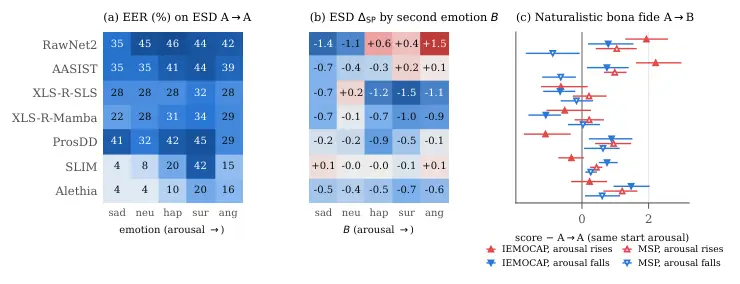
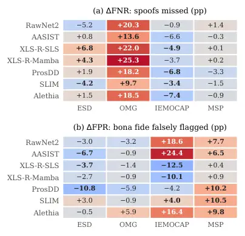

# Too Emotional to Be Fake? Intra-Utterance Emotion Shifts Expose Failure Modes in Speech Deepfake Detectors

Jingyi Chen Affiliation: Reality Defender
Email: [jingyi@realitydefender.ai](mailto:)    Surya Koppisetti
Affiliation: Reality Defender Email: [surya@realitydefender.ai](mailto:)

###### Abstract

Expressive speech synthesis can now change emotion within a single
utterance, yet its impact on deepfake detection remains unclear. We
introduce EmoShift, a benchmark comparing emotion-stable (a$`\to`$a) and
emotion-changing (a$`\to`$b) speech to examine these effects while
accounting for static emotion identity and acoustic confounds. It
comprises 7,240 bona fide utterances from four source datasets and 9,720
synthetic utterances generated using four expressive TTS systems. Across
seven detectors, we find that emotion changes can make synthetic speech
appear more genuine, increasing spoof miss rates by up to 25.3
percentage points on OMG-Emotion at fixed thresholds. Conversely,
emotion-changing bona fide speech increases false-alarm rates by up to
24.4 percentage points on IEMOCAP. Further analyses reveal
detector-specific sensitivities to emotion trajectories, not fully
explained by static emotion identity or splicing artifacts. These
findings underscore the importance of emotion dynamics in deepfake
detection.

## 1 Introduction

Emotion is rarely static in natural speech. Within a single utterance, a
speaker may shift from calm to angry, sadness to excitement, or
fluctuate between more subtle emotional states. Advances in expressive
text-to-speech (TTS) have made such dynamics possible in synthetic
speech (Chen et al., 2025; Zhou et al., 2025; Liang et al., 2026). As
synthetic voices become more expressive, we ask: _how do speech deepfake
detectors respond to emotion changes within an utterance?_

Existing benchmarks provide limited insight into this question. Standard
speech deepfake benchmarks (Wang et al., 2020; Wang and others, 2024;
Müller et al., 2022) focus primarily on the authenticity label.
Emotion-focused benchmarks such as EmoFake (Zhao et al., 2024) and
AffectDF (Mahapatra and others, 2026) evaluate detection across emotion
labels, but treat emotion primarily as an utterance-level property.
However, differences in detection performance across emotion categories
cannot reveal whether detectors are sensitive to changes in emotion
within an utterance, beyond the individual emotions being expressed.
Addressing this question requires comparing emotion-stable and
emotion-changing speech while considering other factors that may affect
detector responses.

To investigate this question, we introduce EmoShift, a benchmark
contrasting emotion-stable (a$`\to`$a) and emotion-changing (a$`\to`$b)
speech in both bona fide and synthetic audio. Evaluating both
authenticity classes allows us to examine whether emotion changes make
synthetic speech harder to detect, bona fide speech more prone to false
alarms, or both. The benchmark contains 16,960 utterances, including
7,240 bona fide utterances sourced from four publicly available datasets
and 9,720 synthetic utterances generated using four expressive TTS
systems. Our design combines controlled same-speaker, same-text
comparisons in ESD (Zhou et al., 2021) with naturally occurring
emotional variation in OMG-Emotion (Barros et al., 2018), IEMOCAP (Busso
et al., 2008), and MSP-Podcast (Lotfian and Busso, 2019).

We characterize emotion using both categorical labels (e.g., happy or
sad) and continuous valence, arousal, and dominance (VAD) annotations
(Mehrabian and Russell, 1974), representing emotional pleasantness,
activation, and perceived control. While categorical labels identify
discrete emotional states, VAD captures continuous differences in
emotion, including variation within the same category. Together, these
annotations characterize both categorical emotion changes and continuous
differences in emotional states, including their magnitude and
direction. We compare detector scores separately for bona fide and
synthetic speech, examine detection errors at fixed thresholds, and
analyze potential confounding factors.

We evaluate seven speech deepfake detectors on EmoShift and identify
distinct detection failures. On OMG-Emotion, all seven detectors assign
lower spoof scores to emotion-changing synthetic speech, increasing
spoof miss rates by 9.7–25.3 percentage points at thresholds calibrated
on emotion-stable speech (§5.1; Figure 2, Appendix Table 4). In
contrast, emotion-changing bona fide speech increases false-alarm rates
by up to 24.4 percentage points on IEMOCAP (§5.2). These effects depend
on the detector, dataset, and emotion trajectory: XLS-R-based detectors
tend to assign lower spoof scores to emotion-changing synthetic speech
on ESD and OMG-Emotion, whereas AASIST and RawNet2 respond strongly to
increasing arousal in bona fide speech (§5.3; Figure 3). Additional
analyses suggest that static emotion identity and splicing artifacts
alone do not fully explain these patterns (§5.4).

Our contributions are threefold:

- •
  We introduce EmoShift, a benchmark combining controlled and
  naturalistic comparisons of emotion-stable (a$`\to`$a) and
  emotion-changing (a$`\to`$b) bona fide and synthetic speech across
  four source datasets.
- •
  We systematically evaluate the effects of emotion changes through
  class-specific detector score shifts, fixed-threshold detection
  errors, and analyses of potential confounding factors.
- •
  We reveal detector-specific responses to emotion changes, showing that
  they can increase spoof miss rates or false-alarm rates depending on
  speech conditions and emotion trajectories.

The EmoShift benchmark and demo audio samples are available on our
project website
([https://emoshift.github.io/emoshift/](https://emoshift.github.io/emoshift/)).

## 2 Related Work

#### Benchmarks and generalization.

ASVspoof (Wang et al., 2020; Wang and others, 2024) established
EER-based evaluation on studio-controlled read speech; In-the-Wild
(Müller et al., 2022) demonstrated substantial performance degradation
on real-world recordings. Recent work highlights the challenges of
generalizing deepfake detection beyond benchmark conditions (Berisha and
others, 2025) and the limitations of EER at deployment thresholds (Firc
et al., 2026). We therefore also evaluate detection errors at fixed
thresholds.

#### Emotion and expressive attacks.

EmoFake (Zhao et al., 2024) uses emotional voice conversion to modify
the emotion of ESD utterances, while AffectDF (Mahapatra and others, 2026) evaluates emotional attacks across TTS, VC, and audio-LLM
generators. Both benchmarks primarily examine utterance-level emotion.
Recent advances in fine-grained emotion control allow synthetic speech
to change emotion within an utterance (Liang et al., 2026; Liu et al.,
2026; Chen et al., 2026), raising new questions about how deepfake
detectors respond to such changes.

#### Temporal structure within an utterance.

PartialSpoof (Zhang et al., 2023) studies temporal changes in
authenticity by embedding synthetic segments into bona fide utterances.
In contrast, our work examines temporal changes in emotion while
authenticity remains constant throughout each utterance. Prior research
has characterized emotion as a dynamic process (Russell, 1980; Kuppens
and Verduyn, 2017), but its implications for speech deepfake detection
remain underexplored.

## 3 The EmoShift Benchmark

EmoShift contains 16,960 utterances, including 7,240 bona fide
utterances constructed from four source datasets and 9,720 synthetic
utterances generated using four expressive TTS systems (Table 1). The
benchmark is organized around comparisons between emotion-stable
(a$`\to`$a) and emotion-changing (a$`\to`$b) speech in both authenticity
classes, combining controlled and naturalistic evaluation settings.

|                        |                |                   |            |                      |                    |            |         |                                     |               |
| ---------------------- | -------------- | ----------------- | ---------- | -------------------- | ------------------ | ---------- | ------- | ----------------------------------- | ------------- |
|                        | Speech         | Emotion           | Intra-utt. | Comparison           |                    | Utterances |         | Duration (s), a$`\to`$a / a$`\to`$b |               |
| Dataset                | style          | labels            | transition | design               | Generators         | Bona fide  | Spoof   | Bona fide                           | Spoof         |
| _Related benchmarks_   |                |                   |            |                      |                    |            |         |                                     |               |
| ASVspoof 2019 LA       | read           | –                 | ✗          | –                    | TTS, VC            | 12,483     | 108,978 | –                                   | –             |
| In-the-Wild            | spontaneous    | –                 | ✗          | –                    | in-the-wild        | 19,963     | 11,816  | –                                   | –             |
| PartialSpoof           | read           | –                 | ✗          | –                    | TTS, VC            | 12,483     | 108,978 | –                                   | –             |
| EmoFake                | acted          | categorical       | ✗          | –                    | EVC                | 35,000     | 72,800  | –                                   | –             |
| AffectDF               | acted + spont. | categorical       | ✗          | –                    | TTS, VC, EVC, LALM | 19,108     | 266,689 | –                                   | –             |
| EmoShift (ours)        | acted + spont. | categorical + VAD | ✓          | controlled + natural | TTS                | 7,240      | 9,720   | 10.16 / 10.33                       | 10.68 / 10.87 |
| _EmoShift composition_ |                |                   |            |                      |                    |            |         |                                     |               |
| ESD                    | acted, read    | categorical       | ✓          | same speaker & text  | I, T, H            | 800        | 2,400   | 5.69 / 5.70                         | 5.13 / 5.18   |
| OMG-Emotion            | in-the-wild    | categorical       | ✓          | separate utterances  | I, T, H            | 440        | 1,320   | 11.49 / 11.38                       | 6.89 / 7.08   |
| IEMOCAP                | dyadic         | categorical + VAD | ✓          | separate utterances  | E                  | 1,600      | 1,600   | 8.85 / 9.21                         | 10.42 / 10.91 |
| MSP-Podcast            | podcast        | categorical + VAD | ✓          | separate utterances  | E                  | 4,400      | 4,400   | 11.32 / 11.48                       | 14.95 / 15.09 |

Table 1: Comparison with related benchmarks (top) and EmoShift
composition (bottom). ESD uses same-speaker, same-text
a$`\to`$a/a$`\to`$b pairs; other datasets use separate utterances.
Generators: I = IndexTTS2, T = TED-TTS, H = HybridEmo, E = EmoTra-TTS.
Durations are mean utterance lengths (s) for a$`\to`$a/a$`\to`$b within
each class.


Figure 1: Benchmark construction. Each spoof follows the text and
emotion targets of its bona fide source. $`\Delta_{\text{BF}}`$ and
$`\Delta_{\text{SP}}`$ measure the (a$`\to`$b)–(a$`\to`$a) score
difference within each class.

### 3.1 Benchmark Construction

Each utterance contains two speech regions with emotional states
$`(e_{1},e_{2})`$. Emotion-stable (a$`\to`$a) speech maintains the same
emotion across both regions, whereas emotion-changing (a$`\to`$b) speech
changes from emotion $`A`$ to $`B`$ ($`A\neq B`$).

Constructing these comparisons poses two challenges. First, speakers
rarely produce the same utterance with different emotional trajectories
in naturally occurring speech, making matched comparisons difficult to
obtain. Second, existing public speech datasets do not readily provide
annotated within-utterance emotion changes for systematic evaluation. We
therefore combine controlled and naturalistic settings with different
levels of experimental control.

Under each setting, we construct both bona fide and synthetic speech in
the a$`\to`$a and a$`\to`$b conditions (Figure 1). Synthetic utterances
are generated using the transcripts and region-level emotion targets of
their bona fide sources.

#### Controlled: ESD.

ESD (Zhou et al., 2021) contains parallel recordings of the same
sentences in five emotions: neutral, angry, happy, sad, and surprise.
For each of 10 English speakers, we construct a$`\to`$a/a$`\to`$b pairs
by concatenating two sentences. Both versions share an identical first
recording expressing emotion $`A`$. Their second regions contain the
same sentence spoken by the same speaker, but express emotion $`A`$ in
a$`\to`$a and emotion $`B`$ in a$`\to`$b. We obtain 400 pairs, balanced
across all 20 ordered emotion transitions (20 pairs each).

#### In-the-wild: OMG-Emotion.

OMG-Emotion (Barros et al., 2018) contains emotional monologues from
online videos. We select 220 a$`\to`$a excerpts with two consecutive
utterances sharing the same emotion label, and 220 a$`\to`$b excerpts
where the label changes. All excerpts are continuous and unspliced.
Unlike ESD, a$`\to`$a and a$`\to`$b are different source utterances with
different texts.

#### Naturalistic: IEMOCAP and MSP-Podcast.

These conversational datasets provide continuous valence, arousal, and
dominance (VAD) annotations (Busso et al., 2008; Lotfian and Busso,
2019). Each example combines two speech regions from the same speaker.
We use VAD annotations to measure differences in emotional states
between the two regions, including differences within the same
categorical emotion. Specifically, we compute the Euclidean distance
$`d_{\mathrm{VAD}}`$ between their VAD vectors, with each dimension
normalized to $`[0,1]`$.

For IEMOCAP and MSP-Podcast, a$`\to`$a requires the same categorical
emotion and a small $`d_{\mathrm{VAD}}`$, while a$`\to`$b requires
different emotion categories and a large $`d_{\mathrm{VAD}}`$. The
selected ranges are 0.00–0.13 (a$`\to`$a) versus 0.84–1.09 (a$`\to`$b)
for IEMOCAP, and 0.00–0.14 versus 0.55–1.40 for MSP-Podcast. The final
subsets contain 800/800 a$`\to`$a/a$`\to`$b examples from IEMOCAP and
2,200/2,200 from MSP-Podcast. Full selection criteria are provided in
Appendix B.

#### Synthetic speech generation.

We generate spoofs using four state-of-the-art expressive TTS systems
that differ in how they control emotion. For each bona fide source, we
use its transcript and region-level emotion annotations as generation
targets. IndexTTS2 (Zhou et al., 2025) synthesizes each region
separately, conditioning on its corresponding emotion label and a
reference voice from the source speaker, before concatenating the two
outputs. TED-TTS (Liang et al., 2026) uses single-pass, segment-aware
emotion control, assigning the source emotion labels to their
corresponding text segments while conditioning on the source speaker’s
voice. HybridEmo (Zhou et al., 2026) generates the full utterance from a
natural-language instruction specifying the sequence of emotions in the
source, together with its transcript and speaker reference. We apply all
three generators to both ESD and OMG-Emotion, generating one synthetic
utterance per bona fide source with each generator.

For the naturalistic corpora, we use EmoTra-TTS (Liu et al., 2026),
built on CosyVoice 2 (Du and others, 2024), to generate speech
conditioned on source transcripts and continuous
valence–arousal–dominance (VAD) trajectories. VAD annotations from both
source regions define the target emotional trajectory, enabling
single-pass generation of emotion-stable or emotion-changing speech. All
audio is resampled to 16 kHz before scoring.

### 3.2 Addressing Potential Confounding Factors

#### Static emotion identity.

Differences between a$`\to`$a and a$`\to`$b may reflect the emotions
expressed in each region, rather than emotional change alone. In ESD, we
balance all 20 ordered transitions to maintain a balanced distribution
of starting and ending emotions. For OMG-Emotion, we compare each
a$`\to`$b synthetic sample against the average score of emotion-stable
synthetic samples expressing its starting and ending emotions, within
the same generator. This analysis examines whether static emotion
identity alone accounts for the observed score differences (§5.4).

#### Linguistic content.

We address potential linguistic-content confounds through complementary
controlled and naturalistic comparisons. In ESD, a$`\to`$a and a$`\to`$b
share the same speaker and text, with identical first-region audio,
providing a controlled comparison. In OMG-Emotion, IEMOCAP, and
MSP-Podcast, a$`\to`$a and a$`\to`$b are constructed from different
source utterances, reflecting naturally occurring emotional variation.
We analyze detector score shifts separately for bona fide and synthetic
speech and, for naturalistic bona fide speech, additionally adjust for
speaker, duration, and regional VAD annotations (Appendix D). These
complementary analyses allow us to examine emotion-related detector
responses across settings with different levels of experimental control.

#### Audio splicing.

Concatenation can introduce acoustic artifacts unrelated to emotion.
Both a$`\to`$a and a$`\to`$b use the same construction procedure within
each corpus and generator. We additionally compare spliced speech (ESD,
naturalistic bona fide speech, and IndexTTS2) with unspliced speech
(OMG-Emotion, TED-TTS, HybridEmo, and EmoTra), and examine detector
scores around known splice boundaries (§5.4).

#### Duration.

Within each dataset and authenticity class, the mean durations of
a$`\to`$a and a$`\to`$b differ by no more than 0.49 s (Table 1). These
small mean differences suggest that duration is unlikely to be the
primary driver of the observed score shifts.

## 4 Experimental Setup

### 4.1 Detectors

We evaluate seven speech deepfake detectors spanning different
architectures: RawNet2 (Tak et al., 2021) (raw waveform), AASIST (Jung
et al., 2022) (spectro-temporal graph attention), XLS-R-SLS (Zhang et
al., 2024) and XLS-R-Mamba (Xiao and Das, 2025) (self-supervised XLS-R
features; Babu et al., 2022), ProsDD (Mahapatra et al., 2026)
(prosody-aware), SLIM (Zhu et al., 2024) (style–linguistics mismatch),
and Alethia (Zhu et al., 2026) (foundation model for voice deepfakes).

All detectors are evaluated using checkpoints trained on ASVspoof 2019
LA (Wang et al., 2020) to maintain a common training benchmark. We use
publicly released checkpoints for RawNet2, AASIST, XLS-R-SLS,
XLS-R-Mamba, and ProsDD. For SLIM, a suitable ASVspoof 2019 LA
checkpoint was not available, so we fine-tuned its WavLM-Large backbone
on ASVspoof 2019 LA for five epochs. For Alethia, we obtained a
pretrained checkpoint from the model authors and fine-tuned it on
ASVspoof 2019 LA.

All audio is converted to 16 kHz mono. Each detector scores overlapping
windows at its native input length (3.0–4.2 s), with 50% overlap and the
final window aligned to the end of the utterance. The utterance-level
spoof probability is the mean of the window-level probabilities. Full
inference settings are provided in Appendix E.

### 4.2 Evaluation Protocol

#### Baseline detection performance.

We report Equal Error Rate (EER, %) to assess overall discrimination
between bona fide and synthetic speech, a widely used metric in speech
deepfake detection (Wang et al., 2020; Wang and others, 2024; Zhu et
al., 2026).

#### Emotion-induced score shifts.

To examine how within-utterance emotion changes affect detector
decisions, we compare scores between emotion-stable (a$`\to`$a) and
emotion-changing (a$`\to`$b) speech separately for bona fide and
synthetic samples. This distinction allows us to determine whether
emotion changes make synthetic speech appear more genuine or bona fide
speech appear more synthetic.

Let $`p(x)`$ be the utterance-level spoof probability, with higher
values indicating more spoof-like speech. To capture differences near
probability extremes, we use the logit score
$`s(x)=\log\frac{p(x)}{1-p(x)}`$, with $`p(x)`$ clipped to
$`[10^{-6},1-10^{-6}]`$. We define

```math
\displaystyle\Delta_{\mathrm{SP}} \displaystyle=\bar{s}_{\mathrm{SP}}(\textsc{a$\to$b})-\bar{s}_{\mathrm{SP}}(\textsc{a$\to$a}), \tag{1}
```

```math
\displaystyle\Delta_{\mathrm{BF}} \displaystyle=\bar{s}_{\mathrm{BF}}(\textsc{a$\to$b})-\bar{s}_{\mathrm{BF}}(\textsc{a$\to$a}),
```

where $`\bar{s}_{\mathrm{SP}}`$ and $`\bar{s}_{\mathrm{BF}}`$ are the
mean logit scores of synthetic and bona fide speech, respectively.
Negative shifts indicate lower spoof scores for a$`\to`$b, while
positive shifts indicate higher scores.

For ESD, we compute differences within matched a$`\to`$a/a$`\to`$b pairs
and average them. For the other datasets, where a$`\to`$a and a$`\to`$b
use separate source utterances, we subtract the mean score of all
a$`\to`$a samples from that of all a$`\to`$b samples within each
authenticity class. These score shifts are reported in Figure 2.

We additionally examine $`\Delta_{\mathrm{SP}}-\Delta_{\mathrm{BF}}`$ to
assess changes in the mean score separation between bona fide and
synthetic speech (Appendix Table 4).

|             | ESD                    |                        | OMG-Emotion            |                        | IEMOCAP                |                        | MSP-Podcast            |                        |
| ----------- | ---------------------- | ---------------------- | ---------------------- | ---------------------- | ---------------------- | ---------------------- | ---------------------- | ---------------------- |
|             | _controlled_           |                        | _in-the-wild_          |                        | _naturalistic_         |                        |                        |                        |
| Detector    | $`\Delta_{\text{SP}}`$ | $`\Delta_{\text{BF}}`$ | $`\Delta_{\text{SP}}`$ | $`\Delta_{\text{BF}}`$ | $`\Delta_{\text{SP}}`$ | $`\Delta_{\text{BF}}`$ | $`\Delta_{\text{SP}}`$ | $`\Delta_{\text{BF}}`$ |
| RawNet2     | +0.01                  | −0.28                  | −3.25                  | +0.10                  | +0.09                  | +1.54                  | +0.03                  | +0.13                  |
| AASIST      | −0.22                  | −0.50                  | −1.64                  | −0.15                  | +0.25                  | +1.66                  | −0.02                  | +0.23                  |
| XLS-R-SLS   | −0.85                  | −0.42                  | −2.64                  | −0.03                  | +0.49                  | −0.60                  | −0.04                  | 0.00                   |
| XLS-R-Mamba | −0.67                  | −0.08                  | −2.47                  | +0.30                  | +0.39                  | −0.75                  | −0.02                  | +0.11                  |
| ProsDD      | −0.37                  | −0.56                  | −2.02                  | −0.57                  | +0.57                  | −0.27                  | +0.14                  | +0.83                  |
| SLIM        | +0.02                  | +0.23                  | −0.46                  | +0.02                  | +0.32                  | +0.14                  | 0.00                   | +0.39                  |
| Alethia     | −0.52                  | +0.23                  | −2.03                  | −0.35                  | +0.99                  | +0.79                  | +0.06                  | +0.92                  |

Figure 2: Detector score shifts from emotion-stable (a$`\to`$a) to
emotion-changing (a$`\to`$b) speech. _Left:_ mean logit score
differences for synthetic ($`\Delta_{\mathrm{SP}}`$) and bona fide
($`\Delta_{\mathrm{BF}}`$) speech; bold indicates 95% CIs excluding
zero. _Right:_ corresponding score shifts with 95% CIs (filled:
synthetic; hollow: bona fide). Negative values indicate lower spoof
scores for a$`\to`$b. Grey indicates pooled EER above 50% (Table 3).
Additional results are in Appendix Table 4.

#### Detection errors.

We compare EER between a$`\to`$a and a$`\to`$b to assess changes in
overall detection performance. However, EER allows the decision
threshold to vary between conditions, potentially obscuring changes in
errors at a fixed operating point. We therefore calibrate a threshold at
the EER point on a$`\to`$a speech and apply it unchanged to a$`\to`$b.
We report changes in false-negative rate ($`\Delta`$FNR; synthetic
speech incorrectly flagged as bonafide) and false-positive rate
($`\Delta`$FPR; bona fide speech incorrectly flagged as synthetic), in
percentage points (a$`\to`$b minus a$`\to`$a).

#### Emotion and splicing analyses.

We examine individual emotion transitions in ESD and arousal changes in
naturalistic speech to characterize how detector responses vary with
emotional trajectories (§5.3). We also compare spliced and jointly
generated speech and analyze scores around known splice boundaries to
examine potential effects of concatenation artifacts (§5.4).

#### Statistical uncertainty.

We estimate uncertainty in detector score shifts using 1,000 bootstrap
resamples of utterances, separately within each dataset and authenticity
class. For datasets with speaker IDs, we resample speakers with
replacement, retaining their utterances and a$`\to`$a/a$`\to`$b
assignments. We recompute score shifts for each resample and report 95%
bootstrap confidence intervals. A shift is considered statistically
significant when its confidence interval excludes zero.

## 5 Results

Figure 2 summarizes how within-utterance emotion changes affect detector
scores across four datasets. We examine synthetic speech, followed by
bona fide speech, before investigating emotion-specific responses and
alternative explanations.

Baseline detection performance varies substantially across datasets. On
OMG-Emotion, SLIM and ProsDD have EERs above 50%, while EERs on ESD
range from 13.0% to 43.2%. On IEMOCAP and MSP-Podcast, most detectors
have EERs above 50%. Full baseline results are provided in Appendix
Table 3. These baseline differences provide context for interpreting the
score shifts below.

### 5.1 How Do Emotion Transitions Affect Synthetic Speech Detection?

#### Categorical emotion transitions.

On OMG-Emotion, all seven detectors assign significantly lower spoof
scores to emotion-changing (a$`\to`$b) than to emotion-stable
(a$`\to`$a) synthetic speech, while bona fide scores remain largely
unchanged (Figure 2). This indicates that emotional transitions make
synthetic speech appear more genuine to the detectors, without similarly
affecting their judgments of real speech. At thresholds fixed on
a$`\to`$a, spoof miss rates increase by 9.7–25.3 percentage points
(Appendix Table 4). Thus, detectors miss more transitioning deepfakes at
the same threshold.

A similar pattern appears on ESD, where a$`\to`$a and a$`\to`$b share
the same speaker and text, allowing a more controlled comparison. Five
of the seven detectors assign lower spoof scores to a$`\to`$b, making
transitioning synthetic speech appear more genuine. For XLS-R-SLS and
XLS-R-Mamba, spoof miss rates increase by 6.8 and 4.3 percentage points,
respectively, while EER changes are small and not statistically
significant ($`+1.1`$ and $`+1.6`$ points). This shows that EER alone
may not capture the increased risk of missed transitioning deepfakes.

#### Continuous VAD-based transitions.

A different pattern emerges on IEMOCAP and MSP-Podcast, where emotional
transitions are selected using continuous valence, arousal, and
dominance (VAD) annotations. On IEMOCAP, six of the seven detectors
assign significantly higher spoof scores to a$`\to`$b, making
transitioning synthetic speech appear more fake rather than more
genuine. On MSP-Podcast, spoof scores remain nearly unchanged across all
seven detectors, although ProsDD, SLIM, and Alethia assign significantly
higher spoof scores to transitioning bona fide speech, as discussed in
the next section.

Unlike categorical transitions in ESD and OMG-Emotion, VAD-based
transitions do not consistently make synthetic speech harder to detect.
These differences may reflect differences in emotion conditioning,
synthesis methods, or source characteristics.

### 5.2 How Do Detectors Respond to Genuine Emotion Transitions?

Emotion transitions also change how detectors score bona fide speech,
but the direction varies across models and corpora.

On ESD, SLIM assigns significantly higher spoof scores to transitioning
bona fide speech ($`\Delta_{\mathrm{BF}}=+0.23`$). A similar effect
appears on IEMOCAP, where AASIST and RawNet2 increase bona fide spoof
scores by $`+1.66`$ and $`+1.54`$, respectively. At fixed thresholds,
this corresponds to 18.6–24.4 percentage points of more false alarms.

On MSP-Podcast, ProsDD, SLIM, and Alethia also assign significantly
higher spoof scores to genuine transitions ($`+0.83`$, $`+0.39`$, and
$`+0.92`$, respectively). To assess whether these effects persist after
accounting for differences in speaker, duration, and regional VAD, we
perform an adjusted analysis. SLIM and Alethia continue to show positive
score shifts on both IEMOCAP and MSP-Podcast (Appendix Table 5).

In contrast, the XLS-R detectors assign lower spoof scores to
transitioning bona fide speech on IEMOCAP. This effect persists after
adjustment, with score shifts of $`-0.60`$ for XLS-R-SLS and $`-0.82`$
for XLS-R-Mamba (Appendix Table 5). For both XLS-R detectors, synthetic
speech shifts in the opposite direction, increasing the mean score
separation between bona fide and synthetic speech (Figure 2). EER
decreases from 48.6% to 39.7% for XLS-R-SLS, and from 59.0% to 52.5% for
XLS-R-Mamba, although only the former change is statistically
significant (Appendix Table 4).

Overall, genuine emotion transitions affect detectors differently. Some
assign higher spoof scores to transitioning real speech, while others
assign lower scores. These differences show that the effect of emotional
change depends on the detector and the speech conditions. For deployment
in the wild, detector algorithms need a systematic redesign to be robust
to emotional change within an utterance.



Figure 3: Emotion-specific detector responses. (a) EER on emotion-stable
(a$`\to`$a) ESD speech by emotion. (b) ESD spoof score shifts by
destination emotion. (c) Bona fide spoof score shifts for transitions
with increasing or decreasing arousal, relative to stable speech with
similar starting arousal. Positive values indicate higher spoof scores
for transitioning bona fide speech. Error bars show 95% bootstrap CIs.

### 5.3 Why Do Detectors Respond Differently?

The preceding results show that emotional transitions affect synthetic
and genuine speech differently across detectors. We further investigate
whether these effects depend on the specific emotion trajectory. We use
ESD to examine destination emotions under controlled conditions, and
IEMOCAP and MSP-Podcast to study changes in arousal using continuous VAD
annotations.

#### Sensitivity to individual emotions.

Even without emotion transitions, detection performance varies across
emotions (Figure 3a). Surprise generally yields higher EERs, while sad
and neutral speech yield lower EERs. This is especially pronounced for
SLIM, whose EER rises from 4% on sad speech to 42% on surprise, and
Alethia, whose EER rises from 4% to 20%. However, this pattern is not
universal: ProsDD performs best on angry speech, while XLS-R detectors
show smaller differences across emotions.

#### The destination emotion matters.

On ESD, the XLS-R detectors consistently assign lower spoof scores to
transitions ending in non-neutral emotions (Figure 3b). For XLS-R-SLS,
shifts range from $`-0.7`$ to $`-1.5`$, compared with $`+0.2`$ for
neutral.

RawNet2 and AASIST show a different pattern: spoof scores tend to
decrease for sad and neutral endpoints but increase for more arousing
emotions. For RawNet2, shifts range from $`-1.4`$ for sadness to
$`+1.5`$ for anger. These opposing shifts largely cancel, explaining its
near-zero overall score change on ESD ($`+0.01`$).

Among other detectors, ProsDD shows larger reductions for happy and
surprise, Alethia shows negative shifts across all endpoints, and SLIM
remains close to zero across destination emotions.

#### The direction of arousal change matters.

Figure 3c shows that detector score shifts differ between increasing and
decreasing arousal, with patterns varying across detectors and datasets.
We distinguish directions using the arousal difference between the
second and first regions.

RawNet2 and AASIST show particularly consistent responses across the two
naturalistic datasets. On IEMOCAP, compared with emotion-stable speech
with similar starting arousal, their spoof scores increase by $`+1.9`$
and $`+2.2`$ logits, respectively, when arousal increases. When arousal
decreases, the increases are smaller ($`+0.8`$ for both). A similar
pattern appears on MSP-Podcast.

We further examine the relationship between arousal and detector scores
within individual utterances (Appendix D). Only RawNet2 and AASIST show
consistently positive associations between arousal changes and spoof
scores across both datasets. Together, these findings reveal broader
detector-specific sensitivities to arousal direction, with RawNet2 and
AASIST showing the most consistent tendency to assign higher spoof
scores to increasing arousal in bona fide speech.

### 5.4 Are the Effects Explained by Emotion Identity or Splicing?

#### Emotion identity.

As shown above, detector performance varies across individual emotions.
We therefore examine whether the score shifts between a$`\to`$a and
a$`\to`$b are caused by the emotions present, rather than by the
transition itself.

On ESD, all 20 ordered emotion transitions are balanced, with each
emotion appearing equally often in both regions. Despite this balance,
five detectors assign significantly lower spoof scores to a$`\to`$b
(Figure 2), suggesting that differences in emotion frequency alone
cannot explain the effect.

On OMG-Emotion, we further account for the starting and ending emotions
of each transition. For an a$`\to`$b spoof, we compare its score with
the average scores of stable-emotion spoofs expressing emotion $`A`$
(a$`\to`$a) and emotion $`B`$ ($`B\to B`$), using samples from the same
generator. These controls are grouped by emotion rather than matched by
text. After this comparison, all seven detectors still assign
significantly lower scores to transitioning spoofs ($`-0.41`$ to
$`-3.42`$). These results suggest that the lower spoof scores cannot be
explained solely by the emotions present in the speech.

#### Splicing artifacts.

Some benchmark utterances are constructed by concatenating two speech
segments, which may introduce acoustic artifacts unrelated to emotion
transitions. We examine whether these artifacts could explain the
observed score shifts in both synthetic and bona fide speech.

For synthetic speech, IndexTTS2 generates and concatenates two segments,
whereas TED-TTS and HybridEmo generate complete utterances without
splicing. On OMG-Emotion, all three generators show significantly lower
spoof scores for a$`\to`$b than for a$`\to`$a across nearly all
detectors (7/7 for IndexTTS2, 6/7 for TED-TTS, and 7/7 for HybridEmo).
On ESD, the jointly generated TED-TTS shows significant score reductions
for more detectors than the spliced IndexTTS2 (5/7 versus 3/7). These
results (Appendix Figure 5a) show that spoof score reductions do not
require splicing.

For bona fide speech, ESD uses the same concatenation procedure for
a$`\to`$a and a$`\to`$b, yet score differences remain. We further
examine IEMOCAP and MSP-Podcast by comparing scores from windows
containing the splice boundary with other windows in the same utterance.
Alethia, SLIM, and ProsDD assign higher spoof scores to splice-boundary
windows, while unspliced EmoTra spoofs show little change at the
corresponding position. However, the boundary effect is similar for bona
fide a$`\to`$a and a$`\to`$b. For example, Alethia shows increases of
$`+4.5`$ and $`+4.7`$ logits, respectively, on MSP-Podcast (Appendix
Figure 5). Thus, splicing affects local detector scores, but has similar
effects on emotion-stable (a$`\to`$a) and emotion-changing (a$`\to`$b)
speech and thus cannot fully explain the differences between conditions.

## 6 Discussion

#### Emotional variation can reduce spoof detectability.

A notable finding is that emotion changes can make synthetic speech
appear more genuine to deepfake detectors. On ESD and OMG-Emotion,
several detectors assign lower spoof scores to emotion-changing
synthetic speech, even though the speech remains synthetic. This
suggests that some emotion-related acoustic patterns may overlap with
features associated with bona fide speech. These score shifts are also
associated with increased spoof miss rates at fixed detection
thresholds, highlighting a potential risk in deployment.

#### The effect depends on how emotions change and how they are synthesized.

The contrast between categorical and continuous VAD-based transitions is
particularly informative. Strong spoof score reductions occur in ESD and
OMG-Emotion, whereas naturalistic corpora show smaller or opposite
shifts. Moreover, the same XLS-R detectors that assign lower scores to
transitioning spoofs on ESD and OMG-Emotion can show improved class
separation on IEMOCAP. One possible explanation is that emotion-related
acoustic cues may have different distributions in bona fide and
synthetic speech, leading to different detector responses. Consistent
with this possibility, our emotion-specific analyses reveal that XLS-R
responses vary with destination emotion, while RawNet2 and AASIST show
associations with arousal direction. These observations suggest that the
effect of a transition depends on both the detector and how the
emotional change is realized.

#### Implications for deepfake detection.

Most emotion-aware evaluations characterize speech using utterance-level
emotion labels, which do not capture emotion changes occurring within an
utterance. Our findings show that these temporal changes can affect
detector scores and error rates in ways that are not fully explained by
static emotion identity or splicing artifacts. Evaluating both
categorical transitions and continuous VAD trajectories provides a more
complete view of detector behavior. In addition, fixed-threshold
evaluation is important because increases in missed spoofs or false
alarms may be less apparent from EER alone. Future detectors would
benefit from training and evaluation data that include emotional
transitions in both bona fide and synthetic speech, rather than treating
emotion as a static utterance-level property.

## 7 Conclusion

We introduced EmoShift, a benchmark evaluating the effects of
categorical and continuous VAD-based emotion transitions on speech
deepfake detection. We find that transitions can increase missed spoofs
even with small EER changes, while genuine transitions also shift scores
depending on the detector and emotion trajectory. These effects are not
fully explained by static emotion identity or splicing artifacts,
highlighting within-utterance emotion dynamics as an important
evaluation dimension for speech deepfake detection.

## Limitations

Our evaluation covers four source datasets, multiple synthesis methods,
and seven deepfake detectors, providing complementary controlled and
naturalistic settings. As with any benchmark, the observed effects
reflect the speech conditions and synthesis systems included in the
evaluation. The categorical and VAD-based settings also differ in their
generation methods, so their individual contributions cannot be
isolated. In the naturalistic datasets, bona fide and synthetic speech
differ in their construction procedures, which may affect cross-class
detection metrics. Our primary analyses compare emotion-stable and
emotion-changing speech within each authenticity class, reducing this
potential confound. Future work can extend EmoShift to additional
languages, synthesis systems, and emotion trajectories to further assess
the generalizability of these findings.

## Ethics Statement

This work investigates how emotional changes in speech affect the
reliability of audio deepfake detection systems. The benchmark is
intended to support the development and evaluation of more robust
detection methods, particularly for emotionally expressive speech.

Our experiments use established speech corpora and synthetic audio
generated for research evaluation. We follow applicable dataset access
and usage conditions and report results at the aggregate level. The
study does not involve deploying synthetic speech for impersonation or
deception. We hope the findings will contribute to more reliable and
responsible audio authenticity assessment.

## References

- Babu et al. (2022) A. Babu, C. Wang, A. Tjandra, K. Lakhotia, Q.
  Xu, N. Goyal, K. Singh, P. von Platen, Y. Saraf, J. Pino, A.
  Baevski, A. Conneau, and M. Auli XLS-R: self-supervised cross-lingual
  speech representation learning at scale. In Proc. Interspeech, Cited
  by: §4.1.
- Barros et al. (2018) P. Barros, N. Churamani, E. Lakomkin, H.
  Siqueira, A. Sutherland, and S. Wermter The OMG-emotion behavior
  dataset. In Proc. International Joint Conference on Neural Networks
  (IJCNN), Cited by: §1, §3.1.
- Berisha et al. (2025) V. Berisha et al. Why speech deepfake detectors
  won’t generalize: the limits of detection in an open world. arXiv
  preprint arXiv:2509.20405. Cited by: §2.
- Busso et al. (2008) C. Busso, M. Bulut, C. Lee, A. Kazemzadeh, E.
  Mower, S. Kim, J. N. Chang, S. Lee, and S. S. Narayanan IEMOCAP:
  interactive emotional dyadic motion capture database. Language
  Resources and Evaluation 42 (4). Cited by: §1, §3.1.
- Chen et al. (2025) J. Chen, J. S. Byun, M. Elsner, P. Wang, and A.
  Perrault Fine-tuning text-to-speech diffusion models using
  reinforcement learning with human feedback. In Interspeech 2025,
  pp. 3454–3458. External Links:
  [Document](https://dx.doi.org/10.21437/Interspeech.2025-63) Cited by:
  §1.
- Chen et al. (2026) J. Chen, Z. Guo, J. Chun, P. Wang, A. Perrault,
  and M. Elsner Do audio LLMs really LISTEN, or just transcribe?
  measuring lexical vs. acoustic emotion cues reliance. In Proceedings
  of the 19th Conference of the European Chapter of the Association for
  Computational Linguistics (Volume 1: Long Papers), pp. 5848–5877.
  External Links:
  [Document](https://dx.doi.org/10.18653/v1/2026.eacl-long.274),
  [Link](https://aclanthology.org/2026.eacl-long.274/) Cited by: §2.
- Du et al. (2024) Z. Du et al. CosyVoice 2: scalable streaming speech
  synthesis with large language models. arXiv preprint arXiv:2412.10117.
  Cited by: §3.1.
- Firc et al. (2026) A. Firc, K. Malinka, V. Staněk, M. Hlav́áček, and M.
  Bartoň The last mile of deepfake speech detection: an
  industry–academia experience report. arXiv preprint arXiv:2608.17585.
  Cited by: §2.
- Jung et al. (2022) J. Jung, H. Heo, H. Tak, H. Shim, J. S. Chung, B.
  Lee, H. Yu, and N. Evans AASIST: audio anti-spoofing using integrated
  spectro-temporal graph attention networks. In Proc. ICASSP, Cited by:
  §4.1.
- Kuppens and Verduyn (2017) P. Kuppens and P. Verduyn Emotion dynamics.
  Current Opinion in Psychology 17. Cited by: §2.
- Liang et al. (2026) Q. Liang, Y. Liu, R. Wei, N. Lu, J. Zhao, and Y.
  Wang TED-TTS: training-free intra-utterance emotion and duration
  control for text-to-speech synthesis. arXiv preprint arXiv:2601.03170.
  Cited by: §1, §2, §3.1.
- Liu et al. (2026) T. Liu, Z. Song, T. Wang, Z. Li, C. Xu, and Y. Guo
  EmoTra-tts: smooth intra-utterance emotion transitions for speech
  synthesis. External Links: 2608.23791,
  [Link](https://arxiv.org/abs/2608.23791) Cited by: §2, §3.1.
- Lotfian and Busso (2019) R. Lotfian and C. Busso Building naturalistic
  emotionally balanced speech corpus by retrieving emotional speech from
  existing podcast recordings. IEEE Transactions on Affective Computing
  10 (4). Cited by: §1, §3.1.
- Mahapatra et al. (2026) A. Mahapatra et al. AffectDF: the most
  comprehensive benchmark for speech deepfake detection against
  emotionally expressive attacks. arXiv preprint arXiv:2608.05507. Cited
  by: §1, §2.
- Mahapatra et al. (2026) A. Mahapatra, I. R. Ulgen, K. A. Lee, N.
  Andrews, and B. Sisman ProSDD: learning prosodic representations for
  speech deepfake detection against expressive and emotional attacks.
  arXiv preprint arXiv:2604.13229. Cited by: §4.1.
- Mehrabian and Russell (1974) A. Mehrabian and J. A. Russell The basic
  emotional impact of environments. Perceptual and Motor Skills 38 (1),
  pp. 283–301. External Links:
  [Document](https://dx.doi.org/10.2466/pms.1974.38.1.283) Cited by: §1.
- Müller et al. (2022) N. M. Müller, P. Czempin, F. Dieckmann, A.
  Froghyar, and K. Böttinger Does audio deepfake detection generalize?.
  In Proc. Interspeech, Cited by: §1, §2.
- Russell (1980) J. A. Russell A circumplex model of affect. Journal of
  Personality and Social Psychology 39 (6). Cited by: §2.
- Tak et al. (2021) H. Tak, J. Patino, M. Todisco, A. Nautsch, N. Evans,
  and A. Larcher End-to-end anti-spoofing with RawNet2. In Proc. ICASSP,
  Cited by: §4.1.
- Wang et al. (2024) X. Wang et al. ASVspoof 5: crowdsourced speech
  data, deepfakes, and adversarial attacks at scale. In Proc. ASVspoof
  2024 Workshop, Cited by: §1, §2, §4.2.
- Wang et al. (2020) X. Wang, J. Yamagishi, M. Todisco, H. Delgado, A.
  Nautsch, N. Evans, M. Sahidullah, V. Vestman, T. Kinnunen, K. A. Lee,
  et al. ASVspoof 2019: a large-scale public database of synthesized,
  converted and replayed speech. Computer Speech & Language 64. Cited
  by: §1, §2, §4.1, §4.2.
- Xiao and Das (2025) Y. Xiao and R. K. Das XLSR-Mamba: a dual-column
  bidirectional state space model for spoofing attack detection. IEEE
  Signal Processing Letters. Cited by: §4.1.
- Zhang et al. (2023) L. Zhang, X. Wang, E. Cooper, N. Evans, and J.
  Yamagishi The PartialSpoof database and countermeasures for the
  detection of short fake speech segments embedded in an utterance.
  IEEE/ACM Transactions on Audio, Speech, and Language Processing 31.
  Cited by: §2.
- Zhang et al. (2024) Q. Zhang, S. Wen, and T. Hu Audio deepfake
  detection with self-supervised XLS-R and SLS classifier. In Proc. ACM
  International Conference on Multimedia, Cited by: §4.1.
- Zhao et al. (2024) Y. Zhao, J. Yi, J. Tao, et al. EmoFake: an initial
  dataset for emotion fake audio detection. In Proc. National Conference
  on Man-Machine Speech Communication (NCMMSC), Cited by: §1, §2.
- Zhou et al. (2021) K. Zhou, B. Sisman, R. Liu, and H. Li Seen and
  unseen emotional style transfer for voice conversion with a new
  emotional speech dataset. In Proc. ICASSP, Cited by: §1, §3.1.
- Zhou et al. (2025) S. Zhou, Y. Zhou, Y. He, X. Zhou, J. Wang, W. Deng,
  and J. Shu IndexTTS2: a breakthrough in emotionally expressive and
  duration-controlled auto-regressive zero-shot text-to-speech. arXiv
  preprint arXiv:2506.21619. Cited by: §1, §3.1.
- Zhou et al. (2026) Y. Zhou, Y. Hong, and Y. Feng Sequential
  trajectories and simultaneous blending: multi-emotion modeling for
  instruction-following tts. External Links: 2608.30325,
  [Link](https://arxiv.org/abs/2608.30325) Cited by: §3.1.
- Zhu et al. (2026) Y. Zhu, B. Dwivedi, J. Raghuram, and S. Koppisetti
  Alethia: a foundational encoder for voice deepfakes. In Proceedings of
  the 43rd International Conference on Machine Learning, Proceedings of
  Machine Learning Research, Vol. 306, pp. 166939–166961. External
  Links: [Link](https://proceedings.mlr.press/v306/zhu26l.html) Cited
  by: §4.1, §4.2.
- Zhu et al. (2024) Y. Zhu, S. Koppisetti, T. Tran, and G. Bharaj SLIM:
  style-linguistics mismatch model for generalized audio deepfake
  detection. In Advances in Neural Information Processing Systems
  (NeurIPS), Cited by: §4.1.

## Appendix A Dataset Licenses and Usage Conditions

We use four existing speech corpora under their respective licenses and
usage agreements. The necessary permissions have been obtained for the
use and distribution of the benchmark artifacts released in this work.

#### ESD.

The Emotional Speech Dataset (ESD) is distributed for research use under
a dataset-specific license agreement, separate from the repository’s MIT
license.

#### OMG-Emotion.

OMG-Emotion is distributed under CC BY-NC-SA 3.0 DE, subject to
additional research-use and redistribution conditions.

#### IEMOCAP.

IEMOCAP is provided by USC SAIL under a non-transferable research
license. Its use and redistribution are governed by the applicable
licensing agreement and permissions.

#### MSP-Podcast.

MSP-Podcast is distributed by UT Dallas under academic and commercial
licensing agreements. Its use and redistribution are subject to the
applicable agreement and source recording rights.

## Appendix B Benchmark Details

#### Benchmark distribution.

EmoShift includes both bona fide and synthetically generated speech
derived from these resources. The original datasets retain their
respective licensing and usage conditions. Any redistribution of
benchmark audio must comply with the applicable permissions for the
underlying data and generated artifacts.

#### Selection of naturalistic emotion changes.

For IEMOCAP and MSP-Podcast, we characterize emotional differences
between two speech regions using the Euclidean distance between their
normalized valence, arousal, and dominance (VAD) annotations. Each VAD
dimension is normalized to $`[0,1]`$.

We construct emotion-stable (a$`\to`$a) speech from regions sharing the
same categorical emotion with small VAD distances, and emotion-changing
(a$`\to`$b) speech from regions with different categorical emotions and
large VAD distances. Table 2 reports the selection thresholds and the
distributions of VAD distances in the final subsets. The selected
a$`\to`$a and a$`\to`$b conditions have non-overlapping VAD distance
ranges in both datasets.

|             |           | Selection threshold |                    | Selected $`d_{\text{VAD}}`$ |        |             |
| ----------- | --------- | ------------------- | ------------------ | --------------------------- | ------ | ----------- |
| Dataset     | Cond.     | a$`\to`$a $`\leq`$  | a$`\to`$b $`\geq`$ | Mean                        | Median | Range       |
| IEMOCAP     | a$`\to`$a | 0.1816              | 0.6305             | 0.033                       | 0.000  | 0.000–0.125 |
|             | a$`\to`$b |                     |                    | 0.958                       | 0.972  | 0.839–1.087 |
| MSP-Podcast | a$`\to`$a | 0.1414              | 0.5509             | 0.076                       | 0.075  | 0.000–0.141 |
|             | a$`\to`$b |                     |                    | 0.690                       | 0.626  | 0.551–1.397 |

Table 2: VAD-based selection of naturalistic speech.
$`d_{\mathrm{VAD}}`$ denotes the Euclidean distance between the
normalized VAD vectors of two speech regions. Selection thresholds
define candidate pools; the final selected samples show stronger
separation, with non-overlapping a$`\to`$a and a$`\to`$b distance
ranges.

## Appendix C Full Detection Results

#### Baseline detection performance.

Table 3 reports the pooled equal error rate (EER) and area under the ROC
curve (AUC) for each detector and dataset, combining a$`\to`$a and
a$`\to`$b speech. Grey shading identifies detector–dataset combinations
with pooled EER above 50%, indicating inverted score rankings. These
baseline results provide context for interpreting subsequent score
shifts and detection errors.

|                            |      |      |         |      |
| -------------------------- | ---- | ---- | ------- | ---- |
| Detector                   | ESD  | OMG  | IEMOCAP | MSP  |
| _EER (%), lower is better_ |      |      |         |      |
| RawNet2                    | 43.2 | 35.9 | 62.4    | 81.4 |
| AASIST                     | 39.4 | 35.7 | 58.9    | 86.3 |
| XLS-R-SLS                  | 30.4 | 41.4 | 44.2    | 50.9 |
| XLS-R-Mamba                | 29.1 | 45.7 | 55.6    | 56.5 |
| ProsDD                     | 36.6 | 56.2 | 56.8    | 53.5 |
| SLIM                       | 20.5 | 73.0 | 84.4    | 76.1 |
| Alethia                    | 13.0 | 42.3 | 65.6    | 59.3 |
| _AUC, higher is better_    |      |      |         |      |
| RawNet2                    | 0.60 | 0.66 | 0.27    | 0.11 |
| AASIST                     | 0.65 | 0.69 | 0.34    | 0.07 |
| XLS-R-SLS                  | 0.77 | 0.63 | 0.58    | 0.48 |
| XLS-R-Mamba                | 0.78 | 0.58 | 0.45    | 0.40 |
| ProsDD                     | 0.69 | 0.41 | 0.40    | 0.47 |
| SLIM                       | 0.87 | 0.22 | 0.13    | 0.22 |
| Alethia                    | 0.95 | 0.62 | 0.32    | 0.42 |

Table 3: Baseline detection per corpus, pooling a$`\to`$a and a$`\to`$b.
Grey: EER above 50% (equivalently, AUC below 0.5 for every cell here),
i.e., the detector ranks bona fide speech as more spoof-like than spoofs
in most bona fide–spoof pairs.

#### Emotion-induced detection errors.

Figure 4 summarizes changes in false-negative and false-positive rates
between emotion-stable and emotion-changing speech, using thresholds
calibrated at the EER operating point on a$`\to`$a. The same threshold
is applied to a$`\to`$b, allowing us to examine changes in detection
errors without recalibrating for emotional transitions.



Figure 4: Changes in detection errors from a$`\to`$a to a$`\to`$b at
thresholds calibrated on a$`\to`$a speech. Values are in percentage
points. Positive changes indicate higher error rates for
emotion-changing speech. Bold indicates 95% bootstrap confidence
intervals excluding zero.

#### Complete detector comparisons.

Table 4 provides the complete results for all seven detectors across the
four datasets. For each detector, we report the mean score shifts for
synthetic ($`\Delta_{\mathrm{SP}}`$) and bona fide
($`\Delta_{\mathrm{BF}}`$) speech, their difference
($`\Delta_{\mathrm{SP}}-\Delta_{\mathrm{BF}}`$), EER under a$`\to`$a and
a$`\to`$b, and changes in false-negative and false-positive rates at the
fixed a$`\to`$a threshold.

The difference $`\Delta_{\mathrm{SP}}-\Delta_{\mathrm{BF}}`$ describes
the change in signed mean score separation between the two authenticity
classes. It complements, rather than replaces, the EER and
fixed-threshold error measurements.

|         |                 |                          |                        |                                             |                             |                      |               |
| ------- | --------------- | ------------------------ | ---------------------- | ------------------------------------------- | --------------------------- | -------------------- | ------------- |
|         |                 | Score difference (logit) |                        |                                             | EER (%)                     | Fixed threshold (pp) |               |
|         | Detector        | $`\Delta_{\text{SP}}`$   | $`\Delta_{\text{BF}}`$ | $`\Delta_{\text{SP}}{-}\Delta_{\text{BF}}`$ | a$`\to`$a $`\to`$ a$`\to`$b | $`\Delta`$FNR        | $`\Delta`$FPR |
| ESD     | RawNet2         | +0.01                    | −0.28                  | +0.28                                       | 45.2 $`\to`$ 40.8           | −5.2                 | −3.0          |
|         | AASIST          | −0.22                    | −0.50                  | +0.28                                       | 41.0 $`\to`$ 38.2           | +0.8                 | −6.7          |
|         | XLS-R-SLS       | −0.85                    | −0.42                  | −0.43                                       | 28.7 $`\to`$ 29.8           | +6.8                 | −3.7          |
|         | XLS-R-Mamba     | −0.67                    | −0.08                  | −0.59                                       | 29.2 $`\to`$ 30.8           | +4.3                 | −2.7          |
|         | ProsDD          | −0.37                    | −0.56                  | +0.19                                       | 39.2 $`\to`$ 34.5           | +1.9                 | −10.8         |
|         | SLIM            | +0.02                    | +0.23                  | −0.22                                       | 20.5 $`\to`$ 20.2           | −4.2                 | +3.0          |
|         | Alethia         | −0.52                    | +0.23                  | −0.75                                       | 12.8 $`\to`$ 13.4           | +1.5                 | −0.5          |
| OMG     | RawNet2         | −3.25                    | +0.10                  | −3.35                                       | 31.8 $`\to`$ 41.4           | +20.3                | −3.2          |
|         | AASIST          | −1.64                    | −0.15                  | −1.48                                       | 32.7 $`\to`$ 39.9           | +13.6                | −0.9          |
|         | XLS-R-SLS       | −2.64                    | −0.03                  | −2.61                                       | 35.9 $`\to`$ 45.5           | +22.0                | −1.4          |
|         | XLS-R-Mamba     | −2.47                    | +0.30                  | −2.77                                       | 38.7 $`\to`$ 53.2           | +25.3                | −0.9          |
|         | ProsDD^(†)      | −2.02                    | −0.57                  | −1.45                                       | 54.5 $`\to`$ 60.9           | +18.2                | −5.9          |
|         | SLIM^(†)        | −0.46                    | +0.02                  | −0.48                                       | 70.1 $`\to`$ 75.9           | +9.7                 | −0.9          |
|         | Alethia         | −2.03                    | −0.35                  | −1.67                                       | 36.4 $`\to`$ 46.4           | +18.5                | +5.9          |
| IEMOCAP | RawNet2^(†)     | +0.09                    | +1.54                  | −1.45                                       | 60.5 $`\to`$ 65.5           | −0.9                 | +18.6         |
|         | AASIST^(†)      | +0.25                    | +1.66                  | −1.41                                       | 53.2 $`\to`$ 67.6           | −6.6                 | +24.4         |
|         | XLS-R-SLS       | +0.49                    | −0.60                  | +1.08                                       | 48.6 $`\to`$ 39.7           | −4.9                 | −12.5         |
|         | XLS-R-Mamba^(†) | +0.39                    | −0.75                  | +1.14                                       | 59.0 $`\to`$ 52.5           | −3.7                 | −10.1         |
|         | ProsDD^(†)      | +0.57                    | −0.27                  | +0.84                                       | 59.4 $`\to`$ 54.1           | −6.8                 | −4.2          |
|         | SLIM^(†)        | +0.32                    | +0.14                  | +0.19                                       | 85.1 $`\to`$ 84.2           | −3.4                 | +4.0          |
|         | Alethia^(†)     | +0.99                    | +0.79                  | +0.20                                       | 63.4 $`\to`$ 66.9           | −7.4                 | +16.4         |
| MSP     | RawNet2^(†)     | +0.03                    | +0.13                  | −0.09                                       | 78.5 $`\to`$ 84.5           | +1.4                 | +7.7          |
|         | AASIST^(†)      | −0.02                    | +0.23                  | −0.25                                       | 84.3 $`\to`$ 88.6           | −0.3                 | +6.5          |
|         | XLS-R-SLS^(†)   | −0.04                    | 0.00                   | −0.05                                       | 50.8 $`\to`$ 51.0           | +0.1                 | +0.4          |
|         | XLS-R-Mamba^(†) | −0.02                    | +0.11                  | −0.13                                       | 56.2 $`\to`$ 56.7           | +0.2                 | +0.9          |
|         | ProsDD^(†)      | +0.14                    | +0.83                  | −0.68                                       | 50.0 $`\to`$ 56.6           | −3.3                 | +10.2         |
|         | SLIM^(†)        | 0.00                     | +0.39                  | −0.40                                       | 74.3 $`\to`$ 77.8           | −1.5                 | +10.5         |
|         | Alethia^(†)     | +0.06                    | +0.92                  | −0.86                                       | 56.4 $`\to`$ 62.6           | −0.9                 | +9.8          |

Table 4: Full results. $`\Delta`$: mean score of a$`\to`$b minus
a$`\to`$a within a class (negative: transitioning speech looks more bona
fide). $`\Delta_{\text{SP}}{-}\Delta_{\text{BF}}`$ measures the change
in signed mean score separation between synthetic and bona fide speech.
EER on a$`\to`$a and on a$`\to`$b. $`\Delta`$FNR / $`\Delta`$FPR: change
in spoof miss rate and bona fide false-alarm rate from a$`\to`$a to
a$`\to`$b, with the threshold fixed at the EER point on a$`\to`$a. Bold:
95% cluster-bootstrap CI excludes zero (for EER, of the change). Grey,
^(†): detector inverted on that corpus (pooled EER $`>50\%`$, Table 3).

## Appendix D Naturalistic Controls

We conduct additional analyses on bona fide speech from IEMOCAP and
MSP-Podcast to examine whether the observed score shifts persist after
accounting for differences in speech characteristics and emotional
trajectories. Table 5 reports both adjusted score shifts and
within-utterance arousal associations.

#### Adjusted score shifts.

We estimate the association between emotion condition and detector
scores using ordinary least squares (OLS) regression. The dependent
variable is the utterance-level logit spoof score, and the main
predictor distinguishes a$`\to`$b from a$`\to`$a. We include speaker
fixed effects, log utterance duration, and VAD annotations from both
speech regions as covariates. The coefficient of the a$`\to`$b indicator
provides the adjusted score shift. We report speaker-clustered 95%
confidence intervals.

These adjustments account for measured differences in speaker, duration,
and regional emotional states while preserving the comparison between
emotion-stable and emotion-changing bona fide speech.

#### Within-utterance arousal associations.

We additionally examine how score changes between the two speech regions
relate to changes in arousal. For each utterance, we regress
window-level spoof scores on the proportion of each window overlapping
the second region. The resulting coefficient estimates the score
difference between the second and first regions.

We then regress this within-utterance score difference on the signed
change in normalized arousal between regions, pooling a$`\to`$a and
a$`\to`$b utterances. Slopes are reported per 0.1 increase in normalized
arousal, with confidence intervals estimated using 1,000 speaker-level
bootstrap resamples.

|             | $`\Delta_{\text{BF}}`$, IEMOCAP |       | $`\Delta_{\text{BF}}`$, MSP |       | Arousal slope |       |
| ----------- | ------------------------------- | ----- | --------------------------- | ----- | ------------- | ----- |
| Detector    | raw                             | adj.  | raw                         | adj.  | IEM.          | MSP   |
| RawNet2     | +1.54                           | +1.35 | +0.13                       | −0.22 | +0.55         | +0.78 |
| AASIST      | +1.66                           | +1.38 | +0.23                       | −0.05 | +0.98         | +0.70 |
| XLS-R-SLS   | −0.60                           | −0.60 | +0.00                       | −0.31 | 0.00          | +0.14 |
| XLS-R-Mamba | −0.75                           | −0.82 | +0.11                       | −0.22 | +0.07         | +0.12 |
| ProsDD      | −0.27                           | 0.00  | +0.83                       | +0.54 | −0.50         | +0.19 |
| SLIM        | +0.14                           | +0.26 | +0.39                       | +0.24 | −0.29         | +0.10 |
| Alethia     | +0.79                           | +1.01 | +0.92                       | +0.59 | −0.75         | +0.45 |

Table 5: Naturalistic bona fide controls. $`\Delta_{\text{BF}}`$ raw and
adjusted for speaker, duration, and regional VAD; arousal slope:
within-utterance second-minus-first-region score per 0.1 rise in
normalized arousal. Bold: 95% CI excludes zero.

RawNet2 and AASIST are the only detectors with significantly positive
arousal slopes on both IEMOCAP and MSP-Podcast. In contrast, ProsDD,
SLIM, and Alethia show significant associations in opposite directions
across the two datasets. These findings indicate that sensitivity to
arousal changes varies across detectors and recording conditions.

## Appendix E Detector Settings

Table 6 summarizes the checkpoint sources and window configurations used
for inference. All detectors are evaluated using checkpoints trained or
fine-tuned for spoof detection on ASVspoof 2019 LA. Audio is converted
to 16 kHz mono, and overlapping windows are aggregated to obtain
utterance-level spoof scores.

| Detector    | Checkpoint | Window          | Hop    |
| ----------- | ---------- | --------------- | ------ |
| RawNet2     | official   | 64,600 (4.04 s) | 32,300 |
| AASIST      | official   | 64,600 (4.04 s) | 32,300 |
| XLS-R-SLS   | official   | 64,600 (4.04 s) | 32,300 |
| XLS-R-Mamba | official   | 66,800 (4.18 s) | 33,400 |
| ProsDD      | official   | 64,000 (4.00 s) | 32,000 |
| SLIM        | fine-tuned | 48,000 (3.00 s) | 24,000 |
| Alethia     | fine-tuned | 48,000 (3.00 s) | 24,000 |

Table 6: Detector inference configurations. Window and hop sizes are
reported in samples at 16 kHz. The first five detectors use released
checkpoints, while SLIM and Alethia use ASVspoof 2019 LA fine-tuned
checkpoints.

## Appendix F Additional Analysis of Splicing Artifacts

We further investigate whether acoustic discontinuities introduced by
concatenation could account for the observed differences between
emotion-stable and emotion-changing speech (Figure 5).

#### Generator-specific score shifts.

Figure 5a compares synthetic score shifts across IndexTTS2, TED-TTS, and
HybridEmo on ESD and OMG-Emotion. IndexTTS2 generates two speech
segments separately and concatenates them, whereas TED-TTS and HybridEmo
generate complete utterances without splicing. Significant negative
score shifts also appear in the unspliced generations, indicating that
concatenation is not necessary for the observed reductions in spoof
scores.

#### Local splice-boundary effects.

Figure 5b compares spoof scores from windows containing the splice
boundary with scores from other windows in the same utterance. We
perform this analysis on IEMOCAP and MSP-Podcast bona fide speech, using
unspliced EmoTra-TTS utterances as a reference at the corresponding
temporal position.

Some detectors assign higher spoof scores to windows containing splice
boundaries. However, the average boundary effects are similar between
a$`\to`$a and a$`\to`$b bona fide speech. These observations indicate
that splicing can influence local scores, but its presence alone does
not fully account for the condition-level shifts.

Figure 5: Analysis of splicing artifacts. (a) Synthetic spoof score
shifts from emotion-stable (a$`\to`$a) to emotion-changing (a$`\to`$b)
speech, grouped by generator on ESD and OMG-Emotion. (b) Difference
between spoof scores from windows containing a splice boundary and other
windows within the same utterance on IEMOCAP and MSP-Podcast. Unspliced
EmoTra-TTS speech is included as a reference at the corresponding
position. Positive values indicate higher spoof scores near splice
boundaries. Error bars show 95% bootstrap confidence intervals.
