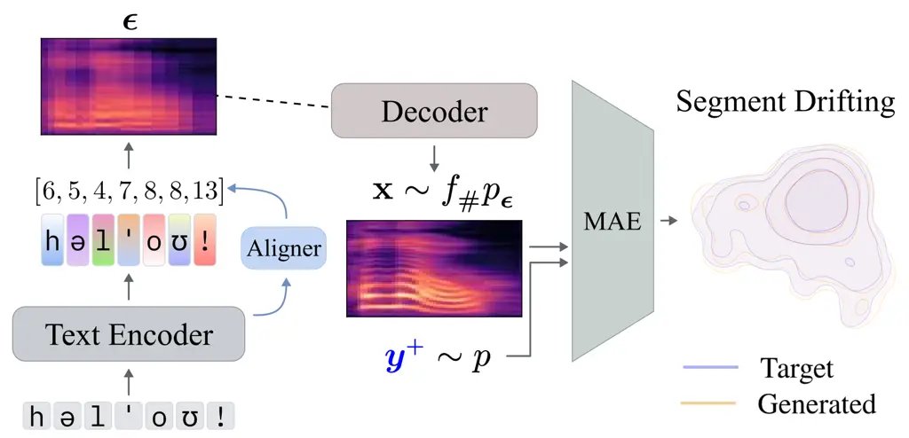
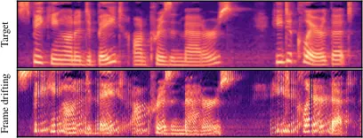

# DriftTTS: One-stage Single Step Text-to-Speech via Generative Drifting

Jaehyun Ahn    Dohyun Kim    Heeseung Kim^(†) ^(†)^(†)thanks: \$†\$
Corresponding Author.

###### Abstract

Text-to-speech models built on score matching and flow matching produce
natural speech, but only by calling the decoder many times, which makes
synthesis slow. Existing ways to cut the number of calls either distill
from a multi-step teacher or add a stage on top of a pretrained model,
leaving single-step TTS without a pretrained TTS model unexplored. We
question whether pretraining a TTS model is necessary, and propose
DriftTTS, which adopts generative drifting, an objective that moves
iterative sampling from inference into training. Drifting assumes
samples of fixed shape, whereas speech has variable length; we address
this issue with segment drifting. On LJSpeech, DriftTTS matches the
multi-step quality of Matcha-TTS and RapFlow-TTS in a single decoder
call, while being faster. To our knowledge, this is the first
application of generative drifting to text-to-speech.

###### Index Terms: 

text-to-speech, generative drifting, single step generation, one-stage
training

^(†)^(†)address: Department of AI, University of Seoul, Seoul, South
Korea

## 1 Introduction

Generative models have advanced since the introduction of diffusion
models \[4\]. Earlier approaches often suffered from over-smoothing, a
limitation diffusion models are widely regarded as having largely
overcome. Instead of transporting a prior sample to the data
distribution in a single step, they train a model to remove a small
amount of noise at a time, and generate data by applying it repeatedly,
which stably models continuous distributions. Building on this paradigm
of discretized iterative sampling, subsequent work has produced
score-based generative models \[14\], which estimate the gradient of the
log-density of perturbed data distributions.

However, iterative sampling requires a large number of function
evaluations (NFE), which slows down inference and has motivated efforts
to simplify the sampling process. Flow Matching \[9\] provides a
simulation-free framework for training continuous normalizing flows by
directly regressing the vector field that transports prior samples to
data. Nevertheless, generation still relies on iterative integration,
leaving the number of function evaluations as an important bottleneck.
MeanFlow \[3\] addresses this limitation by learning the average
velocity between two points in time instead of the instantaneous
velocity, enabling effective generation with very few function
evaluations. Consistency Flow Matching \[16\] instead imposes velocity
consistency across different starting times toward the same endpoint,
encouraging straighter sampling trajectories. These approaches have
demonstrated strong performance at low NFE in image generation.

Text-to-speech (TTS), which generates natural speech from text, has
largely followed this progression. Grad-TTS \[12\] introduces
score-based generative modeling, while Matcha-TTS \[10\] adopts flow
matching. Both achieve high-quality speech synthesis but still require a
non-trivial number of sampling steps, typically ten or more NFE.
IntMeanFlow \[15\], a zero-shot TTS model, adapts MeanFlow to speech by
learning the average velocity along trajectories generated by a
pretrained flow matching model, achieving performance comparable to
existing models with a single NFE. RapFlow-TTS \[11\] instead adapts
consistency flow matching by further training a pretrained Matcha-TTS so
that points along its estimated trajectory are mapped toward the same
data sample. With only two NFE, it matches or surpasses Matcha-TTS using
ten. However, both approaches depend on a pretrained TTS model to
provide the underlying generation trajectory, increasing training
complexity and computational cost.

In this work, we introduce DriftTTS, a TTS model that achieves
competitive performance with a single NFE without relying on a
pretrained TTS model. DriftTTS builds on generative drifting \[2\],
which moves iterative sampling from inference to training. Generative
drifting formulates sampling as a pushforward map from the prior to the
data distribution and directly learns this map during training. At each
training step, the model is updated to minimize the magnitude of the
drift from its predicted distribution toward the data distribution. To
the best of our knowledge, DriftTTS is the first application of
generative drifting to TTS.

Our experiments show that DriftTTS with a single NFE performs on par
with existing few-step TTS models while requiring fewer function
evaluations and no pretrained TTS model. Ablation studies further show
that both the feature extractor and segment-level drifting are
necessary: without either component, training leads to loudness
divergence or false convergence. Synthesized speech samples are
available on our demo page¹¹ 1
[https://drifttts.github.io/](https://drifttts.github.io/).

## 2 Generative Drifting

This section briefly reviews generative drifting \[2\]. Let a neural
network $`f:{\mathbb{R}}^{C}\rightarrow{\mathbb{R}}^{D}`$ take
$`{\bm{\epsilon}}\sim p_{{\bm{\epsilon}}}`$ (e.g., a standard normal
distribution) as input and produce $`{\mathbf{x}}=f({\bm{\epsilon}})`$.
The distribution $`q`$ of $`{\mathbf{x}}`$ is then the pushforward
distribution

```math
q=f_{\#}p_{{\bm{\epsilon}}}. \tag{1}
```

Denoting the model at training step $`i`$ as $`f_{i}`$, we call the
residual $`\Delta{\mathbf{x}}_{i}={\mathbf{x}}_{i+1}-{\mathbf{x}}_{i}`$
of the generated sample the drift. A zero drift corresponds to a fixed
point of the update. To obtain a computable update direction, generative
drifting defines a drifting field $`\mathbf{V}_{p,q}`$ that determines
the drift of a generated sample $`{\mathbf{x}}`$. Based on mean shift
theory \[1\], the field is constructed from an attraction toward the
data distribution $`p`$ and a corresponding interaction with the model
distribution $`q`$:

```math
{\color[rgb]{0,0,1}\mathbf{V}}_{p}^{{\color[rgb]{0,0,1}+}}({\mathbf{x}})\coloneqq\frac{1}{Z_{p}({\mathbf{x}})}{\mathbb{E}}_{{\color[rgb]{0,0,1}\mathbf{y}^{+}}\sim p}[k({\mathbf{x}},{\color[rgb]{0,0,1}\mathbf{y}^{+}})({\color[rgb]{0,0,1}\mathbf{y}^{+}}-{\mathbf{x}})], \tag{2}
```

```math
{\color[rgb]{1,0.5352,0}\mathbf{V}}_{q}^{{\color[rgb]{1,0.5352,0}-}}({\mathbf{x}})\coloneqq\frac{1}{Z_{q}({\mathbf{x}})}{\mathbb{E}}_{{\color[rgb]{1,0.5352,0}\mathbf{y}^{-}}\sim q}[k({\mathbf{x}},{\color[rgb]{1,0.5352,0}\mathbf{y}^{-}})({\color[rgb]{1,0.5352,0}\mathbf{y}^{-}}-{\mathbf{x}})]. \tag{3}
```

Here, $`k`$ is a kernel that measures the similarity between samples,
and $`Z_{p}({\mathbf{x}})`$ and $`Z_{q}({\mathbf{x}})`$ are
normalization terms:

```math
Z_{p}({\mathbf{x}})\coloneqq{\mathbb{E}}_{{\color[rgb]{0,0,1}\mathbf{y}^{+}}\sim p}[k({\mathbf{x}},{\color[rgb]{0,0,1}\mathbf{y}^{+}})], \tag{4}
```

```math
Z_{q}({\mathbf{x}})\coloneqq{\mathbb{E}}_{{\color[rgb]{1,0.5352,0}\mathbf{y}^{-}}\sim q}[k({\mathbf{x}},{\color[rgb]{1,0.5352,0}\mathbf{y}^{-}})]. \tag{5}
```

The drifting field combines the two interactions as
$`\mathbf{V}_{p,q}({\mathbf{x}})\allowbreak={\color[rgb]{0,0,1}\mathbf{V}}_{p}^{{\color[rgb]{0,0,1}+}}({\mathbf{x}})-{\color[rgb]{1,0.5352,0}\mathbf{V}}_{q}^{{\color[rgb]{1,0.5352,0}-}}({\mathbf{x}})`$.
Thus, $`{\color[rgb]{0,0,1}\mathbf{V}}_{p}^{{\color[rgb]{0,0,1}+}}`$
attracts $`{\mathbf{x}}`$ toward nearby data samples, while subtracting
$`{\color[rgb]{1,0.5352,0}\mathbf{V}}_{q}^{{\color[rgb]{1,0.5352,0}-}}`$
induces repulsion from nearby generated samples. Substituting the two
terms gives

```math
\mathbf{V}_{p,q}({\mathbf{x}})=\frac{1}{Z_{p}Z_{q}}{\mathbb{E}}_{p,\,q}[k({\mathbf{x}},{\color[rgb]{0,0,1}\mathbf{y}^{+}})k({\mathbf{x}},{\color[rgb]{1,0.5352,0}\mathbf{y}^{-}})({\color[rgb]{0,0,1}\mathbf{y}^{+}}-{\color[rgb]{1,0.5352,0}\mathbf{y}^{-}})], \tag{6}
```

Generative drifting uses a Laplace kernel with temperature $`\tau`$:

```math
k_{\tau}({\mathbf{x}},\mathbf{y})=\exp\left(-\frac{1}{\tau}|{\mathbf{x}}-\mathbf{y}|_{2}\right). \tag{7}
```

In practice, the expectations are estimated over a minibatch, where
$`{\color[rgb]{0,0,1}\mathbf{y}^{+}}`$ and
$`{\color[rgb]{1,0.5352,0}\mathbf{y}^{-}}`$ are sampled from the data
distribution and the model distribution, respectively. For
high-dimensional data, generative drifting computes the field in the
feature space of an extractor $`\phi(\cdot)`$ rather than directly on
the raw signal. For $`{\mathbf{x}}=f_{\theta}({\bm{\epsilon}})`$, the
training objective is

```math
{\cal L}={\mathbb{E}}_{{\bm{\epsilon}}\sim p_{{\bm{\epsilon}}}}\left[\left|\phi({\mathbf{x}})-\texttt{sg}(\phi({\mathbf{x}})+\mathbf{V}(\phi({\mathbf{x}})))\right|_{2}^{2}\right], \tag{8}
```

where sg is the stop-gradient operator. Numerically, this objective
equals the squared magnitude of the drifting field, while the drifted
sample is treated as a fixed target during backpropagation. The model is
therefore trained to move its samples toward their drifted counterparts,
gradually guiding the pushforward distribution $`q`$ toward the data
distribution $`p`$.

## 3 DriftTTS

### 3.1 Architecture of DriftTTS

DriftTTS builds on Matcha-TTS and consists of a text encoder, a duration
predictor, and a decoder. The text encoder converts the input text into
token-level representations. During training, monotonic alignment search
(MAS) \[6\] aligns these representations with the target
mel-spectrogram. Specifically, MAS searches for a monotonic alignment
that minimizes the $`L^{2}`$ distance between the target mel-spectrogram
and the text encoder outputs. The resulting alignment provides the
duration of each token, which is used to train the duration predictor.
It is also used to construct the prior sample $`\mu`$ by repeating each
token representation according to its duration, such that $`\mu`$ has
the same length as the target mel-spectrogram. Since MAS explicitly
searches for an alignment that minimizes the $`L^{2}`$ distance, the
resulting $`\mu`$ is already close to the target mel-spectrogram. The
text encoder and duration predictor are trained using the prior loss
$`{\cal L}_{\textup{prior}}`$ and duration loss
$`{\cal L}_{\textup{duration}}`$, respectively.



Figure 1: Overview of DriftTTS during training. The text encoder and MAS
construct the prior sample $`{\bm{\epsilon}}=\mu`$ by repeating each
token representation according to its duration, and the decoder maps it
to a generated segment $`{\mathbf{x}}\sim f_{\#}p_{\mu}`$ in a single
call. Segment drifting compares the generated segment with a target
segment $`{\color[rgb]{0,0,1}\mathbf{y}^{+}}\sim p`$ in the MAE feature
space.

Unlike Matcha-TTS, whose decoder repeatedly predicts a velocity field
that is integrated over time, the DriftTTS decoder directly predicts the
target mel-spectrogram. Generative drifting does not require a timestep
input, allowing us to remove the timestep embedding from the Matcha-TTS
decoder and reduce the number of parameters. Fig. 1 shows the overall
training pipeline of DriftTTS.

### 3.2 Segment Drifting

Generative drifting is formulated for fixed-shape images with class
conditions. TTS, in contrast, involves variable-length speech and text
conditions that do not belong to a fixed set of classes. To handle
variable length, we sample fixed-length segments from both the prior and
target speech during training, following \[12\]. We address the
conditioning problem by redefining the starting point, or prior
$`{\bm{\epsilon}}`$, from a standard normal sample to the encoder output
$`\mu`$ (i.e., $`{\bm{\epsilon}}=\mu`$). The decoder additionally
receives a noise sample as a stochastic condition. Since this prior
places each generated sample near its corresponding target, the
attraction of
$`{\color[rgb]{0,0,1}\mathbf{V}}_{p}^{{\color[rgb]{0,0,1}+}}`$ is
concentrated around that target, implicitly providing conditional
generation.

This choice of prior constrains the positive samples. Since $`\mu`$ is
constructed from an alignment with its target speech, each prior is
associated with a specific target rather than being independent of the
data sample. Consequently, each generated sample has only one correct
destination, and attraction toward another speech segment would provide
an incorrect training signal even if the generated distribution matched
the data distribution. The corresponding target must therefore be
included among the positive samples
$`{\color[rgb]{0,0,1}\mathbf{y}^{+}}`$. We satisfy this by using the
batch of target segments as $`{\color[rgb]{0,0,1}\mathbf{y}^{+}}`$. In
contrast, the negative samples
$`{\color[rgb]{1,0.5352,0}\mathbf{y}^{-}}`$ do not require such pairing,
and we use the generated segments in the batch, masking out
self-interactions when computing
$`{\color[rgb]{1,0.5352,0}\mathbf{V}}_{q}^{{\color[rgb]{1,0.5352,0}-}}`$.

For the feature extractor $`\phi(\cdot)`$, we adopt the masked
autoencoder (MAE) used in \[2\]. The MAE is trained to reconstruct
masked regions of images. Treating mel-spectrograms as single-channel
images, we train the MAE using $`4\times 4`$ masks applied with a
probability of 50%. The encoder has a bottleneck structure, and feature
representations from corresponding encoder layers are compared in pairs.

Figure 2: Evolution of the generated distribution toward the target
distribution during training. Each panel flattens a fixed 80-frame
log-mel segment from every evaluation utterance and projects it using a
single PCA basis fitted to the targets.

Following previous work \[2\], we compute the drift at multiple
temperatures and MAE encoder layers. Let $`i`$ index a combination of
temperature $`\tau`$ and MAE layer $`l`$. We average the losses over
$`i`$ rather than summing them, since summation increases the gradient
propagated to the text encoder and reduces the relative influence of
$`{\cal L}_{\textup{prior}}`$, hindering training. The drifting loss
$`{\cal L}_{\textup{drift}}`$ is defined as

```math
{\cal L}_{\textup{drift}}={\mathbb{E}}_{{\bm{\epsilon}},,i}\left[\left|\phi_{i}({\mathbf{x}})-\texttt{sg}(\phi_{i}({\mathbf{x}})+\mathbf{V}_{p,,q}(\phi_{i}({\mathbf{x}})))\right|_{2}^{2}\right]. \tag{9}
```

DriftTTS is trained with $`{\cal L}_{\textup{prior}}`$ and
$`{\cal L}_{\textup{duration}}`$ for the text encoder and duration
predictor, respectively, and with $`{\cal L}_{\textup{drift}}`$ for the
decoder. The final objective is

```math
{\cal L}={\cal L}_{\textup{prior}}+{\cal L}_{\textup{duration}}+{\cal L}_{\textup{drift}}. \tag{10}
```

## 4 Experiments

### 4.1 System

We trained both DriftTTS and MAE on LJSpeech \[5\], following the split
used in \[10\]. The predicted mel-spectrogram is converted to speech
using HiFi-GAN \[7\], and we therefore follow the mel-spectrogram
configuration of HiFi-GAN V1.

DriftTTS was trained for 2000 epochs on four NVIDIA A10 GPUs using AdamW
with a learning rate of $`1\times 10^{-4}`$ and a weight decay of 0.01.
Gradients are clipped at 5.0, and an exponential moving average (EMA) of
the weights with a decay of 0.999 is used for inference. The batch size
matters more here than usual: the targets in a batch serve as the
positive samples and the generated segments as the negative samples, and
previous work reports that generation improves as both increase \[2\].
We therefore use the largest batch that fits in memory, 64 pairs of text
and speech per GPU. The text encoder is trained on the entire utterance,
while the decoder is trained on a segment of 80 frames
($`{\sim}0.93`$,s), and monotonic alignment search runs on GPU with
SuperMAS \[8\].

The decoder takes a segment of the prior $`\mu`$ obtained by MAS
together with a noise sample as a stochastic condition, and predicts the
target segment. The predicted segments serve both as the generated
samples $`{\mathbf{x}}`$ and as the negative samples
$`{\color[rgb]{1,0.5352,0}\mathbf{y}^{-}}`$, and
$`{\color[rgb]{1,0.5352,0}\mathbf{V}}_{q}^{{\color[rgb]{1,0.5352,0}-}}`$
is computed with the diagonal masked out so that a sample is not
repelled by itself. The temperatures are set to $`[0.02,0.05,0.2]`$.

### 4.2 Evaluations

We measure pronunciation accuracy by word error rate (WER), transcribed
with openai/whisper-large-v3-turbo \[13\], perceptual naturalness by a
5-point mean opinion score (MOS) study on the evaluation set, and
synthesis speed by the real-time factor (RTF). For each utterance, RTF
is computed as the model inference time excluding the vocoder, divided
by the generated audio duration. We average RTF over the 500 evaluation
utterances at a batch size of one. Every system is run in the same
environment on a single GPU, and we report the median over five
interleaved runs.

For a controlled comparison, we focus on models that share the
Matcha-TTS architecture or are directly built upon it. At a single step,
we compare DriftTTS with Matcha-TTS, Matcha-TTS with MeanFlow applied,
and RapFlow-TTS. We additionally evaluate the standard multi-step
settings of Matcha-TTS and RapFlow-TTS, using ten and two steps,
respectively, to examine whether single-step DriftTTS can match their
reference generation quality.

We first ablate the MAE by applying segment drifting directly in the
mel-spectrogram space, testing whether the feature extractor is
necessary. We then replace segment drifting with frame drifting, where
each frame is treated independently. This setting is problematic because
the prior repeats the same token representation across its duration,
while the corresponding target frames are acoustically different. Frame
drifting does not preserve which target frame each generated frame
should match. As a result, the generated frames can match the overall
distribution of target frames and yield $`\mathbf{V}=\bm{0}`$ even when
they are arranged into incorrect speech. We refer to this behavior as
false convergence. Following previous work \[2\], we also compare
single-temperature losses with the multi-temperature loss. We evaluate
these ablations using WER, UTMOSv2, and overall DNSMOS.

### 4.3 Results

|               |     |      |                                   |                   |
| ------------- | --- | ---- | --------------------------------- | ----------------- |
| Model         | NFE | WER  | MOS                               | RTF ($`10^{-3}`$) |
| Ground truth  | –   | 1.92 | $`4.53\pm 0.06`$                  | –                 |
| Vocoded GT    | –   | 1.99 | $`4.48\pm 0.06`$                  | –                 |
| Matcha-TTS    | 10  | 1.93 | $`4.38\pm 0.08`$                  | 18.7              |
| RapFlow-TTS   | 2   | 1.82 | $`4.42\pm 0.08`$                  | 5.85              |
| Matcha-TTS    | 1   | 1.86 | $`4.09\pm 0.10`$                  | 4.15              |
|    + MeanFlow | 1   | 1.83 | $`4.39\pm 0.07`$                  | 4.19              |
| RapFlow-TTS   | 1   | 1.79 | $`4.38\pm 0.08`$                  | 4.19              |
| DriftTTS      | 1   | 1.80 | $`\mathbf{4.43}\pm\mathbf{0.08}`$ | 4.41              |

Table 1: Comparison on the LJSpeech evaluation set. MOS is computed from
290 responses of 153 listeners, and RTF is measured on a single NVIDIA
A10 GPU.

Table 1 summarizes the main comparison. DriftTTS achieves comparable WER
and MOS to the other synthesized systems. Matcha-TTS loses much of its
naturalness at a single NFE. Matcha-TTS with MeanFlow and RapFlow-TTS
recover most of this loss, but both require further training of a
pretrained Matcha-TTS. DriftTTS reaches this level of quality with a
single NFE, trained in a single stage without any pretrained TTS model.
It also performs comparably to Matcha-TTS at ten steps and RapFlow-TTS
at two steps while running about $`4.2\times`$ and $`1.3\times`$ faster,
respectively. The single-step baselines remain slightly faster, which we
attribute to our decoder implementation rather than the training
objective.

Table 2 reports the ablations. The single temperatures perform
comparably to the multi-temperature loss in UTMOSv2 and DNSMOS, with no
single value consistently outperforming the others. We adopt the
multi-temperature loss with $`[0.02,0.05,0.2]`$ from previous work
\[2\], which also achieves the lowest WER. The feature extractor and
drifting unit, in contrast, matter substantially. When segment drifting
is applied directly in the mel-spectrogram space without the MAE, every
metric collapses as the predicted energy diverges: high-energy mel bins
are pushed toward the upper bound of 0, while low-energy bins continue
decreasing. We hypothesize that distances between high-dimensional raw
mel segments are dominated by coarse energy differences, causing the
drifting field to emphasize overall energy rather than local spectral
structure. The lower-dimensional frame-wise ablation does not exhibit
this divergence, which is consistent with the instability arising from
direct kernel computation in the high-dimensional mel space. We leave a
rigorous analysis of this behavior to future work.

|                |       |         |        |
| -------------- | ----- | ------- | ------ |
| Type           | WER   | UTMOSv2 | DNSMOS |
| Baseline       | 1.80  | 3.931   | 3.263  |
| w/o MAE        | 20.03 | 0.517   | 1.394  |
| frame, w/o MAE | 2.72  | 2.137   | 1.724  |
| $`\tau=0.02`$  | 2.00  | 3.829   | 3.149  |
| $`\tau=0.05`$  | 2.00  | 3.982   | 3.244  |
| $`\tau=0.2`$   | 1.90  | 3.936   | 3.273  |

Table 2: Ablation on the feature extractor, drifting unit, and
temperature. Each row lists its change from the baseline, and the
$`\tau`$ rows use a single temperature in place of the multi-temperature
loss. DNSMOS is the overall score.



Figure 3: False convergence of frame drifting. The target is the
mel-spectrogram of a validation utterance, and the frame-wise model
predicts it using the alignment found by MAS, so the two panels have the
same number of frames.

Frame drifting keeps WER reasonable, yet its UTMOSv2 and DNSMOS drop
sharply, consistent with false convergence: the prior preserves
linguistic content, while frames may match incorrect target frames. As
shown in Fig. 3, the prediction follows the structure of the target, but
many frames do not connect naturally with their neighbors. Segment
drifting avoids this by tying neighboring frames together.

## 5 Conclusion

We introduced DriftTTS, a TTS model built upon generative drifting that
moves iterative sampling from inference to training, predicting the
target mel-spectrogram directly rather than its dynamics, in a single
step and without any pretrained TTS model. To apply generative drifting
to speech, we proposed segment drifting, which samples fixed-length
segments during training and uses the encoded text representation as the
prior. It thereby removes the inference cost that grows with the number
of steps, while performing on par with the multi-step results of
existing models. Extending DriftTTS to multi-speaker and zero-shot
synthesis and reducing its dependence on the trained feature extractor
remain future work.

## 6 Compliance with Ethical Standards

The listening test was conducted through an online survey platform
(Amazon Mechanical Turk) that obtained participant consent and collected
only non-sensitive evaluation data.

## 7 Acknowledgments

This work was supported by the Korea Government (MSIT) through the
National Research Foundation of Korea (NRF) (No. RS-2022-NR068754, NO.
RS-2026-25601142) and by the supercomputing resources provided by the
Urban Big Data and AI Institute of the University of Seoul
([http://ubai.uos.ac.kr](http://ubai.uos.ac.kr)). We utilized an LLM to
assist with language editing, including grammar and wording, and with
the development of the project page.

## References

- \[1\] Y. Cheng (1995) Mean shift, mode seeking, and clustering. IEEE
  Transactions on Pattern Analysis and Machine Intelligence 17 (8),
  pp. 790–799. External Links:
  [Document](https://dx.doi.org/10.1109/34.400568) Cited by: §2.
- \[2\] M. Deng, H. Li, T. Li, Y. Du, and K. He (2026) Generative
  modeling via drifting. arXiv preprint arXiv:2602.04770. Cited by: §1,
  §2, §3.2, §3.2, §4.1, §4.2, §4.3.
- \[3\] Z. Geng, M. Deng, X. Bai, J. Z. Kolter, and K. He (2025) Mean
  flows for one-step generative modeling. In The Thirty-ninth Annual
  Conference on Neural Information Processing Systems, External Links:
  [Link](https://openreview.net/forum?id=uWj4s7rMnR) Cited by: §1.
- \[4\] J. Ho, A. Jain, and P. Abbeel (2020) Denoising diffusion
  probabilistic models. In Advances in Neural Information Processing
  Systems, H. Larochelle, M. Ranzato, R. Hadsell, M.F. Balcan, and H.
  Lin (Eds.), Vol. 33, pp. 6840–6851. External Links:
  [Link](https://proceedings.neurips.cc/paper_files/paper/2020/file/4c5bcfec8584af0d967f1ab10179ca4b-Paper.pdf)
  Cited by: §1.
- \[5\] K. Ito (2017) The lj speech dataset. Note:
  [https://keithito.com/LJ-Speech-Dataset/](https://keithito.com/LJ-Speech-Dataset/)
  Cited by: §4.1.
- \[6\] J. Kim, S. Kim, J. Kong, and S. Yoon (2020) Glow-tts: a
  generative flow for text-to-speech via monotonic alignment search. In
  Advances in Neural Information Processing Systems, H. Larochelle, M.
  Ranzato, R. Hadsell, M.F. Balcan, and H. Lin (Eds.), Vol. 33,
  pp. 8067–8077. External Links:
  [Link](https://proceedings.neurips.cc/paper_files/paper/2020/file/5c3b99e8f92532e5ad1556e53ceea00c-Paper.pdf)
  Cited by: §3.1.
- \[7\] J. Kong, J. Kim, and J. Bae (2020) HiFi-gan: generative
  adversarial networks for efficient and high fidelity speech synthesis.
  In Advances in Neural Information Processing Systems, H.
  Larochelle, M. Ranzato, R. Hadsell, M.F. Balcan, and H. Lin (Eds.),
  Vol. 33, pp. 17022–17033. External Links:
  [Link](https://proceedings.neurips.cc/paper_files/paper/2020/file/c5d736809766d46260d816d8dbc9eb44-Paper.pdf)
  Cited by: §4.1.
- \[8\] J. Lee and H. Kim (2024) Super Monotonic Alignment Search. arXiv
  preprint arXiv:2409.07704. Cited by: §4.1.
- \[9\] Y. Lipman, R. T. Q. Chen, H. Ben-Hamu, M. Nickel, and M.
  Le (2023) Flow matching for generative modeling. In The Eleventh
  International Conference on Learning Representations, External Links:
  [Link](https://openreview.net/forum?id=PqvMRDCJT9t) Cited by: §1.
- \[10\] S. Mehta, R. Tu, J. Beskow, É. Székely, and G. E. Henter (2024)
  Matcha-tts: a fast tts architecture with conditional flow matching. In
  ICASSP 2024 - 2024 IEEE International Conference on Acoustics, Speech
  and Signal Processing (ICASSP), Vol. , pp. 11341–11345. External
  Links:
  [Document](https://dx.doi.org/10.1109/ICASSP48485.2024.10448291) Cited
  by: §1, §4.1.
- \[11\] H. J. Park, J. Liu, J. S. Kim, J. Y. Yang, S. W. Han, and E.
  Song (2025) RapFlow-TTS: Rapid and High-Fidelity Text-to-Speech with
  Improved Consistency Flow Matching. In Interspeech 2025,
  pp. 2440–2444. External Links:
  [Document](https://dx.doi.org/10.21437/Interspeech.2025-554), ISSN
  2958-1796 Cited by: §1.
- \[12\] V. Popov, I. Vovk, V. Gogoryan, T. Sadekova, and M.
  Kudinov (2021) Grad-tts: a diffusion probabilistic model for
  text-to-speech. In Proceedings of the 38th International Conference on
  Machine Learning, M. Meila and T. Zhang (Eds.), Proceedings of Machine
  Learning Research, Vol. 139, pp. 8599–8608. External Links:
  [Link](https://proceedings.mlr.press/v139/popov21a.html) Cited by: §1,
  §3.2.
- \[13\] A. Radford, J. W. Kim, T. Xu, G. Brockman, C. Mcleavey, and I.
  Sutskever (2023) Robust speech recognition via large-scale weak
  supervision. In Proceedings of the 40th International Conference on
  Machine Learning, A. Krause, E. Brunskill, K. Cho, B. Engelhardt, S.
  Sabato, and J. Scarlett (Eds.), Proceedings of Machine Learning
  Research, Vol. 202, pp. 28492–28518. External Links:
  [Link](https://proceedings.mlr.press/v202/radford23a.html) Cited by:
  §4.2.
- \[14\] Y. Song, J. Sohl-Dickstein, D. P. Kingma, A. Kumar, S. Ermon,
  and B. Poole (2021) Score-based generative modeling through stochastic
  differential equations. In International Conference on Learning
  Representations, External Links:
  [Link](https://openreview.net/forum?id=PxTIG12RRHS) Cited by: §1.
- \[15\] W. Wang, R. Cao, Y. Guo, Z. Chen, K. Chen, and Y. Huo (2026)
  Int-meanflow: few-step speech generation with integral velocity
  distillation. In ICASSP 2026 - 2026 IEEE International Conference on
  Acoustics, Speech and Signal Processing (ICASSP), Vol. ,
  pp. 18317–18321. External Links:
  [Document](https://dx.doi.org/10.1109/ICASSP55912.2026.11462627) Cited
  by: §1.
- \[16\] L. Yang, Z. Zhang, Z. Zhang, X. Liu, J. Liu, M. Xu, C. Meng, S.
  Ermon, W. Zhang, and B. CUI (2025) Consistency flow matching: defining
  straight flows with velocity consistency. External Links:
  [Link](https://openreview.net/forum?id=bS76qaGbel) Cited by: §1.
