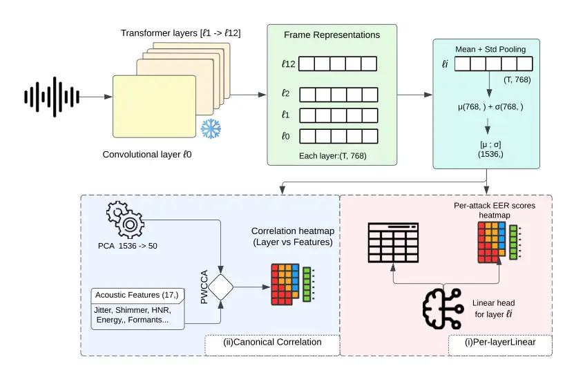
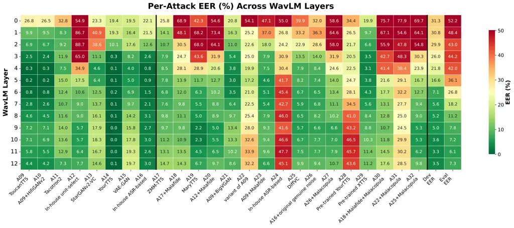
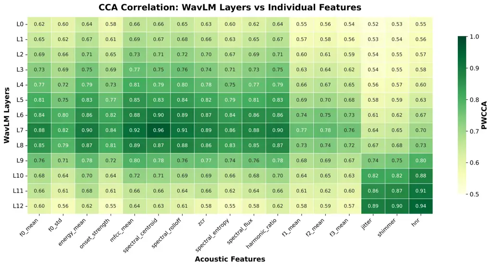
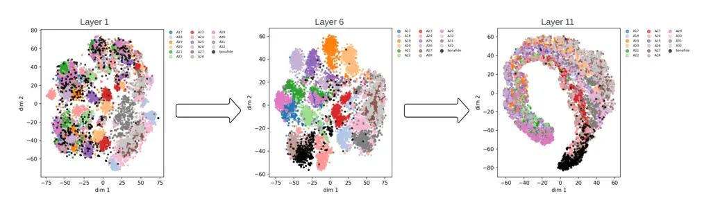

# Interpreting SSL Representations for Spoof Detection: a WavLM Study

Mohamed Mallat EURECOM Sophia Antipolis, France
Mohamed.Mallat@eurecom.fr Michele Panariello EURECOM Sophia Antipolis,
France Michele.Panariello@eurecom.fr Massimiliano Todisco EURECOM Sophia
Antipolis, France Massimiliano.Todisco@eurecom.fr Nicholas Evans EURECOM
Sophia Antipolis, France Nicholas.Evans@eurecom.fr   Anthony Larcher
Université du Mans Le Mans, France Anthony.Larcher@univ-lemans.fr

###### Abstract

Self-supervised speech models such as WavLM achieve strong spoofing
detection performance, yet which layers encode the most spoof-relevant
information and what acoustic properties they capture remain opaque. We
present a layer-wise interpretability study of WavLM using the
ASVspoof 5 database, combining three complementary analyses:
(i) per-layer linear probing with attack-level evaluation across speech
synthesis, voice conversion, and adversarial attacks; (ii) a canonical
correlation analysis (CCA) linking layer representations to
spoofing-relevant acoustic features; (iii) an exhaustive grid search
over layer subsets showing that use of five layers outperforms full
thirteen-layer pooling. CCA analysis reveals that, while most acoustic
features peak in alignment with mid-layers and then decay, voice quality
measures jitter, shimmer, and the harmonics-to-noise ratio show the
opposite trend, with correlation increasing toward later layers.
Embedding visualisations reveal that deeper layers capture a continuous
acoustic similarity among attacks rather than discrete categories,
suggesting these layers encode fundamental synthesis artifacts rather
than attack-specific signatures.

⁰⁰footnotetext:  This work was supported by the French Agence Nationale
de la Recherche (ANR) via the COMPROMIS (ANR-22-PECY-0011) project.

## I Introduction

Self-supervised learning (SSL) front-ends have become the backbone of
modern spoofing countermeasures (CMs) and presentation attack detection
(PAD) solutions, achieving state-of-the-art performance for ASVspoof
benchmarks \[1, 2\]. However, these models remain opaque; it is unclear
which layers encode spoof-relevant information, how layer behaviour
varies across attack types, and whether the learned representations can
be linked to interpretable acoustic properties. Herein lie the goals of
our work reported in this paper. Recent work shows that spoofing
countermeasures can exploit spurious cues and learning shortcuts \[3\],
e.g. those linked to non-speech duration. This further motivates
analyses that ground model behaviour in meaningful acoustic properties.

Among a plethora of available and popular alternative SSL models, we
focus on WavLM \[4\] which incorporates a denoising pre-training
objective that exposes the model to noisy and overlapped speech. Because
WavLM is trained to recover masked targets for a designated main speaker
in noisy/overlapped mixtures, its denoising objective encourages
representations that preserve speaker-related information and remain
stable under acoustic distortions.

We report an investigation performed using the most recent ASVspoof 5
database \[5\]. It provides a diverse set of bona fide speech utterances
together with a set of spoofed/deepfake attacks generated using
text-to-speech (TTS), voice conversion (VC), and adversarial
perturbation methods, all treated with varied codecs and recording
conditions \[1\]. Its crowdsourced nature and the diversity of the data
and acoustic conditions make it an ideal test bed for
interpretability-driven analysis. We address three research questions:

1.  1.  Which WavLM layers carry the most discriminative bona fide-spoof
        information?
2.  2.  Does the detection of different attack families (TTS, VC,
        adversarial) depend upon the capture of information at different
        layer depths?
3.  3.  What interpretable acoustic properties do WavLM layers encode, and
        how do these relate to known spoofing markers?

The contributions of the work reported in this paper include:
Attack-aware layer characterisation - We provide a comprehensive
analysis of how spoofing discriminability varies with representation
depth and attack types, revealing strong layer-attack interactions and
showing that mid-to-deep layers carry the most reliable bonafide/spoof
cues under most conditions.  
Layer subset search - We show that an optimally chosen compact layer
subset can outperform standard all-layer pooling with a linear backend,
providing a practical efficiency gain.  
CCA-based acoustic grounding - We link layer representations to
interpretable spoofing-relevant acoustic cues by computing
projection-weighted canonical correlation analysis (PWCCA) showing a
shift in representation geometry helping explain why certain layers
behave differently and when they fail. t-SNE visualisation corroborates
this: representations transition from discrete attack clusters
(mid-layers) to a continuous horseshoe manifold (deep layers).



Fig. 1: Overview of the analysis pipeline. Top: WavLM produces
frame‑level layer representations; each layer is summarised by mean+std
pooling to a 1536‑D utterance vector. Bottom left (blue): PWCCA
pipeline, PCA (1536→50) and correlation between pooled layer vectors and
handcrafted acoustic features, producing layer vs feature heatmaps.
Bottom right (pink): per‑layer linear probing, yielding per‑layer EER
and per‑attack EER heatmaps.

## II Related Work

### II-A Spoofing CMs and SSL front-ends

Neural spoofing countermeasures (CMs) now span a broad range of
back-ends, including graph-attention architectures such as AASIST,
conformer-based anti-spoofing classifiers, and fused/ensemble
systems \[6, 7, 1, 8, 9\]. In recent ASVspoof 5 submissions, these
back-ends are frequently paired with SSL front-ends such as wav2vec 2.0
and WavLM, often together with augmentation (e.g., RawBoost) and
score/model fusion strategies \[1, 10, 11, 4, 12, 8\].

### II-B Layer-wise analysis of SSL models

Previous layer-wise studies of SSL speech representations \[13, 14\]
show that early layers capture local acoustic features while late layers
encode more abstract content and speaker information. In the context of
spoofing detection, studies have explored SSL front ends \[8, 10, 9\],
but primarily to optimize detection performance. More recently, Xiao et
al. \[15\] proposed layer-wise decision fusion for fake audio detection,
demonstrating that per-layer decisions outperform feature-level fusion.
Representation analysis tools such as singular vector canonical
correlation analysis (SVCCA) \[16\] and projection-weighted canonical
correlation analysis (PWCCA) \[17\] provide quantitative similarity
measures between representations. However, these tools have not yet been
applied to interpret what spoofing-relevant information individual
layers encode in an attack-dependent manner.

### II-C Acoustic cues for spoofing detection

Specific acoustic features like jitter, shimmer, and the
harmonic-to-noise ratio measures of vocal fold micro-perturbations are
known markers of spoofed speech; TTS vocoders produce unnaturally smooth
or irregular voice quality patterns \[18\]. Formant trajectories have
been shown to expose voice conversion artifacts; generative models
struggle to replicate fine-grained articulatory detail \[19, 20\].
Spectral features such as sub-band centroids and flux have also been
studied; spectral discontinuities from frame-level synthesis leave
detectable traces in these measures \[21\]. While none of these features
alone match the detection performance of modern SSL-based systems, they
offer the advantage of direct interpretability. The shift toward
self-supervised models has improved accuracy but moved the field further
from understanding what information drives detection. Whether SSL
representations internally encode the same acoustic properties as these
handcrafted features explicitly measure remains unexplored. Our CCA
analysis addresses this question by directly measuring the alignment
between WavLM layer representations and these spoofing-relevant acoustic
features. These findings motivate our choice of CCA target features.

## III Methodology

An illustration of our analysis pipeline is shown in Figure 1. It
comprises two components: (i) per-layer linear probing for
discriminability assessment (bottom right, pink block); (ii) canonical
correlation analysis (CCA) which is applied between layer
representations and handcrafted acoustic features so as to ground
representations in interpretable spoofing-relevant utterance
characteristics (bottom left, blue block). We describe both in the
following after a description of the dataset and attack taxonomy and our
use of WavLM representations.

### III-A Dataset and attack taxonomy

All work reported in this paper was performed using the ASVspoof 5
database \[5\], using the Track 1 protocol for spoofing/deepfake
detection and with the standard train, development (dev) and evaluation
(eval) partition splits \[22\]. The train set contains attacks A01--A08
(GlowTTS, GradTTS, FastPitch, VITS variants), the dev set A09--A16
(ToucanTTS, Tacotron2, StarGANv2-VC, YourTTS, VAE-GAN, and others), and
the eval set A17--A32 (including ZMM-TTS, MaryTTS, DiffVC, among others,
and adversarial methods such as Malafide and Malacopula). For analysis,
we group the set of 32 attacks into three families, specifically those
generated using TTS and VC and those augmented¹¹ 1 For the ASVspoof 5
database, adversarial attacks are applied to already-spoofed utterances
generated using either TTS or VC. There is no application of adversarial
attacks to bonafide utterances. See \[5\] for details. by adversarial
attacks (ADV).

### III-B WavLM representations and linear probing

We use the WavLM Base model \[4\] as a frozen feature extractor
extracting representations from all layers (L0–L12). Unlike
wav2vec2.0 \[11\], which is trained solely with a contrastive objective
using clean speech, WavLM incorporates an additional denoising objective
that exposes the model to noisy and overlapped speech during
pre-training. This design makes WavLM particularly relevant to our
analysis, since spoof detection depends on both acoustic distortions and
speaker-related properties. We use the Base variant rather than the
Large model for computational efficiency and because its 13-layer
architecture provides a tractable setting for layer-wise analysis while
still achieving competitive performance for many speech-related tasks.

Since all WavLM layers produce 768-dimensional frame representations,
direct layer-wise comparison is straightforward. For each layer, we
compute mean and standard deviation pooling over the time frame axis,
yielding two 768-dimensional statistics which are concatenated into a
single 1536-dimensional utterance-level vector suitable for
classification. Using training data only, we learn distinct linear
classifiers using the representations extracted from each layer to
distinguish bona fide from spoofed utterances. We select the best model
according to that which produces the lowest equal error rate (EER) for
the development set and report EERs for all bona fide and spoofed data
in both the development and evaluation sets. This approach provides a
transparent measure of layer-wise discriminability without the use of
complex back-ends obscuring interpretation.

### III-C CCA-based acoustic feature analysis

To ground WavLM representations in interpretable acoustic properties, we
estimate the correlation between the representations of each layer and a
set of 17 handcrafted acoustic features organised into four categories:

- •
  Voice quality (3): jitter, shimmer and the harmonic-to-noise ratio
  (HNR), measures of vocal fold micro-perturbations known to be
  distorted by TTS vocoders \[18\].
- •
  Prosodic (4): F0 mean, F0 standard deviation, energy mean, onset
  strength.
- •
  Spectral (6): MFCC mean, spectral centroid, spectral roll-off, ZCR,
  spectral entropy, spectral flux, general signal descriptors used in
  CM \[21\].
- •
  Harmonic/formant (4): harmonic ratio, F1 mean, F2 mean, F3 mean,
  formant trajectories expose voice conversion artifacts \[19, 20\].

We use canonical correlation analysis (CCA) to measure how well each
WavLM layer’s representations align with a set of handcrafted acoustic
features \[17\]. CCA identifies linear projections of two variable sets
that are maximally correlated. Here, these correspond to the pooled
layer representation $`\mathbf{x}\in\mathbb{R}^{d_{1}}`$ and the
acoustic feature vector $`\mathbf{y}\in\mathbb{R}^{d_{2}}`$, yielding
coefficients $`\rho_{1}\geq\rho_{2}\geq\cdots\geq\rho_{k}`$, where
$`k=\min(d_{1},d_{2})`$.

Standard CCA can be sensitive to directions with low variance. We
therefore adopt projection-weighted CCA (PWCCA) \[17\], which computes a
weighted mean of canonical correlations:

```math
\text{PWCCA}=\frac{\sum_{i=1}^{k}\alpha_{i}\rho_{i}}{\sum_{i=1}^{k}\alpha_{i}} \tag{1}
```

where $`\alpha_{i}`$ is the sum of absolute projection weights onto the
$`i`$-th canonical direction, giving greater weight to directions that
capture greater variance in the original representation. CCA requires
the number of samples to exceed the dimensionality of both inputs;
following \[17\], we reduce layer representations to 50 dimensions via
principal component analysis (PCA) prior to computing PWCCA.

We compute correlations between each 1536-dimensional layer
representation and the 17 acoustic features matrix. Canonical
correlations are weighted by projection magnitudes and symmetrised by
averaging in both directions. To report per-feature correlations
(Fig. 3), we compute the squared correlation between each individual
feature and the first canonical variate of the layer representation.
Analyses use the train+dev splits only, with the eval set reserved for
final reporting. For computational efficiency, we randomly sample up to
5000 speaker-balanced utterances per attack group. This sample size
comfortably exceeds the reduced dimensionality and supports reliable
correlation estimates.

## IV Results

We report results for both development and evaluation sets. The study of
results for both sets allows us to examine whether layer-wise patterns
observed for more familiar attacks generalise to unseen conditions, and
to identify where generalisation fails.



Fig. 2: Per-attack EER (%) across WavLM layers for the dev (A09–A16) and
eval (A17–A32) splits, with overall per-layer EER for each set shown in
the two rightmost columns. Green indicates low EER (easy detection),
whereas red indicates high EER (hard detection). The vertical black line
separates dev and eval attacks.

### IV-A Per-layer probing

Per-layer EERs from frozen WavLM representations with linear classifiers
are shown in Fig. 2 for both dev and eval sets. For both sets,
performance generally improves with depth up to L11 resulting in the
lowest dev EER of 3.33% and the lowest eval EER of 6.07%. EERs for L12
are higher, showing a loss of discriminative information.

A visualisation of EER results for each layer and each attack is shown
in Figure 2. Several patterns emerge. For the dev set, near-zero EERs
(dark green colours) are achieved for some TTS attacks (A09, A10, A14
and A16) from mid layers onward. Notably, the EER for A12 (unit
selection) is higher for early layers but drops sharply after L6 (from
up to $`\approx`$80% for early layers dropping to $`\approx`$5% for late
layers), suggesting that deeper representations capture artifacts that
shallow layers miss. For all other attacks in the dev set, and with only
few exceptions, EERs are higher than 5% for all layers. For the eval
set, most attacks follow a similar pattern of decreasing EER with depth.
However, for three TTS attacks, A22 (ToucanTTS variant), A24 (ASR-based
TTS), and A28 (pre-trained YourTTS), we observe the opposite trend: EERs
exceed $`\sim`$30% in later layers, higher than that for mid-layers.
What distinguishes these attacks from others that become easier to
detect with depth is explored further in Section IV-B.

For attacks augmented with Malafide \[23\] (A18, A20, A23) and
Malacopula \[24\] (A27, A30–32) adversarial filtering, EERs are
consistently high (EER$`>`$20%) for all layers, with either flat or
inverted layer trends. This is expected since adversarial filters are
optimised to suppress detectable artifacts, whether by maximising CM
scores (Malafide) or matching target speaker embeddings (Malacopula).
The uniform failure across all layers suggests that adversarial
optimisation successfully removes detectable artifacts regardless of
representation depth, exposing a fundamental limitation of
artifact-based detection.

### IV-B CCA analysis

PWCCA results are illustrated by a heatmap shown in Figure 3. Colours
indicate the correlation between representations extracted from each
WavLM layer and individual acoustic features. Two distinct patterns
emerge.  
Correlation Peak Around L7- Most acoustic features follow a consistent
pattern: correlation increases from L0, peaks at around L7, and then
decays toward L12. Spectral features show the strongest mid-layer
alignment, with that for the spectral centroid reaching 0.96 at L7,
followed by MFCC mean (0.92) and spectral roll-off (0.91). Prosodic
features (F0, energy) follow the same trend with slightly lower peak
values. Formant features (F1–F3) show the weakest correlations overall
(peaks of 0.70–0.78), suggesting that formant information is less
accessible from WavLM representations than spectral or prosodic
properties. This pattern mirrors the acoustic-to-abstract transitions
reported previously for SSL models \[13\]: mid-layers encode
signal-level properties while later layers encode more abstract
representations.  
Uniform Increase in Correlation- In contrast, jitter, shimmer, and HNR
show monotonically increasing correlation with layer depth. Jitter rises
from 0.52 (L0) to 0.89 (L12), shimmer from 0.53 to 0.90, and HNR from
0.55 to 0.94. These features measure micro-perturbations in pitch
period, amplitude, and harmonic structure properties that vocoders and
TTS systems are known to distort  \[18\].

These two patterns help explain the probing results. The EER
improvements from early to mid-layers coincide with stronger spectral
and prosodic encoding, while the further gains at late layers are driven
by increasing voice quality sensitivity — even as spectral alignment
decays. Voice quality correlation is greatest for L12, yet EERs are
slightly worse than for L11 (7.3% vs. 6.07%), suggesting a greater
balance between retained spectral information and voice quality
sensitivity.



Fig. 3: PWCCA correlation between WavLM layers and individual acoustic
features. Most features peak at mid-layers and decay, while voice
quality measures (jitter, shimmer, HNR) increase with depth.

### IV-C Layer subset search

The per-layer results show clear variation in discriminability across
layers, raising the question of whether a compact subset can match or
outperform full-layer pooling. To test this, we perform an exhaustive
grid search over all $`\sum_{k=1}^{13}\binom{13}{k}=8191`$ possible
layer combinations. For each subset of $`k`$ layers, we concatenate the
corresponding 1536-dimensional representations into a single
$`k\times 1536`$-dimensional vector and train a linear probe. Subsets
are selected on dev only; eval is used once for final reporting.  
Table I compares the top subsets against the full 13-layer baseline
(19 968-dimensional input). The best 5-layer subset (L7–9–10–11–12)
achieves 6.1% eval EER, outperforming the full baseline (8.08%). All top
subsets concentrate in the L6–L12 range. This is consistent with the CCA
findings in Section IV-B: layers beyond L6 exhibit the strongest
alignment with spoofing-relevant acoustic properties, particularly the
voice quality features (jitter, shimmer, HNR) whose correlation
increases monotonically with depth. Early layers, which encode primarily
low-level spectral information with weaker discriminative relevance, do
not contribute complementary information in the linear pooling setting.

| Layers       | $`k`$ | Dev EER | Eval EER |
| ------------ | ----- | ------- | -------- |
| 7–9–10–11–12 | 5     | 2.06%   | 6.1%     |
| 6–8–9–10–12  | 5     | 2.16%   | 7.16%    |
| 6–9–10–11–12 | 5     | 2.02%   | 7.25%    |
| All (0–12)   | 13    | 4.59%   | 8.08%    |

TABLE I: Top layer subsets from grid search vs. all-layer pooling.

### IV-D t-SNE Visualisation

Figure 4 shows t-SNE projections of WavLM representations at three
depths for the eval splits. For L1, attacks form overlapping clusters
with no clear separation. For L6, discrete attack-specific clusters
appear and the model appears to distinguish attacks (coloured points)
from bona fide utterances (black points). For L11, attacks form a
continuous horseshoe arc with bona fide samples lying at one end of the
shoe. We observed this pattern to be consistent across multiple t-SNE
random seeds and perplexity settings (20, 30, 50).

The horseshoe arc is often associated with data organized along a
dominant continuous latent dimension \[25\]. This observation aligns
with the PWCCA result: mid-layers show stronger correlation with
categorical spectral features (forming discrete clusters), while late
layers correlate more strongly with voice quality features (jitter,
shimmer, HNR). The shift from discrete to continuous organisation
suggests that late layers organise attacks along a gradient of vocal
naturalness rather than by categorical attack identity.



Fig. 4: t-SNE visualisation of WavLM representations at layers 1, 6, and 11. Representations transition from overlapping clusters (L1) to
discrete attack-specific groupings (L6) to a continuous horseshoe
manifold (L11).

## V Discussion

The results offer insights into how WavLM encodes information relevant
to spoofing detection.

Voice quality and layer depth - The most striking finding from the CCA
analysis is that voice quality features (jitter, shimmer, HNR) show
increasing correlation with late layers, in contrast to the decay
observed for spectral and prosodic features. This difference may reflect
the WavLM denoising objective during pre-training which exposes the
model to degraded and overlapped speech. Being tasked with predicting
masked tokens from corrupt input, the model may develop sensitivity to
fine-grained signals. These layers achieve the lowest EER suggesting a
direct link: the ability to encode voice quality patterns translates to
spoofing discriminability, since vocoders are known to distort these
properties \[18\].

Attack-specific layer signatures - The per-attack heatmap (Fig. 2)
reveals that detection performance is not uniformly distributed across
layers. Some attacks (A09, A10, A14, A16) are detected from mid-layers
onward, while detection of A12 (unit selection) is better for late
layers. On the other hand A22, A24 and A28 evade detection at late
layers despite being detectable at mid-layers. This implies that
different synthesis methods leave artifacts at different levels of
abstraction: conventional TTS systems may introduce voice quality
distortions caught by late layers, while high-quality neural TTS systems
trained on greater quantities of data may produce natural voice quality
but leave spectral or prosodic artifacts that are captured by mid layer
representations. These attack-specific layer signatures have practical
implications: a fixed single-layer will at some point fail on certain
attack families, motivating multi-layer or adaptive layer selection
strategies.

Adversarial robustness - The uniform failure across all layers for
adversarial attacks (Malafide, Malacopula) highlights a fundamental
limitation of artifact-based detection. These methods are explicitly
optimised to remove detectable cues, and our results confirm they
succeed regardless of layer depth. This suggests that robustness to
adversarial attacks may require defenses beyond representation learning,
such as adversarial training or detection methods that do not rely
solely on acoustic artifacts.

Limitations - Linear probes capture only linearly accessible
information. We study a single SSL model (WavLM Base), and other
architectures may show different layer-wise behaviour. Our CCA analysis
also assumes linear relationships between representations and acoustic
features. In addition, all experiments are conducted on ASVspoof 5, so
the reported trends may not transfer unchanged to other corpora,
real-world recordings, or unseen attack families. Finally, our acoustic
feature set is not exhaustive.

## VI Conclusions

We present a layer-wise interpretability study of WavLM for spoof
detection using the ASVspoof 5 database combining linear probing,
CCA-based acoustic grounding and layer subset search. Mid-to-late layers
(L9–L11) are most discriminative, and a compact 5-layer subset
outperforms full 13-layer pooling. CCA reveals that voice quality
features (jitter, shimmer, HNR) correlate increasingly with late layers,
the same layers that achieve the most reliable detection, while spectral
and prosodic features peak at mid-layers and decay. t-SNE visualisations
corroborate these observations, showing that late layers organise
attacks along a continuous gradient of vocal naturalness. These findings
provide an interpretable grounding for SSL-based layer selection and
highlight the challenge posed by adversarial attacks that are designed
to evade detection. Future work should examine whether these layer-wise
trends remain stable across other corpora, real-world conditions, and
unseen attack families.

## References

- \[1\] X. Wang, H. Delgado, H. Tak, J. Jung, H. Shim, M. Todisco, I.
  Kukanov, X. Liu, M. Sahidullah, T. H. Kinnunen, N. Evans, K. A. Lee,
  and J. Yamagishi (2024) ASVspoof 5: crowdsourced speech data,
  deepfakes, and adversarial attacks at scale. In Proc. ASVspoof
  Workshop, Cited by: §I, §I, §II-A.
- \[2\] J. Jung et al. (2024) ESPnet-SPK: full pipeline speaker
  embedding toolkit with reproducible recipes, self-supervised
  front-ends, and off-the-shelf models. In Proc. Interspeech, Cited by:
  §I.
- \[3\] N. Müller, P. Czempin, F. Dieckmann, R. Canals, K. Böttinger,
  and J. Williams (2021) Speech is silver, silence is golden: what do
  ASVspoof-trained models really learn?. In Proc. ASVspoof 2021
  Workshop, pp. 55–60. Cited by: §I.
- \[4\] S. Chen, C. Yu, Y. Wu, et al. (2022) WavLM: large-scale
  self-supervised pre-training for full stack speech processing. IEEE
  Journal of Selected Topics in Signal Processing 16 (6), pp. 1505–1518.
  Cited by: §I, §II-A, §III-B.
- \[5\] X. Wang et al. (2025) ASVspoof 5: design, collection and
  validation of resources for spoofing, deepfake, and adversarial attack
  detection using crowdsourced speech. Computer Speech and Language.
  Cited by: §I, §III-A, footnote 1.
- \[6\] J. Jung, H. Heo, H. Tak, H. Shim, J. S. Chung, B. Lee, H. Yu,
  and N. Evans (2022) AASIST: audio anti-spoofing using integrated
  spectro-temporal graph attention networks. In Proc. IEEE ICASSP,
  pp. 6367–6371. Cited by: §II-A.
- \[7\] E. Rosello, A. Gomez-Alanis, A. M. Gomez, and A. Peinado (2023)
  A conformer-based classifier for variable-length utterance processing
  in anti-spoofing. In Proc. Interspeech 2023, pp. 5281–5285. External
  Links: [Document](https://dx.doi.org/10.21437/Interspeech.2023-1820)
  Cited by: §II-A.
- \[8\] T. Stourbe, V. Miara, T. Lepage, and R. Dehak (2024) Exploring
  WavLM back-ends for speech spoofing and deepfake detection. In Proc.
  ASVspoof 2024 Workshop, pp. 72–78. External Links:
  [Document](https://dx.doi.org/10.21437/ASVspoof.2024-11) Cited by:
  §II-A, §II-B.
- \[9\] Y. Zhu, S. Koppisetti, T. Tran, and G. Bharaj (2024) SLIM:
  style-linguistics mismatch model for generalized audio deepfake
  detection. In Proc. NeurIPS, Cited by: §II-A, §II-B.
- \[10\] X. Wang and J. Yamagishi (2022) Investigating self-supervised
  front ends for speech spoofing countermeasures. In Proc. Odyssey: The
  Speaker and Language Recognition Workshop, pp. 100–106. External
  Links: [Document](https://dx.doi.org/10.21437/Odyssey.2022-14) Cited
  by: §II-A, §II-B.
- \[11\] A. Baevski, Y. Zhou, A. Mohamed, and M. Auli (2020) Wav2vec
  2.0: a framework for self-supervised learning of speech
  representations. In Proc. NeurIPS, Cited by: §II-A, §III-B.
- \[12\] H. Tak, M. Kamble, J. Patino, M. Todisco, and N. Evans (2022)
  RawBoost: a raw data boosting and augmentation method applied to
  automatic speaker verification anti-spoofing. In Proc. IEEE ICASSP,
  pp. 6382–6386. Cited by: §II-A.
- \[13\] A. Pasad, J. Chou, and K. Livescu (2021) Layer-wise analysis of
  a self-supervised speech representation model. In Proc. IEEE ASRU,
  Cited by: §II-B, §IV-B.
- \[14\] A. Pasad, B. Shi, and K. Livescu (2023) Comparative layer-wise
  analysis of self-supervised speech models. In Proc. IEEE ICASSP, Cited
  by: §II-B.
- \[15\] Y. Xiao and N. T. Vu (2025) Layer-wise decision fusion for fake
  audio detection using XLS-R. In Proc. Interspeech, pp. 5618–5622.
  External Links:
  [Document](https://dx.doi.org/10.21437/Interspeech.2025-1543) Cited
  by: §II-B.
- \[16\] M. Raghu, J. Gilmer, J. Yosinski, and J. Sohl-Dickstein (2017)
  SVCCA: singular vector canonical correlation analysis for deep
  learning dynamics and interpretability. In Proc. NeurIPS, Cited by:
  §II-B.
- \[17\] A. Morcos, M. Raghu, and S. Bengio (2018) Insights on
  representational similarity in neural networks with canonical
  correlation. In Proc. NeurIPS, Cited by: §II-B, §III-C, §III-C,
  §III-C.
- \[18\] K. Warren, P. Gupta, J. Ma, K. Srinivas, et al. (2025) Pitch
  imperfect: detecting audio deepfakes through acoustic prosodic
  analysis. arXiv preprint arXiv:2502.14726. Cited by: §II-C, 1st item,
  §IV-B, §V.
- \[19\] L. Cuccovillo et al. (2024) Audio transformer for synthetic
  speech detection via multi-formant analysis. In Proc. CVPR Workshops,
  Cited by: §II-C, 4th item.
- \[20\] C. Borrelli et al. (2025) Forensic deepfake audio detection
  using segmental speech features. Forensic Science International. Cited
  by: §II-C, 4th item.
- \[21\] Md. Sahidullah, T. Kinnunen, and C. Hanilci (2015) A comparison
  of features for synthetic speech detection. In Proc. Interspeech,
  Cited by: §II-C, 3rd item.
- \[22\] X. Wang, J. Yamagishi, M. Todisco, et al. (2024) ASVspoof 5
  evaluation plan. Technical report ASVspoof Consortium. External Links:
  [Link](https://www.asvspoof.org/file/ASVspoof5___Evaluation_Plan_Phase2.pdf)
  Cited by: §III-A.
- \[23\] M. Panariello, W. Ge, H. Tak, M. Todisco, and N. Evans (2023)
  Malafide: a novel adversarial convolutive noise attack against
  deepfake and spoofing detection systems. In Proc. Interspeech,
  pp. 2868–2872. Cited by: §IV-A.
- \[24\] M. Todisco et al. (2024) Malacopula: adversarial automatic
  speaker verification attacks using a neural-based generalised
  hammerstein model. In Proc. ASVspoof5 Workshop, Cited by: §IV-A.
- \[25\] P. Diaconis, S. Goel, and S. Holmes (2008) Horseshoes in
  multidimensional scaling and local kernel methods. The Annals of
  Applied Statistics 2 (3), pp. 777–807. Cited by: §IV-D.
