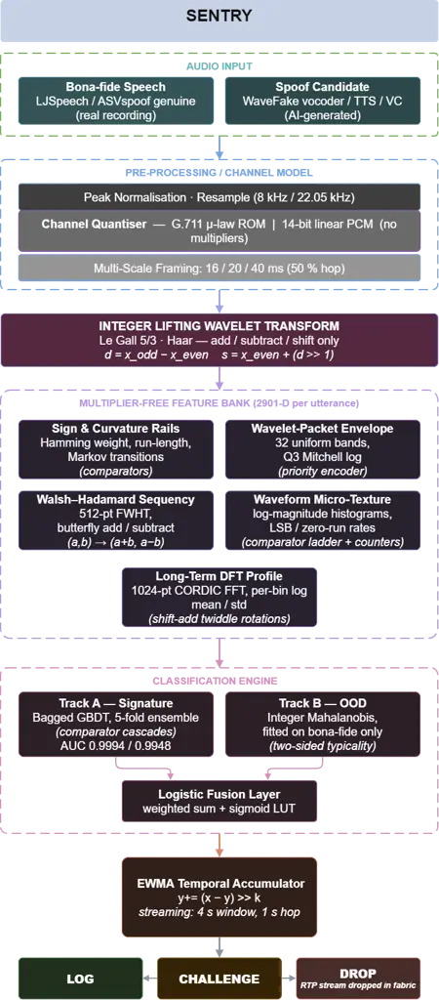

# SENTRY: A Streaming Edge Network Trust Engine for Real-Time Audio Deepfake Detection

Chirantan Banerjee, Soumita Chatterjee, Bhargab B. Bhattacharya and
Hafizur Rahaman Affiliation: Indian Institute of Engineering Science and
Technology, Shibpur, India

###### Abstract

Advances in real-time voice cloning and neural vocoders have enabled
large-scale streaming deepfake and vishing attacks, while simultaneously
exposing voice communication systems to denial-of-service threats.
Existing Network Detection and Response (NDR) solutions rely on
computationally intensive, GPU-based post-processing techniques that
require buffered audio and exhibit limited robustness against unseen
speech synthesis models. This paper presents SENTRY, a
hardware-oriented, streaming trust engine for inline deepfake detection
at the network edge. SENTRY employs an integer lifting-wavelet front end
together with a bank of multiplier-free transforms, including
wavelet-packet envelopes, Walsh–Hadamard sequency profiles, waveform
micro-statistics, and long-term spectral features, designed so that
acoustic analysis needs only integer add, shift, compare and bitwise
operations. A supervised gradient-boosted tree classifier is combined
with an unsupervised Mahalanobis out-of-distribution detector trained
solely on authentic speech, and their outputs are fused through a
lightweight logistic decision layer to produce graduated log, challenge,
or drop actions. Under a closed-set protocol, SENTRY reaches 98.75%
accuracy at a 1.25% equal-error rate (EER) on WaveFake, with perfect
separation of HiFi-GAN and WaveGlow; its supervised track alone achieves
an AUC of 0.9994 (fused system: 0.9993). On ASVspoof 2019 LA (attacks
A01–A06) transmitted through an $`8`$ kHz $`\mu`$-law telephony channel,
it reaches 94.75% accuracy at a 5.05% EER, with a supervised-track AUC
of 0.9948 (fused: 0.9884) and per-attack EERs below 7%. In our
prototype, the feature front end runs as bit-exact integer code on a
single Arm Cortex-A53 core, and the classifier and fusion stage are
synthesized for a Xilinx Zynq UltraScale+ MPSoC using no DSP slices,
returning a decision 220 ns after a feature vector is ready. These
results indicate that deepfake screening can be placed inline without
GPUs or floating-point hardware; generalization to unseen generators is
left to future work.

###### Index Terms: 

Audio Deepfake Detection, FPGA, Integer Lifting Wavelet Transform,
Network Detection and Response, Real-Time, Voice Phishing

## I Introduction

Voice phishing, or vishing, has become one of the most effective forms
of social engineering in modern telecommunications \[21\]. Unlike a
suspicious email, a phone call carries tone, urgency and the simple
human habit of trusting a voice, which makes people far more likely to
comply before they stop to think \[7\]. Generative speech models have
removed the last practical barrier for attackers: a convincing cloned
voice costs almost nothing to produce and can be generated on demand. A
recent population-scale study reports that AI-generated voices reach
compliance rates above $`36\%`$ in emotionally charged scenarios, and
that several commercial voice systems are already cheap enough to make
automated vishing economically worthwhile \[7\]. The threat is no longer
hypothetical; it is active, inexpensive and spreading.

Compounding the problem, people cannot be relied upon to spot these
calls themselves. The same study found listeners correctly identified
AI-generated callers only about $`70\%`$ of the time, close to chance
when judging text, and, critically, participants who use AI tools
frequently were no better at detection than those who never had \[7\].
Independent perceptual studies reach the same conclusion: humans are
poor discriminators of cloned speech, and training offers little
benefit \[2, 14\]. Familiarity with generative AI confers no protection.
This makes automated, in-network detection not merely convenient but
necessary, because the human in the loop is not a dependable line of
defence.

The danger is not limited to fooling a single victim. When synthetic
voices are generated in bulk and pointed at corporate customer-service
lines, they can exhaust human agents and automated menus alike, tipping
a call centre into an operational denial-of-service against real
customers. Defending against this needs more than accuracy: it needs a
decision made _during_ the call. A vishing call is a live audio stream,
not a file waiting on a disk, and by the time a recording could be
pulled aside and analysed offline, the conversation is already over and
the money already gone. A useful defence has to render a verdict in the
first seconds of a call, close to where the audio enters the network.

This is where current detectors fall short, in three ways. First, the
strongest systems, such as AASIST \[8\] and RawNet2 \[18\], and the
self-supervised front ends that now dominate the leaderboards \[19, 1\],
are floating-point neural networks that rely on dense
multiply-accumulate hardware such as GPUs, an assumption that does not
hold for a low-cost inline device at a network gateway. Second, these
models are trained against a fixed list of known synthesisers and
generalise poorly when a new one appears. Müller et al. \[13\] showed
that detectors tuned on ASVspoof degrade by up to an order of magnitude
on found, real-world audio, which suggests the field has fitted itself
rather closely to one benchmark \[24\]. Third, existing tools are built
as offline forensic utilities that look only at the waveform, ignoring
the live network-layer signals, such as RTP jitter and packet-arrival
volatility, that a real-time system sitting in the data path could
exploit. In short, deepfake defence today is an after-the-fact analysis,
not the real-time inline network security function an NDR appliance
actually needs. SENTRY addresses the third gap through inline deployment
but currently uses acoustic features only; exploiting network-layer
signals is left to future work.



Fig. 1: Overview of the proposed framework.

We present SENTRY (Streaming Edge-Network Trust Engine; Fig. 1), a
lightweight, hardware-oriented detector built to close these gaps. The
central idea is to do all detection work with integer additions, shifts,
comparisons, xor and popcount operations, so that the pipeline can be
mapped onto FPGA look-up tables with no floating-point units and no DSP
multipliers. On that arithmetic foundation, SENTRY makes three design
choices aimed directly at the three failures above:

- •
  Artefact-oriented features. Rather than a mel front end, which
  compresses the very band where vocoder artefacts live, SENTRY uses a
  multi-resolution integer wavelet decomposition together with a fine
  long-term spectral profile, so the high-frequency evidence survives
  into the classifier.
- •
  Built for live audio. SENTRY is designed to consume an RTP stream
  directly and produce a running human-versus-AI verdict within the
  first seconds of a call, rather than waiting for a completed
  recording.
- •
  Deployable at the edge. Every operation on the inference path is
  designed as a cheap integer primitive, so the detector can be mapped
  to FPGA fabric and run inline without a GPU in the loop.

We prototype SENTRY on a Xilinx Zynq UltraScale+ MPSoC. In this
prototype, the feature front end runs as bit-exact integer C on one Arm
Cortex-A53 core of the processing system, and the classifier and fusion
stage run as a Vitis HLS kernel in the programmable logic. Feature
vectors are transferred to the fabric via AXI-DMA, the
log/challenge/drop verdict is computed without further CPU involvement,
and the design allows the offending stream to be dropped directly in
hardware. Trained parameters load at start-up over AXI-Lite and can be
refreshed without rebuilding the bitstream.

## II Related Work

### II-A Neural Countermeasures and Their Cost

The anti-spoofing literature has converged on end-to-end neural models.
RawNet2 consumes raw waveforms through learnable sinc filters \[18\],
AASIST models spectral and temporal artefacts jointly with graph
attention \[8\], and the current strongest systems fine-tune large
self-supervised encoders such as wav2vec 2.0 on spoofing data \[19, 1\],
often with heavy augmentation to survive channel variation \[17\]. These
deliver excellent in-domain numbers on ASVspoof 2019 \[22\] and
2021 \[23\]. Their sizes range from hundreds of thousands of parameters
(AASIST) to hundreds of millions (self-supervised encoders), but all of
them depend on dense floating-point multiply-accumulate hardware.
Nothing in that design admits a multiplier-free, line-rate
implementation, which is the constraint SENTRY takes as primary.

### II-B The Generalisation Problem

A second and more troubling thread is that these numbers do not travel.
Müller et al. \[13\] evaluated a suite of published detectors on found,
in-the-wild recordings of public figures and observed error-rate
increases of up to an order of magnitude relative to ASVspoof,
concluding that the field may have tailored its solutions too closely to
a single benchmark. Surveys of the area report the same pattern \[24\],
and successive challenge editions have added codec, compression and
channel variability precisely because in-domain accuracy had ceased to
be informative \[23\]. This is why we report per-generator behaviour and
two acoustically different channel conditions rather than a single
pooled figure.

### II-C Lightweight and Applied Voice-Scam Detectors

Closest to our deployment goal are recent applied systems. Saxena
et al. \[16\] pair a CNN with a recurrent network over MFCC and
spectrogram inputs and add SHAP/LIME explainability, reporting $`98\%`$
accuracy for real-versus-fake audio. Rubika et al. \[15\] combine a
1D-CNN branch with a Speech-Transformer branch to capture prosodic
urgency and conversational intent, reporting a $`94.8\%`$ F1-score and
explicitly targeting lightweight deployment. Both frame the problem
correctly, as a live telecommunications threat rather than an offline
forensic exercise.

Three gaps remain, and SENTRY is designed around them. _Scale and
evaluation:_ these systems are trained and tested on small,
self-collected corpora ($`1{,}000`$ and $`1{,}200`$ clips respectively),
with a test partition of a few tens of clips in the first case; neither
performs cross-dataset validation, and Rubika et al. name the small
dataset and the absence of cross-corpus evaluation as principal
limitations of their own study. Given the degradation documented
in \[13\], accuracy measured on such partitions is hard to transfer to
an operational setting. _Front-end choice:_ both rely on mel-scaled
features, which compress precisely the high-frequency band where
neural-vocoder upsampling artefacts accumulate; constant-Q and cepstral
front ends share this tendency \[20\]. _Deployment reality:_ the CNN–RNN
system is served from a Flask/React stack with Twilio call capture and
cloud hosting, so detection still runs on general-purpose servers, while
the Transformer–CNN hybrid is designed for edge feasibility but defers
parameter count, memory footprint and latency measurement to future
work. In both cases the arithmetic is floating-point neural computation,
which needs DSP blocks or a GPU.

SENTRY differs on all three axes. It is evaluated on two established
public corpora spanning distinct generator families—neural vocoders and
classical TTS/voice-conversion attacks—rather than a single
self-collected set, with per-generator breakdowns reported for every
attack system. It replaces the mel front end with a multi-resolution
integer lifting wavelet plus a fine long-term spectral profile that
preserves the high-frequency evidence. And it executes entirely in
integer arithmetic, so the classifier is not merely “lightweight” in
parameter count but structurally free of multipliers and synthesisable
into FPGA fabric inline with the RTP path.

## III Methodology

SENTRY is a streaming trust engine that decides whether a telephony or
VoIP audio stream carries genuine human speech or machine-generated
audio, using integer additions, subtractions, shifts, comparisons, xor
and popcount operations, so that the inference datapath is designed to
map to FPGA lookup logic with no DSP multipliers. An incoming stream
first passes through a channel front end (an $`8`$ kHz $`\mu`$-law
telephony model, or a wideband 14-bit linear quantizer for
Opus/G.722-grade links). The integer PCM is then analysed by a bank of
multiplier-free transforms at several time scales, each turning the
waveform into a compact set of statistics that expose a different kind
of synthesis artefact. These statistics feed two parallel decision
tracks: Track A, a gradient-boosted tree ensemble \[9\] trained on known
bona-fide and spoof examples, and Track B, an integer Mahalanobis
out-of-distribution detector \[11\] fitted on genuine speech only. A
lightweight logistic layer fuses the two track scores, an
exponentially-weighted accumulator smooths the decision over time, and a
graduated policy emits one of three actions—log, challenge or drop—at
operator-chosen false-alarm rates. Training happens offline in floating
point; only integer thresholds and shift-quantized matrices are
deployed.

The feature front end is a stack of complementary multiplier-free
transforms; each was added to capture an artefact class the previous
ones could not see. We describe them in the order signal information
flows.

### III-A Integer Lifting Wavelet and Sign Rails

Each frame is decomposed with a multi-level integer lifting wavelet
transform (Le Gall 5/3 \[10\] or Haar), realised through the lifting
factorisation \[5\], which maps integers to integers using only add,
subtract and arithmetic shift \[4\]. For the Haar case the lifting step
is

```math
d=x_{\mathrm{odd}}-x_{\mathrm{even}},\qquad s=x_{\mathrm{even}}+\lfloor d/2\rfloor, \tag{1}
```

where $`s`$ and $`d`$ are the approximation and detail sub-bands and
$`\lfloor\cdot/2\rfloor`$ is a right shift. From the wavelet
coefficients we form binary “sign-of-derivative” rails: bit $`b_{t}=1`$
if a coefficient increased relative to the previous frame, and a second
curvature rail marking sign changes of the second temporal difference.
These rails are magnitude-blind by construction, cost only comparators,
and summarise the fine temporal dynamics of the coefficients through
per-band Hamming weights, run-length statistics and first-order Markov
transition rates.

### III-B Wavelet-Packet Envelope

The sign rails cannot see spectral _magnitude_ structure, so we add a
wavelet-packet filterbank: the top octave is split further with repeated
Haar lifting to yield $`32`$ uniform sub-bands, an integer,
multiplier-free analogue of a linear-frequency filterbank. For each band
we take a fixed-point log energy using Mitchell’s approximation \[12\],

```math
\log_{2}v\approx e+\mathrm{frac},\qquad e=\lfloor\log_{2}v\rfloor, \tag{2}
```

where $`e`$ is the leading-one position (a priority encoder) and the
fractional bits are a barrel shift—no multiplier. Band statistics are
computed over all frames and, separately, over high-energy (voiced)
frames selected by an energy comparator, since silence dilutes the
envelope.

### III-C Walsh–Hadamard Sequency Profile

To resolve narrow comb structure that a shallow packet tree smears, we
apply a Fast Walsh–Hadamard Transform (FWHT), the classic
multiplier-free spectral transform \[3\], built entirely from butterfly
add/subtract stages:

```math
(a,b)\;\longmapsto\;(a+b,\;a-b), \tag{3}
```

recursively over $`\log_{2}N`$ stages. Per-bin means and standard
deviations of the integer log-magnitude sequency spectrum, taken over
voiced frames, give a fine texture descriptor for the mid band. Averaged
over voiced frames, synthetic speech sits consistently below genuine
speech across most sequency bands, and it is this systematic offset
rather than any single bin that the downstream classifier exploits.

### III-D Waveform Micro-statistics

Real recordings carry a microphone/pre-amp noise floor that dithers the
low-order sample bits; vocoder output does not. We therefore histogram
the log-magnitudes of the samples and of their first differences and
record least-significant-bit and zero-run rates—a comparator ladder plus
a handful of counters in hardware—to expose this “too clean”
fine-amplitude texture.

### III-E Long-Term DFT Log-Magnitude Profile

The most discriminative descriptor is a fine Discrete Fourier Transform
of long frames. The average energy per frequency bin is precisely where
the original WaveFake analysis locates the real-versus-fake
difference \[6\], and it is concentrated in the higher frequencies. For
a frame $`x`$ we compute

```math
X(k)=\sum_{n=0}^{N-1}x(n)\,w(n)\,e^{-j2\pi kn/N}, \tag{4}
```

and store per-bin means and standard deviations of the integer log
magnitude over voiced frames. In hardware this is the golden model of a
CORDIC FFT, whose twiddle rotations are shift-add iterations, so the
multiplier-free property is preserved; a quantization ablation of the
fixed-point path is left to future work.

### III-F Two-Track Decision and Fusion

Track A is a bagged $`k`$-fold gradient-boosted tree ensemble \[9\] over
the full feature vector. Track B is an integer Mahalanobis score fitted
on bona-fide speech only, using robust median/MAD scaling, a shrinkage
covariance estimator and a two-sided log-distance so that “suspiciously
typical” (over-smoothed) audio is flagged as strongly as “far” audio:

```math
D(f)=(f-\mu)^{\top}\,\Sigma^{-1}\,(f-\mu),\qquad z=\frac{|\log(1+D)-m|}{\mathrm{MAD}}. \tag{5}
```

A two-input logistic layer fuses the track scores; in RTL this is a
weighted sum plus a small sigmoid lookup. Algorithm 1 summarises the
inference path.

1: $`p\leftarrow\textsc{ChannelQuantize}(x)`$

2: $`F\leftarrow[\,]`$

3: for each analysis scale do

4:   compute lifting-wavelet sign/curvature rail statistics

5:   compute $`32`$-band packet log-energy envelope

6:   compute FWHT sequency profile and waveform micro-statistics

7:   compute long-term DFT log-magnitude profile

8:   append all to $`F`$

9: end for

10:
$`s_{A}\leftarrow\textsc{TrackA}(F)`$; $`s_{B}\leftarrow\textsc{TrackB}(F)`$

11:
$`s\leftarrow\textsc{Fuse}(s_{A},s_{B})`$; $`\bar{s}\leftarrow\textsc{Ewma}(s)`$

12: return
$`\textsc{Policy}(\bar{s})\in\{\textsc{log},\textsc{challenge},\textsc{drop}\}`$

Algorithm 1 SENTRY inference for one stream

The novelty of SENTRY is that it reaches high closed-set accuracy with a
feature front end designed around integer primitives: every transform in
the inference path, from the lifting wavelet to the CORDIC-FFT profile,
is built from adds, shifts and comparators, so that it maps to LUT logic
without DSP slices. Two kinds of statistic still involve products of
signal-dependent values, namely the per-bin standard deviations and the
Mahalanobis quadratic form; in this work they are computed in the
integer golden model, and their multiplier-free hardware realisation
(for example, small squaring look-up tables or log-domain squaring) is
part of the front-end synthesis left to future work. The feature set is
also deliberately artefact-oriented rather than model-specific: the
packet and DFT profiles describe _how_ synthesised speech deviates from
natural speech—high-frequency energy imbalance, over-smoothed spectral
envelopes, an absent noise floor—which are properties shared across
broad generator families rather than tied to one architecture. Track B,
fitted on genuine speech alone, is included as a mechanism for flagging
inputs that leave the bona-fide manifold; Section IV reports its
measured contribution, including where it underperforms.

The datapath is designed to run in real time on a mid-range FPGA at the
network edge, inline with a VoIP gateway. Because the transforms avoid
multipliers, the front end maps to a pipeline of the fabric’s native
primitives: the $`\mu`$-law stage is a $`256`$-entry ROM, the lifting
wavelet and Haar packet tree are add/subtract/shift stages, the FWHT is
a butterfly network, the DFT profile is a CORDIC FFT, and the per-band
log is a priority encoder plus barrel shifter. The tree ensemble becomes
comparator cascades and the fusion layer a short weighted sum with a
sigmoid lookup, so the classifier fits in on-chip block RAM and LUTs
(Section IV-C) and comfortably meets the $`20`$–$`40`$ ms frame budget.

## IV Results and Discussions

We evaluate SENTRY on two established public corpora chosen to span
different generator families. WaveFake \[6\] supplies six neural
vocoders (five GAN-based and one flow-based) resynthesising LJSpeech,
and is analysed at $`22.05`$ kHz through the wideband integer front end,
which retains the $`8`$–$`11`$ kHz band where vocoder artefacts are
strongest. ASVspoof 2019 LA \[22\] supplies six text-to-speech and
voice-conversion attack systems over many speakers, and is analysed at
$`8`$ kHz through the G.711 $`\mu`$-law telephony channel model,
matching the narrowband PSTN condition an inline appliance would
actually see. Each dataset contributes $`8{,}000`$ utterances, divided
into disjoint training and test sets in which every attack system
appears in both; for ASVspoof 2019 LA they are drawn from the training
and development partitions (attacks A01–A06). This closed-set protocol
differs from the official ASVspoof 2019 LA evaluation partition, whose
attacks A07–A19 are unseen in training; we leave that protocol, and a
same-split comparison with published neural countermeasures, to future
work. All feature extraction and inference use integer arithmetic only;
the floating-point transforms serve purely as golden-model references.
We report equal-error rate alongside accuracy, F1 and AUC, following
standard practice in the anti-spoofing literature; confidence intervals
are not yet reported, so small differences should be read with caution.

### IV-A Detection Performance Across Datasets

Table I reports both datasets with each decision track shown separately,
and the best value in every column is set in bold. On WaveFake the fused
system reaches $`98.75\%`$ accuracy at a $`1.25\%`$ equal-error rate. On
ASVspoof 2019 LA the same pipeline, operating through a narrowband
telephony channel that discards everything above $`4`$ kHz, reaches
$`94.75\%`$ accuracy at a $`5.05\%`$ equal-error rate. We attribute much
of the gap between the two to the channel: the wideband condition
preserves the high-frequency band the packet and DFT profiles depend on,
while the $`\mu`$-law trunk removes it. The two datasets also differ in
speakers and generator families, so this comparison is indicative rather
than controlled. The ASVspoof figure should be read as the harder, more
operationally realistic PSTN operating point, since channel and codec
variability is exactly what later challenge editions were designed to
stress \[23\].

The per-track breakdown deserves a plain statement. Track A carries the
discriminative load on both datasets and achieves the _best ranking
quality of any configuration_, with an AUC of $`0.9994`$ on WaveFake and
$`0.9948`$ on ASVspoof, higher in both cases than the fused score. The
fusion layer trades a little ranking quality for a slightly better
decision threshold: fusion lowers EER from $`1.31\%`$ to $`1.25\%`$ on
WaveFake and from $`5.38\%`$ to $`5.05\%`$ on ASVspoof. These
differences are small, and without confidence intervals we do not claim
they are significant. Track B, the unsupervised out-of-distribution
engine, performs weakly in this closed-set regime ($`29.89\%`$ and
$`43.18\%`$ EER), which is unsurprising: with every generator
represented in training, a supervised model leaves little for an anomaly
detector to add, and a single-Gaussian model of the bona-fide manifold
is a coarse description of a high-dimensional feature space. We retain
Track B because its intended value lies in the unseen-generator regime
that a closed-set protocol does not exercise \[13\]; quantifying that
value under leave-one-generator-out and cross-corpus protocols is
ongoing work.

|                            |         |          |        |        |         |
| -------------------------- | ------- | -------- | ------ | ------ | ------- |
| Dataset                    | Track   | Acc. (%) | F1 (%) | AUC    | EER (%) |
| WaveFake                   | Fused   | 98.75    | 98.75  | 0.9993 | 1.25    |
|                            | Track A | 98.69    | 98.69  | 0.9994 | 1.31    |
|                            | Track B | 70.11    | 70.16  | 0.7195 | 29.89   |
| ASVspoof 2019 LA (A01–A06) | Fused   | 94.75    | 97.00  | 0.9884 | 5.05    |
|                            | Track A | 94.17    | 96.65  | 0.9948 | 5.38    |
|                            | Track B | 56.83    | 70.23  | 0.6024 | 43.18   |

TABLE I: Closed-Set Detection Performance on Both Datasets ($`8{,}000`$
utterances each, integer datapath). Best value per column in bold.

### IV-B Per-Generator Detection

Table II breaks the fused score down by the AI model that produced the
audio. This is the view an operator cares about, since it answers which
synthesisers the detector actually catches. Two generators, HiFi-GAN and
WaveGlow, are separated without error at the equal-error operating
point, and Parallel WaveGAN and MelGAN are close behind. Multi-band
MelGAN, which synthesises sub-bands separately, and Full-band MelGAN are
the hardest of the GAN family. On the ASVspoof side the per-attack EERs
of the six attack systems range from $`1.60\%`$ to $`6.95\%`$ despite
the narrowband channel, with A06, a voice-conversion system, the most
difficult. Per-generator accuracy is measured at each generator’s own
EER threshold (Table II, note), so it shows separability rather than the
detection rate at a single deployed threshold.

|                                                |      |                              |            |         |
| ---------------------------------------------- | ---- | ---------------------------- | ---------- | ------- |
| AI Model                                       | Type | Accuracy of Being AI (%)^(a) | AUC        | EER (%) |
| _WaveFake ($`22.05`$ kHz wideband)_            |      |                              |            |         |
| HiFi-GAN                                       | GAN  | 100.00                       | 1.0000     | 0.00    |
| WaveGlow                                       | Flow | 100.00                       | 1.0000     | 0.00    |
| Parallel WaveGAN                               | GAN  | 99.87                        | 1.0000^(b) | 0.13    |
| MelGAN                                         | GAN  | 99.36                        | 1.0000^(b) | 0.64    |
| Multi-band MelGAN                              | GAN  | 98.43                        | 0.9981     | 1.57    |
| Full-band MelGAN                               | GAN  | 98.07                        | 0.9980     | 1.93    |
| _ASVspoof 2019 LA ($`8`$ kHz G.711 telephony)_ |      |                              |            |         |
| A02                                            | TTS  | 98.40                        | 0.9902     | 1.60    |
| A01                                            | TTS  | 98.11                        | 0.9966     | 1.89    |
| A05                                            | VC   | 97.31                        | 0.9912     | 2.69    |
| A04                                            | TTS  | 95.59                        | 0.9873     | 4.41    |
| A03                                            | TTS  | 95.42                        | 0.9975     | 4.58    |
| A06                                            | VC   | 93.05                        | 0.9686     | 6.95    |

^(a)Measured at each generator’s own EER threshold, so it equals
$`100-\mathrm{EER}`$. ^(b)Rounded to four decimals; the unrounded value
is below 1, consistent with $`\mathrm{AUC}\leq 1-\mathrm{EER}^{2}`$.

TABLE II: Detection Accuracy by AI Model (fused score, each generator
versus bona fide)

### IV-C FPGA Implementation and Real-Time Behaviour

The classifier and fusion stage were described in Vitis HLS and
synthesised for the Zynq UltraScale+ target; in this prototype the
feature front end runs as bit-exact integer C on the processing system.
The front end is designed for the same integer primitives: the channel
model is a small ROM, the lifting wavelet and packet tree are
add/subtract/shift stages \[5\], the Walsh–Hadamard stage is a butterfly
network \[3\], the long-term profile is a CORDIC-style shift-add block,
and the per-band log is a priority encoder with a barrel shifter \[12\];
synthesising it is future work. On a positive verdict, the offending RTP
stream can be dropped in the fabric with no host CPU involvement, which
is the inline mitigation an NDR appliance requires. This is the concrete
difference from cloud-served detectors, where audio must be captured
through a telephony API, shipped to a server and classified there before
any action can be taken \[16\], and from edge-oriented neural hybrids
whose latency and memory cost on embedded hardware remain
unmeasured \[15\].

Table III reports post-synthesis resource utilisation of the classifier
and fusion kernel: it consumes 11,656 LUTs (5.06% of the 230,400
available), 1,090 LUTRAMs (1.07%), 9 BRAMs (2.88% of 312), and 13,249
registers (2.88% of 460,800), while requiring zero DSP slices,
confirming that this kernel is realised entirely from integer compare
and add logic rather than multiply-accumulate resources. Table IV
reports its timing and power: at a 100 MHz clock the kernel returns a
decision 220 ns (22 cycles) after a feature vector is ready,
corresponding to 4.55 million feature vectors per second. The 2.94 W
figure is the Vivado on-chip power estimate for the whole device,
including the processing system and static power, rather than the
incremental power of the kernel. End-to-end time to first verdict is
dominated by the window of audio the policy accumulates rather than by
this compute latency, and is not measured here.

|          |        |           |                 |
| -------- | ------ | --------- | --------------- |
| Resource | Used   | Available | Utilization (%) |
| LUT      | 11,656 | 230,400   | 5.06            |
| LUTRAM   | 1,090  | 101,760   | 1.07            |
| BRAM     | 9      | 312       | 2.88            |
| Register | 13,249 | 460,800   | 2.88            |
| DSP      | 0      | 1,728     | 0.00            |

TABLE III: Post-Synthesis Resource Utilization of the Classifier and
Fusion Kernel (Zynq UltraScale+ XCZU7EV)

| Clock (MHz) | Latency (ns) | Throughput (M vectors/s) | Power (W) |
| ----------- | ------------ | ------------------------ | --------- |
| 100         | 220          | 4.55                     | 2.94      |

TABLE IV: Timing and Power of the Classifier and Fusion Kernel (power is
the Vivado on-chip estimate for the whole device, including the
processing system)

### IV-D Comparison with Prior Systems

Table V places SENTRY beside representative prior detectors. We compare
design points rather than headline accuracies, because the reported
figures come from different corpora and, in the case of the CNN–RNN and
Transformer–CNN systems, from small self-collected test partitions that
are not commensurable with the public benchmarks used here \[16, 15\].
What the table makes visible is the combination SENTRY targets: a front
end that keeps high-frequency evidence, arithmetic that needs no
multipliers, evaluation on more than one public corpus with
per-generator reporting, and a deployment target that sits in the packet
path rather than behind it.

|                        |                     |                  |                           |               |
| ---------------------- | ------------------- | ---------------- | ------------------------- | ------------- |
| Method                 | Front End           | Arithmetic       | Public multi- corpus eval | Deploy target |
| CNN–RNN + XAI \[16\]   | MFCC/Spec           | Float NN         | No                        | Cloud         |
| Transformer–CNN \[15\] | Mel-spec            | Float NN         | No                        | Mobile^(∗)    |
| RawNet2 \[18\]         | Raw/sinc            | Float NN         | Yes                       | GPU           |
| AASIST \[8\]           | Raw/graph           | Float NN         | Yes                       | GPU           |
| wav2vec2-AASIST \[19\] | SSL                 | Float NN         | Yes                       | GPU           |
| SENTRY (ours)          | Integer lifting DWT | Integer (no DSP) | Yes                       | FPGA Online   |

^(∗)Stated design goal; latency and memory on embedded hardware are left
to future work in the cited study.

TABLE V: Comparison of Design Points with Representative Prior Systems

## V Conclusion

This paper presented SENTRY, a streaming deepfake voice detector built
entirely on integer arithmetic. By combining an integer lifting-wavelet
front end, multiplier-free feature transforms, and a dual-track decision
engine, SENTRY is designed for inline deployment on FPGA-based network
infrastructure without floating-point units or DSP multipliers; in our
prototype the classifier and fusion stage are synthesised with zero DSP
slices, while the front end runs as integer code on the processing
system. Under a closed-set protocol, SENTRY achieves 98.75% accuracy
with a 1.25% equal-error rate (EER) on WaveFake, perfectly separating
HiFi-GAN and WaveGlow, and 94.75% accuracy with a 5.05% EER on
ASVspoof 2019 LA (attacks A01–A06) transmitted over an $`8`$ kHz
$`\mu`$-law telephony channel, with per-attack EERs below 7%. The
supervised detection path delivers the best ranking performance, with
AUCs of 0.9994 and 0.9948, while the fusion stage slightly improves
operating-point selection. We attribute the narrowband performance
reduction primarily to the loss of high-frequency spectral information.
The out-of-distribution track is weak in the closed-set regime, and
generalisation to unseen generators, which motivates it, remains to be
demonstrated. Future work will evaluate SENTRY on the official
ASVspoof 2019 LA evaluation partition and under leave-one-generator-out
and cross-corpus protocols with same-split neural baselines, synthesise
the complete front end, assess robustness to codecs and adaptive
attacks, and explore network-layer evidence such as RTP timing.

## References

- \[1\] A. Baevski, Y. Zhou, A. Mohamed, and M. Auli (2020) wav2vec 2.0:
  a framework for self-supervised learning of speech representations. In
  Advances in Neural Information Processing Systems, Vol. 33,
  pp. 12449–12460. Cited by: §I, §II-A.
- \[2\] S. Barrington, E. A. Cooper, and H. Farid (2025) People are
  poorly equipped to detect AI-powered voice clones. Scientific Reports
  15 (1), pp. 11004. Cited by: §I.
- \[3\] K. G. Beauchamp (1984) Applications of Walsh and related
  functions. Academic Press, London. Cited by: §III-C, §IV-C.
- \[4\] A. R. Calderbank, I. Daubechies, W. Sweldens, and B. Yeo (1998)
  Wavelet transforms that map integers to integers. Applied and
  Computational Harmonic Analysis 5 (3), pp. 332–369. Cited by: §III-A.
- \[5\] I. Daubechies and W. Sweldens (1998) Factoring wavelet
  transforms into lifting steps. Journal of Fourier Analysis and
  Applications 4 (3), pp. 247–269. Cited by: §III-A, §IV-C.
- \[6\] J. Frank and L. Schönherr (2021) WaveFake: a data set to
  facilitate audio deepfake detection. In Proc. NeurIPS Datasets and
  Benchmarks Track, Cited by: §III-E, §IV.
- \[7\] F. Heiding, C. Mayrink Verdun, S. Lermen, A. Kao, V. Albiero, L.
  Deason, I. Veliche, and C. Lehane (2027) Evaluating AI models’
  capability to automate voice phishing attacks. Expert Systems with
  Applications 332, pp. 133620. External Links:
  [Document](https://dx.doi.org/10.1016/j.eswa.2026.133620) Cited by:
  §I, §I.
- \[8\] J. Jung, H. Heo, H. Tak, H. Shim, J. S. Chung, B. Lee, H. Yu,
  and N. Evans (2022) AASIST: audio anti-spoofing using integrated
  spectro-temporal graph attention networks. In Proc. IEEE ICASSP,
  pp. 6367–6371. External Links:
  [Document](https://dx.doi.org/10.1109/ICASSP43922.2022.9747766) Cited
  by: §I, §II-A, TABLE V.
- \[9\] G. Ke, Q. Meng, T. Finley, T. Wang, W. Chen, W. Ma, Q. Ye,
  and T. Liu (2017) LightGBM: a highly efficient gradient boosting
  decision tree. In Advances in Neural Information Processing Systems,
  Vol. 30. Cited by: §III-F, §III.
- \[10\] D. Le Gall and A. Tabatabai (1988) Sub-band coding of digital
  images using symmetric short kernel filters and arithmetic coding
  techniques. In Proc. IEEE ICASSP, pp. 761–764. Cited by: §III-A.
- \[11\] K. Lee, K. Lee, H. Lee, and J. Shin (2018) A simple unified
  framework for detecting out-of-distribution samples and adversarial
  attacks. In Advances in Neural Information Processing Systems, Vol. 31. Cited by: §III.
- \[12\] J. N. Mitchell (1962) Computer multiplication and division
  using binary logarithms. IRE Transactions on Electronic Computers
  EC-11 (4), pp. 512–517. Cited by: §III-B, §IV-C.
- \[13\] N. M. Müller, P. Czempin, F. Dieckmann, A. Froghyar, and K.
  Böttinger (2022) Does audio deepfake detection generalize?. In Proc.
  Interspeech, pp. 2783–2787. External Links:
  [Document](https://dx.doi.org/10.21437/Interspeech.2022-108) Cited by:
  §I, §II-B, §II-C, §IV-A.
- \[14\] N. M. Müller, K. Pizzi, and J. Williams (2022) Human perception
  of audio deepfakes. In Proc. DDAM, pp. 85–91. Cited by: §I.
- \[15\] R. Rubika, S. Saniya Rajan, and R. Elavarasan (2026)
  Voice-based scam detection system using lightweight speech-transformer
  models for real-time phone call monitoring. In Proc. EPDMC,
  pp. 390–395. External Links:
  [Document](https://dx.doi.org/10.1109/EPDMC67535.2026.11496568) Cited
  by: §II-C, §IV-C, §IV-D, TABLE V.
- \[16\] M. Saxena, O. Pote, V. Satarkar, Y. Bhosale, S. Ranjane, and G.
  Badkar (2025) AI powered deepfake voice and scam call detector for
  secure communication. In Proc. ICSIAIML, Advances in Intelligent
  Systems Research, Vol. 200, pp. 705–719. External Links:
  [Document](https://dx.doi.org/10.2991/978-94-6463-948-3%5F49) Cited
  by: §II-C, §IV-C, §IV-D, TABLE V.
- \[17\] H. Tak, M. Kamble, J. Patino, M. Todisco, and N. Evans (2022)
  RawBoost: a raw data boosting and augmentation method applied to
  automatic speaker verification anti-spoofing. In Proc. IEEE ICASSP,
  pp. 6382–6386. Cited by: §II-A.
- \[18\] H. Tak, J. Patino, M. Todisco, A. Nautsch, N. Evans, and A.
  Larcher (2021) End-to-end anti-spoofing with RawNet2. In Proc. IEEE
  ICASSP, pp. 6369–6373. External Links:
  [Document](https://dx.doi.org/10.1109/ICASSP39728.2021.9414234) Cited
  by: §I, §II-A, TABLE V.
- \[19\] H. Tak, M. Todisco, X. Wang, J. Jung, J. Yamagishi, and N.
  Evans (2022) Automatic speaker verification spoofing and deepfake
  detection using wav2vec 2.0 and data augmentation. In Proc. Odyssey
  Speaker and Language Recognition Workshop, pp. 112–119. Cited by: §I,
  §II-A, TABLE V.
- \[20\] M. Todisco, H. Delgado, and N. Evans (2017) Constant Q cepstral
  coefficients: a spoofing countermeasure for automatic speaker
  verification. Computer Speech & Language 45, pp. 516–535. Cited by:
  §II-C.
- \[21\] A. Triantafyllopoulos, A. A. Spiesberger, I. Tsangko, X.
  Jing, V. Distler, F. Dietz, F. Alt, and B. W. Schuller (2025) Vishing:
  detecting social engineering in spoken communication — a first survey
  and urgent roadmap to address an emerging societal challenge. Computer
  Speech & Language 94, pp. 101802. External Links:
  [Document](https://dx.doi.org/10.1016/j.csl.2025.101802) Cited by: §I.
- \[22\] X. Wang, J. Yamagishi, M. Todisco, H. Delgado, A. Nautsch, N.
  Evans, M. Sahidullah, V. Vestman, T. Kinnunen, K. A. Lee, et
  al. (2020) ASVspoof 2019: a large-scale public database of
  synthesized, converted and replayed speech. Computer Speech & Language
  64, pp. 101114. External Links:
  [Document](https://dx.doi.org/10.1016/j.csl.2020.101114) Cited by:
  §II-A, §IV.
- \[23\] J. Yamagishi, X. Wang, M. Todisco, M. Sahidullah, J. Patino, A.
  Nautsch, X. Liu, K. A. Lee, T. Kinnunen, N. Evans, and H.
  Delgado (2021) ASVspoof 2021: accelerating progress in spoofed and
  deepfake speech detection. In Proc. ASVspoof 2021 Workshop, pp. 47–54.
  External Links:
  [Document](https://dx.doi.org/10.21437/ASVSPOOF.2021-8) Cited by:
  §II-A, §II-B, §IV-A.
- \[24\] J. Yi, C. Wang, J. Tao, X. Zhang, C. Y. Zhang, and Y.
  Zhao (2023) Audio deepfake detection: a survey. arXiv preprint
  arXiv:2308.14970. Cited by: §I, §II-B.
