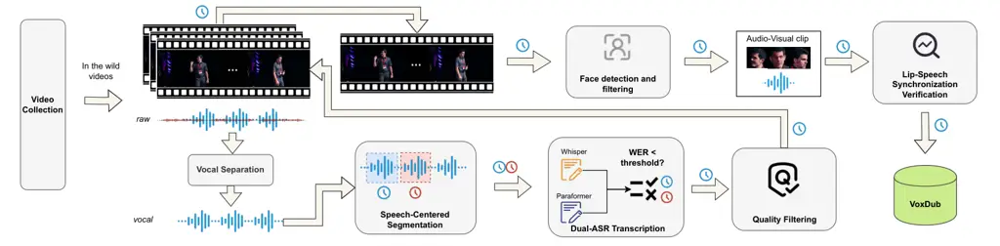

⁰⁰footnotetext: Corresponding authors

# VoxDub: A Bilingual Lip-Synchronized Audio-Visual Dataset for Automatic Video DubbingThanks: This work was supported in part by the National Natural Science Foundation of China under Grants 62276220 and 62371407 and the Innovation of Policing Science and Technology, Fujian province (Grant number: 2024Y0068).

Kaidi Wang Affiliation: School of Informatics, Xiamen University, China
   Wenhao Guan Affiliation: School of Electronic Science and
Engineering, Xiamen University, China E-mail <qyhong@xmu.edu.cn>   
Peijie Chen Affiliation: School of Informatics, Xiamen University, China
   Weijie Wu Affiliation: School of Informatics, Xiamen University,
China    Xuetao Lin Affiliation: School of Informatics, Xiamen
University, China    Lin Li Affiliation: School of Electronic Science
and Engineering, Xiamen University, China E-mail <qyhong@xmu.edu.cn>   
Qingyang Hong Affiliation: School of Informatics, Xiamen University,
China

###### Abstract

Automatic video dubbing (AVD) requires temporally aligned speech,
transcripts, and video, yet existing corpora vary in audio quality,
transcription reliability, and speaking-face visibility. We introduce
VoxDub, a bilingual lip-synchronized audio-visual dataset containing
766K clips and approximately 1.58K hours of in-the-wild Chinese and
English recordings, covering varied speakers, scenes, speaking styles,
and linguistic content. Its curation pipeline combines speech-centered
segmentation with dual-ASR transcription checking, speech quality
filtering, face visibility checks, and lip-speech synchronization
verification. Text-to-speech (TTS) experiments show that training on
VoxDub yields lower word error rates and higher speaker similarity than
training on the compared audio-visual corpora, LRS3 and CN-CVS. AVD
experiments show broadly comparable speech quality and subjective
synchronization. These results support the utility of VoxDub for TTS and
AVD training. More details are available on the [project
website](https://voxdub-dataset.github.io/VoxDub/).

###### Keywords: 

Automatic video dubbing Lip-speech synchronization Audio-visual dataset

## 1 Introduction

Automatic video dubbing (AVD) \[13\] aims to generate natural speech
that matches the linguistic content, speaking style, duration, and lip
movements of a target video. Compared with conventional text-to-speech
(TTS), AVD additionally requires temporal alignment between generated
speech and visible facial motion. Training data must therefore provide
not only usable speech–text pairs but also corresponding visual
information with consistent lip-speech alignment.

Existing resources meet different parts of this requirement. Speech and
audio-visual datasets \[7, 27\] have supported a range of modeling
tasks, while TTS-oriented corpora such as Emilia \[12\] provide speech
and transcriptions without visual supervision. Audio-visual corpora
supply paired speech and video, but differ in their treatment of audio
quality, transcription reliability, language and domain coverage, and
continuous face visibility. Recent work on joint audio-motion generation
and video dubbing \[14, 23\] further motivates the use of multimodal
training data. For the setting considered here, the data curation
problem is to retain usable speech segments while checking the quality
and consistency of the audio, text, and visible speaking face across
both Chinese and English recordings.

We address this problem with VoxDub, a bilingual corpus of
lip-synchronized video–speech pairs for AVD. It contains more than 766K
clips and approximately 1.58K hours of in-the-wild recordings spanning
varied speakers, scenes, speaking styles, and linguistic content. The
pipeline first segments recordings around speech activity, then filters
candidates using transcription agreement, speech quality, face
visibility, and lip-speech synchronization. This ordering prioritizes
speech segments while applying visual and synchronization checks to the
corresponding video intervals.

We assess the resulting corpus through dataset statistics and two
complementary downstream tasks. TTS experiments evaluate the utility of
its speech–text pairs, whereas AVD experiments evaluate its use for
adapting a pretrained speech generator to video-conditioned dubbing. The
main contributions are as follows:

- •
  We construct VoxDub, a bilingual audio-visual dataset of more than
  766K lip-synchronized clips for automatic video dubbing.
- •
  We develop a curation pipeline that combines speech-centered
  segmentation with checks on audio quality, transcription agreement,
  face visibility, and lip-speech synchronization.
- •
  We characterize the corpus and evaluate it on TTS and AVD, reporting
  improved TTS performance relative to the compared audio-visual corpora
  and competitive AVD performance under the evaluated settings.

## 2 Related Work

### 2.1 Text-to-Speech Datasets

Speech corpora provide the audio and text supervision required for TTS.
LibriTTS \[26\], derived from LibriSpeech \[18\], contains 585 hours of
English multi-speaker read speech with normalized text. Emilia \[12\]
extends this setting to large-scale multilingual in-the-wild speech,
using source separation, voice activity detection (VAD), automatic
speech recognition (ASR), and filtering to construct speech–text pairs.
These corpora are relevant to the speech quality and transcription
requirements of AVD, but their audio-only format does not provide visual
supervision for learning the correspondence between speech timing and
facial motion.

### 2.2 Audio-Visual Datasets

Audio-visual speech datasets serve tasks including lip reading,
talking-face generation, speaker recognition, and audio-visual speech
modeling. LRS3 \[1\], CMLR \[28\], and CN-CVS \[4\] provide paired
speech and video for visual speech recognition and related tasks.
Table 1 places these resources alongside speech-only corpora and
datasets used for talking-face generation and dubbing. Their different
intended uses lead to different choices of segmentation, annotation,
language coverage, and audio-visual filtering; they should therefore not
be treated as interchangeable sources of AVD training data.

VoxDub focuses on speech-centered clips with explicit checks on
transcription agreement, audio quality, face visibility, and lip-speech
synchronization. Its contribution is the combination of these checks in
a Chinese–English corpus, rather than synchronization filtering alone.
In Table 1, “Seg. Modality” denotes the primary modality used to segment
long recordings, and “Full Lip-Speech Align.” summarizes the treatment
of lip-speech correspondence across a clip. “Explicit” denotes an
explicit check or filtering step, “Assumed” denotes synchronization
inherited from the source recordings without explicit filtering, and
“Partial” denotes alignment constraints that do not cover the entire
clip. These categories describe curation procedures rather than a common
quantitative measure of alignment quality.

| Dataset           | Language | Scale   | Transcript | Visual     | Data Source      | Seg. Modality | Full Lip-Speech Align. |
| ----------------- | -------- | ------- | ---------- | ---------- | ---------------- | ------------- | ---------------------- |
| LibriTTS \[26\]   | EN       | 585 h   | ✓          | $`\times`$ | Audiobook        | Audio         | –                      |
| Emilia \[12\]     | Multi    | 101K+ h | ✓          | $`\times`$ | In-the-wild      | Audio         | –                      |
| MEAD \[25\]       | EN       | 40+ h   | ✓          | ✓          | Studio recording | –             | –                      |
| HDTF \[27\]       | EN       | 15.8 h  | $`\times`$ | ✓          | In-the-wild      | Visual        | Assumed                |
| CMLR \[28\]       | ZH       | 61+ h   | ✓          | ✓          | In-the-wild      | Audio         | Assumed                |
| LRS3 \[1\]        | EN       | 400+ h  | ✓          | ✓          | In-the-wild      | Visual        | Explicit               |
| CN-CVS \[4\]      | ZH       | 300+ h  | ✓          | ✓          | In-the-wild      | Visual        | Explicit               |
| VoxCeleb2 \[7\]   | Multi    | 2K+ h   | $`\times`$ | ✓          | In-the-wild      | Visual        | Explicit               |
| CelebV-Dub \[23\] | EN       | 86 h    | ✓          | ✓          | In-the-wild      | Visual        | Explicit               |
| CineDub-CN \[17\] | ZH       | 4.7K h  | ✓          | ✓          | In-the-wild      | Audio         | Partial                |
| VoxDub            | ZH/EN    | 1.58K h | ✓          | ✓          | In-the-wild      | Audio         | Explicit               |

Table 1: Comparison with representative speech and audio-visual
datasets.

## 3 VoxDub Dataset

### 3.1 Construction Pipeline

The VoxDub construction pipeline is illustrated in Fig. 1. Audio
processing first produces candidate speech segments and transcriptions.
Visual filtering then checks face visibility and lip-speech
correspondence within the matching video intervals. The stages are
described below.

Figure 1: Overview of the VoxDub dataset construction pipeline.

#### Video Collection

We collect videos from online streaming platforms using manually
selected topic keywords covering talks, interviews, films, news, vlogs,
and daily conversations. For each candidate, we record the video ID and
metadata and download the highest-quality available video and audio
streams. We standardize the recordings to 25 frames per second (FPS) and
a 24 kHz audio sampling rate before further processing.

#### Vocal Separation

In-the-wild recordings can contain background music, environmental
noise, and other non-speech sounds that interfere with transcription and
speech generation. Following Emilia \[12\], we use Ultimate Vocal
Remover (UVR)¹¹ 1
[https://github.com/Anjok07/ultimatevocalremovergui](https://github.com/Anjok07/ultimatevocalremovergui)
to separate each audio track into vocal and non-vocal components. Only
the vocal track is retained for subsequent processing.

#### Speech-Centered Segmentation

VoxDub uses speech activity, rather than visual tracks, as the primary
basis for segmentation. This choice is intended to reduce speech
truncation and retain segments suitable for transcription and speech
generation. We apply VAD²² 2
[https://github.com/snakers4/silero-vad](https://github.com/snakers4/silero-vad)
to the separated vocal track to obtain timestamps for speech-active
regions. Regions separated by short pauses are merged, and overly short
segments are removed to reduce over-segmentation. We then extract the
corresponding video intervals using the same timestamps, preserving the
temporal correspondence between each audio segment and its video.

#### Dual-ASR Transcription

We use agreement between two ASR systems as a transcription filtering
criterion. WhisperX \[3\], using Whisper-large-v3 \[20\], and
Paraformer \[11\] are applied to all candidate speech segments. WhisperX
provides transcription and language identification; only segments
identified as Chinese or English are retained. For each retained
segment, we compute the word error rate (WER) between the two ASR
hypotheses and discard candidates whose WER exceeds a predefined
threshold. The final annotation is the Whisper transcription for English
and the Paraformer transcription for Chinese.

#### Speech Quality Filtering

We filter the candidate audio to reduce noise, distortion, and other
acoustic artifacts. Specifically, we use the overall quality (OVRL)
score from DNSMOS P.835 \[21\] and discard clips with scores below 2.8.
To reduce speaker inconsistency within clips, we also apply a
multi-speaker detection model based on the CED architecture \[10\].
Segments detected as containing multiple speakers or speaker changes are
removed.

#### Face Detection and Filtering

We apply frame-level face detection \[8\] and retain only clips in which
exactly one face is detected in every frame. This criterion favors
continuous face visibility and reduces ambiguity associated with missing
or multiple visible faces. We also compare face bounding boxes in
adjacent frames and discard clips with abrupt location changes, which
may indicate a face switch, shot transition, or unstable detection.
These checks select clips with more stable face detections.

#### Lip-Speech Synchronization Verification

Continuous face detections do not by themselves establish that the
visible face corresponds to the speech. We therefore use SyncNet³³ 3
[https://huggingface.co/ByteDance/LatentSync-1.6/tree/main/auxiliary](https://huggingface.co/ByteDance/LatentSync-1.6/tree/main/auxiliary) \[6\]
to estimate lip-speech synchronization confidence for each candidate
clip. Clips with confidence scores below 3.0 are discarded. This stage
filters out low-confidence audio-visual pairs after the speech and face
checks.

Figure 2: Corpus composition: (a) language, (b) gender, and (c) clip
duration.

Figure 3: Quality-score distributions: (a) inter-ASR WER, (b) DNSMOS
P.835 OVRL, and (c) LSE-C.

### 3.2 Dataset Statistics

The curated VoxDub corpus contains $`766{,}708`$ clips. We characterize
its composition, visual continuity, resolution, and quality-score
distributions.

#### Dataset Composition

Fig. 2 summarizes language, speaker-category, and clip-duration
distributions. We additionally examine visual continuity because
speech-based boundaries can retain camera transitions within a clip.
Using SceneDetect⁴⁴ 4
[https://github.com/Breakthrough/PySceneDetect](https://github.com/Breakthrough/PySceneDetect),
we find that $`97.3\%`$ of clips contain a single detected scene. The
median short-side resolution is $`1080`$ px, and $`92.8\%`$ of clips
have a short-side resolution above 720 px. These statistics characterize
the continuity and spatial resolution of the retained video inputs.

#### Quality Distribution

Fig. 3 shows the distributions of inter-ASR WER, DNSMOS P.835 OVRL, and
LSE-C. Nearly 35% of retained clips have an inter-ASR WER of zero,
meaning that the two ASR hypotheses match under the applied comparison
procedure. More than half have WERs below 5%. These results indicate
substantial agreement between the recognizers, which serves as a proxy
for transcription reliability.

More than 80% of clips have DNSMOS P.835 OVRL scores above 3.0, and over
70% have LSE-C scores above 5.0. These distributions characterize the
predicted audio quality and synchronization confidence of the retained
corpus. They are consistent with the quality criteria used during
curation, rather than independent evidence of the contribution of each
filtering stage.

## 4 Experiments

### 4.1 Experimental Setup

#### Tasks

We evaluate VoxDub on two complementary tasks. For TTS, we use
ZipVoice \[29\], a compact flow-matching zero-shot TTS model, to assess
the utility of the speech–text pairs for synthesis. For AVD, we use
SyncVoice \[24\] to assess the utility of the paired video and speech
for video-conditioned generation. Together, these tasks assess the
suitability of VoxDub for speech synthesis and video-conditioned
dubbing.

#### Training Data

For TTS, we train separate Chinese and English ZipVoice models. The
Chinese models are trained on VoxDub-ZH and CN-CVS for 100K steps using
4 GPUs and a per-GPU batch size of 250 seconds of speech. The English
models trained on VoxDub-EN and LRS3 use 180K steps with the same GPU
count and batch size. The LibriTTS model follows the official ZipVoice
recipe for 60 epochs, or approximately 115K steps. We also evaluate the
official ZipVoice checkpoint pretrained on the large-scale Emilia corpus
as a reference model.

For AVD, we follow SyncVoice and initialize from ZipVoice weights
pretrained on Emilia. We fine-tune Chinese models on VoxDub-ZH and
CN-CVS and an English model on VoxDub-EN. The stated AVD training
configuration is 100K steps on 2 GPUs, with a per-GPU batch size of 250
seconds of speech. For the LRS3 baseline, we directly use the official
open-source checkpoint.

#### Evaluation Sets

We introduce DubBench, a bilingual test set for evaluating speech
synthesis and automatic video dubbing. DubBench comprises two subsets:
DubBench-ZH, constructed from CMLR with 1,000 Chinese samples, and
DubBench-EN, constructed from CelebV-Dub with 978 English samples. Each
sample includes reference speech, target text, and the corresponding
real video clip.

For TTS, we evaluate Chinese models on Seed-TTS test-zh \[2\] and
DubBench-ZH, and English models on Seed-TTS test-en and DubBench-EN. For
AVD, we use only DubBench-ZH and DubBench-EN, as this task requires
paired video inputs.

#### Evaluation Metrics

We use objective metrics and human ratings to evaluate the generated
speech.

For objective evaluation, we consider four aspects: (1) Intelligibility
is measured by WER between an ASR transcription of the generated speech
and the input text. We use Whisper-large-v3 \[20\] for English and
Paraformer-zh \[11\] for Chinese. (2) Speaker similarity is measured by
the cosine similarity between embeddings of the generated and reference
speech. We extract embeddings using a WavLM-based \[5\] ECAPA-TDNN \[9\]
speaker verification model and denote the metric as SIM-o \[15\]. (3)
Naturalness is estimated using UT-MOS \[22\], a neural mean opinion
score (MOS) predictor. (4) Lip-speech synchronization is evaluated for
AVD using LSE-C \[19\], computed with the pretrained SyncNet model
from \[16\]. Higher LSE-C indicates greater estimated synchronization
confidence between the generated speech and visible mouth motion.

For subjective evaluation, we randomly select 10 samples from each test
set and collect ratings from 15 human raters. We report CMOS, SMOS, and,
for AVD, Sync-MOS. CMOS evaluates naturalness relative to the reference
speech on a scale from $`-3`$ to $`3`$ in increments of $`1`$, with
higher scores indicating better perceived quality relative to the
reference. SMOS evaluates speaker similarity to the reference speech on
a scale from $`1`$ to $`5`$ in increments of $`0.5`$. Sync-MOS evaluates
perceived synchronization between generated speech and visible mouth
motion on the same $`1`$–$`5`$ scale with increments of $`0.5`$. Higher
SMOS and Sync-MOS scores indicate greater perceived speaker similarity
and lip-speech synchronization, respectively.

| Train Data | Seed-TTS test-en   |                    |                     |                   |                   | DubBench-EN        |                    |                     |                   |                   |
| ---------- | ------------------ | ------------------ | ------------------- | ----------------- | ----------------- | ------------------ | ------------------ | ------------------- | ----------------- | ----------------- |
|            | WER $`\downarrow`$ | SIM-o $`\uparrow`$ | UT-MOS $`\uparrow`$ | CMOS $`\uparrow`$ | SMOS $`\uparrow`$ | WER $`\downarrow`$ | SIM-o $`\uparrow`$ | UT-MOS $`\uparrow`$ | CMOS $`\uparrow`$ | SMOS $`\uparrow`$ |
| Emilia     | 1.55               | 0.696              | 3.85                | 0.19              | 4.08              | 2.40               | 0.635              | 3.58                | 0.14              | 3.86              |
| LibriTTS   | 3.92               | 0.603              | 3.69                | 0.07              | 3.79              | 8.38               | 0.511              | 3.46                | 0.03              | 3.51              |
| LRS3       | 12.54              | 0.448              | 3.36                | -0.16             | 3.47              | 12.34              | 0.506              | 3.06                | -0.07             | 3.55              |
| VoxDub-EN  | 3.01               | 0.601              | 3.92                | 0.14              | 3.96              | 4.34               | 0.562              | 3.42                | 0.09              | 3.67              |

Table 2: English TTS results on Seed-TTS test-en and DubBench-EN. WER is
reported as a percentage.

|            |                    |                    |                     |                   |                   |                    |                    |                     |                   |                   |
| ---------- | ------------------ | ------------------ | ------------------- | ----------------- | ----------------- | ------------------ | ------------------ | ------------------- | ----------------- | ----------------- |
| Train Data | Seed-TTS test-zh   |                    |                     |                   |                   | DubBench-ZH        |                    |                     |                   |                   |
|            | WER $`\downarrow`$ | SIM-o $`\uparrow`$ | UT-MOS $`\uparrow`$ | CMOS $`\uparrow`$ | SMOS $`\uparrow`$ | WER $`\downarrow`$ | SIM-o $`\uparrow`$ | UT-MOS $`\uparrow`$ | CMOS $`\uparrow`$ | SMOS $`\uparrow`$ |
| Emilia     | 1.42               | 0.750              | 3.14                | 0.06              | 4.03              | 1.72               | 0.740              | 3.55                | -0.03             | 4.11              |
| CN-CVS     | 12.52              | 0.482              | 2.81                | -0.22             | 3.64              | 7.17               | 0.593              | 2.71                | -0.25             | 3.48              |
| VoxDub-ZH  | 2.63               | 0.613              | 3.22                | -0.02             | 3.88              | 3.08               | 0.652              | 2.70                | -0.18             | 3.97              |

Table 3: Chinese TTS results on Seed-TTS test-zh and DubBench-ZH. WER is
reported as a percentage.

### 4.2 TTS Results

The TTS experiments assess the utility of VoxDub’s speech–text pairs on
the Seed-TTS and DubBench test sets. English comparisons include
LibriTTS, LRS3, and the Emilia reference model; Chinese comparisons
include CN-CVS and the Emilia reference model.

Table 2 reports the English results. The Emilia reference model achieves
the lowest WER and highest SIM-o and SMOS on both test sets, although it
does not obtain the highest UT-MOS on Seed-TTS test-en. Relative to
Emilia, the LibriTTS model has higher WER and lower speaker similarity,
particularly on DubBench-EN, where its WER is 8.38. The difference is
consistent with the potential benefit of large-scale TTS-oriented data.

Among the compared audio-visual corpora, VoxDub-EN improves on LRS3
across all reported metrics on both English test sets. WER decreases
from 12.54 to 3.01 on Seed-TTS test-en and from 12.34 to 4.34 on
DubBench-EN. LRS3 has the lowest SIM-o and UT-MOS on both sets; its SMOS
is the lowest on Seed-TTS test-en, but exceeds that of LibriTTS on
DubBench-EN. Relative to LibriTTS, VoxDub-EN achieves lower WER and
higher CMOS and SMOS on both sets. Its SIM-o is slightly lower on
Seed-TTS test-en and higher on DubBench-EN, while its UT-MOS is higher
on the former and lower on the latter. These results support the utility
of VoxDub-EN for TTS under the reported settings.

Table 3 reports the Chinese results. Compared with CN-CVS, VoxDub-ZH
reduces WER from 12.52 to 2.63 on Seed-TTS test-zh and from 7.17 to 3.08
on DubBench-ZH, while achieving higher SIM-o, CMOS, and SMOS on both
sets. UT-MOS is higher on Seed-TTS test-zh and nearly unchanged, but
numerically lower, on DubBench-ZH (2.70 versus 2.71). The Emilia
reference model retains lower WER and higher speaker similarity on both
sets; VoxDub-ZH has higher UT-MOS on Seed-TTS test-zh but lower UT-MOS
on DubBench-ZH. Overall, VoxDub improves intelligibility and speaker
similarity relative to the compared audio-visual corpora in these TTS
experiments. These results support the use of VoxDub’s curated
speech–text pairs for intelligible speech synthesis with consistent
speaker characteristics.

### 4.3 Audio Quality Comparison

Figure 4: Comparison of DNSMOS OVRL scores across different corpora.
Error bars denote standard deviations.

To complement the downstream evaluation, Fig. 4 compares mean DNSMOS
OVRL scores and their standard deviations across corpora. DNSMOS is a
reference-free predictor of perceived speech quality. We randomly sample
100K utterances from CN-CVS, LRS3, and VoxDub to compute these
statistics; the Emilia and LibriTTS values are taken from \[12\].

In Fig. 4, VoxDub has a higher mean score than CN-CVS and LRS3 and a
mean close to those reported for Emilia and LibriTTS. This ordering is
consistent with its favorable TTS results relative to the compared
audio-visual corpora. Together, the DNSMOS scores and TTS results
support the suitability of VoxDub’s speech recordings for speech
synthesis training.

| Lang | Train Data | WER $`\downarrow`$ | SIM-o $`\uparrow`$ | UT-MOS $`\uparrow`$ | LSE-C $`\uparrow`$ | CMOS $`\uparrow`$ | SMOS $`\uparrow`$ | Sync-MOS $`\uparrow`$ |
| ---- | ---------- | ------------------ | ------------------ | ------------------- | ------------------ | ----------------- | ----------------- | --------------------- |
| EN   | LRS3       | 6.10               | 0.652              | 3.51                | 7.10               | -0.06             | 3.75              | 4.27                  |
|      | VoxDub-EN  | 5.44               | 0.649              | 3.54                | 6.29               | -0.02             | 3.83              | 4.12                  |
| ZH   | CN-CVS     | 1.40               | 0.728              | 2.78                | 6.05               | 0.06              | 3.65              | 4.01                  |
|      | VoxDub-ZH  | 1.41               | 0.730              | 2.74                | 5.79               | 0.09              | 3.71              | 4.07                  |

Table 4: AVD results on DubBench-EN and DubBench-ZH. WER is reported as
a percentage.

### 4.4 AVD Results

The AVD experiments evaluate VoxDub as a fine-tuning corpus for
video-conditioned speech generation. Following SyncVoice, the models
adapt a pretrained ZipVoice speech generator using video-conditioned
modules.

Table 4 shows broadly similar speech-side results across the compared
corpora. On DubBench-EN, VoxDub-EN yields lower WER and slightly higher
UT-MOS than LRS3, with slightly lower SIM-o. On DubBench-ZH, VoxDub-ZH
has nearly the same WER as CN-CVS, slightly higher SIM-o, and slightly
lower UT-MOS. The VoxDub models obtain higher CMOS and SMOS point
estimates in both languages. The smaller speech-side differences
observed in AVD may be partly explained by the pretrained TTS model,
which provides a shared foundation for intelligibility, speaker
similarity, and naturalness before adaptation to video-conditioned
dubbing.

Synchronization results are mixed. VoxDub has lower LSE-C than LRS3 on
DubBench-EN (6.29 versus 7.10) and lower LSE-C than CN-CVS on
DubBench-ZH (5.79 versus 6.05). The subjective Sync-MOS scores are
close: VoxDub is lower on English (4.12 versus 4.27) and higher on
Chinese (4.07 versus 4.01). These point estimates support broadly
comparable perceived synchronization in the evaluated samples, without
establishing equivalence or a synchronization advantage. Taken together,
the results support VoxDub as a usable AVD fine-tuning corpus with
competitive speech quality and subjective synchronization under the
reported conditions.

## 5 Conclusion

We presented VoxDub, a bilingual audio-visual dataset for automatic
video dubbing. Its curation pipeline combines speech-centered
segmentation with checks on transcription agreement, audio quality, face
visibility, and lip-speech synchronization. The resulting corpus
supports both speech–text and video–speech modeling.

In the reported TTS experiments, VoxDub improves intelligibility and
speaker similarity relative to the compared audio-visual corpora. In AVD
fine-tuning, it yields competitive speech-side results and broadly
comparable subjective synchronization. These findings support its
utility for the evaluated speech generation tasks. VoxDub also offers a
potential data resource for broader multimodal speech research,
including audio-visual speech representation learning, lip reading, and
talking-face speech generation.

## References

- \[1\] T. Afouras, J. S. Chung, and A. Zisserman (2018) Lrs3-ted: a
  large-scale dataset for visual speech recognition. arXiv preprint
  arXiv:1809.00496. Cited by: §2.2, Table 1.
- \[2\] P. Anastassiou, J. Chen, J. Chen, Y. Chen, Z. Chen, Z. Chen, J.
  Cong, L. Deng, C. Ding, L. Gao, et al. (2024) Seed-tts: a family of
  high-quality versatile speech generation models. arXiv preprint
  arXiv:2406.02430. Cited by: §4.1.
- \[3\] M. Bain, J. Huh, T. Han, and A. Zisserman (2023) WhisperX:
  time-accurate speech transcription of long-form audio. INTERSPEECH 2023. Cited by: §3.1.
- \[4\] C. Chen, D. Wang, and T. F. Zheng (2023) CN-cvs: a mandarin
  audio-visual dataset for large vocabulary continuous visual to speech
  synthesis. In ICASSP 2023 - 2023 IEEE International Conference on
  Acoustics, Speech and Signal Processing (ICASSP), Vol. , pp. 1–5.
  Cited by: §2.2, Table 1.
- \[5\] S. Chen, C. Wang, Z. Chen, Y. Wu, S. Liu, Z. Chen, J. Li, N.
  Kanda, T. Yoshioka, X. Xiao, et al. (2022) Wavlm: large-scale
  self-supervised pre-training for full stack speech processing. IEEE
  Journal of Selected Topics in Signal Processing 16 (6), pp. 1505–1518.
  Cited by: §4.1.
- \[6\] J. S. Chung and A. Zisserman (2016) Out of time: automated lip
  sync in the wild. In Workshop on Multi-view Lip-reading, ACCV, Cited
  by: §3.1.
- \[7\] J. S. Chung, A. Nagrani, and A. Zisserman (2018) Voxceleb2: deep
  speaker recognition. arXiv preprint arXiv:1806.05622. Cited by: §1,
  Table 1.
- \[8\] J. Deng, J. Guo, E. Ververas, I. Kotsia, and S. Zafeiriou (2020)
  Retinaface: single-shot multi-level face localisation in the wild. In
  Proceedings of the IEEE/CVF conference on computer vision and pattern
  recognition, pp. 5203–5212. Cited by: §3.1.
- \[9\] B. Desplanques, J. Thienpondt, and K. Demuynck (2020)
  ECAPA-tdnn: emphasized channel attention, propagation and aggregation
  in tdnn based speaker verification. In Interspeech, Cited by: §4.1.
- \[10\] H. Dinkel, Y. Wang, Z. Yan, J. Zhang, and Y. Wang (2024) CED:
  consistent ensemble distillation for audio tagging. In ICASSP
  2024-2024 IEEE International Conference on Acoustics, Speech and
  Signal Processing (ICASSP), Cited by: §3.1.
- \[11\] Z. Gao, S. Zhang, I. Mcloughlin, and Z. Yan (2022) Paraformer:
  fast and accurate parallel transformer for non-autoregressive
  end-to-end speech recognition. In Interspeech, Cited by: §3.1, §4.1.
- \[12\] H. He, Z. Shang, C. Wang, X. Li, Y. Gu, H. Hua, L. Liu, C.
  Yang, J. Li, P. Shi, et al. (2024) Emilia: an extensive, multilingual,
  and diverse speech dataset for large-scale speech generation. In 2024
  IEEE Spoken Language Technology Workshop (SLT), pp. 885–890. Cited by:
  §1, §2.1, Table 1, §3.1, §4.3.
- \[13\] C. Hu, Q. Tian, T. Li, W. Yuping, Y. Wang, and H. Zhao (2021)
  Neural dubber: dubbing for videos according to scripts. Advances in
  neural information processing systems 34, pp. 16582–16595. Cited by:
  §1.
- \[14\] M. Kwon, J. Shin, J. Jung, J. Park, and Y. Uh (2025) JAM-flow:
  joint audio-motion synthesis with flow matching. arXiv preprint
  arXiv:2506.23552. Cited by: §1.
- \[15\] M. Le, A. Vyas, B. Shi, B. Karrer, L. Sari, R. Moritz, M.
  Williamson, V. Manohar, Y. Adi, J. Mahadeokar, et al. (2023) Voicebox:
  text-guided multilingual universal speech generation at scale.
  Advances in neural information processing systems 36, pp. 14005–14034.
  Cited by: §4.1.
- \[16\] C. Li, C. Zhang, W. Xu, J. Lin, J. Xie, W. Feng, B. Peng, C.
  Chen, and W. Xing (2024) LatentSync: taming audio-conditioned latent
  diffusion models for lip sync with syncnet supervision. arXiv preprint
  arXiv:2412.09262. Cited by: §4.1.
- \[17\] J. Liu, Y. Xiang, H. Zhao, X. Li, and Z. Ling (2026)
  FunCineForge: a unified dataset toolkit and model for zero-shot movie
  dubbing in diverse cinematic scenes. arXiv preprint arXiv:2601.14777.
  Cited by: Table 1.
- \[18\] V. Panayotov, G. Chen, D. Povey, and S. Khudanpur (2015)
  Librispeech: an asr corpus based on public domain audio books. In 2015
  IEEE international conference on acoustics, speech and signal
  processing (ICASSP), pp. 5206–5210. Cited by: §2.1.
- \[19\] K. Prajwal, R. Mukhopadhyay, V. P. Namboodiri, and C.
  Jawahar (2020) A lip sync expert is all you need for speech to lip
  generation in the wild. In Proceedings of the 28th ACM international
  conference on multimedia, Cited by: §4.1.
- \[20\] A. Radford, J. W. Kim, T. Xu, G. Brockman, C. Mcleavey, and I.
  Sutskever (2023) Robust speech recognition via large-scale weak
  supervision. In Proceedings of the 40th International Conference on
  Machine Learning, Cited by: §3.1, §4.1.
- \[21\] C. K. Reddy, V. Gopal, and R. Cutler (2022) DNSMOS p. 835: a
  non-intrusive perceptual objective speech quality metric to evaluate
  noise suppressors. In ICASSP 2022-2022 IEEE international conference
  on acoustics, speech and signal processing (ICASSP), pp. 886–890.
  Cited by: §3.1.
- \[22\] T. Saeki, D. Xin, W. Nakata, T. Koriyama, S. Takamichi, and H.
  Saruwatari (2022) UTMOS: UTokyo-SaruLab System for VoiceMOS Challenge 2022. In Interspeech 2022, pp. 4521–4525. External Links: ISSN
  2958-1796 Cited by: §4.1.
- \[23\] K. Sung-Bin, J. Choi, P. Peng, J. S. Chung, T. Oh, and D.
  Harwath (2025) Voicecraft-dub: automated video dubbing with neural
  codec language models. In Proceedings of the IEEE/CVF International
  Conference on Computer Vision, pp. 14623–14632. Cited by: §1, Table 1.
- \[24\] K. Wang, Y. He, W. Guan, W. Wu, H. Ding, X. Zhang, D. Wu, M.
  Meng, J. Luan, L. Li, et al. (2025) SyncVoice: towards video dubbing
  with vision-augmented pretrained tts model. arXiv preprint
  arXiv:2512.05126. Cited by: §4.1.
- \[25\] K. Wang, Q. Wu, L. Song, Z. Yang, W. Wu, C. Qian, R. He, Y.
  Qiao, and C. C. Loy (2020) MEAD: a large-scale audio-visual dataset
  for emotional talking-face generation. In ECCV, Cited by: Table 1.
- \[26\] H. Zen, V. Dang, R. A. J. Clark, Y. Zhang, R. J. Weiss, Y.
  Jia, Z. Chen, and Y. Wu (2019) LibriTTS: a corpus derived from
  librispeech for text-to-speech. In Interspeech, Cited by: §2.1, Table
  1.
- \[27\] Z. Zhang, L. Li, Y. Ding, and C. Fan (2021) Flow-guided
  one-shot talking face generation with a high-resolution audio-visual
  dataset. In Proceedings of the IEEE/CVF Conference on Computer Vision
  and Pattern Recognition, pp. 3661–3670. Cited by: §1, Table 1.
- \[28\] Y. Zhao, R. Xu, and M. Song (2019) A cascade
  sequence-to-sequence model for chinese mandarin lip reading. In
  Proceedings of the 1st ACM International Conference on Multimedia in
  Asia, pp. 1–6. Cited by: §2.2, Table 1.
- \[29\] H. Zhu, W. Kang, Z. Yao, L. Guo, F. Kuang, Z. Li, W. Zhuang, L.
  Lin, and D. Povey (2025) ZipVoice: fast and high-quality zero-shot
  text-to-speech with flow matching. arXiv preprint arXiv:2506.13053.
  Cited by: §4.1.
