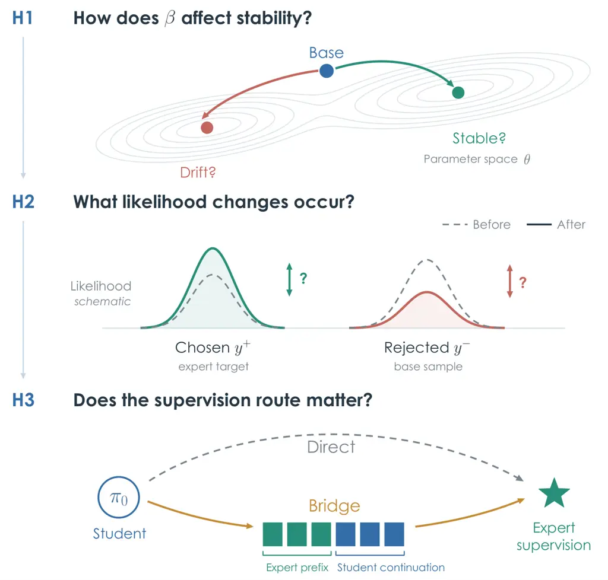
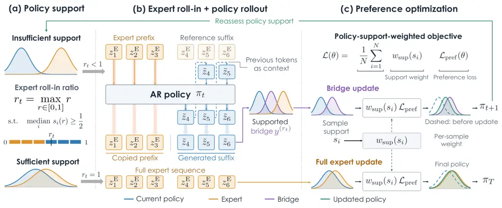

# Does Expert Supervision Improve Text-to-Speech? An Empirical Study of Preference Optimization

Minh Duc Vu ^(†)^(†)thanks: These authors contributed equally.
Affiliation: Department of Statistics & Data Science, National
University of Singapore, Singapore Email: <minhduc.vu@u.nus.edu>   
Junchuan Zhao¹¹footnotemark: 1 Affiliation: School of Computing,
National University of Singapore, Singapore Email: <junchuan@u.nus.edu>
   Ye Wang ^(†)^(†)thanks: Corresponding author. Affiliation: School of
Computing, National University of Singapore, Singapore
Email: <dcswangy@nus.edu.sg>

###### Abstract

Preference optimization promises to improve text-to-speech (TTS) systems
by learning which speech outputs are better. External expert speech
seems a natural source of preferred responses, especially when student
generations contain errors. Yet demonstration quality does not establish
whether the student can benefit from that supervision, or whether better
target fitting will produce better speech. We examine this gap across
two TTS students using real and synthetic expert speech, comparing
preference objectives and direct versus bridge supervision while
tracking fixed-sequence likelihoods and generation metrics. With expert
supervision held fixed, objectives differ markedly in their sensitivity
to preference-score scaling and the resulting generation quality.
Likelihood diagnostics characterize these responses, but cannot
establish their benefit: expert likelihood can increase while
intelligibility worsens, or decrease while it improves. Bridge
supervision highlights a distinction between mitigating degradation and
improving the student: it can recover performance lost under direct
training without consistently surpassing the pretrained base. Route
benefits vary across objectives, students, and expert sources; neither
route consistently dominates. Together, these findings distinguish
demonstration quality, target fitting, and generated-speech quality as
complementary criteria for assessing expert supervision.

## 1 Introduction

Preference optimization offers text-to-speech (TTS) systems a way to
learn which speech outputs to prefer. Language-model-based TTS enables
this approach through speech-token prediction (Chen et al., 2025; Peng
et al., 2024; Casanova et al., 2024; Du et al., 2024; Anastassiou et
al., 2024; Hu et al., 2026). Direct Preference Optimization (DPO) learns
from chosen–rejected pairs without a separately trained reward model
(Rafailov et al., 2023), and has been applied to speech generation
(Zhang et al., 2024; Zhang et al., 2025). Its appeal, however, depends
on where those preferred responses come from.



Figure 1: Motivating questions for expert-guided preference
optimization. Schematic panels H1–H3 correspond to RQ1–RQ3: objective
sensitivity, likelihood responses, and supervision routes.

One option is to rank student generations using recognition or speaker
metrics (Tian et al., 2025; Hussain et al., 2025). Another is to pair
student generations with external demonstrations from real recordings or
an expert synthesizer. We call the latter _expert-guided preference
optimization_. Demonstrations supply preferred targets without ranking a
pool of student candidates and can provide examples absent from that
pool. The attraction is straightforward: teach the student to favor an
expert’s response over its own. Whether this produces a better speech
generator is less straightforward.

Existing evidence cautions against equating demonstration quality with
training benefit. TTS studies report limited gains from ground-truth
chosen responses compared with ranked model outputs (Tian et al., 2025;
Hussain et al., 2025), with related observations in non-verbal
vocalization synthesis (Li et al., 2026a). Expert speech must also pass
through the student’s speech-token representation, which can alter its
quality. During optimization, a larger preference margin can coexist
with declining chosen-response likelihood (Pal et al., 2024); such a
decline need not imply worse generation (Im et al., 2026). These
observations leave an empirical question: how does fitting expert
targets relate to generation quality under different objectives and
supervision routes?

We study CosyVoice and GPT-SoVITS as students, with real recordings and
Qwen3-TTS generations as expert sources. We compare DPO, Weighted
Preference Optimization (WPO), Anchored Preference Optimization’s zero
variant (APO-zero), and Noise Contrastive Alignment (NCA) (Zhou et al.,
2024; D’Oosterlinck et al., 2025; Chen et al., 2024b). RQ1 examines
sensitivity to the score scale $`\beta`$, and RQ2 relates likelihood
changes to generation outcomes. RQ3 asks how supervision routes affect
these outcomes across objectives, expert sources, and students.

We compare Direct training on full expert targets with a staged _Bridge_
route. A Bridge target combines an expert prefix with a
student-generated continuation, adapting a construction explored in
InCo-DPO (Wang et al., 2025) to speech. This route introduces Bridge
targets before full expert supervision and refreshes rejected responses
between phases. The comparison evaluates the complete protocol. Fixed
expert and initial-student probes make likelihood changes comparable
across checkpoints even when training pairs change.

Our study yields three findings about expert supervision:

- •
  Reconstruction can erode an expert’s intelligibility advantage, so
  source quality alone does not characterize the supervision received by
  the student.
- •
  Training benefits depend on the objective and supervision route:
  objectives differ in sensitivity to $`\beta`$, while bridge
  supervision can mitigate degradation without consistently surpassing
  the pretrained base.
- •
  Expert-probe likelihood can increase while intelligibility worsens, or
  decrease while it improves; target fitting alone therefore cannot
  establish generation benefit.

## 2 Related Work

### 2.1 Post-Training for Speech Generation

Speech post-training draws on reinforcement learning from human feedback
(Ouyang et al., 2022) and PPO/GRPO policy optimization (Schulman et al.,
2017; Shao et al., 2024). Seed-TTS, IndexTTS 2.5, and GLM-TTS optimize
rewards for recognition accuracy, speaker consistency, or expressiveness
(Anastassiou et al., 2024; Li et al., 2026c; Cui et al., 2025). Other
work studies GRPO-based TTS and ASR-guided updates (Liu et al., 2026;
Hussain et al., 2026), differentiable rewards (Gao et al., 2025a; Gao et
al., 2025b), and metric optimization for diffusion synthesis and
duration prediction (Li et al., 2025; Li et al., 2026b). At inference,
MSpoofTTS uses spoof detectors for pruning and reranking; TED-TTS
controls emotion and duration without fine-tuning (Zhao et al., 2026;
Liang et al., 2026).

DPO uses preference pairs; KTO uses individual desirability labels
(Rafailov et al., 2023; Ethayarajh et al., 2024). Speech preferences
often rank candidates by recognition or speaker metrics (Tian et al.,
2025; Hussain et al., 2025; Zhang et al., 2025). UNO and RIO study
unpaired feedback and reverse-inference supervision (Chen et al., 2024a;
Hu et al., 2024); FPO and TKTO study fine-grained and targeted
token-level optimization (Yao et al., 2026; Kotoge and Sasaki, 2026).
Align-SLM uses semantic feedback for speech continuation (Lin et al.,
2025), while non-verbal synthesis requires preferences sensitive to
lexical content and vocal events (Li et al., 2026a). We compare how
objectives use external expert demonstrations.

### 2.2 Preference Data and Policy Compatibility

Discrete latent learning (van den Oord et al., 2017) and neural audio
codecs (Zeghidour et al., 2022; Défossez et al., 2022) support
token-based audio modeling and reconstruction. AudioLM combines semantic
and acoustic tokens for structure and acoustic detail (Borsos et al.,
2023); we evaluate expert speech before and after reconstruction through
the student’s representation.

SpeechAlign pairs encoded recordings with synthesized responses and
refreshes the latter (Zhang et al., 2024). However, ground-truth chosen
responses yield limited benefits in some TTS studies (Tian et al., 2025;
Hussain et al., 2025); ground-truth and hybrid targets can also
underperform synthetic pairs in non-verbal synthesis (Li et al., 2026a).
These findings motivate assessing training value separately from source
quality.

On-policy sampling and online preference learning connect data–policy
compatibility to alignment outcomes (Tajwar et al., 2024; Calandriello
et al., 2024; Tang et al., 2024). WPO reweights offline pairs using
current-policy probabilities (Zhou et al., 2024). InCo-DPO combines
stronger-model prefixes with student continuations and selects pairs
using reward-model scores (Wang et al., 2025). We adapt its continuation
construction to speech as Bridge. Varying the expert-prefix ratio lets
us compare target quality, likelihood, and generation outcomes.

### 2.3 Likelihood Dynamics and Generation Quality

Preference objectives modify likelihoods differently. SLiC-HF and RRHF
calibrate or rank sequence likelihoods (Zhao et al., 2023; Yuan et al.,
2023), while IPO provides an alternative preference-learning formulation
(Gheshlaghi Azar et al., 2024). ORPO and CPO combine preference learning
with likelihood-based fitting, and SimPO uses length-normalized,
reference-free rewards (Hong et al., 2024; Xu et al., 2024; Meng et al.,
2024). APO addresses underspecified likelihood updates, and NCA
distinguishes absolute likelihood optimization from relative comparisons
(D’Oosterlinck et al., 2025; Chen et al., 2024b). A larger preference
margin can coexist with declining chosen likelihood (Pal et al., 2024;
Razin et al., 2025), yet this decline need not imply worse generation
(Im et al., 2026). Length effects and reward overoptimization further
motivate separating training signals from outcome quality (Park et al.,
2024; Gao et al., 2023).

NISQA and UTMOS predict perceptual ratings; SpeechBERTScore compares
generated and reference representations (Mittag et al., 2021; Saeki et
al., 2022; Saeki et al., 2024). SpeechLMScore uses discrete-unit
likelihood under a separately trained speech language model (Maiti et
al., 2023). Our diagnostics track the student’s likelihood of fixed
expert and initial-student probes across checkpoints, relating these
changes to generation without equating them with perceptual improvement.

## 3 Study Design

### 3.1 Research Questions and Comparison Axes

Here, $`\beta`$ scales the reference-relative preference score,
following the standard DPO formulation (Appendix A.1, Eq. 8). Three
research questions examine expert supervision across objectives and
routes:

- •
  RQ1: How sensitive are different preference objectives to the
  preference-score scale $`\beta`$?
- •
  RQ2: How do expert and initial-student likelihoods change, and how do
  these changes relate to generation outcomes?
- •
  RQ3: How do Direct–Bridge differences vary across objectives, expert
  sources, and students?

DPO optimizes a relative preference margin, and WPO reweights that
comparison (Rafailov et al., 2023; Zhou et al., 2024). APO-zero and NCA
act on chosen and rejected scores separately (D’Oosterlinck et al.,
2025; Chen et al., 2024b). We therefore measure both likelihood
responses alongside generation outcomes.

### 3.2 Characterizing Expert Supervision

Expert speech enters training through the student’s speech-token
representation. Table 1 compares original and reconstructed
demonstrations with CosyVoice outputs. Qwen3-TTS retains its WER
advantage after reconstruction; real recordings largely lose theirs.
Rankings also differ across metrics: original recordings have lower WER
but lower predicted quality than student generations.

|                     |                       |                 |                   |
| ------------------- | --------------------- | --------------- | ----------------- |
| Speech source       | WER (%)$`\downarrow`$ | SIM$`\uparrow`$ | NISQA$`\uparrow`$ |
| Pretrained base     | 4.2                   | 0.709           | 4.357             |
| Real: original      | 3.2                   | 0.672           | 4.066             |
| Real: reconstructed | 4.1                   | 0.721           | 4.349             |
| Qwen: original      | 2.7                   | 0.753           | 4.358             |
| Qwen: reconstructed | 2.9                   | 0.798           | 4.368             |

Table 1: Target quality before CosyVoice training. WER is corpus-level;
SIM uses a common speaker reference per input. Reconstruction uses the
student’s speech representation.

Source-level preferences guarantee neither better utterances on every
metric nor training gains. We assess target quality, initial-policy
likelihood, and post-training generation separately.

### 3.3 Direct and Bridge Supervision

Let $`x_{i}`$ contain the text and speaker prompt, and
$`\mathbf{y}_{i}^{\mathrm{E}}`$ the expert’s student-native tokens.
Denote the initial student by $`\pi_{0}`$ and the policy entering phase
$`t`$ by $`\pi_{t}`$. With $`\pi_{t}`$ frozen, sample
$`\mathbf{y}^{\mathrm{P}}_{t,i}\sim\pi_{t}(\cdot\mid x_{i})`$. Bold
symbols denote sequences; plain symbols denote tokens.

Direct training uses the full expert sequence as the chosen response.
Bridge adapts the expert-prefix/student-continuation construction of
InCo-DPO to speech (Wang et al., 2025). For an expert-prefix ratio
$`r`$, define
$`k_{i}(r)=\lfloor r|\mathbf{y}_{i}^{\mathrm{E}}|\rfloor`$. For
$`0<r<1`$,

```math
\mathbf{y}^{\mathrm{B}}_{t,i}(r)=\mathbf{y}^{\mathrm{E}}_{i,1:k_{i}(r)}\oplus\widetilde{\mathbf{y}}_{t,i}(r), \tag{1}
```

where
$`\widetilde{\mathbf{y}}_{t,i}(r)\sim\pi_{t}(\cdot\mid x_{i},\mathbf{y}^{\mathrm{E}}_{i,1:k_{i}(r)})`$
and $`\oplus`$ denotes concatenation. We set
$`\mathbf{y}^{\mathrm{B}}_{t,i}(0)=\mathbf{y}^{\mathrm{P}}_{t,i}`$ and
$`\mathbf{y}^{\mathrm{B}}_{t,i}(1)=\mathbf{y}_{i}^{\mathrm{E}}`$. The
ratio measures the fraction of expert tokens retained, not their share
of final audio duration.



Figure 2: Bridge construction and support-weighted training (schematic).
Token symbols $`z`$ correspond to $`y`$ in the text; experiments use a
discrete ratio grid and two fixed training phases.

At training ratio $`r_{t}`$, Bridge pairs chosen
$`\mathbf{y}^{+}_{t,i}=\mathbf{y}^{\mathrm{B}}_{t,i}(r_{t})`$ with
rejected $`\mathbf{y}^{-}_{t,i}=\mathbf{y}^{\mathrm{P}}_{t,i}`$. It then
uses full expert targets with refreshed student negatives; Direct
retains full expert targets and initial-student negatives. Both start
from the same student, so the comparison evaluates the complete route,
including target composition and negative-sample refresh (Figure 2).

### 3.4 Ratio Selection and Policy-Support Weighting

For a nonempty sequence, length-normalized negative log-likelihood (NLL)
is

```math
\operatorname{NLL}_{\pi}(\mathbf{y}\mid x)=-\frac{1}{|\mathbf{y}|}\sum_{j=1}^{|\mathbf{y}|}\log\pi(y_{j}\mid x,\mathbf{y}_{<j}). \tag{2}
```

Natural logarithms give nats/token. Teacher-forced scoring covers the
full sequence, including copied expert prefixes, with a consistent token
mask. Under frozen $`\pi_{t}`$, define

```math
\displaystyle g_{t,i}(r) \displaystyle=\operatorname{NLL}_{\pi_{t}}(\mathbf{y}^{\mathrm{B}}_{t,i}(r)\mid x_{i}) \tag{3}
```

```math
\displaystyle-\operatorname{NLL}_{\pi_{t}}(\mathbf{y}^{\mathrm{P}}_{t,i}\mid x_{i}),
```

```math
\displaystyle s_{t,i}(r) \displaystyle=\min\{1,\exp[-g_{t,i}(r)]\}.
```

A positive gap means lower per-token likelihood for the target. Before
clipping, $`\exp(-g)`$ is the ratio of geometric-mean token
probabilities. The relative-likelihood score $`s`$, also called the
support score, measures neither perceptual quality nor distributional
distance.

For the common set $`I_{t}`$ of selection inputs with finite scores at
every candidate ratio, the selection rule is

```math
\displaystyle S_{t}(r) \displaystyle=\operatorname{median}_{i\in I_{t}}s_{t,i}(r), \tag{4}
```

```math
\displaystyle r_{t}^{\mathrm{sel}} \displaystyle=\max\{r\in\mathcal{A}:S_{t}(r)\geq\tau\},
```

with $`\mathcal{A}=\{0,0.2,0.4,0.6,0.8,1\}`$ and $`\tau=0.5`$. Selection
uses dev-clean; training targets are constructed separately on
train-clean-100. Speech-quality metrics do not enter this rule. Since
$`S_{t}(0)=1`$, the feasible set is nonempty, although $`r=0`$ gives
identical chosen and rejected responses. The threshold is heuristic. The
schematic’s $`r_{t}`$ denotes $`r_{t}^{\mathrm{sel}}`$; actual training
ratios are reported in Section 4.

Figure 3: CosyVoice constructed targets across ratios. Error reduction
uses $`r=0`$; SIM/NISQA show absolute changes. Dashed lines mark
rule-selected ratios $`r_{t}^{\mathrm{sel}}`$, distinct from training
ratios. Shaded quality bands show 95% bootstrap intervals.

In Figure 3, more expert tokens generally raise target NLL, while
quality varies by metric and source. These measurements characterize
constructed targets before training.

#### Policy-support weighting.

For sample-specific scores $`s_{i}=s_{t,i}(r_{t})`$ at the training
ratio, parabolic weighting defines

```math
\displaystyle\mathcal{L}_{t}(\theta) \displaystyle=\frac{1}{N}\sum_{i=1}^{N}w_{\mathrm{sup}}(s_{i})\mathcal{L}_{\mathrm{pref},i}(\theta), \tag{5}
```

```math
\displaystyle w_{\mathrm{sup}}(s) \displaystyle=4s(1-s).
```

Scores are computed under $`\pi_{t}`$ and fixed during training. The
weight peaks at $`s=0.5`$ and vanishes at $`s=0,1`$, emphasizing
intermediate support. It is separate from the preference objective and
WPO’s own pair weighting. Clipping maps every $`g\leq 0`$ to $`s=1`$, so
maximal support does not establish that a target is on-policy.

### 3.5 Relating Target Fitting to Generation

Within each student–expert setting, we score fixed full-expert and
initial-student probes across objectives, routes, and checkpoints. This
separates fitting from changes in training targets. For checkpoint
$`\pi_{\theta}`$, define

```math
\displaystyle\delta_{\theta}(\mathbf{y}\mid x) \displaystyle=\frac{\log\pi_{\theta}(\mathbf{y}\mid x)-\log\pi_{0}(\mathbf{y}\mid x)}{|\mathbf{y}|} \tag{6}
```

```math
\displaystyle=\operatorname{NLL}_{\pi_{0}}(\mathbf{y}\mid x)-\operatorname{NLL}_{\pi_{\theta}}(\mathbf{y}\mid x).
```

Positive $`\delta_{\theta}`$ indicates increased likelihood of the same
sequence. The tables report its mean over expert and initial-student
probes as $`\Delta\ell_{\mathrm{E}}`$ and $`\Delta\ell_{\mathrm{P}}`$
(nats/token). The table heading “Base” denotes initial-student probes.
Both checkpoints score identical conditioning and tokens with the same
mask. Unlike the gap $`g`$, which compares two targets under one policy,
$`\delta_{\theta}`$ compares two policies on one target. The initial
diagnostic baseline $`\pi_{0}`$ also remains distinct from the
objective’s reference policy $`\pi_{\mathrm{ref},t}`$.

We evaluate intelligibility, speaker similarity, and predicted quality
against both Direct and the base, distinguishing mitigation from
improvement beyond the starting model. Probe fitting may disagree with
generation (Tang et al., 2024); likelihood responses alone establish
neither causality nor perceptual improvement.

## 4 Experimental Setup

#### Models and data.

We use CosyVoice-1 (300M) and GPT-SoVITS v4 as students, with LibriTTS
recordings and Qwen3-TTS (1.7B) generations as expert sources (Du et
al., 2024; Zen et al., 2019; Hu et al., 2026). Expert speech is encoded
into each student’s native representation. Training uses
train-clean-100, and ratio assessment uses dev-clean. Generation
evaluation uses fixed 4–10-second subsets of LibriTTS test-clean and
English SEED TTS Eval (Anastassiou et al., 2024).

#### Training configurations.

For RQ1–RQ2, we compare all four objectives at $`\beta\in\{0.01,0.1\}`$
using CosyVoice with real-speech supervision. For RQ3, we fix
$`\beta=0.1`$ and compare both routes across students and expert
sources. Direct trains for two epochs with full expert targets and fixed
initial-student negatives. Bridge uses one epoch with partial-expert
targets, followed by one epoch with full expert targets and regenerated
intermediate-student negatives. First-phase ratios are $`r=0.6`$ for
CosyVoice–real, $`r=0.8`$ for CosyVoice–Qwen, $`r=0.4`$ for
GPT-SoVITS–real, and $`r=0.8`$ for GPT-SoVITS–Qwen.

#### Evaluation.

We report utterance-level macro WER (%), speaker similarity (SIM), and
NISQA predicted speech quality (Mittag et al., 2021). The ratio plot
also reports character error rate (CER). Table 1 separately reports
corpus-level WER for target characterization. The two aggregations are
not directly interchangeable. Fixed-probe likelihood changes use
full-expert and initial-student sequences, independently of
phase-specific training pairs. Results are point estimates; we
distinguish their magnitude and direction without claiming statistical
significance.

Unless accompanied by confidence intervals, results are point estimates
and small differences are interpreted cautiously. All NLL measurements,
conditional KL measurements, and paired speaker-bootstrap comparisons
use the same shared pool of 1,000 utterance IDs across objectives,
routes, and checkpoints. Bootstrap intervals quantify uncertainty in
generation-metric differences. Conditional KL is measured relative to
the original pretrained base on fixed teacher-forced contexts.

## 5 Results

|                 |           |                      |                 |                   |                      |                 |                   |                              |             |
| --------------- | --------- | -------------------- | --------------- | ----------------- | -------------------- | --------------- | ----------------- | ---------------------------- | ----------- |
| Objective       | $`\beta`$ | LibriTTS test        |                 |                   | SEED TTS Eval        |                 |                   | Fixed probes: $`\Delta\ell`$ |             |
|                 |           | WER(%)$`\downarrow`$ | SIM$`\uparrow`$ | NISQA$`\uparrow`$ | WER(%)$`\downarrow`$ | SIM$`\uparrow`$ | NISQA$`\uparrow`$ | Expert                       | Base        |
| Pretrained base | –         | 3.87                 | 0.731           | 4.484             | 4.27                 | 0.739           | 4.169             | $`0.000`$                    | $`0.000`$   |
| LibriTTS expert | –         | 3.40                 | 0.696           | 4.151             | –                    | –               | –                 | –                            | –           |
| DPO             | 0.1       | 4.59                 | 0.706           | 4.427             | 6.33                 | 0.721           | 4.057             | $`-0.348`$                   | $`-1.448`$  |
|                 | 0.01      | 29.78                | 0.611           | 4.119             | 63.02                | 0.496           | 3.462             | $`-3.473`$                   | $`-22.301`$ |
| WPO             | 0.1       | 4.81                 | 0.708           | 4.429             | 6.58                 | 0.722           | 4.072             | $`-0.295`$                   | $`-1.191`$  |
|                 | 0.01      | 25.57                | 0.559           | 4.161             | 49.08                | 0.530           | 3.552             | $`-3.467`$                   | $`-8.446`$  |
| APO-zero        | 0.1       | 3.73                 | 0.730           | 4.487             | 3.70                 | 0.734           | 4.172             | $`+0.083`$                   | $`-0.516`$  |
|                 | 0.01      | 3.77                 | 0.731           | 4.491             | 3.77                 | 0.737           | 4.155             | $`+0.056`$                   | $`-9.243`$  |
| NCA             | 0.1       | 3.76                 | 0.732           | 4.501             | 3.74                 | 0.736           | 4.171             | $`+0.033`$                   | $`-0.420`$  |
|                 | 0.01      | 3.67                 | 0.730           | 4.489             | 3.39                 | 0.736           | 4.143             | $`+0.061`$                   | $`-7.078`$  |

Table 2: CosyVoice with LibriTTS supervision under Direct training.
Green/red marks likelihood increases/decreases. Bold marks the best
student result across objective–$`\beta`$ settings.

|                             |        |                      |                 |                   |                      |                 |                   |                              |            |
| --------------------------- | ------ | -------------------- | --------------- | ----------------- | -------------------- | --------------- | ----------------- | ---------------------------- | ---------- |
| Objective                   | Route  | LibriTTS test        |                 |                   | SEED TTS Eval        |                 |                   | Fixed probes: $`\Delta\ell`$ |            |
|                             |        | WER(%)$`\downarrow`$ | SIM$`\uparrow`$ | NISQA$`\uparrow`$ | WER(%)$`\downarrow`$ | SIM$`\uparrow`$ | NISQA$`\uparrow`$ | Expert                       | Base       |
| Pretrained base             | –      | 3.87                 | 0.731           | 4.484             | 4.27                 | 0.739           | 4.169             | $`0.000`$                    | $`0.000`$  |
| LibriTTS                    | Expert | 3.40                 | 0.696           | 4.151             | –                    | –               | –                 | –                            | –          |
| Qwen3-TTS                   | Expert | 2.80                 | 0.780           | 4.441             | –                    | –               | –                 | –                            | –          |
| Expert: LibriTTS recordings |        |                      |                 |                   |                      |                 |                   |                              |            |
| DPO                         | Direct | 4.59                 | 0.706           | 4.427             | 6.33                 | 0.721           | 4.057             | $`-0.348`$                   | $`-1.448`$ |
|                             | Bridge | 4.26                 | 0.716           | 4.439             | 5.77                 | 0.725           | 4.091             | $`-0.225`$                   | $`-1.077`$ |
| WPO                         | Direct | 4.81                 | 0.708           | 4.429             | 6.58                 | 0.722           | 4.072             | $`-0.295`$                   | $`-1.191`$ |
|                             | Bridge | 4.18                 | 0.726           | 4.496             | 4.87                 | 0.728           | 4.181             | $`-0.101`$                   | $`-0.773`$ |
| APO-zero                    | Direct | 3.73                 | 0.730           | 4.487             | 3.70                 | 0.734           | 4.172             | $`+0.083`$                   | $`-0.516`$ |
|                             | Bridge | 3.80                 | 0.732           | 4.509             | 3.72                 | 0.735           | 4.162             | $`+0.049`$                   | $`-0.500`$ |
| NCA                         | Direct | 3.76                 | 0.732           | 4.501             | 3.74                 | 0.736           | 4.171             | $`+0.033`$                   | $`-0.420`$ |
|                             | Bridge | 3.78                 | 0.731           | 4.508             | 3.97                 | 0.737           | 4.169             | $`+0.022`$                   | $`-0.391`$ |
| Expert: Qwen3-TTS synthesis |        |                      |                 |                   |                      |                 |                   |                              |            |
| DPO                         | Direct | 3.27                 | 0.712           | 4.542             | 2.60                 | 0.732           | 4.247             | $`-0.318`$                   | $`-1.400`$ |
|                             | Bridge | 4.27                 | 0.723           | 4.498             | 3.48                 | 0.727           | 4.121             | $`-0.164`$                   | $`-0.961`$ |
| WPO                         | Direct | 3.22                 | 0.715           | 4.543             | 3.29                 | 0.730           | 4.265             | $`-0.270`$                   | $`-1.117`$ |
|                             | Bridge | 4.29                 | 0.725           | 4.507             | 3.79                 | 0.727           | 4.129             | $`-0.127`$                   | $`-0.774`$ |
| APO-zero                    | Direct | 3.32                 | 0.723           | 4.549             | 2.65                 | 0.731           | 4.220             | $`+0.152`$                   | $`-0.562`$ |
|                             | Bridge | 3.38                 | 0.726           | 4.545             | 2.55                 | 0.734           | 4.202             | $`+0.150`$                   | $`-0.711`$ |
| NCA                         | Direct | 3.62                 | 0.731           | 4.520             | 3.24                 | 0.739           | 4.198             | $`+0.038`$                   | $`-0.341`$ |
|                             | Bridge | 3.48                 | 0.728           | 4.511             | 3.38                 | 0.739           | 4.180             | $`+0.039`$                   | $`-0.349`$ |

Table 3: CosyVoice: Direct versus Bridge at $`\beta=0.1`$. Green/red
marks likelihood increases/decreases. Bold marks the best student result
within each expert block.

|                             |        |                      |                 |                   |                      |                 |                   |                              |            |
| --------------------------- | ------ | -------------------- | --------------- | ----------------- | -------------------- | --------------- | ----------------- | ---------------------------- | ---------- |
| Objective                   | Route  | LibriTTS test        |                 |                   | SEED TTS Eval        |                 |                   | Fixed probes: $`\Delta\ell`$ |            |
|                             |        | WER(%)$`\downarrow`$ | SIM$`\uparrow`$ | NISQA$`\uparrow`$ | WER(%)$`\downarrow`$ | SIM$`\uparrow`$ | NISQA$`\uparrow`$ | Expert                       | Base       |
| Pretrained base             | –      | 9.50                 | 0.387           | 3.767             | 4.27                 | 0.401           | 3.986             | $`0.000`$                    | $`0.000`$  |
| LibriTTS                    | Expert | 3.40                 | 0.696           | 4.151             | –                    | –               | –                 | –                            | –          |
| Qwen3-TTS                   | Expert | 2.80                 | 0.780           | 4.441             | –                    | –               | –                 | –                            | –          |
| Expert: LibriTTS recordings |        |                      |                 |                   |                      |                 |                   |                              |            |
| DPO                         | Direct | 18.12                | 0.381           | 3.577             | 5.25                 | 0.406           | 3.908             | $`-0.685`$                   | $`-2.666`$ |
|                             | Bridge | 9.50                 | 0.387           | 3.767             | 4.87                 | 0.400           | 3.931             | $`+0.102`$                   | $`-0.370`$ |
| WPO                         | Direct | 13.03                | 0.381           | 3.563             | 4.58                 | 0.405           | 3.912             | $`-0.030`$                   | $`-0.504`$ |
|                             | Bridge | 9.49                 | 0.387           | 3.767             | 5.49                 | 0.398           | 3.916             | $`0.000`$                    | $`-0.429`$ |
| APO-zero                    | Direct | 11.78                | 0.392           | 3.696             | 3.83                 | 0.411           | 3.940             | $`+0.138`$                   | $`-0.414`$ |
|                             | Bridge | 9.50                 | 0.387           | 3.767             | 4.98                 | 0.388           | 3.903             | $`+0.081`$                   | $`-0.860`$ |
| NCA                         | Direct | 9.71                 | 0.390           | 3.754             | 3.97                 | 0.406           | 4.003             | $`+0.018`$                   | $`-0.235`$ |
|                             | Bridge | 9.50                 | 0.387           | 3.767             | 4.65                 | 0.398           | 3.969             | $`+0.005`$                   | $`-0.417`$ |
| Expert: Qwen3-TTS synthesis |        |                      |                 |                   |                      |                 |                   |                              |            |
| DPO                         | Direct | 7.54                 | 0.483           | 3.823             | 4.46                 | 0.406           | 3.931             | $`-0.033`$                   | $`-0.539`$ |
|                             | Bridge | 7.01                 | 0.477           | 3.854             | 4.64                 | 0.400           | 3.976             | $`-0.034`$                   | $`-0.495`$ |
| WPO                         | Direct | 7.59                 | 0.478           | 3.812             | 4.77                 | 0.403           | 3.943             | $`-0.027`$                   | $`-0.520`$ |
|                             | Bridge | 7.46                 | 0.485           | 3.862             | 4.35                 | 0.405           | 3.977             | $`+0.028`$                   | $`-0.245`$ |
| APO-zero                    | Direct | 6.73                 | 0.493           | 3.900             | 4.00                 | 0.410           | 3.946             | $`+0.235`$                   | $`-0.287`$ |
|                             | Bridge | 6.76                 | 0.489           | 3.890             | 4.70                 | 0.408           | 3.969             | $`+0.152`$                   | $`-0.182`$ |
| NCA                         | Direct | 7.20                 | 0.486           | 3.900             | 4.52                 | 0.401           | 3.979             | $`+0.014`$                   | $`-0.208`$ |
|                             | Bridge | 7.08                 | 0.486           | 3.906             | 4.14                 | 0.404           | 3.977             | $`+0.011`$                   | $`-0.090`$ |

Table 4: GPT-SoVITS: Direct versus Bridge at $`\beta=0.1`$. Green/red
marks likelihood increases/decreases. Bold marks the best student result
within each expert block.

We first examine objective-dependent sensitivity to $`\beta`$ (RQ1) and
likelihood responses on fixed probes (RQ2), using CosyVoice with
LibriTTS expert supervision. We then compare Direct and Bridge across
both students and expert sources (RQ3), before considering whether
improvements agree across evaluation metrics (RQ2–RQ3). Tables report
WER as a percentage and fixed-probe log-likelihood changes relative to
the initial student; positive changes indicate increased likelihood.
Colors encode this direction, not the quality of generated speech.
Expert rows report reference speech scores; – marks unreported or
inapplicable entries.

### 5.1 Objective-Dependent Sensitivity to $`\beta`$

Table 2 shows that reducing $`\beta`$ from $`0.1`$ to $`0.01`$
substantially degrades DPO and WPO in this setting.. For DPO, LibriTTS
WER rises from $`4.59\%`$ to $`29.78\%`$, and SEED TTS Eval WER from
$`6.33\%`$ to $`63.02\%`$. WPO shows the same pattern, with WER
increasing from $`4.81\%`$ to $`25.57\%`$ and from $`6.58\%`$ to
$`49.08\%`$, respectively. Both objectives also lose speaker similarity
and predicted speech quality.

APO-zero and NCA show smaller changes across the same two values. Their
LibriTTS WER remains between $`3.67\%`$ and $`3.77\%`$, compared with
$`3.87\%`$ for the pretrained base. The tested $`\beta`$ reduction
therefore has markedly different consequences across objectives. These
results establish local sensitivity in one student–expert setting; two
values do not establish a stability range or an optimal $`\beta`$ for
any objective. A shared numerical $`\beta`$ is a comparison condition,
not evidence that different losses induce matched update strengths. We
use $`\beta=0.1`$ in the remaining comparisons and examine how the
contrasting generation outcomes relate to likelihood changes.

### 5.2 Likelihood Responses and Their Limits

As shown in Table 2, at $`\beta=0.1`$, DPO and WPO decrease mean token
log-likelihood on expert probes by $`0.348`$ and $`0.295`$,
respectively, whereas APO-zero and NCA increase it by $`0.083`$ and
$`0.033`$. This difference extends beyond the mean: no evaluated expert
probes gain likelihood under DPO or WPO, compared with $`99.8\%`$ under
APO-zero and $`96.0\%`$ under NCA. All four objectives, however,
decrease likelihood on $`99.9`$–$`100\%`$ of initial-student probes.
Initial-student suppression therefore occurs both when WER improves over
the base and when it deteriorates. Within this setting, expert-probe
responses distinguish these outcomes more clearly than initial-student
suppression.

The expert-probe distinction persists at $`\beta=0.01`$: the
positive-change rates are $`0\%`$ for DPO/WPO and $`97.7\%/97.6\%`$ for
APO-zero/NCA. Yet a large decrease on initial-student probes is not
sufficient to identify poor generation. APO-zero decreases their mean
log-likelihood by $`9.243`$, more than WPO’s $`8.446`$, while their
LibriTTS WERs are $`3.77\%`$ and $`25.57\%`$. Neither the prevalence nor
the magnitude of initial-student suppression alone distinguishes these
outcomes.

The expert-probe responses are consistent with the objectives’ different
structures. DPO/WPO optimize relative preference scores without
requiring a likelihood increase for the chosen response, while APO-zero
and NCA act on chosen and rejected scores separately. NCA additionally
counterbalances chosen-score growth. This comparison characterizes the
observed updates; it does not establish that the likelihood changes
cause the generation differences. The following cross-setting
comparisons test the limits of interpreting these diagnostics.

### 5.3 Route Effects Across Supervision Settings

Figure 4: DPO log-probability distributions under real-speech
supervision. Positive/negative sequences denote fixed
expert/initial-student probes. Dotted lines mark means;
$`\Delta\mu=\mu_{\mathrm{post}}-\mu_{\mathrm{base}}`$. Panel headings
report macro WER.

#### Real-speech supervision.

Tables 3 and 4 show that Bridge reduces the LibriTTS WER deterioration
of DPO/WPO for both students. For CosyVoice, DPO WER decreases from
$`4.59\%`$ under Direct to $`4.26\%`$ under Bridge, and WPO from
$`4.81\%`$ to $`4.18\%`$. Both remain above the base WER of $`3.87\%`$.
For GPT-SoVITS, the corresponding changes are $`18.12\%`$ to $`9.50\%`$
and $`13.03\%`$ to $`9.49\%`$, approaching the base value of $`9.50\%`$.
Figure 4 shows the corresponding DPO distributions. This mitigation
accompanies smaller expert-probe likelihood losses for CosyVoice and a
change from loss to gain for GPT-SoVITS DPO. Yet the latter’s
expert-probe gain of $`0.102`$ does not translate into better-than-base
WER: Bridge matches the displayed LibriTTS baseline and reaches
$`4.87\%`$ on SEED TTS Eval, above the base’s $`4.27\%`$. Recovery from
Direct’s deterioration should therefore be distinguished from
improvement over the starting model. Benefits do not extend uniformly
across evaluation sets: GPT-SoVITS WPO worsens on SEED TTS Eval, from
$`4.58\%`$ to $`5.49\%`$. APO-zero and NCA likewise show no consistent
additional WER benefit from Bridge.

Figure 5: Paired macro-WER differences (Phase 2 minus comparator, in
percentage points) with 95% speaker-bootstrap confidence intervals.
Negative values favor Phase 2.

#### Synthetic-expert supervision.

With Qwen3-TTS supervision, CosyVoice Direct DPO/WPO improve WER over
the base on both evaluation sets, despite decreasing expert-probe
likelihood. DPO reduces LibriTTS WER from $`3.87\%`$ to $`3.27\%`$ and
SEED TTS Eval WER from $`4.27\%`$ to $`2.60\%`$, while expert-probe
$`\Delta\ell=-0.318`$. Bridge reduces this likelihood loss to
$`-0.164`$, but increases WER to $`4.27\%`$ and $`3.48\%`$,
respectively. Thus, neither the sign of expert fitting relative to the
base nor its improvement over Direct orders these generation outcomes.
Together with GPT-SoVITS under real-speech supervision, these cases show
why the likelihood–generation association observed in one setting cannot
serve as a general route-selection criterion.

GPT-SoVITS shows a different pattern with the same synthetic expert.
Bridge lowers LibriTTS WER for DPO, WPO, and NCA, but slightly raises it
for APO-zero. SEED TTS Eval changes are also mixed: WPO/NCA improve,
whereas DPO/APO-zero worsen. These comparisons answer RQ3 by identifying
setting-dependent mitigation and gains, rather than a consistently
superior route.

### 5.4 Checkpoint Analysis of Bridge Training

We examine where the CosyVoice–Qwen Bridge route loses its Phase 1
gains. Figure 5 reports paired WER differences on the shared
1,000-utterance pool. For DPO and WPO, Phase 2 increases WER relative to
Phase 1 by 1.04 percentage points (95% CI: $`[0.68,1.50]`$) and 1.01
points ($`[0.68,1.39]`$), respectively, and also underperforms Direct
training. Relative to the pretrained base, WPO’s WER increase has an
interval excluding zero, whereas DPO’s interval includes zero. APO-zero
and NCA show no clearly resolved phase difference and retain lower final
WER than the base.

The stage-specific likelihood measurements in Table 11 characterize the
accompanying updates. During Phase 2, DPO/WPO substantially decrease
rejected-response likelihood while producing little net change in mean
chosen-target likelihood. Rejecting generations from the improved
intermediate policy may discourage useful Phase 1 behavior without a
corresponding increase in expert fitting. However, Phase 1 can improve
WER despite declining chosen likelihood, and NCA remains stable despite
little mean chosen-likelihood change. Neither rejected-response
suppression nor weak expert fitting alone explains the deterioration.

Table 5 provides a further counterexample through conditional KL
measurements. Direct DPO/WPO have larger KL to the pretrained base than
their final Bridge checkpoints on both fixed context sets, yet achieve
lower WER. Thus, conditional KL magnitude alone does not consistently
rank generation quality.

|           |         |           |         |           |        |           |
| --------- | ------- | --------- | ------- | --------- | ------ | --------- |
| Objective | Phase 1 |           | Phase 2 |           | Direct |           |
|           | $`E`$   | $`S_{0}`$ | $`E`$   | $`S_{0}`$ | $`E`$  | $`S_{0}`$ |
| APO-zero  | 0.088   | 0.165     | 0.113   | 0.331     | 0.120  | 0.299     |
| DPO       | 0.204   | 0.308     | 0.265   | 0.453     | 0.391  | 0.640     |
| WPO       | 0.159   | 0.229     | 0.226   | 0.354     | 0.345  | 0.509     |
| NCA       | 0.019   | 0.058     | 0.016   | 0.098     | 0.018  | 0.099     |

Table 5: Conditional KL to the pretrained base (nats/token) on fixed
expert ($`E`$) and initial-student ($`S_{0}`$) contexts, averaged over
tokens within each sequence, then over utterances. See Appendix E.5.

These analyses locate an objective-dependent deterioration in Phase 2,
but do not isolate its cause: the phase transition jointly changes
chosen targets, refreshes rejected responses, and resets the optimizer
state.

### 5.5 Differences Across Evaluation Metrics

Generation metrics also favor different configurations. Under synthetic
supervision, CosyVoice Direct WPO improves LibriTTS WER from the base’s
$`3.87\%`$ to $`3.22\%`$ and NISQA from $`4.484`$ to $`4.543`$, while
SIM falls from $`0.731`$ to $`0.715`$. For GPT-SoVITS with real-speech
supervision, Direct APO-zero improves SEED TTS Eval WER from $`4.27\%`$
to $`3.83\%`$ and SIM from $`0.401`$ to $`0.411`$, but lowers NISQA from
$`3.986`$ to $`3.940`$. Intelligibility gains therefore need not
coincide with gains in speaker similarity or predicted speech quality. A
single claim of “better speech” would conceal these trade-offs.

Across RQ2–RQ3, fixed-probe diagnostics describe target fitting, while
generation metrics establish observed benefits. Their relationship
varies by student, expert source, route, and evaluation set; neither
expert likelihood nor a single generation metric fully ranks the tested
configurations.

## 6 Conclusion

Expert supervision for TTS requires more than selecting an appealing
demonstration. Our study distinguishes the quality of expert speech, the
student’s fitting of fixed targets, and the quality of its subsequent
generations. Across the evaluated settings, these quantities do not
provide interchangeable evidence of improvement. Preference objectives
respond differently to the tested score scales, and staged Bridge
supervision can mitigate degradation without surpassing the pretrained
base. Most directly, increased expert likelihood can accompany worse
intelligibility, while decreased likelihood can accompany better
generation. The practical implication is to assess expert supervision
through complementary generation metrics and explicit comparisons with
the starting model. Fixed-probe likelihoods help describe what
optimization changes; their value lies in interpreting those changes
alongside generated speech, rather than certifying training success.

## Limitations

Our study examines two student models and two expert sources on English
utterances. The findings are scoped to these models, sources, and
evaluation settings; broader language and duration coverage remains for
future work. Generation results are point estimates from task-specific
comparisons, so small differences warrant cautious interpretation. Our
route comparison uses a fixed two-phase Bridge protocol; more stages and
adaptive supervision schedules remain to be explored.

## References

- Anastassiou et al. (2024) P. Anastassiou, J. Chen, J. Chen, Y.
  Chen, Z. Chen, Z. Chen, J. Cong, L. Deng, C. Ding, L. Gao, et al.
  Seed-tts: a family of high-quality versatile speech generation models.
  arXiv preprint arXiv:2406.02430. Cited by: §1, §2.1, §4.
- Borsos et al. (2023) Z. Borsos, R. Marinier, D. Vincent, E.
  Kharitonov, O. Pietquin, M. Sharifi, D. Roblek, O. Teboul, D.
  Grangier, M. Tagliasacchi, et al. Audiolm: a language modeling
  approach to audio generation. IEEE/ACM transactions on audio, speech,
  and language processing 31, pp. 2523–2533. Cited by: §2.2.
- Calandriello et al. (2024) D. Calandriello, Z. D. Guo, R. Munos, M.
  Rowland, Y. Tang, B. Ávila Pires, P. H. Richemond, C. Le Lan, M.
  Valko, T. Liu, R. Joshi, Z. Zheng, and B. Piot Human Alignment of
  Large Language Models through Online Preference Optimisation. In
  Proceedings of the 41st International Conference on Machine Learning,
  Proceedings of Machine Learning Research, Vol. 235, pp. 5409–5435.
  Cited by: §2.2.
- Casanova et al. (2024) E. Casanova, K. Davis, E. Gölge, G. Göknar, I.
  Gulea, L. Hart, A. Aljafari, J. Meyer, R. Morais, S. Olayemi, and J.
  Weber XTTS: a massively multilingual zero-shot text-to-speech model.
  In Interspeech 2024, pp. 4978–4982. External Links:
  [Document](https://dx.doi.org/10.21437/interspeech.2024-2016) Cited
  by: §1.
- Chen et al. (2024a) C. Chen, Y. Hu, W. Wu, H. Wang, E. S. Chng, and C.
  Zhang Enhancing zero-shot text-to-speech synthesis with human
  feedback. arXiv preprint arXiv:2406.00654. Cited by: §2.1.
- Chen et al. (2024b) H. Chen, G. He, L. Yuan, G. Cui, H. Su, and J. Zhu
  Noise Contrastive Alignment of Language Models with Explicit Rewards.
  In Advances in Neural Information Processing Systems, Vol. 37,
  pp. 117784–117812. Cited by: §A.5, §1, §2.3, §3.1.
- Chen et al. (2025) S. Chen, C. Wang, Y. Wu, Z. Zhang, L. Zhou, S.
  Liu, Z. Chen, Y. Liu, H. Wang, J. Li, L. He, S. Zhao, and F. Wei
  Neural Codec Language Models are Zero-Shot Text to Speech
  Synthesizers. IEEE Transactions on Audio, Speech and Language
  Processing 33, pp. 705–718. External Links:
  [Document](https://dx.doi.org/10.1109/taslpro.2025.3530270) Cited by:
  §1.
- Cui et al. (2025) J. Cui, Z. Yang, N. Li, J. Tian, X. Ma, Y. Zhang, G.
  Chen, R. Yang, Y. Cheng, Y. Zhou, et al. Glm-tts technical report.
  arXiv preprint arXiv:2512.14291. Cited by: §2.1.
- Défossez et al. (2022) A. Défossez, J. Copet, G. Synnaeve, and Y. Adi
  High fidelity neural audio compression. arXiv preprint
  arXiv:2210.13438. Cited by: §2.2.
- Du et al. (2024) Z. Du, Q. Chen, S. Zhang, K. Hu, H. Lu, Y. Yang, H.
  Hu, S. Zheng, Y. Gu, Z. Ma, et al. Cosyvoice: a scalable multilingual
  zero-shot text-to-speech synthesizer based on supervised semantic
  tokens. arXiv preprint arXiv:2407.05407. Cited by: §1, §4.
- D’Oosterlinck et al. (2025) K. D’Oosterlinck, W. Xu, C. Develder, T.
  Demeester, A. Singh, C. Potts, D. Kiela, and S. Mehri Anchored
  Preference Optimization and Contrastive Revisions: Addressing
  Underspecification in Alignment. Transactions of the Association for
  Computational Linguistics 13, pp. 442–460. External Links:
  [Document](https://dx.doi.org/10.1162/TACL%5FA%5F00748) Cited by:
  §A.4, §1, §2.3, §3.1.
- Ethayarajh et al. (2024) K. Ethayarajh, W. Xu, N. Muennighoff, D.
  Jurafsky, and D. Kiela Model Alignment as Prospect Theoretic
  Optimization. In Proceedings of the 41st International Conference on
  Machine Learning, Proceedings of Machine Learning Research, Vol. 235,
  pp. 12634–12651. Cited by: §2.1.
- Gao et al. (2025a) C. Gao, Z. Du, and S. Zhang Differentiable Reward
  Optimization for LLM based TTS system. In Interspeech 2025,
  pp. 2450–2454. External Links:
  [Document](https://dx.doi.org/10.21437/interspeech.2025-704) Cited by:
  §2.1.
- Gao et al. (2025b) C. Gao, Y. Li, K. An, Z. Gao, Z. Du, H. Zhao,
  and X. Li Explore the reinforcement learning for the llm based asr and
  tts system. arXiv preprint arXiv:2509.18569. Cited by: §2.1.
- Gao et al. (2023) L. Gao, J. Schulman, and J. Hilton Scaling Laws for
  Reward Model Overoptimization. In Proceedings of the 40th
  International Conference on Machine Learning, Proceedings of Machine
  Learning Research, Vol. 202, pp. 10835–10866. Cited by: §2.3.
- Gheshlaghi Azar et al. (2024) M. Gheshlaghi Azar, Z. D. Guo, B.
  Piot, R. Munos, M. Rowland, M. Valko, and D. Calandriello A General
  Theoretical Paradigm to Understand Learning from Human Preferences. In
  Proceedings of the 27th International Conference on Artificial
  Intelligence and Statistics, Proceedings of Machine Learning Research,
  Vol. 238, pp. 4447–4455. Cited by: §2.3.
- Hong et al. (2024) J. Hong, N. Lee, and J. Thorne ORPO: Monolithic
  Preference Optimization without Reference Model. In Proceedings of the
  2024 Conference on Empirical Methods in Natural Language Processing,
  pp. 11170–11189. External Links:
  [Document](https://dx.doi.org/10.18653/v1/2024.emnlp-main.626) Cited
  by: §2.3.
- Hu et al. (2026) H. Hu, X. Zhu, T. He, D. Guo, B. Zhang, X. Wang, Z.
  Guo, Z. Jiang, H. Hao, Z. Guo, et al. Qwen3-tts technical report.
  arXiv preprint arXiv:2601.15621. Cited by: §1, §4.
- Hu et al. (2024) Y. Hu, C. Chen, S. Wang, E. S. Chng, and C. Zhang
  Robust zero-shot text-to-speech synthesis with reverse inference
  optimization. arXiv preprint arXiv:2407.02243. Cited by: §2.1.
- Hussain et al. (2026) S. Hussain, P. Neekhara, X. Yang, E.
  Casanova, S. Ghosh, R. Fejgin, R. Langman, M. Desta, L. Tavabi, and J.
  Li Align2Speak: Improving TTS for Low Resource Languages via
  ASR-Guided Online Preference Optimization. In ICASSP 2026 - 2026 IEEE
  International Conference on Acoustics, Speech and Signal Processing
  (ICASSP), pp. 18637–18641. External Links:
  [Document](https://dx.doi.org/10.1109/ICASSP55912.2026.11460913) Cited
  by: §2.1.
- Hussain et al. (2025) S. S. Hussain, P. Neekhara, X. Yang, E.
  Casanova, S. Ghosh, R. Fejgin, M. T. Desta, R. Valle, and J. Li
  Koel-TTS: Enhancing LLM based Speech Generation with Preference
  Alignment and Classifier Free Guidance. In Proceedings of the 2025
  Conference on Empirical Methods in Natural Language Processing,
  pp. 21219–21234. External Links:
  [Document](https://dx.doi.org/10.18653/v1/2025.emnlp-main.1076) Cited
  by: §A.6, §1, §1, §2.1, §2.2.
- Im et al. (2026) S. Im, F. Danieli, S. Seto, B. Theobald, and K.
  Metcalf Normalized Rewards for Preference Optimization. In Proceedings
  of the 43rd International Conference on Machine Learning, Proceedings
  of Machine Learning Research, Vol. 306, pp. 49627–49646. Cited by: §1,
  §2.3.
- Kotoge and Sasaki (2026) R. Kotoge and Y. Sasaki Data-efficient
  Targeted Token-level Preference Optimization for LLM-based
  Text-to-Speech. In Proceedings of the 64th Annual Meeting of the
  Association for Computational Linguistics (Volume 2: Short Papers),
  pp. 719–726. External Links:
  [Document](https://dx.doi.org/10.18653/v1/2026.acl-short.59) Cited by:
  §2.1.
- Li et al. (2026a) H. Li, C. Xu, J. Zhao, Y. Cao, L. Xue, Y. Guo,
  and E. S. Chng Preference optimization for non-verbal vocalization
  synthesis. arXiv preprint arXiv:2608.24163. Cited by: §1, §2.1, §2.2.
- Li et al. (2026b) Y. A. Li, X. Jiang, F. Tao, C. Niu, K. Xu, J. Song,
  and N. Mesgarani DMOSpeech 2: Reinforcement Learning for Duration
  Prediction in Metric-Optimized Speech Synthesis. In Proceedings of the
  AAAI Conference on Artificial Intelligence, Vol. 40, pp. 31814–31822.
  External Links:
  [Document](https://dx.doi.org/10.1609/aaai.v40i38.40450) Cited by:
  §2.1.
- Li et al. (2025) Y. A. Li, R. Kumar, and Z. Jin DMOSpeech: Direct
  Metric Optimization via Distilled Diffusion Model in Zero-Shot Speech
  Synthesis. In Proceedings of the 42nd International Conference on
  Machine Learning, Proceedings of Machine Learning Research, Vol. 267,
  pp. 35186–35208. Cited by: §2.1.
- Li et al. (2026c) Y. Li, X. Zhou, J. Wang, L. Wang, Y. Wu, S. Zhou, Y.
  Zhou, Y. Wang, Y. Yang, Z. Hu, et al. Indextts 2.5 technical report.
  arXiv preprint arXiv:2601.03888. Cited by: §2.1.
- Liang et al. (2026) Q. Liang, Y. Liu, R. Wei, N. Lu, J. Zhao, and Y.
  Wang TED-TTS: Training-Free Intra-Utterance Emotion and Duration
  Control for Text-to-Speech Synthesis. In Proceedings of the 64th
  Annual Meeting of the Association for Computational Linguistics
  (Volume 1: Long Papers), pp. 23485–23508. External Links:
  [Document](https://dx.doi.org/10.18653/v1/2026.acl-long.1077) Cited
  by: §2.1.
- Lin et al. (2025) G. Lin, P. G. Shivakumar, A. Gourav, Y. Gu, A.
  Gandhe, H. Lee, and I. Bulyko Align-SLM: Textless Spoken Language
  Models with Reinforcement Learning from AI Feedback. In Proceedings of
  the 63rd Annual Meeting of the Association for Computational
  Linguistics (Volume 1: Long Papers), pp. 20395–20411. External Links:
  [Document](https://dx.doi.org/10.18653/v1/2025.acl-long.997) Cited by:
  §2.1.
- Liu et al. (2026) C. Liu, Y. Hu, Y. Gao, S. Zhang, and Z. Ling Group
  Relative Policy Optimization for Text-to-Speech with Large Language
  Models. In ICASSP 2026 - 2026 IEEE International Conference on
  Acoustics, Speech and Signal Processing (ICASSP), pp. 16132–16136.
  External Links:
  [Document](https://dx.doi.org/10.1109/ICASSP55912.2026.11462553) Cited
  by: §2.1.
- Maiti et al. (2023) S. Maiti, Y. Peng, T. Saeki, and S. Watanabe
  SpeechLMScore: Evaluating Speech Generation Using Speech Language
  Model. In ICASSP 2023 - 2023 IEEE International Conference on
  Acoustics, Speech and Signal Processing (ICASSP), pp. 1–5. External
  Links:
  [Document](https://dx.doi.org/10.1109/icassp49357.2023.10095710) Cited
  by: §2.3.
- Meng et al. (2024) Y. Meng, M. Xia, and D. Chen SimPO: Simple
  Preference Optimization with a Reference-Free Reward. In Advances in
  Neural Information Processing Systems, Vol. 37. Cited by: §2.3.
- Mittag et al. (2021) G. Mittag, B. Naderi, A. Chehadi, and S. Möller
  NISQA: A Deep CNN-Self-Attention Model for Multidimensional Speech
  Quality Prediction with Crowdsourced Datasets. In Interspeech 2021,
  pp. 2127–2131. External Links:
  [Document](https://dx.doi.org/10.21437/interspeech.2021-299) Cited by:
  Appendix D, §2.3, §4.
- Ouyang et al. (2022) L. Ouyang, J. Wu, X. Jiang, D. Almeida, C. L.
  Wainwright, P. Mishkin, C. Zhang, S. Agarwal, K. Slama, A. Ray, J.
  Schulman, J. Hilton, F. Kelton, L. Miller, M. Simens, A. Askell, P.
  Welinder, P. F. Christiano, J. Leike, and R. Lowe Training language
  models to follow instructions with human feedback. In Advances in
  Neural Information Processing Systems, Vol. 35. Cited by: §2.1.
- Pal et al. (2024) A. Pal, D. Karkhanis, S. Dooley, M. Roberts, S.
  Naidu, and C. White Smaug: fixing failure modes of preference
  optimisation with dpo-positive. arXiv preprint arXiv:2402.13228. Cited
  by: §1, §2.3.
- Park et al. (2024) R. Park, R. Rafailov, S. Ermon, and C. Finn
  Disentangling Length from Quality in Direct Preference Optimization.
  In Findings of the Association for Computational Linguistics: ACL
  2024, pp. 4998–5017. External Links:
  [Document](https://dx.doi.org/10.18653/v1/2024.findings-acl.297) Cited
  by: §2.3.
- Peng et al. (2024) P. Peng, P. Huang, S. Li, A. Mohamed, and D.
  Harwath VoiceCraft: Zero-Shot Speech Editing and Text-to-Speech in the
  Wild. In Proceedings of the 62nd Annual Meeting of the Association for
  Computational Linguistics (Volume 1: Long Papers), pp. 12442–12462.
  External Links:
  [Document](https://dx.doi.org/10.18653/v1/2024.acl-long.673) Cited by:
  §1.
- Rafailov et al. (2023) R. Rafailov, A. Sharma, E. Mitchell, C. D.
  Manning, S. Ermon, and C. Finn Direct Preference Optimization: Your
  Language Model is Secretly a Reward Model. In Advances in Neural
  Information Processing Systems, Vol. 36, pp. 53728–53741. Cited by:
  §A.2, §1, §2.1, §3.1.
- Razin et al. (2025) N. Razin, S. Malladi, A. Bhaskar, D. Chen, S.
  Arora, and B. Hanin Unintentional Unalignment: Likelihood Displacement
  in Direct Preference Optimization. In International Conference on
  Learning Representations, Cited by: §2.3.
- Saeki et al. (2024) T. Saeki, S. Maiti, S. Takamichi, S. Watanabe,
  and H. Saruwatari SpeechBERTScore: Reference-Aware Automatic
  Evaluation of Speech Generation Leveraging NLP Evaluation Metrics. In
  Interspeech 2024, pp. 4943–4947. External Links:
  [Document](https://dx.doi.org/10.21437/interspeech.2024-1508) Cited
  by: §2.3.
- Saeki et al. (2022) T. Saeki, D. Xin, W. Nakata, T. Koriyama, S.
  Takamichi, and H. Saruwatari UTMOS: UTokyo-SaruLab System for VoiceMOS
  Challenge 2022. In Interspeech 2022, pp. 4521–4525. External Links:
  [Document](https://dx.doi.org/10.21437/interspeech.2022-439) Cited by:
  §2.3.
- Schulman et al. (2017) J. Schulman, F. Wolski, P. Dhariwal, A.
  Radford, and O. Klimov Proximal policy optimization algorithms. arXiv
  preprint arXiv:1707.06347. Cited by: §2.1.
- Shao et al. (2024) Z. Shao, P. Wang, Q. Zhu, R. Xu, J. Song, X. Bi, H.
  Zhang, M. Zhang, Y. Li, Y. Wu, et al. Deepseekmath: pushing the limits
  of mathematical reasoning in open language models. arXiv preprint
  arXiv:2402.03300. Cited by: §2.1.
- Tajwar et al. (2024) F. Tajwar, A. Singh, A. Sharma, R. Rafailov, J.
  Schneider, T. Xie, S. Ermon, C. Finn, and A. Kumar Preference
  Fine-Tuning of LLMs Should Leverage Suboptimal, On-Policy Data. In
  Proceedings of the 41st International Conference on Machine Learning,
  Proceedings of Machine Learning Research, Vol. 235, pp. 47441–47474.
  Cited by: §2.2.
- Tang et al. (2024) Y. Tang, D. Z. Guo, Z. Zheng, D. Calandriello, Y.
  Cao, E. Tarassov, R. Munos, B. Á. Pires, M. Valko, Y. Cheng, et al.
  Understanding the performance gap between online and offline alignment
  algorithms. arXiv preprint arXiv:2405.08448. Cited by: §2.2, §3.5.
- Tian et al. (2025) J. Tian, C. Zhang, J. Shi, H. Zhang, J. Yu, S.
  Watanabe, and D. Yu Preference Alignment Improves Language Model-Based
  TTS. In ICASSP 2025 - 2025 IEEE International Conference on Acoustics,
  Speech and Signal Processing (ICASSP), pp. 1–5. External Links:
  [Document](https://dx.doi.org/10.1109/icassp49660.2025.10890510) Cited
  by: §A.6, §1, §1, §2.1, §2.2.
- van den Oord et al. (2017) A. van den Oord, O. Vinyals, and K.
  Kavukcuoglu Neural Discrete Representation Learning. In Advances in
  Neural Information Processing Systems, Vol. 30. Cited by: §2.2.
- Wang et al. (2025) Y. Wang, J. Li, B. Zhang, L. Wang, and G. Liu
  Inco-dpo: balancing distribution shift and data quality for enhanced
  preference optimization. arXiv preprint arXiv:2503.15880. Cited by:
  §1, §2.2, §3.3.
- Xu et al. (2024) H. Xu, A. Sharaf, Y. Chen, W. Tan, L. Shen, B. Van
  Durme, K. Murray, and Y. J. Kim Contrastive Preference Optimization:
  Pushing the Boundaries of LLM Performance in Machine Translation. In
  Proceedings of the 41st International Conference on Machine Learning,
  Proceedings of Machine Learning Research, Vol. 235, pp. 55204–55224.
  Cited by: §2.3.
- Yao et al. (2026) J. Yao, Y. Yang, Y. Feng, Y. Pan, Z. Ning, J. Ye, H.
  Zhou, and L. Xie FPO: Fine-Grained Preference Optimization Improves
  Zero-Shot Text-to-Speech. IEEE Transactions on Audio, Speech and
  Language Processing 34, pp. 557–566. External Links:
  [Document](https://dx.doi.org/10.1109/TASLPRO.2025.3648888) Cited by:
  §2.1.
- Yuan et al. (2023) H. Yuan, Z. Yuan, C. Tan, W. Wang, S. Huang, and F.
  Huang RRHF: Rank Responses to Align Language Models with Human
  Feedback. In Advances in Neural Information Processing Systems, Vol. 36. Cited by: §2.3.
- Zeghidour et al. (2022) N. Zeghidour, A. Luebs, A. Omran, J. Skoglund,
  and M. Tagliasacchi SoundStream: an end-to-end neural audio codec.
  IEEE ACM Trans. Audio Speech Lang. Process. 30, pp. 495–507. External
  Links: [Document](https://dx.doi.org/10.1109/TASLP.2021.3129994) Cited
  by: §2.2.
- Zen et al. (2019) H. Zen, V. Dang, R. Clark, Y. Zhang, R. J. Weiss, Y.
  Jia, Z. Chen, and Y. Wu LibriTTS: A Corpus Derived from LibriSpeech
  for Text-to-Speech. In Interspeech 2019, pp. 1526–1530. External
  Links: [Document](https://dx.doi.org/10.21437/interspeech.2019-2441)
  Cited by: §4.
- Zhang et al. (2024) D. Zhang, Z. Li, S. Li, X. Zhang, P. Wang, Y.
  Zhou, and X. Qiu SpeechAlign: Aligning Speech Generation to Human
  Preferences. In Advances in Neural Information Processing Systems,
  Vol. 37, pp. 50343–50360. Cited by: §1, §2.2.
- Zhang et al. (2025) X. Zhang, Y. Wang, C. Wang, Z. Li, Z. Chen, and Z.
  Wu Advancing Zero-shot Text-to-Speech Intelligibility across Diverse
  Domains via Preference Alignment. In Proceedings of the 63rd Annual
  Meeting of the Association for Computational Linguistics (Volume 1:
  Long Papers), pp. 12251–12270. External Links:
  [Document](https://dx.doi.org/10.18653/v1/2025.acl-long.598) Cited by:
  §1, §2.1.
- Zhao et al. (2026) J. Zhao, M. D. Vu, and Y. Wang Hierarchical
  decoding for discrete speech synthesis with multi-resolution spoof
  detection. arXiv preprint arXiv:2603.05373. Cited by: §2.1.
- Zhao et al. (2023) Y. Zhao, R. Joshi, T. Liu, M. Khalman, M. Saleh,
  and P. J. Liu Slic-hf: sequence likelihood calibration with human
  feedback. arXiv preprint arXiv:2305.10425. Cited by: §2.3.
- Zhou et al. (2024) W. Zhou, R. Agrawal, S. Zhang, S. R. Indurthi, S.
  Zhao, K. Song, S. Xu, and C. Zhu WPO: Enhancing RLHF with Weighted
  Preference Optimization. In Proceedings of the 2024 Conference on
  Empirical Methods in Natural Language Processing, pp. 8328–8340.
  External Links:
  [Document](https://dx.doi.org/10.18653/v1/2024.emnlp-main.475) Cited
  by: §A.3, §1, §2.2, §3.1.

## Appendix A Background of Preference Optimization Algorithms

We summarize the four preference optimization objectives considered in
this study: DPO, WPO, APO-zero, and NCA.

### A.1 Common Notation

Let $`(x,\mathbf{y}^{+},\mathbf{y}^{-})`$ denote a preference triple,
where $`x`$ is the conditioning input and $`\mathbf{y}^{+}`$ and
$`\mathbf{y}^{-}`$ are the chosen and rejected speech-token sequences,
respectively. Let $`\pi_{\theta}`$ be the trainable policy and
$`\pi_{\mathrm{ref}}`$ a frozen reference policy. The sequence
log-likelihood is

```math
\log\pi_{\theta}(\mathbf{y}\mid x)=\sum_{j=1}^{|\mathbf{y}|}\log\pi_{\theta}(y_{j}\mid x,\mathbf{y}_{<j}). \tag{7}
```

Following the standard reference-based formulation, define

```math
u_{\theta}(x,\mathbf{y})=\beta\log\frac{\pi_{\theta}(\mathbf{y}\mid x)}{\pi_{\mathrm{ref}}(\mathbf{y}\mid x)}, \tag{8}
```

where $`\beta>0`$ scales the reference-relative score. We write
$`u^{+}=u_{\theta}(x,\mathbf{y}^{+})`$,
$`u^{-}=u_{\theta}(x,\mathbf{y}^{-})`$, and
$`\sigma(z)=(1+e^{-z})^{-1}`$. Each training objective averages the
corresponding per-pair loss over the preference dataset.

### A.2 Direct Preference Optimization (DPO)

DPO (Rafailov et al., 2023) derives a direct policy-learning objective
from KL-regularized reward maximization and a Bradley–Terry preference
model. Its per-pair loss is

```math
\mathcal{L}_{\mathrm{DPO}}=-\log\sigma(u^{+}-u^{-}). \tag{9}
```

This formulation allows preference learning without training a separate
reward model or performing an explicit reinforcement-learning rollout
during each update.

Intuitively, DPO encourages the chosen response to improve relative to
the rejected response, after accounting for their likelihoods under the
reference policy. Its objective depends on the score difference rather
than either score individually. Consequently, a larger preference margin
can arise from increasing chosen likelihood, decreasing rejected
likelihood, or decreasing both while suppressing the rejected response
more strongly. DPO therefore does not explicitly require chosen
likelihood to increase relative to the reference.

### A.3 Weighted Preference Optimization (WPO)

WPO (Zhou et al., 2024) addresses the discrepancy between offline
preference data and the current policy by assigning policy-dependent
weights to preference pairs. Its DPO-based form is

```math
\mathcal{L}_{\mathrm{WPO}}=\operatorname{sg}[a_{\theta}]\mathcal{L}_{\mathrm{DPO}}, \tag{10}
```

where $`a_{\theta}`$ is a nonnegative pair weight and
$`\operatorname{sg}`$ denotes stop-gradient. A basic length-normalized
weighting construction is

```math
\begin{split}q_{\theta}(x,\mathbf{y})&=\exp\left[\frac{1}{|\mathbf{y}|}\log\pi_{\theta}(\mathbf{y}\mid x)\right],\\
a_{\theta}&=q_{\theta}(x,\mathbf{y}^{+})q_{\theta}(x,\mathbf{y}^{-}).\end{split} \tag{11}
```

The original method additionally introduces calibrated weights that
account for variation in policy confidence.

The intuition is to give greater influence to pairs that are more
compatible with the current policy, approximating aspects of on-policy
learning while retaining an offline dataset. Detaching the weights
prevents the model from reducing the loss by directly manipulating the
weighting factor. WPO changes the relative contribution of training
pairs but retains DPO’s relative-margin objective.

### A.4 Anchored Preference Optimization (APO-zero)

APO (D’Oosterlinck et al., 2025) introduces objectives that specify the
intended directions of chosen and rejected likelihood changes. We
consider its APO-zero variant:

```math
\mathcal{L}_{\mathrm{APO\text{-}zero}}=1-\sigma(u^{+})+\sigma(u^{-}). \tag{12}
```

The additive constant does not affect optimization.

Unlike DPO, APO-zero acts on the two scores separately. It encourages
chosen likelihood to increase relative to the reference and rejected
likelihood to decrease. The zero anchor represents unchanged likelihood
under the reference policy. Its sigmoid terms yield bounded losses and
gradients that diminish as the individual scores move away from the
anchor. This variant is motivated by settings in which the chosen
responses are desirable examples for the policy to learn from.

### A.5 Noise Contrastive Alignment (NCA)

NCA (Chen et al., 2024b) formulates policy alignment through
noise-contrastive estimation. Whereas DPO compares responses through a
relative score difference, NCA learns individual reference-relative
scores. Its binary-preference form is

```math
\begin{split}\mathcal{L}_{\mathrm{NCA}}={}&-\log\sigma(u^{+})\\
&-\frac{1}{2}\log\sigma(-u^{+})-\frac{1}{2}\log\sigma(-u^{-}).\end{split} \tag{13}
```

The first term supports the chosen response, while the remaining terms
account for the noise contribution of both responses. The
chosen-response noise term counterbalances unrestricted score growth.

Viewed as a loss over independent scores, NCA has a finite chosen-score
optimum at $`u^{+}=\log 2`$, while encouraging the rejected score to
decrease. It therefore provides chosen support with a counterbalancing
term, rather than optimizing only the pairwise margin.

### A.6 Connection to Expert Supervision and Training Stability

The objectives above differ in whether they optimize a relative margin,
reweight that comparison, or act on individual reference-relative
scores. These differences motivate examining chosen and rejected
likelihood changes separately. However, objective-level incentives do
not guarantee particular likelihood changes in a shared neural policy or
improvements in generated-speech quality.

Existing TTS studies likewise question whether higher-quality
demonstrations necessarily provide better preference supervision. Tian
et al. (2025) find that ranked model-generated pairs outperform
ground-truth chosen responses, and report deterioration after an
additional round of iterative optimization. Koel-TTS reports
degeneration when ground-truth speech supplies chosen responses under
its default DPO configuration (Hussain et al., 2025). These observations
show that neither ground-truth targets nor additional optimization
rounds guarantee better generation.

Our study extends this evidence across objectives, students, expert
sources, and Direct versus Bridge routes. We jointly examine
demonstration quality after reconstruction, likelihood changes on fixed
probes, and generated-speech quality. The comparisons identify settings
in which expert fitting and intelligibility move in opposite directions,
and distinguish mitigation of degradation from improvement over the
pretrained base. Checkpoint analysis further localizes the loss of
Bridge’s initial gains and examines whether conditional KL consistently
ranks generation quality.

## Appendix B Training Datasets Statistics

|             |           |       |            |          |              |        |              |
| ----------- | --------- | ----- | ---------- | -------- | ------------ | ------ | ------------ |
| Student     | Expert    | $`r`$ | Utterances | Speakers | Duration (h) |        |              |
|             |           |       |            |          | Total        | Prefix | Continuation |
| CosyVoice-1 | LibriTTS  | 0.6   | 36,000     | 274      | 57.40        | 34.79  | 22.61        |
| GPT-SoVITS  | LibriTTS  | 0.4   | 35,729     | 270      | 57.91        | 22.81  | 35.10        |
| CosyVoice-1 | Qwen3-TTS | 0.8   | 33,931     | 267      | 57.05        | 44.72  | 12.33        |
| GPT-SoVITS  | Qwen3-TTS | 0.8   | 35,459     | 267      | 57.79        | 45.72  | 12.07        |

Table 6: Composition of the retained Bridge datasets. The copied token
fraction $`r`$ specifies the proportion of expert tokens retained as the
prefix. Total speech duration is partitioned into copied expert prefixes
and student-generated continuations.

Figure 6: Normalized duration histograms of the retained Bridge samples
across student–expert configurations. The Qwen3-TTS source distribution
is shown in gray. Ratios denote the copied fraction of expert tokens.

For each training input, we encode the expert speech into the student’s
native speech-token representation. We retain the first $`r`$ fraction
of expert tokens and generate the continuation using the incoming
student policy, conditioned on the same text, speaker prompt, and copied
prefix. The concatenated sequence forms the Bridge target, which is
decoded into speech for duration and quality evaluation. To maintain a
comparable training-set size across configurations, we retain 36,000
constructed utterances per Bridge dataset and around 57–58 hours of
speech. Table 6 reports their composition. Figure 6 shows right-skewed
duration distributions, with broadly overlapping densities across
configurations and the Qwen3-TTS source.

Figure 7: GPT-SoVITS constructed targets across ratios. Error reduction
uses $`r=0`$; SIM/NISQA show absolute changes. Dashed lines mark
rule-selected ratios $`r_{t}^{\mathrm{sel}}`$, distinct from training
ratios. Shaded quality bands show 95% bootstrap intervals.

Complementing the CosyVoice-1 analysis in the main text, Figure 7
presents the corresponding expert-prefix ratio analysis for GPT-SoVITS.
We examine token-level negative log-likelihood (NLL), reductions in word
and character error rates, and changes in speaker similarity and
perceptual quality. Together, these metrics characterize the trade-offs
associated with varying the proportion of copied expert tokens.

## Appendix C Implementation Details

#### Model configurations.

We initialize the students from the publicly released CosyVoice-1 300M¹¹
1
[https://huggingface.co/FunAudioLLM/CosyVoice-300M](https://huggingface.co/FunAudioLLM/CosyVoice-300M)
and GPT-SoVITS v4²² 2
[https://huggingface.co/lj1995/GPT-SoVITS](https://huggingface.co/lj1995/GPT-SoVITS)
checkpoints. Preference training performs full parameter fine-tuning of
the autoregressive speech-token generation model: the LLM in CosyVoice
and the GPT/Text2Semantic model in GPT-SoVITS. The remaining
speech-processing and waveform-generation components are kept fixed.
Synthetic expert speech is generated using Qwen3-TTS-12Hz-1.7B-Base.³³ 3
[https://huggingface.co/Qwen/Qwen3-TTS-12Hz-1.7B-Base](https://huggingface.co/Qwen/Qwen3-TTS-12Hz-1.7B-Base)

#### Optimization settings.

Both students use Adam with a learning rate of $`10^{-6}`$, batch size
2, zero weight decay, no gradient accumulation, and no warm-up.
Gradients are clipped to a maximum norm of 5. Direct training runs for
two epochs, while Bridge training uses one epoch per phase. We use
$`\beta=0.1`$ unless explicitly varied in the $`\beta`$ ablation. The
objectives operate on summed sequence log-probabilities, including
speech tokens, copied expert prefixes, and EOS, while excluding
conditioning positions and padding. Parabolic policy-support weighting
is applied across objectives and training routes, except when explicitly
varied in the weighting ablation.

#### Training routes.

All objectives and routes use the same retained training inputs within
each student–expert setting. Direct pairs full expert targets with
initial-student generations. Bridge first trains on constructed Bridge
targets paired with initial-student generations, then trains on full
expert targets paired with negatives regenerated by the corresponding
intermediate student. Phase 2 starts from the Phase 1 model parameters
with a newly initialized optimizer. The reference policy remains a
frozen copy of the original pretrained student throughout both phases.

## Appendix D Evaluation Metrics

We follow CosyVoice 3’s CV3-Eval evaluation tools for content
consistency and speaker similarity⁴⁴ 4
[https://github.com/FunAudioLLM/CV3-Eval](https://github.com/FunAudioLLM/CV3-Eval).
All metrics are averaged across evaluated utterances.

#### Word Error Rate (WER).

We transcribe generated English speech using Whisper-large-v3⁵⁵ 5
[https://huggingface.co/openai/whisper-large-v3](https://huggingface.co/openai/whisper-large-v3)
and compare it with the intended text. WER is the number of word
substitutions, deletions, and insertions divided by the reference word
count. We report macro WER, the average of utterance-level error rates.
Lower is better.

#### Speaker Similarity (SIM).

We compute cosine similarity between speaker embeddings of generated and
reference speech using ERes2Net⁶⁶ 6
[https://github.com/modelscope/3D-Speaker](https://github.com/modelscope/3D-Speaker).
The speaker reference for each input is fixed across configurations.
Higher is better.

#### Speech Quality (NISQA).

We use NISQA (Mittag et al., 2021), a non-intrusive speech-quality
predictor, to estimate overall perceptual quality without a reference
recording. Higher scores indicate better predicted quality.

## Appendix E Supplementary Results

### E.1 Fixed-Probe Likelihood Diagnostics

Tables 7–9 characterize likelihood changes on fixed full-expert and
initial-student probes. Within each student–expert setting, all
checkpoints score the same sequences against a common initial-student
baseline. This keeps the comparison consistent even when the training
pairs change between phases. Lower NLL indicates higher likelihood.
Expert$`\uparrow`$ reports the percentage of expert probes gaining
likelihood, while Base$`\downarrow`$ reports the percentage of
initial-student probes losing likelihood. Mean NLL and direction rates
provide complementary information: the former captures the aggregate
fitting response, while the latter shows how widely a direction of
change is shared across probes. Green and red indicate likelihood
increases and decreases, respectively. These diagnostics describe expert
fitting and initial-student suppression; their implications for training
benefit must be assessed alongside generation outcomes.

|                 |           |           |            |                    |                    |
| --------------- | --------- | --------- | ---------- | ------------------ | ------------------ |
| Objective       | $`\beta`$ | NLL       |            | Probes (%)         |                    |
|                 |           | Expert    | Base       | Expert$`\uparrow`$ | Base$`\downarrow`$ |
| Pretrained base |           | 2.729     | 2.509      | –                  | –                  |
| DPO             | 0.1       | $`3.077`$ | $`3.957`$  | 0.0                | 100.0              |
|                 | 0.01      | $`6.202`$ | $`24.810`$ | 0.0                | 100.0              |
| WPO             | 0.1       | $`3.024`$ | $`3.700`$  | 0.0                | 100.0              |
|                 | 0.01      | $`6.196`$ | $`10.955`$ | 0.0                | 100.0              |
| APO-zero        | 0.1       | $`2.646`$ | $`3.025`$  | 99.8               | 99.9               |
|                 | 0.01      | $`2.673`$ | $`11.752`$ | 97.7               | 100.0              |
| NCA             | 0.1       | $`2.696`$ | $`2.929`$  | 96.0               | 100.0              |
|                 | 0.01      | $`2.668`$ | $`9.587`$  | 97.6               | 100.0              |

Table 7: CosyVoice: fixed-probe diagnostics across $`\beta`$ under
LibriTTS supervision.

|                             |        |           |           |                    |                    |
| --------------------------- | ------ | --------- | --------- | ------------------ | ------------------ |
| Objective                   | Route  | NLL       |           | Probes (%)         |                    |
|                             |        | Expert    | Base      | Expert$`\uparrow`$ | Base$`\downarrow`$ |
| Expert: LibriTTS recordings |        |           |           |                    |                    |
| Pretrained base             |        | 2.729     | 2.509     | –                  | –                  |
| DPO                         | Direct | $`3.077`$ | $`3.957`$ | 0.0                | 100.0              |
|                             | Bridge | $`2.954`$ | $`3.586`$ | 0.1                | 100.0              |
| WPO                         | Direct | $`3.024`$ | $`3.700`$ | 0.0                | 100.0              |
|                             | Bridge | $`2.830`$ | $`3.282`$ | 1.7                | 100.0              |
| APO-zero                    | Direct | $`2.646`$ | $`3.025`$ | 99.8               | 99.9               |
|                             | Bridge | $`2.680`$ | $`3.009`$ | 97.7               | 99.7               |
| NCA                         | Direct | $`2.696`$ | $`2.929`$ | 96.0               | 100.0              |
|                             | Bridge | $`2.707`$ | $`2.900`$ | 94.2               | 100.0              |
| Expert: Qwen3-TTS synthesis |        |           |           |                    |                    |
| Pretrained base             |        | 2.263     | 2.527     | –                  | –                  |
| DPO                         | Direct | $`2.581`$ | $`3.927`$ | 0.8                | 100.0              |
|                             | Bridge | $`2.427`$ | $`3.488`$ | 3.5                | 100.0              |
| WPO                         | Direct | $`2.533`$ | $`3.644`$ | 1.2                | 100.0              |
|                             | Bridge | $`2.390`$ | $`3.301`$ | 6.3                | 100.0              |
| APO-zero                    | Direct | $`2.111`$ | $`3.089`$ | 99.9               | 100.0              |
|                             | Bridge | $`2.113`$ | $`3.238`$ | 99.9               | 100.0              |
| NCA                         | Direct | $`2.225`$ | $`2.868`$ | 95.5               | 100.0              |
|                             | Bridge | $`2.224`$ | $`2.876`$ | 98.6               | 100.0              |

Table 8: CosyVoice: fixed-probe diagnostics by route ($`\beta=0.1`$).

|                             |        |           |           |                    |                    |
| --------------------------- | ------ | --------- | --------- | ------------------ | ------------------ |
| Objective                   | Route  | NLL       |           | Probes (%)         |                    |
|                             |        | Expert    | Base      | Expert$`\uparrow`$ | Base$`\downarrow`$ |
| Expert: LibriTTS recordings |        |           |           |                    |                    |
| Pretrained base             |        | 5.518     | 4.876     | –                  | –                  |
| DPO                         | Direct | $`6.203`$ | $`7.542`$ | 6.2                | 100.0              |
|                             | Bridge | $`5.416`$ | $`5.246`$ | 84.8               | 93.5               |
| WPO                         | Direct | $`5.548`$ | $`5.380`$ | 49.8               | 99.2               |
|                             | Bridge | 5.518     | $`5.305`$ | 56.5               | 99.6               |
| APO-zero                    | Direct | $`5.380`$ | $`5.290`$ | 98.2               | 98.9               |
|                             | Bridge | $`5.437`$ | $`5.736`$ | 87.2               | 99.1               |
| NCA                         | Direct | $`5.500`$ | $`5.111`$ | 74.7               | 99.4               |
|                             | Bridge | $`5.513`$ | $`5.293`$ | 58.3               | 99.4               |
| Expert: Qwen3-TTS synthesis |        |           |           |                    |                    |
| Pretrained base             |        | 5.087     | 4.886     | –                  | –                  |
| DPO                         | Direct | $`5.120`$ | $`5.425`$ | 50.5               | 98.8               |
|                             | Bridge | $`5.121`$ | $`5.381`$ | 56.0               | 87.0               |
| WPO                         | Direct | $`5.114`$ | $`5.406`$ | 53.5               | 99.3               |
|                             | Bridge | $`5.059`$ | $`5.131`$ | 71.2               | 84.0               |
| APO-zero                    | Direct | $`4.852`$ | $`5.173`$ | 99.8               | 84.1               |
|                             | Bridge | $`4.935`$ | $`5.068`$ | 95.4               | 64.2               |
| NCA                         | Direct | $`5.073`$ | $`5.094`$ | 65.5               | 96.0               |
|                             | Bridge | $`5.076`$ | $`4.976`$ | 64.9               | 75.4               |

Table 9: GPT-SoVITS: fixed-probe diagnostics by route ($`\beta=0.1`$).

### E.2 Policy-Support Weighting Ablation

|           |           |                   |                 |                   |
| --------- | --------- | ----------------- | --------------- | ----------------- |
| Objective | Weighting | WER$`\downarrow`$ | SIM$`\uparrow`$ | NISQA$`\uparrow`$ |
| DPO       | Constant  | 4.1               | 0.712           | 4.468             |
|           | Linear    | 4.1               | 0.710           | 4.464             |
|           | Parabolic | 4.3               | 0.708           | 4.458             |
| APO-zero  | Constant  | 3.6               | 0.722           | 4.505             |
|           | Linear    | 3.7               | 0.720           | 4.498             |
|           | Parabolic | 3.6               | 0.721           | 4.496             |

Table 10: Ablation of policy-support weighting with fixed preference
targets and training budgets. WER is macro-averaged over utterances and
reported in percent.

We compare constant, linear, and parabolic policy-support weighting with
preference targets and training budgets held fixed as shown in Table 10.
The observed differences are small, and constant weighting matches or
outperforms both non-uniform variants across the reported metrics. Thus,
this ablation does not demonstrate a benefit from non-uniform weighting
in the evaluated setting. We retain parabolic weighting, as the default
configuration used elsewhere in the paper. Here, $`s`$ is the
relative-likelihood score defined in the main text. This weighting
emphasizes intermediate scores and downweights both extremes; it is a
design choice, not an empirically superior variant established by this
ablation.

### E.3 Likelihood Distributions Across Preference Objectives

Figures 8–10, together with Figure 4, compare all four objectives under
LibriTTS real-speech supervision at $`\beta=0.1`$. Each curve summarizes
mean token log-probabilities on fixed sequences: “positive” denotes
full-expert probes and “negative” denotes initial-student probes. Gray
curves show the pretrained base, colored curves the trained policy, and
dotted lines their means. The plotted $`\Delta\mu`$ measures the mean
change from the base. Panel headings report LibriTTS macro WER; “APO”
denotes APO-zero. For CosyVoice, DPO and WPO lower mean log-probability
on both probe sets, with smaller decreases under Bridge. APO-zero and
NCA instead raise the expert mean while lowering the initial-student
mean. Their expert mean gains are smaller under Bridge than under
Direct, indicating weaker expert fitting. Thus, shared initial-student
suppression can accompany either increased or decreased expert
likelihood.

The route effects differ for GPT-SoVITS. Bridge reverses DPO’s expert
mean shift from negative to positive, whereas WPO’s expert mean shifts
remain small under both routes, with a near-zero Bridge change. APO-zero
and NCA retain positive expert mean shifts, but Bridge reduces these
gains while strengthening initial-student suppression. Bridge therefore
does not uniformly reduce the magnitude of likelihood changes across
objectives and probe types. These distributional differences do not
provide a universal ranking of generation outcomes. For GPT-SoVITS
APO-zero, Bridge lowers LibriTTS WER despite weaker expert fitting and
stronger initial-student suppression than Direct, but raises WER on SEED
TTS Eval (Table 4). For CosyVoice APO-zero and NCA, weaker expert
fitting under Bridge accompanies slightly higher LibriTTS WER (Table 3).
Fixed-probe distributions characterize how each objective and route
changes target fitting; generation benefits still require evaluation
against both Direct and the pretrained base.

Figure 8: WPO fixed-probe log-probability distributions under
real-speech supervision.

Figure 9: APO-zero fixed-probe log-probability distributions under
real-speech supervision.

Figure 10: NCA fixed-probe log-probability distributions under
real-speech supervision.

|                 |           |                      |                 |                   |                                                                  |                                                                  |                 |                          |
| --------------- | --------- | -------------------- | --------------- | ----------------- | ---------------------------------------------------------------- | ---------------------------------------------------------------- | --------------- | ------------------------ |
| Objective       | Stage     | WER(%)$`\downarrow`$ | SIM$`\uparrow`$ | NISQA$`\uparrow`$ | Chosen NLL                                                       | Rejected NLL                                                     | Chosen gain (%) | Rejected suppression (%) |
| Pretrained base | Reference | 3.91                 | 0.730           | 4.482             | –                                                                | 2.527                                                            | –               | –                        |
| Qwen3-TTS       | Expert    | 3.08                 | 0.826           | 4.500             | 2.263                                                            | –                                                                | –               | –                        |
| DPO             | Phase 1   | 3.19                 | 0.721           | 4.522             | $`2.227\!\rightarrow\!{\color[rgb]{0.7266,0.1758,0.1758}2.391}`$ | $`2.517\!\rightarrow\!{\color[rgb]{0.7266,0.1758,0.1758}3.292}`$ | 2.7             | 100.0                    |
|                 | Phase 2   | 4.23                 | 0.723           | 4.498             | $`2.423\!\rightarrow\!{\color[rgb]{0.7266,0.1758,0.1758}2.427}`$ | $`2.759\!\rightarrow\!{\color[rgb]{0.7266,0.1758,0.1758}3.301}`$ | 47.4            | 100.0                    |
|                 | Direct    | 3.30                 | 0.713           | 4.542             | $`2.263\!\rightarrow\!{\color[rgb]{0.7266,0.1758,0.1758}2.581}`$ | $`2.527\!\rightarrow\!{\color[rgb]{0.7266,0.1758,0.1758}3.927}`$ | 0.8             | 100.0                    |
| WPO             | Phase 1   | 3.31                 | 0.721           | 4.517             | $`2.227\!\rightarrow\!{\color[rgb]{0.7266,0.1758,0.1758}2.348}`$ | $`2.517\!\rightarrow\!{\color[rgb]{0.7266,0.1758,0.1758}3.113}`$ | 3.3             | 100.0                    |
|                 | Phase 2   | 4.33                 | 0.724           | 4.504             | $`2.378\!\rightarrow\!{\color[rgb]{0.7266,0.1758,0.1758}2.390}`$ | $`2.682\!\rightarrow\!{\color[rgb]{0.7266,0.1758,0.1758}3.127}`$ | 43.1            | 100.0                    |
|                 | Direct    | 3.25                 | 0.714           | 4.542             | $`2.263\!\rightarrow\!{\color[rgb]{0.7266,0.1758,0.1758}2.533}`$ | $`2.527\!\rightarrow\!{\color[rgb]{0.7266,0.1758,0.1758}3.644}`$ | 1.2             | 100.0                    |
| APO-zero        | Phase 1   | 3.39                 | 0.727           | 4.539             | $`2.227\!\rightarrow\!{\color[rgb]{0,0.4688,0.2734}2.122}`$      | $`2.517\!\rightarrow\!{\color[rgb]{0.7266,0.1758,0.1758}2.878}`$ | 99.0            | 99.9                     |
|                 | Phase 2   | 3.38                 | 0.725           | 4.544             | $`2.158\!\rightarrow\!{\color[rgb]{0,0.4688,0.2734}2.113}`$      | $`2.627\!\rightarrow\!{\color[rgb]{0.7266,0.1758,0.1758}2.987}`$ | 98.8            | 100.0                    |
|                 | Direct    | 3.31                 | 0.722           | 4.548             | $`2.263\!\rightarrow\!{\color[rgb]{0,0.4688,0.2734}2.111}`$      | $`2.527\!\rightarrow\!{\color[rgb]{0.7266,0.1758,0.1758}3.089}`$ | 99.9            | 100.0                    |
| NCA             | Phase 1   | 3.48                 | 0.730           | 4.508             | $`2.227\!\rightarrow\!{\color[rgb]{0,0.4688,0.2734}2.193}`$      | $`2.517\!\rightarrow\!{\color[rgb]{0.7266,0.1758,0.1758}2.760}`$ | 98.5            | 100.0                    |
|                 | Phase 2   | 3.49                 | 0.728           | 4.509             | $`2.226\!\rightarrow\!{\color[rgb]{0,0.4688,0.2734}2.224}`$      | $`2.665\!\rightarrow\!{\color[rgb]{0.7266,0.1758,0.1758}2.764}`$ | 50.7            | 99.9                     |
|                 | Direct    | 3.65                 | 0.729           | 4.518             | $`2.263\!\rightarrow\!{\color[rgb]{0,0.4688,0.2734}2.225}`$      | $`2.527\!\rightarrow\!{\color[rgb]{0.7266,0.1758,0.1758}2.868}`$ | 95.5            | 100.0                    |

Table 11: CosyVoice checkpoints under Qwen3-TTS supervision. NLL entries
show before-to-after measurements on each stage’s chosen/rejected pairs.
Pairs and stage-start diagnostic baselines differ across stages; the
training reference remains the original pretrained student.
Gain/suppression reports the percentages of sequences whose likelihood
increases/decreases within that stage. Phases 1 and 2 use Bridge and
full-expert targets, respectively.

### E.4 Intermediate Checkpoint Analysis

Table 11 examines intermediate and final checkpoints of staged Bridge
training for CosyVoice under Qwen3-TTS supervision. Phase 1 reduces
macro WER from the pretrained base’s $`3.91\%`$ to $`3.19`$–$`3.48\%`$
across the four objectives. However, subsequent training on full expert
targets increases WER from $`3.19\%`$ to $`4.23\%`$ for DPO and from
$`3.31\%`$ to $`4.33\%`$ for WPO, leaving both final checkpoints with
higher WER than the base and their Direct counterparts. APO-zero and NCA
remain comparatively stable, with WER changing by only $`0.01`$
percentage points across phases.

The Phase 2 likelihood statistics distinguish how the objectives respond
to full expert targets. DPO and WPO slightly increase mean chosen NLL
($`2.423\rightarrow 2.427`$ and $`2.378\rightarrow 2.390`$), with
reported rejected-suppression rates of $`100.0\%`$. Nevertheless, chosen
likelihood increases on $`47.4\%`$ and $`43.1\%`$ of examples,
respectively, showing that the small mean shifts summarize mixed update
directions. NCA also produces little change in mean chosen NLL, with
gains on $`50.7\%`$ of examples. APO-zero exhibits a more consistent
increase in chosen likelihood: mean NLL decreases from $`2.158`$ to
$`2.113`$, with gains on $`98.8\%`$ of examples. These checkpoint
comparisons locate the observed DPO/WPO WER deterioration in Phase 2,
without establishing its cause. Because preference pairs and reference
checkpoints differ across stages, the likelihood statistics characterize
updates within each stage. They should not be interpreted as a
fixed-trajectory comparison across checkpoints.

### E.5 Paired Uncertainty and Conditional KL

All analyses use the shared pool of 1,000 utterances.

#### Paired WER comparisons.

We compute percentile 95% intervals from 10,000 paired speaker-bootstrap
replicates. Each replicate samples speakers with replacement, retains
their utterances with multiplicity, and recomputes macro-WER differences
using identical resampled IDs across systems. Intervals capture
evaluation-sample uncertainty, not training-seed variability.

Figure 5 confirms that DPO/WPO lose their Phase 1 gains and underperform
Direct training. Their Phase 2 WER increases relative to Phase 1 are
1.04 percentage points (95% CI: $`[0.68,1.50]`$) and 1.01 points
($`[0.68,1.39]`$), respectively. Relative to the pretrained base, WPO’s
interval excludes zero, whereas DPO’s includes it. APO-zero/NCA retain
lower WER than the base, but their intervals establish neither a Phase 2
benefit nor equivalence between phases.

#### Conditional distribution drift.

Each checkpoint scores identical conditioning inputs and fixed
expert/initial-student sequences. Let $`p_{\theta,i,j}`$ and
$`p_{0,i,j}`$ denote its next-token distribution and the pretrained
base’s distribution at position $`j`$ of utterance $`i`$. For each
context set, we compute

```math
\widehat{D}_{\theta}=\frac{1}{N}\sum_{i=1}^{N}\frac{1}{T_{i}}\sum_{j=1}^{T_{i}}D_{\mathrm{KL}}\left(p_{\theta,i,j}\,\|\,p_{0,i,j}\right). \tag{14}
```

Here, $`N=1{,}000`$ and $`T_{i}`$ counts scored positions. We use
pre-sampling decoder distributions over speech tokens and EOS, excluding
conditioning positions and padding. Natural logarithms give nats/token.
These measurements describe conditional KL on fixed contexts, not
sequence-policy KL; differences in KL-to-base are not pairwise
checkpoint KL.

Table 5 shows that increased KL to the base is not specific to Phase 2
deterioration. APO-zero’s initial-student-context KL rises from 0.165 to
0.331 without a clearly resolved WER change. NCA’s expert-context KL
decreases from 0.019 to 0.016 while its initial-student-context KL
increases from 0.058 to 0.098. Together with Direct DPO/WPO’s larger KL
but lower WER, these observations show that drift depends on the scored
contexts and does not consistently order observed generation quality.

## Appendix F AI Usage Statement

Large language models were used to assist with language refinement,
manuscript organization, and LaTeX formatting. All AI-assisted content
was reviewed by the authors for accuracy and consistency with the
study’s methods and experimental findings. The authors take full
responsibility for the accuracy and integrity of the final manuscript.
