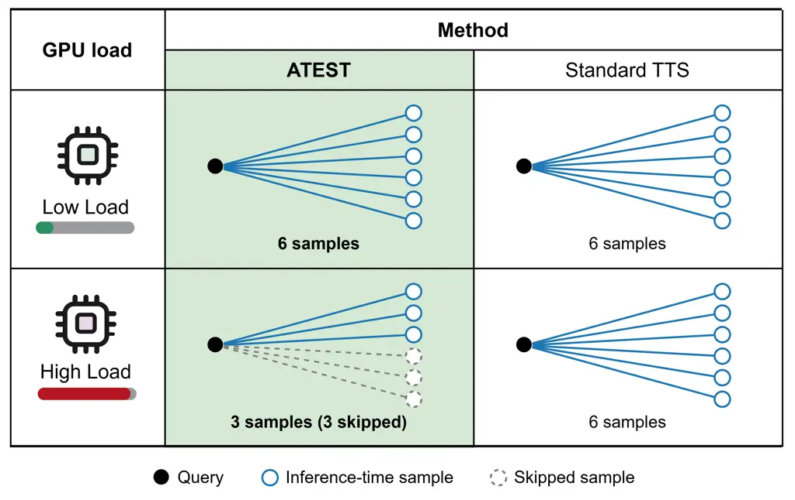
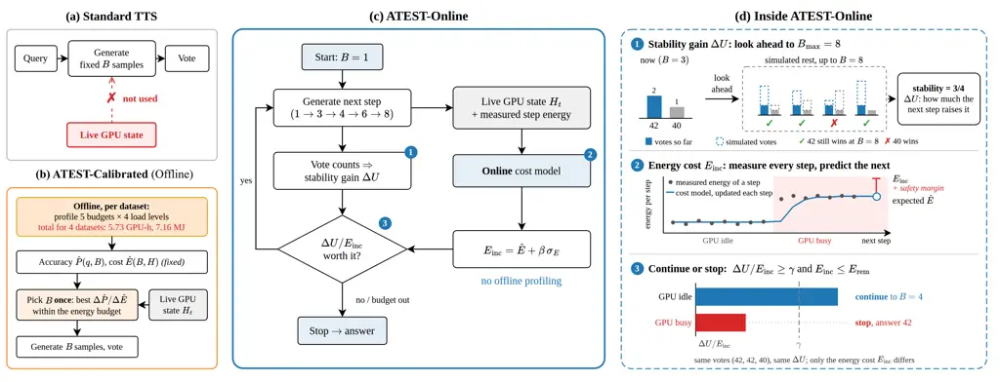
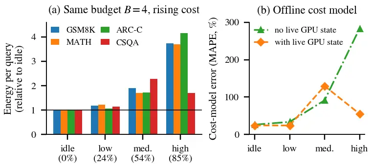
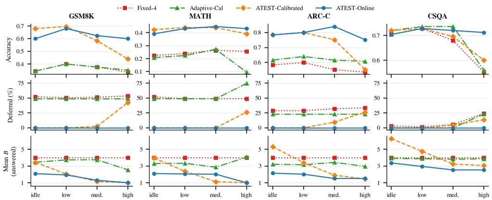

# ATEST: Adaptive Resource-Aware Test-Time Scaling for LLM Inference

Mobina Kashaniyan and Ali Jannesari Affiliation:  Department of Computer
Science  
Iowa State University, USA  
{mobina, jannesar}@iastate.edu

###### Abstract

Test-time scaling (TTS) improves the reasoning of large language models
(LLMs) by generating several samples for a query and voting on the
answer. However, a fixed sampling budget ignores two facts: different
queries need different amounts of reasoning, and the cost of one more
sample changes with GPU load. In our measurements, the same four-sample
query uses up to 4.1$`\times`$ more energy when other jobs load the GPU.
Existing adaptive methods mainly set the budget from answer agreement,
question structure, or question difficulty. They decide how much
reasoning a query needs, but not what that reasoning costs on the GPU
right now. We present ATEST, a runtime framework for resource-aware TTS
with two modes. Its default mode, ATEST-Online, needs no offline
calibration: it starts with one sample, checks whether the plurality
answer is stable, reads the live GPU state, predicts the cost of the
next step with an online cost model, and decides whether to stop or
continue. For stable deployments that can reuse a one-time profile,
ATEST also offers an offline mode, ATEST-Calibrated, which picks the
budget from accuracy and cost models built offline. We evaluate ATEST
with Phi-3-mini on an NVIDIA A100 across four reasoning and
question-answering datasets under a controlled idle-to-high GPU load
schedule, and repeat the study on an NVIDIA L40S and with a second
model, Qwen2.5-3B. On the A100, ATEST-Online answers every query, never
exceeds the energy budget, gives the highest or statistically tied
accuracy on all four datasets, and uses fewer samples as load rises. The
same pattern holds on the L40S and with Qwen2.5-3B, where ATEST-Online
again answers every query within the budget. On GSM8K at high load, it
keeps 60.0% accuracy, while ATEST-Calibrated drops to 44.0% because it
defers 42.4% of the queries. A controlled ablation shows that online
cost learning is what makes the budget follow the load. Including
offline calibration, ATEST-Online uses 42$`\times`$ less GPU time and
48$`\times`$ less energy than ATEST-Calibrated. Its main costs are
higher tail latency and lower throughput on short tasks, and offline
calibration remains strong only when the load is stable. These results
show that TTS on shared GPUs is a runtime resource-management problem,
not only an accuracy problem.

###### Index Terms: 

large language models, test-time scaling, GPU load, resource-aware
inference, adaptive sampling, energy-aware systems



Fig. 1: The idea of ATEST. Standard test-time scaling (TTS) generates
the same number of samples for a query whether the GPU is idle or busy.
ATEST looks at the live GPU load. When the GPU is busy and each sample
costs more energy, it skips samples that are not worth their cost.



Fig. 2: Overview of ATEST. (a) Standard TTS generates a fixed number of
samples $`B`$ and does not use the live GPU state. (b) ATEST-Calibrated,
the offline mode of ATEST, builds accuracy and cost models offline for
each dataset and picks $`B`$ once per query. (c) ATEST-Online starts
with one sample and adds samples step by step
($`1\!\to\!3\!\to\!4\!\to\!6\!\to\!8`$). (d) An illustration of one
decision: \scriptsize1⃝ a Monte Carlo look-ahead to $`B_{\max}=8`$
estimates how likely the current winner is to stay the winner, and
$`\Delta U`$ is how much the next step raises this; \scriptsize2⃝ the
online cost model learns from the measured energy of every step, follows
the load, and predicts the next step’s energy with a safety margin;
\scriptsize3⃝ with the same votes, ATEST-Online continues on an idle GPU
but stops on a busy one.

## I Introduction

Large language models (LLMs) give better answers when they use more
computation at inference time. A simple and popular way to do this is
_test-time scaling_ (TTS) with voting: the model generates several
answers (samples) for the same question, and the system returns the most
common one \[1, 2\]. More samples usually mean better answers, but they
also mean more GPU work, more energy, and longer waiting time.

Because of this cost, recent work makes TTS _adaptive_. These methods
give more samples to hard queries and fewer to easy ones, using signals
such as answer agreement, query difficulty, or reasoning progress \[3,
4, 5, 6, 7, 8\]. They answer one question well: _how many samples does
this query need?_ However, they treat the cost of one sample as a fixed
number. On a real system, this cost is not fixed. LLM performance
depends on batching, scheduling, and memory management \[9, 10\], and
the same number of samples can have very different energy, latency, and
throughput costs \[11\].

Many GPUs in clusters and HPC centers are _shared_: other jobs run on
the same GPU at the same time and compete with the LLM for compute,
memory bandwidth, and power, and this competition changes over time. In
our measurements on an A100, the same four-sample query uses up to
4.1$`\times`$ more energy when the GPU is heavily loaded (Fig. 3). For
example, a GSM8K query costs 121.7 J on an idle GPU and 455.6 J on a
busy one. A controller that ignores this change either wastes energy
when the GPU is busy, or uses up its energy budget too early and must
_defer_ later queries, which means refusing to answer them.

So a TTS controller on a shared GPU must answer two questions at the
same time:

1.  1.  _Is one more sample useful for this query?_
2.  2.  _What does that sample cost on the GPU right now?_

We present ATEST, a resource-aware TTS framework that answers both
questions. Fig. 1 shows the idea: when the GPU is busy, ATEST skips
samples that are not worth their higher cost. ATEST has two modes that
share the same budget ladder, GPU monitor, and energy accounting
(Fig. 2). Its default mode, ATEST-Online, needs no offline profiling. It
works as a closed control loop: it generates samples in small steps,
checks whether the vote is becoming stable, reads the live GPU state,
measures what each step really cost, updates an online cost model, and
stops as soon as another step is not worth its cost.

Some deployments, however, run the same model and workload on a GPU
whose load rarely changes, or need low tail latency. For these cases
ATEST also offers an offline mode, ATEST-Calibrated, which profiles each
dataset once and picks the whole budget per query from accuracy and cost
models, together with the live GPU state. Choosing $`B`$ once lets it
generate all samples in one batch, which gives lower tail latency and
higher throughput on short tasks. The price is the profile itself, which
took 5.73 GPU-hours and 7.16 MJ for our four datasets, and a cost model
that does not follow the GPU when the load changes. Including profiling,
ATEST-Online uses 42$`\times`$ less GPU time and 48$`\times`$ less
energy than ATEST-Calibrated on the same 2,000 queries.

This difference matters most when the GPU becomes busy. On GSM8K under
high load, ATEST-Calibrated must defer 42.4% of the queries, so it
answers only 44.0% of them correctly. Under the same load, ATEST-Online
answers every query, keeps 60.0% accuracy, and uses less energy per
query (175.8 J vs. 206.4 J). Across all four datasets, ATEST-Online
never defers a query, never exceeds the energy budget, and gives the
highest or tied-best accuracy. We also test _why_ ATEST-Online changes
its budget. In a controlled ablation, we keep the remaining-energy
signal fixed, so that budget depletion cannot drive the decision.
Without online cost learning, the controller uses the same mean budget
($`B=3.12`$) at every load level on all four datasets. With online cost
learning, the budget follows the load. So the adaptation comes from the
runtime resource signals, not from the budget running out.

Contributions. This paper makes three contributions:

1.  1.  We show with measurements that the cost of a TTS sample is not
        fixed: on a GPU shared with other jobs, the same four-sample query
        uses up to 4.1$`\times`$ more energy under high load. Based on this,
        we treat adaptive TTS as a runtime resource-management problem,
        where each decision weighs the value of more reasoning against its
        current cost.
2.  2.  We introduce ATEST with two modes. Its default mode, ATEST-Online,
        learns the cost of sampling online and decides step by step, with no
        dataset-specific profiling. Its offline mode, ATEST-Calibrated,
        picks the budget once from offline accuracy and cost models together
        with the live GPU state, for deployments that can reuse a one-time
        profile.
3.  3.  We show when each mode should be used. Under changing load,
        ATEST-Online answers every query and stays within the energy budget,
        while ATEST-Calibrated defers up to 42.4% of the queries. Under
        stable load, offline calibration remains a strong choice. A
        controlled ablation shows that online cost learning is what makes
        the budget follow the load.

## II Background and Related Work

### II-A Test-Time Scaling and Adaptive Sampling

Test-time scaling (TTS) uses more computation at inference time to get
better answers \[12\]. A common form is to generate several answers for
the same query and combine them. Chain-of-thought prompting \[1\],
\[13\],\[14\] lets the model write out its reasoning, and
self-consistency \[2, 15\] samples several reasoning paths and returns
the answer that appears most often. We call the number of samples the
*sampling budget* $`B`$. The same budget is not useful for every query.
Easy questions are often answered correctly after one or two samples,
while hard questions may need more. Adaptive methods therefore change
$`B`$ per query. Adaptive-Consistency \[3\],\[16\] and Early-Stopping
Self-Consistency \[4\], \[17\], \[18, 19, 20\] stop sampling once the
answers agree. Other methods use question difficulty, answer confidence,
or reasoning progress \[5, 6, 7, 8\].

These methods remove many unnecessary samples. However, they decide only
from the reasoning side: they ask whether more samples would change the
answer, but not what those samples cost on the GPU right now. Recent
work shows that the number of samples alone does not describe the
systems cost of TTS, because the same samples can have very different
energy, latency, and throughput costs depending on how they run \[11\].
ATEST adds this missing systems side to adaptive TTS.

### II-B GPU-Aware and Energy-Efficient LLM Serving

LLM serving systems\[21, 22\] show that runtime conditions strongly
affect inference performance. Orca \[9\] and vLLM \[10\] improve
batching and GPU memory management. Llumnix \[23\] moves requests
between model instances at runtime to balance load and reduce latency,
and Bullet \[24\] changes GPU resource allocation during execution based
on current performance conditions. Energy is also a main goal in LLM
serving. Samsi et al. \[25\] measured the energy cost of LLM inference
on V100 and A100 GPUs. POLCA \[26\] studies power management and power
oversubscription in LLM clusters, and DynamoLLM \[27\] reconfigures
inference clusters to save energy while meeting latency targets.
throttLL’eM \[28\] adjusts GPU frequency and resource configuration to
reduce inference energy while meeting latency targets. EnerTune \[29\]
studies energy-aware GPU sharing, models how GPU allocation, frequency,
and batch size affect power and performance, and shows that large
profiling spaces can make offline profiling expensive.

These systems decide _how_ to run a given amount of work: where to place
requests, how to batch them, and how to set the hardware. They do not
decide _how much_ reasoning work each query should get. ATEST makes this
second decision, so it complements these systems and can run on top of
them.

### II-C Research Gap

|                                                     |                 |                |
| --------------------------------------------------- | --------------- | -------------- |
| Method                                              | Cost unit       | Live GPU state |
| Self-consistency family \[2, 3, 4, 6\]              | samples         | ✗              |
| $`\hookrightarrow`$ Fixed-4 (baseline)              | samples         | ✗              |
| Adaptive allocation family \[7, 5, 8\]              | tokens, compute | ✗              |
| $`\hookrightarrow`$ Adaptive-Cal (baseline)         | energy (model)  | ✗              |
| ATEST (this work)                                   |                 |                |
| $`\hookrightarrow`$ ATEST-Calibrated (offline mode) | energy (model)  | ✓              |
| $`\hookrightarrow`$ ATEST-Online (default)          | energy (live)   | ✓              |

TABLE I: Families of TTS methods. Indented rows are the methods we run.

Adaptive TTS decides how much reasoning a query needs but treats the
cost of a sample as fixed, while inference and energy systems manage the
GPU but do not change how much reasoning each query gets. On a shared
GPU, these decisions depend on each other: one more sample is worth it
only if the answers so far and the current GPU cost justify it. No prior
method in Table I reads the live GPU state; the closest,
Adaptive-Cal \[8\], uses offline-calibrated models. ATEST makes this
decision at runtime using both signals, and ATEST-Online learns the cost
online without per-dataset profiling.

## III Motivation



Fig. 3: Motivation. (a) Energy per answered query for a fixed budget of
$`B=4`$ at four GPU load levels, relative to idle. The value under each
level is the measured GPU utilization. (b) Error of the offline cost
model, averaged over four datasets. Without live GPU state
(Adaptive-Cal), the error grows from 26% at idle to 283% at high load.
Adding live GPU state (ATEST-Calibrated) lowers the high-load error to
55%, but the error is still large at medium load (130%).

When several jobs share one GPU, they compete for the same compute
units, memory bandwidth, and power limit. As a result, the same
microbatch runs longer, and the GPU draws more power while it runs. In
our setup, each microbatch is charged for the GPU energy used while it
occupies the GPU (§VI), so the same number of samples costs more joules
when the GPU is busy. This cost depends on the current load, which
changes over time and is not known in advance. Fig. 3 shows two
observations from our experiments.

Observation 1: the same budget can cost several times more. With a fixed
budget of $`B=4`$, the energy per answered query rises with load on all
four datasets. At high load it is 3.7$`\times`$ the idle value on GSM8K
and MATH, and 4.1$`\times`$ on ARC-Challenge.

Observation 2: an offline cost model does not follow the load. A cost
model fitted offline predicts the cost of a budget before it runs.
Fig. 3(b) shows that its prediction error grows quickly as the GPU
becomes busy. Adding the live GPU state as an input helps, but it does
not remove the problem.

These observations lead to four design goals for a TTS controller on a
shared GPU:

- •
  G1 – Spend samples where they help. Give more samples only to queries
  whose answer is still uncertain.
- •
  G2 – Follow the live cost. Use the cost of a sample _now_, not the
  cost measured during profiling.
- •
  G3 – Avoid expensive profiling. Do not require a new offline
  calibration for every dataset.
- •
  G4 – Stay safe and serve everyone. Never exceed the energy budget, and
  avoid deferring queries.

ATEST-Calibrated meets G1, partly meets G2, and does not meet G3.
ATEST-Online is designed to meet all four.

## IV Problem Formulation

We serve a stream of $`N`$ queries $`q_{1},\dots,q_{N}`$ on one GPU that
is shared with other jobs. For each query $`q_{i}`$, the controller
chooses a budget $`B_{i}\in\mathcal{B}=\{1,3,4,6,8\}`$. The GPU
condition at time $`t`$ is $`H_{t}`$. Because $`H_{t}`$ changes, the
same budget can have a different energy cost at different times.

All queries share one energy budget $`E_{\max}`$. Let $`E_{i}`$ be the
measured GPU energy used for query $`q_{i}`$. The total must stay within
the budget:

```math
\sum_{i=1}^{N}E_{i}\leq E_{\max}. \tag{1}
```

A query is admitted only if its predicted cost fits its share of the
remaining budget, $`E_{\mathrm{rem}}/N_{\mathrm{rem}}`$, where
$`N_{\mathrm{rem}}`$ is the number of queries left; otherwise it is
_deferred_. A deferred query gets no answer, and we write $`B_{i}=0`$.
The _defer rate_ is the fraction of deferred queries, and the _service
coverage_ is one minus the defer rate. The goal is to answer as many
queries correctly as possible while keeping Eq. (1):

```math
\max_{B_{1},\dots,B_{N}}\ \sum_{i=1}^{N}\mathbf{1}\big[\text{answer to }q_{i}\text{ is correct}\big]\quad\text{s.t. Eq.~\eqref{eq:budget}}. \tag{2}
```

A deferred query counts as not correct. So deferring is never free: it
protects the budget, but it lowers accuracy and coverage.

## V ATESTDesign

### V-A Overview

ATEST has two modes that share the same budget ladder, GPU monitor
(NVML \[30\]), and energy accounting. They differ in _when_ they decide
and _what they learn_. The default mode, ATEST-Online, decides step by
step, using the samples it has already generated and a cost model that
it learns while it runs. The offline mode, ATEST-Calibrated, decides the
whole budget once, before generating any sample, using models built
offline. Table II summarizes the differences.

|                       |                                 |                               |
| --------------------- | ------------------------------- | ----------------------------- |
| Property              | ATEST-Calibrated                | ATEST-Online                  |
| Value of more samples | Offline accuracy model          | Live vote stability           |
| Cost model            | Built offline, fixed            | Learned online (RLS)          |
| Uses live GPU state   | Yes                             | Yes                           |
| Uses current samples  | No                              | Yes                           |
| When $`B`$ is chosen  | Once, before sampling           | Step by step                  |
| Dataset profiling     | Required                        | Not required                  |
| Decision score        | $`\Delta\hat{P}/\Delta\hat{E}`$ | $`\Delta U/E_{\mathrm{inc}}`$ |

TABLE II: The two ATEST modes.

When to use the offline mode. ATEST-Online is the right choice when the
load changes or new models and datasets arrive often. ATEST-Calibrated
is useful in three cases: (1) the model, GPU, and workload stay the same
long enough to reuse one profile, where it reaches higher accuracy under
stable load (§VII-F); (2) the service needs low tail latency or high
throughput on short tasks, since it generates all samples in one batch
(§VII-E); and (3) the cost of each query must be known before it runs.

### V-B ATEST-Online

ATEST-Online removes the offline phase. It uses two kinds of feedback
while it runs: the answers it has already generated for the current
query, and the measured cost of the steps it has already executed.
Algorithm 1 shows the loop.

Step-by-step sampling. ATEST-Online starts with $`B=1`$. It then climbs
the same ladder $`1\!\to\!3\!\to\!4\!\to\!6\!\to\!8`$, but it only
generates the _new_ samples at each step. Samples from earlier steps are
kept and reused.

Reasoning signal: vote stability. After each step, ATEST-Online groups
the answers and counts votes. Let $`w_{B}`$ be the current plurality
answer after $`B`$ samples. The _stability_ is the chance that $`w_{B}`$
would still win if we went all the way to $`B_{\max}=8`$:

```math
S(B)=P\big(w_{B}\text{ is still the plurality answer at }B_{\max}\big). \tag{3}
```

ATEST-Online estimates $`S`$ with a small Monte Carlo simulation of the
remaining samples, based on the current vote counts. The expected gain
of the next step is the increase in stability:

```math
\Delta U=S_{\text{after}}-S_{\text{now}}. \tag{4}
```

This signal does not need the correct answer. It only asks: _would more
samples still change the result?_

Resource signal: online cost learning. After each executed step,
ATEST-Online records the measured energy $`e_{t}`$ of that step and a
feature vector $`\boldsymbol{\phi}_{t}`$ that describes the step (the
number of new samples) and the current GPU state. It predicts energy
with a linear model,
$`\hat{E}=\boldsymbol{\theta}^{\top}\boldsymbol{\phi}`$, and updates
$`\boldsymbol{\theta}`$ with the standard recursive least squares (RLS)
rule \[31\]:

```math
\displaystyle\mathbf{k}_{t} \displaystyle=\frac{\mathbf{P}_{t-1}\boldsymbol{\phi}_{t}}{\lambda+\boldsymbol{\phi}_{t}^{\top}\mathbf{P}_{t-1}\boldsymbol{\phi}_{t}}, \tag{5}
```

```math
\displaystyle\boldsymbol{\theta}_{t} \displaystyle=\boldsymbol{\theta}_{t-1}+\mathbf{k}_{t}\big(e_{t}-\boldsymbol{\theta}_{t-1}^{\top}\boldsymbol{\phi}_{t}\big), \tag{6}
```

```math
\displaystyle\mathbf{P}_{t} \displaystyle=\tfrac{1}{\lambda}\big(\mathbf{P}_{t-1}-\mathbf{k}_{t}\boldsymbol{\phi}_{t}^{\top}\mathbf{P}_{t-1}\big), \tag{7}
```

where $`\lambda\leq 1`$ is a forgetting factor ($`\lambda=1`$ means no
forgetting). RLS is cheap (a few small matrix operations per step),
needs no training data, and starts learning from the first query.
Because measurements arrive after every step, the model quickly sees the
effect of a load change. A second RLS model predicts step latency in the
same way.

Safety margin. To lower the risk of underestimating the cost,
ATEST-Online uses a conservative estimate for the next step:

```math
E_{\mathrm{inc}}=\hat{E}+\beta\,\sigma_{E}, \tag{8}
```

where $`\sigma_{E}`$ is the uncertainty of the current prediction and
$`\beta`$ sets how careful the controller is.

Continue or stop. ATEST-Online continues only if the next step is worth
its cost and fits in the budget:

```math
\frac{\Delta U}{E_{\mathrm{inc}}}\geq\gamma\quad\text{and}\quad E_{\mathrm{inc}}\leq E_{\mathrm{rem}}, \tag{9}
```

where $`\gamma`$ is a minimum gain per joule and $`E_{\mathrm{rem}}`$ is
the remaining energy budget. It also stops when the answer is already
stable, when more samples are unlikely to resolve a disagreement, or
when it reaches $`B_{\max}`$.

1: query $`q`$; ladder $`1\!\to\!3\!\to\!4\!\to\!6\!\to\!8`$; remaining
budget $`E_{\mathrm{rem}}`$; RLS model
$`(\boldsymbol{\theta},\mathbf{P})`$

2: $`H\leftarrow`$ read GPU state (NVML)

3: if $`E_{\mathrm{inc}}(B{=}1,H)>E_{\mathrm{rem}}/N_{\mathrm{rem}}`$
then return Defer

4: end if

5: generate 1 sample; $`B\leftarrow 1`$; update votes $`v`$

6: measure step energy $`e`$; RLS update;
$`E_{\mathrm{rem}}\leftarrow E_{\mathrm{rem}}-e`$

7: while $`B<8`$ and answer not yet stable do

8:   $`B^{\prime}\leftarrow`$ next budget on the ladder

9:   $`\Delta U\leftarrow`$ MonteCarloGain($`v,B\!\to\!B^{\prime}`$)
$`\triangleright`$ Eq. (4)

10:   $`H\leftarrow`$ read GPU state;
$`E_{\mathrm{inc}}\leftarrow\hat{E}(B^{\prime}{-}B,H)+\beta\sigma_{E}`$

11:   if $`\Delta U/E_{\mathrm{inc}}<\gamma`$ or
$`E_{\mathrm{inc}}>E_{\mathrm{rem}}`$ then break

12:   end if

13:   generate $`B^{\prime}{-}B`$ new samples; update $`v`$;
$`B\leftarrow B^{\prime}`$

14:   measure $`e`$; RLS update $`(\boldsymbol{\theta},\mathbf{P})`$;
$`E_{\mathrm{rem}}\leftarrow E_{\mathrm{rem}}-e`$

15: end while

16: return plurality answer of $`v`$

Algorithm 1 ATEST-Online for one query $`q`$

A simple example. The following case is only an illustration of the
rule. Suppose a math question has three samples, and all three give the
answer 42. The vote is already stable, so $`\Delta U`$ is close to zero
and ATEST-Online stops at $`B=3`$, whether the GPU is idle or busy. Now
suppose the three samples give 42, 42, and 40. More samples could still
change the winner, so $`\Delta U`$ is large. If the GPU is idle, the
next step is cheap, $`\Delta U/E_{\mathrm{inc}}`$ passes the threshold,
and ATEST-Online goes to $`B=4`$. If the GPU is busy, the same step
costs several times more joules (Fig. 3(a)), the ratio can drop below
$`\gamma`$, and ATEST-Online returns 42. In both cases the decision uses
the same two questions: is the next sample useful, and what does it cost
now?

Two feedback loops. Each executed step feeds back twice. The new answers
update the reasoning signal $`\Delta U`$, and the measured energy
updates the cost model. So the next decision depends on both how the
reasoning is going and how the GPU is behaving now.

Overhead. The controller runs on the host CPU. Per step, it reads NVML,
runs a small Monte Carlo estimate, and does one RLS update. The main
runtime cost is not this computation, but the fact that samples are
generated in several smaller steps instead of one batch (§VII-E).

### V-C ATEST-Calibrated

ATEST-Calibrated is the offline mode of ATEST. We call it _Calibrated_
because its accuracy and cost models come from an offline calibration
(profiling) phase; it still serves queries at runtime and reads the live
GPU state, but its models stay fixed. For each dataset, we run 500
calibration prompts at each of the five budgets and four load levels (20
settings). Since the five budgets together use $`1+3+4+6+8=22`$ samples
per prompt, this generates $`500\times 22\times 4=44{,}000`$ samples per
dataset. The calibration prompts come from a separate split and do not
overlap with the evaluation queries. From these runs we fit two models.
The _accuracy model_ $`\hat{P}(q,B)`$ estimates the chance that budget
$`B`$ gives a correct answer for query $`q`$, using query features such
as estimated difficulty. The _cost model_ $`\hat{E}(B,H)`$ predicts the
energy of budget $`B`$ under GPU condition $`H`$ by predicting its power
and run time and multiplying them, since energy is power times time
(watts $`\times`$ seconds $`=`$ joules). Both models stay fixed after
this phase.

Online phase. For each query, ATEST-Calibrated reads the current GPU
state $`H_{t}`$. For an upgrade from budget $`B`$ to the next budget
$`B^{\prime}`$, it computes the expected accuracy gain and the extra
energy:

```math
\displaystyle\Delta\hat{P} \displaystyle=\hat{P}(q,B^{\prime})-\hat{P}(q,B), \tag{10}
```

```math
\displaystyle\Delta\hat{E} \displaystyle=\hat{E}(B^{\prime},H_{t})-\hat{E}(B,H_{t}). \tag{11}
```

The score $`\Delta\hat{P}/\Delta\hat{E}`$ is the expected gain per extra
joule. The allocator first gives the query the smallest budget. Then,
among the upgrades on the ladder $`1\!\to\!3\!\to\!4\!\to\!6\!\to\!8`$
that still fit in the remaining energy, it takes the one with the best
score. It stops when no useful upgrade fits. If even $`B=1`$ does not
fit according to the cost model, the query is deferred. After this, all
$`B`$ samples are generated and the plurality answer is returned. The
generated samples do not change the chosen budget.

Weakness. ATEST-Calibrated uses the live GPU state, but its cost model
was learned from the profiling runs and is never updated. When the real
cost moves away from the model, the allocator either overspends early or
rejects queries that it could have served.

## VI Experimental Methodology

We evaluate ATEST under controlled GPU load. Our goal is to measure both
answer quality and system behavior as the GPU condition changes.

### VI-A Model, Hardware, and Settings

We use Phi-3-mini-4k-instruct \[32\] in bfloat16 on one NVIDIA
A100-SXM4-80GB GPU with a 500 W power limit. We use tensor parallel size
1 and batch size 32. Sampling uses temperature 0.7, top-$`p`$ 0.95, at
most 512 new tokens, and a fixed seed (42). All methods use the same
model, prompts, generation settings, and budget set
$`\mathcal{B}=\{1,3,4,6,8\}`$. To test generalization (§VII-G), we
repeat the study on a second GPU type, an NVIDIA L40S with a 350 W power
limit, and with a second model, Qwen2.5-3B-Instruct \[33\], using the
same precision (bfloat16), batch size, sampling settings, query sets,
and load schedule.

### VI-B Datasets

We use four datasets with different answer lengths: two math datasets
with long answers, GSM8K \[34\] and MATH \[35\], and two multiple-choice
datasets with short answers, ARC-Challenge \[36\] and
CommonsenseQA \[37\]. Each dataset has a development set and a test set
of 500 queries each, which do not overlap; all reported results use the
test sets. We report accuracy. All query sets and controller settings
were frozen before we looked at the results, and we did no tuning
afterwards.

### VI-C Compared Methods

- •
  Fixed-4: standard self-consistency \[2\] with a fixed budget: every
  answered query gets $`B=4`$ samples, and the plurality answer is
  returned. We use $`B=4`$ because it is the reference budget that
  defines $`E_{\max}`$.
- •
  Adaptive-Cal: adaptive budget allocation with offline
  calibration \[8\]. It chooses $`B`$ per query from offline accuracy
  and cost models, but does not use the live GPU state.
- •
  ATEST-Calibrated (§V-C): the offline mode of ATEST.
- •
  ATEST-Online (§V-B): the default mode of ATEST.

Choice of baselines. Fixed-budget self-consistency is the base method
that all self-consistency methods in Table I build on, and Adaptive-Cal
is the closest prior work, as the only one that models energy. The other
adaptive methods stop sampling from reasoning signals alone, so their
budget cannot react to GPU load; our ReasoningOnly-Strict ablation,
which uses only such a signal, keeps the same budget at every load level
(§VII-D).

### VI-D Controlled GPU Load

To create a shared-GPU setting, we run a background load injector on the
same GPU. It competes with the LLM for GPU resources, like other jobs on
a shared GPU. The injector is a background thread that runs dense FP16
matrix multiplies on the same GPU for a duty fraction of every 0.2 s
period and sleeps for the rest. We use four levels: _idle_ (no
injector), _low_, _medium_, and _high_, with injector duty settings of
0.25, 0.55, and 0.85. The duty setting controls how hard the injector
works; it is not a utilization target. We check the real effect with
NVML \[30\]. For example, in the Fixed-4 runs the measured GPU
utilization is about 0%, 24%, 54%, and 85%, and the average GPU power on
GSM8K rises from 77 W at idle to 431 W at high load. The 500 queries of
each run are split equally: 125 queries per load level, in the order
idle, low, medium, high. The schedule is fixed by a hash and is reused
exactly for every method. So all methods see the same queries in the
same order under the same injector settings.

|       | Method           | Acc.$`\uparrow`$ | Defer$`\downarrow`$ | Mean  | J/corr.$`\downarrow`$ | Budget   |
| ----- | ---------------- | ---------------- | ------------------- | ----- | --------------------- | -------- |
|       |                  |                  | (%)                 | $`B`$ |                       | used (%) |
| GSM8K | Fixed-4          | 0.364            | 51.8                | 1.928 | 312.4                 | 93.1     |
|       | Adaptive-Cal     | 0.368            | 48.8                | 1.726 | 330.5                 | 99.5     |
|       | ATEST-Calibrated | 0.600            | 11.2                | 1.796 | 196.5                 | 96.5     |
|       | ATEST-Online     | 0.626            | 0.0                 | 1.580 | 191.9                 | 98.3     |
| MATH  | Fixed-4          | 0.246            | 49.6                | 2.016 | 600.5                 | 86.1     |
|       | Adaptive-Cal     | 0.200            | 55.2                | 1.474 | 790.7                 | 92.2     |
|       | ATEST-Calibrated | 0.424            | 6.6                 | 2.046 | 401.2                 | 99.2     |
|       | ATEST-Online     | 0.426            | 0.0                 | 1.794 | 371.2                 | 92.2     |

|       | Method           | Acc.$`\uparrow`$ | Defer$`\downarrow`$ | Mean  | J/corr.$`\downarrow`$ | Budget   |
| ----- | ---------------- | ---------------- | ------------------- | ----- | --------------------- | -------- |
|       |                  |                  | (%)                 | $`B`$ |                       | used (%) |
| ARC-C | Fixed-4          | 0.568            | 30.8                | 2.768 | 25.1                  | 87.4     |
|       | Adaptive-Cal     | 0.620            | 23.2                | 2.450 | 28.0                  | 106.4    |
|       | ATEST-Calibrated | 0.722            | 9.0                 | 2.878 | 19.2                  | 84.9     |
|       | ATEST-Online     | 0.794            | 0.0                 | 1.798 | 19.4                  | 94.7     |
| CSQA  | Fixed-4          | 0.666            | 8.6                 | 3.656 | 17.8                  | 102.3    |
|       | Adaptive-Cal     | 0.688            | 5.8                 | 3.642 | 16.7                  | 99.1     |
|       | ATEST-Calibrated | 0.686            | 4.6                 | 4.192 | 13.3                  | 78.7     |
|       | ATEST-Online     | 0.716            | 0.0                 | 2.848 | 16.2                  | 99.9     |

TABLE III: Overall results under the
idle$`\to`$low$`\to`$medium$`\to`$high load schedule (500 queries per
dataset). Our default mode, ATEST-Online, is shaded. Accuracy counts
deferred queries as wrong. Mean $`B`$ counts deferred queries as
$`B=0`$. Budget used above 100% (red) means the energy budget was
exceeded. Bold: best value per dataset.

### VI-E Energy Accounting and Budget

We measure energy by GPU occupancy ($`E_{\mathrm{occ}}`$). Each
microbatch is charged for all the GPU energy used while it runs,
computed from NVML power readings and its run time. When other jobs
share the GPU, a microbatch runs longer and the GPU draws more power, so
its $`E_{\mathrm{occ}}`$ grows. We use this accounting because a job on
a shared GPU holds the device for its whole run time, so this is the
energy it is responsible for; the same accounting is used for all
methods, so it does not favor any of them. Each run gets one shared
energy budget $`E_{\max}`$, set from the reference energy needed to run
$`B=4`$ under the reference GPU condition. We set this budget separately
for each GPU, model, and dataset, because the cost of a sample depends
on all three. All methods get the same budget.

### VI-F Metrics

Quality and coverage. _Accuracy_ is computed over _all_ 500 queries; a
deferred query counts as wrong. _Defer_ is the percentage of deferred
queries.

Sampling effort. _Mean $`B`$_ is the average budget. In overall results
we count a deferred query as $`B=0`$; in per-load results we average
only over answered queries, so that the budget choice is visible.

Energy. We report $`E_{\mathrm{occ}}`$ per query and _joules per correct
answer_:

```math
\text{J/correct}=\frac{\text{total }E_{\mathrm{occ}}}{\text{number of correct answers}}. \tag{12}
```

This metric gets worse both when a method spends energy on samples that
do not help and when it gets fewer correct answers, for example by
deferring queries.

Budget safety. _Budget used_ is total energy divided by $`E_{\max}`$. A
value above 100% means the method _overshot_ the budget.

System performance. We report 95th-percentile (p95) latency per query,
query throughput (queries per second, QPS), GPU utilization, and power.
For ATEST-Online we also report the error of its online cost model as
mean absolute percentage error (MAPE).

### VI-G Calibration Cost

We measure the offline profiling of the calibrated methods separately,
because it is paid before serving starts. Over four datasets, it uses
2,000 prompts, 80 settings, and 176,000 generated samples, for a total
of 5.73 GPU-hours and 7.16 MJ. ATEST-Online needs no dataset-specific
profiling.

### VI-H Controlled Ablation

In the main runs, the remaining budget shrinks over time, so a change in
$`B`$ could come from the budget and not from the load. To separate
these effects, we run three versions of ATEST-Online: Full-HW (live GPU
state and online cost learning), noHW-State (online cost learning, but
the GPU-state input is hidden), and ReasoningOnly-Strict (no GPU state
and online cost learning frozen). In this experiment we use a large,
non-binding energy budget and keep the remaining-energy value that the
controller sees fixed. So the budget cannot drive the decision.

## VII Evaluation

We organize the results around seven questions: Q1: Does ATEST-Online
keep quality and serve every query under changing load? Q2: How does
each controller react as load rises, and why does the offline mode
defer? Q3: What does each mode cost in energy, including profiling? Q4:
Is the adaptation really caused by the resource signals? Q5: What is the
runtime overhead of online control? Q6: When is offline calibration the
better choice? Q7: Does the behavior hold on another GPU and another
model?



Fig. 4: Behavior at each load level (125 queries per level). Top:
accuracy over all queries (deferred = wrong). Middle: deferred queries
(%). Bottom: mean $`B`$ over _answered_ queries. ATEST-Online (blue,
solid) never defers and lowers its budget as load rises.
ATEST-Calibrated (orange, dashed) also lowers its budget, but it starts
deferring at medium or high load on all four datasets, which pulls its
accuracy down.

### VII-A Q1: Overall Results under Changing Load

Table III gives the main results. Three points stand out.

ATEST-Online serves every query. It has zero deferred queries on all
four datasets and stays within the energy budget on all of them (budget
used 92–100%). Every other method defers queries on all four datasets,
and Fixed-4 and Adaptive-Cal also exceed the budget once each.

ATEST-Online gives the best or tied-best accuracy. It has the highest
accuracy on all four datasets: GSM8K (0.626), MATH (0.426),
ARC-Challenge (0.794), and CommonsenseQA (0.716). Each result comes from
one run of 500 queries, so the 95% confidence interval of one accuracy
is about $`\pm`$4 points; gaps of up to about 3 points, as on GSM8K,
MATH, and CommonsenseQA, are ties. The clear gains are on ARC-Challenge
(+7.2 points over ATEST-Calibrated), where ATEST-Calibrated loses
accuracy mainly because it defers 9.0% of the queries, and at high load
(§VII-B).

ATEST-Online uses fewer samples. It has the lowest mean $`B`$ on three
of four datasets, even though it answers more queries than any other
method, because it stops as soon as the vote is stable. On MATH only
Adaptive-Cal is lower, and only because it defers 55.2% of the queries.
The two baselines do much worse on the long-answer datasets: Fixed-4 and
Adaptive-Cal defer about half of the GSM8K and MATH queries, at every
load level (Fig. 4). Since each query may use only its share of the
remaining budget, four samples often do not fit, so these baselines
defer queries from the start.

Answer to Q1: Yes. Under changing load, ATEST-Online answers every
query, stays within budget, and gives the best or tied-best accuracy on
all four datasets.

### VII-B Q2: Behavior as the Load Rises

Fig. 4 shows each method at each load level.

Both ATEST modes use fewer samples when the GPU is busy. ATEST-Online
lowers its mean budget from idle to high load on all four datasets: from
2.09 to 1.00 on GSM8K, 2.10 to 1.00 on MATH, 2.14 to 1.51 on
ARC-Challenge, and 3.37 to 2.54 on CommonsenseQA. ATEST-Calibrated also
lowers its budget (for example, from 3.45 to 1.00 on GSM8K). Fixed-4
always uses $`B=4`$ for the queries it answers.

ATEST-Online keeps serving at high load. On GSM8K at high load, both
ATEST modes end up at $`B=1`$. But ATEST-Calibrated defers 53 of the 125
queries (42.4%), so its accuracy for this phase falls to 44.0%.
ATEST-Online answers all 125 queries with 60.0% accuracy and uses less
energy per query (175.8 J vs. 206.4 J). On MATH at high load the pattern
is the same: ATEST-Calibrated defers 26.4% and reaches 39.2%, while
ATEST-Online defers none and reaches 43.2%.

Why does ATEST-Calibrated defer? We see two reasons in the measurements.
_First, it spends more early._ At idle on GSM8K, ATEST-Calibrated uses
$`B=3.45`$ and 124.4 J per query, while ATEST-Online uses $`B=2.09`$ and
60.9 J. This buys higher idle accuracy (68.0% vs. 60.0%), but the budget
is shared by the whole run, so less is left for the high-load phase,
when each query is much more expensive. _Second, its fixed cost model
can be too pessimistic._ ATEST-Calibrated admits a query only if the
predicted cost fits. On CommonsenseQA it deferred 23 queries although
21% of the energy budget was never used; on ARC-Challenge it deferred 45
queries with 15% unused. So the budget was not the limit here; the
deferrals came from the controller’s own cost predictions. Fig. 3(b)
shows the root cause: the offline cost model is often far from the real
cost under load. ATEST-Online avoids both problems because it measures
every step and corrects its cost model as it goes.

A note on measured load. The injector settings are identical for all
methods, but GPU utilization is sampled before each microbatch, so the
reading depends on each method’s execution pattern. On GSM8K and MATH,
all methods see the same high-load utilization (about 85%); for
ATEST-Online on ARC-Challenge and CommonsenseQA the sampled reading at
high load is lower (68% and 45%). We therefore base our main high-load
comparison on GSM8K and MATH.

Answer to Q2: As load rises, ATEST-Online lowers its budget and keeps
serving every query. ATEST-Calibrated also lowers its budget, but its
early spending and fixed cost model lead to deferrals at high load.

### VII-C Q3: Energy Cost, Including Profiling

Serving energy. ATEST-Online has the lowest joules per correct answer on
GSM8K (191.9 J) and MATH (371.2 J), the two long-answer datasets where
the energy budget is tight. On ARC-Challenge the two modes are almost
equal (19.4 J vs. 19.2 J). On CommonsenseQA, ATEST-Calibrated is more
efficient (13.3 J vs. 16.2 J, Table III), but it leaves 4.6% of the
queries unanswered. So ATEST-Online is not always the cheapest per
correct answer during serving, but it wins the overall trade-off: it
gives higher accuracy, answers every query, and, once profiling is
counted, uses far less total energy on every dataset.

|                                      |                  |              |
| ------------------------------------ | ---------------- | ------------ |
|                                      | ATEST-Calibrated | ATEST-Online |
| _Offline profiling (before serving)_ |                  |              |
| GPU time (h)                         | 5.73             | 0            |
| Energy (MJ)                          | 7.16             | 0            |
| Generated samples                    | 176,000          | 0            |
| _Serving 2,000 queries_              |                  |              |
| Run time (h)                         | 0.14             | 0.14         |
| Energy (MJ)                          | 0.156            | 0.153        |
| Queries answered                     | 1,843            | 2,000        |
| Correct answers                      | 1,216            | 1,281        |
| _Total_                              |                  |              |
| GPU time (h)                         | 5.87             | 0.14         |
| Energy (MJ)                          | 7.31             | 0.153        |

TABLE IV: End-to-end cost of The two ATEST modes on four datasets (2,000
queries under the load schedule). ATEST-Calibrated must profile every
dataset before serving. ATEST-Online starts serving at once and learns
its cost model during serving, so its learning cost is included in the
serving numbers.

Setup cost versus serving cost. Table IV puts the full cost of both
modes side by side. ATEST-Calibrated must profile every dataset before
it can serve a single query: 5.73 GPU-hours, 7.16 MJ, and 176,000
generated samples for our four datasets. ATEST-Online skips this stage
completely and starts serving at once; its cost model learns during
normal serving, so its learning cost is already inside the serving
numbers. Serving itself costs almost the same for both modes (about 0.14
hours and 0.15 MJ for 2,000 queries), but ATEST-Online answers all 2,000
queries and gives 65 more correct answers. In total, ATEST-Calibrated
uses about 42$`\times`$ more GPU time and 48$`\times`$ more energy than
ATEST-Online in our study. Calibration is a one-time cost per dataset,
so a long, stable deployment can spread it over many queries, but it
must be repeated whenever the model, the GPU, the prompt format, or the
workload changes.

Answer to Q3: ATEST-Online is the most energy-efficient mode on the
long-answer datasets. Including profiling, it uses 42$`\times`$ less GPU
time and 48$`\times`$ less energy than ATEST-Calibrated for the same
2,000 queries.

### VII-D Q4: Is the Adaptation Caused by Resource Signals?

| Variant              | GPU state | Online learning | Load response     |
| -------------------- | --------- | --------------- | ----------------- |
| Full-HW              | Yes       | Yes             | Yes               |
| noHW-State           | No        | Yes             | Yes               |
| ReasoningOnly-Strict | No        | No              | No ($`B{=}3.12`$) |

TABLE V: Controlled ablation of ATEST-Online with a non-binding budget
and a fixed remaining-energy signal (§VI-H). “Load response” means that
mean $`B`$ changes across load levels. ReasoningOnly-Strict uses the
same mean budget, $`B=3.12`$ samples per query, at every load level.

In the main runs, the energy budget shrinks over time. So the end-to-end
results alone cannot tell us whether ATEST-Online lowers $`B`$ because
of the load or because the budget is running out. The controlled
ablation (§VI-H) removes this confound: the budget is large enough never
to bind, and the remaining-energy value seen by the controller is fixed.

Table V shows the result. When both the GPU state and online cost
learning are removed (ReasoningOnly-Strict), the controller uses the
same mean budget, 3.12 samples per query at every load level on all four
datasets. Its reasoning signal still changes from query to query, but
without resource feedback its decisions do not react to the load at all.
When online cost learning is on (noHW-State), the budget changes with
the load even though the GPU-state input is hidden. This happens because
the measured energy of each step already reflects the load. Adding the
GPU state (Full-HW) changes the budgets again, most visibly on GSM8K and
MATH.

Resource awareness does not mean that $`B`$ must always go down when
load goes up. The decision also depends on how stable the vote is. What
the ablation shows is that removing the resource signals removes the
controller’s response to the load.

Answer to Q4: Yes. With budget effects removed, online cost learning is
necessary for the budget to follow the load, and the GPU state further
changes the decisions.

### VII-E Q5: Runtime Overhead and Cost-Model Error

|         | ATEST-Calibrated |       | ATEST-Online |       |      |
| ------- | ---------------- | ----- | ------------ | ----- | ---- |
| Dataset | p95              | QPS   | p95          | QPS   | MAPE |
| GSM8K   | 0.509            | 2.62  | 1.081        | 2.62  | 23%  |
| MATH    | 1.019            | 1.78  | 1.608        | 1.99  | 22%  |
| ARC-C   | 0.130            | 19.72 | 0.111        | 17.19 | 134% |
| CSQA    | 0.086            | 29.69 | 0.180        | 16.60 | 112% |

TABLE VI: Runtime behavior of the two ATEST modes under the load
schedule: p95 latency per query (s), throughput (QPS), and the energy
error of the online cost model of ATEST-Online (MAPE).

Latency and throughput. Online control is not free (Table VI).
ATEST-Online has higher p95 latency on three of four datasets, for
example 1.08 s vs. 0.51 s on GSM8K and 0.18 s vs. 0.09 s on
CommonsenseQA. Its throughput is about the same on GSM8K, higher on
MATH, and lower on the two multiple-choice datasets, most clearly on
CommonsenseQA (16.6 vs. 29.7 QPS). The reason is the step-by-step
execution: ATEST-Online may run several small microbatches with a
decision between them, instead of one batch with all samples. For short
answers, the fixed cost of each step is large compared with the
generation time.

Online cost-model error. The online cost model is updated after every
step (671 to 993 updates per run). On the long-answer datasets its
energy MAPE is moderate: 23% on GSM8K and 22% on MATH. On the short
multiple-choice datasets it is much higher (134% on ARC-Challenge and
112% on CommonsenseQA). One likely reason is that a step there uses only
a few joules, so small absolute errors become large relative errors.
Even with this error, ATEST-Online never exceeded the energy budget. Two
design choices help here: the safety margin $`\beta\sigma_{E}`$ in
Eq. (8), and the small step size, which limits the damage of one wrong
prediction to one step. A better cost model for very short steps is
future work.

Answer to Q5: The price of online control is higher tail latency and
lower throughput on short tasks. The online cost model is accurate
enough on long tasks and noisy on short ones, but the controller stays
budget-safe.

|         |              |                    |                         |                       |                    |                         |                       |                    |                         |                       |
| ------- | ------------ | ------------------ | ----------------------- | --------------------- | ------------------ | ----------------------- | --------------------- | ------------------ | ----------------------- | --------------------- |
|         |              | Phi-3-mini on A100 |                         |                       | Phi-3-mini on L40S |                         |                       | Qwen2.5-3B on L40S |                         |                       |
| Dataset | Method       | Acc.$`\uparrow`$   | Defer (%)$`\downarrow`$ | J/corr.$`\downarrow`$ | Acc.$`\uparrow`$   | Defer (%)$`\downarrow`$ | J/corr.$`\downarrow`$ | Acc.$`\uparrow`$   | Defer (%)$`\downarrow`$ | J/corr.$`\downarrow`$ |
| GSM8K   | Fixed-4      | 0.364              | 51.8                    | 312.4                 | 0.506              | 34.2                    | 386.2                 | 0.138              | 48.8                    | 1019                  |
|         | ATEST-Online | 0.626              | 0.0                     | 191.9                 | 0.638              | 0.0                     | 303.0                 | 0.280              | 0.0                     | 536                   |
| MATH    | Fixed-4      | 0.246              | 49.6                    | 600.5                 | 0.380              | 24.4                    | 730.3                 | 0.242              | 35.4                    | 1067                  |
|         | ATEST-Online | 0.426              | 0.0                     | 371.2                 | 0.448              | 0.0                     | 614.3                 | 0.348              | 0.0                     | 700                   |
| ARC-C   | Fixed-4      | 0.568              | 30.8                    | 25.1                  | 0.672              | 15.4                    | 31.4                  | 0.380              | 26.0                    | 155                   |
|         | ATEST-Online | 0.794              | 0.0                     | 19.4                  | 0.792              | 0.0                     | 26.6                  | 0.488              | 0.0                     | 123                   |
| CSQA    | Fixed-4      | 0.666              | 8.6                     | 17.8                  | 0.715              | 0.0                     | 17.7                  | 0.414              | 25.8                    | 91                    |
|         | ATEST-Online | 0.716              | 0.0                     | 16.2                  | 0.718              | 0.0                     | 17.9                  | 0.564              | 0.0                     | 69                    |

TABLE VII: Results on a second GPU and a second model (500 queries per
dataset, same load schedule, budget rule, and frozen controller
settings). A100 values are from Table III. $`E_{\max}`$ is re-measured
for each GPU and model, so joules can be compared within a column group
but not across groups. Bold: better of the two methods in each group.

### VII-F Q6: When Does Offline Calibration Win?

|         | Accuracy$`\uparrow`$ |       |        | J/correct$`\downarrow`$ |       |        |
| ------- | -------------------- | ----- | ------ | ----------------------- | ----- | ------ |
| Dataset | Fixed-4              | Cal.  | Online | Fixed-4                 | Cal.  | Online |
| GSM8K   | 0.668                | 0.686 | 0.632  | 176.5                   | 173.3 | 191.1  |
| MATH    | 0.446                | 0.402 | 0.402  | 357.0                   | 421.9 | 414.8  |
| ARC-C   | 0.732                | 0.792 | 0.794  | 12.6                    | 18.4  | 17.3   |
| CSQA    | 0.712                | 0.726 | 0.716  | 10.5                    | 13.4  | 11.2   |

TABLE VIII: Results with a stable GPU (no injected load, 500 test
queries per dataset). Accuracy counts deferred queries as wrong: Fixed-4
defers 10–50 queries, ATEST-Calibrated 0–11 queries, and ATEST-Online
none.

Offline calibration is a good choice when the GPU load is stable. In the
idle phase of the load schedule, ATEST-Calibrated matches or beats
ATEST-Online in accuracy on all four datasets (for example, 68.0% vs.
60.0% on GSM8K and 42.4% vs. 39.2% on MATH). Table VIII shows a separate
run with no injected load at all. Here ATEST-Calibrated has higher
accuracy than ATEST-Online on GSM8K (0.686 vs. 0.632), and they are
close on the other datasets. Even Fixed-4 is strong in this setting: it
has the lowest J/correct on three of four datasets.

Answer to Q6: When the load is stable and the profile matches the
runtime, offline calibration, or even a well-chosen fixed budget, is
hard to beat. The advantage of ATEST-Online appears when the load
changes.

### VII-G Q7: Does the Behavior Hold on Another GPU and Another Model?

We repeat the experiment on a second GPU, an NVIDIA L40S, with
Phi-3-mini and Qwen2.5-3B-Instruct on all four datasets. Everything else
follows the A100 protocol; only $`E_{\max}`$ is re-measured, because the
cost of a sample depends on the GPU and the model. We compare Fixed-4
with ATEST-Online; ATEST-Calibrated and Adaptive-Cal would first need a
new offline profiling of every dataset on this GPU, which is exactly the
cost that ATEST-Online avoids. Table VII shows the results.

Zero deferrals. ATEST-Online answers every query in all eight new
settings within the energy budget (92–99.5% used), while Fixed-4 defers
up to 48.8%.

Accuracy. With Phi-3-mini, ATEST-Online reaches almost the same accuracy
on the L40S as on the A100 (0.638 vs. 0.626 on GSM8K and 0.448 vs. 0.426
on MATH) and keeps its gains over Fixed-4: +13.2 points on GSM8K, +6.8
on MATH, and +12.0 on ARC-Challenge. With Qwen2.5-3B, it is more
accurate than Fixed-4 on every dataset: it doubles GSM8K accuracy (0.138
to 0.280) and raises MATH from 0.242 to 0.348, ARC-Challenge from 0.380
to 0.488, and CommonsenseQA from 0.414 to 0.564.

Energy. ATEST-Online lowers joules per correct answer in seven of eight
settings. With Phi-3-mini on the L40S, the drop is 22% on GSM8K (303.0
vs. 386.2 J), 16% on MATH, and 15% on ARC-Challenge; with Qwen2.5-3B it
is larger, from 21% on ARC-Challenge to almost half on GSM8K (536 vs.
1019 J).

When the budget is loose. The one exception is CommonsenseQA with
Phi-3-mini on the L40S. Here the budget is loose enough for Fixed-4 to
answer every query with $`B=4`$, and the two methods are almost equal
(0.715 vs. 0.718 accuracy, 17.7 vs. 17.9 J). This agrees with Q6: online
control helps most when the budget is tight.

Answer to Q7: Yes. On a second GPU and a second model, ATEST-Online
again answers every query within the budget, is at least as accurate as
Fixed-4 in all eight settings, and uses less energy per correct answer
in seven of them.

## VIII Discussion

Which mode should be used? If the model, GPU, and workload stay the same
and the load is stable, the profile of ATEST-Calibrated can be built
once and reused, giving strong accuracy, low tail latency, and high
throughput. If the GPU is shared, the load changes, or new datasets and
models arrive often, ATEST-Online is the safer choice: it needs no
profiling, follows the live cost, and serves every query. The two modes
can also be combined by starting ATEST-Online from a calibrated cost
model.

Service coverage is a systems metric. A controller can look good on the
queries it answers while refusing many others, so we count deferred
queries as wrong. On GSM8K at high load, this shows the real difference:
44.0% accuracy with 42.4% deferrals for ATEST-Calibrated, against 60.0%
with none for ATEST-Online.

Resource awareness is more than “use fewer samples when busy.”
ATEST-Online compares the value of the next step with its current cost:
it stops on a stable vote even on an idle GPU, and continues on a split
vote even under load if the cost is acceptable.

Why not let an LLM decide? A variant in which an LLM makes the
continue-or-stop decision reached similar accuracy, but exceeded the
energy budget on three of four datasets (by up to 6.2% on GSM8K) and
spent extra GPU energy on its decisions. A small numerical controller is
cheaper and easier to keep within a hard budget.

## IX Limitations and Future Work

Evaluation scope. Our evaluation is bounded by the available compute.
Every setting must be run for every method and load level, together with
the stable-load runs, the ablations, and the offline calibration, so the
total GPU time grows quickly. We therefore use 500 queries per dataset,
four datasets, two open models, and two GPU types, which is enough to
compare all methods under the same conditions.

Runtime overhead. Step-by-step control adds some overhead on short tasks
(§VII-E). Batching the steps of several queries and overlapping
decisions with generation could reduce it.

Online cost model. The online cost model of ATEST-Online is simple by
design. Richer online models could make cost predictions more precise.

Integration with inference systems. ATEST decides how much reasoning
each query gets, while inference engines and power managers decide how
that work runs. Running ATEST inside engines such as vLLM \[10\] or with
GPU frequency control \[28\] could manage both together.

## X Conclusion

The cost of a test-time scaling sample is not fixed on a shared GPU; in
our measurements it changes by up to 4.1$`\times`$ with load. We
presented ATEST, which makes the sampling decision depend on both the
value of more reasoning and its current cost. Its default mode,
ATEST-Online, learns the cost online, decides step by step, and needs no
profiling; its offline mode, ATEST-Calibrated, works well when the load
is stable and one profile can be reused. Under changing load on four
datasets, ATEST-Online answered every query, stayed within the energy
budget, and gave the highest or tied-best accuracy, while the offline
mode deferred up to 42.4% of queries at high load. The same behavior
held on an L40S GPU and with a second model, Qwen2.5-3B. It also avoided
5.73 GPU-hours of offline calibration. A controlled ablation showed that
online cost learning is what makes the budget follow the load. The price
is higher tail latency and lower throughput on short tasks. Our results
suggest that test-time scaling on shared accelerators should be treated
as a runtime resource-management problem, not only as a reasoning
problem.

## References

- \[1\] J. Wei, X. Wang, D. Schuurmans, M. Bosma, B. Ichter, F.
  Xia, E. H. Chi, Q. V. Le, and D. Zhou (2022) Chain-of-thought
  prompting elicits reasoning in large language models. In Advances in
  Neural Information Processing Systems, Vol. 35. Cited by: §I, §II-A.
- \[2\] X. Wang, J. Wei, D. Schuurmans, Q. V. Le, E. H. Chi, S.
  Narang, A. Chowdhery, and D. Zhou (2023) Self-consistency improves
  chain of thought reasoning in language models. In International
  Conference on Learning Representations, Cited by: §I, §II-A, TABLE I,
  1st item.
- \[3\] P. Aggarwal, A. Madaan, Y. Yang, and Mausam (2023) Let’s sample
  step by step: adaptive-consistency for efficient reasoning and coding
  with LLMs. In Proceedings of the 2023 Conference on Empirical Methods
  in Natural Language Processing (EMNLP), pp. 12375–12396. External
  Links: [Document](https://dx.doi.org/10.18653/v1/2023.emnlp-main.761),
  [Link](https://doi.org/10.18653/v1/2023.emnlp-main.761) Cited by: §I,
  §II-A, TABLE I.
- \[4\] Y. Li, P. Yuan, S. Feng, B. Pan, X. Wang, B. Sun, H. Wang,
  and K. Li (2024) Escape sky-high cost: early-stopping self-consistency
  for multi-step reasoning. In International Conference on Learning
  Representations (ICLR), External Links:
  [Link](https://proceedings.iclr.cc/paper_files/paper/2024/file/3fe2a777282299ecb4f9e7ebb531f0ab-Paper-Conference.pdf)
  Cited by: §I, §II-A, TABLE I.
- \[5\] C. Snell, J. Lee, K. Xu, and A. Kumar (2024) Scaling llm
  test-time compute optimally can be more effective than scaling model
  parameters. arXiv preprint arXiv:2408.03314. Cited by: §I, §II-A,
  TABLE I.
- \[6\] G. Wan, Y. Wu, J. Chen, and S. Li (2025) Reasoning aware
  self-consistency: leveraging reasoning paths for efficient llm
  sampling. In Proceedings of the 2025 Conference of the Nations of the
  Americas Chapter of the Association for Computational Linguistics:
  Human Language Technologies, pp. 3613–3635. External Links:
  [Document](https://dx.doi.org/10.18653/v1/2025.naacl-long.184) Cited
  by: §I, §II-A, TABLE I.
- \[7\] X. Wang, S. Feng, Y. Li, P. Yuan, Y. Zhang, C. Tan, B. Pan, Y.
  Hu, and K. Li (2025) Make every penny count: difficulty-adaptive
  self-consistency for cost-efficient reasoning. In Findings of the
  Association for Computational Linguistics: NAACL 2025, pp. 6919–6932.
  External Links:
  [Document](https://dx.doi.org/10.18653/v1/2025.findings-naacl.383)
  Cited by: §I, §II-A, TABLE I.
- \[8\] M. Kashaniyan and A. Jannesari (2026) Interpretable adaptive
  sampling for llm test-time scaling. arXiv preprint arXiv:2608.03961.
  External Links:
  [Document](https://dx.doi.org/10.48550/arXiv.2608.03961) Cited by: §I,
  §II-A, §II-C, TABLE I, 2nd item.
- \[9\] G. Yu, J. S. Jeong, G. Kim, S. Kim, and B. Chun (2022) Orca: a
  distributed serving system for transformer-based generative models. In
  16th USENIX Symposium on Operating Systems Design and Implementation
  (OSDI 22), pp. 521–538. Cited by: §I, §II-B.
- \[10\] W. Kwon, Z. Li, S. Zhuang, Y. Sheng, L. Zheng, C. H. Yu, J. E.
  Gonzalez, H. Zhang, and I. Stoica (2023) Efficient memory management
  for large language model serving with pagedattention. In Proceedings
  of the 29th Symposium on Operating Systems Principles, pp. 611–626.
  External Links: [Document](https://dx.doi.org/10.1145/3600006.3613165)
  Cited by: §I, §II-B, §IX.
- \[11\] M. Kashaniyan and A. Jannesari (2026) Sample count is not
  enough: candidate-generation strategy shapes the energy and
  performance of llm test-time scaling. arXiv preprint arXiv:2609.19499.
  External Links:
  [Document](https://dx.doi.org/10.48550/arXiv.2609.19499) Cited by: §I,
  §II-A.
- \[12\] N. Muennighoff, Z. Yang, W. Shi, X. L. Li, L. Fei-Fei, H.
  Hajishirzi, L. Zettlemoyer, P. Liang, E. Candès, and T.
  Hashimoto (2025) S1: simple test-time scaling. In Proceedings of the
  2025 Conference on Empirical Methods in Natural Language
  Processing, C. Christodoulopoulos, T. Chakraborty, C. Rose, and V.
  Peng (Eds.), Suzhou, China, pp. 20275–20321. External Links:
  [Link](https://aclanthology.org/2025.emnlp-main.1025/),
  [Document](https://dx.doi.org/10.18653/v1/2025.emnlp-main.1025), ISBN
  979-8-89176-332-6 Cited by: §II-A.
- \[13\] Q. Chen, L. Qin, J. Liu, D. Peng, J. Guan, P. Wang, M. Hu, Y.
  Zhou, T. Gao, and W. Che (2026) Towards reasoning era: a survey of
  long chain-of-thought for reasoning large language models. Science
  China Information Sciences 69 (6), pp. 161101. External Links:
  [Document](https://dx.doi.org/10.1007/s11432-025-4665-8),
  [Link](https://doi.org/10.1007/s11432-025-4665-8) Cited by: §II-A.
- \[14\] X. Chen, A. Zhao, H. Xia, X. Lu, H. Wang, Y. Chen, W. Zhang, J.
  Wang, W. Li, and X. Shen (2025) Reasoning beyond language: a
  comprehensive survey on latent chain-of-thought reasoning. arXiv
  preprint arXiv:2505.16782. Cited by: §II-A.
- \[15\] A. Taubenfeld, T. Sheffer, E. Ofek, A. Feder, A. Goldstein, Z.
  Gekhman, and G. Yona (2025) Confidence improves self-consistency in
  llms. In Findings of the Association for Computational Linguistics:
  ACL 2025, pp. 20090–20111. Cited by: §II-A.
- \[16\] C. Huang, L. Huang, J. Leng, J. Liu, and J. Huang (2025)
  Efficient test-time scaling via self-calibration. arXiv preprint
  arXiv:2503.00031. Cited by: §II-A.
- \[17\] G. Wan, Y. Wu, J. Chen, and S. Li (2024) Dynamic
  self-consistency: leveraging reasoning paths for efficient llm
  sampling. arXiv preprint arXiv:2408.17017 4. Cited by: §II-A.
- \[18\] E. Aghazadeh, A. Ghasemi, H. Beyhaghi, and H. Pishro-Nik (2025)
  CGES: confidence-guided early stopping for efficient and accurate
  self-consistency. arXiv preprint arXiv:2511.02603. Cited by: §II-A.
- \[19\] X. Liu and L. Wang (2025) Answer convergence as a signal for
  early stopping in reasoning. In Proceedings of the 2025 Conference on
  Empirical Methods in Natural Language Processing, pp. 17907–17918.
  Cited by: §II-A.
- \[20\] R. Sun, W. Cheng, D. Li, H. Chen, and W. Wang (2026) Stop when
  enough: adaptive early-stopping for chain-of-thought reasoning. In
  Proceedings of the 64th Annual Meeting of the Association for
  Computational Linguistics (Volume 1: Long Papers), pp. 27250–27268.
  Cited by: §II-A.
- \[21\] J. Pan and G. Li (2025) A survey of llm inference systems.
  arXiv preprint arXiv:2506.21901. Cited by: §II-B.
- \[22\] S. Park, S. Jeon, C. Lee, S. Jeon, B. Kim, and J. Lee (2025) A
  survey on inference engines for large language models: perspectives on
  optimization and efficiency. ACM Transactions on Intelligent Systems
  and Technology. Cited by: §II-B.
- \[23\] B. Sun, Z. Huang, H. Zhao, W. Xiao, X. Zhang, Y. Li, and W.
  Lin (2024) Llumnix: dynamic scheduling for large language model
  serving. In 18th USENIX Symposium on Operating Systems Design and
  Implementation (OSDI 24), pp. 173–191. Cited by: §II-B.
- \[24\] Z. Lin, H. Xu, G. Chen, Z. Chen, Y. Lu, and X. Zhang (2026)
  Bullet: boosting gpu utilization for llm serving via dynamic
  spatial-temporal orchestration. In Proceedings of the 31st ACM
  International Conference on Architectural Support for Programming
  Languages and Operating Systems, pp. 290–306. External Links:
  [Document](https://dx.doi.org/10.1145/3779212.3790135) Cited by:
  §II-B.
- \[25\] S. Samsi, D. Zhao, J. McDonald, B. Li, A. Michaleas, M.
  Jones, W. Bergeron, J. Kepner, D. Tiwari, and V. Gadepally (2023) From
  words to watts: benchmarking the energy costs of large language model
  inference. In Proceedings of the IEEE High Performance Extreme
  Computing Conference (HPEC), External Links:
  [Link](https://ieeexplore.ieee.org/document/10363447) Cited by: §II-B.
- \[26\] P. Patel, E. Choukse, C. Zhang, Í. Goiri, B. Warrier, N.
  Mahalingam, and R. Bianchini (2024) Characterizing power management
  opportunities for LLMs in the cloud. In Proceedings of the 29th ACM
  International Conference on Architectural Support for Programming
  Languages and Operating Systems (ASPLOS), Volume 3, External Links:
  [Document](https://dx.doi.org/10.1145/3620666.3651329),
  [Link](https://doi.org/10.1145/3620666.3651329) Cited by: §II-B.
- \[27\] J. Stojkovic, C. Zhang, Í. Goiri, J. Torrellas, and E.
  Choukse (2025) DynamoLLM: designing LLM inference clusters for
  performance and energy efficiency. In Proceedings of the IEEE
  International Symposium on High Performance Computer Architecture
  (HPCA), External Links:
  [Document](https://dx.doi.org/10.1109/HPCA61900.2025.00102),
  [Link](https://doi.org/10.1109/HPCA61900.2025.00102) Cited by: §II-B.
- \[28\] A. K. Kakolyris, D. Masouros, P. Vavaroutsos, S. Xydis, and D.
  Soudris (2025) ThrottLL’em: predictive gpu throttling for energy
  efficient llm inference serving. In 2025 IEEE International Symposium
  on High Performance Computer Architecture (HPCA), External Links:
  [Document](https://dx.doi.org/10.1109/HPCA61900.2025.00103) Cited by:
  §II-B, §IX.
- \[29\] P. Sinha, D. Liakopoulos, N. Lemma, and N. J. Yadwadkar (2026)
  Beyond utilization: energy-conscious gpu sharing for inference
  serving. In Proceedings of the 32nd ACM Symposium on Operating Systems
  Principles, External Links:
  [Document](https://dx.doi.org/10.1145/3830418.3843913) Cited by:
  §II-B.
- \[30\] NVIDIA NVIDIA Management Library (NVML). Note: NVIDIA Developer
  documentation External Links:
  [Link](https://developer.nvidia.com/management-library-nvml) Cited by:
  §V-A, §VI-D.
- \[31\] S. Haykin (2002) Adaptive filter theory. 4 edition, Prentice
  Hall. Cited by: §V-B.
- \[32\] Microsoft (2024) Phi-3-mini-4k-instruct model card. Note:
  Hugging Face External Links:
  [Link](https://huggingface.co/microsoft/Phi-3-mini-4k-instruct) Cited
  by: §VI-A.
- \[33\] Qwen Team (2024) Qwen2.5-3B-Instruct model card. Note: Hugging
  Face External Links:
  [Link](https://huggingface.co/Qwen/Qwen2.5-3B-Instruct) Cited by:
  §VI-A.
- \[34\] K. Cobbe, V. Kosaraju, M. Bavarian, M. Chen, H. Jun, L.
  Kaiser, M. Plappert, J. Tworek, J. Hilton, R. Nakano, C. Hesse, and J.
  Schulman (2021) Training verifiers to solve math word problems. Note:
  arXiv:2110.14168 External Links:
  [Link](https://arxiv.org/abs/2110.14168) Cited by: §VI-B.
- \[35\] D. Hendrycks, C. Burns, S. Kadavath, A. Arora, S. Basart, E.
  Tang, D. Song, and J. Steinhardt (2021) Measuring mathematical problem
  solving with the MATH dataset. In Proceedings of the Neural
  Information Processing Systems Track on Datasets and Benchmarks,
  External Links: [Link](https://arxiv.org/abs/2103.03874) Cited by:
  §VI-B.
- \[36\] P. Clark, I. Cowhey, O. Etzioni, T. Khot, A. Sabharwal, C.
  Schoenick, and O. Tafjord (2018) Think you have solved question
  answering? Try ARC, the AI2 reasoning challenge. Note:
  arXiv:1803.05457 External Links:
  [Link](https://arxiv.org/abs/1803.05457) Cited by: §VI-B.
- \[37\] A. Talmor, J. Herzig, N. Lourie, and J. Berant (2019)
  CommonsenseQA: a question answering challenge targeting commonsense
  knowledge. In Proceedings of the 2019 Conference of the North American
  Chapter of the Association for Computational Linguistics (NAACL-HLT),
  External Links: [Link](https://aclanthology.org/N19-1421/) Cited by:
  §VI-B.
