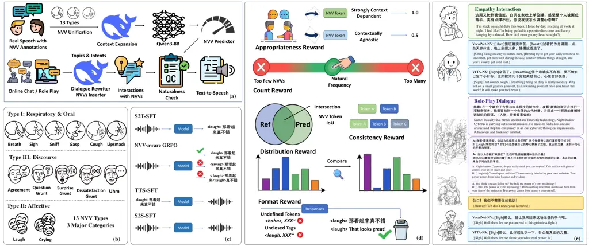

# Speech LLMs That Breathe: Modeling Non-Verbal Vocalizations in Dialogue

Heyang Liu, Lixin Zhang, Jiayi Huang, Ziyang Cheng, Yuhao Wang, Ronghua
Wu, Qunshan Gu, Yanfeng Wang, Yu Wang ^(†)^(†)thanks: ^(†)Corresponding
author.

###### Abstract

The user experience of speech interaction models has improved,
benefiting from the modeling of paralinguistic attributes and advances
in speech reconstruction paradigms. However, human communication follows
extensive norms regarding non-verbal vocalizations (NVVs) spanning
respiratory, affective, and discourse. The omission of these events
imposes inherent limitations on the naturalness of current approaches.
In this work, we cover 13 major types of NVVs and construct a natural
dialogue dataset that conforms to human conversational norms through an
automated synthesis pipeline. We enhance the ability of speech
interaction models to generate contextually appropriate NVV events
through multi-stage fine-tuning and NVV-aware GRPO (Group Relative
Policy Optimization). Based on distinct modeling paradigms, we
substantially improve the expressiveness of VocalNet and VITA-Qinyu in
empathy interactions and role-play dialogues, and further discuss the
architectural necessity for achieving high-quality natural speech
generation.

###### Index Terms: 

Speech LLM, non-verbal vocalization

^(†)^(†)address: ¹Shanghai Jiao Tong University  ²Ant Group
^(†)^(†)address: ¹Shanghai Jiao Tong University  ²Ant Group

## 1 Introduction

Human speech interaction conveys rich information beyond textual
content, encompassing speaker-specific timbres, paralinguistic emotional
cues, and diverse non-verbal vocalizations (NVVs). These characteristics
complement the linguistic content and play an important role in
conveying information that is difficult to capture through text alone.
In particular, NVV events such as sighs, laughter, and affirmations can
reflect subjective attitudes and conversational intentions, and are
essential to expressive human dialogues \[5\]. Speech interaction
models, especially speech large language models (Speech LLMs), receive
users’ vocal instructions and generate corresponding spoken responses,
moving toward increasingly natural and human-like interactions \[4, 12,
15\]. Beyond accurately generating linguistic content, an ideal Speech
LLM should be capable of modeling the rich vocal behaviors that
naturally accompany human communication. Recent research has
increasingly explored the emotional characteristics, enabling more
affective speech generation. However, the integration of NVVs
appropriate for conversational norms remains underexplored, and current
Speech LLMs still fail to naturally produce conversational vocal
behaviors.

The advances in speech synthesis models have made it increasingly
feasible to develop interactive models capable of producing NVV events.
Recent approaches support a predefined set of NVV event types \[3\],
while the latest closed-source models can incorporate appropriate NVV
vocalizations while maintaining high-quality speech generation \[18\].
Natural conversation requires the model to determine when an NVV should
occur, where it should be placed, and which type of NVV is appropriate
for the conversational context. In this work, we investigate this
problem and develop Speech LLMs capable of generating NVVs in accordance
with human conversational norms. Specifically, we begin by training a
text-based predictor capable of generating NVV tokens using Mandarin
real-world speech data. To facilitate spoken interactions, we synthesize
natural dialogues related to empathy-oriented interactions and role-play
dialogues, and leverage an external LLM to annotate NVV events, with the
NVV predictor to assess their appropriateness, and Minimax-HD 2.8 for
high-quality speech synthesis. Beyond the conventional two-stage
paradigm of speech-to-text and speech-to-speech training, we further
introduce NVV-aware GRPO to improve the contextual appropriateness of
NVV events in generated responses. From two distinct architectures, we
develop VocalNet-NV and VITA-NV, and demonstrate that multi-codebook
modeling that preserves fine-grained acoustic information is a
preferable choice for high-quality speech interactions. Our
contributions are summarized as follows:

- •
  We construct a data generation pipeline for conversational speech with
  contextually appropriate NVVs.
- •
  We propose NVV-aware GRPO, which improves the appropriateness of model
  responses under substantial distribution discrepancies among NVV
  events.
- •
  We compare two major speech generation paradigms, revealing the key
  limitations of single-codebook modeling for natural speech generation.
- •
  Extensive experiments demonstrate substantial improvements in the
  naturalness and human-likeness of responses from both VocalNet-NV and
  VITA-NV.

## 2 Related Works

Speech interaction models accept spoken instructions from users and
generate coherent, aligned textual and speech responses. Cascaded
pipelines are considered suboptimal due to information loss, error
propagation, and cumulative latency. In contrast, Speech LLMs achieve
direct speech interactions. Representative Speech LLMs, including
LLaMA-Omni and VocalNet, adopt single-stream speech tokens \[4, 12\].
The LLM backbones autoregressively generate semantic speech tokens and
then combine with external tone prompts via flow matching to produce
speech responses. Conversely, multi-codebook models, represented by
Qwen3-Omni and VITA-Qinyu, simultaneously decode all tokens required for
speech reconstruction, which encompasses both high-level semantics and
fine-grained acoustic details, such as speech features derived from
residual vector quantization (RVQ) \[16, 15\]. Although both approaches
enable seamless speech interaction, they generally lack NVV
characteristics of human speech, thereby limiting their naturalness and
anthropomorphism. JoyAI-Talker incorporates several NVV tokens. However,
it has neither explored their placement appropriateness nor investigated
the feasibility across model architectures \[1\].

## 3 Methods

As shown in Figure 1 (b), regarding the covered NVV types, we
comprehensively consider a wide range of open-source datasets and merge
or distinguish categories according to their original class
definitions \[10, 2, 13, 17, 6, 7\].

### 3.1 NVV Predictor

Modeling the contextual regularities of NVVs is essential for natural
conversational systems. We utilize extensively collected real-world
speech and unify the NVV labels to train Qwen3-8B, enabling it to
generate NVV tokens alongside standard text. For isolated single-turn
instances, we employ DeepSeek-V4-Pro \[14\] for contextual expansion to
provide 2–3 plausible context sentences. The generated NVV predictor is
able to distinguish the presence of a natural NVV from random placement.
In the synthetic dialogue pipeline, it is employed to assess the
plausibility of NVV labels and filter for simulated interactions.

### 3.2 Corpus Construction

For empathy interactions, instances are sourced from LCCC \[11\].
DeepSeek-V4-Pro is utilized to construct single-turn interactions with
distinct affective inclinations based on topics and user intents. For
multi-turn role-play dialogues, our data originates from open-source
corpora, retaining solely spoken conversational utterances.
DeepSeek-V4-Pro is likewise employed to insert appropriate NVV tokens,
and the NVV predictor is subsequently applied to verify their
plausibility, yielding natural and pragmatically grounded data.



Figure 1: Method overview. (a) Construction pipeline for speech datasets
with NVVs; (b) Covered 13 NVV types; (c) NVV-centric multi-stage
training; (d) Reward design for NVV-aware GRPO; (e) Interaction examples
in both scenarios.

### 3.3 NVV-Centric Multi-stage Training

#### 3.3.1 Speech-to-Text SFT

Given that the vast majority of NVV events are brief and without overlap
with regular speech, we extend the model vocabulary with corresponding
special tokens and perform supervised fine-tuning (SFT) on synthesized
dialogues for text responses. This stage enables the model to generate
responses containing NVV events and provides an effective foundation for
subsequent NVV-aware reinforcement learning.

#### 3.3.2 NVV-aware GRPO

To enhance the model’s comprehension of natural dialogues, we conduct
NVV-aware GRPO (Group Relative Policy Optimization). The reward function
comprises five key aspects:

```math
\displaystyle\mathcal{R}_{nvv}={} \displaystyle\lambda_{\mathrm{appropriate}}\mathcal{R}_{\mathrm{appropriate}}+\lambda_{\mathrm{count}}\mathcal{R}_{\mathrm{count}} \tag{1}
```

```math
\displaystyle+\lambda_{\mathrm{consist}}\mathcal{R}_{\mathrm{consist}}+\lambda_{\mathrm{dist}}\mathcal{R}_{\mathrm{dist}}+\lambda_{\mathrm{format}}\mathcal{R}_{\mathrm{format}}
```

where $`\mathcal{R}_{\mathrm{format}}`$ indicates format reward:

```math
\displaystyle\mathcal{R}_{\mathrm{format}}=\begin{cases}-1&\text{undefined NVV tokens, unclosed tags, etc.}\\
0&\text{otherwise}.\end{cases} \tag{2}
```

Appropriateness reward: For appropriateness, we strengthen responses in
which the NV token’s predicted probability by the predictor surpasses
alternative NVV tokens within the given context. Specifically, we
downweight contextually agnostic tokens (e.g., breath) to ensure a
balanced reward. For context $`c`$ and token $`t`$, the score is
computed as:

```math
\displaystyle\mathcal{S}_{\mathrm{reason(c,t)}}=\begin{cases}1&rank(c,t)=1,t\notin\{breath,...\}\\
0.5&rank(c,t)=1,t\in\{breath,...\}\\
0&\text{otherwise}.\end{cases} \tag{3}
```

The final reasonableness reward is computed as the average score across
all NVV events, with an additional bonus awarded to fully plausible
responses containing strongly context-dependent tokens.

```math
\displaystyle\mathcal{R}_{\mathrm{reason}} \displaystyle=\frac{1}{|\mathcal{C}||\mathcal{T}|}\sum_{c\in\mathcal{C}}\sum_{t\in\mathcal{T}}\mathcal{S}_{\mathrm{reason}}(c,t) \tag{4}
```

```math
\displaystyle+b\mathbb{I}\left[\min_{c\in\mathcal{C},\,t\in\mathcal{T}}\mathcal{S}_{\mathrm{reason}}(c,t)=1\right].
```

Count reward: The count reward is designed to penalize the model for
aggressively generating excessive relatively safe NVV events, or
conversely, outputting too few event tokens to evade potential errors.
It is formulated as follows:

```math
\displaystyle\mathcal{R}_{\mathrm{count}}=\max\left(0,\,1-\frac{|{}n_{\text{pred}}-n_{\text{ref}}|{}}{\max(n_{\text{ref}},\,2)}\right) \tag{5}
```

Consistency reward: The consistency reward depends on the distance
between predicted and reference events and is calculated using
class-level IoU (Intersection over Union). It prioritizes accurate
predictions compared to reasonable events.

```math
\displaystyle\mathcal{R}_{\mathrm{consist}}=\frac{\text{pred}\cap\text{ref}}{\text{pred}\cup\text{ref}} \tag{6}
```

Distribution reward: The distribution reward is to prevent the model
from overproducing a particular NVV category and exploiting relatively
safe or context-agnostic tokens. Specifically, we measure the
discrepancy between the empirical distribution of predicted categories
and their natural distribution in the training corpus using the total
variation (TV) distance:

```math
\displaystyle\mathrm{TV}(P_{\mathrm{pred}},P_{\mathrm{ref}})=\frac{1}{2}\sum_{c}\left|P_{\mathrm{pred}}(c)-P_{\mathrm{ref}}(c)\right|, \tag{7}
```

The distribution reward is defined as:

```math
\displaystyle\mathcal{R}_{\mathrm{dist}}=\begin{cases}1-\mathrm{TV}(P_{\mathrm{pred}},P_{\mathrm{ref}})&\text{if }n_{\mathrm{pred}}>0,\\
0&\text{otherwise}.\end{cases} \tag{8}
```

| Base Model | Phase    | Empathy Interaction |              |             |              | Role-play Dialogue |              |             |              |
| ---------- | -------- | ------------------- | ------------ | ----------- | ------------ | ------------------ | ------------ | ----------- | ------------ |
|            |          | Appropriateness     |              | Consistency |              | Appropriateness    |              | Consistency |              |
|            |          | Token (%)           | Response (%) | Token (%)   | Response (%) | Token (%)          | Response (%) | Token (%)   | Response (%) |
| VocalNet   | S2T-SFT  | 92.5                | 85.2         | 55.9        | 22.4         | 97.1               | 96.8         | 38.5        | 25.3         |
|            | NVV-GRPO | 96.8                | 93.5         | 55.2        | 21.3         | 97.5               | 96.9         | 34.1        | 25.8         |
|            | S2S-SFT  | 98.0                | 96.0         | 55.5        | 20.2         | 97.2               | 97.0         | 43.8        | 32.2         |
| VITA-Qinyu | S2T-SFT  | 94.6                | 89.6         | 51.3        | 17.2         | 95.2               | 94.5         | 40.9        | 30.0         |
|            | NVV-GRPO | 95.2                | 91.0         | 52.5        | 17.0         | 96.2               | 96.0         | 44.1        | 33.0         |
|            | S2S-SFT  | 92.2                | 84.6         | 52.9        | 18.1         | 95.6               | 95.0         | 41.5        | 27.0         |

Table 1: NVV appropriateness and reference consistency across training
stages.

Using the full training dataset to construct the reference distribution
prevents the reward from inheriting category biases introduced by
over-sampling in the GRPO training set. Consequently, the reward
penalizes excessive concentration on any single NVV category while
encouraging the model to preserve a natural category distribution.

#### 3.3.3 Speech-to-Speech SFT

This stage trains the model to incorporate fluent NVV events into spoken
responses. Given the limited speaker diversity and scale of the
synthesized data, we leverage open-source data for text-to-speech
training to capture general representations of NVVs \[10, 2, 13, 17, 6,
7\]. Subsequently, the synthesized dialogue data is used for further
training.

## 4 Experiments

### 4.1 Non-verbal Token Prediction

We utilize Emilia-NV \[6\] and nonverbalspeech38k \[17\] to train
Qwen3-8B to generate NVV tokens alongside standard text, as explained in
Section 3.1. 200K instances are used for training. The evaluation set
comprises 6,034 recordings spanning over 317K token positions with
around 7K real NVV occurrences. For each position, the fine-tuned model
is employed to predict the presence of an NVV, achieving an AUC-ROC of
0.7635. Furthermore, at real NVV positions, the median predicted
probability is 75.0 times higher than non-NVV positions, demonstrating
the effective capture of the vocalization distributions in natural
conversations. Across the considered NVV categories, the ground-truth
NVV label falls within the top-10 predictions with a probability of
92.2%, with more than half ranking within the top-2. We carefully
formulate validation rules that reasonably relax probability thresholds
for rare label classes. Evaluations on real conversations alongside
negatively sampled random insertions demonstrate that the model accepts
88.6% of genuine dialogues while rejecting 91.3% of unnatural
insertions.

### 4.2 Speech Interaction Performance

#### 4.2.1 Training Configuration and Indicators

We conduct training on two speech interaction models, VocalNet and
VITA-Qinyu, with the same Qwen3-8B backbone \[12, 15\]. We first perform
S2T-SFT for 3 epochs, followed by GRPO training involving 3K samples.
For speech response generation, we conduct 1 epoch of TTS training and 3
epochs of S2S training using the same data as in the S2T stage, with the
corresponding speech responses synthesized by Minimax-HD 2.8. For
evaluation, we primarily assess the appropriateness of generated NVV
events, following the same criteria used for corpus filtering. We
additionally consider consistency with the reference annotations as a
complementary metric, while acknowledging that a given query may admit
multiple natural responses with different NVV labels. For the
vocalization quality, 5 human raters are instructed to evaluate in an
NV-MOS (mean opinion score) manner on a scale of 1-5. UTMOS \[8\] is
reported as overall speech quality, and we transcribe the responses
using Qwen3-ASR-1.7B \[9\] and calculate the character error rate (CER)
for linguistic speech, as the insertion of NVV events may affect the
pronunciation of surrounding linguistic content.

#### 4.2.2 NV Position Performance

As shown in Table 1, after S2T-SFT, both models acquire the ability to
generate NVV events that conform to conversational norms, with more than
85% of complete responses containing only appropriate NVV events.
Performance is even stronger in multi-turn role-play dialogue. NVV-aware
GRPO yields consistent improvements, particularly for empathy-oriented
interactions. For VocalNet, token-level NVV appropriateness increases
from 92.5% to 96.8%, while both models achieve response-level
appropriateness above 90% on this dataset. Across the four sets of
metrics corresponding to the two datasets, we observe consistent
improvements, except for fluctuations in consistency with the
ground-truth annotations, which mainly result from changes in response
styles. S2S-SFT affects the two models differently. VocalNet preserves
the capabilities of its backbone by fine-tuning only the speech
generator, whereas VITA-Qinyu exposes additional LLM parameters due to
its native architecture, resulting in a certain degree of performance
degradation.

| Model       | Empathy Interaction |       |         | Role-play Dialogue |       |         |
| ----------- | ------------------- | ----- | ------- | ------------------ | ----- | ------- |
|             | NV-MOS              | UTMOS | CER (%) | NV-MOS             | UTMOS | CER (%) |
| VocalNet-NV | 3.78                | 2.85  | 1.20    | 3.94               | 3.04  | 1.78    |
| VITA-NV     | 3.84                | 3.54  | 1.18    | 4.08               | 3.64  | 1.70    |

Table 2: Speech quality evaluation of model responses.

#### 4.2.3 NV Vocalization Quality

VITA-NV consistently outperforms VocalNet-NV across all three evaluation
metrics. It achieves an NV-MOS above 4 in role-play, indicating that it
generates highly natural and fluent NVV events. VocalNet performs
slightly worse, while a more noticeable inferiority is in the overall
speech quality. VITA-NV achieves a UTMOS score above 3.5, while VocalNet
sustains a score around 3.0. For linguistic pronunciation, both models
maintain strong performance, with CER remaining below 2%. In the
calculation, we exclude text corresponding to discourse interjections to
avoid the influence of NVV transcription on the evaluation metrics.
These results suggest that, under the evaluated architectures,
single-codebook modeling has limited capacity for representing newly
introduced vocal expressions while preserving strong speech quality,
whereas multi-codebook reconstruction provides a more effective approach
for high-quality speech generation.

## 5 Conclusion

Non-verbal vocalizations (NVVs) are an important component of natural
and human-like speech interaction. We construct a high-quality data
generation pipeline for an NVV-centric speech corpus, incorporate 13
major types of NVVs into Speech LLMs, and equip them with the ability to
generate contextually appropriate NVV-aware responses through
multi-stage training. In particular, NVV-aware GRPO further improves the
appropriateness of NVV events in model outputs while mitigating the
tendency to collapse into a limited subset of categories. Both
subjective evaluations and objective metrics demonstrate the superior
speech quality of VITA-NV, further highlighting the advantages of
multi-codebook speech generation for natural and expressive speech
interaction. These results suggest that modeling NVVs not only requires
appropriate event selection and contextual integration, but also
benefits from a speech generation paradigm with sufficient capacity to
represent diverse vocal expressions.

## References

- \[1\] Y. Bai, J. Chen, Y. Chen, W. Deng, B. Dong, N. Duan, Y. Gu, W.
  Han, Y. Huang, M. Ke, et al. (2026) JoyAI-talker: full-duplex speech
  interactive large model built for empathetic voice agents. arXiv
  preprint arXiv:2608.01119. Cited by: §2.
- \[2\] M. Borisov, E. Spirin, and D. Diatlova (2025) Nonverbaltts: a
  public english corpus of text-aligned nonverbal vocalizations with
  emotion annotations for text-to-speech. arXiv preprint
  arXiv:2507.13155. Cited by: §3.3.3, §3.
- \[3\] Z. Du, C. Gao, Y. Wang, F. Yu, T. Zhao, H. Wang, X. Lv, H.
  Wang, C. Ni, X. Shi, et al. (2025) Cosyvoice 3: towards in-the-wild
  speech generation via scaling-up and post-training. arXiv preprint
  arXiv:2505.17589. Cited by: §1.
- \[4\] Q. Fang, S. Guo, Y. Zhou, Z. Ma, S. Zhang, and Y. Feng (2025)
  Llama-omni: seamless speech interaction with large language models. In
  International Conference on Learning Representations, Vol. 2025,
  pp. 57607–57624. Cited by: §1, §2.
- \[5\] J. A. Hall, S. A. Andrzejewski, and J. E. Yopchick (2009)
  Psychosocial correlates of interpersonal sensitivity: a meta-analysis.
  Journal of nonverbal behavior 33 (3), pp. 149–180. Cited by: §1.
- \[6\] H. Liao, Q. Ni, Y. Wang, Y. Lu, H. Zhan, P. Xie, Q. Zhang,
  and Z. Wu (2026) Emilia-nv: a non-verbal speech dataset with
  word-level annotation for human-like speech modeling. In ICASSP
  2026-2026 IEEE International Conference on Acoustics, Speech and
  Signal Processing (ICASSP), pp. 17587–17591. Cited by: §3.3.3, §3,
  §4.1.
- \[7\] J. Mai, J. Ji, X. Xing, C. Yang, W. Chen, J. Xing, and X.
  Xu (2026) Mnv-17: a high-quality performative mandarin dataset for
  nonverbal vocalization recognition in speech. In ICASSP 2026-2026 IEEE
  International Conference on Acoustics, Speech and Signal Processing
  (ICASSP), pp. 18312–18316. Cited by: §3.3.3, §3.
- \[8\] T. Saeki, D. Xin, W. Nakata, T. Koriyama, S. Takamichi, and H.
  Saruwatari (2022) Utmos: utokyo-sarulab system for voicemos challenge 2022. arXiv preprint arXiv:2204.02152. Cited by: §4.2.1.
- \[9\] X. Shi, X. Wang, Z. Guo, Y. Wang, P. Zhang, X. Zhang, Z. Guo, H.
  Hao, Y. Xi, B. Yang, et al. (2026) Qwen3-asr technical report. arXiv
  preprint arXiv:2601.21337. Cited by: §4.2.1.
- \[10\] K. Wang and D. Herremans (2024) Disfluencyspeech–single-speaker
  conversational speech dataset with paralanguage. In TENCON 2024-2024
  IEEE Region 10 Conference (TENCON), pp. 469–472. Cited by: §3.3.3, §3.
- \[11\] Y. Wang, P. Ke, Y. Zheng, K. Huang, Y. Jiang, X. Zhu, and M.
  Huang (2020) A large-scale chinese short-text conversation dataset. In
  CCF International Conference on Natural Language Processing and
  Chinese Computing, pp. 91–103. Cited by: §3.2.
- \[12\] Y. Wang, H. Liu, Z. Cheng, R. Wu, Q. Gu, Y. Wang, and Y.
  Wang (2025) Vocalnet: speech llms with multi-token prediction for
  faster and high-quality generation. In Proceedings of the 2025
  Conference on Empirical Methods in Natural Language Processing,
  pp. 19595–19612. Cited by: §1, §2, §4.2.1.
- \[13\] Z. Wu, D. Liu, J. Liu, Y. Wang, L. Li, L. Jin, H. Bu, P. Zhang,
  and M. Li (2025) Smiip-nv: a multi-annotation non-verbal expressive
  speech corpus in mandarin for llm-based speech synthesis. In
  Proceedings of the 33rd ACM International Conference on Multimedia,
  pp. 12564–12570. Cited by: §3.3.3, §3.
- \[14\] A. Xu, B. Lin, B. Xue, B. Wang, B. Xu, B. Wu, B. Zhang, C.
  Lin, C. Dong, C. Ling, et al. (2026) Deepseek-v4: towards highly
  efficient million-token context intelligence. arXiv preprint
  arXiv:2606.19348. Cited by: §3.1.
- \[15\] J. Xu, H. Gao, L. Xie, Z. Yang, L. Li, Y. Chen, B. Zhang, M.
  Chen, C. Fu, W. Zhao, et al. (2026) VITA-qinyu: expressive spoken
  language model for role-playing and singing. arXiv preprint
  arXiv:2605.06765. Cited by: §1, §2, §4.2.1.
- \[16\] J. Xu, Z. Guo, H. Hu, Y. Chu, X. Wang, J. He, Y. Wang, X.
  Shi, T. He, X. Zhu, et al. (2025) Qwen3-omni technical report. arXiv
  preprint arXiv:2509.17765. Cited by: §2.
- \[17\] R. Ye, Y. Zhou, R. Yu, Z. Lin, K. Li, X. Li, X. Liu, G. Zeng,
  and Z. Wu (2025) A scalable pipeline for enabling non-verbal speech
  generation and understanding. arXiv preprint arXiv:2508.05385. Cited
  by: §3.3.3, §3, §4.1.
- \[18\] B. Zhang, C. Guo, G. Yang, H. Yu, H. Zhang, H. Lei, J. Mai, J.
  Yan, K. Yang, M. Yang, et al. (2025) Minimax-speech: intrinsic
  zero-shot text-to-speech with a learnable speaker encoder. arXiv
  preprint arXiv:2505.07916. Cited by: §1.
