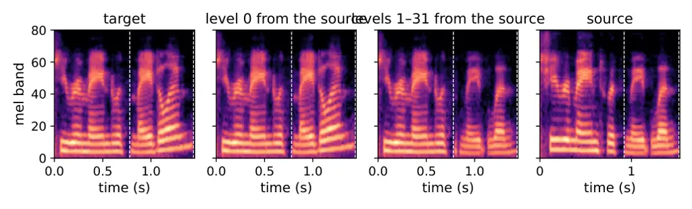
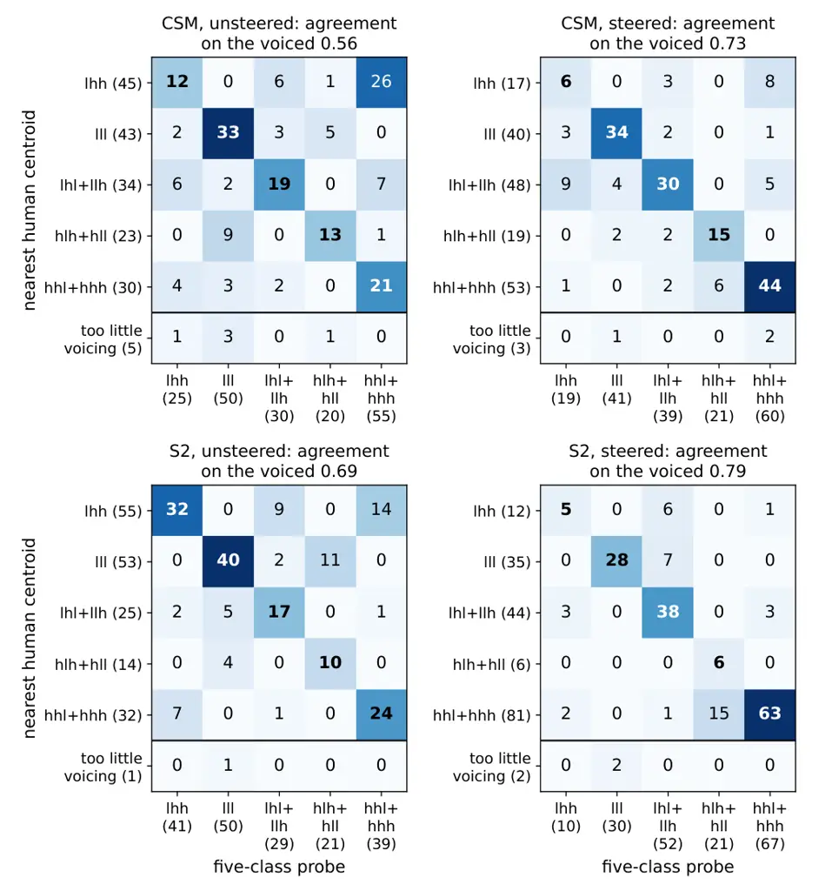

# Steering intonational tunes in text-to-speech synthesis

Juan Pablo Vigneaux & Jennifer Cole Affiliation: Northwestern University
Email: [{jpvigneaux,jennifer.cole1}@northwestern.edu](mailto:)

###### Abstract

Text-to-speech systems built on residual vector quantization often
generate audio in two stages: a transformer backbone emits the first
level of each frame’s token stack, and a smaller depth model generates
the rest autoregressively. We ask which components of such a model are
responsible for prosodic intonation, more precisely for generating the
English _nuclear tune_ (for instance, the falling pitch melody that
distinguishes an assertion from a question’s rising melody), and whether
interventions on those components can be used to control intonation.
Prompt-based control mostly fails; only a final question mark is a
reliable lever. Interchange interventions in CSM and S2 locate the tune:
the backbone’s hidden state carries it to the waveform through the depth
model, and the first level of the stack carries little or none of it.
Steering the backbone state with a difference-of-means vector computed
on new material generated with a final period or question mark moves the
tune, but the push toward an assertion degrades the voice. Steering
vectors computed instead from the backbone states associated with human
imitations of theoretically-specified tunes, whose text carries no
punctuation, and applied inside the generation loop, move most
recordings to the other condition in both systems (even when fitted
without the speaker being steered), at a small cost in predicted
naturalness. These imitation-derived vectors are aligned with the one
obtained from the two punctuated conditions far beyond a shuffled-label
null, so the backbone state of a punctuated prompt already represents
intonation. The steered recordings broadly become falling or rising,
according to the intent, but the edge tone moves more coherently than
the pitch accent, and the target tune cannot be selected precisely
beyond this broad tendency.

|     |
| --- |
|     |

^(†)^(†)footnotetext: Code:
[https://github.com/jpvigneaux/steering-intonation-tts](https://github.com/jpvigneaux/steering-intonation-tts)

## 1 Introduction

Neural audio codecs based on residual vector quantization (RVQ) and
variants thereof (e.g., Mimi’s split RVQ) represent an audio signal as a
low-frequency stream of discretized representations; in fact, with a
whole hierarchy of these, meant to capture the signal at increasing
levels of fidelity (Zeghidour et al., 2022; Défossez et al., 2023). Many
generative speech models take these codec-derived discrete
representations as tokens and split the stack. We call a _staged
hierarchical generator_ a model in which an autoregressive backbone runs
along time and emits the first level in the hierarchy (level $`0`$), and
a smaller network, conditioned on the backbone’s hidden state and on the
level-$`0`$ token, fills the other levels of each frame along depth. CSM
(Schalkwyk et al., 2025) and Fish Audio S2 (Liao et al., 2026) are
text-to-speech systems of this kind, and Moshi (Défossez et al., 2024),
an adaptation of the RQ-Transformer (Lee et al., 2022), is a
speech-to-speech one; VALL-E (Chen et al., 2025) and HALL-E (Nishimura
et al., 2025) split the stack at the same level but fill the other
levels non-autoregressively from the level-$`0`$ tokens. The split is an
efficiency measure, and its consequence for control has not been
measured. This paper asks about control of intonation: it is not clear
if intonation is computed by the backbone transformer or by the depth
transformer (or both), if level $`0`$ already contains any meaningful
representation of intonation, and where exactly one should intervene to
change or improve intonational behavior. Using probing, Vigneaux and
Cole (2026) show that quantization affects the encoding of intonation,
and that levels $`1`$ and $`2`$ encode it more faithfully than level
$`0`$; we ask whether a similar phenomenon shows up at the level of
generation.

Our work focuses on the expression of intonational _nuclear tunes_ in
American English, which are the pitch melodies carried from the stressed
syllable of the last accented word of an _intonational phrase_ to the
end of that phrase. Nuclear tunes distinguish a tune with falling pitch
marking assertions, for instance,“It’s Marilyn.” from a tune with rising
pitch marking questions, “It’s Marilyn?” (Pierrehumbert, 1980). Tunes
are phonological categories (abstract sound features) rather than
speaker properties, and they are conventionally written as sequences of
high and low tonal targets: a pitch accent on the stressed syllable,
then a phrase accent and a boundary tone at the edge. In this work, we
implicitly elicit rising and falling tunes from the models, by prompting
them with a full stop (condition A, assertion) or a question mark
(condition I, interrogation); this particular tune contrast is
practically the only one that can be consistently elicited by a single
orthographic sign: in general, tunes depend on the whole communicative
situation in a complex way. Moreover, we use human imitations of the
eight model tunes provided by the autosegmental-metrical theory of
English intonation (Cole et al., 2023) as a ground truth for tune
distinctions; although the theory prescribes eight tunes (technically,
monotonal nuclear tunes), the human imitations of these theoretically
specified tunes only support a five-way distinction (§G).

In preliminary experiments, we tried to elicit a varied inventory of
tunes from a text-to-speech system in three different ways: by using
various kinds of style tags, by providing repeated recorded examples of
one tune, or by prompting the model with a lead-in that, in humans,
would constrain the intonation of its continuation (§C). Eighteen inline
style tags naming typical uses of a rising tune (\[questioning\], \[very
uncertain\], …) leave S2’s pitch indistinguishable from the untagged
baseline across ten voices, and none moves the contour toward a rise
(Figure 5). Lead-ins do not move the contour either, and a recorded
demonstration of the tune, given as the voice prompt, moves it only
partway. Changing the final punctuation mark is the only prompt-side
lever that works reliably: controlling intonation beyond that single
orthographic switch requires intervening on the computation.

Broadly, we are interested in speech models’ capacity to produce the
whole spectrum of tunes as humans use them. Here we take a narrower
perspective: since prompting does not yield the expected variety of
tunes, we use the A/I contrast, which does change the tune consistently,
to study the mechanisms that compute intonation inside staged
hierarchical generators.

#### Contributions.

1.  1.  We locate the intonational tune in two staged hierarchical
        generators by interchange interventions. Swapping the audio tokens
        generated by the depth model between utterances produced under the
        assertion or interrogation condition (with matched sentence and
        voice) transfers the intonation, while swapping level $`0`$
        transfers neither tune nor words (in S2, a small part of the tune).
        Re-running the depth model with the other utterance’s backbone state
        $`\bm{h}_{t}`$ transfers the tune, and with its level-$`0`$ tokens
        does not: $`\bm{h}_{t}`$ carries the tune contrast to the waveform
        through the depth model (§4).
2.  2.  We show that a difference-of-means edit on $`\bm{h}_{t}`$, with the
        steering vector computed from backbone states of _generated_
        material under both punctuation conditions over the final word,
        steers the tune offline (i.e., by only re-running the depth model at
        each frame after adding the steering vector), and fails in one
        direction: a question driven toward an assertion suffers degraded
        voicing and harmonicity (§4).
3.  3.  We fit difference-of-means steering vectors on the backbone states
        computed while the model _reads_ human imitations of
        theoretically-specified nuclear tunes, whose transcripts carry no
        punctuation, and apply them inside the generation loop. They shift
        the pitch contour near the end of the utterance (the edge tone) to
        the other condition’s contours in most recordings of both systems
        ($`56`$ to $`72\%`$), also when fitted without the speaker being
        steered, while predicted naturalness remains very similar to that of
        the target condition. Despite the effect of steering on the final
        region of the pitch contour, the resulting contours often fail to
        reach the intended tune and differ from the tunes elicited from
        punctuation (§5).

## 2 Related work

#### Causal localization.

In causal analysis, an interchange intervention runs a model on one
input with some internal variables set to the values they take on
another input, and reads what changes in the output (Geiger et al.,
2021; Geiger et al., 2022); in the interpretability literature this is a
form of activation patching (Meng et al., 2022; Heimersheim and Nanda,
2024), and an instance of causal mediation analysis (Vig et al., 2020);
our mediators are the levels of the token stack and the backbone state
read by the depth model. SpeechTokenizer (Zhang et al., 2024) combines
the first level of one utterance with the other levels of another to
transfer a speaker’s voice (their §5.2).

#### Activation steering.

Adding a fixed vector to hidden states at inference changes what a
language model generates (Subramani et al., 2022; Turner et al., 2023;
Zou et al., 2023); the vector is usually a difference of means between
contrasting inputs (Panickssery et al., 2024; Li et al., 2023), which
steers better than a probe’s direction (Li et al., 2023; Marks and
Tegmark, 2024), and its success is read as evidence that the attribute
is linearly represented (Park et al., 2024). Prompting often matches or
beats steering where both apply (Wu et al., 2025), as we also find for
the single tune contrast that we can prompt.

#### Steering speech and music generators.

Difference-of-means and learned steering vectors control emotion in
flow-matching and language-model text-to-speech systems (Xie et al.,
2025; Zhou et al., 2026), neutralize accent (Yang and Hansen, 2026), and
change tempo and timbre in music generation (Facchiano et al., 2025);
sparse-autoencoder features of a text-to-speech language model steer
laughter, gender and speech rate (Koriagin et al., 2026). Closest to our
question, Wang et al. (2026b) and Wang et al. (2026a) ask which module
of a hybrid text-to-speech system (a speech language model followed by a
flow-matching decoder) to steer for mixed emotions. These studies steer
utterance-level attributes; we steer a linguistic attribute, a cue for
meaning located on one word.

#### Controlling prosody.

In SSML (W3C, 2010), the common language of text-to-speech control,
intonation can only be manipulated through explicit acoustic parameters
such as pitch targets, ranges, contours and rates. This requires a tune
to be defined as a time-varying pitch trajectory, which presupposes
knowing the right trajectory for a particular speaker and sentence
content, and ignores the evidence that speakers select from a
categorical inventory rather than a continuum of time-varying
trajectories (Cole et al., 2023). Natural-language prompts and tags
describe style at the level of the utterance (Guo et al., 2023; Yang et
al., 2024; Lyth and King, 2024), and QI-TTS transfers a questioning
intonation from reference speech (Tang et al., 2023). Probing studies
find prosodic information in self-supervised speech representations (Lin
et al., 2023), in discrete tokens derived from them (Onda et al., 2025)
and across spoken-language-model pipelines (Naber et al., 2026), and
intonational categories in the levels of RVQ codecs (Vigneaux and Cole,
2026).

## 3 Setup

#### Staged hierarchical generators.

Write $`q_{t}=(q_{t}^{0},\dots,q_{t}^{K-1})`$ for the stack of codewords
of frame $`t`$ and $`\bm{h}_{t}`$ for the backbone’s final-layer hidden
state at that frame. Codewords are sampled stochastically, frame by
frame, from a distribution $`p_{\theta,\phi,\psi}`$ that a staged
hierarchical generator factorizes as

```math
p_{\theta,\phi,\psi}(q_{t}\mid q_{<t},c)\;=\;\underbrace{p_{\phi}(q^{0}_{t}\mid\bm{h}_{t})}_{\text{L0-head}}\;\cdot\;\underbrace{\textstyle\prod_{k\geq 1}p_{\psi}(q^{k}_{t}\mid q^{<k}_{t},\bm{h}_{t})}_{\text{depth
model}},\qquad\bm{h}_{t}=f_{\theta}(q_{<t},c), \tag{1}
```

with $`c`$ the text and voice conditioning. Here $`f_{\theta}`$, the
backbone, and $`p_{\psi}`$, the depth model, are transformers with
parameters $`\theta`$ and $`\psi`$, and $`p_{\phi}`$ is a shallow
network, the _L0-head_: in both systems a single matrix multiplication
followed by a softmax (in S2 the matrix is the backbone’s
token-embedding matrix, whose weights are tied to the output). We study
CSM (Schalkwyk et al., 2025) and Fish Audio S2 (Liao et al., 2026).
CSM’s codec is Mimi (Défossez et al., 2024), which CSM runs with
$`K=32`$ levels at $`12.5`$ Hz; S2’s is built on the Descript Audio
Codec (Kumar et al., 2023), with $`K=10`$ levels at $`21.5`$ Hz
($`44.1`$ kHz audio, $`2048`$ samples per frame). Level $`0`$ is
referred to in the literature as a ‘semantic’ level, which is aligned
during training with the representations generated by a neural audio
encoder: Mimi distils WavLM (Chen et al., 2022) into it and S2’s codec
distils w2v-BERT 2.0. Both systems follow SpeechTokenizer (Zhang et al.,
2024), which distils HuBERT (Hsu et al., 2021). The two codecs differ in
how the other levels relate to level $`0`$: S2’s level-$`1`$ tokens
quantize the residual that level $`0`$ leaves (and each further level
the residual of the one before), while Mimi forms a separate RVQ stack
over the whole frame, in parallel with level $`0`$ (a _split_ quantizer;
§A.1). CSM and S2 apply a root-mean-square normalization (Zhang and
Sennrich, 2019) to the backbone’s final hidden state before feeding it
to the L0-head and the depth transformer. Our steering vectors are
applied before this normalization.

#### Material.

The human recordings are the Basic8 corpus of Cole et al. (2023), in
which speakers hear a resynthesized recording of each of eight
theoretically-specified combinations of high and low pitch accent,
phrase accent and boundary tone (the _model tunes_) and imitate it on
short sentences. A tune is written by its three tones in that order: hll
(high accent, low phrase accent, low boundary tone) is the paradigmatic
fall of an assertion and lhh the paradigmatic rise of a question (§A.2).
The recordings are labelled by the model tune, and clustering the
speakers’ renditions yields five groups that correspond almost exactly
to a partition of the eight labels into five classes ($`92\%`$ of
speaker-and-tune means fall in the cluster of their label’s class, §G).
As prompts for audio generation, we use the three carrier sentences the
corpus uses for every speaker (He modeled Harmony, She remained with
Madelyn, They honored Melanie) with recordings from ten speakers (five
female, four male, one non-binary), spanning the corpus’s range of
median $`F_{0}`$. Each generated utterance is prompted with the voice of
one of those speakers: eight of that speaker’s recordings, one per tune,
in random order and excluding the sentence to be synthesized, so that no
tune is privileged. Each sentence is generated three times per voice
(three _iterations_), each with its own draw of the eight prompt
recordings and its own seed. Ten speakers $`\times`$ three sentences
$`\times`$ three iterations $`\times`$ two punctuation conditions give
$`180`$ utterances per system, the _ten-speaker set_; an assertion and a
question with the same voice, sentence and iteration form a _matched
pair_ ($`90`$ per system). All audio is force-aligned (McAuliffe et al.,
2017), and every measurement is taken over the final word. The final
word carries the nuclear tune in these sentences: in the generated
utterances, the pitch contours associated with the two punctuation
conditions differ over the final word and not before it, as in human
imitations of the corresponding tunes (§D.1).

#### What we measure.

$`F_{0}`$ (the acoustic correlate of auditorily perceived pitch) is
tracked with Praat’s filtered autocorrelation (Boersma, 1993) and
converted to ERB (equivalent rectangular bandwidth), a psychoacoustic
scale on which equal differences are heard as approximately equal pitch
movements whatever a speaker’s range (Hermes and van Gestel, 1991). Over
the final word we take the _excursion_ (mean $`F_{0}`$ level of the last
fifth of voiced points minus that of the first fifth), the _offset_ (the
mean $`F_{0}`$ level of the last fifth alone), the _voiced fraction_
(the proportion of time steps to which the pitch tracker can assign an
$`F_{0}`$ value), and the harmonics-to-noise ratio (HNR; Boersma, 1993),
which falls as a voice becomes hoarse or breathy (Yumoto et al., 1982).
Over the whole utterance we measure predicted naturalness with UTMOS
(Saeki et al., 2022) and speaker similarity to the voice prompt with
WavLM speaker embeddings (Chen et al., 2022) (§F.3). A recording _falls_
or _rises_ according to the sign and magnitude of its excursion, with
the boundary at $`+0.38`$ ERB, the value that best separates both human
hll from lhh and the models’ own two conditions; it is above zero
because the models’ assertions are flat rather than falling (§B.2).

The interventions of §4 are scored by three read-outs of the final-word
contour, each a signed number that is larger for a more question-like
contour: the excursion; the _velocity_ (the mean slope of a smoothed
contour); and a _cluster_ read-out. To define the latter, every contour
is centred on its speaker’s mean pitch, the unintervened recordings’
contours are split into two groups by $`k`$-means, and the read-out is
defined as a contour’s distance to the falling group’s centroid minus
its distance to the rising group’s centroid. For a read-out $`\Phi`$, an
intervention’s _normalized displacement_ $`\Delta_{\Phi}`$ is the mean
change it causes (the mean taken over all intervened recordings) divided
by the difference between the unintervened conditions’ means, so $`0`$
is no effect and $`1`$ moves a recording all the way to the other
condition (§B.3). We also apply a probe trained on human speech from
HuBERT encodings to classify the edge as rising or falling, reported
with its accuracy on unmodified generations (§B.5). Finally, we use
nearest-neighbor classification to describe each final-word contour by
one of the five tune shapes that emerge from the human productions (§G):
lhh; lll; the _mixed edge_ lhl/llh which is neither clearly falling nor
rising; hll/hlh; and the _high plateau_ hhl/hhh. Every generated contour
is centred on the mean and divided by the standard deviation of its own
voice’s unsteered recordings, as each human contour is by its speaker’s.
We use this to describe shape in the corpus’s terms; we are not claiming
that the model manipulates abstract tune representations.

## 4 Localization via interchange interventions

In this section, we use interchange interventions (Geiger et al., 2021)
to localize the computation of the tune among the backbone transformer,
the L0-head and the depth transformer, and among the levels of the token
stack, a causal counterpart to the probing results of Vigneaux and Cole
(2026).

#### The tune is carried by the end of the final word.

Before intervening, we establish on which part of the utterance the two
conditions differ: the systematic pitch-contour variability induced by
the A or I condition is only expressed on the final word of the sentence
(§3), and within that word at its offset and not at its onset
(Figure 6), This fixes where an intervention must act and what it must
move: the edge of the tune rather than its pitch accent. (Note that
expectations from tunes produced by humans are that falling and rising
tunes will differ at both the onset and offset.)

Figure 1: Normalized displacement toward the source condition when
levels of the token stack are swapped over the final word between a
matched assertion and question, by range of levels and by read-out (CSM,
ten-speaker set, $`90`$ pairs, paired-bootstrap intervals; $`1`$ means
the swapped recording lands on the source condition’s mean). The last
group swaps levels $`1`$–$`2`$ over the word’s first frames (_pre_)
instead of its last (§D.2).

|                                              |                           |               |           |                           |               |           |
| -------------------------------------------- | ------------------------- | ------------- | --------- | ------------------------- | ------------- | --------- |
|                                              | CSM ($`90`$ pairs)        |               |           | Fish S2 ($`90`$ pairs)    |               |           |
| Intervention                                 | $`\Delta_{\Phi}`$         | rising, A/I   | WER       | $`\Delta_{\Phi}`$         | rising, A/I   | WER       |
| Unmodified                                   | —                         | $`17`$/$`93`$ | $`0.257`$ | —                         | $`17`$/$`98`$ | $`0.130`$ |
| Swap levels $`1`$–$`K{-}1`$                  | $`0.99`$ $`[0.97,1.01]`$  | $`90`$/$`18`$ | $`0.328`$ | $`0.91`$ $`[0.82,0.99]`$  | $`91`$/$`17`$ | $`0.194`$ |
| Swap level $`0`$                             | $`0.00`$ $`[0.00,0.00]`$  | $`17`$/$`93`$ | $`0.266`$ | $`0.09`$ $`[0.00,0.21]`$  | $`18`$/$`92`$ | $`0.228`$ |
| Re-run, own $`\bm{h}_{t}`$ and $`q^{0}_{t}`$ | $`0.01`$ $`[-0.03,0.03]`$ | $`21`$/$`92`$ | $`0.336`$ | $`0.00`$ $`[-0.02,0.02]`$ | $`13`$/$`96`$ | $`0.144`$ |
| Source $`\bm{h}_{t}`$, own $`q^{0}_{t}`$     | $`0.98`$ $`[0.94,1.02]`$  | $`90`$/$`17`$ | $`0.348`$ | $`0.91`$ $`[0.82,0.98]`$  | $`90`$/$`19`$ | $`0.165`$ |
| Own $`\bm{h}_{t}`$, source $`q^{0}_{t}`$     | $`0.01`$ $`[-0.03,0.04]`$ | $`20`$/$`92`$ | $`0.344`$ | $`0.11`$ $`[0.06,0.18]`$  | $`23`$/$`91`$ | $`0.185`$ |
| Source $`\bm{h}_{t}`$ and $`q^{0}_{t}`$      | $`1.00`$ $`[0.97,1.03]`$  | $`90`$/$`19`$ | $`0.337`$ | $`0.99`$ $`[0.97,1.02]`$  | $`96`$/$`16`$ | $`0.172`$ |
| Steer, probe direction^(‡)                   | $`0.05`$ $`[-0.03,0.15]`$ | $`18`$/$`91`$ | $`0.254`$ | $`0.14`$ $`[0.03,0.28]`$  | $`21`$/$`91`$ | $`0.126`$ |
| Steer, mean difference^(§)                   | $`0.74`$ $`[0.28,1.12]`$  | $`39`$/$`38`$ | $`0.305`$ | $`0.76`$ $`[0.46,0.96]`$  | $`46`$/$`29`$ | $`0.122`$ |

Table 1: Interventions in both systems. $`\Delta_{\Phi}`$: normalized
displacement toward the source condition, mean over the three read-outs
and both directions, with the range over those six cells. _Rising_: per
cent of assertion (A) and question (I) targets whose final-word
excursion exceeds $`+0.38`$ ERB afterwards. WER: word error rate. Middle
blocks: the depth model re-run with $`\bm{h}_{t}`$ and $`q^{0}_{t}`$
from the target (own) or the source. Steering rows: the offline edit of
(3) at $`\alpha=4`$ gaps; ^(‡)the probe direction’s most effective
strength.

#### Token swaps: the decoder’s sensitivity.

An interchange intervention modifies one recording, the _target_, with
values taken from the other recording of its matched pair, the _source_.
Swapping the sampled tokens at every level the depth model emits (the
full swap, levels $`1`$ to $`K{-}1`$) _over the final word_ between a
matched assertion and question (i.e., same text and speaker, different
tune), followed by codec decoding, displaces contours from one condition
to another under all three read-outs (Figure 1, Table 1). Level $`1`$
alone does little in CSM ($`\Delta_{\Phi}=0.23`$); levels $`1`$–$`3`$
move the recording about three quarters of the way, and levels
$`1`$–$`7`$ as far as the full swap. Swapping level $`0`$ changes
neither the tune nor the words; a more detailed analysis with Mimi shows
that the final word’s log-mel spectrogram moves by $`1.7`$ dB on
average, against $`11`$ dB for the full swap (§D.4); what level $`0`$
carries into the other levels is tested by the depth-model re-runs
below. Word error rate rises slightly for the full swap and more for
partial ranges. Decoding truncated stacks (the first $`k+1`$ levels
only), the contrast between conditions appears at $`k=1`$ and reaches
the separation of the full stack at $`k=2`$, both in terms of excursion
and clustering (§D.3). S2 reproduces this with a different codec and
language model; with ten levels instead of thirty-two, its level $`1`$
alone already carries most of the contrast, and its level $`0`$ a small
part of it (§D.6).

#### The backbone state is the route; level $`0`$ is not.

Treating the generator as a causal model over its activations and
substituting one variable at a time (Geiger et al., 2021), we re-run the
depth model $`p_{\psi}`$ on a target frame with either of its two inputs
replaced by the source’s. Giving it the source’s $`\bm{h}_{t}`$ flips
the tune as completely as the full swap: the final word’s offset moves
to the source condition while its onset is unchanged. Giving it the
source’s level-$`0`$ tokens, which differ from the target’s in most
frames, changes most of the depth model’s sampled tokens, but not the
tune: the excursion does not move in CSM, and moves by about a tenth of
the contrast in S2 (Table 1). The words need both inputs. Across two
different sentences, the depth model given one sentence’s $`\bm{h}_{t}`$
and the other’s level-$`0`$ tokens garbles the final word, and produces
the other sentence’s word only when given both of its inputs (§D.4). The
route is therefore

```math
\text{prompt}\xrightarrow{f_{\theta}}\bm{h}_{t}\xrightarrow{p_{\psi}}q^{1:K-1}_{t}\to\text{tune},\quad\text{prompt}\xrightarrow{f_{\theta},\,p_{\phi}}(\bm{h}_{t},q^{0}_{t})\xrightarrow{p_{\psi}}q^{1:K-1}_{t}\to\text{words}. \tag{2}
```

The factorization (1) lets $`q^{0}_{t}`$ influence everything
$`p_{\psi}`$ emits; that it carries the words but not the tune is a
property of the trained models.

#### A mean difference steers it, offline.

Write $`\bm{x}_{t}`$ for the backbone’s final-layer state before its
normalization, so that $`\bm{h}_{t}=\mathrm{norm}(\bm{x}_{t})`$. Let
$`\bar{\bm{x}}_{\textsf{I}}`$ and $`\bar{\bm{x}}_{\textsf{A}}`$ be the
mean states over the final words of each condition, and

```math
\bm{w}=\bar{\bm{x}}_{\textsf{I}}-\bar{\bm{x}}_{\textsf{A}},\qquad g=\lVert\bm{w}\rVert\;\;(\text{the \emph{gap}}),\qquad\hat{\bm{w}}=\bm{w}/g. \tag{3}
```

Replacing the state over the final word by
$`\mathrm{norm}(\bm{x}_{t}+\alpha g\hat{\bm{w}})`$, so that $`\alpha`$
is measured in gaps, and re-running the depth model moves the tune
toward the other condition in both systems, about three quarters of the
way at four gaps (see Table 1 and §E). A logistic-regression probe
fitted to the same states separates the conditions as well, but its
direction, used the same way, barely moves the tune at any strength,
although the two directions are correlated (cosine $`0.64`$ to $`0.68`$
in CSM, $`0.50`$ to $`0.55`$ in S2), and its component orthogonal to
$`\hat{\bm{w}}`$ does nothing on its own (§E). We steer with the
difference of means.

#### Control, but not the whole story.

The offline edit controls the tune, with two limits.

- •
  _The edit is not symmetric, and one direction damages the voice._ The
  edit brings the final word’s $`F_{0}`$ offset for either condition
  onto the other’s natural range, but not at the same price (Figures 12
  and 13). Assertions pushed toward a question keep their voicing and
  harmonicity: the push mostly raises their pitch, and their $`F_{0}`$
  trajectories most closely resemble the high plateau hhl/hhh. Questions
  pushed toward an assertion steadily degrade in voicing and harmonicity
  once the offset approaches the target, whether the edit is made before
  or after the backbone’s normalization and whether or not level $`0`$
  is redrawn from the edited state (§E).
- •
  _The vector might just encode the punctuation mark._ The two
  conditions differ in one character of the prompt (the punctuation), so
  $`\hat{\bm{w}}`$ could encode the orthographic sign alone, leaving the
  depth model to turn it into a tune; the intervention would then be an
  expensive way of writing a question mark. It is not: $`\hat{\bm{w}}`$
  is aligned with the rising-versus-falling direction fitted on human
  recordings whose transcripts carry no punctuation (§5; cosine $`0.66`$
  in CSM, $`0.44`$ in S2), far beyond a shuffled-label null (§F). The
  state of a punctuated prompt therefore already represents intonation.
  It still encodes the whole prompt as well, and we conjecture that this
  contributes to the damage; a direction fitted on tune differences
  alone does steer more cleanly (§5).

## 5 Steering with tunes taken from human speech

#### Steering vectors derived from human imitations.

The corpus gives, for the same three sentences and the same ten
speakers, productions of all eight tunes. We feed each recording to the
generator as a voice prompt is fed — its transcript, which carries _no
punctuation_, then its audio codec tokens — and record the backbone’s
final-layer state before normalization, $`\bm{x}_{t}`$, at every frame.
A difference of means over the frames of the final word, between the
recordings of two tunes, gives a unit vector $`\hat{\bm{w}}`$ and a gap
$`g`$ as in (3). The tune vector contrasts lhh with hll, the
paradigmatic tunes of interrogation and assertion, so it pushes toward a
lower pitch accent and a higher edge (§F.2). The two groups contain the
same speakers reading the same words, so nothing in the input
distinguishes them but the tune. Vectors fitted on the edge tones alone
(xhh against xll, with x for either tone), where §4 located the
conditions’ difference, and on the pitch accent alone are reported in §I
and taken up in §6. Here we keep the contrast over the holistic tune, as
our current focus. For space, the figures of this section show CSM;
S2’s, which are as informative, are Figures 13 (offline) and 15 (in the
loop).

#### Steering procedure.

The edit acts inside the generation loop. An A or I recording is
generated and aligned, which locates the onset $`t^{*}`$ of its final
word; the generation is then replayed, drawing the same tokens up to
$`t^{*}`$ and, from $`t^{*}`$, replacing the state before normalization
by $`\bm{x}_{t}+\alpha g\hat{\bm{w}}`$ for as many frames as the source
word occupied. Every level is sampled under the edit, and the model
decides its own timing and when to stop. Strength $`\alpha`$ is in gaps,
so one grid ($`1.5`$ to $`4.5`$) is comparable across vectors. At
$`\alpha=0`$ the replay reproduces its source exactly in CSM (§F).

Figure 2: Steering along the tune vector in the loop, CSM, $`90`$
recordings per strength: assertions pushed toward a rise (top),
questions toward a fall (bottom). _Left:_ acoustic measures over the
final word in units of the source condition’s s.d., centred on the
unsteered run (_null_); rightmost, the unmodified target condition, so a
strength is read as a position between source and target. _Right:_
nearest human tune shape (§3), with the target condition’s own
distribution at the right; grey, too little voicing (§G). Shaded: the
strength chosen. S2: Figure 15; offline: Figure 12 (CSM) and 13 (S2).

The strength is chosen for each system and direction as the one at which
the steered recordings’ distributions of excursion, offset, voiced
fraction and HNR come closest to those of the target condition’s
unmodified recordings: the mean over the four measures of the
Wasserstein distance, in units of the unsteered runs’ standard deviation
(§F). It selects $`\alpha=2.5`$ gaps for the push toward a rise and
$`\alpha=1.5`$ for the push toward a fall, in each system separately
(Figures 2 and 15), and the same strengths in each of ten folds when it
is applied leaving one speaker out. Beyond it, a push toward a rise
makes the voice artificially high, and a push toward a fall collapses
voicing and HNR. A recording _flips_ when its final-word excursion
crosses to the other condition’s side of $`+0.38`$ ERB, the boundary
that best separates the two conditions (§3). A flip is thus a move to
the other condition, not necessarily to its paradigmatic tune: since the
models’ own assertions have a flat rather than falling pitch trajectory,
a question that flips toward an assertion may end flat.

#### What the edit costs the voice.

Over every steered recording at the strengths we read, flipped or not,
UTMOS stays within $`0.2`$ of the target condition’s own recordings in
both systems and both directions, and speaker similarity to the voice
prompt is unchanged (§F.3). The final word’s harmonicity separates the
two directions: pushed toward a rise it matches or exceeds that of the
model’s own questions, and pushed toward a fall it is about $`1.5`$ dB
below that of its assertions in CSM and $`2`$ dB in S2; stronger edits
flip more recordings toward a fall only at a steep cost in harmonicity
(Figure 16). The asymmetry of §4 is thus much reduced inside the loop,
but not gone. The median change in word error rate against each
recording’s unsteered run is zero in every cell.

Figure 3: $`F_{0}`$ trajectories of every generated recording, coloured
by the nearest of the five human tune clusters (Figure 17), in scaled
ERB, each voice scaled by its own unsteered recordings as the clusters
were scaled by speaker; nothing is fitted to the generated material.
Bold: the mean of each colour, with its share of the panel; words with
too little voicing are left out. Columns: assertions steered toward a
rise, questions toward a fall; rows: unsteered, steered.

#### Where the steered recordings land.

Figure 3 labels every generated recording by the nearest of the corpus’s
five tune shapes. The unsteered prompts produce the paradigmatic tunes
only in part: the models’ assertions are mostly lll ($`49\%`$ in CSM,
$`60\%`$ in S2) rather than the predicted hll/hlh ($`24\%`$, $`15\%`$),
and their questions are the expected lhh in $`41\%`$ and $`58\%`$ of
recordings, with most of the rest on the high plateau hhl/hhh ($`31\%`$,
$`34\%`$) or the mixed edge lhl/llh ($`26\%`$, $`7\%`$). Steering moves
the recordings out of their unedited (target’s) shape in every case.
Pushed toward a rise, they mostly reach the high plateau ($`57\%`$,
$`87\%`$) and rarely lhh ($`11\%`$, $`1\%`$); pushed toward a fall, they
divide between the mixed edge lhl/llh ($`45\%`$, $`47\%`$) and lll
($`42\%`$, $`38\%`$), and almost never reach hll/hlh ($`2\%`$, $`0\%`$).
Although the tune vector also contrasts a low with a high pitch accent,
the effect of steering is systematic only on the edge tone. The edit
reliably takes a recording off its unedited tune, and less reliably
delivers it to the intended one.

The shapes it delivers are, however, ones that neither punctuation mark
produces often. The high plateau makes up $`57\%`$ and $`87\%`$ of the
steered rises, against $`31\%`$ and $`34\%`$ of the models’ own
questions; the mixed edge $`45\%`$ and $`47\%`$ of the steered falls,
against $`13\%`$ and $`21\%`$ of their own assertions. The intervention
thus widens the set of tunes beyond what the prompt selects, although it
does not yet choose among them.

#### Held-out speakers.

Refitting the tune vector on nine speakers and steering the tenth, for
each speaker in turn, flips $`60\%`$ of CSM’s recordings in both
directions and $`76\%`$ and $`58\%`$ of S2’s, against $`56\%`$,
$`56\%`$, $`72\%`$ and $`57\%`$ of the original intervention, with the
same voice quality (§F).

#### Beyond punctuation.

We run a pilot to test the possibility of obtaining a tune that no
punctuation mark elicits: a vector contrasting hlh (a fall-rise) with
lll, fitted as the other imitation-derived vectors are, was applied to
the $`43`$ CSM assertions whose unsteered run is nearest lll. Each
contour is labelled by the nearest of eight per-tune templates, since
the five clusters merge hlh with hll (§H, Figure 21). Unsteered,
$`98\%`$ are nearest lll and none hlh. At $`2.5`$ gaps, $`26\%`$ are
nearest hlh, the most of any template (lll also $`26\%`$); from $`3.5`$
gaps they move to hhl ($`56\%`$ to $`75\%`$), keeping the high accent
and losing the boundary. At the right strength, a vector fitted on human
imitations of a tune without an orthographic cue thus produces that tune
in a quarter of the recordings.

## 6 Discussion

In both systems the pitch contour is written by the depth model from a
backbone state that already encodes it (at least partially). The
level-$`0`$ tokens, computed separately from the backbone, carry little
to no intonation, and in CSM the waveform hardly depends on them at all.
To control or fine-tune intonation in a staged generator, the lever is
the backbone state, not the ‘semantic’ level-$`0`$ audio token; more
broadly, localization results as in §4 might guide fine-tuning with
prosodically annotated data, which is relatively scarce. Control also
works best inside the full generation loop: applied “offline”, where the
number of frames is fixed and changes in audio tokens do not propagate
in time, the vector moves the tune at the cost of the voice; inside the
loop the cost is small, because the model is free to choose the
codewords, timing and length that go with the tune it is pushed toward.

The alignment of the imitation-derived and punctuation vectors says that
the state of a punctuated prompt already represents intonation: the
orthographic cue has been translated into something the model also
computes when it reads the pitch of human speech. It does not show that
the model operates with the tune categories of the
autosegmental-metrical analysis. We use those categories as units of
analysis, to describe the shapes a model produces and how they depart
from the prototypes speakers produce, and the departures are
informative: the models’ assertions are flat lll more often than the
falling hll their prompt would predict, and their questions often end on
a high plateau. S2 departs further (§I): a vector fitted on the pitch
accent alone flips up to $`74\%`$ of its questions toward an assertion
($`34\%`$ in CSM), which it can only do through the edge, since the
conditions do not differ where the accent sits. S2 thus seems to
represent pitch accent and edge tone jointly, although they vary
independently in human speech.

For the contrast studied here, punctuation already does what steering
does; the interest of steering is that it acts on the representation the
prompt produces, and so may reach tunes that no orthographic cue
elicits. It already takes recordings to shapes that neither punctuation
mark produces often, and a vector fitted for one such tune, hlh, reaches
it in a quarter of the recordings at the right strength. Choosing a tune
reliably, across strengths and for the other tunes of the corpus, and
determining if imitation-derived vectors compose in linguistically
predictable ways, are challenges that remain open.

## 7 Limitations

The material is English imitated speech, three carrier sentences, ten
speakers, and the tunes of a single corpus. The voice prompt is as
varied as it can be in pitch movements, with all eight tunes, but each
of them occurs over a single word, at the end of its recording. The
steering strengths were chosen on the ten-speaker set; the choice does
not change when each speaker is held out in turn, and the vectors were
also held out (§5). No listening test was run: voice quality is measured
acoustically and by prediction (harmonicity, voicing, UTMOS, speaker
similarity), and tune shapes are read from $`F_{0}`$ contours, so a word
with too little voicing cannot be labelled.

## Reproducibility statement

Code accompanies the submission (first page). Every measurement reported
here is produced by a script that reads a committed CSV; no number is
transcribed by hand. Figure regeneration runs from two entry points: the
offline figures and tables from the repository’s figure and table
scripts, and the in-loop figures — the strength-choice panels, the
nearest-centroid labels and the reproduction of Cole et al. (2023) —
from the steering matrix’s own scripts, which are released with it. The
acoustic front end, the alignment policy, the swap operator, the depth
re-run and the effect-size estimator are covered by $`354`$ tests. The
offline depth re-runs are additionally checked against each generator’s
own computation (§D.5) before any result computed from them is reported,
and every in-loop run is replayed at $`\alpha=0`$ against its original
recording (§F). Split seeds, sampling temperature, top-$`k`$ and the
per-recording generation seeds are stored inside each token archive, as
is the backbone state $`\bm{h}_{t}`$ for every frame. Strength is quoted
throughout in units of each vector’s own gap $`g`$ (3); the in-loop edit
is applied before the normalization, over the aligned final word; and
the rise/fall boundary is $`+0.38`$ ERB (§B.2).

## AI statement

In this work, we used generative AI tools to assist us in refining
hypotheses, designing or providing feedback on research methodology
(particularly statistical methods), designing or providing feedback on
experiments, implementing methods as code, and interpreting results. We
did not use generative AI tools to help develop theoretical models or
conceptual frameworks, formulate mathematical claims, clean or reformat
a dataset, or support qualitative or thematic data analysis. The
remaining tasks listed in the disclosure policy (generating synthetic
datasets, assisting with translation, providing critical ingredients for
proving mathematical claims, and assisting in the writing of proofs) do
not apply to this work. We also used generative AI tools to assist with
creating scientific figures and tables, creating and editing software
code, drafting parts of the paper, summarizing and analyzing existing
literature, identifying relevant literature, formatting references, and
brainstorming.

The paper was not generated automatically: it was developed over
multiple iterations across several months, and every methodological
decision was made deliberately and discussed among the coauthors. We
have reviewed all AI-assisted work; in particular, one of the authors
tested and reviewed the code, and we verified the authenticity and
relevance of the references. We take responsibility for the final
content of this work, including any text, claims or artifacts produced
with the aid of generative AI.

## References

- Boersma and Weenink (2024) P. Boersma and D. Weenink Praat: doing
  phonetics by computer. Note: Computer program,
  [https://www.praat.org](https://www.praat.org) Cited by: §B.1.
- Boersma (1993) P. Boersma Accurate short-term analysis of the
  fundamental frequency and the harmonics-to-noise ratio of a sampled
  sound. Proceedings of the Institute of Phonetic Sciences, University
  of Amsterdam 17, pp. 97–110. Cited by: §3.
- Chen et al. (2022) S. Chen, C. Wang, Z. Chen, Y. Wu, S. Liu, Z.
  Chen, J. Li, N. Kanda, T. Yoshioka, X. Xiao, J. Wu, L. Zhou, S.
  Ren, Y. Qian, Y. Qian, J. Wu, M. Zeng, X. Yu, and F. Wei WavLM:
  large-scale self-supervised pre-training for full stack speech
  processing. IEEE Journal of Selected Topics in Signal Processing 16
  (6), pp. 1505–1518. External Links:
  [Document](https://dx.doi.org/10.1109/JSTSP.2022.3188113) Cited by:
  §3, §3.
- Chen et al. (2025) S. Chen, C. Wang, Y. Wu, Z. Zhang, L. Zhou, S.
  Liu, Z. Chen, Y. Liu, H. Wang, J. Li, L. He, S. Zhao, and F. Wei
  Neural codec language models are zero-shot text to speech
  synthesizers. IEEE Transactions on Audio, Speech and Language
  Processing 33, pp. 705–718. External Links:
  [Document](https://dx.doi.org/10.1109/TASLPRO.2025.3530270) Cited by:
  §1.
- Cole et al. (2023) J. Cole, J. Steffman, S. Shattuck-Hufnagel, and S.
  Tilsen Hierarchical distinctions in the production and perception of
  nuclear tunes in American English. Laboratory Phonology 14 (1).
  External Links: [Document](https://dx.doi.org/10.16995/labphon.9437)
  Cited by: §B.3, Figure 17, Appendix G, §1, §2, §3, Reproducibility
  statement.
- Défossez et al. (2023) A. Défossez, J. Copet, G. Synnaeve, and Y. Adi
  High fidelity neural audio compression. Transactions on Machine
  Learning Research. Note: arXiv:2210.13438 Cited by: §1.
- Défossez et al. (2024) A. Défossez, L. Mazaré, M. Orsini, A. Royer, P.
  Pérez, H. Jégou, E. Grave, and N. Zeghidour Moshi: a speech-text
  foundation model for real-time dialogue. arXiv preprint
  arXiv:2410.00037. Cited by: §A.1, §1, §3.
- Dettmers et al. (2022) T. Dettmers, M. Lewis, Y. Belkada, and L.
  Zettlemoyer GPT3.int8(): 8-bit matrix multiplication for transformers
  at scale. In Advances in Neural Information Processing Systems
  (NeurIPS), Vol. 35, pp. 30318–30332. Note: arXiv:2208.07339, as
  LLM.int8() Cited by: Appendix F.
- Facchiano et al. (2025) S. Facchiano, G. Strano, D. Crisostomi, I.
  Tallini, T. Mencattini, F. Galasso, and E. Rodolà Activation patching
  for interpretable steering in music generation. arXiv preprint
  arXiv:2504.04479. Cited by: §2.
- Geiger et al. (2021) A. Geiger, H. Lu, T. Icard, and C. Potts Causal
  abstractions of neural networks. In Advances in Neural Information
  Processing Systems (NeurIPS), Vol. 34, pp. 9574–9586. Cited by: §2,
  §4, §4.
- Geiger et al. (2022) A. Geiger, Z. Wu, H. Lu, J. Rozner, E. Kreiss, T.
  Icard, N. Goodman, and C. Potts Inducing causal structure for
  interpretable neural networks. In International Conference on Machine
  Learning (ICML), PMLR, Vol. 162, pp. 7324–7338. Cited by: §2.
- Guo et al. (2023) Z. Guo, Y. Leng, Y. Wu, S. Zhao, and X. Tan
  PromptTTS: controllable text-to-speech with text descriptions. In IEEE
  International Conference on Acoustics, Speech and Signal Processing
  (ICASSP), External Links:
  [Document](https://dx.doi.org/10.1109/ICASSP49357.2023.10096285) Cited
  by: §2.
- Heimersheim and Nanda (2024) S. Heimersheim and N. Nanda How to use
  and interpret activation patching. arXiv preprint arXiv:2404.15255.
  Cited by: §2.
- Hermes and van Gestel (1991) D. J. Hermes and J. C. van Gestel The
  frequency scale of speech intonation. The Journal of the Acoustical
  Society of America 90 (1), pp. 97–102. External Links:
  [Document](https://dx.doi.org/10.1121/1.402397) Cited by: §B.1, §3.
- Hsu et al. (2021) W. Hsu, B. Bolte, Y. H. Tsai, K. Lakhotia, R.
  Salakhutdinov, and A. Mohamed HuBERT: self-supervised speech
  representation learning by masked prediction of hidden units. IEEE/ACM
  Transactions on Audio, Speech, and Language Processing 29,
  pp. 3451–3460. External Links:
  [Document](https://dx.doi.org/10.1109/TASLP.2021.3122291) Cited by:
  §3.
- Koriagin et al. (2026) N. Koriagin, G. Aparin, N. Balagansky, and D.
  Gavrilov Interpreting and steering a text-to-speech language model
  with sparse autoencoders. arXiv preprint arXiv:2606.10029. Cited by:
  §2.
- Kumar et al. (2023) R. Kumar, P. Seetharaman, A. Luebs, I. Kumar,
  and K. Kumar High-fidelity audio compression with improved RVQGAN. In
  Advances in Neural Information Processing Systems (NeurIPS), Vol. 36,
  pp. 27980–27993. Cited by: §3.
- Lee et al. (2022) D. Lee, C. Kim, S. Kim, M. Cho, and W. Han
  Autoregressive image generation using residual quantization. In
  Proceedings of the IEEE/CVF Conference on Computer Vision and Pattern
  Recognition (CVPR), pp. 11513–11522. External Links:
  [Document](https://dx.doi.org/10.1109/CVPR52688.2022.01123) Cited by:
  §1.
- Li et al. (2023) K. Li, O. Patel, F. Viégas, H. Pfister, and M.
  Wattenberg Inference-time intervention: eliciting truthful answers
  from a language model. In Advances in Neural Information Processing
  Systems (NeurIPS), Vol. 36, pp. 41451–41530. Cited by: Appendix E, §2.
- Liao et al. (2026) S. Liao, Y. Wang, S. Liu, Y. Cheng, R. Zhang, T.
  Li, S. Li, Y. Zheng, X. Liu, Q. Wang, Z. Zhou, J. Liu, X. Chen, and D.
  Han Fish Audio S2 technical report. arXiv preprint arXiv:2603.08823.
  Note: Code at
  [https://github.com/fishaudio/fish-speech](https://github.com/fishaudio/fish-speech)
  Cited by: §A.1, §C.1, §D.6, §1, §3.
- Lin et al. (2023) G. Lin, C. Feng, W. Huang, Y. Tseng, T. Lin, C.
  Li, H. Lee, and N. G. Ward On the utility of self-supervised models
  for prosody-related tasks. In IEEE Spoken Language Technology Workshop
  (SLT 2022), pp. 1104–1111. External Links:
  [Document](https://dx.doi.org/10.1109/SLT54892.2023.10023234) Cited
  by: §2.
- Lyth and King (2024) D. Lyth and S. King Natural language guidance of
  high-fidelity text-to-speech with synthetic annotations. arXiv
  preprint arXiv:2402.01912. Cited by: §2.
- Marks and Tegmark (2024) S. Marks and M. Tegmark The geometry of
  truth: emergent linear structure in large language model
  representations of true/false datasets. In Conference on Language
  Modeling, Cited by: Appendix E, §2.
- McAuliffe et al. (2017) M. McAuliffe, M. Socolof, S. Mihuc, M. Wagner,
  and M. Sonderegger Montreal forced aligner: trainable text-speech
  alignment using Kaldi. In Proceedings of Interspeech, pp. 498–502.
  External Links:
  [Document](https://dx.doi.org/10.21437/Interspeech.2017-1386) Cited
  by: §3.
- Meng et al. (2022) K. Meng, D. Bau, A. Andonian, and Y. Belinkov
  Locating and editing factual associations in GPT. In Advances in
  Neural Information Processing Systems, Vol. 35, pp. 17359–17372. Cited
  by: §2.
- Naber et al. (2026) S. Naber, J. Koch, P. Singh, A. Saponaro, I.
  Karagianni, and N. T. Vu Probing discrete speech tokens of spoken
  language models. In Proceedings of the Fifteenth Language Resources
  and Evaluation Conference (LREC), pp. 2344–2354. External Links:
  [Document](https://dx.doi.org/10.63317/4d4kttgdydde) Cited by: §2.
- Nishimura et al. (2025) Y. Nishimura, T. Hirose, M. Ohi, H. Nakayama,
  and N. Inoue HALL-E: hierarchical neural codec language model for
  minute-long zero-shot text-to-speech synthesis. In International
  Conference on Learning Representations (ICLR), Note: arXiv:2410.04380
  Cited by: §1.
- Onda et al. (2025) K. Onda, S. Fukayama, D. Saito, and N. Minematsu
  Benchmarking prosody encoding in discrete speech tokens. In IEEE
  Automatic Speech Recognition and Understanding Workshop (ASRU),
  External Links:
  [Document](https://dx.doi.org/10.1109/ASRU65441.2025.11434685) Cited
  by: §2.
- Panickssery et al. (2024) N. Panickssery, N. Gabrieli, J. Schulz, M.
  Tong, E. Hubinger, and A. M. Turner Steering Llama 2 via contrastive
  activation addition. In Proceedings of the 62nd Annual Meeting of the
  Association for Computational Linguistics (Volume 1: Long Papers),
  pp. 15504–15522. Note: Published under the name Nina Rimsky External
  Links: [Document](https://dx.doi.org/10.18653/v1/2024.acl-long.828)
  Cited by: §2.
- Park et al. (2024) K. Park, Y. J. Choe, and V. Veitch The linear
  representation hypothesis and the geometry of large language models.
  In International Conference on Machine Learning (ICML), PMLR, Vol.
  235, pp. 39643–39666. Cited by: §2.
- Pierrehumbert (1980) J. B. Pierrehumbert The phonology and phonetics
  of English intonation. Ph.D. Thesis, Massachusetts Institute of
  Technology. Cited by: §A.2, §1.
- Saeki et al. (2022) T. Saeki, D. Xin, W. Nakata, T. Koriyama, S.
  Takamichi, and H. Saruwatari UTMOS: UTokyo-SaruLab system for VoiceMOS
  challenge 2022. In Proceedings of Interspeech, pp. 4521–4525. External
  Links: [Document](https://dx.doi.org/10.21437/Interspeech.2022-439)
  Cited by: §3.
- Schalkwyk et al. (2025) J. Schalkwyk, A. Kumar, D. Lyth, S. E.
  Eskimez, Z. Hodari, C. Resnick, R. Sanabria, and R. Jiang Crossing the
  uncanny valley of conversational voice. Note: Sesame research blog,
  [https://www.sesame.com/research/crossing_the_uncanny_valley_of_voice](https://www.sesame.com/research/crossing_the_uncanny_valley_of_voice)Code
  and model:
  [https://github.com/SesameAILabs/csm](https://github.com/SesameAILabs/csm)
  Cited by: §1, §3.
- Subramani et al. (2022) N. Subramani, N. Suresh, and M. E. Peters
  Extracting latent steering vectors from pretrained language models. In
  Findings of the Association for Computational Linguistics: ACL 2022,
  pp. 566–581. External Links:
  [Document](https://dx.doi.org/10.18653/v1/2022.findings-acl.48) Cited
  by: §2.
- Tang et al. (2023) H. Tang, X. Zhang, J. Wang, N. Cheng, and J. Xiao
  QI-TTS: questioning intonation control for emotional speech synthesis.
  In IEEE International Conference on Acoustics, Speech and Signal
  Processing (ICASSP), External Links:
  [Document](https://dx.doi.org/10.1109/ICASSP49357.2023.10095623) Cited
  by: §2.
- Timkey and van Schijndel (2021) W. Timkey and M. van Schijndel All
  bark and no bite: rogue dimensions in transformer language models
  obscure representational quality. In Proceedings of the 2021
  Conference on Empirical Methods in Natural Language Processing
  (EMNLP), pp. 4527–4546. External Links:
  [Document](https://dx.doi.org/10.18653/v1/2021.emnlp-main.372) Cited
  by: Appendix F.
- Turner et al. (2023) A. M. Turner, L. Thiergart, G. Leech, D.
  Udell, J. J. Vazquez, U. Mini, and M. MacDiarmid Steering language
  models with activation engineering. arXiv preprint arXiv:2308.10248.
  Cited by: §2.
- Vig et al. (2020) J. Vig, S. Gehrmann, Y. Belinkov, S. Qian, D.
  Nevo, Y. Singer, and S. Shieber Investigating gender bias in language
  models using causal mediation analysis. In Advances in Neural
  Information Processing Systems (NeurIPS), Vol. 33, pp. 12388–12401.
  Cited by: §2.
- Vigneaux and Cole (2026) J. P. Vigneaux and J. Cole Probing neural
  audio codecs for distinctions among English nuclear tunes. In Proc.
  SpeechProsody 2026, pp. 23–27. Cited by: §1, §2, §4.
- W3C (2010) W3C Speech synthesis markup language (SSML) version 1.1.
  Note: W3C Recommendation,
  [https://www.w3.org/TR/speech-synthesis11/](https://www.w3.org/TR/speech-synthesis11/)
  Cited by: §2.
- Wang et al. (2026a) S. Wang, J. Bailey, and T. Dang A geometric
  perspective on composable emotion steering in text-to-speech models.
  arXiv preprint arXiv:2607.00946. Cited by: §2.
- Wang et al. (2026b) S. Wang, S. Tan, S. Liu, H. Jia, G. Huang, J.
  Bailey, and T. Dang CoCoEmo: composable and controllable human-like
  emotional TTS via activation steering. In International Conference on
  Machine Learning (ICML), Note: arXiv:2602.03420 Cited by: §2.
- Wu et al. (2025) Z. Wu, A. Arora, A. Geiger, Z. Wang, J. Huang, D.
  Jurafsky, C. D. Manning, and C. Potts AxBench: steering LLMs? even
  simple baselines outperform sparse autoencoders. In International
  Conference on Machine Learning (ICML), PMLR, Vol. 267,
  pp. 67035–67080. Note: arXiv:2501.17148 Cited by: §2.
- Xie et al. (2025) T. Xie, S. Yang, C. Li, D. Yu, and L. Liu
  EmoSteer-TTS: fine-grained and training-free emotion-controllable
  text-to-speech via activation steering. arXiv preprint
  arXiv:2508.03543. Cited by: §2.
- Yang et al. (2024) D. Yang, S. Liu, R. Huang, C. Weng, and H. Meng
  InstructTTS: modelling expressive TTS in discrete latent space with
  natural language style prompt. IEEE/ACM Transactions on Audio, Speech,
  and Language Processing 32, pp. 2913–2925. External Links:
  [Document](https://dx.doi.org/10.1109/TASLP.2024.3402088) Cited by:
  §2.
- Yang and Hansen (2026) M. Yang and J. H. L. Hansen Activation steering
  for accent-neutralized zero-shot text-to-speech. In IEEE Spoken
  Language Technology Workshop (SLT), Note: To appear. arXiv:2603.05977
  Cited by: §2.
- Yumoto et al. (1982) E. Yumoto, W. J. Gould, and T. Baer
  Harmonics-to-noise ratio as an index of the degree of hoarseness. The
  Journal of the Acoustical Society of America 71 (6), pp. 1544–1550.
  External Links: [Document](https://dx.doi.org/10.1121/1.387808) Cited
  by: §3.
- Zeghidour et al. (2022) N. Zeghidour, A. Luebs, A. Omran, J. Skoglund,
  and M. Tagliasacchi SoundStream: an end-to-end neural audio codec.
  IEEE/ACM Transactions on Audio, Speech, and Language Processing 30,
  pp. 495–507. External Links:
  [Document](https://dx.doi.org/10.1109/TASLP.2021.3129994) Cited by:
  §1.
- Zhang and Sennrich (2019) B. Zhang and R. Sennrich Root mean square
  layer normalization. In Advances in Neural Information Processing
  Systems, Vol. 32. Cited by: §3.
- Zhang et al. (2024) X. Zhang, D. Zhang, S. Li, Y. Zhou, and X. Qiu
  SpeechTokenizer: unified speech tokenizer for speech language models.
  In International Conference on Learning Representations (ICLR), Note:
  arXiv:2308.16692 Cited by: §2, §3.
- Zhou et al. (2026) L. Zhou, H. Jiang, J. Li, T. Wang, and H. Li
  EmoShift: lightweight activation steering for enhanced emotion-aware
  speech synthesis. In IEEE International Conference on Acoustics,
  Speech and Signal Processing (ICASSP), pp. 17262–17266. External
  Links:
  [Document](https://dx.doi.org/10.1109/ICASSP55912.2026.11464460) Cited
  by: §2.
- Zou et al. (2023) A. Zou, L. Phan, S. Chen, J. Campbell, P. Guo, R.
  Ren, A. Pan, X. Yin, M. Mazeika, A. Dombrowski, et al. Representation
  engineering: a top-down approach to AI transparency. arXiv preprint
  arXiv:2310.01405. Cited by: §2.

## Appendix A Background

### A.1 Residual quantization

Let $`\mathrm{Enc}:\mathcal{X}\to\mathbb{R}^{D\times T}`$ be a codec
encoder mapping a waveform to $`T`$ latent frames of dimension $`D`$,
and let
$`\mathcal{C}_{k}=\{e^{1}_{k},\dots,e^{V}_{k}\}\subset\mathbb{R}^{D}`$
be the codebook at level $`k`$, for $`k=0,\dots,K-1`$. Residual vector
quantization of a frame $`z\in\mathbb{R}^{D}`$ proceeds greedily down a
stack of levels: setting $`r_{a}=z`$ at the first level $`a`$ of the
stack,

```math
q_{k}\;=\;\arg\min_{v\in\{1,\dots,V\}}\bigl\|r_{k}-e^{v}_{k}\bigr\|_{2},\qquad r_{k+1}\;=\;r_{k}-e^{q_{k}}_{k}, \tag{4}
```

so that each level quantizes what the levels before it left unexplained.
Both codecs we study quantize level $`0`$ on its own, with a plain
vector quantizer whose codeword is trained to predict the representation
of a self-supervised speech encoder (§3), and differ in what the other
levels quantize. In S2’s codec, levels $`1`$ to $`9`$ are a residual
stack (4) started at $`r_{1}=z-e^{q_{0}}_{0}`$, the part of the frame
level $`0`$ leaves unexplained (in its released codec code; Liao et al.,
2026). Mimi instead uses a _split_ quantizer: levels $`1`$ to $`31`$ are
a residual stack started at $`r_{1}=z`$, in parallel with level $`0`$,
so that the acoustic levels are not constrained to encode only what
level $`0`$ misses (Défossez et al., 2024); Moshi runs it with $`8`$
levels, CSM with $`32`$. In both, the decoder reads the sum of the
selected codewords, and the _partial reconstruction_ at depth $`k`$ is
the waveform decoded from the first $`k+1`$ levels,

```math
\hat{z}^{(k)}\;=\;\sum_{j=0}^{k}e^{\,q^{j}}_{j},\qquad\hat{x}^{(k)}=\mathrm{Dec}\big(\hat{z}^{(k)}\big). \tag{5}
```

Within the residual stack the greedy rule orders the levels from coarse
to fine, which is what the swap of (11) and the truncation of §D.3 rely
on. In Mimi, level $`0`$ and level $`1`$ each quantize the whole frame,
so a level-$`0`$ swap exchanges a code that the acoustic levels do not
depend on, and a truncation to levels $`0`$–$`1`$ keeps the coarsest
acoustic description of the frame in addition to the semantic one.

### A.2 Tune notation

Following the autosegmental-metrical convention (Pierrehumbert, 1980), a
nuclear tune is written as three tone symbols, pitch accent, phrase
accent and boundary tone, so hlh is a high pitch accent, a low phrase
accent and a high boundary tone; the eight monotonal tunes (one tone per
position) are the cross product of two levels at each position. An x
stands for either tone, so xhh is every tune ending in a high phrase
accent and a high boundary tone.

## Appendix B Measurement

### B.1 The acoustic front end

$`F_{0}`$ is tracked with Praat’s filtered-autocorrelation method
(Boersma and Weenink, 2024) and converted to the
equivalent-rectangular-bandwidth scale

```math
\mathcal{E}(f)\;=\;21.4\,\log_{10}\!\bigl(1+f/228.8\bigr), \tag{6}
```

on which a difference means the same size of pitch movement whether the
speaker is high or low in their range (Hermes and van Gestel, 1991). The
contour is restricted to the final-word interval given by forced
alignment and resampled to $`N=30`$ points. Grid points outside the
voiced extent are left undefined rather than extrapolated, so unvoiced
margins bias neither an average nor the position of a peak, and nothing
is imputed. Short voiced islands at the edge of the word, detached from
the main voiced body by an unvoiced gap, are marked unvoiced before
resampling: they are cross-word pitch leaking past an imperfect
alignment boundary, and interpolating across the gap fabricates a steep
slope. An island is removed only if it is shorter than a tenth of the
word and lies within a tenth of an edge.

The _excursion_ of a contour $`c`$, with $`\mathcal{V}`$ its voiced
points, is the level of its last fifth minus that of its first:

```math
\mathrm{exc}(c)\;=\;\frac{1}{|\mathcal{V}_{\text{last}}|}\sum_{i\in\mathcal{V}_{\text{last}}}\mathcal{E}(c_{i})\;-\;\frac{1}{|\mathcal{V}_{\text{first}}|}\sum_{i\in\mathcal{V}_{\text{first}}}\mathcal{E}(c_{i}),\qquad\mathcal{V}_{\text{last}}=\mathcal{V}\cap\{\lceil 4N/5\rceil,\dots,N\}, \tag{7}
```

and the _onset_ and _offset_ are its two terms. The _velocity_ is the
derivative of a cubic regression spline with four interior knots, about
a fifth of the word apart — roughly $`110`$ ms for a median word, the
timescale of pitch accents and boundary tones — taken analytically; a
linear interpolation differentiated numerically turns pitch-frame steps
into a zigzag. The HNR uses Praat’s cross-correlation method with a
$`10`$ ms step and a $`75`$ Hz floor, averaged over voiced frames. The
cluster read-out centres each contour $`F`$ of speaker $`v`$ on that
speaker’s mean over the $`n_{v}`$ unmodified recordings,

```math
F\;\mapsto\;F-\tfrac{1}{n_{v}N}\textstyle\sum_{i\in v,\,j}F_{ij}, \tag{8}
```

which keeps pitch level relative to the speaker’s register; the mean is
taken over voiced points, and an intervened recording is centred on the
mean of its target’s speaker.

### B.2 The rise/fall boundary

A recording is counted as rising or falling by which side of
$`+0.38`$ ERB its excursion falls on. The boundary is shifted off zero
because the models’ assertions are flat rather than falling — their mean
excursion is $`-0.01`$ ERB, whereas, for comparison, human imitations of
hll fall on average by $`1.04`$ ERB and human imitations of lll by
$`0.72`$ ERB — so that a criterion taken at zero scatters them across
both sides: on the ten-speaker set it reads $`27\%`$ of CSM’s unsteered
assertions as rises against $`17\%`$ at $`+0.38`$. The value is not
chosen to suit the models: the boundary that best separates the human
imitations of hll and lhh is $`+0.375`$ ERB, and the one that best
separates the models’ own two prompt conditions is $`+0.381`$.

### B.3 The read-outs and the normalized displacement

The three read-outs of §3 each give a signed score per recording: the
excursion, the mean velocity, and, for the cluster read-out, a contour’s
distance to the falling-like centroid minus its distance to the
rising-like one, of two $`k`$-means clusters fitted to the unmodified
recordings’ speaker-centred contours. Which cluster is rising-like is
decided by its members’ mean excursion, never by the design labels. For
a read-out $`\Phi`$, unmodified target recordings $`x_{1},\dots,x_{n}`$,
their intervened counterparts $`\Sigma x_{i}`$, and the mean score
$`\bar{\Phi}_{c}`$ of the unmodified recordings in condition $`c`$,

```math
\Delta_{\Phi}\;=\;\frac{\frac{1}{n}\sum_{i=1}^{n}\bigl[\Phi(\Sigma x_{i})-\Phi(x_{i})\bigr]}{\bar{\Phi}_{\text{source}}-\bar{\Phi}_{\text{target}}}, \tag{9}
```

where $`i`$ indexes recordings, not frames. The numerator is the mean
within-pair movement and the denominator the separation between the
conditions on unmodified recordings, so $`\Delta_{\Phi}`$ is
dimensionless and comparable across read-outs. Intervals are paired
bootstraps over pairs.

Table 2 scores the three read-outs against the design labels on the
unsteered ten-speaker sets: each recovers the conditions for $`84`$ to
$`94`$ per cent of recordings. The cluster read-out centres each contour
on its speaker’s mean, as Cole et al. (2023) scale contours by speaker,
so that ten voices whose registers differ by more than the tune contrast
are not split by voice.

|           | CSM ($`180`$) |          |          | S2 ($`180`$) |          |          |
| --------- | ------------- | -------- | -------- | ------------ | -------- | -------- |
| read-out  | agreement     | AUC      | ARI      | agreement    | AUC      | ARI      |
| excursion | $`0.84`$      | $`0.90`$ | $`0.46`$ | $`0.84`$     | $`0.96`$ | $`0.47`$ |
| velocity  | $`0.84`$      | $`0.88`$ | $`0.46`$ | $`0.84`$     | $`0.96`$ | $`0.47`$ |
| cluster   | $`0.84`$      | $`0.90`$ | $`0.46`$ | $`0.94`$     | $`0.97`$ | $`0.77`$ |

Table 2: The three read-outs on the unsteered ten-speaker sets, scored
against the design labels with the score’s sign at zero. _Agreement_:
fraction of recordings put in the right condition; AUC: area under the
ROC curve; ARI: adjusted Rand index of the partition.

### B.4 How much the measurement depends on the alignment

Swapped recordings are not force-aligned: a swap leaves level $`0`$
untouched and does not change the frame count, so their segmental timing
should match the target recording’s, and the target’s final-word
interval is inherited. What can be checked is whether the measurement is
sensitive to the boundary at all. On $`84`$ aligned CSM recordings of an
earlier pilot set, prompted with one recorded reference voice, we
recomputed the excursion under boundaries displaced by $`\pm 40`$ and
$`\pm 80`$ ms — one Mimi frame is $`80`$ ms — and under no alignment at
all, taking the final two fifths of the utterance’s voiced extent
(Table 3). Displacing the boundary by half a frame moves the excursion
by $`0.14`$ to $`0.23`$ ERB against a condition separation of $`2.4`$,
and preserves its sign on $`94`$ to $`99`$ per cent of recordings. The
error is one-sided: displacing the window $`80`$ ms earlier shrinks the
separation to $`1.56`$ ERB, because the window then stops short of the
final rise, while displacing it later costs almost nothing. A swap that
somehow shortened the recording would therefore bias the measured effect
down, not up.

| Final-word interval              | mean $`   | \Delta    | `$        | max $`    | \Delta | `$  | $`r`$ | sign agreement |
| -------------------------------- | --------- | --------- | --------- | --------- | ------ | --- | ----- | -------------- |
| displaced $`-80`$ ms             | $`0.482`$ | $`1.662`$ | $`0.930`$ | $`0.893`$ |
| displaced $`-40`$ ms             | $`0.233`$ | $`1.191`$ | $`0.981`$ | $`0.940`$ |
| displaced $`+40`$ ms             | $`0.140`$ | $`1.082`$ | $`0.992`$ | $`0.988`$ |
| displaced $`+80`$ ms             | $`0.182`$ | $`1.569`$ | $`0.985`$ | $`0.976`$ |
| no alignment (asserted interval) | $`0.218`$ | $`1.555`$ | $`0.980`$ | $`0.988`$ |

Table 3: Excursion under perturbed and absent final-word boundaries,
against the excursion under the forced alignment, in ERB. The condition
separation is $`2.409`$ ERB under the forced alignment, $`2.046`$ and
$`2.565`$ under $`\mp 40`$ ms, $`1.560`$ and $`2.565`$ under
$`\mp 80`$ ms, and $`2.555`$ with no alignment.

### B.5 The probes

Three probes trained on human speech were applied to the generated
audio: a rising-against-falling edge probe (xll against xhh), a
pitch-accent probe (hxx against lxx) and a five-class tune probe. All
read HuBERT-base hidden states with attention pooling over the final
word, and each is the average of five random-split runs rather than the
best of them; held-out accuracies on human speech are $`0.972`$,
$`0.923`$ and $`0.819`$. Applied to all $`180`$ unsteered recordings of
each system, the edge probe recovers the generating condition at
accuracy $`0.87`$ in CSM and $`0.92`$ in S2 (area under the curve
$`0.89`$ and $`0.97`$), against $`0.88`$ and $`0.93`$ for the
excursion’s sign at $`+0.38`$ ERB. The five-class probe is compared with
the nearest-centroid labels the paper reports in §G. The accent probe is
at chance on unmodified generations and is not used. This need not mean
the probe is broken: the generated assertions and questions share their
pitch accent (Figure 6), so there is little accent contrast in the
generated material for a probe to recover, unlike in the human
recordings it was trained on. We have no working measurement of the
pitch accent in generated audio, and make no claim about it beyond the
contour shapes of §G.

## Appendix C Prompt-side control

### C.1 Style tags

Fish S2 accepts free-form inline instructions in square brackets,
learned from captions generated by a separate audio captioning model
(Liao et al., 2026). Eighteen tags were chosen in three groups: credence
(\[completely convinced\], \[confident\], \[fairly certain\], \[hedging,
not quite sure\], \[very uncertain\], \[doubtful\], \[questioning\]),
attitude (\[sarcastic\], \[surprised\], \[skeptical\], \[incredulous\],
\[impressed\]) and speech act (\[asking a question\], \[stating a
fact\], \[calling out to someone across a distance\], \[correcting a
mistake\], \[listing, with more items to come\], \[confirming what was
just said\]). Each prefixes the three carrier sentences, which end in a
full stop and carry an \[emphasis\] marker on the sentence-final name so
that the nucleus falls where it is measured, as does an untagged
control. Every voice of the ten-speaker set generates one example of
each tag on each of the three carrier sentences. Each voice is elicited
with the same randomly ordered eight-tune voice prompt as in the main
experiments. Therefore, in total, we generate $`570`$ utterances ($`19`$
tag conditions, counting the untagged control, $`\times`$ $`3`$ target
sentences $`\times`$ $`10`$ speakers), which are force-aligned and
scored by the excursion (7).

Figure 4: Each style tag’s mean change against the untagged utterance of
the same voice and sentence, over the ten speakers, in three measures of
the final word: its excursion (grey), its highest pitch (purple) and its
lowest pitch (green), taken as the $`95`$th and $`5`$th percentiles of
its voiced contour so that one stray pitch point cannot set them. Each
has its $`95\%`$ interval (dark) and the Bonferroni interval over the
eighteen tags (light); the dashed lines mark the widest $`95\%`$
interval of the excursion. Below, the question mark’s effect on the
excursion in the same ten voices, paired by voice, sentence and
iteration.

Figure 5: Every style tag in the ten voices. One panel per tag, the
untagged control first; each panel draws one recording from each of the
ten speakers, all prompted with that speaker’s own eight-tune voice
prompt. Each contour is centred on its own mean, so that shape is
compared across voices whose registers differ. A speaker is shown on one
carrier sentence, rotated across speakers and the same in all of that
speaker’s panels, so that within a speaker only the tag changes. Blue:
the panel’s mean where at least half of the recordings are voiced;
dashed: the control’s mean, repeated in every panel; top right: how many
of the ten rise past $`+0.38`$ ERB.

No tag moves the tune toward a rise (Figures 4 and 5). Each interval in
Figure 4 is a confidence interval for one tag’s mean change, so the null
hypothesis it tests is that the tag changes nothing: an interval that
contains zero is consistent with no effect, and one that stops short of
the question mark’s effect rules out an effect of that size. Every tag’s
mean change in the excursion lies between $`-0.38`$ and $`0.00`$ ERB. No
Bonferroni interval excludes zero, in the excursion or in the word’s
highest or lowest pitch; without the correction, $`4`$ of the $`54`$
intervals do, about what chance predicts ($`2.7`$): three lower the word
(\[impressed\] in its excursion and lowest pitch, \[confirming what was
just said\] in its lowest pitch), and \[questioning\] raises its highest
pitch by $`0.25`$ ERB without changing its excursion. Every interval
also ends well short of the question mark’s effect of $`2.09`$
$`[1.84,2.34]`$ ERB in the same voices: the widest $`95\%`$ interval of
the excursion reaches $`\pm 0.80`$ ERB, and the widest Bonferroni
interval $`\pm 1.11`$. With voice-by-sentence blocks the tag explains
nothing ($`F_{18,522}=0.79`$, $`p=0.71`$); $`48`$ of $`540`$ tagged
recordings rise, against $`4`$ of $`30`$ untagged ones. The shape of the
final-word contour is the same under every tag: a rise-fall on the
accented syllable followed by a fall to the end of the word.

#### Without the full stop.

A full stop is the standard end of an English sentence whatever the
speaker’s credence, attitude or speech act, so the tags were tested with
it; but it might also override a tag. The same $`570`$ cells were
therefore generated with no final punctuation. The result is the same:
every tag’s mean change in the excursion lies between $`-0.37`$ and
$`+0.09`$ ERB, no Bonferroni interval excludes zero, in the excursion or
in the word’s highest or lowest pitch, and the tag explains nothing
($`F_{18,522}=0.44`$, $`p=0.98`$); $`102`$ of $`540`$ tagged utterances
rise, against $`4`$ of $`30`$ untagged ones. CSM has no inline tags, so
this control exists in S2 only.

### C.2 Demonstration and lexical context

Both controls were first run in CSM, in a single reference voice, and
measured by the excursion over an asserted final-word interval (the
final two fifths of the voiced extent, which §B.4 shows recovers the
aligned separation), with punctuation held fixed. They were then
repeated in S2, in the ten voices, on aligned final words.

#### Demonstration transfers, partly.

Three human recordings carrying one tune are given as the voice prompt,
and the conditions are a tune that falls (hll) against one that rises
(lhh). These two differ in all three tone symbols and are $`3.07`$ ERB
apart in human productions, more than the punctuation effect. In CSM the
generations differ by $`0.897`$ ERB $`[0.646,1.140]`$, $`45`$ of $`72`$
rising under the rising demonstration: about a third of the punctuation
contrast, whose interval it excludes. In S2, with each speaker’s own
recordings of the tune (none of the sentence being said) and paired by
voice, sentence and seed, they differ by $`1.19`$ ERB $`[0.92,1.46]`$,
$`38`$ of $`90`$ rising under the rising demonstration against $`1`$ of
$`90`$ under the falling one: a little over half of the question mark’s
$`2.09`$ ERB in the same voices. A demonstrated tune is not ignored, but
it transfers only in part.

#### A lexical lead-in does nothing.

Four lead-ins presenting what follows as already established (“As you
know,”, “Obviously,”, “Of course,”, “Everyone knows,”) and four
presenting it as news (“You won’t believe this:”, “Guess what:”, “Listen
to this:”, “Here’s the thing:”) were generated in CSM’s prompt voice by
the model itself, so that only the words differ; $`576`$ generations
followed, $`12`$ per fragment per carrier sentence. The group contrast
is $`0.102`$ ERB $`[-0.046,0.247]`$. In S2 the lead-in was written
before the sentence in the same utterance, in the ten voices: after a
news lead-in the excursion is $`0.10`$ ERB _lower_ than after a known
one $`[-0.24,0.04]`$, and $`7`$ of $`120`$ and $`3`$ of $`120`$
utterances rise, against $`5`$ of $`30`$ with no lead-in.

## Appendix D Locating the tune

### D.1 Where the unsteered conditions differ

A pair’s two contours are compared, segment by segment, by their
root-mean-square distance in ERB at matched normalized time, dropping
grid points where either is unvoiced. The same distance between two
generations of one condition (same voice and sentence, different
iteration) is the reference. Before the final word the two conditions
are no further apart than two generations of the same condition: the
excess distance is $`+0.09`$ ERB $`[-0.04,+0.23]`$ in CSM and $`+0.03`$
$`[-0.06,+0.12]`$ in S2. Over the final word it is $`+0.47`$
$`[+0.29,+0.66]`$ and $`+0.65`$ $`[+0.51,+0.79]`$. Human imitations of
hll and lhh by one speaker behave the same way ($`+0.03`$ before,
$`+0.92`$ over). An intervention restricted to the final word is
therefore not missing a systematic difference elsewhere, and the cluster
read-out is not separating the conditions by register. Within the final
word the difference is at the end (Figure 6).

|        | CSM      |          | S2        |           |
| ------ | -------- | -------- | --------- | --------- |
| region | I$`-`$A  | $`d`$    | I$`-`$A   | $`d`$     |
| onset  | $`0.08`$ | $`0.08`$ | $`-0.06`$ | $`-0.05`$ |
| offset | $`1.89`$ | $`1.37`$ | $`2.04`$  | $`1.66`$  |

Figure 6: Where the unsteered conditions differ on the final word,
ten-speaker sets ($`90`$ recordings per condition and system). _Left:_
$`F_{0}`$ of the first and last fifth of the word’s voiced contour, one
point per recording, with each condition’s mean drawn and printed.
_Right:_ the separation of the condition means in ERB and as Cohen’s
$`d`$.

### D.2 The swap

The recording modified by the intervention is the _target_ (superscript
$`t`$) and the recording supplying the tokens is the _source_ ($`s`$).
With $`[\alpha,\beta]`$ the final-word interval from forced alignment
and $`f`$ the frame rate, the final-word frames are
$`N=\{\lfloor\alpha f\rfloor,\dots,\lceil\beta f\rceil\}`$. Put
$`w=\min(|N_{s}|,|N_{t}|)`$ and take the last $`w`$ frames of each final
word (the _suffix_ window, used for every result), or the first $`w`$
(_prefix_):

```math
\displaystyle\text{\emph{suffix}}: \displaystyle W_{s}=[\,\beta_{s}-w,\ \beta_{s}), \displaystyle W_{t}=[\,\beta_{t}-w,\ \beta_{t}); \tag{10}
```

```math
\displaystyle\text{\emph{prefix}}: \displaystyle W_{s}=[\,\alpha_{s},\ \alpha_{s}+w), \displaystyle W_{t}=[\,\alpha_{t},\ \alpha_{t}+w).
```

Let $`q^{t},q^{s}\in\{1,\dots,V\}^{T\times K}`$ be the two token stacks,
$`L\subseteq\{0,\dots,K-1\}`$ a set of levels, and
$`\pi:W_{t}\to W_{s}`$ the order-preserving bijection between the
windows. Then

```math
\bigl(\Sigma_{L,W}(q^{t};\,q^{s})\bigr)_{t,k}\;=\;\begin{cases}q^{s}_{\pi(t),\,k}&\text{if }k\in L\text{ and }t\in W_{t},\\[2.0pt]
q^{t}_{t,k}&\text{otherwise,}\end{cases} \tag{11}
```

and the intervened audio is
$`\mathrm{Dec}\bigl(\sum_{k}e^{(\Sigma_{L,W}(q^{t};\,q^{s}))_{t,k}}_{k}\bigr)`$.
Two identities serve as implementation tests:
$`\Sigma_{\emptyset,W}(q^{t};q^{s})=q^{t}`$, and
$`\bigl(\Sigma_{\{0,\dots,K-1\},W}(q^{t};q^{s})\bigr)\big|_{W_{t}}=q^{s}\big|_{W_{s}}`$.
Matching equal numbers of frames is the simplest policy that makes the
swap well defined; interpolating codewords instead would mean
re-quantizing, which introduces a second approximation, or leaving token
space. In CSM’s ten-speaker set final words are $`8`$ frames at the
median and the two words of a pair differ by $`0.9`$ frames on average
(Figure 9), so the suffix window swaps $`7.3`$ frames and leaves little
out: over the $`90`$ pairs, the suffix and the prefix windows each leave
$`85`$ final-word frames unswapped, less than one per pair. The swapped
blocks differ in $`98.2`$ to $`99.7`$ per cent of their token positions,
except level $`0`$, which differs in $`80.0`$ per cent.

Figure 7: The final-word length of the two recordings of each matched
pair in frames, over the $`90`$ CSM pairs of the ten-speaker set.

Figure 8: Levels $`1`$–$`31`$ swapped over a varying share of the
window, trimmed from the start so that the final word’s last frames are
always included. Bands span the three read-outs.

Figure 9: Per-pair movement at the two ends of the final word under the
$`1`$–$`31`$ swap. The offset moves in opposite directions for the two
swap directions; the onset does not move.

Where on the word the swap acts: exchanging levels $`1`$–$`31`$ over a
shrinking share of the window, always keeping the word’s final frames,
the final quarter of the window — about two frames — already carries
most of the effect (Figure 9), and the full swap moves the word’s offset
while leaving its onset in place (Figure 9).

### D.3 Truncation

Reconstructing each recording from levels $`0`$ to $`k`$ (5), the
conditions’ separation appears at $`k=1`$ and reaches the full stack’s
at $`k=2`$, by the excursion and independently by an unsupervised
cluster index (Figure 10). Level $`0`$ alone decodes to unvoiced,
unintelligible audio, and intelligibility returns over the same depths
as the tune, so truncation cannot separate tune from words; the swaps
and the depth-model re-runs can.

Figure 10: Reconstruction from levels $`0`$–$`k`$, CSM. _Left:_ the
conditions’ separation by the excursion and by an unsupervised cluster
index against the design labels. At $`k=0`$ the reconstruction carries
no voiced material, so neither measure exists. _Right:_ word error rate
against depth, with the unmodified recordings’ rate marked.

### D.4 What level 0 carries: the cross-sentence control

#### How much a level-0 swap changes the audio.

In the matched pairs of the ten-speaker set, a level-$`0`$ swap
exchanges $`80\%`$ of the final word’s level-$`0`$ tokens, yet the final
word’s excursion changes by $`0.003`$ ERB per pair on average (at most
$`0.20`$). Over the final word, resampled to a common length, the
log-mel spectrogram of the swapped recording differs from its target’s
by $`1.7`$ dB on average ($`1.1`$ to $`3.1`$ across pairs), against
$`11.3`$ dB for the swap of levels $`1`$–$`31`$ and $`11.1`$ dB between
the target and the source themselves (Figure 11). Mimi’s decoder, whose
acoustic levels quantize the whole frame in parallel with level $`0`$
(§A.1), thus writes the waveform almost entirely from levels
$`1`$–$`31`$: at the codec, a level-$`0`$ swap cannot move the tune
because it hardly moves anything. What level $`0`$ carries into the
generation is the question of the depth re-runs, and of the control
below.



Figure 11: One matched pair of the CSM ten-speaker set: the target, the
target with level $`0`$ taken from the source, the target with levels
$`1`$–$`31`$ taken from the source, and the source. Log-mel
spectrograms; dashed lines bound the final word.

#### The cross-sentence control.

Within a matched pair a level-$`0`$ swap moves tokens between two
renditions of the same words, so an unchanged transcript is expected.
The control swaps between the assertions of two different sentences by
the same voice and iteration, over the final word, in both directions:
$`10`$ voices $`\times`$ $`3`$ sentence pairs $`\times`$ $`3`$
iterations $`\times`$ $`2`$ directions $`=180`$ recordings per variant,
transcribed by Whisper-small and scored by whether the transcript names
the target’s final word or the source’s (Table 4). At the codec, the
source’s level $`0`$ does not bring the source’s word with it, while the
source’s levels $`1`$–$`31`$ do: in the decoded waveform the word’s
segmental content, like its tune, is carried by the levels the depth
model emits. Inside the depth model, the source’s $`q^{0}_{t}`$ with the
target’s own $`\bm{h}_{t}`$ garbles the word, and so does the source’s
$`\bm{h}_{t}`$ with the target’s own $`q^{0}_{t}`$; only both together
produce the source’s word. The depth model therefore writes the word
from $`q^{0}_{t}`$ and $`\bm{h}_{t}`$ jointly, and the tune from
$`\bm{h}_{t}`$ alone (2).

| CSM, final word of two sentences                        | $`n`$   | WER      | target’s name | source’s name |
| ------------------------------------------------------- | ------- | -------- | ------------- | ------------- |
| unmodified                                              | $`180`$ | $`0.26`$ | $`0.93`$      | —             |
| swap level $`0`$ (codec)                                | $`180`$ | $`0.20`$ | $`0.97`$      | $`0.00`$      |
| swap levels $`1`$–$`31`$ (codec)                        | $`180`$ | $`0.50`$ | $`0.00`$      | $`0.77`$      |
| depth model: own $`\bm{h}_{t}`$, source’s $`q^{0}_{t}`$ | $`180`$ | $`0.55`$ | $`0.06`$      | $`0.07`$      |
| depth model: source’s $`\bm{h}_{t}`$, own $`q^{0}_{t}`$ | $`180`$ | $`0.47`$ | $`0.13`$      | $`0.02`$      |
| depth model: source’s $`\bm{h}_{t}`$ and $`q^{0}_{t}`$  | $`180`$ | $`0.50`$ | $`0.02`$      | $`0.76`$      |

Table 4: The cross-sentence control, CSM ten-speaker set. _Target’s
name_, _source’s name_: share of transcripts containing the final word
of the recording modified or of the one supplying the tokens (the
recognizer’s spellings, e.g. Madeleine, counted).

### D.5 Re-running the depth model offline

#### Why it can be done.

The generator samples a frame by computing $`\bm{h}_{t}`$, drawing
$`q^{0}_{t}`$ from the L0-head applied to it, and running the depth
model over the codebook axis, starting from
$`(\bm{h}_{t},e_{0}(q^{0}_{t}))`$, to emit levels $`1`$ to $`K-1`$. The
backbone attends over the whole prompt and all audio emitted up to
$`t`$; the depth model does not. In CSM its key-value cache is allocated
with as many positions as there are codebooks, its causal mask is
$`32\times 32`$, and its caches are reset before every frame; in S2 the
cache has ten positions, the mask is indexed by the within-frame
position, and every position a frame reads has been overwritten by that
frame first. Levels $`1`$ to $`K-1`$ of a frame are therefore a function
of that frame’s $`(\bm{h}_{t},q^{0}_{t})`$ exactly. The archives store
$`\bm{h}_{t}`$, the sampled stack and, in CSM, the level-$`0`$ logits
for every frame, so no backbone pass is needed.

#### How the re-run was verified.

In CSM, recomputing the L0-head on the stored $`\bm{h}_{t}`$ reproduces
the stored logits (largest disagreement $`0.125`$ on logits running to
tens, argmax never changing); with the depth loop made greedy, the
offline re-run on the stored $`(\bm{h}_{t},q^{0}_{t})`$ reproduces every
level of every frame of three generations; and every frame recomputed in
isolation and in reverse order reproduces the forward pass token for
token. In S2, the sampler restated with an explicit random generator
gives the library’s probabilities on $`2{,}000`$ random logit vectors;
every stored token of levels $`1`$–$`9`$ lies in the set the re-run
could have drawn from (with every state shifted one frame back the rate
falls to about one half, so the check can fail); and a greedy re-run in
order and in reverse agree token for token. A re-run at a fresh seed
changes $`95`$ to $`99`$ per cent of the level-$`1`$-and-above tokens,
which is why the re-run on the recording’s own inputs is reported as a
null: token churn of that size has to be shown not to move the
read-outs.

#### Decodability of the condition.

Table 5 gives the linear decodability of the condition from each level’s
codewords and from $`\bm{h}_{t}`$ in CSM, on the ten-speaker set. The
backbone state decodes it over the final word and weakly before it, and
is near chance at the word’s onset; the codewords of single levels,
pooled over the final word, are near chance for every level but level
$`2`$. On an earlier set of $`156`$ CSM generations prompted with one
recorded reference voice instead of the ten speakers, level $`1`$
decoded the condition at $`0.84`$, so a linear read-out of codewords
does not transfer across voices, which is one reason the localization
rests on interventions rather than on decodability. In S2, on the ninety
pairs, $`\bm{h}_{t}`$ is at chance before and at the onset of the final
word ($`0.52`$ and $`0.55`$) and decodes the condition at $`0.93`$ over
it.

|                       |                            |           |     |                                          |           |           |
| --------------------- | -------------------------- | --------- | --- | ---------------------------------------- | --------- | --------- |
|                       | pooled over the final word |           |     | backbone state $`\bm{h}_{t}`$, by region |           |           |
|                       | accuracy                   | AUC       |     | region                                   | accuracy  | AUC       |
| level $`0`$ codewords | $`0.522`$                  | $`0.559`$ |     | before the final word                    | $`0.661`$ | $`0.760`$ |
| level $`1`$           | $`0.528`$                  | $`0.571`$ |     | final-word onset                         | $`0.556`$ | $`0.690`$ |
| level $`2`$           | $`0.650`$                  | $`0.703`$ |     | final word                               | $`0.861`$ | $`0.927`$ |
| level $`3`$           | $`0.589`$                  | $`0.603`$ |     | final-word offset                        | $`0.839`$ | $`0.904`$ |
| level $`7`$           | $`0.467`$                  | $`0.451`$ |     | final frame                              | $`0.844`$ | $`0.929`$ |
| $`\bm{h}_{t}`$        | $`0.861`$                  | $`0.927`$ |     | whole recording                          | $`0.878`$ | $`0.967`$ |

Table 5: Linear decodability of the condition, CSM ten-speaker set
($`180`$ recordings), leave-one-carrier-sentence-out. The permutation
null has mean accuracy $`0.47`$–$`0.52`$ and maximum $`0.54`$–$`0.64`$
across cells, so values below about $`0.64`$ are not distinguishable
from chance.

### D.6 The second system

Fish Audio S2 (Liao et al., 2026) pairs a $`4`$B autoregressive backbone
with a $`400`$M depth decoder over a $`10`$-level RVQ codec at
$`{\approx}21`$ Hz; the sizes, and the token layout that follows, are
those of its code release. The backbone samples a token in its text
vocabulary from which level $`0`$ is obtained by a fixed offset, and the
depth decoder samples levels $`1`$–$`9`$. The S2 column of Table 1 is
the ninety matched pairs of the ten-speaker set. Levels $`1`$–$`9`$ swap
the tune ($`\Delta_{\Phi}=0.91`$); level $`1`$ alone already carries
$`0.71`$ of it, against a fraction of that in CSM, where the residual
stack has $`31`$ levels instead of $`9`$ (§A.1); and level $`0`$ carries
a small part ($`0.09`$ as a swap, $`0.11`$ as a depth-model input).
Swapping level $`0`$ in S2 also raises the word error rate from
$`0.130`$ to $`0.228`$ (Table 1). A plausible reason is that, unlike
Mimi’s, S2’s acoustic levels quantize the residual of level $`0`$, so a
level-$`0`$ code taken from another recording no longer matches the
residual the other levels encode. Depth $`0`$ has no counterpart: S2’s
codec decodes level $`0`$ and the residual by separate paths and does
not accept a one-level stack. The steering directions are refitted on
S2’s own states, leaving one carrier sentence out; the probe and
mean-difference directions agree to a cosine of $`0.50`$ to $`0.55`$
across folds (§E).

#### Frame rate.

S2’s final-word windows were computed at $`21.0`$ frames per second
instead of its codec’s $`21.53`$ ($`44.1`$ kHz audio, $`2048`$ samples
per frame). Over the $`180`$ recordings of the ten-speaker set, the
window, $`14`$ frames at the median, therefore ends one frame early in
$`73\%`$ of recordings and starts one frame early in $`39\%`$; it is
never off by more than one frame and always covers at least $`92\%`$ of
the word ($`95\%`$ on average). The shift applies equally to every S2
intervention, to the steering onsets and to the human-derived vectors,
and may account for part of the full swap’s shortfall from $`1`$
($`\Delta_{\Phi}=0.91`$).

### D.7 Intelligibility

Word error rate is Whisper-small’s against the prompt, both strings
lower-cased and stripped of punctuation, since the recognizer punctuates
by what it hears and would otherwise count a punctuation mark as a
substituted word, differently by condition. The generators’ own output
is not perfectly intelligible — $`0.26`$ in CSM and $`0.13`$ in S2 on
the ten-speaker sets, largely misheard names (Madeleine for Madelyn):
each sentence is three or four words of which one is a proper name, so a
single misheard name is a quarter of the utterance — and every rate is
read against the unmodified recordings’ rate. In CSM the depth-model
re-run on the target’s own inputs raises the rate from $`0.26`$ to
$`0.34`$, so the re-run blocks of Table 1 are read against that row, not
against the unmodified one.

## Appendix E Offline steering

Figure 12: Steering along the punctuation vector $`\hat{\bm{w}}`$
offline, CSM, ten-speaker set. One row per direction of the push:
assertions pushed toward a rise (top) and questions toward a fall
(bottom), $`90`$ recordings per strength. _Left:_ what the edit does to
the voice. Each violin is one acoustic measure over the final word —
excursion, offset, voiced fraction, harmonics-to-noise ratio — in units
of the source condition’s standard deviation, centred on the source’s
own re-run without an edit (_null_); the rightmost group is the
unmodified target condition. A strength is therefore read as a position
between the source and the target. _Right:_ the nearest of the five
human tune shapes for the same recordings (§3), with the target
condition’s own distribution at the right; grey, words with too little
voicing for a contour (§G). The strength axis is in gaps (3). The edit
is made before the normalization,
$`\mathrm{norm}(\bm{x}_{t}+\alpha g\hat{\bm{w}})`$, the form used in the
rest of the paper; the S2 version is Figure 13.

#### Directions.

Offline, every edit is made before the backbone’s normalization,
$`\mathrm{norm}(\bm{x}_{t}+\alpha g\hat{\bm{w}})`$, with
$`\hat{\bm{w}}`$ fitted on the unnormalized state $`\bm{x}_{t}`$, which
keeps every edited state on the surface the heads were trained on. The
mean-difference direction is the difference of means of $`\bm{x}_{t}`$
over every final-word frame of each condition (3); for Table 1 it is
refitted leaving one carrier sentence out, and for Figure 12 it is
fitted on all ten voices. The discriminative direction of Table 1 is a
logistic regression on $`\bm{x}_{t}`$ pooled over the final word, mapped
out of the standardized space and normalized. In S2 both are fitted with
the two coordinates that hold $`97\%`$ of $`\lVert\bm{x}_{t}\rVert^{2}`$
set to zero. Held out, the probe classifies the condition at $`0.83`$ to
$`0.88`$ in CSM and $`0.90`$ to $`0.97`$ in S2, the difference of means
at $`0.82`$ to $`0.88`$ and $`0.82`$ to $`0.87`$; the two directions
agree to a cosine of $`0.64`$ to $`0.68`$ in CSM and $`0.50`$ to
$`0.55`$ in S2. One gap is $`10.7`$ to $`11.4`$ state units in CSM and
$`152`$ to $`181`$ in S2.

To see why the probe direction fails, its component orthogonal to
$`\hat{\bm{w}}`$ was steered on its own in CSM, at the length it has
inside the probe edits of $`2`$ and $`4`$ gaps ($`16.5`$ and $`33`$
state units): it moves the tune by $`\Delta_{\Phi}=0.01`$ and $`0.02`$
(mean over read-outs and directions), while the probe edit of $`4`$
gaps, which adds $`2.6`$ gaps along $`\hat{\bm{w}}`$ to that component,
moves it by $`0.05`$, and the difference of means alone at $`3`$ gaps by
$`0.61`$. The probe’s edit is therefore not simply a weaker version of
the mean difference: its component along $`\hat{\bm{w}}`$ would on its
own move the tune about half of the way, its orthogonal component does
nothing, and together they cancel. The contrast between the two
directions resembles the one Marks and Tegmark (2024) report for
directions of truth in language models; in their case, as in Li et al.
(2023), difference-of-means is also better at steering. We leave the
mechanism open.

#### The cost of the edit.

Four forms of the offline edit were run on the ten-speaker set: after
the normalization; the same with $`q^{0}_{t}`$ redrawn from the edited
state before the depth model runs; before the normalization; and, in S2,
before the normalization with the two coordinates that hold $`97\%`$ of
$`\lVert\bm{x}_{t}\rVert^{2}`$ excluded. At the strength that matches
the target condition’s mean offset, all four cost about the same
(Table 6). Re-running the depth model on unedited states costs about
$`2`$ dB of harmonicity by itself, so most of the loss is from the edit.
What the four share is that the word’s level-$`0`$ content, its duration
and the frames after it are held at the value of the question, which is
what the in-loop protocol of §5 releases.

|     |                                       |            |          |          |          |            |          |          |          |
| --- | ------------------------------------- | ---------- | -------- | -------- | -------- | ---------- | -------- | -------- | -------- |
|     |                                       | I$`\to`$A  |          |          |          | A$`\to`$I  |          |          |          |
|     | Edit                                  | $`\alpha`$ | offset   | voiced   | HNR      | $`\alpha`$ | offset   | voiced   | HNR      |
| CSM | natural target                        |            | $`4.69`$ | $`0.86`$ | $`15.3`$ |            | $`6.58`$ | $`0.93`$ | $`17.7`$ |
|     | depth re-run only                     | $`0`$      | $`6.58`$ | $`0.92`$ | $`15.5`$ | $`0`$      | $`4.70`$ | $`0.85`$ | $`13.1`$ |
|     | after the norm                        | $`8`$      | $`4.68`$ | $`0.74`$ | $`9.7`$  | $`10`$     | $`6.54`$ | $`0.91`$ | $`14.1`$ |
|     | after the norm, $`q^{0}_{t}`$ redrawn | $`8`$      | $`4.65`$ | $`0.74`$ | $`9.9`$  | $`10`$     | $`6.75`$ | $`0.92`$ | $`14.3`$ |
|     | before the norm                       | $`30`$     | $`4.65`$ | $`0.72`$ | $`9.4`$  | $`40`$     | $`7.04`$ | $`0.92`$ | $`15.1`$ |
| S2  | natural target                        |            | $`4.59`$ | $`0.83`$ | $`16.7`$ |            | $`6.63`$ | $`0.89`$ | $`17.8`$ |
|     | depth re-run only                     | $`0`$      | $`6.60`$ | $`0.88`$ | $`16.1`$ | $`0`$      | $`4.60`$ | $`0.81`$ | $`14.6`$ |
|     | after the norm                        | $`10`$     | $`4.53`$ | $`0.71`$ | $`10.2`$ | $`8`$      | $`6.89`$ | $`0.85`$ | $`15.0`$ |
|     | after the norm, $`q^{0}_{t}`$ redrawn | $`7`$      | $`4.62`$ | $`0.69`$ | $`10.4`$ | $`7`$      | $`7.16`$ | $`0.87`$ | $`17.0`$ |
|     | before the norm                       | $`800`$    | $`4.42`$ | $`0.71`$ | $`9.9`$  | $`600`$    | $`6.46`$ | $`0.82`$ | $`14.5`$ |
|     | before the norm, two coordinates out  | $`660`$    | $`4.56`$ | $`0.71`$ | $`10.2`$ | $`500`$    | $`6.48`$ | $`0.83`$ | $`14.6`$ |

Table 6: Voice quality of the offline edits at matched offset,
ten-speaker set, $`90`$ targets per direction. _Offset_: mean offset
level of the steered word (ERB); _voiced_: voiced fraction; HNR in dB.
Each row is the grid value of $`\alpha`$ (state units) whose mean offset
is closest to the natural target; one gap is about $`3.1`$ state units
after the normalization in CSM and $`2.3`$ in S2, and before it $`10.6`$
in CSM and $`166`$ in S2 with the two coordinates out; _natural target_
gives that condition’s unmodified values, and _depth re-run only_ the
steered condition’s recordings re-run without an edit.

Figure 13: Steering along the punctuation vector offline in S2, drawn as
Figure 12.

## Appendix F Steering inside the generation loop

#### The vectors.

Each recording is fed as a voice prompt would be — its transcript from
the alignment, which carries no punctuation, then its own codec tokens —
and the pre-normalization state $`\bm{x}_{t}`$ is recorded at every
frame. The state assigned to frame $`i`$ is the one computed after
reading frame $`i-1`$, the state the L0-head reads to choose frame
$`i`$; the capture checks this against the model’s own step. Frames of
the final word are pooled by tune group and the difference of the two
means is taken. In S2 the two coordinates with the largest
root-mean-square, which hold $`95`$ to $`98\%`$ of
$`\lVert x\rVert^{2}`$ at every frame (the rogue or outlier dimensions
reported for transformer language models, Timkey and van Schijndel,
2021; Dettmers et al., 2022), are zeroed first, since an edit along them
acts as a gain change. The tune vector separates held-out human
recordings at $`0.81`$ (CSM) and $`0.74`$ (S2) accuracy;
leave-one-speaker-out cosines with the pooled vector are
$`0.97`$–$`0.99`$. Frames are pooled, not recordings, so a long final
word contributes more than a short one, and the groups are not exactly
balanced across speakers.

#### Alignment with the punctuation vector.

The tune vector’s cosine with $`\hat{\bm{w}}`$ is $`0.66`$ in CSM and
$`0.44`$ in S2. As a null, the same difference of means was fitted
$`200`$ times on the same recordings with their tune labels shuffled
within each speaker and sentence, so that each half keeps the speakers,
sentences and sizes of the real contrast: the cosine reaches at most
$`0.31`$ in CSM and $`0.19`$ in S2 ($`95`$th percentile of its absolute
value; the shuffled directions’ mean is $`0.18`$ and $`-0.04`$). Among
the human-fitted directions, the one fitted on the edge tones alone is
the most aligned ($`0.78`$, $`0.80`$), and in CSM the one fitted on the
pitch accent alone the least ($`0.28`$; $`0.58`$ in S2), as expected
from where the two conditions differ (§4). The human-fitted directions
are computed on states that follow the audio already read, so they may
carry the recent pitch movement as much as a planned tune; the alignment
shows a shared representation of intonation, not of tune categories.

#### Leave-one-speaker-out steering.

For each system and each speaker, the tune vector was refitted on the
other nine speakers’ human recordings and used to steer that speaker’s
$`18`$ targets in the loop, at the two strengths the paper reads, in
units of the refitted vector’s own gap (Table 7). Flip rates are within
the in-sample vector’s intervals in every cell, and so is the voice
quality of the steered words.

| system | push               | vector    | flip rate                | voiced fraction | HNR (dB) |
| ------ | ------------------ | --------- | ------------------------ | --------------- | -------- |
| CSM    | rise, $`2.5`$ gaps | held out  | $`0.60`$ $`[0.50,0.69]`$ | $`0.97`$        | $`17.7`$ |
|        |                    | in-sample | $`0.56`$ $`[0.48,0.64]`$ | $`0.98`$        | $`18.1`$ |
|        | fall, $`1.5`$ gaps | held out  | $`0.60`$ $`[0.53,0.67]`$ | $`0.90`$        | $`14.0`$ |
|        |                    | in-sample | $`0.56`$ $`[0.46,0.66]`$ | $`0.89`$        | $`14.3`$ |
| S2     | rise, $`2.5`$ gaps | held out  | $`0.76`$ $`[0.67,0.83]`$ | $`0.92`$        | $`19.6`$ |
|        |                    | in-sample | $`0.72`$ $`[0.62,0.82]`$ | $`0.92`$        | $`19.0`$ |
|        | fall, $`1.5`$ gaps | held out  | $`0.58`$ $`[0.43,0.73]`$ | $`0.88`$        | $`14.5`$ |
|        |                    | in-sample | $`0.57`$ $`[0.38,0.74]`$ | $`0.87`$        | $`14.2`$ |

Table 7: Leave-one-speaker-out steering: flip rates with $`95\%`$
intervals bootstrapped over speakers, and median voice quality of the
steered final words, $`90`$ targets per cell. _Held out_: each speaker
steered with a vector fitted on the other nine; _in-sample_: the vector
fitted on all ten.

#### Replaying the prefix.

A target is regenerated with its archived seed and its own voice prompt,
the eight recordings the prompt plan assigned to that voice. Frames
before the onset of the final word are computed as in generation, with
their random draws made, and their sampled tokens are replaced by the
archived ones, so that the backbone’s cache and the random stream are
those of the original run when the edit begins. In CSM the frame step is
a copy of the generator’s, which a test on a small instance of the model
code shows to reproduce it draw for draw, and at $`\alpha=0`$ every run
reproduces its original recording frame for frame. In S2 every run
reproduces itself, but for the first prompt of each sentence the replay
does not match the original recording, which was the first generated
after a change of sentence; the original driver seems to have carried
state from one generation to the next. S2’s in-loop results are
therefore read against the replayed $`\alpha=0`$ run rather than the
original recordings.

#### Strength, window and measures.

The grid is $`1.5`$, $`2.5`$, $`3.5`$ and $`4.5`$ times each vector’s
own gap, the distance between the mean states of its two groups of human
recordings; CSM’s tune gap is $`10.19`$, so the grid is
$`\alpha\approx 15.3`$ to $`45.8`$ in state units. (Along that
direction, the model’s own unsteered assertions and questions are
$`7.10`$ apart.) Steering from the onset to the end of the utterance,
the model often fails to end it; with the final-word window the steered
utterances stay within about two frames of the original’s length.
Steered recordings are measured on their own forced alignment. Against
each recording’s own unsteered run, the mean change in word error rate
is $`+0.062`$ and $`-0.010`$ in CSM for the two directions and
$`+0.011`$ and $`-0.004`$ in S2, with a median of exactly zero in all
four.

#### Choosing the strength.

For each system and push, the steered recordings at each strength are
compared with the unmodified recordings of the target condition on the
four measures of Figures 2 and 15. On each measure the distance is the
$`1`$-Wasserstein distance between the two distributions, divided by the
standard deviation of the steered recordings’ own unsteered runs, the
scale the figures are drawn in; the criterion $`D`$ is the mean over the
four measures, and the strength read is the one that minimizes it
(Table 8). A strength that carries the pitch past the target, or that
buys the pitch movement with a loss of voicing or harmonicity the target
does not show, is penalised by the same criterion. The choice does not
depend on the distance: the mean Kolmogorov–Smirnov statistic and the
mean absolute difference of means, in the same units, select the same
four strengths. Nor does it depend on the speakers it is measured on:
chosen on nine voices and applied to the tenth, for each voice in turn,
it selects the same strength in all ten folds of all four cells, so the
held-out flip rates equal those reported.

| system | push          | $`1.5`$           | $`2.5`$           | $`3.5`$  | $`4.5`$  |
| ------ | ------------- | ----------------- | ----------------- | -------- | -------- |
| CSM    | toward a rise | $`0.48`$          | $`\mathbf{0.30}`$ | $`0.43`$ | $`0.76`$ |
| CSM    | toward a fall | $`\mathbf{0.37}`$ | $`0.89`$          | $`1.50`$ | $`1.95`$ |
| S2     | toward a rise | $`0.57`$          | $`\mathbf{0.38}`$ | $`0.54`$ | $`0.70`$ |
| S2     | toward a fall | $`\mathbf{0.48}`$ | $`0.82`$          | $`1.14`$ | $`1.45`$ |

Table 8: The strength criterion $`D`$, the mean over excursion, offset,
voiced fraction and HNR of the Wasserstein distance between the steered
recordings and the target condition’s unmodified recordings, in units of
the unsteered runs’ standard deviation, by strength in gaps; $`90`$
recordings per cell. Bold: the minimum, the strength read.

### F.1 Flip rates

A _flip_ counts a recording whose steered excursion ends on the target
side of $`+0.38`$ ERB when its own unsteered run did not (Table 9). Each
cell is ten speakers $`\times`$ three sentences $`\times`$ three
iterations, so intervals resample _speakers_, $`2000`$ draws;
per-speaker rates within one cell run from $`0.22`$ to $`1.00`$, and
differences smaller than about $`0.15`$ are not interpretable. For the
tune vector the velocity and edge-probe read-outs agree with the
excursion to within $`0.12`$ at every strength, and each puts at most
$`0.11`$ of recordings on the wrong side. They diverge more for the
other two vectors: pushed toward a fall from $`2.5`$ gaps, the velocity
counts up to $`0.34`$ fewer flips than the excursion, and pushed toward
a rise, the accent vector moves up to $`0.23`$ of CSM’s recordings the
wrong way by the velocity read-out ($`0.17`$ by the excursion).

|              |           |                          |                          |                          |                          |
| ------------ | --------- | ------------------------ | ------------------------ | ------------------------ | ------------------------ |
| intervention | direction | $`1.5`$                  | $`2.5`$                  | $`3.5`$                  | $`4.5`$                  |
| _CSM_        |           |                          |                          |                          |                          |
| tune         | A$`\to`$I | $`0.36`$ $`[0.22,0.49]`$ | $`0.56`$ $`[0.48,0.64]`$ | $`0.51`$ $`[0.42,0.60]`$ | $`0.64`$ $`[0.52,0.76]`$ |
|              | I$`\to`$A | $`0.56`$ $`[0.45,0.67]`$ | $`0.82`$ $`[0.77,0.88]`$ | $`0.81`$ $`[0.71,0.90]`$ | $`0.76`$ $`[0.69,0.82]`$ |
| edge         | A$`\to`$I | $`0.30`$ $`[0.21,0.39]`$ | $`0.56`$ $`[0.49,0.62]`$ | $`0.53`$ $`[0.45,0.61]`$ | $`0.36`$ $`[0.29,0.43]`$ |
|              | I$`\to`$A | $`0.63`$ $`[0.53,0.74]`$ | $`0.78`$ $`[0.74,0.83]`$ | $`0.69`$ $`[0.59,0.80]`$ | $`0.58`$ $`[0.51,0.67]`$ |
| accent       | A$`\to`$I | $`0.16`$ $`[0.09,0.23]`$ | $`0.19`$ $`[0.09,0.31]`$ | $`0.30`$ $`[0.23,0.38]`$ | $`0.42`$ $`[0.35,0.48]`$ |
|              | I$`\to`$A | $`0.08`$ $`[0.02,0.15]`$ | $`0.17`$ $`[0.09,0.26]`$ | $`0.33`$ $`[0.24,0.43]`$ | $`0.34`$ $`[0.24,0.42]`$ |
| _S2_         |           |                          |                          |                          |                          |
| tune         | A$`\to`$I | $`0.51`$ $`[0.43,0.59]`$ | $`0.72`$ $`[0.62,0.83]`$ | $`0.79`$ $`[0.70,0.88]`$ | $`0.71`$ $`[0.61,0.82]`$ |
|              | I$`\to`$A | $`0.57`$ $`[0.38,0.74]`$ | $`0.80`$ $`[0.70,0.90]`$ | $`0.84`$ $`[0.79,0.90]`$ | $`0.82`$ $`[0.68,0.93]`$ |
| edge         | A$`\to`$I | $`0.51`$ $`[0.38,0.63]`$ | $`0.71`$ $`[0.61,0.80]`$ | $`0.81`$ $`[0.77,0.86]`$ | $`0.82`$ $`[0.77,0.88]`$ |
|              | I$`\to`$A | $`0.60`$ $`[0.44,0.77]`$ | $`0.84`$ $`[0.80,0.90]`$ | $`0.82`$ $`[0.73,0.90]`$ | $`0.58`$ $`[0.40,0.72]`$ |
| accent       | A$`\to`$I | $`0.12`$ $`[0.03,0.23]`$ | $`0.13`$ $`[0.08,0.19]`$ | $`0.18`$ $`[0.10,0.26]`$ | $`0.43`$ $`[0.32,0.53]`$ |
|              | I$`\to`$A | $`0.12`$ $`[0.04,0.23]`$ | $`0.33`$ $`[0.17,0.53]`$ | $`0.53`$ $`[0.37,0.71]`$ | $`0.74`$ $`[0.61,0.87]`$ |

Table 9: Flip rates by intervention and strength in gaps, with $`95\%`$
intervals bootstrapped over speakers; $`90`$ recordings per cell.

#### The no-edit baseline.

Under deterministic kernels the $`\alpha=0`$ replay reproduces the
source, so it says nothing about how often a _fresh_ draw from the model
would cross the boundary unaided. Regenerating the whole set four times
per target with the seed offset by the repeat, the same event occurs
between draws in $`0.203`$ $`[0.144,0.280]`$ of CSM’s assertions and
$`0.148`$ $`[0.104,0.200]`$ of S2’s, and in $`0.067`$ and $`0.030`$ of
their questions: the models’ assertions are flat, so a small
perturbation moves them across. The tune and edge rates exceed that
baseline by $`0.35`$ to $`0.57`$ at the strengths the paper reads, in
both systems and directions.

### F.2 Two targets, and which one the steering meets

A steering vector fitted on one contrast and applied to another has two
defensible targets. The _nominal_ target is the tune the vector was
fitted to produce: pushing along the tune vector should produce lhh, and
against it hll. The _empirical_ target is the distribution of tunes the
model itself produces in the condition being steered toward. We devised
the intervention in terms of the nominal target, and a pilot analysis of
CSM’s two conditions in a single voice, whose mean contours fall and
rise as those two tunes do, seemed to support it (Figure 14). The
ten-speaker material shows more variability: neither endpoint describes
it (Table 10). The models’ assertions are mostly lll, and their
questions divide between lhh and the high plateau hhl/hhh.

Figure 14: The pilot: mean final-word contours of CSM’s two conditions
in a single voice ($`84`$ recordings), centred on the mean of all
contours (left) and on each contour’s own mean (right), with individual
recordings faint.

| system | unsteered condition | hhl/hhh   | hll/hlh   | lhh                | llh/lhl   | lll                | too little voicing |
| ------ | ------------------- | --------- | --------- | ------------------ | --------- | ------------------ | ------------------ |
| CSM    | assertions (A)      | $`0.033`$ | $`0.233`$ | $`0.100`$          | $`0.122`$ | $`\mathbf{0.478}`$ | $`0.033`$          |
| CSM    | questions (I)       | $`0.300`$ | $`0.022`$ | $`\mathbf{0.400}`$ | $`0.256`$ | $`0.000`$          | $`0.022`$          |
| S2     | assertions (A)      | $`0.011`$ | $`0.144`$ | $`0.033`$          | $`0.211`$ | $`\mathbf{0.589}`$ | $`0.011`$          |
| S2     | questions (I)       | $`0.344`$ | $`0.011`$ | $`\mathbf{0.578}`$ | $`0.067`$ | $`0.000`$          | $`0.000`$          |

Table 10: The nearest human tune shape of the unsteered ten-speaker
recordings, as shares of all $`90`$ recordings per condition; the last
column counts words with too little voicing for a contour (§G).

Against the nominal target the intervention fails: at any strength, at
most $`0.17`$ of the recordings pushed toward a rise are nearest lhh,
and at most $`0.02`$ of those pushed toward a fall are nearest hll/hlh.
Against the empirical target it partly succeeds, and differently in the
two directions (Figures 2 and 15). Pushed toward a fall, the recordings
move to lll, the models’ most frequent assertion shape, and to the
mixed-edge lhl/llh. Pushed toward a rise, they move to the high plateau,
increasingly so with strength; that shape holds about a third of the
models’ own questions ($`0.30`$ in CSM, $`0.34`$ in S2), while their
most frequent question shape, lhh, is rarely reached. The edit moves a
recording toward where the target condition lives without reconstituting
the tune its vector was fitted on.

Figure 15: Steering along the tune vector inside the loop in S2, drawn
as Figure 2. The push to a rise reaches the high plateau rather than
lhh, the most frequent shape of S2’s own questions ($`0.58`$), which the
steered set holds at most $`0.12`$ of, and less with strength.

### F.3 Quality over every steered recording

Conditioning on a flip selects recordings that could be measured and
that moved, so this first reports quality over every steered recording
of a strength, flipped or not, runaway generations included wherever the
final word could still be measured (Figure 16). Two utterance-level
measures that speech-synthesis work reports are added to the final
word’s harmonicity: a predicted naturalness score, UTMOS (the UTMOS22
strong learner, $`1`$ to $`5`$), and speaker similarity, the cosine
between WavLM-base-plus speaker-verification embeddings of a steered
recording and of the mean of its speaker’s eight prompt recordings.

At the strengths we read, UTMOS stays within $`0.2`$ of the target
condition’s own recordings: $`3.20`$ against $`3.30`$ for CSM’s steered
rises, $`3.35`$ against $`3.47`$ for its falls, and $`3.75`$ against
$`3.83`$ and $`3.85`$ against $`3.92`$ in S2. At those strengths speaker
similarity does not move ($`0.898`$ against $`0.906`$ for CSM’s
unsteered assertions; within $`0.01`$ in every cell). Past those
strengths the two pushes diverge. Toward a rise, harmonicity keeps
increasing, because the pitch goes up, while UTMOS falls steadily
($`2.68`$ at $`4.5`$ gaps in CSM). Toward a fall, flip rates rise from
about $`0.56`$ at $`1.5`$ gaps to $`0.80`$ at $`2.5`$ in both systems,
but harmonicity falls $`4`$ to $`5`$ dB below the target’s at the same
time: the extra flips are paid for in voice quality, which is why we
read the lower strength. No listening test was run; these measures stand
in for one.

Figure 16: Flip rate against quality, over every steered recording of
each strength of the tune vector in the loop (numbers: strength in gaps;
$`0`$: the unsteered run). Top: median harmonicity of the final word.
Bottom: mean UTMOS of the utterance. Dashed: the target condition’s own
recordings.

### F.4 Voice quality conditioned on flipping

Table 11 splits each cell by the flip rule and reports the flipped
subset against the model’s own unmodified recordings of the target
condition, with intervals bootstrapped over speakers. Runaway
generations, which reach the frame cap without stopping, are excluded.
Three of the four cells overlap the target on every measure; the
exception is S2’s fall, whose harmonicity interval does not reach the
target’s. In CSM’s fall the _unflipped_ subset sits closer to the
target’s harmonicity than the flipped one, which is how a cell mean can
look like a match. Raising the strength does not rescue the fall: at
$`2.5`$ gaps CSM’s flipped subset drops to voiced fraction $`0.741`$
$`[0.671,0.801]`$ and HNR $`10.3`$ $`[8.9,11.7]`$ dB, and S2’s to
$`0.734`$ and $`11.0`$.

|                                |                     |        |                             |                          |                          |
| ------------------------------ | ------------------- | ------ | --------------------------- | ------------------------ | ------------------------ |
| system                         | subset              | $`n`$  | voiced fraction             | HNR (dB)                 | offset (ERB)             |
| _Push to a rise, $`2.5`$ gaps_ |                     |        |                             |                          |                          |
| CSM                            | flipped             | $`49`$ | $`0.951`$ $`[0.926,0.972]`$ | $`19.5`$ $`[17.5,21.0]`$ | $`7.40`$ $`[6.66,7.99]`$ |
| CSM                            | target (unmodified) | $`90`$ | $`0.927`$ $`[0.901,0.951]`$ | $`17.7`$ $`[16.4,19.1]`$ | $`6.58`$ $`[5.80,7.35]`$ |
| S2                             | flipped             | $`65`$ | $`0.887`$ $`[0.868,0.903]`$ | $`19.4`$ $`[17.5,21.1]`$ | $`7.25`$ $`[6.43,8.09]`$ |
| S2                             | target (unmodified) | $`90`$ | $`0.888`$ $`[0.877,0.900]`$ | $`17.8`$ $`[16.2,19.8]`$ | $`6.63`$ $`[5.87,7.33]`$ |
| _Push to a fall, $`1.5`$ gaps_ |                     |        |                             |                          |                          |
| CSM                            | flipped             | $`50`$ | $`0.883`$ $`[0.835,0.922]`$ | $`13.9`$ $`[12.9,14.7]`$ | $`4.19`$ $`[3.78,4.73]`$ |
| CSM                            | not flipped         | $`39`$ | $`0.869`$ $`[0.829,0.918]`$ | $`14.8`$ $`[13.3,16.6]`$ | $`5.88`$ $`[5.27,6.40]`$ |
| CSM                            | target (unmodified) | $`90`$ | $`0.857`$ $`[0.782,0.915]`$ | $`15.3`$ $`[13.0,17.5]`$ | $`4.69`$ $`[4.19,5.27]`$ |
| S2                             | flipped             | $`51`$ | $`0.816`$ $`[0.772,0.859]`$ | $`13.9`$ $`[12.7,14.9]`$ | $`4.10`$ $`[3.76,4.59]`$ |
| S2                             | target (unmodified) | $`90`$ | $`0.831`$ $`[0.779,0.875]`$ | $`16.7`$ $`[14.4,18.8]`$ | $`4.59`$ $`[4.04,5.16]`$ |

Table 11: Voice quality of the steered recordings that flipped, against
the target condition, with $`95\%`$ intervals bootstrapped over
speakers.

## Appendix G The corpus’s tune shapes

Cole et al. (2023) cluster nuclear-tune contours from this corpus and
find five groups. We repeat that analysis on the corpus recordings, at
their unit of analysis: one point per speaker and model tune, $`29`$
speakers and eight model tunes giving $`232`$ points, in speaker-scaled
ERB (each speaker’s contours centred on that speaker’s mean and divided
by their standard deviation), with $`k`$-means (ten restarts, on the
points two contours share) and the Calinski–Harabasz criterion. One
detail differs: they resample each contour over its own voiced extent,
whereas we keep the final word’s own time base and leave the grid
unvoiced outside the extent each recording phonates. Calinski–Harabasz
peaks at $`k=5`$ and the partition agrees with the tune labels at
adjusted Rand $`0.565`$; against the labels grouped into the five
classes below it agrees at $`0.831`$, with $`213`$ of the $`232`$
speaker-and-tune means ($`92\%`$) in their class’s cluster. The five
groups are the published ones (Figure 17); running it their way changes
nothing material. The structure lives at the level of speaker-and-tune
means: individual trials of the same recordings select two groups, at
adjusted Rand $`0.157`$.

Figure 17: The five nuclear-tune shapes of this corpus, reproducing
Figure 5 of Cole et al. (2023) on the corpus recordings: one point per
speaker and model tune, speaker-scaled ERB over normalized time. lhh
alone, lll alone, lhl with llh, hlh with hll, and hhl with hhh. These
centroids are what Figure 3 labels generated recordings against.

#### Labelling a generated contour.

A generated recording is labelled by the nearest of the five centroids,
by the mean squared distance over the grid points both voice. Each
generated contour is first put in the centroids’ space: centred on the
mean, and divided by the spread, of its own voice’s unsteered recordings
with both conditions pooled, the analogue of the speaker scaling the
centroids were built with. Steered recordings are scaled by the same
unsteered reference, so a change of level produced by the edit is kept.
The label describes the contour’s shape in the corpus’s terms, referring
to the meaning-bearing prototypes derived from it.

#### Too little voicing.

A shape needs a contour. The pitch tracker finds too little periodicity
in some words — devoicing and creak, which falling tunes invite and the
voice collapse of strong edits aggravates — and grid points without
$`F_{0}`$ are left empty. A generated word voiced over less of its
length than $`99\%`$ of the human productions ($`52\%`$ of the grid) is
reported as having too little voicing and is not labelled. This is a
limit of $`F_{0}`$ extraction. The floor is taken from the human data
rather than set by hand, and not from their minimum, since three human
recordings yield no $`F_{0}`$ at all. The exclusion is marginal where
the paper reads its results: at most $`3`$ of $`90`$ recordings in any
unsteered set or in the steered sets at the chosen strengths, in either
system. It grows only for strong pushes toward a fall, where the voice
collapses (up to $`69`$ of $`90`$, for the edge vector at $`4.5`$ gaps
in CSM), and is drawn as its own bar in the strength-choice figures.

#### The alternative: a five-class probe.

The HuBERT probe of §B.5 labels the same recordings by different
machinery; its classes are the same five groups, so the two labellings
can be put in correspondence. Figures 18 and 19 draw the unsteered
recordings each labelling puts in each class, and Figure 20 tabulates
the two against each other. On the voiced recordings, the only ones both
labellings can class, they agree on $`0.56`$ (CSM) and $`0.69`$ (S2) of
the unsteered recordings and on $`0.73`$ and $`0.79`$ of the steered
ones at the strengths the paper reads. Most disagreements are between
lhh and the high plateau, the two rising shapes, whose centroids differ
mainly in when the rise begins. The two labellings therefore give mostly
compatible results, and the same account of where the steered recordings
land. Grouped by the nearest centroid, the recordings of a class are
more alike: the within-class spread is $`0.22`$ (CSM) and $`0.19`$ (S2)
of the total, against $`0.55`$ and $`0.27`$ for the probe’s classes,
$`0.97`$ for shuffled labels, and $`0.21`$ and $`0.17`$ for five-cluster
$`k`$-means on the same contours. Hence the classes the paper reports
are groups of similar contour shapes.

The probe does not abstain on the words with too little voicing (the
last row of Figure 20): it always returns one of its five classes, and
over every punctuated in-loop recording it calls $`85\%`$ (CSM, $`271`$
of $`319`$ punctuated in-loop recordings) and $`89\%`$ (S2, $`188`$ of
$`212`$) of them lll. Where the voice collapses under a push toward a
fall, the probe would therefore report the models’ most frequent
assertion shape, and count a failure of the voice as a successful fall.

Figure 18: CSM’s unsteered recordings, assertions and questions pooled,
as each labelling groups them: one panel per class, recordings faint
(dashed: assertions; solid: questions), the class mean bold, and the
human centroid dashed black; all in the centroids’ scaled ERB. Each
panel’s title gives its recordings by condition and its _spread_, the
mean squared distance to the class mean; _within_ is the member-weighted
spread as a share of the total. Words with too little voicing are left
out.

Figure 19: S2’s unsteered recordings as each labelling groups them,
drawn as Figure 18.



Figure 20: The nearest human centroid (rows) against the five-class
probe (columns), in counts, on the unsteered recordings (left) and on
those steered along the tune vector at the strengths the paper reads
(right: assertions to a rise at $`2.5`$ gaps, questions to a fall at
$`1.5`$), with class totals in brackets. The last row, below the rule,
holds the words with too little voicing for a contour, which the probe
places in one of its five classes; agreement is the diagonal’s share of
the voiced recordings above the rule.

## Appendix H Steering toward a tune without an orthographic cue

The vector is a difference of means over the final word between the
human recordings of hlh and of lll, fitted on the backbone’s pre-norm
states of all ten speakers as in §5 (gap $`7.17`$ state units; cosine
with the punctuation vector $`0.38`$). It was applied in the loop, as in
§5, to the CSM assertions whose unsteered run the nearest-centroid
labelling puts in lll: $`43`$ of the $`90`$, from all ten voices ($`1`$
to $`6`$ per voice). Because the five human clusters merge hlh with hll,
each final-word contour is labelled here by the nearest of eight
per-tune templates: the mean over the corpus’s $`29`$ speakers of each
speaker’s mean contour of that tune, in speaker-scaled ERB, with
generated contours scaled by their voice’s unsteered recordings (§G).
Figure 21 draws the templates and the recordings at $`0`$ and $`2.5`$
gaps.

Figure 21: The hlh pilot, CSM. _Left:_ the eight per-tune templates, in
speaker-scaled ERB over the final word. _Middle:_ the unsteered run of
the $`43`$ assertions nearest lll, each contour in the colour of its
nearest template, bold lines the mean of each colour; _right:_ the same
recordings steered toward hlh at $`2.5`$ gaps. Percentages: the share of
the panel’s voiced recordings nearest each template; words with too
little voicing are left out.

| $`\alpha`$ (gaps) | $`n`$  | hhh    | hhl    | hlh    | hll    | lhh   | lhl    | llh   | lll    | excursion |
| ----------------- | ------ | ------ | ------ | ------ | ------ | ----- | ------ | ----- | ------ | --------- |
| $`0`$             | $`43`$ | $`0`$  | $`0`$  | $`0`$  | $`0`$  | $`0`$ | $`2`$  | $`0`$ | $`98`$ | $`-0.57`$ |
| $`1.5`$           | $`43`$ | $`5`$  | $`5`$  | $`2`$  | $`14`$ | $`5`$ | $`19`$ | $`2`$ | $`47`$ | $`-0.21`$ |
| $`2.5`$           | $`43`$ | $`12`$ | $`2`$  | $`26`$ | $`16`$ | $`5`$ | $`5`$  | $`9`$ | $`26`$ | $`-0.33`$ |
| $`3.5`$           | $`43`$ | $`21`$ | $`56`$ | $`2`$  | $`2`$  | $`5`$ | $`5`$  | $`5`$ | $`5`$  | $`0.59`$  |
| $`4.5`$           | $`40`$ | $`25`$ | $`68`$ | $`5`$  | $`2`$  | $`0`$ | $`0`$  | $`0`$ | $`0`$  | $`0.66`$  |
| $`6`$             | $`41`$ | $`15`$ | $`68`$ | $`0`$  | $`5`$  | $`0`$ | $`0`$  | $`0`$ | $`0`$  | $`0.29`$  |
| $`8`$             | $`36`$ | $`6`$  | $`75`$ | $`6`$  | $`0`$  | $`0`$ | $`0`$  | $`0`$ | $`0`$  | $`-0.06`$ |

Table 12: CSM assertions nearest lll, steered toward hlh: per cent of
recordings nearest each per-tune template, and mean excursion (ERB).
$`0`$: the unsteered in-loop run. $`n`$ counts recordings that were
generated and aligned; at $`6`$ and $`8`$ gaps, $`12\%`$ and $`14\%`$ of
words have too little voicing for a contour.

## Appendix I Decomposing the tune: the edge and the accent

This appendix is for readers interested in the phonology. The tune
vector of §5 contrasts two tunes that differ in all three tone symbols.
Two further vectors decompose it, fitted the same way on groupings
written with x for either tone:

| intervention | rising side | falling side | what it contrasts                                             |
| ------------ | ----------- | ------------ | ------------------------------------------------------------- |
| tune         | lhh         | hll          | the paradigmatic interrogative and assertive tunes            |
| edge         | xhh         | xll          | high against low edge tone (phrase accent + boundary tone)    |
| accent       | hxx         | lxx          | the basic pitch-accent contrast (high against low), edge free |

The tune grouping uses $`287`$ recordings, edge $`587`$ and accent all
$`1205`$; the groupings are nested, so their comparison is not between
independent samples.

#### The contrast is an edge-tone contrast.

The edge vector reproduces the tune vector’s effect throughout (Table 9,
Figures 22 and 23), has the higher cosine with the punctuation direction
($`0.78`$ against $`0.66`$ in CSM, $`0.80`$ against $`0.44`$ in S2) and
separates the model’s own two conditions better ($`0.74`$ against
$`0.71`$; $`0.79`$ against $`0.63`$). The accent vector does none of
this: cosine $`0.28`$, a separation of the model’s own two conditions
along it of $`2.85`$ state units against $`7.10`$ and $`8.34`$ for the
other two, and flip rates that do not clear the no-edit baseline until
$`3.5`$ gaps, its effect at lower strengths being indistinguishable from
resampling (Figures 24 and 25). The assertion–question contrast these
models encode is carried by the phrase accent and boundary tone, with
the pitch accent contributing little, which agrees with where the
contrast sits acoustically (Figure 6) and with the phonology of the two
tunes.

S2 departs from this in one respect. Its accent vector is more aligned
with the punctuation direction than CSM’s ($`0.58`$ against $`0.28`$),
separates S2’s own two conditions better (mass-mean accuracy $`0.73`$
against $`0.62`$), and at $`3.5`$ and $`4.5`$ gaps flips $`0.53`$ and
$`0.74`$ of S2’s questions toward an assertion, against $`0.33`$ and
$`0.34`$ in CSM (Table 9). Since neither system’s unsteered conditions
differ at the final word’s onset, where the accent sits (Figure 6), a
vector fitted on the pitch accent alone can move the flip read-out only
through the edge. If it affected the pitch accent only, it should leave
the edge alone; that it does not suggests that S2 represents pitch
accent and edge tone jointly, in a way that conflicts with the
linguistic distinction between them and with human productions, in which
they vary independently.

This conclusion has a boundary. The flip read-outs are edge instruments:
the excursion is the last fifth of the word minus the first, the
velocity is that quantity differentiated, and the edge probe is an
xll-versus-xhh classifier. An intervention that moved the pitch accent
and left the edge alone would score near zero on all three. The accent
probe, which could break the circle, is uninformative on generated
material (§B.5). The finding is that the contrast _as measured by
movement at the edge of the final word_ is carried by the edge tones; it
is not evidence that the accent is absent from the state, and the accent
vector still separates held-out human recordings at $`0.69`$ (CSM) and
$`0.71`$ (S2), so it is a real direction carrying real information.

Figure 22: Steering along the edge vector inside the loop, CSM, drawn as
Figure 2.

Figure 23: Recordings steered along the edge vector labelled by the
nearest human tune cluster, drawn as Figure 3.

Figure 24: Steering along the accent vector inside the loop, CSM, drawn
as Figure 2.

Figure 25: Recordings steered along the accent vector labelled by the
nearest human tune cluster, drawn as Figure 3.

#### The neutral prompt.

A third prompt condition, in which the sentence ends in no punctuation
at all, was run as an ablation. Without a final mark CSM fails to emit
its end-of-utterance frame on $`7.8\%`$ of generations against $`1.1\%`$
with one; S2, whose prompt template supplies an explicit stop token, is
unaffected. Those recordings carry speech their transcript does not, so
the aligner refuses them, and they are excluded. Within what remains,
the tune moves as it does under the punctuated prompts.
