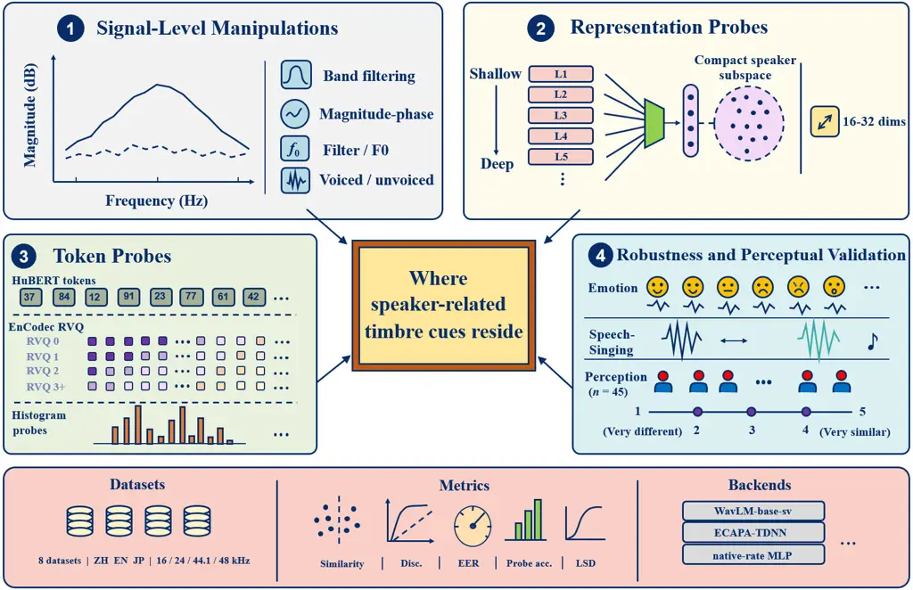

# Where Does Timbre Hide? Localizing Speaker Information in Speech Signals

Yiquan Zhou 

  
Yixuan Wang 

  
Xiaozhe Qi 

  
Xin Gao 

  
Shihao Li 
^(†)^(†)thanks: Yiquan Zhou, Yixuan Wang, and Xiaozhe Qi are with the
School of Software Engineering, Xi’an Jiaotong University, Xi’an, China,
and also with the SYKI-SPEECH Team, Xi’an, China (e-mail:
yiqian.zhou@stu.xjtu.edu.cn; defender@stu.xjtu.edu.cn;
qixz25@stu.xjtu.edu.cn).^(†)^(†)thanks: Xin Gao and Shihao Li are with
the Division of Music and Audio, Union Wheatland Culture and Media Ltd.,
Chengdu, China (e-mail: sui@musinya.com;
yiseho@yiseho.com).^(†)^(†)thanks: Corresponding author: Yiquan Zhou.

###### Abstract

Timbre similarity is a key evaluation target for generative speech
systems, including voice conversion, speaker-cloning text-to-speech, and
zero-shot speech models. When the generated voice does not match the
target speaker, the problem often reflects imperfect separation of
speaker-related timbre from content, making it important to identify
where timbre information resides and which representations still carry
it. Using speaker identity as a measurable proxy, we probe frequency
bands, phase/magnitude structure, WORLD source/filter decomposition,
voiced/unvoiced regions, self-supervised learning (SSL) layers,
EnCodec/HuBERT tokens, and a 45-listener test across Mandarin, English,
and Japanese speech/singing data. Speaker information is distributed:
1–8 kHz magnitude and vocal-tract spectral-envelope structure dominate
perception, above-8 kHz bands remain machine-discriminative, shallow SSL
layers expose compact speaker information, and token leakage depends on
tokenizer/layer choice. These findings indicate where generation systems
should condition on or transform speaker information, and where content,
codec, and token pipelines should audit residual speaker leakage.

###### Index Terms: 

speaker identity, timbre, speaker verification, voice conversion,
self-supervised speech representations, listening test

## I Introduction

Timbre similarity is now a central evaluation target for generative
speech systems. Voice conversion (VC), speaker-cloning text-to-speech
(TTS), and some zero-shot large speech models must preserve linguistic
content while controlling the target speaker’s voice \[1, 2, 3, 4\].
This requirement makes speaker-independent content modeling a practical
engineering concern rather than only a design choice in representation
learning. If speaker-related information remains in a content, codec, or
self-supervised learning (SSL) representation, it can leak into
generation; if the information needed for the target speaker is not
injected or transformed at the right place, the generated speech may
remain intelligible but sound like the wrong speaker.

It is therefore important to know where speaker-related timbre
information resides and how it is coupled with content and other
acoustic factors. Timbre itself is perceptual and difficult to measure
directly at scale, so we use speaker identity as a measurable proxy for
speaker-related timbre while keeping machine discriminability separate
from human similarity judgments. Classical source-filter theory and
perceptual studies point to vocal-tract and spectral-envelope
structure \[5, 6, 7, 8\], while modern speaker verification and SSL
models such as ECAPA-TDNN and WavLM provide strong but less
interpretable speaker information \[9, 10\]. Earlier sub-band
speaker-recognition studies also found that low- and mid-frequency bands
carry substantial speaker information \[11, 12, 13\], but they predate
high-sample-rate corpora, neural codecs, tokenized speech language
models, and recent SSL probing work \[14, 15, 16, 17\].

This paper asks where speaker-related timbre information is preserved,
transformed, or leaked in both speech signals and learned
representations. We systematically compare complementary probes:
frequency filtering, phase/magnitude randomization, WORLD source/filter
swaps, voiced/unvoiced extraction, WavLM and ECAPA speaker verification,
mel classifiers, SSL-layer and PCA probes, EnCodec and HuBERT token
histograms, cross-style robustness checks, and a 45-listener similarity
test. These probes allow the same speaker-related information to be
viewed from signal, representation, and perceptual sides.

The experiments lead to three findings. First, the combined probes give
a structured view of where speaker-related timbre is concentrated.
Frequency-band manipulations and listener ratings place the perceptually
important speaker information mainly in the 1–8 kHz region, rather than
in very high bands. Phase/magnitude edits show that this information is
carried mainly by spectral magnitude, not phase. WORLD source/filter
swaps further identify the vocal-tract spectral envelope as a stronger
carrier than fundamental frequency (F0) alone. Second, representation
probes show that speaker-related information remains accessible in
shallow SSL layers and can survive in some token streams, so content and
codec representations should be audited rather than assumed
speaker-free. Third, speaker information measured by a classifier is not
the same as perceived timbre similarity. High-frequency bands still
contain speaker information that classifiers can use, but this
information does not produce strong same-speaker similarity for
listeners. This suggests that high-band reconstruction may improve
acoustic detail without restoring the perceived speaker similarity that
listeners rely on. Together, these findings can guide future VC, TTS,
anonymization, codec, and speech language model work in deciding which
components need speaker conditioning, transformation, suppression, or
leakage checks.

## II Experimental Setup

This section defines the experimental setting used in the paper. It
contains two parts: the datasets and common evaluation setup, and the
design of each experiment.

### II-A Datasets and Common Setup

The protocol uses multiple datasets because different probes require
different data characteristics (e.g., sampling rate, language, style
labels). AISHELL-1 and AISHELL-3 provide Mandarin multi-speaker speech
for frequency, SSL, token, and listening checks \[18, 19\]. VCTK
provides 48 kHz English speech for high-band and voiced/unvoiced
tests \[20\]. ESD and CREMA-D test whether speaker information survives
emotion changes \[21, 22\]. NUS-48E and JVS/JVS-MuSiC test
speech–singing transfer \[23, 24, 25\]. We also use a self-recorded 48
kHz Chinese–English corpus for controlled band-swap and voiced/unvoiced
pilot experiments. Table I summarizes the data used by each experiment
group.

| Experiment group | Data scale  | What it checks                                          |
| ---------------- | ----------- | ------------------------------------------------------- |
| AISHELL-1        | 20 spk.     | lowpass/highpass, SSL, tokens                           |
| AISHELL-3        | 98 spk.     | high-sample-rate bands, SSL/token validation, listening |
| VCTK             | 100 spk.    | 48 kHz high-band and unvoiced validation                |
| ESD/CREMA-D      | 20/91 spk.  | emotion robustness                                      |
| NUS/JVS          | 12/100 spk. | speech–singing robustness                               |
| Self-rec.        | 4 spk.      | controlled band-swap and voiced/unvoiced pilot          |

TABLE I: Data used in the main checks.

All experiments use speaker identity as the measurable target, but the
metric depends on the probe. WavLM-base-sv is the main speaker
verification (SV) backend \[10\]. For signal edits that may depend on
the backend, we repeat the phase/magnitude and source/filter tests with
a SpeechBrain ECAPA-TDNN VoxCeleb model \[9\]. Embedding-based tests use
cosine similarity between speaker embeddings, and report intra-speaker
similarity, inter-speaker similarity, and discriminability, defined as
the same-speaker score minus the different-speaker score. Bandwidth
curves also report equal error rate (EER). Closed-set feature and token
probes report speaker-classification accuracy. The listening test
reports mean voice-timbre similarity ratings (i.e., perceived
same-speaker similarity) on a 1–5 scale. Because WavLM-base-sv requires
16 kHz input, spectral content above 8 kHz is discarded before embedding
extraction. High-sample-rate spectra are therefore evaluated with mel
multilayer perceptron (MLP) probes in the frequency-band experiment.
Fig. 1 summarizes the full protocol.

Fig. 1: Speaker-information localization protocol. The study combines
signal edits, model-based and model-free measurements, representation
probes, and human similarity ratings, so speaker information measured by
models can be kept separate from perceived speaker-related timbre
information.

### II-B Experiment Design

Frequency-band experiment: This experiment tests which spectral regions
preserve speaker information. For lowpass and highpass analysis, we
apply Butterworth filters to each utterance, extract WavLM-base-sv
embeddings, and compute speaker discriminability and EER. Lowpass curves
show how speaker information changes as more bandwidth is retained from
the bottom up. Highpass curves show how speaker information changes when
low and mid frequencies are removed. For bands above 8 kHz, we cannot
rely on WavLM-base-sv because its 16 kHz input removes this frequency
range. We therefore keep AISHELL-3 and VCTK at their original sampling
rates, isolate fixed frequency bands, extract log-mel summaries from
each band, and train a 2-layer closed-set MLP speaker classifier. We
also check shuffled labels and duration/energy baselines to make sure
the classifier is not succeeding for trivial reasons. Mel-cosine
separability (the cosine-distance gap between same- and
different-speaker mel features) provides an additional classifier-free
check. To compare machine-detectable information with perception, we
also construct AISHELL-3 paired trials from full-band, lowpass,
bandpass, highpass, and different-speaker conditions. Listeners rate
each pair on a 1–5 voice-timbre similarity scale. The main metrics are
discriminability and EER for the SV curves, speaker-classification
accuracy for the mel MLP checks, and mean listener rating for the
listening conditions.

Phase/magnitude experiment: This experiment tests whether speaker
information is carried mainly by spectral magnitude or phase. For each
utterance, we compute a short-time Fourier transform (STFT) and
synthesize two variants. The magnitude-kept variant keeps the original
magnitude and randomizes phase. The phase-kept variant keeps the
original phase and randomizes magnitude. We then compare the speaker
discriminability of each variant against that of the unmodified signal.
This manipulation directly tests whether speaker information is carried
by the spectral envelope or the phase structure.

Source/filter experiment: This experiment tests whether speaker
information is better explained by source pitch (F0) or vocal-tract
filtering. Using WORLD, we decompose each utterance into fundamental
frequency (F0), spectral envelope, and aperiodicity \[26\]. We then
create cross-speaker resynthesized signals by keeping one speaker’s F0
while replacing the spectral envelope, or by keeping the spectral
envelope while replacing F0. We judge the two conditions by same-speaker
cosine similarity and retention (the fraction of the original
same-speaker similarity preserved). If the filter-kept signal preserves
more speaker similarity than the F0-kept signal, the retained
information is more closely linked to vocal-tract spectral-envelope
structure than to pitch alone. We repeat the phase/magnitude and
source/filter tests with ECAPA-TDNN to check that the pattern is not
specific to WavLM-base-sv.

Self-supervised learning (SSL) representation experiment: This
experiment tests where speaker information is exposed in continuous
speech features. We extract layer-wise features from WavLM, HuBERT,
Wav2Vec 2.0, and Whisper-base, mean-pool each utterance, and train
lightweight speaker classifiers. We also apply principal component
analysis (PCA) before classification to test whether speaker information
remains accessible after dimensionality reduction. This shows which
layers are most speaker-discriminative and whether the information is
compact enough to leak through content features when they are reused in
downstream systems. The main metric is closed-set speaker-classification
accuracy.

Token experiment: This experiment tests whether discrete speech units
retain speaker information. For EnCodec, we compute histograms from each
residual vector quantization (RVQ) layer and from cumulative RVQ groups.
For HuBERT, we compute k-means token histograms from multiple SSL layers
and codebook sizes, and add a bigram check to capture limited sequential
dependencies. These probes test whether speaker leakage depends on
tokenizer, layer, codebook size, and RVQ depth. The main metric is
closed-set speaker-classification accuracy.

Robustness experiments: These experiments test whether speaker
information survives common style and phonation changes. Emotion tests
compare same-speaker cross-emotion similarity with different-speaker
baselines, and include a CREMA-D leave-one-emotion-out validation.
Speech–singing tests compare same-speaker cross-modal similarity and
train speech-based classifiers that are evaluated on singing.
Voiced/unvoiced tests separate active speech into voiced and unvoiced
regions and evaluate whether speaker information survives outside
pitch-bearing regions. These checks prevent the main claims from relying
only on neutral read speech. The main metrics are cosine similarity gaps
and speaker-classification accuracy.

## III Results

### III-A Frequency-Band Experiment Results

The frequency-band results show that the strongest speaker information
lies in the low/mid spectrum, while higher bands retain weaker but
measurable information. In the WavLM-base-sv lowpass curves,
discriminability increases as more bandwidth is retained and nearly
reaches the full-band score by 7.5 kHz. The highpass curves give the
complementary pattern: performance remains stable when only sub-1 kHz
content is removed, but drops sharply once the cutoff exceeds 1–2 kHz.
These two curves indicate that speaker information is not carried by
sub-1 kHz content alone, but by a broader low/mid-frequency range.
Because WavLM-base-sv is limited by its 16 kHz input, the WavLM curves
cannot determine whether bands above 8 kHz still contain speaker
information.

| Dataset/Band        | 1–4  | 4–8  | 8–12 | High band    |
| ------------------- | ---- | ---- | ---- | ------------ |
| VCTK acc.           | 92.1 | 89.3 | 88.1 | 50.1 (20–24) |
| VCTK shuf.          | 1.2  | 1.5  | 1.1  | 0.8          |
| VCTK dur./eng.      | 4.5  | 5.8  | 5.4  | 5.4          |
| AISHELL-3 acc.      | 82.5 | 72.4 | 55.0 | 42.8 (16–20) |
| AISHELL-3 shuf.     | 0.9  | 1.0  | 1.0  | 0.9          |
| AISHELL-3 dur./eng. | 6.4  | 5.6  | 5.3  | 6.0          |

TABLE II: Band MLP check. Values are speaker-classification accuracy
(%); shuffled labels stay near chance and duration/energy baselines are
much lower.

Table II fills this gap with the mel MLP checks. Both high-sample-rate
datasets show the same trend: accuracy decreases with frequency. The 1–8
kHz bands are strongest: VCTK reaches 92.1% at 1–4 kHz and 89.3% at 4–8
kHz, while AISHELL-3 reaches 82.5% and 72.4% in the same bands. Bands
above 8 kHz remain well above shuffled labels and duration/energy
baselines, so they do contain speaker information that classifiers can
use. However, the scores decline with frequency: VCTK falls to 50.1% in
the 20–24 kHz band, and AISHELL-3 falls to 42.8% in the 16–20 kHz band.
Mel-cosine separability confirms the same frequency trend, with
AISHELL-3 spectral-shape features peaking at 4–8 kHz
($`d^{\prime}=1.86`$) and decreasing toward the highest tested band
($`d^{\prime}=0.97`$). Fig. 2 summarizes the contrast between
low/mid-band dominance and weaker high-band information.

Fig. 2: Bandwidth comparison. SV lowpass curves saturate near 4–8 kHz,
while mel probes show weaker but measurable above-8 kHz information.

Table III and Fig. 3 report the listening-test results for the same
frequency contrast.

| Condition       | Mean $`\pm`$ SD   | 95% CI         |
| --------------- | ----------------- | -------------- |
| Different full  | 2.29 $`\pm`$ 0.53 | \[2.13, 2.45\] |
| Same 12–20 kHz  | 1.07 $`\pm`$ 0.28 | \[0.99, 1.16\] |
| Same $`>`$8 kHz | 1.24 $`\pm`$ 0.29 | \[1.15, 1.32\] |
| Same $`<`$4 kHz | 3.81 $`\pm`$ 0.58 | \[3.64, 3.99\] |
| Same 1–4 kHz    | 2.92 $`\pm`$ 0.69 | \[2.71, 3.13\] |
| Same $`<`$8 kHz | 4.45 $`\pm`$ 0.35 | \[4.35, 4.56\] |
| Same full       | 4.44 $`\pm`$ 0.36 | \[4.34, 4.55\] |

TABLE III: Human similarity ratings (45 listeners, 1–5 scale).

Fig. 3: Listening test. Low/mid-frequency same-speaker pairs receive
high similarity ratings; high-frequency-only pairs receive low ratings.

The listening results show that classifier-usable high-frequency
information is not sufficient for perceived same-speaker timbre
similarity. Same-speaker full-band pairs are rated much higher than
different-speaker full-band controls (4.44 vs. 2.29,
$`p=3.6\times 10^{-21}`$). Low/mid-frequency same-speaker conditions
(Same $`<`$4 kHz, Same 1–4 kHz, Same $`<`$8 kHz) are rated much higher
than high-frequency-only conditions (Same $`>`$8 kHz, Same 12–20 kHz),
with a mean paired difference of 2.57 points ($`p=1.7\times 10^{-38}`$).
The $`<8`$ kHz versus $`>8`$ kHz contrast is especially large (4.45 vs.
1.24, $`p=1.3\times 10^{-39}`$). Together with the MLP results, this
shows that high-frequency bands contain detectable speaker information,
but do not provide strong same-speaker similarity for listeners under
the present manipulations.

### III-B Phase/Magnitude Experiment Results

Table IV and Fig. 4 summarize the phase/magnitude and source/filter
results across the two SV backends. For the phase/magnitude experiment,
magnitude preserves much more speaker information than phase. With
WavLM, keeping the original magnitude spectrum while randomizing phase
preserves 81.6% of the original discriminability. The phase-kept variant
loses speaker discriminability entirely: WavLM discriminability drops to
-0.199 and ECAPA to 0.003, both effectively at or below chance.

| Backend | Condition      | Score        | Ret.  |
| ------- | -------------- | ------------ | ----- |
| WavLM   | magnitude kept | disc. 0.195  | 81.6% |
| WavLM   | phase kept     | disc. -0.199 | –     |
| WavLM   | filter kept    | sim. 0.906   | 92.4% |
| WavLM   | F0 kept        | sim. 0.804   | 82.0% |
| ECAPA   | magnitude kept | disc. 0.284  | 77.1% |
| ECAPA   | phase kept     | disc. 0.003  | 0.7%  |
| ECAPA   | filter kept    | sim. 0.601   | 79.3% |
| ECAPA   | F0 kept        | sim. 0.199   | 26.2% |

TABLE IV: Phase/magnitude and source/filter summary across two SV
backends. Ret. denotes retention relative to the full or original
condition.

Fig. 4: Second-backend validation. WavLM and ECAPA both favor
magnitude/filter information over phase/F0-dominant information.

### III-C Source/Filter Experiment Results

The source/filter rows in Table IV and Fig. 4 confirm the same pattern
in a source-filter decomposition: spectral-envelope information
dominates over F0. Keeping the vocal-tract spectral envelope preserves
92.4% of full-signal same-speaker similarity with WavLM, compared with
82.0% when only F0 is retained. With ECAPA, the filter-kept condition
also retains much more speaker similarity than the F0-kept condition
(79.3% vs. 26.2%). Together with the phase/magnitude result in Table IV,
this links the main speaker-related information to spectral-envelope
structure rather than to phase or F0 alone.

### III-D SSL Representation Experiment Results

Table V summarizes the model-wise layer and PCA results. The
representation results show that speaker information is strongest in
early to mid layers. On AISHELL-1, WavLM, HuBERT, Wav2Vec 2.0, and
Whisper speaker probes all peak in the first few layers (L1–L5), well
before the final layer. On AISHELL-3 (not tabulated), WavLM reaches
96.5–97.7% in layers L0–L4 but falls to 75.7–76.5% in L9–L12. PCA
results show the same depth effect: AISHELL-3 WavLM L0 remains at 95.8%
with 32 dimensions, while L12 falls to 62.7%.

| Model    | Peak    | Final    | 32d  | 16d  | 8d   |
| -------- | ------- | -------- | ---- | ---- | ---- |
| WavLM    | L1 99.8 | L12 94.8 | 99.8 | 98.3 | 85.3 |
| HuBERT   | L5 99.5 | L12 95.3 | 99.0 | 93.8 | 69.2 |
| Wav2Vec2 | L1 99.3 | L12 95.0 | 99.0 | 95.8 | 82.2 |
| Whisper  | L3 97.5 | L6 92.0  | 96.5 | 90.2 | 74.5 |

TABLE V: SSL representation results on AISHELL-1. PCA columns use each
model’s peak layer.

### III-E Token Experiment Results

Table VI summarizes the token and codec results. The results are
tokenizer- and layer-dependent. With the order-free histogram probe used
here, HuBERT k-means tokens preserve more speaker information than the
tested 24 kHz EnCodec RVQ histograms. This is not a final ranking of all
codec representations. These results show that tokenization objective
and layer choice strongly affect how much speaker information remains
available.

| HuBERT k-means tokens |          |           |           |           |            |
| --------------------- | -------- | --------- | --------- | --------- | ---------- |
| Layer                 | $`k`$=50 | $`k`$=100 | $`k`$=200 | $`k`$=500 | $`k`$=1000 |
| L1                    | 60.2     | 68.5      | 78.0      | 89.0      | 94.0       |
| L3                    | 46.5     | 65.7      | 70.7      | 84.0      | 92.7       |
| L6                    | 43.0     | 57.8      | 75.3      | 87.3      | 96.2       |
| L9                    | 37.7     | 52.0      | 64.7      | 75.2      | 88.5       |
| L12                   | 40.7     | 57.2      | 68.3      | 74.2      | 84.2       |
| EnCodec RVQ tokens    |          |           |           |           |            |
| Layer                 | Acc.     |           | Cum.      | Cum. Acc. |            |
| RVQ-0                 | 53.5     |           | 0         | 53.5      |            |
| RVQ-1                 | 65.0     |           | 0–1       | 63.7      |            |
| RVQ-2                 | 67.2     |           | 0–2       | 68.8      |            |
| RVQ-3                 | 47.0     |           | 0–3       | 68.7      |            |
| RVQ-4                 | 45.8     |           | 0–4       | 67.8      |            |
| RVQ-5                 | 42.0     |           | 0–5       | 68.8      |            |
| RVQ-6                 | 36.0     |           | 0–6       | 67.8      |            |
| RVQ-7                 | 36.7     |           | 0–7       | 67.0      |            |

TABLE VI: Token and codec results. HuBERT and EnCodec values are
speaker-classification accuracies (%).

### III-F Robustness Experiment Results

Table VII reports the robustness results across style, modality, and
phonation changes. Speaker information remains detectable in all tested
settings. In CREMA-D, leave-one-emotion-out speaker classification over
91 actors reaches 89.2% mean accuracy; anger is hardest at 75.4%, still
far above the 1.1% chance level. In JVS/JVS-MuSiC, a classifier trained
on 10,000 read-speech utterances from 100 speakers reaches 23.7% on 600
singing segments — above the 1.0% chance level but substantially lower
than within-mode accuracy. For VCTK voiced/unvoiced validation,
unvoiced-only active frames reach 70.9% speaker accuracy, and the
same-speaker cosine similarity gap between voiced and unvoiced frames is
0.463 (voiced higher). These checks show that speaker information
remains detectable across emotion, singing, and unvoiced speech,
although it weakens when style or phonation changes.

| Condition     | Quantitative detail                                                                           |
| ------------- | --------------------------------------------------------------------------------------------- |
| ESD emotion   | Same-speaker cross-emotion cosine 0.899 vs. different-speaker same-emotion 0.644; gap +0.255. |
| CREMA-D       | Leave-one-emotion-out mean 89.2%; held-out anger 75.4%, neutral 95.1%.                        |
| NUS-48E       | Sing–read same-speaker similarity 0.909; cross-modal discriminability 0.246.                  |
| JVS/JVS-MuSiC | Speech-trained classifier reaches 23.7% on singing; centroid gap 0.272.                       |
| VCTK V/UV     | Unvoiced-only 70.9$`\pm`$1.2%; voiced-vs.-unvoiced cosine gap 0.463.                          |

TABLE VII: Robustness details across style, modality, and phonation
changes.

## IV Discussion

The results provide a consistent localization pattern. The strongest
perceived speaker-related timbre information is carried by low- and
mid-frequency magnitude structure, especially in the 1–8 kHz region.
Phase/magnitude edits and WORLD source/filter swaps, validated with a
second SV backend (ECAPA-TDNN), further point to the vocal-tract
spectral envelope rather than phase or F0 alone. This agrees with the
source-filter view of speech: the vocal tract shapes formants and broad
spectral balance, both of which remain relatively stable across
utterances; vocal-tract filtering also applies to unvoiced segments,
consistent with the unvoiced speaker-recognition results in
Section III-F.

The high-frequency results need a separate interpretation. Bands above 8
kHz remain useful for closed-set classifiers and mel-cosine checks, so
they should not be treated as empty. However, high-frequency-only
same-speaker pairs receive low listener ratings. This suggests that
high-band reconstruction may contribute to acoustic detail (e.g.,
frication or airiness), but is unlikely to restore the speaker
similarity that listeners primarily perceive.

Learned representations echo the signal-level findings. Shallow SSL
layers retain more speaker information and keep it in a compact
subspace, while deeper layers expose less speaker information under our
probes. HuBERT and EnCodec results also show that discrete
representations are not automatically speaker-free. The amount of
speaker information depends on the source layer, codebook size, and
residual vector quantization layer. Therefore, content, codec, and token
pipelines should check speaker leakage at the actual representation used
by the downstream system, not only in explicit speaker embeddings.

The robustness experiments show that this information is not limited to
clean neutral voiced speech. Speaker information remains measurable
across emotion, speech–singing changes, and unvoiced segments. The
strength decreases under larger domain changes, especially
speech-to-singing transfer, but remains above chance. Combined with the
signal-level findings, this supports the view that speaker-related
spectral-envelope structure can survive changes in prosody, style, and
phonation.

These findings provide a practical map for speaker-aware speech systems.
Voice conversion and speaker-cloning TTS should control low/mid
spectral-envelope information when matching a target speaker, while
treating high-band enhancement mainly as acoustic detail unless the
downstream task specifically requires closed-set speaker discrimination
at high sampling rates. Anonymization and tokenized speech language
models should test residual speaker information in shallow SSL features,
codec layers, and token streams. A single speaker-similarity score is
therefore not enough: evaluation should separate machine speaker
discriminability, perceived speaker similarity, and representation-level
leakage.

## V Limitations and Conclusion

This study has several limitations. Many probes are closed-set, so
speaker-classification accuracy and SV-style scores should not be
interpreted as open-set speaker verification performance. WavLM-base-sv
operates at 16 kHz, which limits SV-based frequency analysis above 8
kHz; the high-sample-rate mel probes, mel-cosine checks, and listening
test reduce this issue but do not replace a high-sample-rate open-set SV
backend. The high-frequency listening stimuli are narrowband and less
natural than full-band speech, so their low ratings describe perceived
voice-timbre similarity under the present filtering conditions. The
emotion, singing, and token results would also benefit from more speaker
backends, more detailed listener metadata, better-controlled playback
conditions, and sequence-aware token probes.

Overall, this paper uses speaker identity as a measurable proxy to study
where speaker-related timbre information resides in speech signals and
learned representations. First, the strongest perceived speaker-related
information is concentrated in low/mid-frequency spectral-magnitude
structure — specifically the vocal-tract spectral envelope in the 1–8
kHz region — while phase, F0, and high-frequency-only information is
weaker under our probes. Second, speaker information is not confined to
explicit speaker embeddings: shallow SSL layers and some token streams
still expose recoverable speaker information. Third, machine speaker
discriminability is not the same as perceived timbre similarity:
high-frequency bands contain speaker information that classifiers can
use, but they do not produce strong same-speaker ratings in the
listening test. Together, these findings indicate where VC,
speaker-cloning TTS, anonymization, codec, and speech language model
pipelines should inject, transform, suppress, or audit speaker-related
information.

## References

- \[1\] B. Sisman, J. Yamagishi, S. King, and H. Li, “An overview of
  voice conversion and its challenges: From statistical modeling to deep
  learning,” _IEEE/ACM Transactions on Audio, Speech, and Language
  Processing_, vol. 29, pp. 132–157, 2021.
- \[2\] S. Chen, C. Wang, Y. Wu, Z. Zhang, L. Zhou, S. Liu, Z. Chen,
  Y. Liu, H. Wang, J. Li, L. He, S. Zhao, and F. Wei, “Neural codec
  language models are zero-shot text to speech synthesizers,” _IEEE
  Transactions on Audio, Speech and Language Processing_, vol. 33, pp.
  705–718, 2025.
- \[3\] X. Zhang, D. Zhang, S. Li, Y. Zhou, and X. Qiu,
  “Speechtokenizer: Unified speech tokenizer for speech language
  models,” in _International Conference on Learning Representations_,
  B. Kim, Y. Yue, S. Chaudhuri, K. Fragkiadaki, M. Khan, and Y. Sun,
  Eds., vol. 2024, 2024, pp. 31 798–31 818. \[Online\]. Available:
  [https://proceedings.iclr.cc/paper_files/paper/2024/file/86d1ab582afb247ccaa84bec4a7e24f7-Paper-Conference.pdf](https://proceedings.iclr.cc/paper_files/paper/2024/file/86d1ab582afb247ccaa84bec4a7e24f7-Paper-Conference.pdf)
- \[4\] Z. Ju, Y. Wang, K. Shen, X. Tan, D. Xin, D. Yang, E. Liu,
  Y. Leng, K. Song, S. Tang, Z. Wu, T. Qin, X. Li, W. Ye, S. Zhang,
  J. Bian, L. He, J. Li, and S. Zhao, “NaturalSpeech 3: Zero-shot speech
  synthesis with factorized codec and diffusion models,” in _Proceedings
  of the 41st International Conference on Machine Learning_, ser.
  Proceedings of Machine Learning Research, R. Salakhutdinov, Z. Kolter,
  K. Heller, A. Weller, N. Oliver, J. Scarlett, and F. Berkenkamp, Eds.,
  vol. 235. PMLR, 21–27 Jul 2024, pp. 22 605–22 623. \[Online\].
  Available:
  [https://proceedings.mlr.press/v235/ju24b.html](https://proceedings.mlr.press/v235/ju24b.html)
- \[5\] G. Fant, _Acoustic Theory of Speech Production: With
  Calculations based on X-Ray Studies of Russian Articulations_. Berlin,
  Boston: De Gruyter Mouton, 1971. \[Online\]. Available:
  [https://doi.org/10.1515/9783110873429](https://doi.org/10.1515/9783110873429)
- \[6\] Y. Lavner, I. Gath, and J. Rosenhouse, “The effects of acoustic
  modifications on the identification of familiar voices speaking
  isolated vowels,” _Speech Communication_, vol. 30, no. 1, pp.
  9–26, 2000. \[Online\]. Available:
  [https://www.sciencedirect.com/science/article/pii/S016763939900028X](https://www.sciencedirect.com/science/article/pii/S016763939900028X)
- \[7\] R. E. Remez, J. M. Fellowes, and P. E. Rubin, “Talker
  identification based on phonetic information,” _Journal of
  Experimental Psychology: Human Perception and Performance_, vol. 23,
  no. 3, pp. 651–666, 1997.
- \[8\] J. Kreiman and D. Sidtis, _Foundations of voice studies: An
  interdisciplinary approach to voice production and
  perception_. Wiley-Blackwell, 2011.
- \[9\] B. Desplanques, J. Thienpondt, and K. Demuynck, “ECAPA-TDNN:
  Emphasized Channel Attention, Propagation and Aggregation in TDNN
  Based Speaker Verification,” in _Interspeech 2020_, 2020, pp.
  3830–3834.
- \[10\] S. Chen, C. Wang, Z. Chen, Y. Wu, S. Liu, Z. Chen, J. Li,
  N. Kanda, T. Yoshioka, X. Xiao, J. Wu, L. Zhou, S. Ren, Y. Qian,
  Y. Qian, J. Wu, M. Zeng, X. Yu, and F. Wei, “Wavlm: Large-scale
  self-supervised pre-training for full stack speech processing,” _IEEE
  Journal of Selected Topics in Signal Processing_, vol. 16, no. 6, pp.
  1505–1518, 2022.
- \[11\] S. Hayakawa and F. Itakura, “Text-dependent speaker recognition
  using the information in the higher frequency band,” in _Proceedings
  of ICASSP ’94. IEEE International Conference on Acoustics, Speech and
  Signal Processing_, vol. i, 1994, pp. I/137–I/140 vol.1.
- \[12\] L. Besacier, J. Bonastre, and C. Fredouille, “Localization and
  selection of speaker-specific information with statistical modeling,”
  _Speech Communication_, vol. 31, no. 2-3, pp. 89–106, 2000.
  \[Online\]. Available:
  [https://www.sciencedirect.com/science/article/pii/S0167639399000709](https://www.sciencedirect.com/science/article/pii/S0167639399000709)
- \[13\] T. Kinnunen and H. Li, “An overview of text-independent speaker
  recognition: From features to supervectors,” _Speech Communication_,
  vol. 52, no. 1, pp. 12–40, 2010. \[Online\]. Available:
  [https://www.sciencedirect.com/science/article/pii/S0167639309001289](https://www.sciencedirect.com/science/article/pii/S0167639309001289)
- \[14\] S. wen Yang, P.-H. Chi, Y.-S. Chuang, C.-I. J. Lai,
  K. Lakhotia, Y. Y. Lin, A. T. Liu, J. Shi, X. Chang, G.-T. Lin, T.-H.
  Huang, W.-C. Tseng, K. tik Lee, D.-R. Liu, Z. Huang, S. Dong, S.-W.
  Li, S. Watanabe, A. Mohamed, and H. yi Lee, “SUPERB: Speech Processing
  Universal PERformance Benchmark,” in _Interspeech 2021_, 2021, pp.
  1194–1198.
- \[15\] A. Pasad, J.-C. Chou, and K. Livescu, “Layer-wise analysis of a
  self-supervised speech representation model,” in _2021 IEEE Automatic
  Speech Recognition and Understanding Workshop (ASRU)_, 2021, pp.
  914–921.
- \[16\] Y. K. Singla, J. Shah, C. Chen, and R. R. Shah, “What do audio
  transformers hear? probing their representations for language delivery
  & structure,” in _2022 IEEE International Conference on Data Mining
  Workshops (ICDMW)_, 2022, pp. 910–925.
- \[17\] A. Défossez, J. Copet, G. Synnaeve, and Y. Adi, “High fidelity
  neural audio compression,” _Transactions on Machine Learning
  Research_, 2023, featured Certification, Reproducibility
  Certification. \[Online\]. Available:
  [https://openreview.net/forum?id=ivCd8z8zR2](https://openreview.net/forum?id=ivCd8z8zR2)
- \[18\] H. Bu, J. Du, X. Na, B. Wu, and H. Zheng, “Aishell-1: An
  open-source mandarin speech corpus and a speech recognition baseline,”
  in _2017 20th Conference of the Oriental Chapter of the International
  Coordinating Committee on Speech Databases and Speech I/O Systems and
  Assessment (O-COCOSDA)_, 2017, pp. 1–5.
- \[19\] Y. Shi, H. Bu, X. Xu, S. Zhang, and M. Li, “AISHELL-3: A
  Multi-Speaker Mandarin TTS Corpus,” in _Interspeech 2021_, 2021, pp.
  2756–2760.
- \[20\] J. Yamagishi, C. Veaux, and K. MacDonald, “Cstr vctk corpus:
  English multi-speaker corpus for cstr voice cloning toolkit (version
  0.92),” 2019, \[sound\]. \[Online\]. Available:
  [https://doi.org/10.7488/ds/2645](https://doi.org/10.7488/ds/2645)
- \[21\] K. Zhou, B. Sisman, R. Liu, and H. Li, “Emotional voice
  conversion: Theory, databases and esd,” _Speech Communication_, vol.
  137, pp. 1–18, 2022. \[Online\]. Available:
  [https://www.sciencedirect.com/science/article/pii/S0167639321001308](https://www.sciencedirect.com/science/article/pii/S0167639321001308)
- \[22\] H. Cao, D. G. Cooper, M. K. Keutmann, R. C. Gur, A. Nenkova,
  and R. Verma, “Crema-d: Crowd-sourced emotional multimodal actors
  dataset,” _IEEE Transactions on Affective Computing_, vol. 5, no. 4,
  pp. 377–390, 2014.
- \[23\] Z. Duan, H. Fang, B. Li, K. C. Sim, and Y. Wang, “The nus sung
  and spoken lyrics corpus: A quantitative comparison of singing and
  speech,” in _2013 Asia-Pacific Signal and Information Processing
  Association Annual Summit and Conference_, 2013, pp. 1–9.
- \[24\] S. Takamichi, K. Mitsui, Y. Saito, T. Koriyama, N. Tanji, and
  H. Saruwatari, “Jvs corpus: free japanese multi-speaker voice corpus,”
  _arXiv preprint arXiv:1908.06248_, 2019.
- \[25\] H. Tamaru, S. Takamichi, N. Tanji, and H. Saruwatari,
  “JVS-MuSiC: Japanese multispeaker singing-voice corpus,” _arXiv
  preprint arXiv:2001.07044_, 2020.
- \[26\] M. Morise, F. Yokomori, and K. Ozawa, “World: A vocoder-based
  high-quality speech synthesis system for real-time applications,”
  _IEICE TRANSACTIONS on Information and Systems_, vol. E99-D, no. 7,
  pp. 1877–1884, July 2016.
