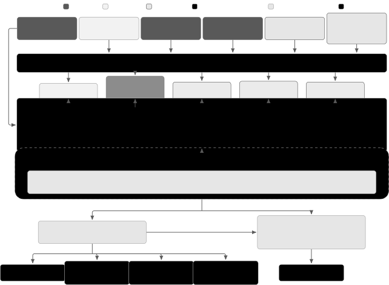
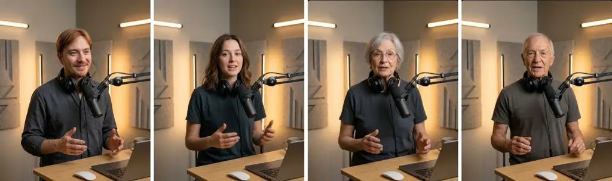

\checkdata

\[Date\]October 10, 2026

# HeyGen Voice: Scene-Aware Voice Cloning for Talking Videos

HeyGen Research

###### Abstract

Most voice-cloning systems are built for audio alone: they copy the
reference recording’s delivery and acoustics, so a voice cloned on a
phone sounds like a phone recording whether the speaker is pictured in a
studio, on a street, or in a cathedral. Speech for a talking video
should sound like the pictured person speaking in the pictured place. We
present HeyGen Voice, a scene-aware voice-cloning model that separates
who is speaking from how and where: it keeps the speaker’s voice from an
everyday recording while the target image sets the delivery and
acoustics. Prior image-conditioned TTS does half of this job: it either
adds scene acoustics without keeping a specific speaker or infers a
voice from a face. HeyGen Voice is a multimodal autoregressive
transformer conditioned on the image, speaker and scene captions, and
the voice recording, trained in five stages that move from multilingual
TTS pretraining through simulated and real cross-scene adaptation to
reinforcement and preference optimization. Two clone policies trade
scene adaptation against fidelity to the original recording, and an
audio anchor holds long scripts in one voice and one acoustic
environment. Listeners prefer HeyGen Voice over leading commercial
systems across a third-party arena, production votes, and talking-video
studies: it ranks first (Elo 1201) on the public Artificial Analysis
controlled-voice TTS leaderboard (October 2026); in a blind test, users
cloning their own voice chose it over ElevenLabs v4 and Cartesia Sonic
3.6 in 62% and 54% of votes; and volunteers rated talking videos of
their own digital twin about 10 to 30 points higher (out of 100) when
voiced by HeyGen Voice than by leading commercial alternatives. Try
HeyGen Voice and hear samples at
[https://heygen.com/heygen-voice](https://heygen.com/heygen-voice).

###### Contents

1.  1 Introduction
2.  2 Model Design
    1.  2.1 Problem formulation
    2.  2.2 Multimodal autoregressive acoustic model
    3.  2.3 Reference voice and continuity
    4.  2.4 Flow matching and waveform synthesis
3.  3 Training Strategy
    1.  3.1 Data engine and infrastructure
    2.  3.2 Supervised TTS pretraining
    3.  3.3 Simulated cross-scene adaptation
    4.  3.4 Supervised fine-tuning on real cross-scene pairs
    5.  3.5 GRPO for intelligibility and speaker similarity
    6.  3.6 DPO adapter for expressiveness
4.  4 Inference
    1.  4.1 Cross-scene authoring workflow
    2.  4.2 Image-based voice design
    3.  4.3 Clone policies
    4.  4.4 Expressiveness control
    5.  4.5 Long-form synthesis and voice consistency
5.  5 Evaluation
    1.  5.1 Cross-scene benchmark
    2.  5.2 Multilingual content fidelity
    3.  5.3 Human listening evaluation
    4.  5.4 Production voice-clone preference
    5.  5.5 Public arena ranking
    6.  5.6 Video-based evaluation
6.  6 Related Work
7.  7 Ethics and Safety
8.  8 Conclusion
9.  Contributions and Acknowledgments
10. References

## 1 Introduction

Zero-shot speech synthesis has matured quickly. Codec language models
\[14\], autoregressive acoustic models paired with diffusion or flow
decoders \[1, 4, 5, 23, 24, 36, 74\], and non-autoregressive
flow-matching models \[16, 27, 39, 69\] now clone a voice from a few
seconds of audio and read a script in dozens of languages. On
read-speech benchmarks the leading commercial and open systems are
separated by fractions of a percent in character error rate; what still
separates them is delivery, acoustics, and fit to the use case.

Talking videos are such a use case. Speech is heard together with a
visible person in a visible place: a creator at a desk, a presenter on a
stage, a host in a podcast studio. Most voice-cloning systems are built
for audio alone: they treat the reference recording as the definition of
the voice and carry its microphone, room, and delivery into the
generated speech, so a voice cloned from a phone recording keeps that
recording’s sound in every pictured scene. Speech for a talking video
should instead sound like the pictured person speaking in the pictured
place.

Achieving this raises three main challenges. First, existing approaches
do one half of the job: description-guided TTS \[32, 49, 71\] controls
delivery from text but has no access to the picture; face-conditioned
and multimodal-controllable synthesis \[40, 52, 53\] infers a plausible
voice from an image without preserving a particular speaker;
image-conditioned TTS and visual acoustic matching \[11, 45, 62, 75\]
add a scene’s acoustics without keeping a specific speaker; and joint
audio–video models \[7, 8, 30, 54\] generate speech with the picture but
not from a chosen voice. Table 1 summarizes these categories. Second,
the training data works against the task: in ordinary TTS data the
reference and the target come from the same recording, so the reference
already explains the delivery and acoustics and the model has no reason
to consult the image, while recordings of the same speaker in genuinely
different scenes are scarce and hard to pair. Third, an image and two
captions leave the exact acoustics of a scene underdetermined, so a long
script generated chunk by chunk drifts in voice and room. Underneath all
three is a tension between fidelity to the recording and fit to the
scene: some users want to sound exactly like their reference, others
want to sound like the pictured place.

HeyGen Voice is built for this setting. It separates who is speaking
from how and where: the user records a voice reference once, on any
device, and then supplies a target image, a script, and a delivery style
for each scene; a language model writes speaker and background captions
from the image and the requested style (Figure 4). A multimodal
autoregressive transformer predicts discrete acoustic codes from pooled
image, caption, and reference tokens, and a flow-matching decoder
renders 44.1 kHz audio that keeps the speaker’s voice while taking
delivery and acoustics from the scene. Our first three contributions
answer the three challenges in turn; the fourth measures the result:

- •
  Image-guided cross-scene speech generation. A conditioning design that
  places pooled reference tokens for the speaker’s voice alongside
  pooled image tokens and explicit delivery and environment captions,
  with two clone policies that either design the voice’s delivery and
  acoustics for the pictured scene (voice-clone) or continue the
  reference recording (full-clone) (Sections 2 and 4).
- •
  A cross-scene training curriculum. Supervised multilingual TTS
  pretraining, simulated cross-scene adaptation with reference
  perturbations that remove the same-recording shortcut, supervised
  fine-tuning on real same-speaker cross-scene pairs, group-relative
  policy optimization with intelligibility and speaker-similarity
  rewards, and direct preference optimization of a low-rank
  expressiveness adapter on judge-scored and then human preferences
  (Section 3).
- •
  Consistent long-form synthesis. An anchor-derived consistency
  embedding and local acoustic context that keep voice and scene
  acoustics fixed across chunks, with an expressiveness control that
  leaves the base model intact (Section 4).
- •
  A cross-scene benchmark and multilingual human evaluation. A 331-case
  same-speaker, different-scene benchmark with speaker-similarity and
  audio–image alignment metrics; a corrected ten-language
  content-fidelity benchmark; paired listening tests in five languages
  against ElevenLabs, Cartesia, and Inworld; a blind side-by-side test
  with platform users cloning their own voice; a third-party arena
  ranking; and two video studies, one with volunteers rating talking
  videos of themselves and one placing designed voices in 50 acoustic
  environments (Section 5).

We evaluate HeyGen Voice comprehensively against ElevenLabs v4, Cartesia
Sonic 3.6, Inworld TTS-2, and Seedance 2.5 (Section 5). The evaluation
spans a cross-scene benchmark, paired listening tests in five languages,
production votes, a third-party arena, and two talking-video studies. On
the cross-scene benchmark, the two clone policies obtain the highest
scene alignment and the highest speaker similarity to both target and
reference, with the policy setting the balance between the two (Section
5.1). Beyond our own benchmark, listeners prefer HeyGen Voice over
leading commercial systems: it ranks first on the Artificial Analysis
controlled-voice leaderboard, which compares text-to-speech systems on
the same eight cloned voices (Elo 1201, October 2026; Section 5.5); in a
blind test in the HeyGen voice-cloning flow, users cloning their own
voice chose it over ElevenLabs v4 and Cartesia Sonic 3.6 in 62% and 54%
of votes (Section 5.4); and volunteers rating talking videos of their
own digital twin scored both HeyGen Voice settings about 10 to 30 points
higher (out of 100) than Cartesia Sonic 3.6, ElevenLabs v4, and Seedance
2.5 (Section 5.6).


 
yes   
some systems or
partly   
no Categories follow Section 6.

Table 1: Capabilities by method category.

## 2 Model Design

To address the talking-video challenges outlined in the introduction,
HeyGen Voice conditions speech on the speaker to preserve, the
performance and scene to realize, and the acoustic state to maintain
across chunks. These requirements motivate a conditioning prefix that
combines a pooled reference-voice representation, a target image,
explicit speaker and background captions, and continuation state. A
multimodal autoregressive transformer predicts discrete acoustic codes
from this prefix and the script; a flow-matching decoder and a waveform
decoder render the codes as 44.1 kHz audio (Figure 1). This design
provides separate inputs for retaining speaker cues, specifying delivery
and environment, and carrying a selected realization through a longer
script.



Figure 1: HeyGen Voice architecture. Multimodal inputs are encoded by
frozen encoders and pooled into conditioning tokens; the clone policy
determines whether the continuation state comes from an anchor designed
for the pictured scene or from the reference recording itself. The
conditioning prefix, script tokens, and acoustic codes form one sequence
processed by an autoregressive transformer decoder. The model predicts
acoustic codes, supervised by cross-entropy during supervised training,
by intelligibility and speaker-similarity rewards during GRPO, and by
preference pairs during DPO; a flow-matching decoder conditioned on the
transformer’s hidden states and the reference audio produces the
waveform.

### 2.1 Problem formulation

Let $`x`$ denote the script, $`I`$ a target image, $`c_{s}`$ a speaker
caption, $`c_{b}`$ a background caption, and $`r`$ an optional reference
recording. We write $`u`$ for additional controls such as language and
acoustic attributes, and $`h`$ for optional continuation context. The
system models

```math
p(y\mid x,I,c_{s},c_{b},r,u,h;\pi), \tag{1}
```

where $`y`$ is the generated waveform and $`\pi`$ is a clone policy that
determines whether the output is designed for the pictured scene or
continues the reference recording (Section 4). The three groups of
inputs play distinct roles: the script determines what is said; the
image and captions describe the intended performance and setting; the
reference and continuation context supply the voice and, when desired,
the acoustics to retain.

### 2.2 Multimodal autoregressive acoustic model

The acoustic model is a causal transformer over a single token sequence:
a conditioning prefix $`P`$, followed by the tokenized script and the
acoustic codes. Acoustic codes come from a pretrained vector-quantized
encoder over mel-spectrograms \[67\], and generation factorizes
autoregressively,

```math
p_{\theta}(a_{1:T}\mid x,P)=\prod_{t=1}^{T}p_{\theta}(a_{t}\mid a_{<t},x,P). \tag{2}
```

Every conditioning source enters the prefix as a small, fixed number of
tokens produced by a frozen encoder and a learned attention-pooling
module, so that prefix cost is bounded regardless of input size and the
transformer can attend jointly across modalities.

#### Visual context

The script and reference recording do not specify the visible setting in
which the new speech should be heard. To provide this missing scene
information, a frozen vision-language visual encoder embeds the target
image, and attention pooling compresses its patch features into a few
image tokens that summarize the person and the scene. Because the image
alone leaves the intended delivery and acoustic realization ambiguous,
we complement these tokens with the explicit speaker and background
descriptions below.

#### Speaker and background captions

The two captions are free-form descriptions of a few sentences each,
written the way a listener would describe a recording rather than as
tags (Figure 2). During training they are produced by captioning models
from the target recording (Section 3); at inference a language model
writes them from the target image and the requested delivery style, so
the user never authors them directly. The speaker caption describes the
voice and its performance; the background caption describes the acoustic
environment and how it evolves over the recording (Figure 2). A frozen
multilingual text encoder embeds each caption, and separate pooling
heads produce speaker-caption and background-caption tokens, so that
delivery and environment are independently addressable while their
representations interact inside the transformer.


Figure 2: Example speaker and background captions for one recording, a
speaker talking inside a moving car. Each caption is a short descriptive
paragraph; the background caption names the sound sources, the space,
and what stays distant, and the speaker caption covers voice, tone,
pace, expressiveness, and articulation.

### 2.3 Reference voice and continuity

Cross-scene generation should preserve a recognizable speaker without
requiring the reference recording’s delivery and environment to remain
fixed. To support this control, a frozen audio encoder and attention
pooling summarize the reference into a small set of _reference tokens_
carrying timbre, accent, and speaking cadence, while the image,
captions, and acoustic controls specify the target performance and
setting. The clone policy (Section 4) determines which recording
conditions to retain: voice-clone designs a new acoustic realization for
the scene, whereas full-clone continues the reference recording’s
delivery and acoustics. Once a realization is selected, a further
requirement is to maintain it across utterances.

#### Resolving acoustic ambiguity

An image and two captions constrain a scene without fixing its sound: a
room admits several plausible reverberation patterns and microphone
perspectives, and a delivery caption admits many performances. Sampling
each utterance independently from the same conditioning therefore yields
segments that are individually plausible but sound recorded under
different conditions. The model resolves this with two continuation
inputs: a consistency embedding of a selected audio anchor, which fixes
the voice, delivery, and scene acoustics for every subsequent chunk, and
a moving window of preceding acoustic context, which tells the model how
the last speech ended. The anchor is either the voice-design output or
the reference recording itself; this choice is the difference between
the two clone policies (Section 4.3). Table 2 summarizes the prefix.

#### Additional controls

Language and accent conditioning are complemented by three scalar
controls that give numeric handles on attributes the captions describe
only qualitatively. Pitch variation sets how much the voice moves in
pitch over an utterance, from a flat reading to an animated one;
signal-to-noise ratio sets the level of the background relative to the
speech, so that the same scene can be rendered nearly clean or clearly
noisy; and ambient uniformity sets how steady the background is over the
clip, so that its level and texture do not drift from one segment to the
next.

| Source                 | Role                                                |
| ---------------------- | --------------------------------------------------- |
| Target image           | Person and scene context                            |
| Speaker caption        | Delivery and vocal attributes                       |
| Background caption     | Environment and acoustics                           |
| Reference tokens       | Speaker voice: timbre, accent, and speaking cadence |
| Consistency embedding  | Shared voice and scene acoustics                    |
| Local acoustic context | Local acoustic continuity                           |

Table 2: Conditioning prefix of the acoustic model. Each source
contributes a small, fixed number of pooled tokens; script and
continuation lengths vary.

### 2.4 Flow matching and waveform synthesis

After the acoustic codes are sampled, the model replays the sequence to
obtain the transformer’s hidden states $`H_{\theta}(x,P,a)`$. These
states condition a diffusion-transformer \[55\] flow model in a
continuous audio-latent space. Following the flow-matching formulation
\[44\], synthesis integrates a learned conditional vector field,

```math
\frac{dz_{\tau}}{d\tau}=v_{\phi}\!\left(z_{\tau},\tau\mid H_{\theta}(x,P,a),q\right),\qquad y=D_{\psi}(z_{1}), \tag{3}
```

where $`q`$ is the reference audio conditioning and $`D_{\psi}`$ is the
waveform decoder. The discrete codes are produced at a lower rate than
the continuous latent and are aligned to it before decoding. Visual and
caption information reaches the waveform through $`H_{\theta}`$; the
decoder itself has no image input.

## 3 Training Strategy

Training proceeds in five stages (Figure 3). Each stage changes what the
model must learn: first read a script in a given voice, then keep that
voice while the scene changes, then improve measured intelligibility and
speaker fidelity, and finally refine expressive delivery. The two
cross-scene stages teach the model to preserve the speaker without
treating the reference microphone, room, and performance as fixed
attributes of that speaker.

### 3.1 Data engine and infrastructure

HeyGen Voice is trained on the same talking-video corpus and compute
platform as Avatar V, and we refer the reader to the Avatar V
infrastructure and data reports for the full description \[34, 33\].
Training and data processing run on HELIOS, HeyGen’s unified GPU
platform, which schedules more than 5,000 GPUs across multiple clouds
through one control plane; its declarative data-processing engine, built
for pipelines that mix I/O-bound media decoding with GPU-bound
inference, sustains over 200,000 concurrent tasks and is the engine
behind every stage below.

On top of the segment-level curation that Avatar V applies to raw video
(normalization, human detection, scene-cut detection, content filtering,
deduplication), we build an audio-specific pipeline of eight stages that
turns speech segments into the adaptation data of Sections 3.3 and 3.4.
In order: vocal and background separation; language identification,
diarization, and ASR with word-level alignment; quality filtering that
removes clipping, poor or misaligned transcriptions, overlapping voices,
and separation artifacts; speaker clustering across source videos;
speaker and background captioning of the separated tracks (Figure 2);
cross-scene pair mining, which links recordings of the same speaker from
different videos and favors pairs whose recording conditions differ;
automated audits for false speaker matches, residual overlap, and
references with too little speech to establish identity; and a
train–test split that separates source videos and near duplicates as
well as speakers. Human annotators from the Avatar V annotation program
provide the preference pairs for the final training stage (Section 3.6)
and the listening tests of Section 5.

Inference uses the same serving stack as Avatar V, including fused
attention and decoding kernels. The flow-matching decoder uses the same
two-phase distillation stack as Avatar V: classifier-free guidance (CFG)
distillation followed by Distribution Matching Distillation (DMD), with
progressive-distillation objectives incorporated in the DMD stage
\[41\]. Together, these optimizations bring end-to-end synthesis to a
real-time factor (RTF) of approximately 0.1 at one concurrent request.


Figure 3: Training curriculum. Talking-video data drives the adaptation
stages. The GRPO checkpoint is the release base model and the base for
the expressiveness adapter, which is an optional inference control.

### 3.2 Supervised TTS pretraining

Pretraining is standard supervised TTS on audio recordings aligned with
their scripts. With teacher forcing, the acoustic model learns to
predict the next acoustic code from the script, the preceding codes, and
reference-voice conditioning. This stage establishes multilingual
text-to-speech and voice conditioning, following the autoregressive
acoustic-model family of Tortoise, MiniMax-Speech, and Inworld TTS-1
\[5, 74, 4\]. The image, caption, and continuity routes of Section 2 are
added during adaptation; the frozen visual, caption, and reference
encoders provide precomputed features, and the acoustic model together
with its learned conditioning modules is the adaptation target.

### 3.3 Simulated cross-scene adaptation

When the reference and the target come from the same recording, the
reference explains most of the target’s delivery and acoustics and the
model has little reason to consult the image or captions. We remove this
shortcut by transforming the reference while keeping the target and its
image and caption conditioning fixed. The reference is passed through a
suite of channel and temporal perturbations that change its apparent
microphone, room, and phrasing while leaving the voice intact. Identity
conditioning is computed from the voice alone and scene conditioning
from the full recording, so the model must take the scene from the image
and captions and the speaker from the reference. Training uses
teacher-forced cross-entropy on text and acoustic codes with
conditioning dropout.

Augmentation covers channel and temporal mismatch only; it cannot
reproduce a speaker changing intent, audience, or delivery between
scenes. Real cross-scene supervision addresses this.

### 3.4 Supervised fine-tuning on real cross-scene pairs

Real cross-scene pairs connect recordings of the same speaker from
different source videos. The reference establishes identity; the target
audio, image, and captions specify the performance and setting. Pairs
are mined across source videos and selected so that the two recordings
differ in recording conditions (Section 3.1); captions describe the
target scene. Training continues the supervised objective on these
pairs, with reference augmentation kept active. Pair quality is decisive
at this stage. If the two recordings are not actually from the same
speaker, the model is trained to reproduce the wrong voice; and if they
were made under nearly the same conditions, the pair teaches little
about adapting a voice to a new scene, which is the purpose of the
stage.

### 3.5 GRPO for intelligibility and speaker similarity

To preserve intelligible speech and the chosen voice as delivery and
acoustics change, the fourth stage applies group-relative policy
optimization (GRPO) \[61\]. For each conditioning example, the policy
samples a group of candidate utterances, which are decoded to waveforms
and scored by automatic speech recognition and speaker verification. The
reward combines speaker-verification similarity between the generated
and target speech, computed on vocal-isolated audio, with character- and
word-error-based intelligibility terms transformed so that larger
rewards favor more intelligible speech. Rewards are centered within each
group to form the advantage $`A_{i}`$, and the update maximizes the
clipped objective of PPO \[60\] with a KL penalty to the reference
policy:

```math
\mathcal{J}(\theta)=\mathbb{E}_{i,t}\!\left[\min\!\left(\rho_{i,t}A_{i},\operatorname{clip}(\rho_{i,t},1-\epsilon_{-},1+\epsilon_{+})A_{i}\right)-\beta\,\widehat{D}_{\mathrm{KL},i,t}\right], \tag{4}
```

where $`\rho_{i,t}`$ is the ratio of new to rollout token probabilities.
Reference augmentation is not used in this stage, so the policy is
optimized on the clean references it will see at inference.

### 3.6 DPO adapter for expressiveness

The intelligibility and speaker-similarity rewards used in GRPO do not
directly evaluate the phrasing, emphasis, rhythm, and emotional delivery
needed for expressive talking videos. To optimize these qualities, the
final stage trains a low-rank adapter \[35\] on top of the GRPO model
with direct preference optimization (DPO) \[58\], first on preferences
from an automatic judge and then on human preferences. Restricting the
update to an adapter retains access to the base model and allows its
strength to be adjusted at inference. Given a conditioning input $`c`$,
a preferred utterance $`a^{+}`$, and a less-preferred utterance
$`a^{-}`$,

```math
\mathcal{L}_{\mathrm{DPO}}=-\mathbb{E}_{(c,a^{+},a^{-})}\log\sigma\!\left(\beta_{\mathrm{DPO}}\left[\log\frac{p_{\theta}(a^{+}\mid c)}{p_{\mathrm{ref}}(a^{+}\mid c)}-\log\frac{p_{\theta}(a^{-}\mid c)}{p_{\mathrm{ref}}(a^{-}\mid c)}\right]\right), \tag{5}
```

where $`p_{\mathrm{ref}}`$ is the frozen GRPO policy and $`p_{\theta}`$
includes the trainable adapter; likelihoods are over acoustic-code
sequences. In the first round, preference pairs are formed from
candidate utterances sampled for the same conditioning input and scored
by a frontier multimodal judge that receives the script, the candidates,
and the reference recording and rates how expressively each candidate
delivers the script and how well it preserves the reference speaker’s
identity. Scoring against the reference keeps the preference signal from
rewarding expressiveness that drifts away from the voice. In the second
round, the pairs come from human listeners, who compare candidates
generated with the first-round adapter and choose the delivery they find
more expressive and more natural; this round corrects the adapter where
the automatic judge and listeners disagree and aligns it with human
judgment, and the released adapter is its result. The objective
therefore favors phrasing, emphasis, rhythm, and vocal variation that
the judge and then human listeners prefer, while the script and the
chosen voice are retained. Because the update is low-rank, the base
model remains available and the adapter becomes a continuous
expressiveness control at inference (Section 4).

## 4 Inference

### 4.1 Cross-scene authoring workflow

The workflow in Figure 4 starts from one reusable voice reference
recorded in an ordinary environment. For each scene the user supplies a
target image, a script, and a delivery style; a language model writes
the speaker and background captions from the image and the style, so
that the image provides visual evidence about the setting and the
captions make the intended delivery and acoustics explicit before
synthesis. HeyGen Voice synthesizes the speech, and a separate video
pipeline renders the talking video. Moving to a new scene means
designing a new image-guided acoustic realization from the same voice
reference; once a realization exists, its consistency embedding and
acoustic context carry further utterances within that scene.


Figure 4: One voice reference, multiple target scenes. An everyday phone
recording supplies the speaker reference. For each target image and the
captions written from it, HeyGen Voice generates speech that retains
that voice and adapts delivery and acoustics to the requested setting;
the designed audio anchors subsequent utterances within the scene.
Images depict a fictional speaker; video rendering is a separate
downstream stage.

### 4.2 Image-based voice design

Voice design combines the target image, script, captions, and optional
reference audio. The model generates one utterance from these inputs and
decodes it to a waveform. Without reference audio, the reference tokens
are zeroed and the image, captions, and text define a new voice for the
pictured scene. With reference audio, the speaker is preserved while the
scene and delivery follow the image and captions. This output becomes
the _audio anchor_: its consistency embedding and acoustic context are
cached, so that new scripts can be synthesized as continuations of the
chosen voice and scene without repeating the design step.

### 4.3 Clone policies

Two clone policies (Table 3) determine how the anchor is formed, and
with it how much of the reference recording carries over into the
output. Each is named for what it clones from the reference. voice-clone
clones the voice: the reference tokens reproduce the speaker’s timbre,
accent, and speaking cadence, while delivery and acoustics follow the
image, captions, and acoustic controls, and the anchor is the
voice-design output. It is the setting to use when the speaker must be
recognizable in a new scene. full-clone clones the voice and the
acoustic conditions of the reference together: the processed reference
serves as the audio anchor, so generation continues the recording’s own
delivery and room rather than designing a new realization from the
image. Its output has the highest similarity to the original recording,
and it is the setting to use when the new speech should sound as if it
came from the same recording; when the target scene differs from the
reference, voice-clone adapts acoustics more freely. Reference audio is
capped at 60 s.

| Clone policy | Behavior                                                                                                                          |
| ------------ | --------------------------------------------------------------------------------------------------------------------------------- |
| voice-clone  | Clones the voice: timbre, accent, and speaking cadence. Delivery and acoustics follow the image, captions, and acoustic controls. |
| full-clone   | Clones the voice and the acoustic conditions of the reference. Highest similarity to the original recording.                      |

Table 3: Clone policies, named for what they clone from the reference.

### 4.4 Expressiveness control

The expressiveness adapter of Section 3.6 modifies the transformer
projections as $`W^{\prime}=W+s\,\Delta W`$, where the strength $`s`$
scales the low-rank update and $`s=0`$ recovers the base model.

### 4.5 Long-form synthesis and voice consistency

Long scripts are normalized and split into chunks using
language-specific character budgets. To maintain a common voice and
recording environment across these chunks, we reuse the anchor-derived
consistency embedding for every chunk. The anchor is the voice-design
output in voice-clone mode and the processed reference in full-clone
mode. Shared conditioning alone does not describe how the preceding
utterance ended, so a moving window of preceding acoustic context is
updated after each generated chunk. Together, these inputs target
sequence-level consistency and local continuity between chunks.

## 5 Evaluation

We evaluate HeyGen Voice on four audio evaluations, a public arena, and
two video studies (Table 4).

|             |                                           |                                                                                                                                                       |
| ----------- | ----------------------------------------- | ----------------------------------------------------------------------------------------------------------------------------------------------------- |
| Evaluation  | Benchmark                                 | Main evidence                                                                                                                                         |
| Audio-based | Cross-scene (Section 5.1)                 | Speaker similarity and audio–audio and audio–image alignment on 331 cases                                                                             |
|             | Multilingual (Section 5.2)                | Ten-language CER with corrected scripts and transcription review                                                                                      |
|             | Listening tests (Section 5.3)             | Paired human judgments of naturalness, accent, clarity, narrator choice, and reference similarity in seven system pairs on 245 cases (42,875 ratings) |
|             | Production voice cloning (Section 5.4)    | Blind pairwise and three-way picks by platform users cloning their own voice, vs. ElevenLabs v4 and Cartesia Sonic 3.6                                |
|             | Public arena (Section 5.5)                | Artificial Analysis controlled-voice leaderboard: blind pairwise listener votes on eight shared cloned voices, Elo ranking                            |
| Video-based | Volunteer self-evaluation (Section 5.6)   | 43 participants rate talking videos of themselves, vs. Cartesia Sonic 3.6, ElevenLabs v4, and Seedance 2.5                                            |
|             | Diverse acoustic conditions (Section 5.6) | Blind side-by-side video comparisons across 50 scenes on overall preference, acoustic fit, and ambient sound fit                                      |

Table 4: Evaluation overview. Automatic audio–image similarity is a
diagnostic of the generated speech; human judgments of talking videos
are collected in the video-based studies.

The cross-scene benchmark measures identity retention and scene
adaptation against real target recordings; the multilingual benchmark
measures content fidelity in ten languages; paired listening tests
measure how listeners rate the speech against ElevenLabs, Cartesia, and
Inworld in five languages; a blind side-by-side test in the HeyGen
voice-cloning flow measures which clone of their own voice users choose;
and the Artificial Analysis controlled-voice leaderboard ranks the model
against text-to-speech systems outside our own comparisons.

The video-based studies ask whether the speech works when heard with the
intended person and scene: volunteers rate talking videos of themselves,
and reviewers compare systems across 50 acoustic environments.

In the comparisons we ran through commercial TTS APIs, we used default
settings and did not attempt to tune provider parameters.

Throughout, 95% intervals are written as $`\pm`$ half-widths in smaller
type; where a bootstrap or binomial interval is asymmetric, the larger
side is shown.

### 5.1 Cross-scene benchmark

#### Benchmark

The cross-scene benchmark tests whether a system preserves a speaker’s
identity while generating speech for a different recording environment.
We curate English same-speaker, different-source pairs from the TalkVid
resources of ID-LoRA \[21\] and from CelebV-HQ \[82\]. Each case
consists of a real target recording with its transcript and a scene
frame, and up to 60 s of reference speech from the same speaker taken
from a different source video. Audio-embedding distance and
speaker-verification screens select pairs whose recording conditions
differ; quality filters remove unsuitable speech, multiple speakers, and
music. The benchmark contains 331 cases (278 TalkVid, 53 CelebV-HQ, 155
speaker clusters).

#### Systems and inputs

Every system receives the same script and the same reference recording.
HeyGen Voice additionally receives the target frame, speaker and
background captions, and an SNR control, with the captions and SNR
derived from the real target recording; the benchmark therefore measures
generation under rich target-scene guidance rather than from the image
alone. The TTS baselines, Cartesia Sonic 3.6, ElevenLabs v4, and Inworld
Realtime TTS-2 \[9, 26, 37\], accept no image or caption input. We
evaluate both clone policies, voice-clone and full-clone.

#### Metrics

Speaker similarity is the cosine between ECAPA-TDNN embeddings \[22\] of
the generated speech and either the real target recording or the
original reference, after vocal isolation on both sides \[48\].
Similarity to the target rewards adaptation to the target scene;
similarity to the reference rewards preservation of the source.
ImageBind \[28\] cosine between generated and target audio (audio–audio)
and between generated audio and the target frame (audio–image) measures
scene alignment. All entries in Table 5 are means over the same 331
cases; content fidelity is assessed separately in Section 5.2.

|                            |                                 |              |                        |             |
| -------------------------- | ------------------------------- | ------------ | ---------------------- | ----------- |
| System / clone policy      | Speaker similarity $`\uparrow`$ |              | ImageBind $`\uparrow`$ |             |
|                            | To target                       | To reference | Audio–audio            | Audio–image |
| HeyGen Voice (voice-clone) | 0.590                           | 0.739        | 0.637                  | 0.282       |
| HeyGen Voice (full-clone)  | 0.581                           | 0.757        | 0.608                  | 0.278       |
| Cartesia Sonic 3.6         | 0.582                           | 0.745        | 0.599                  | 0.261       |
| ElevenLabs v4              | 0.556                           | 0.712        | 0.607                  | 0.269       |
| Inworld Realtime TTS-2     | 0.464                           | 0.567        | 0.544                  | 0.231       |

Table 5: Cross-scene benchmark on 331 matched cases. Speaker similarity
is measured against the real target-scene recording and against the
original voice reference. Best value per column in bold, second best
underlined.

#### Results

Table 5 shows the expected trade-off between the two clone policies.
voice-clone, which designs the acoustics anew for the target scene,
achieves the highest scene alignment of any system (audio–audio 0.637,
audio–image 0.282) and the highest similarity to the target speaker
(0.590, against 0.582 for Cartesia Sonic 3.6 and 0.556 for ElevenLabs
v4). full-clone, the same-scene continuation clone policy, moves toward
the reference: it has the highest similarity to the reference (0.757,
against 0.745 for Cartesia), with lower alignment to the target scene,
though still the second-highest in the table. Cartesia is second on both
similarity measures but trails both HeyGen Voice clone policies on scene
alignment; ElevenLabs v4 sits below full-clone on similarity and close
to it on alignment; Inworld trails on every metric. Because the
embedding scores are proxies influenced by content, voice, and
background, human judgments of acoustic fit are collected in the
video-based studies (Section 5.6).

### 5.2 Multilingual content fidelity

We verify content fidelity on a corrected ten-language subset of the
MiniMax multilingual voice-cloning test set \[51, 74\]. Each language
has 100 scripts and two reference speakers drawn from Common Voice
\[2\], giving 1,000 utterances per system. We revised 110 scripts to
remove source-text errors while keeping every case. All systems receive
the same corrected scripts and references and produce one candidate per
script; HeyGen Voice runs in full-clone mode with image conditioning
disabled and generic captions.

We found that raw ASR error rates on this benchmark are dominated by
transcription and orthographic disagreement rather than by synthesis
errors, so Table 6 reports an _agreement-only CER_: an error is counted
only when a Scribe v2 transcript \[25\] and an independent Gemini audio
review \[31\] agree that the generated speech deviates from the script.
The 110 script revisions repaired malformed wording, typographical and
mixed-script errors, and formatting from the text alone, without
reference to any system’s output. Scripts and transcripts are normalized
identically (Unicode, case, punctuation, and language-aware number
rules); each clip receives a blind Gemini 3.1 Pro transcript and a
target-aware audio review that sees the script and both transcripts but
not the system name. Disagreeing and unresolved clips contribute zero
error but stay in the denominator. We validated this rule by manually
reviewing the English outputs: genuine deviations from the script
occurred only in clips on which Scribe and Gemini agreed, so the
agreement criterion isolates synthesis errors from transcription
variance on the language we checked.

| Language      | HeyGen full-clone | Qwen3-TTS 1.7B | Cartesia Sonic 3.6 | ElevenLabs v4 | Inworld TTS-2 |
| ------------- | ----------------- | -------------- | ------------------ | ------------- | ------------- |
| English       | 0.0000            | 0.0000         | 0.0089             | 0.0000        | 0.0000        |
| Chinese       | 0.0000            | 0.0286         | 0.0526             | 0.0000        | 0.0492        |
| Spanish       | 0.0000            | 0.0000         | 0.0000             | 0.0000        | 0.0109        |
| French        | 0.0000            | 0.0000         | 0.1389             | 0.0000        | 0.0000        |
| German        | 0.0000            | 0.0114         | 0.0827             | 0.0000        | 0.0000        |
| Italian       | 0.0099            | 0.0270         | 0.0393             | 0.0238        | 0.0099        |
| Portuguese    | 0.0000            | 0.0000         | 0.0663             | 0.0137        | 0.0367        |
| Russian       | 0.0000            | 0.1551         | 0.0000             | 0.0000        | 0.0000        |
| Japanese      | 0.0000            | 0.0000         | 0.1625             | 0.0000        | 0.0294        |
| Korean        | 0.1429            | 0.0556         | 0.2353             | 0.0895        | 0.2127        |
| Macro average | 0.0153            | 0.0278         | 0.0787             | 0.0127        | 0.0349        |

Table 6: Agreement-only CER (%, lower is better) on the corrected
multilingual benchmark; 100 utterances per language and system, macro
average over languages. Vendor versions follow the benchmark labels.

HeyGen Voice reaches a macro CER of 0.015%, in the same band as
ElevenLabs v4 (0.013%), Qwen3-TTS (0.028%), and Inworld (0.035%), and
below Cartesia (0.079%); its only agreed errors are in Italian and
Korean. At this level the benchmark no longer separates systems, and
correctly transcribed speech can still be a poor listening experience.
We therefore treat CER as a diagnostic that confirms content fidelity is
on par with the strongest systems and use the listening tests that
follow as the primary measure of quality.

### 5.3 Human listening evaluation

We run paired listening studies on Podonos \[57\] to measure perceived
quality and reference resemblance in five target languages, including
transfer of a reference voice to a different language.

#### Benchmark

The benchmark is a fixed set of 245 reference–script cases (Table 7).
Each case specifies a target script, its language, and a reference
recording; all compared systems share both. The reference recordings are
chosen to resemble what HeyGen users upload: most are made on everyday
devices in untreated rooms, with audible noise and reverberation, by
speakers who are not trained narrators and whose delivery is
conversational rather than professional. A case is _intra-lingual_ when
the reference and script are in the same language and _cross-lingual_
otherwise, giving 142 and 103 cases; only five Chinese cases are
cross-lingual, so the two subsets have different language mixtures. For
HeyGen Voice, the target image of each speaker is adapted to one
podcast-studio template (Figure 5): the speaker stands at a desk with a
broadcast microphone, headphones, and acoustic panels, so the image asks
every case for the delivery and acoustics of a professional narrator in
a treated room. The distance between that scene and the typical
reference is the distance the product has to cover for an average user.
Listeners hear audio only.



Figure 5: Target images of the listening benchmark. Each speaker’s image
is adapted to the same podcast-studio template, which guides HeyGen
Voice toward a professional narrator’s delivery in a treated room. The
four faces shown are AI-generated examples adapted in the same way.

| Target language  | Intra-lingual | Cross-lingual | Total |
| ---------------- | ------------- | ------------- | ----- |
| English (US)     | 22            | 25            | 47    |
| Spanish (Mexico) | 25            | 24            | 49    |
| German (Germany) | 25            | 25            | 50    |
| French (France)  | 25            | 24            | 49    |
| Chinese (China)  | 45            | 5             | 50    |
| Total            | 142           | 103           | 245   |

Table 7: Listening benchmark composition. Counts are unique
reference–script cases, reused in every system comparison.

#### Protocol

Two panel types are used. _Quality_ panels present two candidate
recordings and ask four side-by-side questions; _similarity_ panels
present two candidates and a 10-second reference excerpt and ask one
comparative question (Table 8). All responses are comparative: A
preferred, neutral, or B preferred for quality, and a five-position
scale for similarity. Seven system pairs are compared on the same cases:
the two HeyGen Voice clone policies against ElevenLabs v4 \[26\] and
Cartesia Sonic 3.6 \[9\], voice-clone against Inworld Realtime TTS-2
\[37\] and against full-clone, and ElevenLabs v4 against Cartesia. Every
commercial system clones the same reference recording through its
voice-cloning API and reads the plain script. For each pair, quality and
similarity panels run in each of the five locales, and every case
receives five ratings per aspect: 1,225 ratings per aspect and pair,
6,125 per pair, and 42,875 in total. Each panel includes two
clean/degraded attention-check cases, excluded from the estimates;
across their 350 responses per aspect, listeners preferred the clean
recording in 94%, 87%, and 83% of responses on clarity, narrator choice,
and reference similarity, and mostly answered neutral on naturalness and
native accent, where a degraded copy of the same voice need not sound
less natural or less native. Presentation order within each pair is
randomized by the rating platform, and votes are attributed to the
system that produced each clip.

| Aspect               | Question                                                                                 |
| -------------------- | ---------------------------------------------------------------------------------------- |
| Reference similarity | Which candidate sounds more similar to the reference? (five positions, $`-2`$ to $`+2`$) |
| Narrator choice      | Which voice would you choose for an entire educational lesson narrated by a presenter?   |
| Naturalness          | Which voice sounds more human and natural, ignoring the spoken content?                  |
| Native accent        | Which voice sounds more native in pronunciation, rhythm, and stress?                     |
| Clarity              | Which recording is clearer and higher quality (muffling, noise, distortion, glitches)?   |

Table 8: Listening rubric. Descriptions paraphrase the English study
questions; localized equivalents are used in the other four locales.

#### Analysis

For each pair and aspect we report the share of decided votes favoring
the first-named system, with a 95% interval from a bootstrap that
resamples whole cases with replacement within target locale (20,000
replicates pooled, 4,000 per subset) and an exact sign-flip test on each
case’s net preference; the 35 pooled tests form one Holm family, and the
intervals are conditional on the observed listeners. A case-level
analysis that assigns each case to the side with more votes agrees in
direction with the vote-wise results for every pair and aspect. To place
all five systems on one scale (Table 10), we fit a Bradley–Terry model
\[6\] on the Elo scale to the seven comparisons, separately for each
aspect and for each language and condition subset. Neutral votes count
as half a win for each side, half a win and half a loss are added to
each observed pair as a weak regularizer, and voice-clone is fixed at
1000 \[17\]; a 100-point gap corresponds to an expected score of about
64%, and rating intervals refit all aspect models on 2,000 bootstrap
replicates (500 per subset). The model assumes one strength per system
and aspect, and the largest gap between an observed tie-inclusive pair
score and its fitted value is 5.0 percentage points, so the direct
comparisons remain the evidence for each pair and the fitted scores
summarize them; Inworld TTS-2, compared only with voice-clone, is placed
through that single comparison.

#### Results

Table 9 reports the seven direct comparisons, and one design choice
explains their main pattern. voice-clone follows the pictured scene:
given the podcast-studio image, it delivers the script the way a
professional narrator would in a treated room, so its speech moves
toward that scene and away from a reference that is usually noisy,
reverberant, and conversationally delivered. Listeners reward the result
on narrator choice, clarity, and native accent and penalize it on
reference similarity, because the voice they hear no longer carries the
room and the delivery of the recording they compare it with. full-clone
continues the reference recording, including its delivery and acoustics,
and the pattern reverses: it keeps the reference’s similarity and gives
up most of the narrator’s advantage. On the narrator-choice question,
voice-clone is preferred over ElevenLabs v4 in 61.5 $`\pm`$3.4% of
decided votes, over Cartesia Sonic 3.6 in 77.9 $`\pm`$2.8%, and over
Inworld TTS-2 in 68.1 $`\pm`$3.3%; at the case level it wins 145, 184,
and 167 of the 245 cases against the three systems. Clarity is its
largest advantage, 78.4%, 86.6%, and 63.5% against the same three
systems, and it leads on native accent against Cartesia and Inworld,
77.8% and 70.9%. Against ElevenLabs v4 the naturalness vote is even,
50.2 $`\pm`$3.6%, and the accent vote, 55.7 $`\pm`$4.1%, is not
significant after correction. On reference similarity voice-clone
receives 43.1% of decided votes against ElevenLabs, 22.7% against
Cartesia, and 44.9% against Inworld, the price of the studio delivery.
full-clone wins 63.0 $`\pm`$3.6% of similarity votes against ElevenLabs
v4, 53.8 $`\pm`$3.2% against Cartesia, and 72.1 $`\pm`$3.3% against
voice-clone; its narrator-choice vote is even against ElevenLabs
(47.3 $`\pm`$3.7%) and favorable against Cartesia (60.8 $`\pm`$3.9%),
and its lower clarity relative to voice-clone (22.7% of the decided
votes between the two policies) follows from continuing the reference
recording’s own acoustics. Between the two commercial systems,
ElevenLabs v4 is preferred over Cartesia on every quality aspect (66.3%
to 75.0%) and Cartesia on reference similarity (61.6%).

| Matchup (A / B)                    | Reference similarity | Narrator choice      | Naturalness          | Native accent        | Clarity              |
| ---------------------------------- | -------------------- | -------------------- | -------------------- | -------------------- | -------------------- |
| voice-clone / ElevenLabs v4        | 43.1^(\*) $`\pm`$3.3 | 61.5^(\*) $`\pm`$3.4 | 50.2 $`\pm`$3.6      | 55.7 $`\pm`$4.1      | 78.4^(\*) $`\pm`$2.9 |
| voice-clone / Cartesia Sonic 3.6   | 22.7^(\*) $`\pm`$2.4 | 77.9^(\*) $`\pm`$2.8 | 69.6^(\*) $`\pm`$3.4 | 77.8^(\*) $`\pm`$3.2 | 86.6^(\*) $`\pm`$2.5 |
| voice-clone / Inworld TTS-2        | 44.9 $`\pm`$3.5      | 68.1^(\*) $`\pm`$3.3 | 63.9^(\*) $`\pm`$3.4 | 70.9^(\*) $`\pm`$3.5 | 63.5^(\*) $`\pm`$3.5 |
| full-clone / ElevenLabs v4         | 63.0^(\*) $`\pm`$3.6 | 47.3 $`\pm`$3.7      | 43.9^(\*) $`\pm`$3.7 | 45.8 $`\pm`$4.5      | 65.5^(\*) $`\pm`$4.0 |
| full-clone / Cartesia Sonic 3.6    | 53.8 $`\pm`$3.2      | 60.8^(\*) $`\pm`$3.9 | 46.0 $`\pm`$3.9      | 67.9^(\*) $`\pm`$4.5 | 75.0^(\*) $`\pm`$3.4 |
| voice-clone / full-clone           | 27.9^(\*) $`\pm`$3.3 | 73.6^(\*) $`\pm`$3.3 | 58.6^(\*) $`\pm`$4.2 | 62.2^(\*) $`\pm`$5.0 | 77.3^(\*) $`\pm`$3.5 |
| ElevenLabs v4 / Cartesia Sonic 3.6 | 38.4^(\*) $`\pm`$3.6 | 69.8^(\*) $`\pm`$3.6 | 66.3^(\*) $`\pm`$3.7 | 75.0^(\*) $`\pm`$3.5 | 66.3^(\*) $`\pm`$4.3 |

Table 9: Share of decided votes (%) for the first-named system (A) in
each pair, with 95% whole-case bootstrap intervals, on 245 cases and
1,225 ratings per aspect and pair. Ties are excluded from the
denominator. ^(∗): Holm-corrected $`p<0.05`$ over the 35 pooled tests.

| System             | Reference similarity | Narrator choice | Naturalness   | Native accent | Clarity       |
| ------------------ | -------------------- | --------------- | ------------- | ------------- | ------------- |
| HeyGen voice-clone | 1000 (anchor)        | 1000 (anchor)   | 1000 (anchor) | 1000 (anchor) | 1000 (anchor) |
| HeyGen full-clone  | 1144 $`\pm`$17       | 904 $`\pm`$14   | 951 $`\pm`$12 | 964 $`\pm`$11 | 907 $`\pm`$14 |
| ElevenLabs v4      | 1060 $`\pm`$17       | 935 $`\pm`$15   | 995 $`\pm`$13 | 985 $`\pm`$12 | 860 $`\pm`$16 |
| Cartesia Sonic 3.6 | 1141 $`\pm`$15       | 836 $`\pm`$19   | 934 $`\pm`$14 | 878 $`\pm`$18 | 811 $`\pm`$15 |
| Inworld TTS-2      | 1032 $`\pm`$22       | 896 $`\pm`$21   | 931 $`\pm`$18 | 909 $`\pm`$18 | 939 $`\pm`$17 |

Table 10: Bradley–Terry scores on the Elo scale, fitted separately per
aspect to the seven pairs over all 245 cases with voice-clone fixed at
1000, with 95% whole-case bootstrap intervals. Inworld TTS-2 is placed
through its single comparison with voice-clone.

Table 10 places the five systems on a common scale. voice-clone has the
highest narrator-choice, clarity, and native-accent scores; ElevenLabs
v4 is second on narrator choice (935 $`\pm`$15) and accent
(985 $`\pm`$12), and Inworld is second on clarity (939 $`\pm`$17). On
naturalness, no statistically significant difference is detected between
ElevenLabs v4 and voice-clone; their fitted scores are 995 $`\pm`$13 and
1000, respectively, and the other three systems are 49 to 69 points
behind voice-clone. On reference similarity the ordering reverses:
full-clone (1144 $`\pm`$17) and Cartesia (1141 $`\pm`$15) have the
highest fitted scores, with no statistically significant difference in
their direct comparison after correction; ElevenLabs v4 (1060) and
Inworld (1032) follow, and voice-clone trails. Clarity separates the
systems most: voice-clone leads Inworld by 61 points, full-clone by 93,
ElevenLabs by 140, and Cartesia by 189, corresponding to fitted expected
scores of 59%, 63%, 69%, and 75%.

Because of how the benchmark is built, with user-like references and a
studio scene, reference similarity and narrator usability pull in
opposite directions, and Figure 6 shows the resulting trade-off by
plotting the narrator-choice score against the reference-similarity
score. The non-dominated systems form a front that runs from
voice-clone, which sounds like a professional narrator and sacrifices
reference similarity, through ElevenLabs v4 to full-clone, which keeps
the reference and gives up narrator quality for it; Cartesia and Inworld
lie below the front. Both HeyGen Voice clone policies lie on the
observed Pareto front, offering two distinct trade-offs between narrator
choice and reference similarity.

Figure 6: Narrator choice against reference similarity on the Elo scale,
pooled over 245 cases, with 95% whole-case bootstrap intervals; the
dashed line joins the non-dominated systems. The benchmark pairs
user-like references with a studio scene, so the two questions trade
off: full-clone keeps the reference and gives up narrator quality, and
voice-clone sounds like a professional narrator and gives up reference
similarity.

Figures 7 and 8 break the fits down by target language and by intra-
versus cross-lingual cases. voice-clone has the highest narrator-choice
score in English, Spanish, German, and French; in Chinese, ElevenLabs v4
is ahead on narrator choice (1032 $`\pm`$37) and naturalness
(1046 $`\pm`$33), and in English its naturalness and accent scores (1003
and 1014) and Cartesia’s naturalness score (1014) are level with
voice-clone, with intervals that include 1000. full-clone or Cartesia
has the highest reference-similarity score in every language, and their
intervals overlap in every language. voice-clone’s advantage over
Cartesia and Inworld is larger on cross-lingual cases (narrator-choice
87.0% and 78.2%, against 70.1% and 60.8% intra-lingual), where
Cartesia’s accent score falls to 730. Against ElevenLabs v4 the share is
similar in both conditions (62.6% cross-lingual, 60.8% intra-lingual).
The two subsets differ in language mixture, so the gap between them is
not a controlled estimate of the cost of language transfer. These
listening results characterize the speech in a fixed studio setting and
do not measure acoustic fit across visible scenes, which is the subject
of Section 5.6.

Figure 7: Listening profiles, pooled and for English, Spanish, and
German. Each spoke is scaled to its own displayed range, printed at the
spoke; numerical keys give the fitted Elo-scale scores with voice-clone
at 1000. Polygon areas are not comparable across panels.

Figure 8: Listening profiles for French and Chinese, and for the 142
intra-lingual and 103 cross-lingual cases. Subset fits use the same
model as Table 10; their bootstrap intervals are wider (typically
$`\pm`$35 points per language and $`\pm`$20 per condition).

### 5.4 Production voice-clone preference

The listening tests use fixed benchmark voices rated by paid listeners.
The most direct measure of the product, however, is whether a user
prefers the clone of their _own_ voice. We therefore ran a blind
side-by-side test in the HeyGen voice-cloning flow. A user records a
voice sample; each system synthesizes the same sample script from that
recording; the user hears the candidates, unlabeled and in randomized
positions, and picks the voice to use as their own on the platform. A
vote is counted only when the user played every candidate. The test ran
in three configurations (Table 11): HeyGen Voice against ElevenLabs v4,
HeyGen Voice against Cartesia Sonic 3.6, and a three-way configuration
with all three systems. HeyGen Voice runs the production full-clone
recipe with its default expressiveness setting; the competitors clone
the same recording through their voice-cloning APIs.

| Comparison | Votes | Chance | ElevenLabs v4   | Cartesia Sonic 3.6 | HeyGen Voice    |
| ---------- | ----- | ------ | --------------- | ------------------ | --------------- |
| Pairwise   | 8,332 | 50.0   | 37.8 $`\pm`$1.1 | –                  | 62.2 $`\pm`$1.1 |
| Pairwise   | 7,286 | 50.0   | –               | 45.9 $`\pm`$1.2    | 54.1 $`\pm`$1.2 |
| Three-way  | 6,153 | 33.3   | 23.0 $`\pm`$1.1 | 35.3 $`\pm`$1.2    | 41.7 $`\pm`$1.3 |

Table 11: Blind side-by-side picks in the HeyGen voice-cloning flow
(snapshot of October 2, 2026). Each vote is one user choosing the clone
of their own voice; HeyGen Voice runs the full-clone policy. Entries are
pick shares in percent with Wilson 95% intervals over picks; the largest
share in each row is bold. Chance is the share expected from uniform
random picking, and every HeyGen Voice share exceeds it (exact binomial
test, $`p<0.001`$).

Users chose HeyGen Voice over ElevenLabs v4 in 62.2 $`\pm`$1.1% of 8,332
votes and over Cartesia Sonic 3.6 in 54.1 $`\pm`$1.2% of 7,286 votes
(Table 11). In the three-way configuration, HeyGen Voice was chosen in
41.7 $`\pm`$1.3% of 6,153 votes against a chance share of 33.3%,
Cartesia in 35.3 $`\pm`$1.2%, and ElevenLabs in 23.0 $`\pm`$1.1%; all
three shares differ from chance ($`p\leq 0.001`$). The configurations
agree with one another. Among the three-way votes cast for HeyGen Voice
or Cartesia, HeyGen Voice holds 54.1%, the same as its pairwise share,
and Cartesia is the stronger of the two competitors in every
configuration, as it is on the reference-similarity scale of the
listening tests (Table 10).

The voice-cloning flow is audio only: the user sees no image or scene
and judges one thing, whether the clone sounds like them. HeyGen Voice
therefore runs full-clone, which preserves the reference’s voice,
delivery, and recording conditions, and competes on reference
similarity, the dimension on which ElevenLabs and Cartesia score highest
in the listening tests (Section 5.3). The production result matches the
listening tests: among paid listeners, full-clone wins 63.0% of decided
similarity votes against ElevenLabs v4 and 53.8% against Cartesia; among
users choosing their own clone, it wins 62.2% and 54.1% of votes against
the same systems.

### 5.5 Public arena ranking

Artificial Analysis runs a public Speech Arena in which listeners hear
two anonymous text-to-speech generations of the same script and vote for
the one they prefer \[3\]. Its controlled-voice leaderboard (Figure 9)
holds the voice fixed: every system clones the same eight reference
voices, four US and four UK, so the votes compare delivery and quality
rather than the choice of voice. Scores are on an Elo scale anchored at
1000 for a reference system and carry 95% intervals and a rank range
that reflects the uncertainty of the score. Listeners hear only the two
generations, never the reference recording, so the arena is by design
insensitive to similarity to the reference, the dimension on which
full-clone leads (Section 5.3); HeyGen Voice therefore competes in its
voice-clone setting. The arena is the one evaluation in this report that
we did not run ourselves, and it places HeyGen Voice against systems
outside our own comparisons.

Figure 9: Top ten of the Artificial Analysis controlled-voice
text-to-speech leaderboard, snapshot of October 9, 2026. Elo scores with
the leaderboard’s 95% intervals; the right column is the leaderboard’s
rank range. All systems clone the same eight reference voices; HeyGen
Voice runs voice-clone.

At the snapshot of October 9, 2026, HeyGen Voice in its voice-clone
setting ranks first with a score of 1201 $`\pm`$17, ahead of
Qwen-Audio-3.1-TTS-Plus (1182 $`\pm`$15), Eleven v4 Turbo
(1166 $`\pm`$14), Eleven v4 (1162 $`\pm`$15), and Cartesia Sonic 3.6 and
Inworld Realtime TTS-2 (both 1142 $`\pm`$14); the leaderboard’s rank
range places it alone at the top (Figure 9). The ordering of the
commercial systems agrees with the listening tests of Section 5.3, where
voice-clone was preferred as a narrator over ElevenLabs v4, Cartesia
Sonic 3.6, and Inworld TTS-2 on reference recordings of a different
kind.

### 5.6 Video-based evaluation

Audio-only listening does not answer the question the product poses:
does this speech work for the visible person and scene? We report two
video studies: one in which volunteers rated talking videos of
themselves (Table 12, Figure 10), and one in which reviewers compared
the systems across 50 scenes with different acoustic environments. Both
hold scripts, visual assets, rendering settings, and playback level
fixed across systems, so that the systems differ only in the audio.

#### Volunteer self-evaluation

Forty-three volunteers provided a reference video and a voice recording
of themselves and then rated talking videos of their own digital twin.
Every system synthesized the same short script from the participant’s
voice recording, and an internal avatar video model rendered the talking
video from the audio and the reference video, so the videos differ only
in the audio. The evaluation was blind: the videos were presented
unlabeled and in shuffled order, with the instruction _Listen to each
video, then rate your overall impression of the voice from 1 to 100. How
comfortable would you be using this voice to represent you in this
video?_ Five systems are compared: the two HeyGen Voice clone policies,
voice-clone guided by a studio image of the participant and full-clone;
and Cartesia Sonic 3.6, ElevenLabs v4, and Seedance 2.5 \[7\], an
audio–video joint generation model whose speech track was rendered
through the same pipeline.

| System                     | Mean score      | Centered mean    | Mean rank | Top-1 ballots |
| -------------------------- | --------------- | ---------------- | --------- | ------------- |
| HeyGen Voice (voice-clone) | 76.1 $`\pm`$5.3 | +12.7 $`\pm`$3.5 | 2.19      | 18            |
| HeyGen Voice (full-clone)  | 72.6 $`\pm`$5.8 | +9.3 $`\pm`$3.8  | 2.41      | 13            |
| Cartesia Sonic 3.6         | 63.1 $`\pm`$7.2 | -0.2 $`\pm`$4.7  | 2.99      | 12            |
| ElevenLabs v4              | 59.2 $`\pm`$7.6 | -4.2 $`\pm`$5.0  | 3.26      | 9             |
| Seedance 2.5               | 45.7 $`\pm`$6.9 | -17.6 $`\pm`$4.3 | 4.16      | 2             |

Table 12: Volunteer self-evaluation: 43 participants each rated one
talking video of themselves per system on a 1–100 scale. Mean scores
carry 95% participant-bootstrap intervals. The centered score subtracts
the participant’s mean over the five systems, so it removes differences
in how participants use the scale; its intervals use a common 88% level
following the Goldstein–Healy approach \[29\], providing an approximate
visual guide to unadjusted paired comparisons. Formal significance is
assessed using the paired tests in Table 13. Mean rank averages each
participant’s ranking of the five systems (1 = best, ties share the
average rank); top-1 ballots count the participants who gave the system
their highest score, crediting every system tied at the top.

Figure 10: Centered scores in the volunteer self-evaluation with 88%
Goldstein–Healy intervals for approximate visual comparison. Formal
paired tests are reported in Table 13. Zero is the participant’s mean
over the five systems.

Because participants differ in how they use the scale, the analysis is
paired within participant. A Friedman test rejects equal scores across
the five systems ($`\chi^{2}(4)=43.3`$, $`p<0.001`$). Table 12 and
Figure 10 place the two HeyGen Voice settings first: voice-clone (mean
76.1, centered $`+12.7`$) and full-clone (72.6, $`+9.3`$) lead, Cartesia
Sonic 3.6 (63.1, $`-0.2`$) and ElevenLabs v4 (59.2, $`-4.2`$) follow,
and Seedance 2.5 (45.7, $`-17.6`$) is about 30 points below the HeyGen
Voice settings. The paired comparisons in Table 13 confirm the grouping:
both HeyGen Voice settings score higher than each competitor on the same
participants’ videos (Holm-corrected $`p\leq 0.016`$), by 9.5 to 16.9
points against Cartesia and ElevenLabs v4 and by 26.9 and 30.3 points
against Seedance 2.5, whereas no statistically significant difference is
detected between voice-clone and full-clone ($`p=0.39`$), or between
Cartesia and ElevenLabs v4 ($`p=0.53`$). These results do not establish
equivalence. The Goldstein–Healy intervals in Figure 10 provide a visual
summary of the observed grouping. The ordering matches the production
votes of Section 5.4, where Cartesia was also the closer competitor and
ElevenLabs the more distant one.

| HeyGen Voice setting | Competitor         | Mean difference  | Wins / ties / losses | $`p`$ (Holm)    |
| -------------------- | ------------------ | ---------------- | -------------------- | --------------- |
| voice-clone          | Cartesia Sonic 3.6 | +13.0 $`\pm`$9.0 | 27 / 0 / 16          | 0.016^(\*)      |
| voice-clone          | ElevenLabs v4      | +16.9 $`\pm`$7.4 | 29 / 3 / 11          | $`<`$0.001^(\*) |
| voice-clone          | Seedance 2.5       | +30.3 $`\pm`$7.6 | 39 / 1 / 3           | $`<`$0.001^(\*) |
| full-clone           | Cartesia Sonic 3.6 | +9.5 $`\pm`$6.9  | 24 / 5 / 14          | 0.016^(\*)      |
| full-clone           | ElevenLabs v4      | +13.4 $`\pm`$9.7 | 29 / 2 / 12          | 0.016^(\*)      |
| full-clone           | Seedance 2.5       | +26.9 $`\pm`$8.1 | 35 / 2 / 6           | $`<`$0.001^(\*) |

Table 13: Paired comparisons of each HeyGen Voice setting against each
competitor in the volunteer self-evaluation. The mean difference is in
scale points over the 43 participants with a 95% participant-bootstrap
interval; wins, ties, and losses count participants; $`p`$ is an exact
two-sided Wilcoxon signed-rank test, Holm-corrected over the six
comparisons (^(∗): $`p<0.05`$).

The free-text comments separate the two HeyGen Voice settings in the
expected way. Participants described voice-clone as clean and clear but
at times less like their own voice, and full-clone as closer to their
recording, down to its graininess, breaths, and pace. This is the
intended trade-off between the two policies: voice-clone designs the
delivery and acoustics for the pictured studio and gives up some
similarity to the recording, whereas full-clone continues the recording
as it is; it is the same trade-off the listening tests measured (Section
5.3), and on average participants scored the scene-matched voice-clone
slightly higher.

#### Diverse acoustic conditions

The second study tests the cross-scene workflow of Figure 4 directly:
can a reference voice be placed convincingly in a pictured environment?
We built 50 scenes, each with an image, a script, and its own reference
voice, spanning quiet interiors (podcast booth, bedroom, library),
public spaces (airport gate, restaurant, supermarket, factory floor),
outdoor settings (beach, forest trail, mountain top, city street), and
acoustically distinctive rooms (cathedral, cave, parking garage,
anechoic room); Figure 12 shows sixteen of them. For each scene, a
language model wrote a description of the pictured person’s voice from
the image, and ElevenLabs v3 voice design generated a reference voice
from that description; this reference was given to every system as the
recording to clone, so no system had a recording made in the target
scene. HeyGen Voice ran voice-clone with the scene image and captions;
Cartesia Sonic 3.6, ElevenLabs v4, and Seedance 2.5 received the script
and the reference. Avatar V rendered every video from the audio,
including Seedance 2.5, whose own video output was not used. Five
reviewers compared each HeyGen Voice video with the competitor’s video
for the same scene, blind and with the two videos in counterbalanced
positions, on three questions: overall preference, acoustic fit (whether
the voice sounds as if it were recorded in the pictured place), and
ambient sound fit (whether the background sound matches the scene),
answering A, B, or same. Each comparison and aspect therefore has 250
votes from 50 scenes.


Figure 11: Sixteen of the 50 scenes in the diverse-acoustic-conditions
study, grouped by the kind of acoustics they call for. Each scene is an
AI-generated image of a speaker in a place; the reference voice for the
speaker was designed from the image, and the same image guides HeyGen
Voice and Avatar V.

Figure 12: Votes in the diverse-acoustic-conditions study, HeyGen Voice
(voice-clone) against each competitor. Each bar holds the 250 votes of
one comparison and aspect; stars mark Holm-corrected scene-level tests
with $`p<0.05`$.

Reviewers preferred HeyGen Voice over Cartesia Sonic 3.6 on all three
questions (64.5%, 65.0%, and 73.3% of decided votes; 28, 27, and 36 of
the 50 scenes won), all significant after correction (Figure 12, Table
14). Against ElevenLabs v4, reviewers preferred HeyGen Voice on ambient
sound fit (69.7%, 31 scenes won against 15, $`p=0.002`$) and split
evenly on overall preference (50.7%) and acoustic fit (55.0%). The
baselines differ in what they attempt: ElevenLabs and Cartesia produce
speech without environmental sound, so for them the ambient question
registers the absence of a scene-matched rendering, whereas Seedance 2.5
is an audio–video model that renders scene sound of its own. Against
Seedance, HeyGen Voice is preferred on ambient sound fit (65.3% of
decided votes, 31 scenes won against 14, $`p=0.017`$), while overall
preference (55.9%) and acoustic fit (52.5%, with 111 of 250 votes judged
the same) are not distinguishable from parity at this sample size.

| Competitor         | Aspect             | Votes (win / same / loss) | Win share        | Scenes (won / tied / lost) | $`p`$ (Holm)    |
| ------------------ | ------------------ | ------------------------- | ---------------- | -------------------------- | --------------- |
| Seedance 2.5       | Overall preference | 105 / 62 / 83             | 55.9 $`\pm`$9.2  | 27 / 6 / 17                | 0.954           |
|                    | Acoustic fit       | 73 / 111 / 66             | 52.5 $`\pm`$10.7 | 23 / 7 / 20                | 1.000           |
|                    | Ambient sound fit  | 126 / 57 / 67             | 65.3 $`\pm`$9.2  | 31 / 5 / 14                | 0.017^(\*)      |
| ElevenLabs v4      | Overall preference | 112 / 29 / 109            | 50.7 $`\pm`$8.0  | 22 / 6 / 22                | 1.000           |
|                    | Acoustic fit       | 104 / 61 / 85             | 55.0 $`\pm`$8.4  | 26 / 4 / 20                | 0.954           |
|                    | Ambient sound fit  | 136 / 55 / 59             | 69.7 $`\pm`$8.6  | 31 / 4 / 15                | 0.002^(\*)      |
| Cartesia Sonic 3.6 | Overall preference | 127 / 53 / 70             | 64.5 $`\pm`$8.5  | 28 / 10 / 12               | 0.017^(\*)      |
|                    | Acoustic fit       | 106 / 87 / 57             | 65.0 $`\pm`$8.5  | 27 / 10 / 13               | 0.017^(\*)      |
|                    | Ambient sound fit  | 143 / 55 / 52             | 73.3 $`\pm`$8.1  | 36 / 2 / 12                | $`<`$0.001^(\*) |

Table 14: Diverse acoustic conditions. Votes are counted from the HeyGen
Voice side (win = HeyGen Voice preferred); win share is the HeyGen Voice
share of decided votes with a 95% scene-bootstrap interval; scene
outcomes follow the majority of a scene’s five reviews; $`p`$ is an
exact two-sided sign-flip test on each scene’s net vote, Holm-corrected
over the nine tests (^(∗): $`p<0.05`$). Reviewers are fixed, so
intervals and tests generalize over scenes.

## 6 Related Work

#### Zero-shot speech synthesis

Large-scale zero-shot TTS has converged on two families. Autoregressive
models predict discrete acoustic tokens from text and a voice prompt,
then reconstruct audio with a codec, diffusion, or flow decoder: VALL-E
\[14\] framed synthesis as codec language modeling, Tortoise \[5\]
paired an autoregressive model with a diffusion decoder, and Seed-TTS
\[1\], CosyVoice 2 and 3 \[23, 24\], MiniMax-Speech \[74\], Spark-TTS
\[68\], Fish-Speech \[42\], XTTS \[10\], Inworld TTS-1 \[4\], GLM-TTS
\[20\], and Qwen3-TTS \[36\] scale this recipe to many languages with
flow-matching or codec decoders. Llasa \[73\] shows that the recipe
scales with both training and inference compute, IndexTTS2 \[79\] adds
duration control and separates emotion from timbre within it, VibeVoice
\[56\] extends it to long multi-speaker recordings with next-token
diffusion, and speech-centric audio language models such as Step-Audio 2
\[63, 64\] and MiMo-Audio \[46\] fold synthesis into a single
understanding-and-generation backbone. Non-autoregressive models such as
Voicebox \[39\], NaturalSpeech 3 \[38\], E2 TTS \[27\], F5-TTS \[16\],
MaskGCT \[69\], and the omnilingual OmniVoice \[81\] generate the whole
utterance with flow matching or masked prediction, and Vevo \[77\]
disentangles timbre, style, and content so that each can be imitated
from a different prompt. HeyGen Voice belongs to the first family, with
an autoregressive planner over mel-derived codes \[67\] and a
diffusion-transformer flow decoder \[55, 44\], and adds image, caption,
and continuity conditioning for talking-video use.

#### Reward and preference optimization for speech

Reinforcement learning with automatic rewards was introduced to TTS by
Seed-TTS and has become standard: CosyVoice 3, Qwen3-TTS, and GLM-TTS
optimize recognition- and speaker-based rewards on autoregressive
models, and F5R-TTS \[65\] brings group-relative policy optimization to
flow matching. Preference optimization followed the same path. Early
work applied DPO to language-model TTS with automatically constructed
pairs \[66\] or with human and uncertainty-aware feedback \[12\]; later
work targets intelligibility with large synthetic preference sets
\[76\], optimizes several dimensions at once \[70\], gates the
preference loss to curb hallucination \[80\], and, in StepAudio 2.5,
makes task-tailored RLHF the main alignment mechanism for expressive
synthesis \[64\]. Our curriculum uses both: GRPO with intelligibility
and speaker-similarity rewards on the base model, and DPO of a low-rank
adapter, first on judge-scored pairs and then on human preferences for
expressiveness and naturalness, so that the expressive behavior is
aligned with listeners while the base model stays fixed.

#### Description, image, and scene control

PromptTTS \[32\], InstructTTS \[71\], and Parler-TTS \[49\] control
delivery and voice attributes from natural-language descriptions, since
a transcript alone leaves emotion, pace, and recording conditions
unspecified; our speaker and background captions follow this line but
are split into two streams that address the performer and the
environment separately. Visual conditioning has two strands. One derives
acoustics from a picture of the place: visual acoustic matching
re-synthesizes a recording so that it sounds as if made in a target
image \[11, 62\], and ViT-TTS \[45\] and I2TTS \[75\] condition
synthesis on a scene image for reverberation and spatial cues, with
later multimodal systems \[53\] combining several visual and textual
controls. The other derives the voice from the person: face-conditioned
synthesis predicts a plausible voice from a face image \[40, 52\], and
movie-dubbing systems \[18, 78, 19\] read emotion, timing, and speaker
cues from the video to produce speech that fits a given shot. HeyGen
Voice differs from both strands in preserving a specific speaker from a
reference recording while the image and captions govern only delivery
and acoustics, with clone policies that set the balance, and in holding
a designed realization fixed across a long script.

#### Speech inside generated video

Joint audio–video generators now produce speech together with the
picture. Veo 3 \[30\], Sora 2 \[54\], and Seedance 2.0 and 2.5 \[8, 7\]
render dialogue, ambience, and effects natively, Ovi \[47\] couples a
video and an audio backbone through cross-modal fusion, and
Omni-Customizer \[15\] binds visual identities to vocal characteristics
in such a model. These systems generate speech as part of a joint
audio–video pipeline. Section 5.6 evaluates the speech track of Seedance
2.5 using the same scripts and voice references as the other systems,
with all speech tracks rendered through the same downstream avatar
pipeline. Audio-driven human animation takes the opposite division of
labor: OmniHuman-1 \[43\], InfiniteTalk \[72\], and Avatar V \[41\]
generate a talking person from an image or video and a speech track that
must come from elsewhere. HeyGen Voice supplies that track: it shares
Avatar V’s same-person, different-scene benchmark design, and a voice
that fits the pictured scene makes the animated video more coherent,
which the video-based studies in Section 5.6 evaluate.

#### Evaluation

Zero-shot TTS is commonly evaluated with WER or CER from an ASR model
and speaker similarity from a verification model on Seed-TTS-style test
sets \[1, 74, 36\], complemented by MOS or pairwise listening tests.
Recent benchmarks move toward what listeners care about:
EmergentTTS-Eval \[50\] scores expressiveness and prosody on difficult
texts with a model-as-judge, and MINT-Bench \[13\] tests
instruction-following synthesis in ten languages. We follow the standard
practice for content fidelity and add elements suited to talking video:
a cross-scene benchmark in which similarity to the real target recording
and similarity to the reference are reported separately, paired
listening tests built around the narrator-choice question, blind votes
from platform users cloning their own voice, and video studies in which
the speech is judged with the person and the scene it was made for.

## 7 Ethics and Safety

Reference-conditioned speech generation enables authorized dubbing,
localization, accessibility, and avatar creation, and it can also be
misused for impersonation. HeyGen’s platform requires verified consent
from the person whose voice is cloned, and that person can request
removal of their voice at any time; uploaded and generated content
passes through automated and human moderation, and the full policy is
available at
[https://www.heygen.com/moderation-policy](https://www.heygen.com/moderation-policy).
The serving system integrates AudioSeal watermarking \[59\] to support
provenance detection, and reference recordings, cached voices, and
evaluation assets are held under access, retention, and deletion
controls.

A voice designed from an image is an authored choice for a pictured
scene, not a recovery of the pictured person’s actual voice, and the
product presents it as such. Because training correlations can pair
appearance with accent or vocal attributes, we test internally whether
irrelevant visual attributes change accent or perceived identity and
whether explicit captions remain effective across appearances.

## 8 Conclusion

We have presented HeyGen Voice, a speech generation model built for
talking videos. Given a reference voice, a target image, and captions
written from that image, it keeps the speaker’s voice while adapting
delivery and acoustics to the pictured scene. The model is trained with
a five-stage curriculum, from supervised TTS pretraining through
simulated and real cross-scene adaptation, GRPO, and a DPO
expressiveness adapter. Two clone policies let the user choose between
adapting to the scene and preserving the reference recording, and an
anchor-derived consistency embedding with local acoustic context holds
long-form output in one voice and one room.

Our evaluation spanned a third-party arena, production votes, and
talking-video studies, and listeners preferred HeyGen Voice over leading
commercial systems. On the public Artificial Analysis controlled-voice
leaderboard it ranks first (Elo 1201, October 2026); in the HeyGen
voice-cloning flow, users choosing a clone of their own voice picked it
over ElevenLabs v4 and Cartesia in 62.2% and 54.1% of blind pairwise
votes; and volunteers rating talking videos of themselves placed both
HeyGen Voice settings about 10 to 30 points above Cartesia Sonic 3.6,
ElevenLabs v4, and Seedance 2.5.

Commercial voice-cloning systems typically treat a speaker’s identity
and the sound of their recording as one thing. HeyGen Voice separates
them: the voice stays the speaker’s, and the delivery and the room
follow the picture.

## Contributions and Acknowledgments

This work brings together contributions in model research, training
data, evaluation, and production engineering. We thank the participants
in the listening and video studies and the colleagues who supported
evaluation and deployment.

Pavel Andreev, Andrei Gusev, Adithya Narayan, Yi Ren, Ivan Somov, Zijian
Li, Sergey Demyanov, Viktor Goriachko, Alan Tan, Nik Nolte, Sam
Prokopchuk, Andy Pan, David Chou, Kirill Leonov, Penghan Wang, Jiewei
Yuan, Zhibin Hong, Rong Yan

## References

- \[1\] Philip Anastassiou, Jiawei Chen, Jitong Chen, Yuanzhe Chen, Zhuo
  Chen, Ziyi Chen, Jian Cong, Lelai Deng, Chuang Ding, Lu Gao, et al.
  Seed-TTS: A family of high-quality versatile speech generation models.
  _arXiv preprint arXiv:2406.02430_, 2024. URL
  [https://arxiv.org/abs/2406.02430](https://arxiv.org/abs/2406.02430).
- \[2\] Rosana Ardila, Megan Branson, Kelly Davis, Michael Kohler, Josh
  Meyer, Michael Henretty, Reuben Morais, Lindsay Saunders, Francis
  Tyers, and Gregor Weber. Common voice: A massively-multilingual speech
  corpus. In _Proceedings of the Twelfth Language Resources and
  Evaluation Conference (LREC 2020)_, pages 4218–4222, 2020.
- \[3\] Artificial Analysis. Text to speech leaderboard (controlled
  voice).
  [https://artificialanalysis.ai/text-to-speech/leaderboard/controlled-voice](https://artificialanalysis.ai/text-to-speech/leaderboard/controlled-voice), 2026.
  Accessed October 9, 2026.
- \[4\] Oleg Atamanenko, Anna Chalova, Joseph Coombes, Nikki Cope,
  Phillip Dang, Zhifeng Deng, Jimmy Du, Michael Ermolenko, Feifan Fan,
  Yufei Feng, et al. TTS-1 technical report. _arXiv preprint
  arXiv:2507.21138_, 2025. URL
  [https://arxiv.org/abs/2507.21138](https://arxiv.org/abs/2507.21138).
- \[5\] James Betker. Better speech synthesis through scaling. _arXiv
  preprint arXiv:2305.07243_, 2023. URL
  [https://arxiv.org/abs/2305.07243](https://arxiv.org/abs/2305.07243).
- \[6\] Ralph Allan Bradley and Milton E. Terry. Rank analysis of
  incomplete block designs: I. the method of paired comparisons.
  _Biometrika_, 39(3/4):324–345, 1952.
- \[7\] ByteDance Seed. Seedance 2.5. ByteDance Seed model page, 2026a.
  URL
  [https://seed.bytedance.com/en/seedance2_5](https://seed.bytedance.com/en/seedance2_5).
  Audio–video joint generation model; its speech track is evaluated.
  Accessed September 29, 2026.
- \[8\] ByteDance Seed. Seedance 2.0: Advancing video generation for
  world complexity. _arXiv preprint arXiv:2604.14148_, 2026b. URL
  [https://arxiv.org/abs/2604.14148](https://arxiv.org/abs/2604.14148).
- \[9\] Cartesia. Sonic 3.6. Cartesia documentation, TTS models, 2026.
  URL
  [https://docs.cartesia.ai/build-with-cartesia/tts-models/latest](https://docs.cartesia.ai/build-with-cartesia/tts-models/latest).
  Model sonic-3.6. Accessed September 23, 2026.
- \[10\] Edresson Casanova, Kelly Davis, Eren Gölge, Görkem Göknar,
  Iulian Gulea, Logan Hart, Aya Aljafari, Joshua Meyer, Reuben Morais,
  Samuel Olayemi, and Julian Weber. XTTS: A massively multilingual
  zero-shot text-to-speech model. In _Proc. Interspeech 2024_, pages
  4978–4982, 2024.
- \[11\] Changan Chen, Ruohan Gao, Paul Calamia, and Kristen Grauman.
  Visual acoustic matching. In _IEEE/CVF Conference on Computer Vision
  and Pattern Recognition (CVPR)_, 2022. arXiv:2202.06875.
- \[12\] Chen Chen, Yuchen Hu, Wen Wu, Helin Wang, Eng Siong Chng, and
  Chao Zhang. Enhancing zero-shot text-to-speech synthesis with human
  feedback. _arXiv preprint arXiv:2406.00654_, 2024. URL
  [https://arxiv.org/abs/2406.00654](https://arxiv.org/abs/2406.00654).
- \[13\] Huakang Chen, Jingbin Hu, Liumeng Xue, Qirui Zhan, Wenhao Li,
  et al. MINT-Bench: A comprehensive multilingual benchmark for
  instruction-following text-to-speech. _arXiv preprint
  arXiv:2604.17958_, 2026a. URL
  [https://arxiv.org/abs/2604.17958](https://arxiv.org/abs/2604.17958).
- \[14\] Sanyuan Chen, Chengyi Wang, Yu Wu, Ziqiang Zhang, Long Zhou,
  Shujie Liu, Zhuo Chen, Yanqing Liu, Huaming Wang, Jinyu Li, Lei He,
  Sheng Zhao, and Furu Wei. Neural codec language models are zero-shot
  text to speech synthesizers. _IEEE Transactions on Audio, Speech and
  Language Processing_, 33:705–718, 2025a. Preprint: arXiv:2301.02111
  (2023).
- \[15\] Yuheng Chen, Qingdong He, Teng Hu, Yuji Wang, Yabiao Wang,
  Lizhuang Ma, and Jiangning Zhang. Omni-Customizer: End-to-end
  multimodal customization for joint audio-video generation. _arXiv
  preprint arXiv:2605.17488_, 2026b. URL
  [https://arxiv.org/abs/2605.17488](https://arxiv.org/abs/2605.17488).
- \[16\] Yushen Chen, Zhikang Niu, Ziyang Ma, Keqi Deng, Chunhui Wang,
  Jian Zhao, Kai Yu, and Xie Chen. F5-TTS: A fairytaler that fakes
  fluent and faithful speech with flow matching. In _Proceedings of the
  63rd Annual Meeting of the Association for Computational Linguistics
  (Volume 1: Long Papers)_, pages 6255–6271, 2025b.
- \[17\] Wei-Lin Chiang, Lianmin Zheng, Ying Sheng, Anastasios Nikolas
  Angelopoulos, Tianle Li, Dacheng Li, Banghua Zhu, Hao Zhang, Michael
  Jordan, Joseph E. Gonzalez, and Ion Stoica. Chatbot arena: An open
  platform for evaluating LLMs by human preference. In _Proceedings of
  the 41st International Conference on Machine Learning (ICML)_, 2024.
- \[18\] Gaoxiang Cong, Yuankai Qi, Liang Li, Amin Beheshti, Zhedong
  Zhang, Anton van den Hengel, Ming-Hsuan Yang, Chenggang Yan, and
  Qingming Huang. StyleDubber: Towards multi-scale style learning for
  movie dubbing. In _Findings of the Association for Computational
  Linguistics (ACL)_, 2024. arXiv:2402.12636.
- \[19\] Gaoxiang Cong, Jiadong Pan, Liang Li, Yuankai Qi, Yuxin Peng,
  Anton van den Hengel, Jian Yang, and Qingming Huang. EmoDubber:
  Towards high quality and emotion controllable movie dubbing. In
  _IEEE/CVF Conference on Computer Vision and Pattern Recognition
  (CVPR)_, 2025. arXiv:2412.08988.
- \[20\] Jiayan Cui, Zhihan Yang, Naihan Li, Jiankun Tian, et al.
  GLM-TTS technical report. _arXiv preprint arXiv:2512.14291_, 2025. URL
  [https://arxiv.org/abs/2512.14291](https://arxiv.org/abs/2512.14291).
- \[21\] Aviad Dahan, Moran Yanuka, Noa Kraicer, Lior Wolf, and Raja
  Giryes. ID-LoRA: Identity-driven audio-video personalization with
  in-context LoRA. _arXiv preprint arXiv:2603.10256_, 2026. URL
  [https://arxiv.org/abs/2603.10256](https://arxiv.org/abs/2603.10256).
- \[22\] Brecht Desplanques, Jenthe Thienpondt, and Kris Demuynck.
  ECAPA-TDNN: Emphasized channel attention, propagation and aggregation
  in TDNN based speaker verification. In _Proc. Interspeech 2020_, pages
  3830–3834, 2020.
- \[23\] Zhihao Du, Yuxuan Wang, Qian Chen, Xian Shi, Xiang Lv, Tianyu
  Zhao, Zhifu Gao, Yexin Yang, Changfeng Gao, Hui Wang, Fan Yu, Huadai
  Liu, Zhengyan Sheng, Yue Gu, Chong Deng, Wen Wang, Shiliang Zhang,
  Zhijie Yan, and Jingren Zhou. CosyVoice 2: Scalable streaming speech
  synthesis with large language models. _arXiv preprint
  arXiv:2412.10117_, 2024. URL
  [https://arxiv.org/abs/2412.10117](https://arxiv.org/abs/2412.10117).
- \[24\] Zhihao Du, Changfeng Gao, Yuxuan Wang, Fan Yu, Tianyu Zhao, Hao
  Wang, Xiang Lv, Hui Wang, Chongjia Ni, Xian Shi, Keyu An, Guanrou
  Yang, Yabin Li, Yanni Chen, Zhifu Gao, Qian Chen, Yue Gu, Mengzhe
  Chen, Yafeng Chen, Shiliang Zhang, Wen Wang, and Jieping Ye. CosyVoice
  3: Towards in-the-wild speech generation via scaling-up and
  post-training. _arXiv preprint arXiv:2505.17589_, 2025. URL
  [https://arxiv.org/abs/2505.17589](https://arxiv.org/abs/2505.17589).
- \[25\] ElevenLabs. Introducing Scribe v2. ElevenLabs blog, January 9,
  2026, 2026a. URL
  [https://elevenlabs.io/blog/introducing-scribe-v2](https://elevenlabs.io/blog/introducing-scribe-v2).
  Speech-to-text model scribe_v2. Accessed September 23, 2026.
- \[26\] ElevenLabs. Eleven v4 text-to-speech model. Early-access model;
  public model documentation at
  [https://elevenlabs.io/docs/overview/models](https://elevenlabs.io/docs/overview/models),
  2026b. Evaluated in September 2026 under early access; not publicly
  released at the time of evaluation.
- \[27\] Sefik Emre Eskimez, Xiaofei Wang, Manthan Thakker, Canrun Li,
  Chung-Hsien Tsai, Zhen Xiao, Hemin Yang, Zirun Zhu, Min Tang, Xu Tan,
  Yanqing Liu, Sheng Zhao, and Naoyuki Kanda. E2 TTS: Embarrassingly
  easy fully non-autoregressive zero-shot TTS. In _IEEE Spoken Language
  Technology Workshop (SLT)_, pages 682–689, 2024.
- \[28\] Rohit Girdhar, Alaaeldin El-Nouby, Zhuang Liu, Mannat Singh,
  Kalyan Vasudev Alwala, Armand Joulin, and Ishan Misra. ImageBind: One
  embedding space to bind them all. In _Proceedings of the IEEE/CVF
  Conference on Computer Vision and Pattern Recognition (CVPR)_, pages
  15180–15190, 2023.
- \[29\] Harvey Goldstein and Michael J. R. Healy. The graphical
  presentation of a collection of means. _Journal of the Royal
  Statistical Society: Series A (Statistics in Society)_,
  158(1):175–177, 1995.
  [10.2307/2983411](https://doi.org/10.2307/2983411).
- \[30\] Google DeepMind. Veo 3.1. Model page, 2025. URL
  [https://deepmind.google/models/veo/](https://deepmind.google/models/veo/).
  Video generation with natively generated dialogue, sound effects, and
  ambience. Accessed October 2, 2026.
- \[31\] Google DeepMind. Gemini 3.1 Pro model card. Model card, 2026.
  URL
  [https://deepmind.google/models/model-cards/gemini-3-1-pro/](https://deepmind.google/models/model-cards/gemini-3-1-pro/).
  Accessed September 23, 2026; used through the gemini-3.1-pro-preview
  API model.
- \[32\] Zhifang Guo, Yichong Leng, Yihan Wu, Sheng Zhao, and Xu Tan.
  PromptTTS: Controllable text-to-speech with text descriptions. In
  _IEEE International Conference on Acoustics, Speech and Signal
  Processing (ICASSP)_, 2023.
- \[33\] HeyGen Research. Curating millions of videos: The data engine
  behind Avatar V, 2026a. URL
  [https://www.heygen.com/research/avatar-v-data](https://www.heygen.com/research/avatar-v-data).
  April 3, 2026. Accessed October 12, 2026.
- \[34\] HeyGen Research. HELIOS: Unified GPU infrastructure for
  training, inference, and data at scale, 2026b. URL
  [https://www.heygen.com/research/avatar-v-infrastructure](https://www.heygen.com/research/avatar-v-infrastructure).
  April 1, 2026. Accessed October 12, 2026.
- \[35\] Edward J. Hu, Yelong Shen, Phillip Wallis, Zeyuan Allen-Zhu,
  Yuanzhi Li, Shean Wang, Lu Wang, and Weizhu Chen. LoRA: Low-rank
  adaptation of large language models. In _International Conference on
  Learning Representations (ICLR)_, 2022.
- \[36\] Hangrui Hu, Xinfa Zhu, Ting He, Dake Guo, Bin Zhang, Xiong
  Wang, Zhifang Guo, Ziyue Jiang, Hongkun Hao, Zishan Guo, Xinyu Zhang,
  Pei Zhang, Baosong Yang, Jin Xu, Jingren Zhou, and Junyang Lin.
  Qwen3-TTS technical report. _arXiv preprint arXiv:2601.15621_, 2026.
  URL
  [https://arxiv.org/abs/2601.15621](https://arxiv.org/abs/2601.15621).
- \[37\] Inworld AI. Realtime TTS-2. Product page, 2026. URL
  [https://inworld.ai/realtime-tts-2](https://inworld.ai/realtime-tts-2).
  Accessed September 23, 2026.
- \[38\] Zeqian Ju, Yuancheng Wang, Kai Shen, Xu Tan, Detai Xin,
  Dongchao Yang, Eric Liu, Yichong Leng, Kaitao Song, Siliang Tang,
  Zhizheng Wu, Tao Qin, Xiangyang Li, Wei Ye, Shikun Zhang, Jiang Bian,
  Lei He, Jinyu Li, and Sheng Zhao. NaturalSpeech 3: Zero-shot speech
  synthesis with factorized codec and diffusion models. In _Proceedings
  of the 41st International Conference on Machine Learning
  (ICML)_, 2024.
- \[39\] Matthew Le, Apoorv Vyas, Bowen Shi, Brian Karrer, Leda Sari,
  Rashel Moritz, Mary Williamson, Vimal Manohar, Yossi Adi, Jay
  Mahadeokar, and Wei-Ning Hsu. Voicebox: Text-guided multilingual
  universal speech generation at scale. In _Advances in Neural
  Information Processing Systems 36 (NeurIPS 2023)_, 2023.
- \[40\] Jiyoung Lee, Joon Son Chung, and Soo-Whan Chung. Imaginary
  voice: Face-styled diffusion model for text-to-speech. In _IEEE
  International Conference on Acoustics, Speech and Signal Processing
  (ICASSP)_, 2023.
- \[41\] Benjamin Liang, Ce Chen, Desmond Lin, Ivan Somov, Jiajun Zhao,
  Jiewei Yuan, Jingfeng Zhang, Junhao Huang, Nik Nolte, Pedram Haqiqi,
  Penghan Wang, Rong Yan, Rui Zhang, Sam Prokopchuk, Sivan Wang, Viktor
  Goriachko, Yi Ren, Yuanming Li, Yutao Chen, Zhenhui Ye, Zhibin Hong,
  Zilong Nie, and Zujin Guo. Avatar V: Scaling video-reference avatar
  video generation. _arXiv preprint arXiv:2606.13872_, 2026. URL
  [https://arxiv.org/abs/2606.13872](https://arxiv.org/abs/2606.13872).
- \[42\] Shijia Liao, Yuxuan Wang, Tianyu Li, Yifan Cheng, Ruoyi Zhang,
  Rongzhi Zhou, and Yijin Xing. Fish-speech: Leveraging large language
  models for advanced multilingual text-to-speech synthesis. _arXiv
  preprint arXiv:2411.01156_, 2024. URL
  [https://arxiv.org/abs/2411.01156](https://arxiv.org/abs/2411.01156).
- \[43\] Gaojie Lin, Jianwen Jiang, Jiaqi Yang, Zerong Zheng, and Chao
  Liang. OmniHuman-1: Rethinking the scaling-up of one-stage conditioned
  human animation models. In _IEEE/CVF International Conference on
  Computer Vision (ICCV)_, 2025. arXiv:2502.01061.
- \[44\] Yaron Lipman, Ricky T. Q. Chen, Heli Ben-Hamu, Maximilian
  Nickel, and Matt Le. Flow matching for generative modeling. In
  _International Conference on Learning Representations (ICLR)_, 2023.
- \[45\] Huadai Liu, Rongjie Huang, Xuan Lin, Wenqiang Xu, Maozong
  Zheng, Hong Chen, Jinzheng He, and Zhou Zhao. ViT-TTS: Visual
  text-to-speech with scalable diffusion transformer. In _Conference on
  Empirical Methods in Natural Language Processing (EMNLP)_, 2023.
  arXiv:2305.12708.
- \[46\] LLM-Core Xiaomi. MiMo-Audio: Audio language models are few-shot
  learners. _arXiv preprint arXiv:2512.23808_, 2025. URL
  [https://arxiv.org/abs/2512.23808](https://arxiv.org/abs/2512.23808).
- \[47\] Chetwin Low, Weimin Wang, and Calder Katyal. Ovi: Twin backbone
  cross-modal fusion for audio-video generation. _arXiv preprint
  arXiv:2510.01284_, 2025. URL
  [https://arxiv.org/abs/2510.01284](https://arxiv.org/abs/2510.01284).
- \[48\] Wei-Tsung Lu, Ju-Chiang Wang, Qiuqiang Kong, and Yun-Ning Hung.
  Music source separation with band-split RoPE transformer. In _IEEE
  International Conference on Acoustics, Speech and Signal Processing
  (ICASSP)_, pages 481–485, 2024.
- \[49\] Dan Lyth and Simon King. Natural language guidance of
  high-fidelity text-to-speech with synthetic annotations. _arXiv
  preprint arXiv:2402.01912_, 2024. URL
  [https://arxiv.org/abs/2402.01912](https://arxiv.org/abs/2402.01912).
- \[50\] Ruskin Raj Manku, Yuzhi Tang, Xingjian Shi, Mu Li, and Alex
  Smola. EmergentTTS-Eval: Evaluating TTS models on complex prosodic,
  expressiveness, and linguistic challenges using model-as-a-judge. In
  _Advances in Neural Information Processing Systems (NeurIPS), Datasets
  and Benchmarks Track_, 2025. arXiv:2505.23009.
- \[51\] MiniMax AI. TTS-Multilingual-Test-Set. Hugging Face
  dataset, 2025. URL
  [https://huggingface.co/datasets/MiniMaxAI/TTS-Multilingual-Test-Set](https://huggingface.co/datasets/MiniMaxAI/TTS-Multilingual-Test-Set).
  Accessed September 23, 2026.
- \[52\] Carlos Muñoz-Romero and Jose A. Gonzalez-Lopez. Zero-shot
  face-to-speech synthesis via latent space adaptation of a
  style-diffusion TTS model. _arXiv preprint arXiv:2607.26742_, 2026.
  URL
  [https://arxiv.org/abs/2607.26742](https://arxiv.org/abs/2607.26742).
- \[53\] Rui Niu, Weihao Wu, Jie Chen, Long Ma, and Zhiyong Wu. A
  multi-stage framework for multimodal controllable speech synthesis. In
  _IEEE International Conference on Multimedia and Expo (ICME)_, 2025.
- \[54\] OpenAI. Sora 2 is here. OpenAI, September 30, 2025, 2025. URL
  [https://openai.com/index/sora-2/](https://openai.com/index/sora-2/).
  Video–audio generation with synchronized dialogue and sound effects.
  Accessed October 2, 2026.
- \[55\] William Peebles and Saining Xie. Scalable diffusion models with
  transformers. In _Proceedings of the IEEE/CVF International Conference
  on Computer Vision (ICCV)_, pages 4172–4182, 2023.
- \[56\] Zhiliang Peng, Jianwei Yu, Wenhui Wang, Yaoyao Chang, Yutao
  Sun, et al. VibeVoice technical report. _arXiv preprint
  arXiv:2508.19205_, 2025. URL
  [https://arxiv.org/abs/2508.19205](https://arxiv.org/abs/2508.19205).
- \[57\] Podonos. Podonos documentation: Speech and audio evaluation.
  Online documentation, 2026. URL
  [https://www.podonos.com/docs](https://www.podonos.com/docs). Accessed
  September 23, 2026.
- \[58\] Rafael Rafailov, Archit Sharma, Eric Mitchell, Christopher D.
  Manning, Stefano Ermon, and Chelsea Finn. Direct preference
  optimization: Your language model is secretly a reward model. In
  _Advances in Neural Information Processing Systems 36 (NeurIPS 2023)_, 2023.
- \[59\] Robin San Roman, Pierre Fernandez, Hady Elsahar, Alexandre
  Défossez, Teddy Furon, and Tuan Tran. Proactive detection of voice
  cloning with localized watermarking. In _Proceedings of the 41st
  International Conference on Machine Learning (ICML)_, 2024. AudioSeal.
- \[60\] John Schulman, Filip Wolski, Prafulla Dhariwal, Alec Radford,
  and Oleg Klimov. Proximal policy optimization algorithms. _arXiv
  preprint arXiv:1707.06347_, 2017. URL
  [https://arxiv.org/abs/1707.06347](https://arxiv.org/abs/1707.06347).
- \[61\] Zhihong Shao, Peiyi Wang, Qihao Zhu, Runxin Xu, Junxiao Song,
  Xiao Bi, Haowei Zhang, Mingchuan Zhang, Y. K. Li, Y. Wu, and Daya Guo.
  DeepSeekMath: Pushing the limits of mathematical reasoning in open
  language models. _arXiv preprint arXiv:2402.03300_, 2024. URL
  [https://arxiv.org/abs/2402.03300](https://arxiv.org/abs/2402.03300).
- \[62\] Arjun Somayazulu, Changan Chen, and Kristen Grauman.
  Self-supervised visual acoustic matching. In _Advances in Neural
  Information Processing Systems (NeurIPS)_, 2023. arXiv:2307.15064.
- \[63\] StepFun Audio Team. Step-Audio 2 technical report. _arXiv
  preprint arXiv:2507.16632_, 2025. URL
  [https://arxiv.org/abs/2507.16632](https://arxiv.org/abs/2507.16632).
- \[64\] StepFun-Audio Team. StepAudio 2.5 technical report. _arXiv
  preprint arXiv:2605.23463_, 2026. URL
  [https://arxiv.org/abs/2605.23463](https://arxiv.org/abs/2605.23463).
- \[65\] Xiaohui Sun, Ruitong Xiao, Jianye Mo, Bowen Wu, Qun Yu, and
  Baoxun Wang. F5R-TTS: Improving flow-matching based text-to-speech
  with group relative policy optimization. _arXiv preprint
  arXiv:2504.02407_, 2025. URL
  [https://arxiv.org/abs/2504.02407](https://arxiv.org/abs/2504.02407).
- \[66\] Jinchuan Tian, Chunlei Zhang, Jiatong Shi, Hao Zhang, Jianwei
  Yu, Shinji Watanabe, and Dong Yu. Preference alignment improves
  language model-based TTS. _arXiv preprint arXiv:2409.12403_, 2024. URL
  [https://arxiv.org/abs/2409.12403](https://arxiv.org/abs/2409.12403).
- \[67\] Aaron van den Oord, Oriol Vinyals, and Koray Kavukcuoglu.
  Neural discrete representation learning. In _Advances in Neural
  Information Processing Systems 30 (NIPS 2017)_, 2017.
- \[68\] Xinsheng Wang, Mingqi Jiang, Ziyang Ma, Ziyu Zhang, Songxiang
  Liu, Linqin Li, Zheng Liang, Qixi Zheng, Rui Wang, Xiaoqin Feng, et
  al. Spark-TTS: An efficient LLM-based text-to-speech model with
  single-stream decoupled speech tokens. _arXiv preprint
  arXiv:2503.01710_, 2025a. URL
  [https://arxiv.org/abs/2503.01710](https://arxiv.org/abs/2503.01710).
- \[69\] Yuancheng Wang, Haoyue Zhan, Liwei Liu, Ruihong Zeng, Haotian
  Guo, Jiachen Zheng, Qiang Zhang, Xueyao Zhang, Shunsi Zhang, and
  Zhizheng Wu. MaskGCT: Zero-shot text-to-speech with masked generative
  codec transformer. In _International Conference on Learning
  Representations (ICLR)_, 2025b.
- \[70\] Kangxiang Xia, Xinfa Zhu, Jixun Yao, and Lei Xie. MPO:
  Multidimensional preference optimization for language model-based
  text-to-speech. _arXiv preprint arXiv:2509.00685_, 2025. URL
  [https://arxiv.org/abs/2509.00685](https://arxiv.org/abs/2509.00685).
- \[71\] Dongchao Yang, Songxiang Liu, Rongjie Huang, Chao Weng, and
  Helen Meng. InstructTTS: Modelling expressive TTS in discrete latent
  space with natural language style prompt. _IEEE/ACM Transactions on
  Audio, Speech, and Language Processing_, 32:2913–2925, 2024.
- \[72\] Shaoshu Yang, Zhe Kong, Feng Gao, Meng Cheng, Xiangyu Liu, et
  al. InfiniteTalk: Audio-driven video generation for sparse-frame video
  dubbing. _arXiv preprint arXiv:2508.14033_, 2025. URL
  [https://arxiv.org/abs/2508.14033](https://arxiv.org/abs/2508.14033).
- \[73\] Zhen Ye, Xinfa Zhu, Chi-Min Chan, Xinsheng Wang, Xu Tan, et al.
  Llasa: Scaling train-time and inference-time compute for LLaMA-based
  speech synthesis. _arXiv preprint arXiv:2502.04128_, 2025. URL
  [https://arxiv.org/abs/2502.04128](https://arxiv.org/abs/2502.04128).
- \[74\] Bowen Zhang, Congchao Guo, Geng Yang, Hang Yu, Haozhe Zhang,
  Heidi Lei, Jialong Mai, Junjie Yan, Kaiyue Yang, Mingqi Yang, Peikai
  Huang, Ruiyang Jin, Sitan Jiang, Weihua Cheng, Yawei Li, Yichen Xiao,
  Yiying Zhou, Yongmao Zhang, Yuan Lu, and Yucen He. MiniMax-Speech:
  Intrinsic zero-shot text-to-speech with a learnable speaker encoder.
  _arXiv preprint arXiv:2505.07916_, 2025a. URL
  [https://arxiv.org/abs/2505.07916](https://arxiv.org/abs/2505.07916).
- \[75\] Jiawei Zhang, Tian-Hao Zhang, Jun Wang, Jiaran Gao, Ruijie Tao,
  Xinyuan Qian, and Xu-Cheng Yin. I2TTS: Image-indicated immersive
  text-to-speech synthesis with spatial perception. In _Asia Pacific
  Signal and Information Processing Association Annual Summit and
  Conference (APSIPA ASC)_, pages 771–776, 2025b. Preprint:
  arXiv:2411.13314 (2024).
- \[76\] Xueyao Zhang, Yuancheng Wang, Chaoren Wang, Ziniu Li, Zhuo
  Chen, and Zhizheng Wu. Advancing zero-shot text-to-speech
  intelligibility across diverse domains via preference alignment.
  _arXiv preprint arXiv:2505.04113_, 2025c. URL
  [https://arxiv.org/abs/2505.04113](https://arxiv.org/abs/2505.04113).
- \[77\] Xueyao Zhang, Xiaohui Zhang, Kainan Peng, Zhenyu Tang, Vimal
  Manohar, et al. Vevo: Controllable zero-shot voice imitation with
  self-supervised disentanglement. In _International Conference on
  Learning Representations (ICLR)_, 2025d. arXiv:2502.07243.
- \[78\] Zhedong Zhang, Liang Li, Gaoxiang Cong, Haibing Yin, Yuhan Gao,
  Chenggang Yan, Anton van den Hengel, and Yuankai Qi. From speaker to
  dubber: Movie dubbing with prosody and duration consistency learning.
  In _ACM International Conference on Multimedia (ACM MM)_, 2024.
- \[79\] Siyi Zhou, Yiquan Zhou, Yi He, Xun Zhou, Jinchao Wang, Wei
  Deng, and Jingchen Shu. IndexTTS2: A breakthrough in emotionally
  expressive and duration-controlled auto-regressive zero-shot
  text-to-speech. _arXiv preprint arXiv:2506.21619_, 2025. URL
  [https://arxiv.org/abs/2506.21619](https://arxiv.org/abs/2506.21619).
- \[80\] Xiao Zhou, Oisín Turbitt, Kit Bower-Morris, Jonathan Carlton,
  Jamie Stacey, and Kris Y. Hong. AlignDPO: Preference-gated alignment
  for reducing hallucination in decoder-only TTS. _arXiv preprint
  arXiv:2609.12855_, 2026. URL
  [https://arxiv.org/abs/2609.12855](https://arxiv.org/abs/2609.12855).
- \[81\] Han Zhu, Lingxuan Ye, Wei Kang, Zengwei Yao, Liyong Guo,
  Fangjun Kuang, Zhifeng Han, Weiji Zhuang, Long Lin, and Daniel Povey.
  OmniVoice: Towards omnilingual zero-shot text-to-speech with diffusion
  language models. _arXiv preprint arXiv:2604.00688_, 2026. URL
  [https://arxiv.org/abs/2604.00688](https://arxiv.org/abs/2604.00688).
- \[82\] Hao Zhu, Wayne Wu, Wentao Zhu, Liming Jiang, Siwei Tang, Li
  Zhang, Ziwei Liu, and Chen Change Loy. CelebV-HQ: A large-scale video
  facial attributes dataset. In _Computer Vision – ECCV 2022_, pages
  650–667, 2022.
