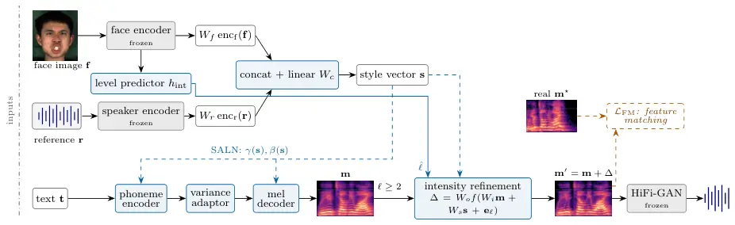

# EmoFI-TTS: Face-Conditioned Expressive Voice Synthesis with Intensity Modulation

Yejin
Jeon [](https://orcid.org/0009-0007-8802-2675),
Luel Hagos
Beyene [](https://orcid.org/0009-0005-9333-4396),
Marie
Maltais [](https://orcid.org/0009-0009-1362-0472),
Hyounghun
Kim [](https://orcid.org/0009-0008-3382-7510),
David Ifeoluwa
Adelani [](https://orcid.org/0000-0002-0193-2083)
^(†)^(†)thanks: ^(\*)Equal contribution. ^(†)Work done at Mila–Québec AI
Institute.

###### Abstract

Controlling emotional intensity remains challenging in expressive
text-to-speech synthesis, particularly when emotion must be inferred
without explicit labels. We propose EmoFI-TTS, a face-conditioned
framework that derives emotion category and intensity from a single
facial image while extracting speaker characteristics from reference
audio. Modality-specific representations are fused to condition a
pretrained speech synthesizer, with cross-speaker training encouraging
separation of affect and vocal identity. An intensity-conditioned
refinement module enhances the generated mel-spectrogram, while
interpolation of learned intensity embeddings enables continuous control
without additional training. On speaker-disjoint MEAD evaluation,
EmoFI-TTS¹¹ 1 https://github.com/luelhagos/Emofi achieves on average
64.4% and 75.2% objective and subjective emotion intensity accuracies,
while retaining low word error rate and high naturalness.

###### Index Terms: 

Face-to-speech, emotion generation, TTS

^(†)^(†)address: ¹Mila-Québec AI Institute ²McGill University ³NM-AIST  
⁴AIMS Research and Innovation Center ⁵CSE & GSAI, POSTECH ⁶Canada CIFAR
AI Chair

## 1 Introduction

Recent advances in text-to-speech (TTS) have substantially improved the
naturalness and intelligibility of synthetic speech \[16, 9\]. This
progress has shifted attention toward more human-like speech generation
by modeling paralinguistic factors such as emotion, with applications
spanning conversational agents, dubbing, and audiobook narration. Yet
achieving precise emotive control that generalizes across linguistic
content and speaker identity, without sacrificing naturalness or
intelligibility, remains an open challenge.

Existing expressive TTS systems typically condition emotion on manually
specified labels, learned style embeddings, or emotional reference
speech \[19\]. Such conditioning is effective in constrained settings
but ill-suited to interactive use: it demands either a hand-set
emotional tag for every utterance or a recording of the target speaker
already exhibiting the desired emotion. To reduce this reliance on
manual specification, recent work has used large language models (LLMs)
to infer a speaker’s emotional state from dialogue history \[8\]. This
strategy, however, inherits the ambiguity of text itself: identical
sentences can be uttered with different, even conflicting, emotional
intent. More fundamentally, none of these approaches capture how emotion
actually unfolds in real communication, where a single category such as
_happy_ spans a continuum from mild to exuberant, each level associated
with markedly different prosody, energy, and spectral emphasis.



Figure 1: System overview. Text, face image, and reference audio each
control content, emotion and its intensity, and speaker timbre,
respectively. Solid lines carry signal, blue dashed lines carry
conditioning, and the orange arrow is the feature-matching loss against
the real mel $`\mathbf{m}^{\star}`$, used only in training. At
inference, the emotion intensity level is predicted from the face.

Facial expression offers a natural resolution to these
limitations \[12\]. In face-to-face communication, a speaker’s
expression sets an auditory expectation before a word is even heard,
priming the listener for how the utterance should sound. Unlike text or
manually assigned labels, a facial expression conveys jointly _which_
emotion is intended and _how intensely_ it is felt. This observation
motivates an alternative conditioning paradigm, in which a facial image
supplies the affective intent of an utterance directly. While prior work
on face-to-speech synthesis has begun to explore visual
conditioning \[7, 21\], they have predominantly treated the face as a
proxy for speaker attributes such as timbre, leaving its affective role
underexplored. Additionally, existing methods do not model the
fine-grained emotion intensity, despite its centrality to perceived
expressiveness: a mildly happy face and an exuberantly happy face are
often mapped to the same high-level category, yet warrant markedly
different acoustic realizations. Modeling emotion category alone can
therefore yield speech that is semantically plausible but perceptually
flat or mismatched to the visual cue.

To address this gap, we propose EmoFI-TTS (Emotion-Face-Intensity-TTS),
an intensity-aware cross-modal framework for emotional speech synthesis.
Given a facial image and a reference utterance, EmoFI-TTS extracts an
affective category and intensity representation from the face and a
timbre representation from the audio. Cross-modal fusion between the two
modalities then conditions the backbone TTS model to generate an initial
mel-spectrogram. An intensity-conditioned modulation module then refines
the mel-spectrogram, reinforcing emotion-relevant acoustic patterns
while preserving speaker consistency. This refinement stage acts as a
targeted acoustic enhancement step, converting otherwise under-expressed
predictions into speech whose emotional strength faithfully matches the
facial cue.

This work makes three contributions. First, we formulate emotional
speech synthesis as a visually-conditioned, disentangled cross-modal
problem, in which facial information governs emotion category and
intensity while reference audio independently governs target-speaker
identity. To the best of our knowledge, this is the first work to
explicitly model facial emotion intensity for face-conditioned emotional
speech synthesis, moving beyond coarse categorical conditioning toward
fine-grained control over expressive strength. Second, the proposed
pipeline enables expressive speech generation and emotion transfer to
unseen speakers without requiring emotional recordings from the target
speaker. Third, subjective and objective evaluations show that this
fine-grained expressivity can be controlled without sacrificing the
intelligibility or naturalness of the generated speech.

## 2 Method

Problem Formulation. Given text $`\mathbf{t}`$, a face image
$`\mathbf{f}`$, and a reference utterance $`\mathbf{r}`$, we synthesize
speech $`\hat{\mathbf{x}}`$ whose content follows $`\mathbf{t}`$,
emotion category and intensity follow $`\mathbf{f}`$, and voice follows
$`\mathbf{r}`$. The backbone is a pretrained multi-speaker FastSpeech2
model \[15\] $`G`$, which generates speech conditioned on target text
and a speaker’s reference audio (Fig.1).

Affect and Timbre Learning To infer emotion category and intensity from
a speaker’s facial expression, we train an ImageNet-pretrained
ResNet-50 \[6\] encoder $`\mathrm{enc_{f}}`$ that maps a single face
frame to a $`768`$-d embedding,
$`\mathbf{e}_{f}=\mathrm{enc_{f}}(\mathbf{f})`$. Training aligns this
embedding against the audio-derived emotion representation of the
corresponding training speaker using emotion2vec \[13\], jointly with
auxiliary emotion- and intensity-classification heads. Once trained,
encoder $`\mathrm{enc_{f}}`$ is frozen thereafter. Independently, a
frozen ECAPA-TDNN \[3\] with least-squares erasure \[2\]
$`\mathrm{enc_{r}}`$ maps the reference utterance to a $`192`$-d timbre
embedding $`\mathbf{z}=\mathrm{enc_{r}}(\mathbf{r})`$. This separation
is deliberate: the face branch is trained to carry only affective
information, while the audio branch is trained to carry only speaker
identity. The two embeddings are then concatenated and linearly
projected into a single style vector:

```math
\mathbf{s}=W_{c}\,\big[\,W_{f}\,\mathbf{e}_{f}\,;\;W_{r}\,\mathbf{z}\,\big]\in\mathbb{R}^{128}, \tag{1}
```

which conditions the phoneme encoder and mel decoder of $`G`$ through
affine modulation.

As such, given text and style vector, $`G`$ produces an emotionally
salient mel-spectrogram $`\mathbf{m}=G(\mathbf{t},\mathbf{s})`$ in the
target speaker’s voice. The model is trained with the backbone model’s
original mel, pitch, energy, duration, and adversarial losses, and two
auxiliary terms for affective information learning:

```math
\mathcal{L}=\big(\mathcal{L}_{\text{mel}}+\mathcal{L}_{p}+\mathcal{L}_{e}+\mathcal{L}_{d}+\lambda_{\text{adv}}\mathcal{L}_{\text{adv}}\big)+\lambda_{\text{emo}}\mathcal{L}_{\text{emo}}+\lambda_{\text{int}}\mathcal{L}_{\text{int}}, \tag{2}
```

where $`\mathcal{L}_{\text{emo}}`$ and $`\mathcal{L}_{\text{int}}`$ are
cross-entropy losses computed by small classification heads reading
$`W_{f}\mathbf{e}_{f}`$ only
($`\lambda_{\text{emo}}{=}\lambda_{\text{int}}{=}0.1`$).

To further enforce the separation between affective and timbre learning,
half of training uses _cross-speaker_ pairing: the input face is swapped
for a _different_ speaker’s, matched only on ground-truth emotion
category and intensity label, while the reference audio continues to
identify the original target speaker. Since identity information from
the face is now mismatched with the target voice, it cannot serve as a
shortcut for reconstructing timbre, forcing speaker identity to route
exclusively through $`\mathrm{enc_{r}}`$.

Intensity-Aware Refinement. Since the decoder is trained to predict a
conditional-mean mel-spectrogram, it tends to over-smooth the spectral
texture, i.e., harmonicity, spectral flux, and energy, that
distinguishes weak from strong emotional expression. As a result,
emotion _category_ is well reproduced, but _intensity_ is often
under-rendered. This is addressed with a refinement module $`R`$ that is
applied after mel-spectrogram generation. Specifically, the
intensity-classification head from training is frozen and then reused as
an intensity predictor $`h_{\text{int}}`$ and the target level
$`\ell\in\{1,2,3\}`$ is inferred directly from the face embedding:
$`\hat{\ell}=\arg\max_{\ell}\,h_{\text{int}}(W_{f}\mathbf{e}_{f})_{\ell}`$.
$`R`$ then predicts a residual on the initial mel-spectrogram through a
level-gated correction:

```math
\mathbf{m}^{\prime}=\mathbf{m}+\mathds{1}[\ell\!\geq\!2]\,\Delta,\quad\Delta=W_{o}\,f\big(W_{i}\mathbf{m}+W_{s}\mathbf{s}+\mathbf{e}_{\ell}\big), \tag{3}
```

where $`f`$ is a stack of dilated convolutions, $`\mathbf{e}_{\ell}`$ is
a learned embedding of the intensity level, and $`W_{o}`$ is
zero-initialized so that $`R`$ starts as an identity map. Note that the
level enters the nonlinearity $`f`$ rather than scaling $`\Delta`$
directly, so each level produces a qualitatively distinct correction
rather than a uniform gain. Lowest intensity level ($`\ell{=}1`$)
bypasses $`R`$ entirely, since applying refinement was found to
measurably over-energize already-calm speech.

|           |      |       |                  |      |      |      |        |        |        |
| --------- | ---- | ----- | ---------------- | ---- | ---- | ---- | ------ | ------ | ------ |
| Model     | WER  | UTMOS | MOS              | L1   | L2   | L3   | L1-Sbj | L2-Sbj | L3-Sbj |
| Real (GT) | 6.6  | 2.86  | 3.98 $`\pm`$0.20 | 69.7 | 34.6 | 80.3 | 88.7   | 81.2   | 87.6   |
| EmoSpeech | 9.3  | 2.88  | 2.96 $`\pm`$0.26 | 42.6 | 56.0 | 18.8 | 63.5   | 46.3   | 33.8   |
| FaceTTS   | 16.3 | 2.46  | 2.65 $`\pm`$0.28 | 43.1 | 44.9 | 14.9 | 61.9   | 44.0   | 40.1   |
| Ours      | 6.9  | 3.14  | 3.25 $`\pm`$0.26 | 76.4 | 42.8 | 74.1 | 82.2   | 69.5   | 73.9   |

Table 1: Results across objective and subjective (Sbj) metrics. MOS
scores are reported with 95% confidence intervals.

Figure 2: Emotion visualizations of generated audio.

$`R`$ is trained with a weighted sum of four terms: a multi-scale LSGAN
loss \[14\]; a variance-matching term that restores the per-bin spectral
variance; an $`\ell_{1}`$ content anchor
$`\lVert\mathbf{m}^{\prime}-\mathbf{m}\rVert_{1}`$; and a speech-emotion
feature-matching loss,

```math
\mathcal{L}_{\mathrm{FM}}=\big\lVert\phi(\mathrm{voc}(\mathbf{m}^{\prime}))-\phi(\mathrm{voc}(\mathbf{m}^{\star}))\big\rVert_{1}, \tag{4}
```

where $`\phi`$ is an intermediate layer of a frozen wav2vec 2.0 \[1\],
$`\mathbf{m}^{\star}`$ is the ground-truth mel-spectrogram, and both
sides are passed through the same frozen universal HiFi-GAN
vocoder \[10\]. Although trained on three discrete levels, the learned
level embeddings also support continuous interpolation: for
$`t\in[1,3]`$ with $`k=\lfloor t\rfloor`$ and $`\alpha=t-k`$,

```math
\mathbf{e}(t)=(1-\alpha)\,\mathbf{e}_{k}+\alpha\,\mathbf{e}_{k+1}, \tag{5}
```

which substitutes for $`\mathbf{e}_{\ell}`$ in Eq. (3), with gate
bypassing at $`t{=}1`$.

## 3 Experimental Settings

Dataset. We use MEAD \[20\], a parallel audio-visual corpus recorded
across emotion categories and three intensity levels. Disgust and
contempt are excluded, as their facial action units and perception
substantially overlap with other emotions \[5\]. Two speakers are also
completely excluded due to unbalanced intensity coverage. The resulting
corpus comprises 18,270 utterances, split speaker-disjointly into
train/val/test of approximately 8:1:1. Each sample thus includes one
face frame extracted from the source video, 22.050 kHz audio, and a
transcript. However, since MEAD lacks ground-truth transcripts, we
manually identify its underlying set of 141 canonical sentences,
transcribe each utterance with Whisper-large \[17\], and then correct
transcriptions by matching against this set.

Training. Starting from the LibriTTS pretrained backbone TTS model
$`G`$, we further train the style-conditioning branches for 30k steps
with batch size 16 to learn emotion category and intensity from the
face. This is then frozen, and the refinement module $`R`$ is trained
separately for 15k steps. All training is conducted on a single NVIDIA
GH200.

Figure 3: Continuous intensity adjustment from mild to strong emotion
intensity. Dashed lines indicate real audio’s recall.

Evaluation. We evaluate along four axes, combining objective and
subjective metrics. (1) Intelligibility: word error rate (WER; %)
between the input text and the transcript of the synthesized speech,
obtained via automatic speech recognition with Whisper-large. (2)
Naturalness: UTMOS \[18\], a mean-opinion-score predictor for synthetic
speech quality. (3) Emotion and Intensity Accuracy: classification
accuracy from a Wav2Vec2 speech-emotion recognizer fine-tuned on MEAD.
(4) Human Evaluation: overall TTS quality, emotion-synthesis accuracy,
and speaker transfer are assessed with 15 annotators who were recruited
via Upwork.

Baselines. As this is the first attempt at generating emotional speech
at varying intensities directly from facial input, no existing method
targets the same task. We therefore adapt models from adjacent tasks for
comparison. EmoSpeech \[4\] synthesizes emotive speech conditioned on an
oracle ground-truth emotion label at inference, serving as an
upper-bound reference that bypasses visual inference entirely.
Furthermore, while FaceTTS \[11\] originally designed to predict voice
identity from a face, it is repurposed here to predict emotion intensity
from the face input.

## 4 Results

Table 1 compares the proposed model with EmoSpeech \[4\] and
FaceTTS \[11\] using objective and subjective measures. Unlike
EmoSpeech, which receives a ground-truth emotion label at synthesis
time, our model infers both emotion category and intensity from a single
facial image. Nevertheless, our model achieves higher unweighted
intensity accuracy ($`64.4`$ vs. $`39.1`$), demonstrating improved
intensity modeling without requiring emotion annotations at inference.
Among the baseline systems, our model also achieves the lowest WER
($`6.9\%`$) and the highest UTMOS score ($`3.14`$).

Human evaluations corroborate these improvements. Our model obtains the
highest naturalness MOS among the synthesis systems ($`3.25`$) and the
highest emotion-synthesis accuracy at each of the three intensity
levels. It also achieves a speaker-fidelity score of $`4.13`$. These
results support the model’s ability to convey the intended emotion while
retaining the reference speaker’s identity. The visualization in
Figure 2 provides complementary qualitative evidence, with generated
utterances forming distinguishable clusters corresponding to the
intended emotion categories. Beyond synthesis at discrete intensity
levels, the model also supports continuous intensity adjustment by
interpolating the learned level embeddings without additional training.
As seen in Figure 3, increasing the intensity variable $`t`$ raises
level-3 recall while reducing that of level-1.

|                           |      |      |      |              |
| ------------------------- | ---- | ---- | ---- | ------------ |
| System                    | L1   | L2   | L3   | Overall Acc. |
| Real audio                | 69.7 | 34.6 | 80.3 | 61.5         |
| Backbone (no refinement)  | 79.3 | 42.1 | 48.9 | 56.7         |
| + refine., face-predicted | 76.4 | 42.8 | 74.1 | 64.4         |
| + refine., oracle label   | 79.3 | 45.9 | 76.5 | 67.2         |

Table 2: Ablation of the intensity refinement module.

|                   |                       |                      |                   |                           |
| ----------------- | --------------------- | -------------------- | ----------------- | ------------------------- |
| Fusion            | Emo. Acc.$`\uparrow`$ | Int. Acc$`\uparrow`$ | WER$`\downarrow`$ | Spk. Transfer$`\uparrow`$ |
| cross-attn.       | 71.7                  | 55.0                 | 5.7               | 90.2                      |
| frame cross-attn. | 61.6                  | 48.3                 | 8.1               | 50.2                      |
| sum               | 71.2                  | 55.2                 | 5.8               | 90.8                      |
| concat$`+`$linear | 70.3                  | 56.7                 | 6.6               | 92.1                      |

Table 3: Fusion ablation. Speaker transfer is reported in percentages.
The adopted methodology is indicated in grey.

Furthermore, we quantify the effect of replacing ground-truth intensity
labels with face-predicted levels during synthesis (Table 2). The
resulting speech achieves an overall intensity accuracy of $`64.4\%`$,
compared with $`67.2\%`$ under oracle conditioning, which is a small gap
of $`2.8`$ percentage points. As such, to examine the contributions of
individual components to the proposed model’s performance, we conduct
several ablation experiments. First, we evaluate how facial emotion and
reference-audio vocal characteristics can effectively be fused into a
shared conditioning vector (Table 3). Concatenation followed by linear
projection achieves the highest intensity accuracy ($`56.7`$) before the
intensity refinement module and speaker transfer ($`92.1\%`$),
outperforming additive and attention-based fusion on these two
objectives. This design preserves separate feature blocks before
learning their joint contribution, consistent with the modalities’
complementary roles: the face specifies affect, whereas the reference
specifies speaker identity. As such, attention-based interactions may
introduce unnecessary coupling between these roles.

|               |        |                      |                |                 |                   |                   |
| ------------- | ------ | -------------------- | -------------- | --------------- | ----------------- | ----------------- |
| Backbone      | Refin. | Int. Acc$`\uparrow`$ | L3$`\uparrow`$ | SIM$`\uparrow`$ | WER$`\downarrow`$ | UTMOS$`\uparrow`$ |
| paired        | –      | 57.2                 | 43.7           | 77.9            | 5.2               | 3.17              |
| paired        | $`+`$  | 64.2                 | 65.9           | 78.8            | 5.4               | 3.17              |
| cross-speaker | –      | 56.7                 | 48.9           | 78.0            | 6.6               | 3.18              |
| cross-speaker | $`+`$  | 64.4                 | 74.1           | 78.5            | 6.9               | 3.14              |

Table 4: Ablations with cross-speaker training.

We further examine cross-speaker training, which pairs the reference
audio with a facial image from a different speaker while matching
emotion category and intensity. This strategy discourages reliance on
facial identity for voice reconstruction, encouraging the model to
derive affect from the face and timbre from the reference audio. As
shown in Table 4, cross-speaker training yields an increase in intensity
accuracy over paired training and a larger improvement in level-3
intensity ($`65.9\%`$ to $`74.1\%`$).

## 5 Conclusion

In this paper, we have presented EmoFI-TTS, a framework for expressive
speech synthesis that infers emotion category and intensity from a
single facial image while using reference audio to specify speaker
characteristics. Cross-speaker training encourages separation of affect
and vocal identity, while intensity-conditioned refinement improves
emotional expressiveness and supports continuous intensity adjustment
without additional training. Evaluations on speaker-disjoint MEAD data
demonstrate improved intensity accuracy, intelligibility, and
naturalness over the evaluated baselines. Together, these findings
establish facial affect as a promising conditioning signal for
fine-grained emotional speech synthesis without emotion annotations at
inference.

## 6 ACKNOWLEDGMENTS

This research was supported in part by the Natural Sciences and
Engineering Research Council (NSERC) of Canada and in part by the AI2050
program at Schmidt Sciences. Finally, we are grateful for the support
from IVADO and the Canada First Research Excellence Fund.

## 7 Compliance with Ethical Standards

This is a modeling study for which no ethical approval was required.

## References

- \[1\] A. Baevski, Y. Zhou, A. Mohamed, and M. Auli (2020) Wav2vec 2.0:
  a framework for self-supervised learning of speech representations. In
  Proc. NeurIPS, Cited by: §2.
- \[2\] N. Belrose, D. Schneider-Joseph, S. Ravfogel, R. Cotterell, E.
  Raff, and S. Biderman (2023) LEACE: perfect linear concept erasure in
  closed form. In Proc. NeurIPS, Cited by: §2.
- \[3\] B. Desplanques, J. Thienpondt, and K. Demuynck (2020)
  ECAPA-TDNN: Emphasized Channel Attention, Propagation and Aggregation
  in TDNN Based Speaker Verification. In Interspeech 2020,
  pp. 3830–3834. External Links:
  [Link](http://dx.doi.org/10.21437/Interspeech.2020-2650),
  [Document](https://dx.doi.org/10.21437/interspeech.2020-2650) Cited
  by: §2.
- \[4\] D. Diatlova and V. Shutov (2023) EmoSpeech: guiding FastSpeech2
  towards emotional text to speech. In Proc. 12th ISCA Speech Synthesis
  Workshop (SSW), Cited by: §3, §4.
- \[5\] S. Du, Y. Tao, and A. M. Martinez (2014) Compound facial
  expressions of emotion. Proceedings of the National Academy of
  Sciences 111 (15), pp. E1454–E1462. External Links:
  [Document](https://dx.doi.org/10.1073/pnas.1322355111),
  [Link](https://www.pnas.org/doi/abs/10.1073/pnas.1322355111),
  https://www.pnas.org/doi/pdf/10.1073/pnas.1322355111 Cited by: §3.
- \[6\] K. He, X. Zhang, S. Ren, and J. Sun (2016) Deep residual
  learning for image recognition. In Proc. CVPR, Cited by: §2.
- \[7\] Y. Jeon, Y. Kim, J. Lee, H. Kim, and G. Lee (2025) Progressive
  Facial Granularity Aggregation with Bilateral Attribute-based
  Enhancement for Face-to-Speech Synthesis. In Findings of the
  Association for Computational Linguistics: EMNLP 2025, C.
  Christodoulopoulos, T. Chakraborty, C. Rose, and V. Peng (Eds.),
  Suzhou, China, pp. 2799–2811. External Links:
  [Link](https://aclanthology.org/2025.findings-emnlp.152/),
  [Document](https://dx.doi.org/10.18653/v1/2025.findings-emnlp.152),
  ISBN 979-8-89176-335-7 Cited by: §1.
- \[8\] Y. Jeon, Y. Kim, J. Lee, and G. Lee (2025) Prompt-Guided
  Selective Masking Loss for Context-Aware Emotive Text-to-Speech. In
  Findings of the Association for Computational Linguistics: NAACL
  2025, L. Chiruzzo, A. Ritter, and L. Wang (Eds.), Albuquerque, New
  Mexico, pp. 638–650. External Links:
  [Link](https://aclanthology.org/2025.findings-naacl.38/),
  [Document](https://dx.doi.org/10.18653/v1/2025.findings-naacl.38),
  ISBN 979-8-89176-195-7 Cited by: §1.
- \[9\] Y. Jeon, Y. Kim, and G. G. Lee (2024) Enhancing Zero-Shot
  Multi-Speaker TTS with Negated Speaker Representations. In The
  Thirty-Eighth AAAI Conference on Artificial Intelligence (AAAI-24),
  Cited by: §1.
- \[10\] J. Kong, J. Kim, and J. Bae (2020) HiFi-GAN: generative
  adversarial networks for efficient and high fidelity speech synthesis.
  In Proc. NeurIPS, Cited by: §2.
- \[11\] J. Lee, J. S. Chung, and S. Chung (2023) Imaginary voice:
  face-styled diffusion model for text-to-speech. In Proc. ICASSP, Cited
  by: §3, §4.
- \[12\] S. Li and W. Deng (2022) Deep Facial Expression Recognition: A
  Survey. IEEE Transactions on Affective Computing 13 (03),
  pp. 1195–1215. External Links: ISSN 1949-3045,
  [Document](https://dx.doi.org/10.1109/TAFFC.2020.2981446),
  [Link](https://doi.ieeecomputersociety.org/10.1109/TAFFC.2020.2981446)
  Cited by: §1.
- \[13\] Z. Ma, Z. Zheng, J. Ye, J. Li, Z. Gao, S. Zhang, and X.
  Chen (2024) Emotion2vec: self-supervised pre-training for speech
  emotion representation. Proc. ACL Findings. Cited by: §2.
- \[14\] X. Mao, Q. Li, H. Xie, R. Y.K. Lau, Z. Wang, and S. P.
  Smolley (2017) Least Squares Generative Adversarial Networks. In ICCV,
  Vol. , pp. 2813–2821. Cited by: §2.
- \[15\] D. Min, D. B. Lee, E. Yang, and S. J. Hwang (2021)
  Meta-StyleSpeech : Multi-Speaker Adaptive Text-to-Speech Generation.
  ICML abs/2106.03153. External Links:
  [Link](https://api.semanticscholar.org/CorpusID:235359041) Cited by:
  §2.
- \[16\] V. Popov, I. Vovk, V. Gogoryan, T. Sadekova, and M.
  Kudinov (2021) Grad-TTS: A Diffusion Probabilistic Model for
  Text-to-Speech. In Proceedings of the 38th International Conference on
  Machine Learning, External Links:
  [Link](https://arxiv.org/abs/2105.06337) Cited by: §1.
- \[17\] A. Radford, J. W. Kim, T. Xu, G. Brockman, C. McLeavey, and I.
  Sutskever (2023) Robust speech recognition via large-scale weak
  supervision. In Proc. ICML, Cited by: §3.
- \[18\] T. Saeki, D. Xin, W. Nakata, T. Koriyama, S. Takamichi, and H.
  Saruwatari (2022) UTMOS: UTokyo-SaruLab System for VoiceMOS Challenge 2022. In Interspeech, Cited by: §3.
- \[19\] J. Shi, H. Du, Y. He, Y. A. Hong, and Y. Gao (2026)
  Emotion-Aligned Generation in Diffusion Text to Speech Models Via
  Preference-Guided Optimization. In ICASSP, pp. 16492–16496. External
  Links:
  [Document](https://dx.doi.org/10.1109/ICASSP55912.2026.11464274) Cited
  by: §1.
- \[20\] K. Wang, Q. Wu, L. Song, Z. Yang, W. Wu, C. Qian, R. He, Y.
  Qiao, and C. C. Loy (2020) MEAD: A Large-Scale Audio-Visual Dataset
  for Emotional Talking-Face Generation. In ECCV 2020, pp. 700–717.
  External Links: ISBN 978-3-030-58588-4 Cited by: §3.
- \[21\] J. Ye, B. Cao, and H. Shan (2025) Emotional Face-to-Speech. In
  ICML, External Links: [Link](https://arxiv.org/abs/2502.01046) Cited
  by: §1.
