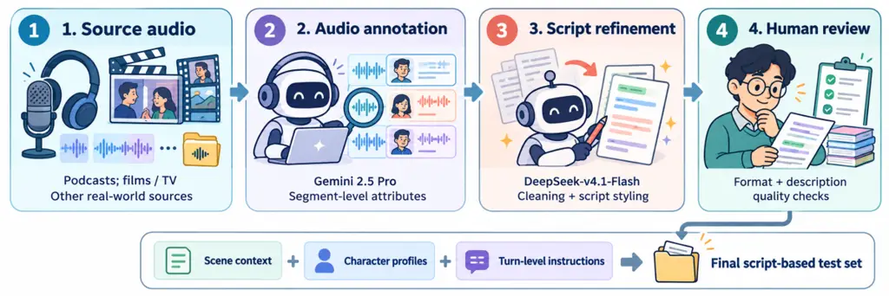

![[Uncaptioned
image]](arxiv-2610-31796v1--bc65e410f433.figures/figure-1.webp)

# DRAMA-Eval: A Benchmark for Context-Aware, Multi-Turn, Multi-Speaker Speech Generation

Jingbin Hu Affiliation: Audio, Speech and Language Processing Group
(ASLP@NPU)School of Computer Science, Northwestern Polytechnical
University    Zihang Yang Affiliation: Audio, Speech and Language
Processing Group (ASLP@NPU)School of Computer Science, Northwestern
Polytechnical University    Xiaoge Peng Affiliation: Shenzhen Pimei
Technology Co., Ltd.    Haoyu Zhang Affiliation: Audio, Speech and
Language Processing Group (ASLP@NPU)School of Computer Science,
Northwestern Polytechnical University    Ziyu Zhang Affiliation: Audio,
Speech and Language Processing Group (ASLP@NPU)School of Computer
Science, Northwestern Polytechnical University    Qirui Zhan
Affiliation: Audio, Speech and Language Processing Group
(ASLP@NPU)School of Computer Science, Northwestern Polytechnical
University    Huakang Chen Affiliation: Audio, Speech and Language
Processing Group (ASLP@NPU)School of Computer Science, Northwestern
Polytechnical University    Zhao Guo Affiliation: Audio, Speech and
Language Processing Group (ASLP@NPU)School of Computer Science,
Northwestern Polytechnical University    Wenjie Tian Affiliation: Audio,
Speech and Language Processing Group (ASLP@NPU)School of Computer
Science, Northwestern Polytechnical University    Kangxiang Xia
Affiliation: Audio, Speech and Language Processing Group
(ASLP@NPU)School of Computer Science, Northwestern Polytechnical
University    Wenkang Hou Affiliation: Audio, Speech and Language
Processing Group (ASLP@NPU)School of Computer Science, Northwestern
Polytechnical University    Ruonan You Affiliation: Audio, Speech and
Language Processing Group (ASLP@NPU)School of Computer Science,
Northwestern Polytechnical University    Zihan Liu Affiliation: Audio,
Speech and Language Processing Group (ASLP@NPU)School of Computer
Science, Northwestern Polytechnical University    Chenyi Liao
Affiliation: Audio, Speech and Language Processing Group
(ASLP@NPU)School of Computer Science, Northwestern Polytechnical
University    Hongyu Lyu Affiliation: Audio, Speech and Language
Processing Group (ASLP@NPU)School of Computer Science, Northwestern
Polytechnical University    Zihao Bai Affiliation: Audio, Speech and
Language Processing Group (ASLP@NPU)School of Computer Science,
Northwestern Polytechnical University    Jinrui Liang
Affiliation: Audio, Speech and Language Processing Group
(ASLP@NPU)School of Computer Science, Northwestern Polytechnical
University    Shengming Lin Affiliation: Audio, Speech and Language
Processing Group (ASLP@NPU)School of Computer Science, Northwestern
Polytechnical University    Yunxiang Chen Affiliation: Shenzhen Pimei
Technology Co., Ltd.    Houdun Liu Affiliation: Shenzhen Pimei
Technology Co., Ltd.    Su Feng Affiliation: Shenzhen Pimei Technology
Co., Ltd.    Bengu Wu Affiliation: Yutu Zhineng    Liumeng Xue
Affiliation: Audio, Speech and Language Processing Group
(ASLP@NJU)School of Intelligence Science and Technology, Nanjing
University    Lei Xie Affiliation: Audio, Speech and Language Processing
Group (ASLP@NPU)School of Computer Science, Northwestern Polytechnical
University

###### Abstract

Recent advances in speech generation are shifting toward context-aware,
multi-turn, and multi-speaker synthesis. While these capabilities are in
high demand for applications such as audiobook and audio drama
production, evaluation has not kept pace with these advances. Beyond
traditional zero-shot Text-to-Speech (TTS), modern systems in this
domain primarily fall into three categories: instruction-controllable
generation models, multi-turn dialogue models, and the audio branches of
audio-visual generation models. However, existing benchmarks evaluate
these paradigms in isolation, failing to provide a unified assessment of
context modeling, instruction following, and multi-speaker generation.
Meanwhile, recent progress in audio understanding models has made it
feasible to evaluate such complex scenarios using LLM-as-a-Judge
approaches. To bridge this gap, we introduce DRAMA-Eval, a comprehensive
benchmark for evaluating such systems. DRAMA-Eval utilizes structured
script contexts and offers a holistic evaluation framework covering
objective, local, and global aspects of generation quality, enabling the
assessment of acoustic fidelity, sentence-level execution, and
long-range coherence. We benchmark leading open-source and commercial
models on a human-verified dataset. The results reveal critical
weaknesses in long-range speaker consistency and implicit instruction
following that require deep contextual understanding. To facilitate
reproducible research, we release a 12-hour bilingual (Chinese-English)
test set of manually corrected real-world scripts, accompanied by
ground-truth audio, evaluation code, and benchmark results.

>

|                                                                                                          |                                                                                                                            |
| -------------------------------------------------------------------------------------------------------- | -------------------------------------------------------------------------------------------------------------------------- |
|                                                                                                          | [https://github.com/ASLP-lab/DRAMA-Eval](https://github.com/ASLP-lab/DRAMA-Eval)                                           |
|                                                                                                          | [https://huggingface.co/datasets/ASLP-lab/DRAMA-Eval](https://huggingface.co/datasets/ASLP-lab/DRAMA-Eval)                 |
| [ ](https://huggingface.co/datasets/ASLP-lab/DRAMA-Eval-Results)                                         | [https://huggingface.co/datasets/ASLP-lab/DRAMA-Eval-Results](https://huggingface.co/datasets/ASLP-lab/DRAMA-Eval-Results) |
| [](https://ASLP-lab.github.io/DRAMA-Eval-Demo) | [https://ASLP-lab.github.io/DRAMA-Eval-Demo](https://ASLP-lab.github.io/DRAMA-Eval-Demo)                                   |

^(†)^(†)footnotetext: ^(∗) Equal contribution (joint first authors).
^(†) Corresponding authors.

## 1 Introduction

Driven by applications such as audiobook and audio drama production,
speech generation is rapidly shifting toward script-driven synthesis.
This shift calls for holistic evaluation spanning local instruction
execution to long-range scene coherence.

Over the past few years, speech synthesis has evolved through several
key paradigms. Early zero-shot Text-to-Speech (TTS) models Wang et al.
(2023); Du et al. (2024a); Du et al. (2024b); Du et al. (2025); Wang
et al. (2025a); Ye et al. (2025); Deng et al. (2025); Zhou et al.
(2026a); Zhou et al. (2025); Zhou et al. (2026b); Zhang et al. (2026a);
Chen et al. (2025); Wang et al. (2025b); Team (2026b); Zhu et al.
(2026); Lian et al. (2026); Shen et al. (2026a) primarily focused on
cloning target voice identities from short reference audio clips.
Subsequent work extended this capability to multi-speaker dialogue
synthesis Zhang et al. (2026b); Xie et al. (2025a); Peng et al. (2025);
Xie et al. (2025b), prioritizing natural turn-taking dynamics in
conversational settings. To enhance controllability and expressiveness,
instruction-following models Zhou et al. (2026b); Team (2026b); Shen
et al. (2026a); Huang et al. (2026); Hu et al. (2026a) introduced
explicit textual prompts for emotion and style steering. Concurrently,
voice control models Zhou et al. (2026b) enabled the decoupling of vocal
identity from acoustic style, preserving the original timbre while
dynamically modifying emotional tone or delivery. Most recently,
Context-Aware TTS models Xue et al. (2026); Hu et al. (2026b); Shen
et al. (2026b); Tian et al. (2026); Han et al. (2026) have emerged,
leveraging surrounding dialogue history as implicit contextual cues to
produce scene-adaptive speech.

In parallel, the audio branches of audio-visual generation models Yu
et al. (2026); HaCohen et al. (2026); MiniMax AI (2026), further reflect
the trend toward context-aware, multi-turn, multi-speaker speech
generation.

Despite these technological advances, a fundamental disconnect exists
between existing model capabilities and evaluation methodologies. On the
one hand, instruction-following models accept rich character and scene
descriptions, yet they target isolated utterances or short speech clips.
On the other hand, current open-source multi-turn dialogue models
preserve speaker identity across turns but primarily condition on plain
transcripts and speaker IDs rather than structured, script-level
context. In the meanwhile, the evaluation of the audio branches of
audio-visual generation models remains limited. Current assessments
predominantly focus on surface-level acoustic properties, such as audio
quality, intelligibility, and basic expressiveness Tjandra et al.
(2025), while overlooking higher-level capabilities essential for
complex multi-turn scenarios, including contextual instruction
following, natural multi-speaker turn-taking, and speaker identity
consistency over extended durations.

To address these limitations, we propose DRAMA-Eval, a benchmark
designed to systematically evaluate multi-turn, multi-speaker speech
generation with structured script context Xia et al. (2026). Unlike
prior benchmarks that isolate instruction following, utterance-level
expressiveness, multi-turn generation, or speaker similarity, DRAMA-Eval
provides a unified evaluation protocol that jointly measures objective
fidelity, local execution quality, and global consistency. This design
enables comprehensive assessment of whether models can understand
structured context, follow implicit and explicit instructions, maintain
speaker identity across extended interactions, and preserve coherence
throughout an entire scene. Furthermore, DRAMA-Eval incorporates A and B
preference testing against ground-truth audio using LLM-as-a-Judge
approaches Manku et al. (2025), offering a more reliable evaluation
protocol for complex dramatic generation. In this way, our benchmark
fills a key evaluation gap and supports progress toward production-grade
narrative speech generation.

Our main contributions are summarized as follows:

- •
  We build and release DRAMA-Eval, including a 12-hour bilingual
  (Chinese-English) test set of manually corrected real-world scripts
  paired with ground-truth audio, broadly sourced from diverse scenarios
  such as films and TV dramas, podcasts, interviews and so on, and
  designed for evaluating context-aware, multi-turn, multi-speaker
  speech generation.
- •
  We propose a holistic evaluation protocol spanning objective, local,
  and global aspects of generation quality. In particular, we adopt
  LLM-as-a-judge with A and B preference comparisons against
  ground-truth audio to compute win rates, and further validate the
  reliability of this protocol through human consistency studies.
- •
  We systematically benchmark a diverse set of leading open-source and
  commercial models, providing a comprehensive analysis of current
  speech generation systems and revealing persistent weaknesses in
  long-range consistency and context-driven implicit instruction
  following.

## 2 Related Work

|                                     |        |                                                                |                 |                |                |                |
| ----------------------------------- | ------ | -------------------------------------------------------------- | --------------- | -------------- | -------------- | -------------- |
| Benchmark                           | Lang.  | Context / conditioning                                         | Evaluation unit | Instr.         | Identity       | Scene          |
| InstructTTSEval Huang et al. (2025) | EN, ZH | Acoustic, style, and role instructions                         | Utterance       | $`\checkmark`$ | –              | –              |
| MINT-Bench Chen et al. (2026)       | 10     | Attribute and style instructions                               | Utterance       | $`\checkmark`$ | –              | –              |
| CEAEval Wang et al. (2026)          | ZH     | Narrative context for a target utterance                       | Utterance       | –              | –              | –              |
| SwanBench-Speech Pan et al. (2026)  | EN, ZH | Long-form texts and speaker-labeled dialogues                  | Sequence        | –              | $`\checkmark`$ | $`\checkmark`$ |
| DRAMA-Eval (ours)                   | EN, ZH | Scene context, character profiles, and turn-level instructions | Scene           | $`\checkmark`$ | $`\checkmark`$ | $`\checkmark`$ |

Table 1: Comparison with related benchmarks. Instr.:
instruction-following evaluation; Identity: cross-utterance speaker
consistency; Scene: complete multi-speaker interaction evaluation.
$`\checkmark`$ indicates a dedicated evaluation target; “–” indicates
otherwise.

### 2.1 History of Speech Generation Evaluation

Speech generation evaluation has traditionally emphasized acoustic
quality, intelligibility, and speaker similarity. Recent benchmarks
extend this scope to controllability and contextual expressiveness.
InstructTTSEval and MINT-Bench Huang et al. (2025); Chen et al. (2026)
evaluate natural-language instruction following across acoustic and
stylistic attributes, while VStyle Zhan et al. (2025) examines voice
style adaptation to spoken instructions, including acoustic control,
role-play, and implicit empathy. CAST Turetzky et al. (2026) evaluates
discourse-conditioned prosodic emphasis, and CEAEval Wang et al. (2026)
assesses whether expressive delivery matches the communicative intent
implied by narrative context. Speech-DRAME Shi et al. (2025) further
evaluates speech role-play through archetype-oriented and human-grounded
realism assessments, incorporating character profiles, scene
descriptions, and human-aligned evaluation models. These studies
establish that expressive quality depends on both the requested delivery
and its contextual appropriateness.

Evaluation has also expanded to long-form speech and multi-turn
dialogue. SwanBench-Speech Pan et al. (2026) covers diverse long-form
and dialogue scenarios through acoustic, semantic, and expressive
dimensions, including acoustic consistency, prosodic coherence, and
expressive hierarchy. MSBench Xu et al. (2026) evaluates one-pass
multi-speaker dialogue generation through character adherence, emotional
expression, acoustic quality, topic relevance, and dialogue structure.
TTSD-eval Zhang et al. (2026b) examines speaker similarity in
multi-speaker dialogue. More directly related to dramatic performance,
SceneTTS-Bench Geng et al. (2026) evaluates drama dubbing through
cross-turn timbre consistency, emotional expressiveness, and rhythm
coherence. Together, these benchmarks demonstrate that long-form
evaluation already encompasses consistency, expressive dynamics, and
interaction-level requirements.

### 2.2 LLM-as-a-Judge for Speech Generation Evaluation

Large audio-language models have increasingly been adopted as automated
judges to assess speech generation beyond conventional objective
metrics. Existing benchmarks instantiate this LLM-as-a-judge paradigm
with different judge models, evaluation criteria, and judgment
protocols.

InstructTTSEval Huang et al. (2025) employs Gemini 2.5 Pro Preview as
the judge to assess instruction following across acoustic-parameter
specification, descriptive-style directives, and role-play, focusing on
whether generated speech realizes the requested acoustic and expressive
characteristics. EmergentTTS-Eval Manku et al. (2025) uses Gemini 2.5
Pro as the primary judge to compare candidate speech against a reference
system across six categories covering emotion, paralinguistics, and
challenging linguistic phenomena. AnyAudio-Judge Li et al. (2026)
instead trains a dedicated audio-language judge based on Qwen3-Omni Team
(2025) to assess fine-grained instruction, audio alignment across
speech, sound, music, and mixed audio. Guided by LLM-generated rubrics,
the judge verifies individual instruction requirements and aggregates
their satisfaction probabilities into an interpretable alignment score.
Together, these studies establish model-based judging as a scalable
evaluation approach, while illustrating how judge selection and
evaluation protocols can be tailored to different aspects of generated
audio.

## 3 DRAMA-Eval

### 3.1 Task Definition and Problem Formulation



Figure 1: Data construction pipeline of DRAMA-Eval, comprising
real-world audio collection, automatic annotation, script refinement,
and human review.

Figure 2: Distributions of audio sources, scene categories, speaker
counts, and turn counts in DRAMA-Eval. All values are percentages.

Existing speech generation paradigms emphasize different capabilities,
leaving their joint realization in extended, multi-speaker scenes
insufficiently examined. Dialogue TTS supports multi-speaker generation,
but its ability to execute expressive instructions and deliver
context-appropriate performances requires closer evaluation.
Instruction-controllable TTS offers fine-grained control over individual
utterances, yet utterance-level success does not establish multi-turn
speaker consistency or natural transitions between separately
synthesized turns. Joint audio-visual generation models provide another
route to expressive, immersive scenes, while raising questions about
sustained dialogue generation and consistent character voices over
longer durations. These complementary strengths and limitations motivate
a shared evaluation setting: can a system jointly maintain character
identity, realize expressive instructions, and sustain coherent
interactions throughout an extended scene?

As summarized in Table 1, DRAMA-Eval judges this question through
multi-turn, multi-speaker speech generation conditioned on structured
scripts. Its purpose is to expose capability gaps that may remain hidden
when instruction following, speaker consistency, and perceptual quality
are evaluated separately.

Formally, a structured script is represented as

```math
\mathcal{S}=\left(c,\mathcal{R},\{(r_{t},x_{t},u_{t})\}_{t=1}^{T}\right),
```

where $`c`$ specifies the scene context, $`\mathcal{R}`$ contains
character descriptions, $`r_{t}`$ identifies the speaker of turn $`t`$,
$`x_{t}`$ is the target text, and $`u_{t}`$ specifies the associated
local instructions.

Given $`\mathcal{S}`$ and optional speaker-reference audio
$`\mathcal{A}_{\mathrm{ref}}`$ when supported, a system generates a
scene-level audio output:

```math
Y\sim p_{\theta}\left(Y\mid\mathcal{S},\mathcal{A}_{\mathrm{ref}}\right).
```

The output should realize the scripted content and speaker assignments.

### 3.2 DRAMA-Eval: Methods

The evaluation target is the complete scene audio, whether produced
through native dialogue generation or assembled from utterance-level
outputs. This allows DRAMA-Eval to assess both local synthesis quality
and discontinuities introduced across turns. We organize evaluation into
three levels: objective measures of textual fidelity and speaker
consistency; local judgments of instruction following, prosody, and
expressive delivery; and global judgments of interaction naturalness,
overall fluency, and scene immersion.

Following the pairwise evaluation paradigm, we compare model-generated
speech with the corresponding real-world reference audio under the same
evaluation criterion. The two audio samples are presented as A and B
without revealing their sources, together with the relevant textual and
contextual information. Rather than assigning an absolute score, the
judge determines which sample better satisfies the target criterion or
declares a tie. We aggregate these decisions into a tie-adjusted win
rate, following the general pairwise evaluation principle used by
EmergentTTS-Eval Manku et al. (2025), while using real-world audio as
the reference. For a candidate system $`s`$, we define

```math
\mathrm{WinRate}(s)=\frac{N_{\mathrm{win}}+0.5N_{\mathrm{tie}}}{N_{\mathrm{comparisons}}},
```

where $`N_{\mathrm{win}}`$ counts comparisons in which the
model-generated audio is preferred over the corresponding real-world
audio, $`N_{\mathrm{tie}}`$ counts ties, and
$`N_{\mathrm{comparisons}}`$ is the total number of valid comparisons. A
win rate of $`0.5`$ indicates parity with the real-world reference under
the specified criterion and judging protocol; higher or lower values
indicate a preference for generated or real-world audio, respectively.
We report win rates separately for each evaluation dimension to
distinguish instruction following, expressive delivery, and
interaction-level quality.

To assess the reliability of Gemini 3.8 Flash Google DeepMind (2026) as
our automated judge, we validate its judgments against human subjective
preferences. We also evaluate each audio pair twice with the A and B
order reversed, counting a system as the winner only when its output is
preferred in both presentations. This consistency requirement mitigates
position bias and reduces sensitivity to presentation order.
Furthermore, we average the resulting win rates across multiple
independent evaluation runs to reduce variability in the judge’s
responses. Together, human agreement validation, order-swapped
comparisons, and repeated evaluation provide a more reliable basis for
system comparison.

### 3.3 DRAMA-Eval: Dataset

#### Diverse real-world sources.

DRAMA-Eval is constructed from Chinese and English audio collected from
diverse real-world sources, primarily podcasts and films or television
series. Additional sources include interviews, news broadcasts, everyday
conversations, livestream commerce, audiobooks, and advertisements. The
film and television material spans genres such as historical drama,
espionage, contemporary drama, and suspense. These sources cover both
conversational and performed speech, providing varied character roles,
expressive styles, and interactional contexts.

#### Segment-level audio annotation.

We first use Gemini 2.5 Pro to annotate speaker-related attributes and
local delivery characteristics for each speech segment. These
annotations describe the voices and expressive behaviors observed in the
source audio and provide the basis for constructing the evaluation
scripts. This approach connects script-level descriptions and delivery
requirements to real-world speech performances.

#### Structured script construction.

We subsequently use DeepSeek-v4.1-Flash DeepSeek-AI (2026) to clean the
Gemini annotations and rewrite them into a consistent script format. The
resulting scripts organize the information at three levels: global scene
context, character profiles, and local delivery instructions associated
with individual utterances. This organization provides generation
systems with both the broader context of a scene and the specific
expressive requirements of each turn.

#### Human quality control.

Human reviewers inspect the resulting scripts for format compliance and
the quality and suitability of their descriptions. The reviewed scripts
form the final test inputs, while the corresponding real-world audio
serves as the reference for evaluation. Figure 1 summarizes the
construction process.

#### Dataset statistics.

DRAMA-Eval contains 1,038 cases, comprising 537 Chinese and 501 English
cases. The source audio totals 12.50 hours, including 10.65 hours of
annotated speech across 7,530 utterance-level turns. Each case lasts
43.36 seconds and contains 7.25 turns on average, while individual turns
average 5.09 seconds. Cases contain one to four speakers and between 2
and 20 turns. Multi-speaker cases account for 65.6% of the dataset, with
two-speaker cases forming the largest group (478 cases). Most cases
(68.0%) contain 6–10 turns, enabling evaluation across successive
utterances rather than isolated sentences. The dataset covers four
evaluation categories: Normal (528 cases), Escalation (149), Contrast
(162), and Rich Emotions (199). Turn-level emotion annotations include
calm speech, sadness, happiness, anger, fear, surprise, and disgust.
Figure 2 summarizes the distributions of evaluation categories, speaker
counts, turn counts, and emotions.

## 4 Experiments

|                                  |                  |                           |                          |                          |                          |                          |                          |                          |
| -------------------------------- | ---------------- | ------------------------- | ------------------------ | ------------------------ | ------------------------ | ------------------------ | ------------------------ | ------------------------ |
| Model                            | A1$`\downarrow`$ | A2$`\uparrow`$            | B1$`\uparrow`$           | B2$`\uparrow`$           | B3$`\uparrow`$           | C1$`\uparrow`$           | C2$`\uparrow`$           | C3$`\uparrow`$           |
| SeedAudio ByteDance (2026)       | 2.58             | $`0.74\pm 0.05`$          | $`\mathbf{62.2}\pm 0.4`$ | $`57.4\pm 0.2`$          | $`\mathbf{64.2}\pm 0.6`$ | $`\mathbf{67.4}\pm 0.7`$ | $`\mathbf{73.2}\pm 0.4`$ | $`\mathbf{75.7}\pm 1.1`$ |
| StepAudio 3 Gen Team (2026c)     | 3.78             | $`0.76\pm 0.05`$          | $`57.3\pm 0.6`$          | $`\mathbf{58.3}\pm 0.3`$ | $`56.9\pm 0.2`$          | $`60.2\pm 1.7`$          | $`64.7\pm 1.5`$          | $`64.6\pm 1.4`$          |
| MiniMax-H3 MiniMax AI (2026)     | 3.84             | $`0.58\pm 0.12`$          | $`56.6\pm 0.2`$          | $`57.9\pm 0.2`$          | $`57.6\pm 0.3`$          | $`49.7\pm 0.1`$          | $`42.2\pm 0.8`$          | $`43.2\pm 0.6`$          |
| Qwen3-TTS (VD) Team (2026b)      | 2.73             | $`0.59\pm 0.08`$          | $`59.7\pm 0.2`$          | $`54.6\pm 0.5`$          | $`60.6\pm 0.5`$          | $`40.0\pm 0.0`$          | $`28.2\pm 0.0`$          | $`27.7\pm 0.0`$          |
| FireRedTTS3 Shen et al. (2026a)  | 2.64             | $`0.62\pm 0.07`$          | $`52.1\pm 0.3`$          | $`55.1\pm 0.4`$          | $`50.4\pm 0.7`$          | $`39.8\pm 0.7`$          | $`31.9\pm 0.8`$          | $`30.7\pm 1.4`$          |
| VoxCPM2 Zhou et al. (2026b)      | 3.25             | $`0.67\pm 0.06`$          | $`48.1\pm 0.5`$          | $`48.6\pm 0.3`$          | $`48.0\pm 0.7`$          | $`36.4\pm 0.2`$          | $`29.8\pm 0.5`$          | $`29.1\pm 0.8`$          |
| MiMo-Audio-7B Xiaomi (2025)      | 5.17             | $`0.55\pm 0.08`$          | $`36.8\pm 1.1`$          | $`34.8\pm 1.2`$          | $`37.0\pm 1.3`$          | $`24.2\pm 0.2`$          | $`10.8\pm 0.2`$          | $`10.9\pm 0.1`$          |
| MOSS-TTSD Zhang et al. (2026b)   | 4.06             | $`\mathbf{0.78}\pm 0.04`$ | $`--`$                   | $`46.6\pm 0.2`$          | $`35.9\pm 1.1`$          | $`38.1\pm 0.5`$          | $`38.8\pm 0.2`$          | $`35.2\pm 0.7`$          |
| SoulX-Podcast Xie et al. (2025a) | 2.74             | $`0.78\pm 0.04`$          | $`--`$                   | $`40.7\pm 0.5`$          | $`27.1\pm 0.4`$          | $`35.4\pm 0.6`$          | $`31.3\pm 0.6`$          | $`27.7\pm 0.4`$          |
| VibeVoice Peng et al. (2025)     | 5.62             | $`0.68\pm 0.07`$          | $`--`$                   | $`35.0\pm 0.6`$          | $`31.8\pm 0.2`$          | $`28.7\pm 0.9`$          | $`22.4\pm 0.5`$          | $`21.5\pm 0.6`$          |
| FireRedTTS2 Xie et al. (2025b)   | 3.01             | $`0.73\pm 0.05`$          | $`--`$                   | $`39.5\pm 0.6`$          | $`28.8\pm 0.3`$          | $`31.7\pm 1.0`$          | $`27.4\pm 1.3`$          | $`25.8\pm 1.0`$          |
| Higgs Audio V2 Boson AI (2025)   | 8.43             | $`0.70\pm 0.07`$          | $`--`$                   | $`24.1\pm 0.1`$          | $`19.8\pm 0.4`$          | $`23.7\pm 0.2`$          | $`13.4\pm 0.6`$          | $`12.4\pm 0.2`$          |

Table 2: DRAMA-Eval results on Chinese. Objective metrics: A1 measures
textual fidelity using character error rate (CER, %; lower is better);
A2 measures speaker consistency across utterances (higher is better).
Local evaluation: B1 assesses instruction following, B2 assesses
utterance-level prosody and fluency, and B3 assesses local expressive
delivery. Global evaluation: C1 assesses interaction naturalness, C2
assesses overall fluency across turns, and C3 assesses scene immersion.
B1–C3 are LALM-evaluated, tie-adjusted win rates against the
corresponding real-world audio, reported in percentage points with the %
sign omitted; 50 indicates parity with the reference under the
evaluation protocol. These scores are averaged over three independent
evaluation runs, with accompanying $`\pm`$ values indicating run-to-run
variability. Dashes indicate that instruction-following evaluation is
not reported for models without an instruction-control interface. Best
mean results are highlighted in bold.

|                                  |                  |                           |                          |                          |                          |                          |                          |                          |
| -------------------------------- | ---------------- | ------------------------- | ------------------------ | ------------------------ | ------------------------ | ------------------------ | ------------------------ | ------------------------ |
| Model                            | A1$`\downarrow`$ | A2$`\uparrow`$            | B1$`\uparrow`$           | B2$`\uparrow`$           | B3$`\uparrow`$           | C1$`\uparrow`$           | C2$`\uparrow`$           | C3$`\uparrow`$           |
| SeedAudio ByteDance (2026)       | 4.45             | $`0.68\pm 0.07`$          | $`\mathbf{56.5}\pm 0.8`$ | $`\mathbf{50.5}\pm 0.2`$ | $`\mathbf{57.0}\pm 0.7`$ | $`\mathbf{56.8}\pm 1.0`$ | $`\mathbf{54.5}\pm 0.4`$ | $`\mathbf{55.7}\pm 0.8`$ |
| StepAudio 3 Gen Team (2026c)     | 6.00             | $`0.67\pm 0.10`$          | $`48.5\pm 0.4`$          | $`48.1\pm 0.4`$          | $`45.2\pm 0.2`$          | $`43.4\pm 0.5`$          | $`33.8\pm 0.6`$          | $`33.6\pm 0.5`$          |
| MiniMax-H3 MiniMax AI (2026)     | 10.56            | $`0.44\pm 0.16`$          | $`50.9\pm 0.3`$          | $`\mathbf{50.5}\pm 0.2`$ | $`51.6\pm 0.6`$          | $`37.8\pm 0.3`$          | $`22.4\pm 0.6`$          | $`23.9\pm 0.9`$          |
| Qwen3-TTS (VD) Team (2026b)      | 4.16             | $`0.40\pm 0.10`$          | $`46.9\pm 0.3`$          | $`48.3\pm 0.3`$          | $`44.5\pm 0.3`$          | $`34.3\pm 0.0`$          | $`16.1\pm 0.0`$          | $`15.0\pm 0.0`$          |
| FireRedTTS3 Shen et al. (2026a)  | 3.97             | $`0.47\pm 0.09`$          | $`37.0\pm 0.2`$          | $`46.2\pm 0.4`$          | $`30.7\pm 0.3`$          | $`30.9\pm 1.1`$          | $`13.2\pm 0.6`$          | $`11.5\pm 0.5`$          |
| VoxCPM2 Zhou et al. (2026b)      | 8.77             | $`0.69\pm 0.06`$          | $`32.5\pm 0.4`$          | $`37.9\pm 0.0`$          | $`28.5\pm 0.7`$          | $`28.9\pm 0.6`$          | $`16.7\pm 0.4`$          | $`14.8\pm 0.6`$          |
| MiMo-Audio-7B Xiaomi (2025)      | 9.12             | $`0.45\pm 0.09`$          | $`28.3\pm 0.3`$          | $`28.5\pm 0.2`$          | $`25.5\pm 0.1`$          | $`24.6\pm 0.3`$          | $`5.9\pm 0.5`$           | $`6.3\pm 0.7`$           |
| MOSS-TTSD Zhang et al. (2026b)   | 6.03             | $`\mathbf{0.77}\pm 0.04`$ | $`--`$                   | $`40.4\pm 0.3`$          | $`23.5\pm 0.2`$          | $`31.4\pm 0.3`$          | $`25.3\pm 0.8`$          | $`18.9\pm 0.7`$          |
| SoulX-Podcast Xie et al. (2025a) | 4.50             | $`0.76\pm 0.05`$          | $`--`$                   | $`32.1\pm 0.4`$          | $`16.7\pm 0.1`$          | $`27.7\pm 0.3`$          | $`16.2\pm 0.3`$          | $`12.8\pm 0.4`$          |
| VibeVoice Peng et al. (2025)     | 9.81             | $`0.64\pm 0.08`$          | $`--`$                   | $`32.8\pm 0.2`$          | $`23.2\pm 0.3`$          | $`27.1\pm 0.6`$          | $`15.4\pm 0.5`$          | $`13.3\pm 0.5`$          |
| FireRedTTS2 Xie et al. (2025b)   | 6.12             | $`0.66\pm 0.07`$          | $`--`$                   | $`29.0\pm 0.6`$          | $`16.2\pm 0.5`$          | $`25.8\pm 0.4`$          | $`10.6\pm 0.2`$          | $`8.7\pm 0.4`$           |
| Higgs Audio V2 Boson AI (2025)   | 8.05             | $`0.69\pm 0.07`$          | $`--`$                   | $`28.9\pm 0.3`$          | $`19.6\pm 0.1`$          | $`26.4\pm 0.3`$          | $`15.0\pm 0.7`$          | $`12.6\pm 1.0`$          |

Table 3: DRAMA-Eval results on English. A1 reports WER (%); all other
metrics and reporting conventions follow Table 2. Best mean results are
highlighted in bold.

### 4.1 Inference Protocols

We adopt capability-specific inference protocols for four categories of
speech generation systems. All systems synthesize the target utterance
texts, while additional conditioning inputs depend on their supported
interfaces.

#### Dialogue TTS.

These systems receive the target texts, speaker assignments, and
reference audio, without global scene descriptions or local delivery
instructions. Reference utterances are sampled from Emilia He et al.
(2024) to specify the target voices. This configuration evaluates voice
maintenance during dialogue generation and reveals how expressive and
interactional performance develops without explicit contextual guidance.

#### Single-speaker voice design.

These systems generate speech without reference audio. For each
utterance, we concatenate the corresponding global character description
and local style description into a natural-language instruction.
Utterances are synthesized individually and concatenated in script order
to form the complete scene.

#### Single-speaker voice control.

These systems receive both speaker-reference audio and the corresponding
delivery instructions. Each utterance is generated separately, and the
resulting utterances are concatenated in script order. This
configuration evaluates whether reference-conditioned voice control can
maintain speaker consistency while realizing utterance-level expressive
requirements.

#### Context-aware multi-speaker generation.

These systems receive the complete structured script, including global
scene context, character descriptions, speaker assignments, and local
delivery instructions, and generate the scene as a whole. This
configuration allows the model to condition expressive choices and turn
transitions on the surrounding interaction.

These protocols evaluate each system through its supported conditioning
interface. Cross-category comparisons therefore characterize the
capabilities of the evaluated generation configurations, rather than
performance under identical contextual inputs.

The evaluated models are organized into four color-coded groups, ordered
from top to bottom in the tables. Green rows denote context-aware
multi-speaker generation models, which receive the complete structured
script and generate the scene as a whole. Blue rows denote
single-speaker voice-design models, which generate individual utterances
from instructions combining global character descriptions and local
style descriptions, without reference audio. Yellow rows denote
single-speaker voice-control models, which receive both
speaker-reference audio and delivery instructions. Outputs from both
single-speaker categories are concatenated in script order. Red rows
denote multi-speaker TTS models, which receive target texts, speaker
assignments, and reference audio, without global scene context or local
delivery instructions. These groups distinguish the conditioning
interfaces and generation protocols used in our evaluation.

### 4.2 Objective Evaluation

We evaluate textual fidelity and speaker consistency using two objective
metrics. A1 reports word error rate (WER) for English and character
error rate (CER) for Chinese, computed using Qwen3-0.6B-ASR Team
(2026a). Lower values indicate better preservation of the target text.
A2 measures speaker consistency across utterances assigned to the same
character using speaker embeddings following the Seed-TTS-Eval
protocol Anastassiou et al. (2024). Unlike similarity to a reference
recording, this metric assesses whether a character maintains a
consistent voice throughout the generated scene.

SeedAudio achieves the lowest Chinese CER of 2.58, while FireRedTTS3
achieves the lowest English WER of 3.97. Strong textual fidelity is
observed across different generation categories, suggesting that
accurate transcription alone does not distinguish systems capable of
expressive scene generation.

Dialogue TTS systems exhibit strong speaker consistency. MOSS-TTSD
obtains approximately 0.78 on Chinese and 0.77 on English, while
SoulX-Podcast reaches approximately 0.78 and 0.76, respectively.
However, their strong identity consistency does not translate into
equally strong expressive and interaction-level results. Conversely,
several voice-design configurations achieve competitive textual fidelity
but lower speaker consistency across independently generated utterances.
These results motivate evaluating identity maintenance separately from
both content accuracy and expressive quality.

### 4.3 LALM-Based Evaluation

We use Gemini 3.8 Flash as an audio-language judge to evaluate six
dimensions: instruction following (B1), prosody and fluency (B2), local
expressiveness (B3), interaction naturalness (C1), overall fluency (C2),
and scene immersion (C3). For each dimension, the judge compares
model-generated audio with the corresponding real-world reference audio,
using the relevant script-level information.

Each audio pair is evaluated twice with the A/B order reversed. A system
is counted as the winner only when its output is preferred in both
presentations. We report tie-adjusted win rates, assigning half credit
to ties, and average the results over three independent evaluation runs.
Scores are reported in percentage points; 50 indicates parity with the
real-world reference under the specified criterion and judging protocol.

#### Local expressive performance.

SeedAudio achieves the highest instruction-following and
local-expressiveness scores in both languages, reaching 62.2/56.5 on B1
and 64.2/57.0 on B3 for Chinese/English. StepAudio 3 Gen achieves the
highest Chinese B2 score of 58.3, indicating that the strongest system
varies across expressive dimensions. Voice-design models also
demonstrate competitive local control: Qwen3-TTS reaches 59.7 on Chinese
B1 and 60.6 on Chinese B3.

#### Scene-level interaction quality.

The differences become more pronounced at the scene level. SeedAudio
achieves C1/C2/C3 scores of 67.4/73.2/75.7 on Chinese and 56.8/54.5/55.7
on English. In contrast, Qwen3-TTS obtains Chinese C2/C3 scores of
28.2/27.7 despite its competitive local expressive scores. This gap
illustrates that successful utterance-level instruction execution does
not necessarily produce a coherent scene after concatenation.

Dialogue TTS systems show a complementary limitation. MOSS-TTSD
maintains strong speaker consistency but obtains Chinese B3 scores of
35.9 under its reference-only configuration. Together, these results
reveal distinct capability gaps: voice maintenance does not ensure
expressive delivery, and local controllability does not ensure
scene-level continuity. Context-aware generation achieves stronger
overall scene performance in the evaluated configurations, highlighting
the value of assessing local and global qualities jointly.

### 4.4 Agreement with Human Judgments

We assess the automated judge against human subjective preferences using
three labels: generated audio preferred, tie, and real-world audio
preferred. Agreement receives a score of 1 when the human and judge
labels match, 0.5 when one selects a tie and the other expresses a
preference, and 0 when their preferences are opposite.

We report two aggregation methods. Annotator-level agreement compares
each individual human annotation with the judge and averages the
resulting scores. Consensus-level agreement first selects the most
frequent human label for each case and dimension, retaining it only when
it receives at least two votes, and then compares it with the judge.
Table 4 reports both results.

Annotator-level agreement ranges from 65.23% to 73.05%, while
consensus-level agreement ranges from 65.91% to 81.58%. Agreement is
higher with consensus labels across all six dimensions, with the highest
value observed for interaction naturalness (C1). These results support
the automated judge as a useful basis for relative system comparison,
while the remaining disagreement motivates reporting its scores together
with human validation.

|           |             |            |
| --------- | ----------- | ---------- |
| Dimension | Individual  | Consensus  |
| B1        | 65.23 (256) | 65.91 (66) |
| B2        | 66.12 (256) | 67.53 (65) |
| B3        | 66.02 (256) | 71.85 (69) |
| C1        | 73.05 (154) | 81.58 (38) |
| C2        | 69.27 (192) | 77.27 (44) |
| C3        | 69.27 (192) | 76.19 (42) |

Table 4: Human–LLM partial-credit agreement (%) for the judge. Exact
matches score 1, tie/non-tie mismatches score 0.5, and opposite
preferences score 0. Parentheses report the number of annotation-level
comparisons for Individual and valid cases for Consensus. Consensus uses
the most frequent human judgment, requiring at least two matching votes.

### 4.5 Global Context Ablation

We ablate global context on SeedAudio and evaluate the resulting
scene-level quality using AB comparisons against real-world audio. As
shown in Table 5, providing global context improves all three dimensions
in both languages. These results support the value of global context for
scene-level generation, particularly for producing speech perceived as
appropriate to the overall scene.

|       |                |                |                |                |
| ----- | -------------- | -------------- | -------------- | -------------- |
| Lang. | Global context | C1$`\uparrow`$ | C2$`\uparrow`$ | C3$`\uparrow`$ |
| ZH    | Without        | 61.1           | 66.2           | 64.4           |
|       | With           | 67.4           | 73.2           | 75.7           |
| EN    | Without        | 50.8           | 48.5           | 45.9           |
|       | With           | 56.8           | 54.5           | 55.7           |

Table 5: Ablation of global context on SeedAudio. C1–C3 are reported.

## 5 Conclusion

We introduced DRAMA-Eval, a bilingual benchmark for evaluating
context-aware, multi-speaker speech generation from structured scripts
grounded in real-world audio. Its evaluation framework jointly assesses
textual fidelity, speaker consistency, local instruction execution, and
scene-level interaction quality. Experiments across four generation
paradigms reveal complementary limitations in expressive control, voice
consistency, and coherent interaction. Human agreement analysis supports
the automated judging protocol, while context ablations highlight the
importance of global scene information. DRAMA-Eval provides a unified
testbed for advancing controllable and coherent speech generation.

## 6 Limitations

DRAMA-Eval currently covers only Chinese and English, limiting
generalization to other languages and cultural contexts. Its automated
evaluation relies on a proprietary audio-language model, whose biases
and updates may affect reliability and reproducibility despite human
validation. The dataset is also imbalanced across emotions and speaker
configurations, and its scene lengths do not capture extended narrative
generation. The current evaluation focuses on speech generation and does
not assess complex audio generation involving background ambience,
music, or sound effects, including their quality and coordination with
speech. Finally, models receive different conditioning inputs according
to their supported interfaces, which should be considered when
interpreting cross-category comparisons.

## References

- Anastassiou et al. (2024) Philip Anastassiou, Jiawei Chen, Jitong
  Chen, Yuanzhe Chen, Zhuo Chen, Ziyi Chen, Jian Cong, Lelai Deng,
  Chuang Ding, Lu Gao, Mingqing Gong, Peisong Huang, Qingqing Huang,
  Zhiying Huang, Yuanyuan Huo, Dongya Jia, Chumin Li, Feiya Li, Hui Li,
  Jiaxin Li, Xiaoyang Li, Xingxing Li, Lin Liu, Shouda Liu, Sichao Liu,
  Xudong Liu, Yuchen Liu, Zhengxi Liu, Lu Lu, Junjie Pan, Xin Wang,
  Yuping Wang, Yuxuan Wang, Zhen Wei, Jian Wu, Chao Yao, Yifeng Yang,
  Yuanhao Yi, Junteng Zhang, Qidi Zhang, Shuo Zhang, Wenjie Zhang, Yang
  Zhang, Zilin Zhao, Dejian Zhong, and Xiaobin Zhuang. Seed-tts: A
  family of high-quality versatile speech generation models. _CoRR_,
  abs/2406.02430, 2024. doi: 10.48550/ARXIV.2406.02430. URL
  [https://doi.org/10.48550/arXiv.2406.02430](https://doi.org/10.48550/arXiv.2406.02430).
- Boson AI (2025) Boson AI. Higgs Audio V2.
  [https://github.com/boson-ai/higgs-audio](https://github.com/boson-ai/higgs-audio), 2025.
- ByteDance (2026) ByteDance. SeedAudio 1.0.
  [https://seed.bytedance.com/en/seedaudio1_0](https://seed.bytedance.com/en/seedaudio1_0), 2026.
- Chen et al. (2026) Huakang Chen, Jingbin Hu, Liumeng Xue, Qirui Zhan,
  Wenhao Li, Guobin Ma, Hanke Xie, Dake Guo, Linhan Ma, Yuepeng Jiang,
  Bengu Wu, Pengyuan Xie, Chuan Xie, Qiang Zhang, and Lei Xie.
  Mint-bench: A comprehensive multilingual benchmark for
  instruction-following text-to-speech. _CoRR_, abs/2604.17958, 2026.
  doi: 10.48550/ARXIV.2604.17958. URL
  [https://doi.org/10.48550/arXiv.2604.17958](https://doi.org/10.48550/arXiv.2604.17958).
- Chen et al. (2025) Yushen Chen, Zhikang Niu, Ziyang Ma, Keqi Deng,
  Chunhui Wang, Jian Zhao, Kai Yu, and Xie Chen. F5-TTS: A fairytaler
  that fakes fluent and faithful speech with flow matching. In Wanxiang
  Che, Joyce Nabende, Ekaterina Shutova, and Mohammad Taher Pilehvar
  (eds.), _Proceedings of the 63rd Annual Meeting of the Association for
  Computational Linguistics (Volume 1: Long Papers), ACL 2025, Vienna,
  Austria, July 27 - August 1, 2025_, pp. 6255–6271. Association for
  Computational Linguistics, 2025. doi: 10.18653/V1/2025.ACL-LONG.313.
  URL
  [https://doi.org/10.18653/v1/2025.acl-long.313](https://doi.org/10.18653/v1/2025.acl-long.313).
- DeepSeek-AI (2026) DeepSeek-AI. Deepseek-v4.1-flash: Pushing the
  limits of KV cache compression. _CoRR_, abs/2609.19969, 2026. doi:
  10.48550/ARXIV.2609.19969. URL
  [https://doi.org/10.48550/arXiv.2609.19969](https://doi.org/10.48550/arXiv.2609.19969).
- Deng et al. (2025) Wei Deng, Siyi Zhou, Jingchen Shu, Jinchao Wang,
  and Lu Wang. Indextts: An industrial-level controllable and efficient
  zero-shot text-to-speech system. _CoRR_, abs/2502.05512, 2025. doi:
  10.48550/ARXIV.2502.05512. URL
  [https://doi.org/10.48550/arXiv.2502.05512](https://doi.org/10.48550/arXiv.2502.05512).
- Du et al. (2024a) Zhihao Du, Qian Chen, Shiliang Zhang, Kai Hu, Heng
  Lu, Yexin Yang, Hangrui Hu, Siqi Zheng, Yue Gu, Ziyang Ma, Zhifu Gao,
  and Zhijie Yan. Cosyvoice: A scalable multilingual zero-shot
  text-to-speech synthesizer based on supervised semantic tokens.
  _CoRR_, abs/2407.05407, 2024a. doi: 10.48550/ARXIV.2407.05407. URL
  [https://doi.org/10.48550/arXiv.2407.05407](https://doi.org/10.48550/arXiv.2407.05407).
- Du et al. (2024b) Zhihao Du, Yuxuan Wang, Qian Chen, Xian Shi, Xiang
  Lv, Tianyu Zhao, Zhifu Gao, Yexin Yang, Changfeng Gao, Hui Wang, Fan
  Yu, Huadai Liu, Zhengyan Sheng, Yue Gu, Chong Deng, Wen Wang, Shiliang
  Zhang, Zhijie Yan, and Jingren Zhou. Cosyvoice 2: Scalable streaming
  speech synthesis with large language models. _CoRR_, abs/2412.10117,
  2024b. doi: 10.48550/ARXIV.2412.10117. URL
  [https://doi.org/10.48550/arXiv.2412.10117](https://doi.org/10.48550/arXiv.2412.10117).
- Du et al. (2025) Zhihao Du, Changfeng Gao, Yuxuan Wang, Fan Yu, Tianyu
  Zhao, Hao Wang, Xiang Lv, Hui Wang, Chongjia Ni, Xian Shi, Keyu An,
  Guanrou Yang, Yabin Li, Yanni Chen, Zhifu Gao, Qian Chen, Yue Gu,
  Mengzhe Chen, Yafeng Chen, Shiliang Zhang, Wen Wang, and Jieping Ye.
  Cosyvoice 3: Towards in-the-wild speech generation via scaling-up and
  post-training. _CoRR_, abs/2505.17589, 2025. doi:
  10.48550/ARXIV.2505.17589. URL
  [https://doi.org/10.48550/arXiv.2505.17589](https://doi.org/10.48550/arXiv.2505.17589).
- Geng et al. (2026) Yizhong Geng, Yanliang Li, Jinghan Yang, Tianhan
  Jiang, Yingming Gao, and Ya Li. Scenetts-bench: A benchmark for
  scene-level TTS in drama dubbing. _CoRR_, abs/2609.26255, 2026. doi:
  10.48550/ARXIV.2609.26255. URL
  [https://doi.org/10.48550/arXiv.2609.26255](https://doi.org/10.48550/arXiv.2609.26255).
- Google DeepMind (2026) Google DeepMind. Gemini 3.8 flash.
  [https://ai.google.dev/gemini-api/docs/models/gemini-3.8-flash](https://ai.google.dev/gemini-api/docs/models/gemini-3.8-flash), 2026.
- HaCohen et al. (2026) Yoav HaCohen, Benny Brazowski, Nisan Chiprut,
  Yaki Bitterman, Andrew Kvochko, Avishai Berkowitz, Daniel Shalem,
  Daphna Lifschitz, Dudu Moshe, Eitan Porat, Eitan Richardson, Guy
  Shiran, Itay Chachy, Jonathan Chetboun, Michael Finkelson, Michael
  Kupchick, Nir Zabari, Nitzan Guetta, Noa Kotler, Ofir Bibi, Ori
  Gordon, Poriya Panet, Roi Benita, Shahar Armon, Victor Kulikov, Yaron
  Inger, Yonatan Shiftan, Zeev Melumian, and Zeev Farbman. LTX-2:
  efficient joint audio-visual foundation model. _CoRR_,
  abs/2601.03233, 2026. doi: 10.48550/ARXIV.2601.03233. URL
  [https://doi.org/10.48550/arXiv.2601.03233](https://doi.org/10.48550/arXiv.2601.03233).
- Han et al. (2026) Dawei Han, Shidong Li, Shijia Liao, Jiahua Liu,
  Songting Liu, Qingzheng Wang, Yuxuan Wang, Xin Chen, Yifan Cheng,
  Tianyu Li, et al. Fish audio drama 3 technical report. _arXiv preprint
  arXiv:2610.18010_, 2026.
- He et al. (2024) Haorui He, Zengqiang Shang, Chaoren Wang, Xuyuan Li,
  Yicheng Gu, Hua Hua, Liwei Liu, Chen Yang, Jiaqi Li, Peiyang Shi,
  Yuancheng Wang, Kai Chen, Pengyuan Zhang, and Zhizheng Wu. Emilia: An
  extensive, multilingual, and diverse speech dataset for large-scale
  speech generation. In _IEEE Spoken Language Technology Workshop, SLT
  2024, Macao, December 2-5, 2024_, pp. 885–890. IEEE, 2024. doi:
  10.1109/SLT61566.2024.10832365. URL
  [https://doi.org/10.1109/SLT61566.2024.10832365](https://doi.org/10.1109/SLT61566.2024.10832365).
- Hu et al. (2026a) Jingbin Hu, Huakang Chen, Linhan Ma, Dake Guo, Qirui
  Zhan, Wenhao Li, Haoyu Zhang, Kangxiang Xia, et al. VoiceSculptor:
  Your voice, designed by you. _arXiv preprint arXiv:2601.10629_, 2026a.
- Hu et al. (2026b) Jingbin Hu, Luyu Wang, Wenjie Tian, Kangxiang Xia,
  Qirui Zhan, Haoyu Zhang, Yunxiang Chen, Houdun Liu, Lei Xie, and
  Liumeng Xue. Bridging data, reasoning, and alignment: A unified
  framework for context-aware instruction-following tts, 2026b. URL
  [https://arxiv.org/abs/2609.14740](https://arxiv.org/abs/2609.14740).
- Huang et al. (2025) Kexin Huang, Qian Tu, Liwei Fan, Chenchen Yang,
  Dong Zhang, Shimin Li, Zhaoye Fei, Qinyuan Cheng, and Xipeng Qiu.
  Instructttseval: Benchmarking complex natural-language instruction
  following in text-to-speech systems. _CoRR_, abs/2506.16381, 2025.
  doi: 10.48550/ARXIV.2506.16381. URL
  [https://doi.org/10.48550/arXiv.2506.16381](https://doi.org/10.48550/arXiv.2506.16381).
- Huang et al. (2026) Kexin Huang, Liwei Fan, Botian Jiang, Yaozhou
  Jiang, Qian Tu, Jie Zhu, Yuqian Zhang, Yiwei Zhao, Chenchen Yang,
  Zhaoye Fei, Shimin Li, Xiaogui Yang, Qinyuan Cheng, and Xipeng Qiu.
  Moss-voicegenerator: Create realistic voices with natural language
  descriptions. _CoRR_, abs/2603.28086, 2026. doi:
  10.48550/ARXIV.2603.28086. URL
  [https://doi.org/10.48550/arXiv.2603.28086](https://doi.org/10.48550/arXiv.2603.28086).
- Li et al. (2026) Haitao Li, Tian Tan, Yuguang Yang, Shan Yang, and Xie
  Chen. Anyaudio-judge: A dynamic rubric-based benchmark and evaluator
  for audio instruction following. _CoRR_, abs/2606.03116, 2026. doi:
  10.48550/ARXIV.2606.03116. URL
  [https://doi.org/10.48550/arXiv.2606.03116](https://doi.org/10.48550/arXiv.2606.03116).
- Lian et al. (2026) Shi Lian, Changtao Li, Bohan Li, Hankun Wang,
  Da Zheng, Junfeng Tian, Yufeng Ma, Colin Zhang, and Kai Yu. dots.tts
  technical report. _CoRR_, abs/2606.07080, 2026. doi:
  10.48550/ARXIV.2606.07080. URL
  [https://doi.org/10.48550/arXiv.2606.07080](https://doi.org/10.48550/arXiv.2606.07080).
- Manku et al. (2025) Ruskin Raj Manku, Yuzhi Tang, Xingjian Shi, Mu Li,
  and Alexander J. Smola. Emergenttts-eval: Evaluating TTS models on
  complex prosodic, expressiveness, and linguistic challenges using
  model-as-a-judge. In Danielle Belgrave, Cheng Zhang, Laura N. Montoya,
  Hsuan-Tien Lin, Razvan Pascanu, Piotr Koniusz, Marzyeh Ghassemi, Nancy
  Chen, Iván Vladimir Meza Ruíz, and Arturo Loaiza-Bonilla (eds.),
  _Advances in Neural Information Processing Systems 38: Annual
  Conference on Neural Information Processing Systems 2025, NeurIPS
  2025, San Diego, CA, USA, December 2-7, 2025 / Mexico City, Mexico,
  November 30 - December 5, 2025_, 2025. URL
  [http://papers.nips.cc/paper_files/paper/2025/hash/04970a25af46918606ba2cf0a3d7905d-Abstract-Datasets_and_Benchmarks_Track.html](http://papers.nips.cc/paper_files/paper/2025/hash/04970a25af46918606ba2cf0a3d7905d-Abstract-Datasets_and_Benchmarks_Track.html).
- MiniMax AI (2026) MiniMax AI. MiniMax-H3.
  [https://github.com/MiniMax-AI/MiniMax-H3](https://github.com/MiniMax-AI/MiniMax-H3), 2026.
- Pan et al. (2026) Changhao Pan, Rui Yang, Han Wang, Zhuan Zhou, Xuming
  He, Wenxiang Guo, Ziyue Jiang, Ruiqi Li, Yu Zhang, Chenyuhao Wen,
  Ke Lei, Xiang Yin, Jingyu Lu, Zhiyuan Zhu, and Zhou Zhao.
  Comprehensive benchmarking of long-form speech generation in diverse
  scenarios. In Maria Liakata, Viviane P. Moreira, Jiajun Zhang, and
  David Jurgens (eds.), _Findings of the Association for Computational
  Linguistics, ACL 2026, San Diego, California, United States, July 2-7,
  2026_, pp. 2365–2400. Association for Computational Linguistics, 2026.
  doi: 10.18653/V1/2026.FINDINGS-ACL.112. URL
  [https://doi.org/10.18653/v1/2026.findings-acl.112](https://doi.org/10.18653/v1/2026.findings-acl.112).
- Peng et al. (2025) Zhiliang Peng, Jianwei Yu, Wenhui Wang, Yaoyao
  Chang, Yutao Sun, Li Dong, Yi Zhu, Weijiang Xu, Hangbo Bao, Zehua
  Wang, Shaohan Huang, Yan Xia, and Furu Wei. Vibevoice technical
  report. _CoRR_, abs/2508.19205, 2025. doi: 10.48550/ARXIV.2508.19205.
  URL
  [https://doi.org/10.48550/arXiv.2508.19205](https://doi.org/10.48550/arXiv.2508.19205).
- Shen et al. (2026a) Feiyu Shen, Kun Xie, Yichen Wu, Ziqi Dai, Yichen
  Han, Junjie Li, Xuelong Geng, Fenglong Xie, Lei Xie, Xu Tang, and Yao
  Hu. Fireredtts3: Unified speech generation and editing with
  semantically enriched speech representations. _CoRR_, abs/2608.17492,
  2026a. doi: 10.48550/ARXIV.2608.17492. URL
  [https://doi.org/10.48550/arXiv.2608.17492](https://doi.org/10.48550/arXiv.2608.17492).
- Shen et al. (2026b) Shengfan Shen, Di Wu, Xingchen Song, Dinghao Zhou,
  Pengyu Cheng, Sixiang Lyu, Jian Luan, and Shuai Wang. Harness TTS:
  towards context-aware expressive speech synthesis with harness layer.
  _CoRR_, abs/2607.17900, 2026b. doi: 10.48550/ARXIV.2607.17900. URL
  [https://doi.org/10.48550/arXiv.2607.17900](https://doi.org/10.48550/arXiv.2607.17900).
- Shi et al. (2025) Jiatong Shi, Jionghao Han, Yichen Lu, Santiago
  Pascual, Pengfei Wu, Chenye Cui, Shinji Watanabe, Chao Weng, and Cong
  Zhou. Speech-drame: A framework for human-aligned benchmarks in speech
  role-play. _CoRR_, abs/2511.01261, 2025. doi:
  10.48550/ARXIV.2511.01261. URL
  [https://doi.org/10.48550/arXiv.2511.01261](https://doi.org/10.48550/arXiv.2511.01261).
- Team (2025) Qwen Team. Qwen3-omni technical report. _CoRR_,
  abs/2509.17765, 2025. doi: 10.48550/ARXIV.2509.17765. URL
  [https://doi.org/10.48550/arXiv.2509.17765](https://doi.org/10.48550/arXiv.2509.17765).
- Team (2026a) Qwen Team. Qwen3-asr technical report. _CoRR_,
  abs/2601.21337, 2026a. doi: 10.48550/ARXIV.2601.21337. URL
  [https://doi.org/10.48550/arXiv.2601.21337](https://doi.org/10.48550/arXiv.2601.21337).
- Team (2026b) Qwen Team. Qwen3-tts technical report. _CoRR_,
  abs/2601.15621, 2026b. doi: 10.48550/ARXIV.2601.15621. URL
  [https://doi.org/10.48550/arXiv.2601.15621](https://doi.org/10.48550/arXiv.2601.15621).
- Team (2026c) StepFun-Audio Team. Stepaudio 3 gen technical report.
  _CoRR_, abs/2609.12945, 2026c. doi: 10.48550/ARXIV.2609.12945. URL
  [https://doi.org/10.48550/arXiv.2609.12945](https://doi.org/10.48550/arXiv.2609.12945).
- Tian et al. (2026) Wenjie Tian, Kangxiang Xia, Jingbin Hu, Xinfa Zhu,
  HangRui Hu, Ziyue Jiang, Kexin Huang, Ting He, Lei Xie, and Jin Xu.
  Interactive TTS: dynamic speaking style adaptation for expressive
  speech synthesis. _CoRR_, abs/2609.25707, 2026. doi:
  10.48550/ARXIV.2609.25707. URL
  [https://doi.org/10.48550/arXiv.2609.25707](https://doi.org/10.48550/arXiv.2609.25707).
- Tjandra et al. (2025) Andros Tjandra, Yi-Chiao Wu, Baishan Guo, John
  Hoffman, Brian Ellis, Apoorv Vyas, Bowen Shi, Sanyuan Chen, Matt Le,
  Nick Zacharov, Carleigh Wood, Ann Lee, and Wei-Ning Hsu. Meta audiobox
  aesthetics: Unified automatic quality assessment for speech, music,
  and sound. _CoRR_, abs/2502.05139, 2025. doi:
  10.48550/ARXIV.2502.05139. URL
  [https://doi.org/10.48550/arXiv.2502.05139](https://doi.org/10.48550/arXiv.2502.05139).
- Turetzky et al. (2026) Arnon Turetzky, Avihu Dekel, Hagai Aronowitz,
  Ron Hoory, and Yossi Adi. Knowing what to stress: A
  discourse-conditioned text-to-speech benchmark. _CoRR_,
  abs/2604.10580, 2026. doi: 10.48550/ARXIV.2604.10580. URL
  [https://doi.org/10.48550/arXiv.2604.10580](https://doi.org/10.48550/arXiv.2604.10580).
- Wang et al. (2023) Chengyi Wang, Sanyuan Chen, Yu Wu, Ziqiang Zhang,
  Long Zhou, Shujie Liu, Zhuo Chen, Yanqing Liu, Huaming Wang, Jinyu Li,
  Lei He, Sheng Zhao, and Furu Wei. Neural codec language models are
  zero-shot text to speech synthesizers. _CoRR_, abs/2301.02111, 2023.
  doi: 10.48550/ARXIV.2301.02111. URL
  [https://doi.org/10.48550/arXiv.2301.02111](https://doi.org/10.48550/arXiv.2301.02111).
- Wang et al. (2026) Tianrui Wang, Ziyang Ma, Yizhou Peng, Haoyu Wang,
  Zhikang Niu, Zikang Huang, Yihao Wu, Yi-Wen Chao, Yu Jiang, Yuheng Lu,
  Guanrou Yang, Xuanchen Li, Hexin Liu, Chunyu Qiang, Cheng Gong, Yifan
  Yang, Tianchi Liu, Junyu Wang, Nana Hou, Meng Ge, Fuming You, Yang
  Wei, Zhongqian Sun, Haifeng Hu, Xiaobao Wang, Eng Siong Chng, Xie
  Chen, Longbiao Wang, and Jianwu Dang. Evaluating the expressive
  appropriateness of speech in rich contexts. In Maria Liakata,
  Viviane P. Moreira, Jiajun Zhang, and David Jurgens (eds.),
  _Proceedings of the 64th Annual Meeting of the Association for
  Computational Linguistics (Volume 1: Long Papers), ACL 2026, San
  Diego, California, United States, July 2-7, 2026_, pp. 9088–9106.
  Association for Computational Linguistics, 2026. doi:
  10.18653/V1/2026.ACL-LONG.411. URL
  [https://doi.org/10.18653/v1/2026.acl-long.411](https://doi.org/10.18653/v1/2026.acl-long.411).
- Wang et al. (2025a) Xinsheng Wang, Mingqi Jiang, Ziyang Ma, Ziyu
  Zhang, Songxiang Liu, Linqin Li, Zheng Liang, Qixi Zheng, Rui Wang,
  Xiaoqin Feng, Weizhen Bian, Zhen Ye, Sitong Cheng, Ruibin Yuan,
  Zhixian Zhao, Xinfa Zhu, Jiahao Pan, Liumeng Xue, Pengcheng Zhu,
  Yunlin Chen, Zhifei Li, Xie Chen, Lei Xie, Yike Guo, and Wei Xue.
  Spark-tts: An efficient llm-based text-to-speech model with
  single-stream decoupled speech tokens. _CoRR_, abs/2503.01710, 2025a.
  doi: 10.48550/ARXIV.2503.01710. URL
  [https://doi.org/10.48550/arXiv.2503.01710](https://doi.org/10.48550/arXiv.2503.01710).
- Wang et al. (2025b) Yuancheng Wang, Haoyue Zhan, Liwei Liu, Ruihong
  Zeng, Haotian Guo, Jiachen Zheng, Qiang Zhang, Xueyao Zhang, Shunsi
  Zhang, and Zhizheng Wu. Maskgct: Zero-shot text-to-speech with masked
  generative codec transformer. In _The Thirteenth International
  Conference on Learning Representations, ICLR 2025, Singapore, April
  24-28, 2025_. OpenReview.net, 2025b. URL
  [https://openreview.net/forum?id=ExuBFYtCQU](https://openreview.net/forum?id=ExuBFYtCQU).
- Xia et al. (2026) Kangxiang Xia, Xinfa Zhu, HangRui Hu, Kexin Huang,
  Wenjie Tian, Ziyue Jiang, Bingshen Mu, Jingbin Hu, Ting He, Lei Xie,
  and Jin Xu. From script to drama: An agentic framework for
  controllable multi-speaker dialogue TTS. _CoRR_, abs/2609.33362, 2026.
  doi: 10.48550/ARXIV.2609.33362. URL
  [https://doi.org/10.48550/arXiv.2609.33362](https://doi.org/10.48550/arXiv.2609.33362).
- Xiaomi (2025) LLM-Core Xiaomi. Mimo-audio: Audio language models are
  few-shot learners. _CoRR_, abs/2512.23808, 2025. doi:
  10.48550/ARXIV.2512.23808. URL
  [https://doi.org/10.48550/arXiv.2512.23808](https://doi.org/10.48550/arXiv.2512.23808).
- Xie et al. (2025a) Hanke Xie, Haopeng Lin, Wenxiao Cao, Dake Guo,
  Wenjie Tian, Jun Wu, Hanlin Wen, Ruixuan Shang, Hongmei Liu, Zhiqi
  Jiang, Yuepeng Jiang, Wenxi Chen, Ruiqi Yan, Jiale Qian, Yichao Yan,
  Shunshun Yin, Ming Tao, Xie Chen, Lei Xie, and Xinsheng Wang.
  Soulx-podcast: Towards realistic long-form podcasts with dialectal and
  paralinguistic diversity. _CoRR_, abs/2510.23541, 2025a. doi:
  10.48550/ARXIV.2510.23541. URL
  [https://doi.org/10.48550/arXiv.2510.23541](https://doi.org/10.48550/arXiv.2510.23541).
- Xie et al. (2025b) Kun Xie, Feiyu Shen, Junjie Li, Fenglong Xie,
  Xu Tang, and Yao Hu. Fireredtts-2: Towards long conversational speech
  generation for podcast and chatbot. _CoRR_, abs/2509.02020, 2025b.
  doi: 10.48550/ARXIV.2509.02020. URL
  [https://doi.org/10.48550/arXiv.2509.02020](https://doi.org/10.48550/arXiv.2509.02020).
- Xu et al. (2026) Zichao Xu, Ting Liu, Haiqiang Shen, Minhao Liu, and
  Lixin Duan. Msbench: Can speech language models generate multi-speaker
  dialogues in one passf. In _ICASSP 2026-2026 IEEE International
  Conference on Acoustics, Speech and Signal Processing (ICASSP)_, pp.
  19462–19466. IEEE, 2026.
- Xue et al. (2026) Wei Xue, Junlan Feng, Shilei Zhang, Yue Wang,
  Ruosong Yang, Bei Liu, Liumeng Xue, Sitong Cheng, Jiahao Pan, Weizhen
  Bian, Boyi Kang, and Bin Long. ISCSLP 2026 cot-tts challenge:
  Chain-of-thought reasoning for context-aware text-to-speech. _CoRR_,
  abs/2606.21933, 2026. doi: 10.48550/ARXIV.2606.21933. URL
  [https://doi.org/10.48550/arXiv.2606.21933](https://doi.org/10.48550/arXiv.2606.21933).
- Ye et al. (2025) Zhen Ye, Xinfa Zhu, Chi-Min Chan, Xinsheng Wang,
  Xu Tan, Jiahe Lei, Yi Peng, Haohe Liu, Yizhu Jin, Zheqi Dai, Hongzhan
  Lin, Jianyi Chen, Xingjian Du, Liumeng Xue, Yunlin Chen, Zhifei Li,
  Lei Xie, Qiuqiang Kong, Yike Guo, and Wei Xue. Llasa: Scaling
  train-time and inference-time compute for llama-based speech
  synthesis. _CoRR_, abs/2502.04128, 2025. doi:
  10.48550/ARXIV.2502.04128. URL
  [https://doi.org/10.48550/arXiv.2502.04128](https://doi.org/10.48550/arXiv.2502.04128).
- Yu et al. (2026) Donghua Yu, Mingshu Chen, Qi Chen, Qi Luo, Qianyi Wu,
  Qinyuan Cheng, Ruixiao Li, Tianyi Liang, Wenbo Zhang, Wenming Tu,
  Xiangyu Peng, Yang Gao, Yanru Huo, Ying Zhu, Yinze Luo, Yiyang Zhang,
  Yuerong Song, Zhe Xu, Zhiyu Zhang, Chenchen Yang, Cheng Chang, Chushu
  Zhou, Hanfu Chen, Hongnan Ma, Jiaxi Li, Jingqi Tong, Junxi Liu,
  Ke Chen, Shimin Li, Shiqi Jiang, Songlin Wang, Wei Jiang, Zhaoye Fei,
  Zhiyuan Ning, Chunguo Li, Chenhui Li, Ziwei He, Zengfeng Huang, Xie
  Chen, and Xipeng Qiu. MOVA: towards scalable and synchronized
  video-audio generation. _CoRR_, abs/2602.08794, 2026. doi:
  10.48550/ARXIV.2602.08794. URL
  [https://doi.org/10.48550/arXiv.2602.08794](https://doi.org/10.48550/arXiv.2602.08794).
- Zhan et al. (2025) Jun Zhan, Mingyang Han, Yuxuan Xie, Chen Wang, Dong
  Zhang, Kexin Huang, Haoxiang Shi, DongXiao Wang, Tengtao Song, Qinyuan
  Cheng, Shimin Li, Jun Song, Xipeng Qiu, and Bo Zheng. Vstyle: A
  benchmark for voice style adaptation with spoken instructions. _CoRR_,
  abs/2509.09716, 2025. doi: 10.48550/ARXIV.2509.09716. URL
  [https://doi.org/10.48550/arXiv.2509.09716](https://doi.org/10.48550/arXiv.2509.09716).
- Zhang et al. (2026a) Yuqian Zhang, Donghua Yu, Zhengyuan Lin, Botian
  Jiang, Mingshu Chen, Yaozhou Jiang, Yiwei Zhao, Yiyang Zhang, Yucheng
  Yuan, Hanfu Chen, Kexin Huang, Jun Zhan, Cheng Chang, Zhaoye Fei,
  Shimin Li, Xiaogui Yang, Qinyuan Cheng, and Xipeng Qiu. MOSS-TTSD:
  text to spoken dialogue generation. _CoRR_, abs/2603.19739, 2026a.
  doi: 10.48550/ARXIV.2603.19739. URL
  [https://doi.org/10.48550/arXiv.2603.19739](https://doi.org/10.48550/arXiv.2603.19739).
- Zhang et al. (2026b) Yuqian Zhang, Donghua Yu, Zhengyuan Lin, Botian
  Jiang, Mingshu Chen, Yaozhou Jiang, Yiwei Zhao, Yiyang Zhang, Yucheng
  Yuan, Hanfu Chen, Kexin Huang, Jun Zhan, Cheng Chang, Zhaoye Fei,
  Shimin Li, Xiaogui Yang, Qinyuan Cheng, and Xipeng Qiu. MOSS-TTSD:
  text to spoken dialogue generation. _CoRR_, abs/2603.19739, 2026b.
  doi: 10.48550/ARXIV.2603.19739. URL
  [https://doi.org/10.48550/arXiv.2603.19739](https://doi.org/10.48550/arXiv.2603.19739).
- Zhou et al. (2026a) Siyi Zhou, Yiquan Zhou, Yi He, Xun Zhou, Jinchao
  Wang, Wei Deng, and Jingchen Shu. Indextts2: A breakthrough in
  emotionally expressive and duration-controlled auto-regressive
  zero-shot text-to-speech. In Sven Koenig, Chad Jenkins, and Matthew E.
  Taylor (eds.), _Fortieth AAAI Conference on Artificial Intelligence,
  Thirty-Eighth Conference on Innovative Applications of Artificial
  Intelligence, Sixteenth Symposium on Educational Advances in
  Artificial Intelligence, AAAI 2026, Singapore, January 20-27, 2026_,
  pp. 35139–35148. AAAI Press, 2026a. doi: 10.1609/AAAI.V40I41.40820.
  URL
  [https://doi.org/10.1609/aaai.v40i41.40820](https://doi.org/10.1609/aaai.v40i41.40820).
- Zhou et al. (2025) Yixuan Zhou, Guoyang Zeng, Xin Liu, Xiang Li,
  Renjie Yu, Ziyang Wang, Runchuan Ye, Weiyue Sun, Jiancheng Gui, Kehan
  Li, Zhiyong Wu, and Zhiyuan Liu. Voxcpm: Tokenizer-free TTS for
  context-aware speech generation and true-to-life voice cloning.
  _CoRR_, abs/2509.24650, 2025. doi: 10.48550/ARXIV.2509.24650. URL
  [https://doi.org/10.48550/arXiv.2509.24650](https://doi.org/10.48550/arXiv.2509.24650).
- Zhou et al. (2026b) Yixuan Zhou, Guoyang Zeng, Xin Liu, Xiang Li,
  Renjie Yu, Jiancheng Gui, Jiaheng Wu, Ziyang Wang, Xudong Shen,
  Runchuan Ye, Zhisheng Zhang, Jiuyang Zhou, Bingsong Bai, Weiyue Sun,
  Mengyuan Deng, Qundong Shi, Zhiyong Wu, and Zhiyuan Liu. Voxcpm2
  technical report. _CoRR_, abs/2606.06928, 2026b. doi:
  10.48550/ARXIV.2606.06928. URL
  [https://doi.org/10.48550/arXiv.2606.06928](https://doi.org/10.48550/arXiv.2606.06928).
- Zhu et al. (2026) Han Zhu, Lingxuan Ye, Wei Kang, Zengwei Yao, Liyong
  Guo, Fangjun Kuang, Zhifeng Han, Weiji Zhuang, Long Lin, and Daniel
  Povey. Omnivoice: Towards omnilingual zero-shot text-to-speech with
  diffusion language models. _CoRR_, abs/2604.00688, 2026. doi:
  10.48550/ARXIV.2604.00688. URL
  [https://doi.org/10.48550/arXiv.2604.00688](https://doi.org/10.48550/arXiv.2604.00688).

## Appendix A Evaluation Prompts and Examples

### A.1 Local LALM Evaluation Prompt

The following prompt evaluates instruction following (B1),
utterance-level prosody and fluency (B2), and local expressiveness (B3)
through pairwise audio comparisons. Each dimension is judged
independently, with a preference for Audio A, Audio B, or a tie.


### A.2 Global LALM Evaluation Prompt

The following prompt evaluates interaction naturalness (C1), overall
fluency (C2), and scene immersion (C3) through pairwise comparisons of
complete scene audio. The structured script and audio samples are
supplied separately, and each dimension receives an independent A/B/tie
judgment.


### A.3 Script Example


