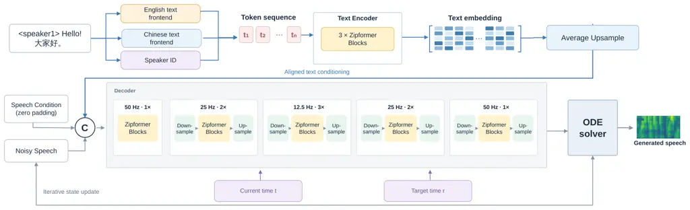

# LeanTTS: Efficient Full-Stack Bilingual TTS for Zero-Shot Cloning and Voice Customization

Yuheng Lu^(1,∗), Qiulin Li^(2,∗), Xi Wang^(3,∗), Yang Wang² Shengpei
Jiang², Liyin Liang², Yifeng Qian², Longbiao Wang¹ ^(†)^(†)thanks:
^(\*)Equal contribution.

###### Abstract

While recent advances in text-to-speech (TTS) synthesis have
substantially improved speech quality and modeling flexibility, the
development of lightweight and computationally efficient systems remains
comparatively underexplored. We present LeanTTS, a bilingual complete
synthesis stack that supports two complementary regimes:
reference-prompt zero-shot cloning for unseen speakers and
token-conditioned customization for recurring voices. LeanTTS combines a
compact Mandarin polyphone front end, a structurally compressed
flow-matching acoustic model, and a lightweight Vocos decoder with
four-step MeanFlow generation. The resulting system contains 18.9M
learned parameters, 86.12% fewer than the 136.2M-parameter
ZipVoice–Vocos pipeline. On Seed-TTS-Eval, its zero-shot mode obtains
2.02 CER/62.3 SIM on Mandarin and 2.32 WER/48.3 SIM on English, exposing
the quality–size trade-off under aggressive compression. With
token-conditioned customized voices, the same system reaches 1.57
CER/77.2 SIM on Mandarin and 1.93 WER/76.6 SIM on English, with UTMOS
scores of 3.03 and 4.33, respectively. It further achieves mean/P90 CPU
RTFs of 0.049/0.061, establishing a sub-20M operating point for
bilingual personalization and real-time CPU deployment. Audio demos are
available at
[https://github.com/notlu/leantts](https://github.com/notlu/leantts).

###### Index Terms: 

zero-shot text-to-speech, voice customization, model compression,
MeanFlow

^(†)^(†)address: ¹Tianjin University, Tianjin, China  ²Didichuxing Co.
Ltd., Beijing, China  ³Tsinghua University, Beijing, China  
{luyuheng2024,wanglongbiao}@tju.edu.cn  
{qiunnlili,ianwangyang,jiangshengpei,liangliyinkevin,qianyifeng}@didiglobal.com  
xi-wang24@mails.tsinghua.edu.cn



Figure 1: Bilingual preset-voice inference and acoustic-model
architecture of LeanTTS.

## 1 Introduction

Recent advances in generative text-to-speech (TTS) have enabled
high-quality synthesis with increasingly flexible capabilities,
including multilingual generation and zero-shot adaptation to unseen
speakers \[29, 9, 8, 6\]. However, these advances are often accompanied
by rapidly growing model size and computational cost. Modern zero-shot
TTS systems commonly rely on hundreds of millions or even billions of
parameters, making them difficult to deploy on resource-constrained
devices where memory, storage, and latency are tightly limited. This is
particularly undesirable for personalized applications such as
in-vehicle assistants and embedded devices, where local synthesis can
reduce network dependency and avoid transmitting speaker-specific
reference audio to remote servers.

A substantial body of work has therefore explored lightweight and
efficient TTS through compact architectures, neural architecture search,
streaming synthesis, and efficient waveform generation \[20, 18, 24, 2,
13, 10, 3, 16, 15, 17\]. Nevertheless, most existing compact systems
focus on fixed-speaker, single-voice, or otherwise constrained synthesis
settings. In contrast, recent zero-shot TTS systems provide much greater
flexibility in speaker adaptation, but typically retain a considerably
larger computational footprint \[29, 9, 8, 6\]. This leaves an important
gap between _efficient on-device synthesis_ and _modern personalized
TTS_: a practical edge system should remain compact enough for real-time
local inference while supporting both unseen-speaker synthesis and
high-quality customized voices. Moreover, deployment cost is determined
by the complete synthesis pipeline rather than the acoustic model alone,
including pronunciation modeling, acoustic generation, and waveform
reconstruction.

To bridge this gap, we present LeanTTS, a compact full-stack bilingual
TTS system designed for efficient personalized synthesis. LeanTTS
jointly reduces the Mandarin pronunciation front end \[5\], the
flow-matching acoustic generator, and the neural waveform decoder
 \[25\], instead of optimizing these components in isolation. The system
supports two complementary usage modes: reference-prompt _zero-shot
voice cloning_ for previously unseen speakers, and token-conditioned
_preset-voice customization_ for frequently used target voices. We
further introduce a compact acoustic training pipeline with
teacher-guided recovery and MeanFlow continuation \[11\], enabling
few-step generation while maintaining the flexibility of the original
flow-matching formulation.

Our deployment-focused LeanTTS configuration contains only 18.9M learned
parameters, reducing the complete ZipVoice–Vocos synthesis path  \[29,
25\] by 86.12% while retaining Mandarin–English zero-shot synthesis. For
customized preset voices, the four-step model achieves 1.57 CER/77.2 SIM
on Mandarin and 1.93 WER/76.6 SIM on English. On CPU, the same compact
system reaches a mean/P90 real-time factor of 0.049/0.061 at four
synthesis steps. These results demonstrate that a complete personalized
TTS stack can be aggressively compressed while still providing a
practical operating point for bilingual zero-shot cloning, voice
customization, and real-time local deployment.

## 2 Method

### 2.1 Full-stack overview

Figure 1 illustrates the bilingual preset-voice inference path and the
internal architecture of the text encoder and FM decoder. A leading
speaker tag selects the preset voice, while language-specific front ends
convert Mandarin and English spans into pronunciation tokens. The
compact acoustic generator predicts a Mel spectrogram, and Vocos
reconstructs the 24-kHz waveform. We build a 25M bilingual flow-matching
model and a smaller 13M FM model, then obtain a separate few-step
checkpoint through MeanFlow continuation.

Preset-speaker conditioning. We append eight speaker tags at IDs 360–367
to the original 360-entry phoneme-and-punctuation vocabulary. A speaker
tag occupies the first input position, bypasses G2P, and is jointly
encoded with the pronunciation tokens into the text condition. Training
progressively removes the reference-speech acoustic condition for tagged
examples while retaining the text condition, enabling token-only preset
voice inference without affecting reference-prompt zero-shot cloning.

### 2.2 Compact Mandarin pronunciation front-end

For Mandarin, contextual modeling is invoked only for ambiguous
polyphones. Deterministic G2P provides candidate pronunciations, while
characters outside the target polyphone inventory directly retain the
rule-based prediction.

For each ambiguous position, a two-layer contextual encoder processes a
target-centered window of at most 42 characters and produces a
128-dimensional representation.¹¹ 1
[https://huggingface.co/uer/roberta-tiny-wwm-chinese-cluecorpussmall](https://huggingface.co/uer/roberta-tiny-wwm-chinese-cluecorpussmall)
The prediction module covers 552 polyphonic characters and 659 global
pronunciation labels. It retains a shared $`659\times 128`$
pronunciation bank, but does not materialize all 659 logits. Instead, a
fixed $`552\times 6`$ candidate-index buffer gathers at most six
pronunciation rows for the target character, and a mask removes unused
slots. Six-dimensional global-slot, character, and
character–part-of-speech terms condition the resulting local logits,
while a part-of-speech classifier provides auxiliary syntactic
supervision. The resulting prediction is followed by deterministic
tone-sandhi processing and converted to acoustic-model tokens. The
complete candidate-slot G2PW contains 3.3M learned parameters.

### 2.3 Structured acoustic compression and recovery

We derive two compact acoustic models from the 122.7M-parameter teacher
using stage-wise depth reduction and L2-norm channel selection. The
teacher contains five FM-decoder stages with $`[2,2,4,4,4]`$ Zipformer
blocks, a decoder model/FFN width of $`512/1536`$, and a four-layer text
encoder with a model/FFN width of $`192/512`$. The 25M configuration
contains 25.1M parameters: its decoder is reduced to $`[1,2,3,2,1]`$
blocks with a model/FFN width of $`384/384`$, while its text encoder
uses three layers with a model/FFN width of $`192/384`$. The 13M
configuration contains 13.3M parameters and retains the same
$`[1,2,3,2,1]`$ decoder depths and three-layer text encoder, but further
narrows the decoder model/FFN width to $`256/256`$; the text-encoder
model/FFN width remains $`192/384`$. Both students preserve the
teacher’s stage-wise downsampling factors.

For each reducible hidden channel $`j`$, its importance is measured by

```math
s_{j}=\lVert W_{\mathrm{in}}[j,:]\rVert_{2}^{2}+\lVert W_{\mathrm{out}}[:,j]\rVert_{2}^{2}+b_{j}^{2}. \tag{1}
```

The highest-scoring channels are retained consistently across coupled
projections, while compatible parameters are inherited directly from the
teacher. The resulting students remain regular dense networks.

After structural transfer, the student is progressively recovered using
teacher guidance and a ground-truth CFM objective:

```math
\mathcal{L}_{\mathrm{recover}}=w_{\mathrm{KD}}\mathcal{L}_{\mathrm{vKD}}+w_{\mathrm{GT}}\mathcal{L}_{\mathrm{CFM}}. \tag{2}
```

During recovery, $`w_{\mathrm{KD}}`$ decreases from 1.0 to 0.2 while
$`w_{\mathrm{GT}}`$ increases from 0 to 1.0. Training then continues
with ground-truth flow matching alone, allowing the compressed
initialization to first recover teacher behavior and subsequently adapt
to the data target.

### 2.4 Fixed-grid rollout distillation

We post-train the recovered 13M model with a frozen flow-matching
teacher on the fixed four-step inference grid from $`t=1`$ (noise) to
$`t=0`$ (data), with step size 0.25. For each adjacent interval
$`(t,r)`$, the student predicts an average velocity and applies

```math
z_{r}=z_{t}-(t-r)u_{\theta}(z_{t},t,r,c). \tag{3}
```

Thus, one network evaluation replaces the teacher trajectory over the
corresponding interval rather than approximating an instantaneous
velocity.

Training samples only these four intervals. To expose the student to
accumulated inference errors, we mix prompt-preserving clean states with
stop-gradient states obtained by rolling out its preceding grid steps;
the on-policy probability is gradually increased to 0.5. From the
resulting state $`z_{t}`$, the teacher performs an eight-step FP32 Euler
rollout to $`y_{r}^{T}`$, yielding the state-conditioned target
$`u^{T}=(z_{t}-y_{r}^{T})/(t-r)`$. We minimize masked MSE between
$`u_{\theta}`$ and $`u^{T}`$ only on valid generated frames, while
prompt and padding frames remain fixed.

|                              |     |              |                    |                  |                    |                    |                  |                    |
| ---------------------------- | --- | ------------ | ------------------ | ---------------- | ------------------ | ------------------ | ---------------- | ------------------ |
|                              |     |              | Objective metrics  |                  |                    |                    |                  |                    |
|                              |     |              | test-zh            |                  |                    | test-en            |                  |                    |
| Model                        | NFE | Params       | CER $`\downarrow`$ | SIM $`\uparrow`$ | UTMOS $`\uparrow`$ | WER $`\downarrow`$ | SIM $`\uparrow`$ | UTMOS $`\uparrow`$ |
| Zero-shot voice cloning      |     |              |                    |                  |                    |                    |                  |                    |
| CosyVoice3 \[8\]             | 10  | $`\geq`$1.8B | 1.12               | 78.1             | 3.31               | 2.22               | 72.0             | 3.97               |
| Spark-TTS \[27\]             | –   | 662.989M     | 1.21               | 67.1             | 3.27               | 1.97               | 58.7             | 3.94               |
| MOSS-TTS-Nano \[12\]         | –   | 139.281M     | 4.40               | 64.1             | 2.96               | 3.09               | 49.9             | 3.62               |
| ZipVoice \[29\]              | 16  | 136.196M     | 1.42               | 75.2             | 3.16               | 1.67               | 69.6             | 3.83               |
| LeanTTS-25M                  | 16  | 30.557M      | 1.52               | 65.2             | 2.62               | 1.75               | 52.3             | 3.32               |
| LeanTTS-13M-FM               | 16  | 18.898M      | 1.99               | 61.2             | 2.43               | 2.29               | 47.4             | 3.17               |
| LeanTTS-13M-MF               | 4   | 18.898M      | 2.02               | 62.3             | 2.41               | 2.32               | 48.3             | 3.12               |
| Preset/fixed-voice synthesis |     |              |                    |                  |                    |                    |                  |                    |
| Matcha-TTS \[19\]            | 10  | 32.140M      | –                  | –                | –                  | 1.76               | –                | 4.35               |
| Inflect-Micro-v2 \[26\]      | –   | 9.357M       | –                  | –                | –                  | 2.77               | –                | 4.41               |
| LeanTTS-13M-FM               | 16  | 18.898M      | 1.56               | 76.7             | 3.11               | 1.88               | 75.3             | 4.34               |
| LeanTTS-13M-MF               | 4   | 18.898M      | 1.57               | 77.2             | 3.03               | 1.93               | 76.6             | 4.33               |

Params denotes the learned inference path; $`\geq`$ marks a verified
lower bound when a complete total is unavailable.

Table 1: System-level comparison on Seed-TTS-Eval. Mandarin
intelligibility is reported as CER and English intelligibility as WER;
baseline values follow the corresponding official reports.

### 2.5 Compact Vocos

We compress Vocos while preserving its 100-bin Mel and 24-kHz waveform
interfaces. The eight-block architecture is retained, while the backbone
width is reduced from 512 to 192 and the intermediate width from 1536 to
576, yielding a 2.1M-parameter decoder. The compact model is retrained
using adversarial, feature-matching, and multi-resolution spectral
objectives.

## 3 Experiments

### 3.1 Experimental setup

Data. The acoustic models are trained on Emilia \[14\]. Both acoustic
variants use Mandarin and English data. The 13M checkpoint jointly
learns eight preset-speaker tokens and is evaluated under both prompt
and token conditioning. Each preset speaker is represented by
approximately 300 hours of Mandarin and 300 hours of English training
speech. The compact Vocos is trained on approximately 2,245 hours of
24-kHz audio. The pronunciation front-end follows the CVTE-Poly
benchmark \[28\]: training uses CPP and CVTE-Poly, and evaluation uses
the refined CPP test split.

Evaluation. We evaluate zero-shot synthesis on Seed-TTS-Eval  \[1\]
using three reproducible model-based metrics. For component evaluation,
we follow CVTE-Poly \[28\] and report overall accuracy (Acc.),
character-macro accuracy (Acc.avg.p), and character–pronunciation-macro
accuracy (Acc.avg.pp) for the pronunciation front end. Following
Vocos \[25\], vocoder reconstruction is evaluated using UTMOS, ViSQOL,
PESQ, voiced/unvoiced F1, and periodicity error. For intelligibility, we
compute the error rate between the input text and an ASR transcription
of the synthesized speech: Whisper large-v3  \[21\]²² 2
[https://github.com/openai/whisper](https://github.com/openai/whisper)
is used for test-en, and SeACo-Paraformer Large  \[23\]³³ 3
[https://github.com/R1ckShi/SeACo-Paraformer](https://github.com/R1ckShi/SeACo-Paraformer)
for test-zh, yielding WER and CER, respectively. Speaker similarity
(SIM) is the cosine similarity between embeddings of the prompt and
synthesized speech, extracted by a WavLM-Large front end \[4\] with an
ECAPA-TDNN speaker model \[7\]⁴⁴ 4
[https://github.com/microsoft/UniSpeech/tree/main/downstreams/speaker_verification](https://github.com/microsoft/UniSpeech/tree/main/downstreams/speaker_verification).
Naturalness is estimated with the UTMOS22 strong learner  \[22\]⁵⁵ 5
[https://github.com/sarulab-speech/UTMOS22](https://github.com/sarulab-speech/UTMOS22).
Efficiency is reported using learned parameters and real-time factor
(RTF), where lower RTF indicates faster synthesis. We report both the
mean and the 90th-percentile (P90) RTF. To assess compatibility with
efficient on-device speech systems, we additionally export the four-step
LeanTTS-13M pipeline to the MNN mobile inference framework⁶⁶ 6
[https://github.com/alibaba/MNN](https://github.com/alibaba/MNN) and
integrate it into an Android application executed in an Android
emulator.

Baselines. Among publicly documented systems with complete
deployment-size accounting, we did not identify a sub-100M baseline that
jointly reports bilingual zero-shot voice cloning and directly
comparable evaluation. Compact TTS systems below this scale are
predominantly monolingual and fixed- or multi-speaker, whereas
comparable zero-shot systems are substantially larger. We therefore
compare zero-shot synthesis against ZipVoice, CosyVoice3, Spark-TTS, and
MOSS-TTS-Nano, and compare preset/fixed-voice synthesis against the
compact Inflect-Micro-v2 and Matcha-TTS systems. Component studies
further compare the original G2PW and Vocos models with their compact
counterparts.

### 3.2 Overall system comparison

Table 1 jointly compares complete learned-parameter counts and synthesis
quality. LeanTTS-13M-FM is evaluated at 16 steps, whereas the separately
continued LeanTTS-13M-MF checkpoint is evaluated at four steps. Table 1
separates reference-prompt zero-shot cloning from preset/fixed-voice
synthesis so that systems are compared under the same conditioning
setting. Preset-token metrics are averaged over the eight learned
speakers. LeanTTS-25M retains conventional 16-step flow-matching
inference for the quality evaluation and serves as a higher-capacity
bilingual reference. Four-NFE CPU latency is reported separately in
Table 2.

| Acoustic model   | Vocoder        | NFE | Mean RTF $`\downarrow`$ | P90 RTF $`\downarrow`$ |
| ---------------- | -------------- | --- | ----------------------- | ---------------------- |
| ZipVoice-distill | Original Vocos | 4   | 1.6975                  | 2.2617                 |
| ZipVoice-distill | Compact Vocos  | 4   | 1.6190                  | 2.1540                 |
| LeanTTS-25M      | Compact Vocos  | 4   | 0.0610                  | 0.0720                 |
| LeanTTS-13M      | Compact Vocos  | 4   | 0.0490                  | 0.0610                 |

Protocol: all 2,020 Seed-TTS-Eval test-zh utterances; MacBook Pro, Apple
M5 (10 cores), 16 GB, macOS 26.5 arm64; CPU-only, no GPU/MPS, one
PyTorch thread; Python 3.12.13, PyTorch/torchaudio 2.8.0, NumPy 2.5.3,
qnnpack; compact Vocos INT8 checkpoint dequantized on loading.

Table 2: Component-wise CPU real-time factor (RTF) at four NFEs. Mean
and 90th-percentile (P90) RTF are reported; lower is faster.

Table 2 separates the latency gains from vocoder and acoustic-model
compression. Replacing the original Vocos with Compact Vocos reduces the
mean/P90 RTF of ZipVoice-distill from 1.6975/2.2617 to 1.6190/2.1540,
showing a modest vocoder-side improvement. The substantially larger
reductions to 0.0610/0.0720 and 0.0490/0.0610 for LeanTTS-25M and
LeanTTS-13M, respectively, indicate that the dominant RTF gain comes
from reducing the acoustic-model size.

The MNN-based Android implementation for LeanTTS-25M achieves an
end-to-end RTF of 0.0327 in the emulator.

LeanTTS-25M contains a 3.3M front end, a 25.1M acoustic model, and a
2.1M vocoder, totaling 30.6M learned parameters; LeanTTS-13M contains
18.9M.

Zero-shot regime. At four NFEs, LeanTTS-13M obtains 2.02 CER/62.3 SIM on
Mandarin and 2.32 WER/48.3 SIM on English. Relative to the 136.2M
ZipVoice pipeline, the lower similarity makes the cost of aggressive
compression explicit, while the 86.12% parameter reduction and 0.049
mean CPU RTF define a practical quality–size–latency operating point.

Customized-voice regime. For voices represented during training, the
same four-step model reaches 1.57 CER/77.2 SIM/3.03 UTMOS on Mandarin
and 1.93 WER/76.6 SIM/4.33 UTMOS on English. Token conditioning
therefore raises SIM by 14.9 and 28.3 points over reference-prompt
zero-shot synthesis in the two languages, respectively, while requiring
no reference recording at inference. LeanTTS-25M provides a
higher-capacity zero-shot point, obtaining 1.52/1.75 CER/WER, 65.2/52.3
SIM, and 2.62/3.32 UTMOS on Mandarin/English.

### 3.3 Component analysis

Mandarin front-end. Table 3 compares candidate-slot G2PW with compact
and 8L/512 global-head counterparts under the same evaluation protocol.

Reducing the contextual encoder from 8L/512 to 2L/128 causes a moderate
accuracy decrease, but the compact models remain within an acceptable
range. More importantly, Candidate-slot G2PW performs similarly to the
compact global-head counterpart (98.0631% versus 98.1527% overall
accuracy) while substantially reducing the pronunciation-head and
character-conditioned parameters by scoring at most six valid candidates
instead of the full global pronunciation inventory.

| Front end                 | Overall $`\uparrow`$ | Acc.avg.p $`\uparrow`$ | Acc.avg.pp $`\uparrow`$ |
| ------------------------- | -------------------- | ---------------------- | ----------------------- |
| Candidate-slot G2PW       | 98.0631              | 97.5011                | 94.2679                 |
| Compact global-head G2PW  | 98.1527              | 97.5377                | 94.5919                 |
| Global-head G2PW (8L/512) | 98.7125              | 98.3513                | 96.4304                 |

Table 3: Mandarin polyphone disambiguation under a common evaluation
protocol.

Vocoder. Table 4 evaluates waveform reconstruction independently of the
acoustic model. Reducing Vocos from 13.5M to 2M parameters causes a
measurable degradation: for the FP32 model, UTMOS decreases from 3.7466
to 3.5116, ViSQOL from 4.6584 to 4.5365, and PESQ from 3.6675 to 3.3723.
INT8 quantization further lowers these scores, but substantially reduces
the deployment footprint of the 2M model while retaining acceptable
reconstruction quality. The results therefore expose an explicit
trade-off between waveform quality and deployment cost.

| Vocos      | UTMOS $`\uparrow`$ | ViSQOL $`\uparrow`$ | PESQ $`\uparrow`$ | V/UV F1 $`\uparrow`$ | Period. $`\downarrow`$ |
| ---------- | ------------------ | ------------------- | ----------------- | -------------------- | ---------------------- |
| 13.5M FP32 | 3.7466             | 4.6584              | 3.6675            | 0.9585               | 0.1007                 |
| 2M FP32    | 3.5116             | 4.5365              | 3.3723            | 0.9497               | 0.1203                 |
| 2M INT8    | 3.1921             | 4.3623              | 3.1963            | 0.9405               | 0.1339                 |

Table 4: Vocoder reconstruction on LibriTTS test-clean.

### 3.4 Impact of Teacher-Guided Recovery

We isolate the effect of teacher guidance using the same compressed
architecture, training data, and number of inference steps. As shown in
Table 5, teacher-guided recovery and ground-truth FM continuation are
comparable during the early recovery stage. The difference emerges with
subsequent training: the teacher-guided trajectory reaches stronger
later checkpoints, including simultaneous error-rate and SIM gains in
both languages at 300k and 500k updates. This suggests that teacher
guidance primarily provides a better recovery initialization rather than
an immediate advantage, allowing the compressed model to realize greater
performance potential during continued optimization.

| Update | EN WER $`\downarrow`$                  | EN SIM (%) $`\uparrow`$              | ZH CER $`\downarrow`$                  | ZH SIM (%) $`\uparrow`$              |
| ------ | -------------------------------------- | ------------------------------------ | -------------------------------------- | ------------------------------------ |
| 250k   | $`\mathbf{2.067}\!\rightarrow\!2.108`$ | $`49.6\!\rightarrow\!\mathbf{50.2}`$ | $`\mathbf{1.658}\!\rightarrow\!1.730`$ | $`63.5\!\rightarrow\!\mathbf{63.8}`$ |
| 300k   | $`2.256\!\rightarrow\!\mathbf{1.937}`$ | $`48.4\!\rightarrow\!\mathbf{50.5}`$ | $`1.933\!\rightarrow\!\mathbf{1.646}`$ | $`62.2\!\rightarrow\!\mathbf{64.4}`$ |
| 450k   | $`1.893\!\rightarrow\!\mathbf{1.782}`$ | $`51.2\!\rightarrow\!\mathbf{51.6}`$ | $`1.664\!\rightarrow\!\mathbf{1.623}`$ | $`\mathbf{64.7}\!\rightarrow\!63.6`$ |
| 500k   | $`1.975\!\rightarrow\!\mathbf{1.742}`$ | $`50.7\!\rightarrow\!\mathbf{52.1}`$ | $`1.701\!\rightarrow\!\mathbf{1.584}`$ | $`63.2\!\rightarrow\!\mathbf{64.7}`$ |

Table 5: Recovery-objective ablation at matched training updates and
inference steps. Each entry reports ground-truth FM only $`\rightarrow`$
teacher-guided recovery; bold indicates the better result.

## 4 Conclusion

LeanTTS demonstrates that a sub-20M complete bilingual TTS stack can
serve two complementary personalization regimes. Reference-prompt
inference retains zero-shot cloning for unseen speakers, with the
expected quality trade-off of aggressive compression: at four NFEs, the
18.9M system obtains 2.02 CER/62.3 SIM on Mandarin and 2.32 WER/48.3 SIM
on English. When recurring voices are available during training,
token-conditioned customization raises similarity to 77.2 and 76.6 while
obtaining 1.57 Mandarin CER and 1.93 English WER. The same four-step
system achieves mean/P90 CPU RTFs of 0.049/0.061. These results
establish a practical operating point across speaker coverage, voice
stability, model size, and latency. Current evaluation is limited to an
Apple M5 CPU and eight customized voices. An MNN-based Android-emulator
deployment further achieves an end-to-end RTF of 0.0327; validation on
physical mobile SoCs and broader multilingual voice sets remains future
work.

## References

- \[1\] P. Anastassiou et al. (2024) Seed-TTS: a family of high-quality
  versatile speech generation models. arXiv preprint arXiv:2406.02430.
  Cited by: §3.1.
- \[2\] R. Atienza (2023) EfficientSpeech: an on-device text to speech
  model. In Proc. IEEE International Conference on Acoustics, Speech and
  Signal Processing (ICASSP), pp. 1–5. External Links:
  [Document](https://dx.doi.org/10.1109/ICASSP49357.2023.10094639) Cited
  by: §1.
- \[3\] Q. Chen, X. Hao, B. Li, Y. Liu, and L. Lu (2025) Towards
  lightweight and stable zero-shot TTS with self-distilled
  representation disentanglement. arXiv preprint arXiv:2501.08566.
  External Links: [Link](https://arxiv.org/abs/2501.08566) Cited by: §1.
- \[4\] S. Chen, C. Wang, Z. Chen, et al. (2022) WavLM: large-scale
  self-supervised pre-training for full stack speech processing. IEEE
  Journal of Selected Topics in Signal Processing 16 (6), pp. 1505–1518.
  External Links:
  [Document](https://dx.doi.org/10.1109/JSTSP.2022.3188113) Cited by:
  §3.1.
- \[5\] Y. Chen, Y. Steven, Y. Chang, and Y. Yeh (2022) g2pW: a
  conditional weighted softmax BERT for polyphone disambiguation in
  mandarin. In Proc. Interspeech, pp. 1926–1930. External Links:
  [Document](https://dx.doi.org/10.21437/Interspeech.2022-216) Cited by:
  §1.
- \[6\] Y. Chen, Z. Niu, Z. Ma, K. Deng, C. Wang, J. Zhao, K. Yu, and X.
  Chen (2024) F5-TTS: a fairytaler that fakes fluent and faithful speech
  with flow matching. arXiv preprint arXiv:2410.06885. External Links:
  [Link](https://arxiv.org/abs/2410.06885) Cited by: §1, §1.
- \[7\] B. Desplanques, J. Thienpondt, and K. Demuynck (2020)
  ECAPA-TDNN: emphasized channel attention, propagation and aggregation
  in TDNN-based speaker verification. In Proc. Interspeech,
  pp. 3830–3834. External Links:
  [Document](https://dx.doi.org/10.21437/Interspeech.2020-2650) Cited
  by: §3.1.
- \[8\] Z. Du, C. Gao, Y. Wang, F. Yu, T. Zhao, H. Wang, X. Lv, H.
  Wang, C. Ni, X. Shi, K. An, G. Yang, Y. Li, Y. Chen, Z. Gao, Q.
  Chen, Y. Gu, M. Chen, Y. Chen, S. Zhang, W. Wang, and J. Ye (2025)
  CosyVoice 3: towards in-the-wild speech generation via scaling-up and
  post-training. arXiv preprint arXiv:2505.17589. External Links:
  [Link](https://arxiv.org/abs/2505.17589) Cited by: §1, §1, Table 1.
- \[9\] Z. Du, Y. Wang, Q. Chen, X. Shi, X. Lv, T. Zhao, Z. Gao, Y.
  Yang, C. Gao, H. Wang, et al. (2024) CosyVoice 2: scalable streaming
  speech synthesis with large language models. arXiv preprint
  arXiv:2412.10117. External Links:
  [Link](https://arxiv.org/abs/2412.10117) Cited by: §1, §1.
- \[10\] K. Fujita, T. Ashihara, M. Delcroix, and Y. Ijima (2024)
  Lightweight zero-shot text-to-speech with mixture of adapters. In
  Proc. Interspeech, pp. 692–696. External Links:
  [Document](https://dx.doi.org/10.21437/Interspeech.2024-803) Cited by:
  §1.
- \[11\] Z. Geng, M. Deng, X. Bai, J. Z. Kolter, and K. He (2025) Mean
  flows for one-step generative modeling. In Advances in Neural
  Information Processing Systems, External Links:
  [Link](https://arxiv.org/abs/2505.13447) Cited by: §1.
- \[12\] Y. Gong, B. Jiang, Y. Zhao, Y. Yuan, K. Chen, Y. Jiang, C.
  Chang, D. Hong, M. Chen, R. Li, et al. (2026) MOSS-TTS technical
  report. arXiv preprint arXiv:2603.18090. Cited by: Table 1.
- \[13\] Y. Guo, Y. Lv, J. Dou, Y. Zhang, and Y. Wang (2024) FLY-TTS:
  fast, lightweight and high-quality end-to-end text-to-speech
  synthesis. In Proc. Interspeech, pp. 4908–4912. External Links:
  [Document](https://dx.doi.org/10.21437/Interspeech.2024-1435) Cited
  by: §1.
- \[14\] H. He, Z. Shang, C. Wang, X. Li, Y. Gu, H. Hua, L. Liu, C.
  Yang, J. Li, P. Shi, Y. Wang, K. Chen, P. Zhang, and Z. Wu (2024)
  Emilia: an extensive, multilingual, and diverse speech dataset for
  large-scale speech generation. arXiv preprint arXiv:2407.05361.
  External Links: [Link](https://arxiv.org/abs/2407.05361) Cited by:
  §3.1.
- \[15\] H. Kim, J. Yang, Y. Yu, S. Ji, J. Morton, F. Bous, J. Byun,
  and J. Lee (2025) SupertonicTTS: towards highly efficient and
  streamlined text-to-speech system. arXiv preprint arXiv:2503.23108.
  External Links: [Link](https://arxiv.org/abs/2503.23108) Cited by: §1.
- \[16\] J. Y. Lee, S. Park, B. J. Choi, J. Lee, M. Kim, and H.
  Cho (2025) Efficient streaming TTS acoustic model with depthwise RVQ
  decoding strategies in a Mamba framework. In Proc. Interspeech,
  pp. 5513–5517. External Links:
  [Document](https://dx.doi.org/10.21437/Interspeech.2025-1084) Cited
  by: §1.
- \[17\] T. Lemerle, N. Obin, and A. Roebel (2024) Small-E: small
  language model with linear attention for efficient speech synthesis.
  In Proc. Interspeech, External Links:
  [Link](https://www.isca-archive.org/interspeech_2024/lemerle24_interspeech.html)
  Cited by: §1.
- \[18\] R. Luo, X. Tan, R. Wang, T. Qin, J. Li, S. Zhao, E. Chen,
  and T. Liu (2021) LightSpeech: lightweight and fast text to speech
  with neural architecture search. In Proc. IEEE International
  Conference on Acoustics, Speech and Signal Processing (ICASSP),
  pp. 5699–5703. External Links:
  [Document](https://dx.doi.org/10.1109/ICASSP39728.2021.9414403) Cited
  by: §1.
- \[19\] S. Mehta, R. Tu, J. Beskow, É. Székely, and G. E. Henter (2024)
  Matcha-TTS: a fast tts architecture with conditional flow matching. In
  Proc. IEEE International Conference on Acoustics, Speech and Signal
  Processing (ICASSP), pp. 11341–11345. Cited by: Table 1.
- \[20\] V. Popov, S. Kamenev, M. Kudinov, S. Repyevsky, T. Sadekova, V.
  Bushaev, V. Kryzhanovskiy, and D. Parkhomenko (2020) Fast and
  lightweight on-device TTS with Tacotron2 and LPCNet. In Proc.
  Interspeech, pp. 220–224. External Links:
  [Document](https://dx.doi.org/10.21437/Interspeech.2020-2169) Cited
  by: §1.
- \[21\] A. Radford, J. W. Kim, T. Xu, G. Brockman, C. McLeavey, and I.
  Sutskever (2023) Robust speech recognition via large-scale weak
  supervision. In Proc. International Conference on Machine Learning
  (ICML), pp. 28492–28518. Cited by: §3.1.
- \[22\] T. Saeki, D. Xin, W. Nakata, T. Koriyama, S. Takamichi, and H.
  Saruwatari (2022) UTMOS: UTokyo-SaruLab system for VoiceMOS challenge 2022. In Proc. Interspeech, pp. 4521–4525. External Links:
  [Document](https://dx.doi.org/10.21437/Interspeech.2022-439) Cited by:
  §3.1.
- \[23\] X. Shi, Y. Yang, Z. Li, Y. Chen, Z. Gao, and S. Zhang (2023)
  SeACo-Paraformer: a non-autoregressive ASR system with flexible and
  effective hotword customization ability. arXiv preprint
  arXiv:2308.03266. Cited by: §3.1.
- \[24\] G. Shopov, S. Gerdjikov, and S. Mihov (2023) StreamSpeech:
  low-latency neural architecture for high-quality on-device speech
  synthesis. In Proc. IEEE International Conference on Acoustics, Speech
  and Signal Processing (ICASSP), pp. 1–5. External Links:
  [Document](https://dx.doi.org/10.1109/ICASSP49357.2023.10096566) Cited
  by: §1.
- \[25\] H. Siuzdak (2023) Vocos: closing the gap between time-domain
  and fourier-based neural vocoders for high-quality audio synthesis.
  arXiv preprint arXiv:2306.00814. External Links:
  [Link](https://arxiv.org/abs/2306.00814) Cited by: §1, §1, §3.1.
- \[26\] O. Song (2026) Inflect-Micro-v2: complete local
  text-to-waveform TTS under 10m parameters. Note: Hugging Face model
  card External Links:
  [Link](https://huggingface.co/owensong/Inflect-Micro-v2) Cited by:
  Table 1.
- \[27\] X. Wang, M. Jiang, Z. Ma, et al. (2025) Spark-tts: an efficient
  llm-based text-to-speech model with single-stream decoupled speech
  tokens. arXiv preprint arXiv:2503.01710. Cited by: Table 1.
- \[28\] S. Zhang, X. Tan, Y. Lei, X. Wang, Z. Zhang, and Y. Xie (2023)
  CVTE-Poly: a new benchmark for chinese polyphone disambiguation. In
  Proc. Interspeech, pp. 5526–5530. External Links:
  [Document](https://dx.doi.org/10.21437/Interspeech.2023-553) Cited by:
  §3.1, §3.1.
- \[29\] H. Zhu, W. Kang, Z. Yao, L. Guo, F. Kuang, Z. Li, W. Zhuang, L.
  Lin, and D. Povey (2025) ZipVoice: fast and high-quality zero-shot
  text-to-speech with flow matching. arXiv preprint arXiv:2506.13053.
  External Links: [Link](https://arxiv.org/abs/2506.13053) Cited by: §1,
  §1, §1, Table 1.
