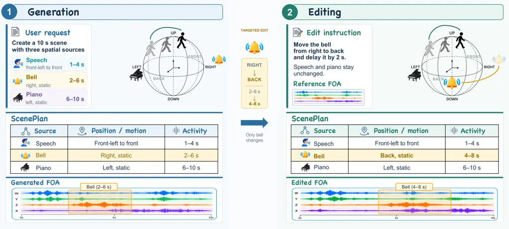
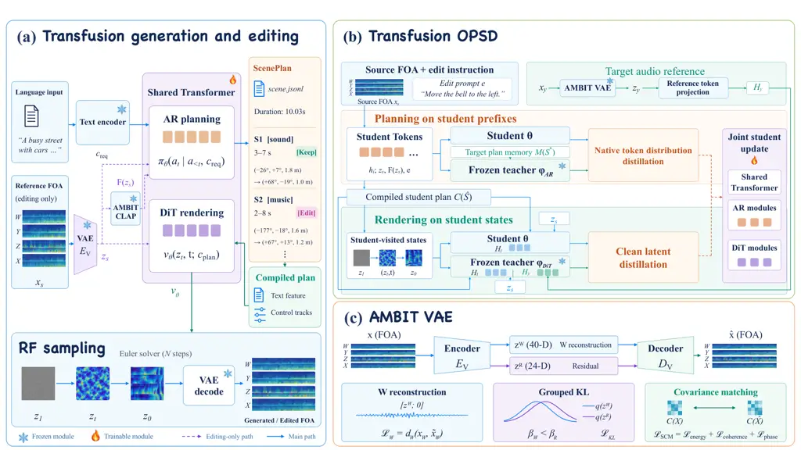

# Spatial Audio Generation and Editing with Executable Plans and Self-Distilling Transfusion

Kam Man Wu^(\*1,2) Yu Zhang^(\*) Pengjun Fang^(1,2) Mingfei Chen³ Weijia
Chen² Zeyue Tian^($`\dagger`$1,2) Qifeng Chen^($`\dagger`$1)
¹HKUST  ²Noiz AI  ³University of Washington ^(\*)Equal
contribution.   ^($`\dagger`$)Corresponding authors.

###### Abstract

Spatial audio authoring coordinates source decisions with soundfield
synthesis. For editing, plans specify what to change and retain, while
reference audio supplies further acoustic detail. We present Ambit, a
unified framework for native First-Order Ambisonics (FOA) generation and
editing with three connected contributions. First, a shared Transfusion
backbone couples autoregressive planning with rectified-flow rendering
through executable ScenePlans that specify source content, activity, and
3D trajectories. For editing, the plan describes the full target scene,
including retained sources; contrastive features ground the requested
change, while full reference latents supply residual acoustic detail for
preservation. Second, an FOA-aware continuous VAE combines
shared-decoder omnidirectional recovery, asymmetric grouped KL, and
spatial covariance matching to preserve content and inter-channel
structure. Third, joint Transfusion on-policy self-distillation (OPSD)
refines planning on student-generated prefixes and rendering at sampling
states reached under student plans, with target-conditioned teachers
supervising both modes of the shared student. Evaluations across speech,
music, and sound show improved generation content and spatial quality,
acoustic fidelity during instruction-guided editing, and unedited-source
preservation over the compared baselines. Project page:
[https://wjm-george.github.io/AMBIT/](https://wjm-george.github.io/AMBIT/).

## 1 Introduction

Spatial audio authoring supports immersive media, virtual acoustics, and
interactive environments (Zhu et al., 2025) through text-driven
generation and instruction-guided editing. Both tasks require decisions
about what each source produces, when it is active, and how it moves to
be realized in a coherent soundfield (Guo et al., 2025a). Editing adds a
further requirement: changing selected attributes while retaining the
surrounding sources. An executable plan can state both the requested
change and the sources to keep at the semantic and structural level;
reference audio then supplies residual acoustic detail beyond these
symbolic fields. This motivates learning source decisions and
multichannel synthesis together, with plans governing what changes or
stays and reference latents supporting the acoustic preservation of
retained sources.



Figure 1: Overview of Ambit capabilities. (1) Spatial audio generation
creates multi-source 3D scenes from text, controlling content, timing,
and trajectories. (2) Instruction-guided spatial and temporal editing
modifies selected sources, preserving unmodified content and spatial
structure.

Recent work provides increasingly rich spatial audio controls.
ImmerseDiffusion synthesizes First-Order Ambisonics (FOA) soundscapes
from text and spatial, temporal, and environmental conditions using
latent diffusion (Heydari et al., 2025). SonicMotion extends FOA
generation to moving sound sources with explicit trajectory
control (Templin et al., 2026). SwanWeave follows natural language
instructions to edit content, timing, and spatial attributes of existing
FOA scenes (Lei et al., 2026a). Unified authoring brings these
capabilities together: language intent, source attributes, and rendered
acoustics must remain aligned as scenes are generated and modified with
source-level instructions.

(i) Grounding language in 3D source controls. AudioChat explores stereo
planning (Chen et al., 2026); FOA authoring requires source-bound
content, timing, and 3D motion, with edit targets identified from source
audio.

(ii) Preserving acoustics and spatial structure in compact latents.
Continuous FOA autoencoders support generation, while discrete codecs
provide spatial-consistency supervision (Heydari et al., 2025;
Sudarsanam et al., 2025). Yet, channel-wise reconstruction fails to
explicitly supervise inter-channel energy, coherence, and phase.

(iii) Refining discrete planning and continuous rendering. Paired
training uses reference prefixes and target plans, whereas inference
relies on student predictions. A predicted plan changes both the
conditions given to the renderer and the sampling states it encounters.
DiffusionOPSD (Zhou et al., 2026) refines continuous generators without
discrete token supervision. Joint refinement needs token and audio
targets on student prefixes and visited sampling states.

We introduce Ambit (Figure 1), a unified FOA authoring framework with
three contributions.

(i) Source-grounded Transfusion planning and rendering. Executable
ScenePlans specify source content, timing, and motion. Their
deterministically compiled controls connect autoregressive planning to
rectified-flow rendering (Ma et al., 2025) within a shared backbone. For
editing, the planner predicts the complete target scene, so modified and
retained sources are both explicit in the plan; semantic and spatial
contrastive features ground the requested change, while full reference
latents provide residual acoustic detail for the preservation of
unchanged sources.

(ii) An FOA-aware continuous Variational Autoencoder. The latents retain
acoustics and inter-channel structure. Auxiliary $`W`$ reconstruction
reuses the decoder, and asymmetric grouped KL gives a latent group
weaker regularization for $`W`$ recovery. Spatial covariance matching
supervises relative energy, coherence, and phase between channels.

(iii) Joint Transfusion On-Policy Self-Distillation. We adapt on-policy
self-distillation (Zhao et al., 2026b; Jiang et al., 2026a) to both
modes, with student plans driving DiT trajectories; frozen teachers use
target plan memory and target audio reference tokens to supervise
student prefixes and visited states. Token and clean-latent losses
update shared and task-specific parameters, coupling updated plans to
rendering conditions and states in fresh rollouts.

For music and sound generation, Ambit achieves higher paired CLAP and
lower FAD than AudioX-Turbo (Tian et al., 2026a), while achieving the
lowest speech WER and CER. Spatially, it reduces directional and
binaural errors over TangoFlux (Hung et al., 2026) with spatialization.
For editing, it outperforms SwanWeave (Lei et al., 2026a) in acoustic
fidelity and spatial accuracy. Fixed-renderer comparisons support our
planner, and VAE ablations improve reconstruction and spatial accuracy.
Joint OPSD leads continued SFT, ReFL, and GRPO across all nine metrics.

## 2 Related Work

#### Spatial audio generation and representation.

General-purpose and multimodal generators broaden audio content and
conditioning (Liu et al., 2024; Evans et al., 2025; Tian et al., 2026b;
Tian et al., 2026a; Tian et al., 2025; Hung et al., 2026; Zhang et al.,
2026b), while timing-aware methods introduce event-level temporal
control (Xie et al., 2024; Jiang et al., 2025; Jiang et al., 2026b).
Diff-SAGe, DualSpec, and PhysWave (Kushwaha et al., 2025; Zhao et al.,
2026a; Yao et al., 2026) explore category and location conditioning,
joint spectrogram modeling, and direction- and distance-consistency
priors, respectively. Video-conditioned and trajectory-aware models
further extend FOA synthesis (Kim et al., 2025; Kim et al., 2026; Lei et
al., 2026b). Neural audio codecs (Kumar et al., 2023; Défossez et al.,
2023; Ji et al., 2025) and continuous FOA autoencoders (Heydari et al., 2025) provide compact representations, while FOA Tokenizer incorporates
spatial consistency supervision into discrete compression (Sudarsanam et
al., 2025). Ambit combines source-level 3D control with acoustic
fidelity across native FOA generation and editing. Our VAE supervises
acoustic reconstruction and inter-channel consistency.

#### Audio editing and executable scene planning.

AudioSpa and TAS offer text-guided mono-to-binaural spatialization (Feng
et al., 2025; Pan et al., 2025c). Diffusion editing uses noise
perturbation, inversion, or instruction conditioning (Meng et al., 2022;
Manor and Michaeli, 2024; Jia et al., 2025; Wang et al., 2023; Pan et
al., 2026). MMEdit, Audio-Omni, and SmartDJ (Tao et al., 2025; Tian et
al., 2026c; Lan et al., 2025) extend language-guided editing, while
SwanWeave targets native FOA editing (Lei et al., 2026a). Scripting and
structured planning support compositional synthesis (Liu et al., 2025c;
Wang et al., 2026; Zhang et al., 2025c); AudioChat unifies stereo
generation and editing (Chen et al., 2026). Following Transfusion (Zhou
et al., 2025), Ambit unifies autoregressive planning and native FOA flow
rendering. Executable, grammar-constrained ScenePlans bind content,
activity, and 3D paths, compiling deterministically into source-indexed
semantic and frame-aligned spatial controls. Audio–text contrastive
learning aids grounding (Elizalde et al., 2023; Wu et al., 2023; Seki et
al., 2026; Zhang et al., 2025b). FOA features ground edits; reference
latents support preservation.

#### On-policy refinement and self-distillation.

Preference optimization and reinforcement learning improve audio
generation (Majumder et al., 2024; Li et al., 2026b); ReFL adds
differentiable reward feedback (Xu et al., 2023). GRPO’s group-relative
advantages (Shao et al., 2024) extend to flow and diffusion
generators (Liu et al., 2025b; Xue et al., 2025). On-policy distillation
supervises student-generated sequences (Agarwal et al., 2024), with
self-distillation for LLM reasoning (Zhao et al., 2026b) and continuous
generators (Zhang et al., 2026a; Zhou et al., 2026; Jiang et al., 2026a;
Liu et al., 2026). Transfusion OPSD instead jointly refines a shared FOA
editor’s discrete planner and continuous renderer. Frozen planning and
rendering teachers use target plan memory and target audio to supply
token distributions on student prefixes and clean-latent targets at flow
states reached by rendering the student’s own plans.

## 3 Methodology

#### Overview.

Let $`u,e`$ denote generation and editing instructions, $`x_{s}`$ a
reference First-Order Ambisonics (FOA) waveform, and
$`z_{s}=E_{V}(x_{s})`$ its latent, with VAE encoder/decoder
$`E_{V},D_{V}`$. The autoregressive (AR) planner $`\pi_{\theta}`$
predicts an executable ScenePlan $`\mathcal{S}`$ token by token,
specifying source-indexed content, activity, and 3D motion. Compilation
and condition encoding produce semantic tokens and frame-aligned spatial
controls $`\mathcal{C}(\mathcal{S})`$. We adapt the Diffusion
Transformer (DiT) architecture (Peebles and Xie, 2023) for audio
rendering. Our renderer $`v_{\theta}`$ predicts audio latent velocities,
which a rectified flow sampler $`\Phi[v_{\theta}]`$ integrates before
VAE decoding. AR and DiT are two modes of a Transfusion-style
Transformer, with shared blocks and task-specific interfaces
collectively parameterized by $`\theta`$. For editing, frozen Ambit CLAP
features $`F(z_{s})`$ ground instructions, while full reference latents
supply residual acoustic detail beyond symbolic plan fields. With
$`\xi=u`$ for generation or $`\xi=(z_{s},F(z_{s}),e)`$ for editing,
inference is

```math
\widehat{\mathcal{S}}=\pi_{\theta}(\xi),\qquad\widehat{x}=D_{V}\!\left(\Phi[v_{\theta}]\big(\epsilon;\mathcal{C}(\widehat{\mathcal{S}}),z_{s}\big)\right). \tag{1}
```

Here $`\epsilon\sim\mathcal{N}(0,I)`$ is noise and $`\widehat{x}`$ is
FOA output; generation omits $`z_{s},F(z_{s})`$ (Figure 2).



Figure 2: Overview of Ambit. (a) A shared Transformer predicts
executable ScenePlans and renders native FOA through latent flow
conditioned on compiled plans. Editing uses source latents in both modes
and Ambit CLAP features in planning. (b) OPSD distills token and clean
latent predictions on student prefixes and visited states, jointly
updating the shared Transformer and AR/DiT modules. (c) The VAE combines
shared-decoder auxiliary $`W`$ reconstruction, grouped KL, and spatial
covariance supervision.

### 3.1 Unified Transfusion Planning and Rendering

Ambit shares a Transfusion backbone (Zhou et al., 2025) so that planning
and rendering supervision shape a common representation. An executable
plan specifies the target scene; reference audio supplies acoustic
context for editing. Mode-specific interfaces use causal attention for
plan tokens and bidirectional attention for rendering latents.

#### Executable ScenePlan interface.

A ScenePlan $`\mathcal{S}`$ is the executable interface between source
decisions and rendering. It specifies scene duration and room type,
binding each source’s type (speech, music, or sound), description,
optional transcript, active interval, and static or linear 3D trajectory
in azimuth, elevation, and distance. For editing, the planner predicts
the complete target scene, including both modified and retained source
attributes.

#### ScenePlan compilation.

The compiler deterministically forms source text clauses and aligns
activity and pose to latent frames (Appendix B.1). Condition encoding
uses a frozen text backbone with a learned projection and source role
embeddings to produce cross-attention tokens $`c_{\mathrm{attn}}`$.
Learned event embeddings encode interval-overlap activity; a trajectory
MLP encodes poses at frame midpoints. The spatial embeddings form
$`c\in\mathbb{R}^{256\times T}`$ over $`T`$ latent frames. Together they
yield
$`\mathcal{C}(\mathcal{S})=(c_{\mathrm{attn}}(\mathcal{S}),c(\mathcal{S}))`$
with semantic tokens and frame-aligned source controls.

#### Ambit CLAP for source understanding.

Following CLAP (Elizalde et al., 2023; Wu et al., 2023), we learn
separate semantic and scene alignment heads from frozen Ambit VAE
latents:

```math
\mathcal{L}_{\mathrm{align}}=\mathcal{L}_{\mathrm{sem}}+\lambda_{\mathrm{scene}}\mathcal{L}_{\mathrm{scene}}, \tag{2}
```

Both terms use symmetric audio–text contrastive losses with multiple
positives. Semantic alignment matches content and source counts; scene
alignment, weighted by $`\lambda_{\mathrm{scene}}`$, also matches
timing, spatial attributes, and room properties. Content-preserving
spatial edits remain semantic positives but become scene negatives. The
frozen encoder supplies global and temporal features $`F(z_{s})`$ for
semantic and spatial grounding in the editing planner (Appendix B.3).

#### Autoregressive planning.

A grammar constrained codec serializes ScenePlans into tokens. We train
the planner with next token cross entropy $`\mathcal{L}_{\mathrm{AR}}`$
on reference prefixes and task inputs. Planning heads predict source
inventory, copy literal spans, and select qualitative controls for
deterministic completion (Appendix B.4). Editing uses a bidirectional
source latent prefix with Ambit CLAP features and instruction cross
attention. A source decoder predicts edit targets, operations, and
updated source attributes; its memory guides AR decoding through gated
residual attention.

#### Flow rendering.

A compiled ScenePlan specifies scene structure; full reference latents
$`z_{s}`$ provide acoustic details of retained sources for editing. For
target waveform $`x_{y}`$, let $`z_{0}=z_{y}=E_{V}(x_{y})`$ be its clean
latent. We sample flow time $`t\in[0,1]`$ from $`p(t)`$, construct
$`z_{t}=(1-t)z_{0}+t\epsilon`$, and minimize the base rectified flow
objective (Liu et al., 2023):

```math
\mathcal{L}_{\mathrm{RF}}=\mathbb{E}\!\left[\frac{1}{\|m\|_{1}}\left\|m\odot\left(v_{\theta}\!\left([z_{t};c(\mathcal{S});z_{s}],t\mid c_{\mathrm{attn}}(\mathcal{S})\right)-(\epsilon-z_{0})\right)\right\|_{2}^{2}\right]. \tag{3}
```

Brackets concatenate channels; $`\odot`$ multiplies elementwise. The
binary mask $`m`$ selects valid latent coordinates across all channels,
excluding padded frames; $`\|m\|_{1}`$ counts all valid latent
coordinates. For generation, the reference-latent channels are set to
zero. Sampling integrates from noise at $`t=1`$ to the output latent at
$`t=0`$. Generation training uses normalized speech activity weighting
and an auxiliary latent temporal difference loss for sound only scenes;
Appendices B.4 and C specify these objectives and the flow time
distributions used for both training tasks.

#### Joint planning and rendering.

Paired editing jointly supervises plan tokens, audio velocities,
recognition, edit binding, and preservation. Structured supervision
reuses one source assignment for retained and modified attributes:

```math
\mathcal{L}_{\mathrm{joint}}=\mathcal{L}_{\mathrm{AR}}+\mathcal{L}_{\mathrm{RF}}+\lambda\mathcal{L}_{\mathrm{struct}}, \tag{4}
```

where $`\lambda`$ weights the structured source supervision
$`\mathcal{L}_{\mathrm{struct}}`$ (Appendix B.5). AR and DiT losses
update shared blocks and mode interfaces. Paired rendering uses ground
truth target plans; inference uses student predictions. Text backbones,
Ambit CLAP, and the VAE remain frozen; student condition projections and
embeddings remain trainable.

### 3.2 Ambit Variational Autoencoder

We adapt the continuous audio VAE of Stable Audio Open (Evans et al., 2025) to encode four-channel waveforms $`x`$ as $`z=E_{V}(x)`$ and
reconstruct them through $`D_{V}(z)`$. Extending the input and output to
four channels alone does not prioritize omnidirectional $`W`$ recovery
or provide explicit supervision of FOA inter-channel relationships. We
therefore combine auxiliary $`W`$ reconstruction and asymmetric grouped
KL to support acoustic recovery, with spatial covariance matching (SCM)
to supervise relative channel energy, coherence, and phase during
reconstruction.

#### Omnidirectional recovery and capacity allocation.

The omnidirectional $`W`$ channel provides a scene-wide acoustic
reconstruction target. We partition $`z=[z^{W};z^{R}]`$, where $`z^{R}`$
contains the remaining latent channels. The full latent reconstructs all
four channels. An auxiliary pass masks $`z^{R}`$ and supervises only
$`W`$ through the same decoder; we combine this auxiliary reconstruction
objective with grouped KL regularization:

```math
\widetilde{x}_{W}=\big[D_{V}([z^{W};\mathbf{0}])\big]_{W},\qquad\mathcal{L}_{\mathrm{KL}}=\beta_{W}K_{W}+\beta_{R}K_{R},\quad\beta_{W}<\beta_{R}. \tag{5}
```

$`\mathcal{L}_{W}`$ combines multiresolution short-time Fourier
transform (STFT) and SI-SDR losses (Le Roux et al., 2019);
$`K_{W},K_{R}`$ are groupwise KL penalties. The $`W`$ task assigns
$`z^{W}`$ a recovery role under weaker KL. Decoder reuse adds no
parameters; the partition encourages specialization without enforcing
exact content–space disentanglement.

#### Spatial covariance matching.

Auxiliary $`W`$ recovery constrains omnidirectional acoustics; SCM adds
supervision of inter-channel structure. It compares local STFT
covariance through energy fractions $`p_{i}`$, coherence magnitudes
$`\gamma_{ij}`$, and stabilized inter-channel phase factors $`U_{ij}`$
between reference and reconstructed audio:

```math
\mathcal{L}_{\mathrm{SCM}}=\Big\langle\sum_{i}|\widehat{p}_{i}-p_{i}|\Big\rangle_{w}+\Big\langle\sum_{i<j}|\widehat{\gamma}_{ij}-\gamma_{ij}|\Big\rangle_{w}+\Big\langle 1-\operatorname{Re}(\widehat{U}_{ij}\overline{U_{ij}})\Big\rangle_{v}. \tag{6}
```

Hats denote reconstructed statistics; brackets denote weighted averages.
The phase component retains magnitude dependence from stabilization. The
full VAE training objective is

```math
\mathcal{L}_{\mathrm{VAE}}=\mathcal{L}_{\mathrm{base}}+\mathcal{L}_{W}+\mathcal{L}_{\mathrm{KL}}+\lambda_{\mathrm{SCM}}\mathcal{L}_{\mathrm{SCM}}. \tag{7}
```

Here $`\mathcal{L}_{\mathrm{base}}`$ contains spectral, waveform, and
adversarial terms, and $`\lambda_{\mathrm{SCM}}`$ weights spatial
supervision. Appendix B.2 gives covariance statistics, stabilization,
reference weights, and reductions across channels, time, and
resolutions.

### 3.3 Joint Transfusion On-Policy Self-Distillation

Paired training uses reference prefixes and ground-truth plans, whereas
inference uses the student’s own decisions. These decisions determine
both the conditions given to DiT and the sampling states reached under
them. We adapt on-policy self-distillation (Zhao et al., 2026b; Jiang et
al., 2026a) to this coupled process: student plans drive DiT
trajectories, and both modes receive supervision on the contexts the
student encounters. We prepare both teachers from a common supervised
model: the planner uses target plan memory, and the renderer uses audio
reference tokens. Teachers are then frozen; the editing student uses
source audio and instructions during rollouts and inference.

#### Planning on student prefixes.

The student and planning teacher $`\phi_{\mathrm{AR}}`$ share editing
conditions $`c=(z_{s},F(z_{s}),e)`$ and a student generated prefix
$`h_{i}`$. The teacher additionally reads target plan memory
$`M(\mathcal{S}^{\star})`$. For non-forced decisions $`\mathcal{I}`$ and
student distribution $`p_{\theta,i}=p_{\theta}(\cdot\mid h_{i},c)`$, we
use

```math
q_{i}=\operatorname{sg}\!\left[p_{\phi_{\mathrm{AR}}}(\cdot\mid h_{i},c,M(\mathcal{S}^{\star}))\right],\qquad\ell_{\mathrm{AR}}=\sum_{i\in\mathcal{I}}\eta_{i}D_{\mathrm{KL}}\!\left(q_{i}\,\|\,p_{\theta,i}\right). \tag{8}
```

Both distributions are normalized over the same tokens allowed by the
grammar at $`h_{i}`$. The stop-gradient operator $`\operatorname{sg}`$
treats $`q_{i}`$ as a fixed teacher target, so the KL loss updates only
the student. Detached weights $`\eta_{i}`$ balance decision families and
exclude positions where aligned target facts are illegal or conflict
with teacher predictions. A reference loss $`\ell_{\mathrm{ref}}`$
anchors selected plan fields to predictions of the frozen initial
supervised model on $`h_{i}`$ under ordinary conditions.

#### Rendering on student states.

Compiling the AR student’s plan $`\widehat{\mathcal{S}}`$ provides
conditions for DiT trajectories alongside source latent $`z_{s}`$. We
collect visited states $`(z_{j},t_{j})`$, with queries $`\mathcal{Q}`$
stratified across sampling times. The teacher $`\phi_{\mathrm{DiT}}`$
receives the same states, source latent, and plan, plus temporally
aligned reference tokens $`H_{y}=P_{\phi_{\mathrm{DiT}}}(z_{y})`$
projected from clean target audio latents as additional attention
context. Matching the models’ clean latent predictions gives

```math
\ell_{\mathrm{DiT}}=\sum_{j\in\mathcal{Q}}\frac{\omega_{j}t_{j}^{2}}{\|m\|_{1}}\Big\|m\odot\Big(v_{\theta}(z_{j},t_{j};\widehat{\mathcal{S}},z_{s})-\operatorname{sg}\!\left[v_{\phi_{\mathrm{DiT}}}(z_{j},t_{j};\widehat{\mathcal{S}},z_{s},H_{y})\right]\Big)\Big\|_{2}^{2}. \tag{9}
```

Masking and normalization follow Equation 3. The factor $`t_{j}^{2}`$
follows from $`\widehat{z}_{0}=z_{j}-t_{j}v`$; $`\omega_{j}`$ averages
noise trajectories and time strata. Sampled states, plans, and teacher
outputs are detached during student optimization.

#### Joint refinement through shared parameters.

For training records
$`(x_{s},e,\mathcal{S}^{\star},x_{y})\sim\mathcal{D}`$,

```math
\mathcal{L}_{\mathrm{OPSD}}=\mathbb{E}_{\mathcal{D}}\!\left[\lambda_{\mathrm{AR}}\ell_{\mathrm{AR}}+\lambda_{\mathrm{DiT}}\ell_{\mathrm{DiT}}+\lambda_{\mathrm{ref}}\ell_{\mathrm{ref}}\right]. \tag{10}
```

The losses jointly update the shared Transformer and active task
modules. Rendering gradients shape the representation used for later
planning, while updated plans change subsequent rendering conditions and
states. This coupling occurs through shared updates and fresh rollouts;
sampled plans and states remain detached. Only student predictions and
trainable conditions receive gradients; teachers, reference models, and
pretrained backbones remain frozen. Appendix E gives implementation
details and a finite-step teacher-tracking analysis under student plans.

## 4 Experiments

### 4.1 Experimental Setup

Datasets. Training uses 1.6M synthetic and recorded FOA examples and 1M
editing pairs, covering speech, music, and environmental sounds. The
Ambit VAE is pretrained on 1M FOA clips. Evaluation uses 8,000
generation requests, 5,000 editing pairs, and 2,000 VAE test clips.
Appendices A and D specify the data and evaluation protocols.

#### Model and training.

Ambit uses 15 shared Transfusion blocks (width 1,024, 16 attention
heads) for native FOA generation and editing. The shared backbone,
native AR/DiT interfaces, and structured heads total 332.6M trainable
parameters. Joint supervised training uses token and rectified flow
objectives with AdamW at $`10^{-4}`$ for adapters and heads and
$`2\times 10^{-6}`$ for shared blocks. Paired rendering uses
ground-truth plans; inference uses AR predictions. The Qwen3.5-0.8B text
backbone (Qwen Team, 2026), Ambit CLAP, and Ambit VAE remain frozen.
OPSD uses AdamW with a global batch of 64 requests and loss weights
$`\lambda_{\mathrm{AR}}=0.1`$, $`\lambda_{\mathrm{DiT}}=1`$, and
$`\lambda_{\mathrm{ref}}=0.1`$, with prepared teachers frozen.
Appendices B, C, and E specify the architecture, supervised training,
and post-training configurations.

[TABLE]

Table 1: FOA reconstruction and cumulative ablation. The upper block
compares codecs on native scenes; each “+” below adds to the previous
row, with grouped KL replacing uniform KL. Ablations use matched updates
from scratch and 24 kHz evaluation. Bold marks the best per block.

Evaluation metrics. We evaluate generation and editing with the same
Ambit checkpoint. For spatial audio, we follow SwanSphere (Lei et al.,
2026b) in reporting FD-PaSST and KL-PaSST, supplemented by paired audio
CLAP, FAD, KL-PANNs, and FD-OpenL3. Speech evaluation uses
Distil-Whisper WER/CER (Gandhi et al., 2023) and UTMOS (Saeki et al.,
2022). For editing, we report FD, FAD, KL, and LSD following
SwanWeave (Lei et al., 2026a), with CLAP and PANNs features for FD, and
the paired CLAP score (Wu et al., 2023). Both tasks report direction
errors on eligible isolated intervals: spherical and azimuth MAE, and
angular trajectory RMSE. Complementary GCC, CRW (Chen et al., 2022),
FSAD (Sun et al., 2025), and wCS from PSELDNets (Lei et al., 2026b; Hu
et al., 2025), together with scene direction and unedited source
preservation, are detailed in Appendix D. Codec evaluation reports
reconstruction quality, intensity-vector direction error, and framewise
intensity-coherence error in Eq. 25. Appendix D.4 complements these
metrics with listener ratings of audio quality, instruction adherence,
and preservation.

### 4.2 Ambit VAE Evaluation

FOA reconstruction must preserve acoustic content and spatial structure.
We compare codecs and train cumulative objective variants from scratch
for matched updates (Table 1). Ambit outperforms DAC (Kumar et al.,
2023), EnCodec (Défossez et al., 2023), and WavTokenizer (Ji et al., 2025) across all four metrics.

SCM reduces direction error from $`6.51^{\circ}`$ to $`5.14^{\circ}`$,
while increasing $`W`$ SI-SDR from 5.63 to 6.08 dB. Subsequent cepstral
and SI-SDR terms raise $`W`$ SI-SDR to 6.25 dB, with only a small
further directional gain ($`5.08^{\circ}`$). This pattern highlights the
value of explicitly supervising interchannel relationships alongside
acoustic reconstruction. Grouped KL with auxiliary $`W`$ recovery then
improves all four metrics, supporting stronger omnidirectional
reconstruction together with spatial fidelity (Appendix D.3).

### 4.3 Generation and Editing Quality

We examine whether executable plans support content fidelity across
music, sound, and speech through comparisons with domain baselines
(Table 2). Ambit leads paired CLAP, classifier KL, and FAD in music and
sound, while AudioX-Turbo retains lower FD-PaSST/FD-OpenL3. For speech,
Ambit achieves lower WER/CER but lower UTMOS than Qwen3-TTS. These
results align with source descriptions and literal transcripts
specifying event content and spoken words: semantic and lexical fidelity
improve, with varying perceptual and distributional rankings.

[TABLE]

Table 2: Generation content quality. Bold and underlined values indicate
the best and second-best results within each evaluated domain; displayed
ties receive the same marking.

Editing requires carrying out an instruction while retaining the
source’s acoustic context. We compare editing baselines (Table 3). Ambit
improves all six metrics over SwanWeave, the strongest baseline. Higher
paired CLAP and lower LSD extend the gains from semantic agreement to
spectral reconstruction, alongside improved distributional scores.
Table 5 evaluates how well the output preserves direction, waveform, and
level of retained sources.

[TABLE]

Table 3: Editing content quality and spectral reconstruction. The KL
here is KL-PANNs. Bold and underlined values indicate the best and
second-best results. Spatial metrics are reported in Table 5.

### 4.4 Spatial Audio Evaluation

Spatial control depends on translating plan attributes into audio. We
compare scene and object metrics against cascaded baselines. BEWO + AS
and TangoFlux + AS use audio spatialization (AS) with Qwen3.5-4B
ScenePlans and Pyroomacoustics (Scheibler et al., 2018); Qwen3.5-4B +
DiT uses our renderer (Appendix D.2). Object metrics use intervals with
one annotated active source (Appendix D.3); planner validity appears in
Appendix D.5. Qwen3.5-4B + DiT improves GCC, CRW, and wCS over AS
pipelines but has higher scene and object direction errors; binaural
gains thus need not imply accurate source placement. Ambit leads both
groups (Table 4). With the same renderer, gains over Qwen3.5-4B + DiT
support the learned planner’s spatial controls at both scene and object
levels.

[TABLE]

[TABLE]

Table 4: Spatial generation at scene and object levels. Scene direction
errors use mixtures; object metrics use isolated source intervals.
Angular errors are in radians. Bold marks the best score.

Preserving unedited sources is a separate requirement from matching
target directions. We compare scene quality, object directions, and
preservation against SwanWeave and Qwen3-Omni + DiT (Xu et al., 2025)
(Table 5). The latter uses our renderer and improves scene and object
metrics and $`W`$ NMSE over SwanWeave, but increases unchanged-source
direction and level errors. This motivates measuring preservation
against original source audio alongside reconstruction against the
target scene. Ambit leads all three metric groups, improving target
direction accuracy alongside retention of the original direction,
waveform, and level on eligible unchanged-source intervals. These
results align with plans specifying requested changes and retained
sources, with full reference latents supplying residual acoustic detail
for preservation. Listener ratings also favor edit success and
preservation (Appendix D.4).

[TABLE]

[TABLE]

Table 5: Spatial editing: scene metrics (upper), preservation and object
metrics on isolated intervals (lower). Angular errors are in radians;
level changes in dB. Bold marks the best score.

### 4.5 Post-training with OPSD

Post-training should improve how scene decisions are realized in audio.
We compare OPSD configurations with continued SFT, our ReFL
adaptation (Xu et al., 2023), and two branch GRPO (Shao et al., 2024;
Liu et al., 2025b) under identical evaluation settings (Appendix E.5).
Joint OPSD leads all reported metrics (Table 6). DiT OPSD improves every
metric over SFT, whereas AR OPSD improves only LSD and FSAD. The gains
across content, reconstruction, and binaural metrics support refining
planning and rendering together within the shared editing model.

A further question is whether on-policy planning distillation adds to
rendering refinement under student plans. We contrast joint OPSD with
the two supervision variants. AR OPSD retains GT plans for flow
supervision; DiT OPSD retains GT token supervision while distilling
rendering under student plans. These plans determine both DiT conditions
and the states queried for distillation. Joint OPSD adds planning
distillation on student prefixes; all variants update the shared
Transformer. Further reductions in classifier KL and CRW over DiT OPSD
support combining planning and rendering distillation on student
prefixes and visited states, improving content fidelity and spatial
execution.

[TABLE]

Table 6: Editing quality after post-training. AR OPSD and DiT OPSD
retain GT supervision in the other branch. Bold and underlined values
indicate the best and second-best scores per metric.

## 5 Conclusion and Limitations

We presented Ambit, a unified Transfusion framework for native FOA
generation and editing. Executable ScenePlans connect source-level
content, timing, and motion to continuous rendering, stating both
requested edits and retained sources; contrastive features ground the
change, while full reference latents supply residual acoustic detail for
preservation. Our FOA-aware VAE combines omnidirectional recovery with
inter-channel supervision, and joint Transfusion OPSD refines planning
and rendering on student-generated contexts. Experiments across speech,
music, and sound show improvements in content fidelity, spatial
accuracy, and unedited-source preservation. Joint OPSD further improves
all nine reported metrics over continued supervised training, ReFL,
GRPO, and both branch supervision variants. These results support
jointly learning scene control and acoustic execution for spatial audio
authoring.

Our current ScenePlan configuration supports scenes up to approximately
15 s. Extending Ambit to longer soundscapes and evaluating acoustic
consistency across successive edits remain important directions for
future work.

## References

- Agarwal et al. (2024) R. Agarwal, N. Vieillard, Y. Zhou, P.
  Stanczyk, S. Ramos Garea, M. Geist, and O. Bachem On-policy
  distillation of language models: learning from self-generated
  mistakes. In International Conference on Learning Representations,
  Vol. 2024, pp. 21246–21263. Cited by: §2.
- Agostinelli et al. (2023) A. Agostinelli, T. I. Denk, Z. Borsos, J.
  Engel, M. Verzetti, A. Caillon, Q. Huang, A. Jansen, A. Roberts, M.
  Tagliasacchi, M. Sharifi, N. Zeghidour, and C. Frank MusicLM:
  generating music from text. External Links: 2301.11325,
  [Link](https://arxiv.org/abs/2301.11325) Cited by: Appendix A.
- Bakhturina et al. (2021) E. Bakhturina, V. Lavrukhin, B. Ginsburg,
  and Y. Zhang Hi-Fi multi-speaker English TTS dataset. arXiv preprint
  arXiv:2104.01497. Cited by: Appendix A.
- Chen et al. (2020) H. Chen, W. Xie, A. Vedaldi, and A. Zisserman
  VGGSound: a large-scale audio-visual dataset. In ICASSP 2020-2020 IEEE
  International Conference on Acoustics, Speech and Signal Processing
  (ICASSP), pp. 721–725. Cited by: Appendix A.
- Chen et al. (2026) W. Chen, P. Seetharaman, R. Kumar, O. Nieto, S.
  Watanabe, J. Salamon, and Z. Jin AudioChat: unified audio
  storytelling, editing, and understanding with Transfusion forcing.
  arXiv preprint arXiv:2602.17097. Cited by: §1, §2.
- Chen et al. (2022) Z. Chen, D. F. Fouhey, and A. Owens Sound
  localization by self-supervised time delay estimation. In European
  Conference on Computer Vision, pp. 489–508. Cited by: §4.1.
- Défossez et al. (2023) A. Défossez, J. Copet, G. Synnaeve, and Y. Adi
  High fidelity neural audio compression. Transactions on Machine
  Learning Research. Cited by: §2, §4.2.
- Elizalde et al. (2023) B. Elizalde, S. Deshmukh, M. Al Ismail, and H.
  Wang CLAP learning audio concepts from natural language supervision.
  In ICASSP 2023-2023 IEEE International Conference on Acoustics, Speech
  and Signal Processing (ICASSP), pp. 1–5. Cited by: §2, §3.1.
- Evans et al. (2025) Z. Evans, J. D. Parker, C. Carr, Z. Zukowski, J.
  Taylor, and J. Pons Stable Audio Open. In ICASSP 2025-2025 IEEE
  International Conference on Acoustics, Speech and Signal Processing
  (ICASSP), pp. 1–5. Cited by: §2, §3.2, Table 2, Table 2.
- Feng et al. (2026) F. Feng, D. Fu, Z. Xie, Y. Zhang, Y. Wu, Z. Zhao,
  and T. Jin Rectifying the emotional flow: aligning priors and dynamic
  guidance for high-arousal text-to-speech. In Proceedings of the 64th
  Annual Meeting of the Association for Computational Linguistics
  (Volume 1: Long Papers), pp. 21874–21888. External Links:
  [Document](https://dx.doi.org/10.18653/v1/2026.acl-long.998) Cited by:
  Appendix B.
- Feng et al. (2025) L. Feng, L. Zhao, B. Zhu, X. Zhang, and X. Li
  AudioSpa: spatializing sound events with text. arXiv preprint
  arXiv:2502.11219. Cited by: §2.
- Fonseca et al. (2022) E. Fonseca, X. Favory, J. Pons, F. Font, and X.
  Serra FSD50K: an open dataset of human-labeled sound events. IEEE/ACM
  Transactions on Audio, Speech, and Language Processing 30,
  pp. 829–852. Cited by: Appendix A.
- Gandhi et al. (2023) S. Gandhi, P. Von Platen, and A. M. Rush
  Distil-Whisper: robust knowledge distillation via large-scale pseudo
  labelling. arXiv preprint arXiv:2311.00430. Cited by: §4.1.
- Gemmeke et al. (2017) J. F. Gemmeke, D. P. Ellis, D. Freedman, A.
  Jansen, W. Lawrence, R. C. Moore, M. Plakal, and M. Ritter Audio Set:
  an ontology and human-labeled dataset for audio events. In 2017 IEEE
  international conference on acoustics, speech and signal processing
  (ICASSP), pp. 776–780. Cited by: Appendix A.
- Guo et al. (2025a) W. Guo, C. Pan, Z. Zhu, X. Hu, Y. Zhang, L.
  Tang, R. Yang, H. Wang, Z. Zhang, Y. Wang, Y. Chen, H. Xu, K. Xu, P.
  Fan, Z. Chen, Y. Yu, Q. Huang, F. Wu, and Z. Zhao MRSAudio: a
  large-scale multimodal recorded spatial audio dataset with refined
  annotations. arXiv preprint arXiv:2510.10396. Cited by: §1.
- Guo et al. (2025b) W. Guo, Y. Zhang, C. Pan, R. Huang, L. Tang, R.
  Li, Z. Hong, Y. Wang, and Z. Zhao TechSinger: technique controllable
  multilingual singing voice synthesis via flow matching. arXiv preprint
  arXiv:2502.12572. Cited by: Appendix C.
- Guo et al. (2025c) W. Guo, Y. Zhang, C. Pan, Z. Zhu, R. Li, Z.
  Chen, W. Xu, F. Wu, and Z. Zhao STARS: a unified framework for singing
  transcription, alignment, and refined style annotation. arXiv preprint
  arXiv:2507.06670. Cited by: Appendix A.
- Heydari et al. (2025) M. Heydari, M. Souden, B. Conejo, and J. Atkins
  ImmerseDiffusion: a generative spatial audio latent diffusion model.
  In ICASSP 2025-2025 IEEE International Conference on Acoustics, Speech
  and Signal Processing (ICASSP), pp. 1–5. Cited by: §1, §1, §2.
- Hu et al. (2022) E. J. Hu, Y. Shen, P. Wallis, Z. Allen-Zhu, Y. Li, S.
  Wang, L. Wang, and W. Chen LoRA: low-rank adaptation of large language
  models. In International Conference on Learning Representations, Cited
  by: Appendix C.
- Hu et al. (2026) H. Hu, X. Zhu, T. He, D. Guo, B. Zhang, X. Wang, Z.
  Guo, Z. Jiang, H. Hao, Z. Guo, et al. Qwen3-TTS technical report.
  arXiv preprint arXiv:2601.15621. Cited by: Table 2.
- Hu et al. (2025) J. Hu, Y. Cao, M. Wu, F. Kang, F. Yang, W.
  Wang, M. D. Plumbley, and J. Yang PSELDNets: pre-trained neural
  networks on a large-scale synthetic dataset for sound event
  localization and detection. IEEE Transactions on Audio, Speech and
  Language Processing 33, pp. 2845–2860. Cited by: §4.1.
- Hung et al. (2026) C. Hung, N. Majumder, Z. Kong, A. Mehrish, A.
  Zadeh, C. Li, R. Valle, B. Catanzaro, and S. Poria TangoFlux: super
  fast and faithful text to audio generation with flow matching and
  CLAP-ranked preference optimization. In International Conference on
  Learning Representations, Vol. 2026, pp. 150793–150816. Cited by: §1,
  §2, Table 2, Table 2.
- Ji et al. (2025) S. Ji, Z. Jiang, W. Wang, Y. Chen, M. Fang, J.
  Zuo, Q. Yang, X. Cheng, Z. Wang, R. Li, Z. Zhang, X. Yang, R.
  Huang, Y. Jiang, Q. Chen, S. Zheng, and Z. Zhao WavTokenizer: an
  efficient acoustic discrete codec tokenizer for audio language
  modeling. In International Conference on Learning Representations, Y.
  Yue, A. Garg, N. Peng, F. Sha, and R. Yu (Eds.), Vol. 2025,
  pp. 93809–93826. External Links:
  [Link](https://proceedings.iclr.cc/paper_files/paper/2025/file/ea1f5f0878d43ff4fb8bf64ef4a2326c-Paper-Conference.pdf)
  Cited by: §2, §4.2.
- Jia et al. (2025) Y. Jia, Y. Chen, J. Zhao, S. Zhao, W. Zeng, Y. Chen,
  and Y. Qin AudioEditor: a training-free diffusion-based audio editing
  framework. In ICASSP 2025-2025 IEEE International Conference on
  Acoustics, Speech and Signal Processing (ICASSP), pp. 1–5. Cited by:
  §2, Table 3.
- Jiang et al. (2026a) D. Jiang, X. Jin, D. Liu, Z. Wang, M. Zheng, R.
  Du, X. Yang, Q. Wu, Z. Li, P. Gao, et al. D-OPSD: on-policy
  self-distillation for continuously tuning step-distilled diffusion
  models. arXiv preprint arXiv:2605.05204. Cited by: §1, §2, §3.3.
- Jiang et al. (2026b) Y. Jiang, Z. Chen, Z. Ju, Y. Dai, W. Dou, and J.
  Zhu ControlAudio: tackling text-guided, timing-indicated and
  intelligible audio generation via progressive diffusion modeling. In
  Proceedings of the 64th Annual Meeting of the Association for
  Computational Linguistics (Volume 1: Long Papers), pp. 1394–1413.
  Cited by: §2.
- Jiang et al. (2025) Y. Jiang, Z. Chen, Z. Ju, C. Li, W. Dou, and J.
  Zhu FreeAudio: training-free timing planning for controllable
  long-form text-to-audio generation. In Proceedings of the 33rd ACM
  International Conference on Multimedia, pp. 9871–9880. Cited by: §2.
- Kim et al. (2019) C. D. Kim, B. Kim, H. Lee, and G. Kim AudioCaps:
  generating captions for audios in the wild. In Proceedings of the 2019
  Conference of the North American Chapter of the Association for
  Computational Linguistics: Human Language Technologies, Volume 1 (Long
  and Short Papers), pp. 119–132. Cited by: Appendix A.
- Kim et al. (2025) J. Kim, H. Yun, and G. Kim ViSAGe: video-to-spatial
  audio generation. In International Conference on Learning
  Representations, Vol. 2025, pp. 46404–46424. Cited by: §2.
- Kim et al. (2026) J. Kim, H. Yun, and G. Kim Towards scene-aware
  video-to-spatial audio generation. International Journal of Computer
  Vision 134 (4), pp. 184. Cited by: §2.
- Kumar et al. (2023) R. Kumar, P. Seetharaman, A. Luebs, I. Kumar,
  and K. Kumar High-fidelity audio compression with improved RVQGAN.
  Advances in neural information processing systems 36, pp. 27980–27993.
  Cited by: §2, §4.2.
- Kushwaha et al. (2025) S. S. Kushwaha, J. Ma, M. R. Thomas, Y. Tian,
  and A. Bruni Diff-SAGe: end-to-end spatial audio generation using
  diffusion models. In ICASSP 2025-2025 IEEE International Conference on
  Acoustics, Speech and Signal Processing (ICASSP), pp. 1–5. Cited by:
  §2.
- Lan et al. (2025) Z. Lan, Y. Hao, and M. Zhao Guiding audio editing
  with audio language model. arXiv preprint arXiv:2509.21625. Cited by:
  §2, Table 3.
- Langman et al. (2025) R. Langman, X. Yang, P. Neekhara, S. Hussain, E.
  Casanova, E. Bakhturina, and J. Li HiFiTTS-2: a large-scale high
  bandwidth speech dataset. arXiv preprint arXiv:2506.04152. Cited by:
  Appendix A.
- Le Roux et al. (2019) J. Le Roux, S. Wisdom, H. Erdogan, and J. R.
  Hershey SDR–half-baked or well done?. In ICASSP 2019-2019 IEEE
  International Conference on Acoustics, Speech and Signal Processing
  (ICASSP), pp. 626–630. Cited by: §3.2.
- Lei et al. (2026a) K. Lei, C. Wen, Y. Zhang, W. Guo, C. Pan, S.
  Zhou, Y. Li, R. Li, R. Hu, H. Xu, et al. One-stage multi-task
  instruction-guided 3D spatial audio editing. arXiv preprint
  arXiv:2609.04975. External Links:
  [Link](https://arxiv.org/abs/2609.04975v2) Cited by: §1, §1, §2, §4.1,
  Table 3.
- Lei et al. (2026b) K. Lei, Y. Zhang, C. Pan, X. Pu, W. Guo, R. Li,
  and Z. Zhao Towards streaming synchronized spatial audio generation
  via autoregressive diffusion transformer. arXiv preprint
  arXiv:2605.30940. Cited by: §2, §4.1.
- Li et al. (2026a) R. Li, Y. Zhang, C. Pan, K. Lei, X. Yin, and C. Yang
  SwanVoice: expressive long-form zero-shot speech synthesis for both
  monologue and dialogue. arXiv preprint arXiv:2605.30993. Cited by:
  Appendix B.
- Li et al. (2026b) X. Li, J. Liu, W. Chen, H. Zhu, Z. Ma, and X. Chen
  Resonate: reinforcing text-to-audio generation via online feedback
  from large audio language models. arXiv preprint arXiv:2603.11661.
  Cited by: §2.
- Liu et al. (2024) H. Liu, Y. Yuan, X. Liu, X. Mei, Q. Kong, Q.
  Tian, Y. Wang, W. Wang, Y. Wang, and M. D. Plumbley AudioLDM 2:
  learning holistic audio generation with self-supervised pretraining.
  IEEE/ACM Transactions on Audio, Speech, and Language Processing 32,
  pp. 2871–2883. Cited by: §2.
- Liu et al. (2026) H. Liu, C. Wang, F. Gao, X. He, Y. Ma, Z. Wan, Y.
  Zhang, X. Wei, and Q. Chen OPSD-V: on-policy self-distillation for
  post-training few-step autoregressive video generators. arXiv preprint
  arXiv:2607.08766. Cited by: §2.
- Liu et al. (2025a) H. Liu, T. Luo, K. Luo, Q. Jiang, P. Sun, J.
  Wang, R. Huang, Q. Chen, W. Wang, X. Li, S. Zhang, Z. Yan, Z. Zhao,
  and W. Xue OmniAudio: generating spatial audio from 360-degree video.
  In Proceedings of the 42nd International Conference on Machine
  Learning, Proceedings of Machine Learning Research, Vol. 267,
  pp. 39060–39084. External Links:
  [Link](https://proceedings.mlr.press/v267/liu25as.html) Cited by:
  Appendix A.
- Liu et al. (2025b) J. Liu, G. Liu, J. Liang, Y. Li, J. Liu, X.
  Wang, P. Wan, D. Zhang, and W. Ouyang Flow-GRPO: training flow
  matching models via online RL. In Advances in Neural Information
  Processing Systems, D. Belgrave, C. Zhang, H. Lin, R. Pascanu, P.
  Koniusz, M. Ghassemi, and N. Chen (Eds.), Vol. 38, Main Conference,
  pp. 40783–40818. External Links:
  [Document](https://dx.doi.org/10.52202/085713-1362),
  [Link](https://proceedings.neurips.cc/paper_files/paper/2025/file/3a10c46572628d58cb44fb705f25cbbf-Paper-Conference.pdf)
  Cited by: §E.5, §2, §4.5.
- Liu et al. (2023) X. Liu, C. Gong, and Q. Liu Flow straight and fast:
  learning to generate and transfer data with rectified flow. In
  International Conference on Learning Representations, Cited by: §3.1.
- Liu et al. (2025c) X. Liu, Z. Zhu, H. Liu, Y. Yuan, Q. Huang, M.
  Cui, J. Liang, Y. Cao, Q. Kong, M. D. Plumbley, et al. WavJourney:
  compositional audio creation with large language models. IEEE
  Transactions on Audio, Speech and Language Processing 33,
  pp. 2830–2844. Cited by: §2.
- Lyth and King (2024) D. Lyth and S. King Natural language guidance of
  high-fidelity text-to-speech with synthetic annotations. arXiv
  preprint arXiv:2402.01912. Cited by: Table 2.
- Ma et al. (2025) Y. Ma, X. Liu, X. Chen, W. Liu, C. Wu, Z. Wu, Z.
  Pan, Z. Xie, H. Zhang, X. Yu, et al. JanusFlow: harmonizing
  autoregression and rectified flow for unified multimodal understanding
  and generation. In 2025 IEEE/CVF Conference on Computer Vision and
  Pattern Recognition (CVPR), pp. 7739–7751. Cited by: §1.
- Majumder et al. (2024) N. Majumder, C. Hung, D. Ghosal, W. Hsu, R.
  Mihalcea, and S. Poria Tango 2: aligning diffusion-based text-to-audio
  generations through direct preference optimization. In Proceedings of
  the 32nd ACM International Conference on Multimedia, pp. 564–572.
  Cited by: §2.
- Manor and Michaeli (2024) H. Manor and T. Michaeli Zero-shot
  unsupervised and text-based audio editing using DDPM inversion. In
  Proceedings of the 41st International Conference on Machine Learning,
  Proceedings of Machine Learning Research, Vol. 235, pp. 34603–34629.
  Cited by: §2, Table 3.
- Meng et al. (2022) C. Meng, Y. He, Y. Song, J. Song, J. Wu, J. Zhu,
  and S. Ermon SDEdit: guided image synthesis and editing with
  stochastic differential equations. In International Conference on
  Learning Representations, Cited by: §2, Table 3.
- Pan et al. (2026) C. Pan, Y. Fan, F. Zhuo, Y. Chen, W. Guo, Y.
  Zhang, R. Li, Z. Zhu, R. Yang, S. Ji, C. Wen, J. Xu, K. Lei, X.
  Yang, J. Lu, and Z. Zhao Audio editing in the era of foundation
  models: a survey. arXiv preprint arXiv:2606.23139. Cited by: §2.
- Pan et al. (2025a) C. Pan, W. Guo, Y. Zhang, Z. Zhu, Z. Chen, H. Wang,
  and Z. Zhao A multimodal evaluation framework for spatial audio
  playback systems: from localization to listener preference. In
  Proceedings of the 33rd ACM International Conference on Multimedia,
  pp. 7006–7015. External Links:
  [Document](https://dx.doi.org/10.1145/3746027.3755571) Cited by: §D.4.
- Pan et al. (2025b) C. Pan, D. Yao, Y. Zhang, W. Guo, J. Lu, Z. Zhu,
  and Z. Zhao Synthetic singers: a review of deep-learning-based singing
  voice synthesis approaches. In Proceedings of the 14th International
  Joint Conference on Natural Language Processing and the 4th Conference
  of the Asia-Pacific Chapter of the Association for Computational
  Linguistics, pp. 396–416. External Links:
  [Document](https://dx.doi.org/10.18653/v1/2025.ijcnlp-long.24) Cited
  by: Appendix A.
- Pan et al. (2025c) T. Pan, J. Liu, Z. Huang, J. Tang, and G. Wu
  In-the-wild audio spatialization with flexible text-guided
  localization. In Proceedings of the 63rd Annual Meeting of the
  Association for Computational Linguistics (Volume 1: Long Papers),
  pp. 1989–2001. Cited by: §2.
- Peebles and Xie (2023) W. Peebles and S. Xie Scalable diffusion models
  with transformers. In 2023 IEEE/CVF International Conference on
  Computer Vision (ICCV), pp. 4172–4182. Cited by: §3.
- Pulkki (2006) V. Pulkki Directional audio coding in spatial sound
  reproduction and stereo upmixing. In Proc. of the AES 28th Int. Conf,
  Pitea, Sweden, Cited by: §D.3.
- Qwen Team (2026) Qwen Team Qwen3.5: towards native multimodal agents.
  External Links: [Link](https://qwen.ai/blog?id=qwen3.5) Cited by:
  §4.1.
- Saeki et al. (2022) T. Saeki, D. Xin, W. Nakata, T. Koriyama, S.
  Takamichi, and H. Saruwatari UTMOS: UTokyo-SaruLab system for VoiceMOS
  challenge 2022. arXiv preprint arXiv:2204.02152. Cited by: §4.1.
- Sarabia et al. (2023) M. Sarabia, E. Menyaylenko, A. Toso, S. Seto, Z.
  Aldeneh, S. Pirhosseinloo, L. Zappella, B. Theobald, N. Apostoloff,
  and J. Sheaffer Spatial LibriSpeech: an augmented dataset for spatial
  audio learning. arXiv preprint arXiv:2308.09514. Cited by: Appendix A,
  Appendix C.
- Scheibler et al. (2018) R. Scheibler, E. Bezzam, and I. Dokmanić
  Pyroomacoustics: a Python package for audio room simulation and array
  processing algorithms. In 2018 IEEE international conference on
  acoustics, speech and signal processing (ICASSP), pp. 351–355. Cited
  by: Appendix A, Appendix A, Appendix A, §4.4.
- Seki et al. (2026) K. Seki, Y. Okamoto, K. Yamaoka, Y. Saito, S.
  Takamichi, and H. Saruwatari Spatial-CLAP: learning spatially-aware
  audio–text embeddings for multi-source conditions. In ICASSP 2026-2026
  IEEE International Conference on Acoustics, Speech and Signal
  Processing (ICASSP), pp. 14742–14746. Cited by: §2.
- Shao et al. (2024) Z. Shao, P. Wang, Q. Zhu, R. Xu, J. Song, X. Bi, H.
  Zhang, M. Zhang, Y. Li, Y. Wu, et al. DeepSeekMath: pushing the limits
  of mathematical reasoning in open language models. arXiv preprint
  arXiv:2402.03300. Cited by: §E.5, §2, §4.5.
- Shimada et al. (2023) K. Shimada, A. Politis, P. Sudarsanam, D. A.
  Krause, K. Uchida, S. Adavanne, A. Hakala, Y. Koyama, N. Takahashi, S.
  Takahashi, T. Virtanen, and Y. Mitsufuji STARSS23: an audio-visual
  dataset of spatial recordings of real scenes with spatiotemporal
  annotations of sound events. In Advances in Neural Information
  Processing Systems, Vol. 36, pp. 72931–72957. External Links:
  [Document](https://dx.doi.org/10.52202/075280-3189),
  [Link](https://proceedings.neurips.cc/paper_files/paper/2023/hash/e6c9671ed3b3106b71cafda3ba225c1a-Abstract-Datasets_and_Benchmarks.html)
  Cited by: Appendix A.
- Sudarsanam et al. (2025) P. Sudarsanam, S. Braun, and H. Gamper FOA
  Tokenizer: low-bitrate neural codec for first order ambisonics with
  spatial consistency loss. arXiv preprint arXiv:2510.22241. Cited by:
  §D.3, §1, §2.
- Sun et al. (2025) P. Sun, S. Cheng, X. Li, Z. Ye, H. Liu, H. Zhang, W.
  Xue, and Y. Guo Both ears wide open: towards language-driven spatial
  audio generation. In International Conference on Learning
  Representations, Vol. 2025, pp. 42606–42649. Cited by: §4.1, Table 2,
  Table 2.
- Tao et al. (2025) Y. Tao, W. Wu, C. Zhang, M. Wu, S. Wang, and X. Xu
  MMEdit: a unified framework for multi-type audio editing via audio
  language model. arXiv preprint arXiv:2512.20339. Cited by: §2, Table 3.
- Templin et al. (2026) C. Templin, Y. Zhu, and H. Wang Generating
  moving 3D soundscapes with latent diffusion models. In ICASSP
  2026-2026 IEEE International Conference on Acoustics, Speech and
  Signal Processing (ICASSP), pp. 2856–2860. Cited by: §1.
- Tian et al. (2026a) Z. Tian, L. Ke, Z. Liu, R. Yuan, L. Xue, Y.
  Yang, W. Chen, X. Tan, Q. Chen, W. Xue, et al. AudioX-Turbo: a unified
  framework for efficient anything-to-audio generation. arXiv preprint
  arXiv:2606.12555. Cited by: §1, §2, Table 2, Table 2.
- Tian et al. (2026b) Z. Tian, Z. Liu, Y. Jin, R. Yuan, L. Xue, X.
  Tan, Q. Chen, W. Xue, and Y. Guo AudioX: a unified framework for
  anything-to-audio generation. In International Conference on Learning
  Representations, C. Vondrick, B. Hariharan, C. Raffel, L. Pinto, D.
  Yang, and A. Faust (Eds.), Vol. 2026, pp. 110625–110651. External
  Links:
  [Link](https://proceedings.iclr.cc/paper_files/paper/2026/file/b36dc39b319ba6ba2a0fd7601951efb4-Paper-Conference.pdf)
  Cited by: §2, Table 2, Table 2.
- Tian et al. (2025) Z. Tian, Z. Liu, R. Yuan, J. Pan, Q. Liu, X.
  Tan, Q. Chen, W. Xue, and Y. Guo VidMuse: a simple video-to-music
  generation framework with long-short-term modeling. In Proceedings of
  the Computer Vision and Pattern Recognition Conference,
  pp. 18782–18793. Cited by: §2.
- Tian et al. (2026c) Z. Tian, B. Yang, Z. Liu, J. Zhang, R. Yuan, H.
  Yin, Q. Chen, C. Li, J. Lyu, W. Xue, et al. Audio-Omni: extending
  multi-modal understanding to versatile audio generation and editing.
  arXiv preprint arXiv:2604.10708. Cited by: §2, Table 3.
- Wang et al. (2023) Y. Wang, Z. Ju, X. Tan, L. He, Z. Wu, J. Bian, et
  al. AUDIT: audio editing by following instructions with latent
  diffusion models. Advances in Neural Information Processing Systems
  36, pp. 71340–71357. Cited by: §2.
- Wang et al. (2026) Y. Wang, X. Wang, X. Cheng, Y. Chen, and R. Song
  Unified synthesis of compositional speech and sound from free-form
  text prompts. arXiv preprint arXiv:2605.28063. Cited by: §2.
- Wu et al. (2023) Y. Wu, K. Chen, T. Zhang, Y. Hui, T.
  Berg-Kirkpatrick, and S. Dubnov Large-scale contrastive language-audio
  pretraining with feature fusion and keyword-to-caption augmentation.
  In ICASSP 2023-2023 IEEE International Conference on Acoustics, Speech
  and Signal Processing (ICASSP), pp. 1–5. Cited by: §2, §3.1, §4.1.
- Xie et al. (2024) Z. Xie, X. Xu, Z. Wu, and M. Wu PicoAudio: enabling
  precise timestamp and frequency controllability of audio events in
  text-to-audio generation. arXiv preprint arXiv:2407.02869. Cited by:
  Appendix A, §2.
- Xu et al. (2023) J. Xu, X. Liu, Y. Wu, Y. Tong, Q. Li, M. Ding, J.
  Tang, and Y. Dong ImageReward: learning and evaluating human
  preferences for text-to-image generation. Advances in Neural
  Information Processing Systems 36, pp. 15903–15935. Cited by: §2,
  §4.5.
- Xu et al. (2025) J. Xu, Z. Guo, H. Hu, Y. Chu, X. Wang, J. He, Y.
  Wang, X. Shi, T. He, X. Zhu, et al. Qwen3-Omni technical report. arXiv
  preprint arXiv:2509.17765. Cited by: Appendix A, §4.4.
- Xue et al. (2025) Z. Xue, J. Wu, Y. Gao, F. Kong, L. Zhu, M. Chen, Z.
  Liu, W. Liu, Q. Guo, W. Huang, et al. DanceGRPO: unleashing GRPO on
  visual generation. arXiv preprint arXiv:2505.07818. Cited by: §2.
- Yang et al. (2026) D. Yang, Y. Wang, D. Chong, S. Liu, X. Wu, and H.
  Meng UniAudio 2.0: a unified audio language model with text-aligned
  factorized audio tokenization. arXiv preprint arXiv:2602.04683. Cited
  by: Table 2.
- Yao et al. (2026) L. Yao, C. Huang, X. Yang, Z. Geng, C. Luo, H.
  Wang, J. Liu, and M. Pan PhysWave: physics-guided latent diffusion
  models for controllable spatial audio generation. arXiv preprint
  arXiv:2608.29549. Cited by: §2.
- Zen et al. (2019) H. Zen, V. Dang, R. Clark, Y. Zhang, R. J. Weiss, Y.
  Jia, Z. Chen, and Y. Wu LibriTTS: a corpus derived from LibriSpeech
  for text-to-speech. arXiv preprint arXiv:1904.02882. Cited by:
  Appendix A.
- Zhang et al. (2025a) R. Zhang, Q. Wang, J. Liu, Y. Zhang, Y. Huo,
  and C. Wu Leveraging pretrained diffusion models for zero-shot part
  assembly. arXiv preprint arXiv:2505.00426. Cited by: Appendix B.
- Zhang et al. (2026a) S. Zhang, M. Liu, Y. Tong, W. He, S. Zou, J.
  Liu, Y. Yu, J. Song, H. Jiang, P. Huang, et al. Self-OPD: on-policy
  distillation for flow matching models without teacher. arXiv preprint
  arXiv:2608.26872. Cited by: §2.
- Zhang et al. (2025b) Y. Zhang, W. Guo, C. Pan, D. Yao, Z. Zhu, Z.
  Jiang, Y. Wang, T. Jin, and Z. Zhao TCSinger 2: customizable
  multilingual zero-shot singing voice synthesis. In Findings of the
  Association for Computational Linguistics: ACL 2025, External Links:
  [Document](https://dx.doi.org/10.18653/v1/2025.findings-acl.687) Cited
  by: §2.
- Zhang et al. (2025c) Y. Zhang, W. Guo, C. Pan, Z. Zhu, T. Jin, and Z.
  Zhao ISDrama: immersive spatial drama generation through multimodal
  prompting. arXiv preprint arXiv:2504.20630. External Links:
  [Document](https://dx.doi.org/10.1145/3746027.3755014) Cited by: §2.
- Zhang et al. (2025d) Y. Zhang, W. Guo, C. Pan, Z. Zhu, R. Li, J.
  Lu, R. Huang, R. Zhang, Z. Hong, Z. Jiang, and Z. Zhao Versatile
  framework for song generation with prompt-based control. In Findings
  of the Association for Computational Linguistics: EMNLP 2025, External
  Links:
  [Document](https://dx.doi.org/10.18653/v1/2025.findings-emnlp.13)
  Cited by: Appendix C.
- Zhang et al. (2024a) Y. Zhang, R. Huang, R. Li, J. He, Y. Xia, F.
  Chen, X. Duan, B. Huai, and Z. Zhao StyleSinger: style transfer for
  out-of-domain singing voice synthesis. In Proceedings of the AAAI
  Conference on Artificial Intelligence, pp. 19597–19605. External
  Links: [Document](https://dx.doi.org/10.1609/aaai.v38i17.29932) Cited
  by: Appendix B.
- Zhang et al. (2024b) Y. Zhang, Z. Jiang, R. Li, C. Pan, J. He, R.
  Huang, C. Wang, and Z. Zhao TCSinger: zero-shot singing voice
  synthesis with style transfer and multi-level style control. In
  Proceedings of the 2024 Conference on Empirical Methods in Natural
  Language Processing, pp. 1960–1975. External Links:
  [Document](https://dx.doi.org/10.18653/v1/2024.emnlp-main.117) Cited
  by: Appendix B.
- Zhang et al. (2026b) Y. Zhang, R. Li, C. Pan, K. Lei, X. Yin, and C.
  Yang SwanTale: unified multi-speaker speech and audio generation for
  instruct and zero-shot tasks. arXiv preprint arXiv:2608.02023. Cited
  by: §2.
- Zhang et al. (2024c) Y. Zhang, C. Pan, W. Guo, R. Li, Z. Zhu, J.
  Wang, W. Xu, J. Lu, Z. Hong, C. Wang, L. Zhang, J. He, Z. Jiang, Y.
  Chen, C. Yang, J. Zhou, X. Cheng, and Z. Zhao GTSinger: a global
  multi-technique singing corpus with realistic music scores for all
  singing tasks. In Advances in Neural Information Processing Systems,
  External Links: [Document](https://dx.doi.org/10.52202/079017-0034)
  Cited by: Appendix A.
- Zhang et al. (2025e) Y. Zhang, B. Tian, and Z. Duan Conan: a chunkwise
  online network for zero-shot adaptive voice conversion. arXiv preprint
  arXiv:2507.14534. Cited by: §D.3.
- Zhao et al. (2026a) L. Zhao, S. Chen, L. Feng, J. Zhang, X. Zhang, C.
  Zhang, and X. Li DualSpec: text-to-spatial-audio generation via
  dual-spectrogram guided diffusion model. IEEE Transactions on
  Multimedia. Cited by: §2.
- Zhao et al. (2026b) S. Zhao, Z. Xie, M. Liu, J. Huang, G. Pang, F.
  Chen, and A. Grover Self-distilled reasoner: on-policy
  self-distillation for large language models. arXiv preprint
  arXiv:2601.18734. Cited by: §1, §2, §3.3.
- Zhou et al. (2025) C. Zhou, L. Yu, A. Babu, K. Tirumala, M.
  Yasunaga, L. Shamis, J. Kahn, X. Ma, L. Zettlemoyer, and O. Levy
  Transfusion: predict the next token and diffuse images with one
  multi-modal model. In International Conference on Learning
  Representations, Vol. 2025, pp. 6446–6469. Cited by: §2, §3.1.
- Zhou et al. (2026) W. Zhou, X. Zhu, L. Kong, B. Chen, L. Zhang, Y.
  Liang, X. Hou, Y. Tian, X. Sun, Y. Wang, et al. On-policy
  self-distillation in diffusion models. arXiv preprint
  arXiv:2608.24646. Cited by: §1, §2.
- Zhu et al. (2026a) Z. Zhu, Y. Chen, Y. Shao, W. Guo, C. Pan, Y.
  Zhang, Y. Wang, W. Liu, H. Zhang, C. Zeng, W. Cheng, Y. Liu, R.
  Yang, S. Yves, L. Bo, and Z. Zhao Spatial-Omni: spatial audio
  understanding integration in multimodal llms via foa encoding. arXiv
  preprint arXiv:2606.10738. Cited by: Appendix A.
- Zhu et al. (2026b) Z. Zhu, H. Wang, W. Guo, Y. Zhang, C. Pan, R. Yang,
  and Z. Zhao CSAVocoder: a causal spatial audio vocoder towards
  real-time spatial audio generation. arXiv preprint arXiv:2608.25404.
  Cited by: §B.2.
- Zhu et al. (2025) Z. Zhu, Y. Zhang, W. Guo, C. Pan, and Z. Zhao
  ASAudio: a survey of advanced spatial audio research. arXiv preprint
  arXiv:2508.10924. Cited by: §1.

Appendix

## Appendix A Dataset details

Collecting finely aligned audio data and detailed attribute annotations
remains labor-intensive (Zhang et al., 2024c; Guo et al., 2025c; Pan et
al., 2025b). Table 7 lists the ScenePlan field ranges for scene and
source attributes (Section 3.1). Synthetic scenes are rendered at
44.1 kHz using ACN $`[W,Y,Z,X]`$ channel order and SN3D normalization.
Coordinates point forward ($`+X`$), left ($`+Y`$), and up ($`+Z`$);
positive azimuth turns left.

| Field      | Representation and constraints                                            |
| ---------- | ------------------------------------------------------------------------- |
| Duration   | At most 648 latent frames at a 1,024-sample hop (approximately 15.05 s)   |
| Room       | Dry, moderate, reverberant, or outdoor                                    |
| Sources    | One to four plan local source IDs.                                        |
| Content    | Source kind, description, and verbatim transcript for speech              |
| Activity   | Interval $`[o_{i},f_{i})`$ with $`0\leq o_{i}<f_{i}\leq d`$               |
| Trajectory | Static pose $`(\theta,\psi,\rho)`$ or linear motion with 2 to 8 keyframes |
| Gain       | Recorded in dB; the planning codec decodes a constant $`0`$ dB            |

Table 7: ScenePlan field ranges. Times, angles, and distances use
seconds, degrees, and metres.

#### Real recordings and captioning.

The generation dataset combines synthetic scenes with a collection of
80,000 FOA clips from Sphere360 (Liu et al., 2025a) and 3,809 clips from
STARSS23 (Shimada et al., 2023). We segment STARSS23 recordings into
consecutive 10 s clips, discarding shorter tails and cropping available
videos to the corresponding intervals. Qwen3-Omni (Xu et al., 2025)
receives synchronized video and the omnidirectional $`W`$ channel as
mono audio to produce concise captions; clips without video use audio
alone. The full FOA signals are retained in their assigned data
partitions. Available STARSS23 event and spatial annotations are
converted into ScenePlan fields. For Sphere360 and unannotated STARSS23
clips, a second Qwen3-Omni pass expands each caption into source
descriptions, activity intervals, and trajectories under the ScenePlan
schema. It retains explicit cues and infers missing times, directions,
and distances as pseudo annotations. Training plans supervise AR
prediction and provide compiled conditions for DiT rendering.

#### Synthetic assets and rendering.

Speech recordings come from LibriTTS (Zen et al., 2019), Hi-Fi
TTS (Bakhturina et al., 2021), and HiFiTTS-2 (Langman et al., 2025);
music and sound assets come from AudioCaps (Kim et al., 2019),
AudioSet (Gemmeke et al., 2017), FSD50K (Fonseca et al., 2022),
PicoAudio (Xie et al., 2024), VGGSound (Chen et al., 2020), and
MusicCaps (Agostinelli et al., 2023). Pyroomacoustics (Scheibler et al., 2018) supplies four-channel room responses at trajectory keyframes.
Source signals are placed at their onsets, convolved with these
responses, and combined by interpolating adjacent keyframes. Static
sources use one response. Scene gain targets $`-23`$ dBFS $`W`$ channel
RMS, subject to a $`-1`$ dBFS true peak ceiling.

For synthetic scene construction, the listener is horizontally centred
at height $`\min(1.7,H/2)`$ m. Initial azimuth, elevation, and distance
are sampled from $`[-180,180)^{\circ}`$, $`[-22,22]^{\circ}`$, and
$`[0.9,2.2]`$ m, with a $`0.3`$ m wall margin. Table 8 gives the room
distributions used for scene rendering.

| Class       | Dimensions $`L\times W\times H`$ (m)  | RT60 (s)        | Image order |
| ----------- | ------------------------------------- | --------------- | ----------- |
| Dry         | $`[6,8]\times[5,7]\times[3,4]`$       | $`[0.16,0.28]`$ | 5 to 7      |
| Moderate    | $`[8,12]\times[7,10]\times[3.2,4.8]`$ | $`[0.38,0.62]`$ | 6 to 9      |
| Reverberant | $`[12,18]\times[10,15]\times[4.5,7]`$ | $`[0.78,1.20]`$ | 6 to 9      |
| Outdoor     | $`[10,16]\times[10,16]\times[5,8]`$   | —               | 0           |

Table 8: Room sampling ranges for synthetic scenes. Outdoor scenes use
no reflections.

#### Editing and partitions.

Requests express source content and qualitative spatial or temporal
constraints, retaining literal speech transcripts. Each edit applies
spatial/time relocate, static$`\to`$linear, linear$`\to`$static, add, or
remove to one source. Dataset annotations retain source correspondence
and assets across an editing pair; serialized plans use the local
indexing described in Appendix B.5. Room and scene duration remain
fixed, and source and target share calibration and master gain apart
from peak ceiling attenuation. Synthetic generation partitions are
disjoint in source assets; editing inherits these partitions and draws
addition assets from the same partition. Sphere360 recordings are used
only for generation training and validation. The 8,000-example
generation test set includes 50 FOA clips of 10 s each from the
annotated STARSS23 dev-test split. These clips are included in the
reported generation results. Splits are assigned by original recording
or video, with all derived clips kept in the same partition. The
original recordings underlying the 50 test clips, including all other
clips derived from those recordings, are excluded from training and
validation. Real recordings outside these held-out recording groups are
used for generation training and validation, following the same
training-to-validation ratio as synthetic scenes. Table 9 summarizes the
overall partitions for both tasks.

| Partition           | Train | Validation | Test |
| ------------------- | ----- | ---------- | ---- |
| Generation examples | 1.6M  | 32k        | 8k   |
| Editing pairs       | 1M    | 20k        | 5k   |

Table 9: Dataset partitions. Generation training combines synthetic
scenes and real recordings. The 8k generation test examples include 50
FOA clips of 10 s each from the annotated STARSS23 dev-test split.

#### Ambit VAE training data.

The VAE corpus contains 1M training clips, 20k validation clips, and
2,000 test clips, combining synthetic spatial audio with FOA clips from
Spatial LibriSpeech (Sarabia et al., 2023). For music and sound, mono
assets are rendered with Pyroomacoustics (Scheibler et al., 2018) under
varied room acoustics, source positions, and motion, then mixed into FOA
scenes. Speech recordings are spatialized into FOA scenes (Zhu et al.,
2026a). For clips already provided in FOA format, we retain their
original channels.

#### Ambit CLAP training data.

We train Ambit CLAP on 1M source-target audio pairs from the editing
training split. Each recording is a synthetic FOA scene: music and sound
assets are rendered with Pyroomacoustics (Scheibler et al., 2018) and
mixed under a shared room and duration, while speech recordings are
spatialized into FOA. From the paired ScenePlans, we construct a
semantic caption of source content and a scene caption that binds each
source to its activity, trajectory, and gain. Relocate and motion edits
keep the semantic caption fixed and change the scene caption; additions
and removals change both. We construct up to four negative captions per
recording by swapping trajectories or activity intervals between
distinguishable sources.

## Appendix B Model details

Fine-grained control spans reference conditioning (Zhang et al., 2024a;
Zhang et al., 2024b; Li et al., 2026a), pretrained generative
priors (Zhang et al., 2025a), and sampling guidance (Feng et al., 2026).
This section specifies the plan interfaces, FOA representation, and
reference conditioning used by the unified model.

### B.1 ScenePlan conditioning

Frozen Qwen3.5-0.8B features of width 1,024 are projected to
768-dimensional cross-attention tokens for semantic clauses. The
compiler rejects text over 512 tokens to preserve speech. Each slot
concatenates 32 activity and 32 pose embedding channels, giving 256
channels across four sources. A frame is active whenever its sample
interval overlaps the source activity interval.

At latent frame midpoints clipped to source activity, elevation and
distance interpolate linearly between adjacent keyframes; azimuth uses
the shortest signed increment in $`[-\pi,\pi)`$. Endpoint poses extend
beyond the keyframe range. Only then do we compute
$`(\sin\theta,\cos\theta,\sin\psi,\cos\psi,\log(1+\rho))`$ and apply a
$`5\to 64\to 32`$ MLP with SiLU activations. Inactive source blocks are
zero; dropped conditions use learned unknown embeddings. Text and gain
are excluded from spatial controls.

### B.2 Ambit variational autoencoder

#### Architecture and KL reduction.

The Oobleck based VAE uses base width 128, channel multipliers
$`(1,2,4,8,16)`$, strides $`(2,2,4,8,8)`$, and Snake activations. Its 64
latent channels have a hop of 1,024 samples, with 40 channels assigned
to $`z^{W}`$ and 24 to $`z^{R}`$. For posterior scale
$`\sigma=\operatorname{softplus}(s)+10^{-4}`$, the group penalties in
Equation 5 are computed as follows:

```math
K_{g}=\frac{1}{BT}\sum_{b,t}\sum_{c\in g}\left(\mu_{bct}^{2}+\sigma_{bct}^{2}-\log\sigma_{bct}^{2}-1\right). \tag{11}
```

Here $`B`$, $`T`$, and $`g`$ denote batch size, latent sequence length,
and channel group. The reduction sums channels and averages examples and
time steps; coefficients absorb the conventional $`1/2`$. The first four
ablation configurations use $`10^{-4}K_{\mathrm{all}}`$ over all 64
channels. The full configuration replaces this uniform penalty with
$`\beta_{W}K_{W}+\beta_{R}K_{R}`$, using $`\beta_{W}=5\times 10^{-5}`$
and $`\beta_{R}=2\times 10^{-4}`$.

#### Reconstruction settings.

STFT reconstruction uses equally weighted spectral convergence and log
magnitude terms with perceptual K weighting and an overall coefficient
of 1. Hann windows of 32 to 2,048 samples in powers of two use quarter
window hops. The multi scale STFT discriminator uses adversarial and
feature matching coefficients of 0.1 and 5.0; waveform $`L_{1}`$ is
disabled. Phase supervision combines instantaneous frequency, group
delay, and normalized complex distance with unit internal weights and
target weight 0.08. The full configuration uses cepstral, SI-SDR, and
high frequency overshoot coefficients of 0.15, 0.003, and 0.05.
Auxiliary $`W`$ recovery reuses the decoder with $`z^{R}`$ zeroed, the
configured spectral objective weighted by 0.3, and SI-SDR by 0.003.

#### Base configuration and cumulative additions.

Phase (base) includes the multiresolution STFT, within-channel phase,
high frequency overshoot, adversarial, and feature matching terms above,
with uniform KL regularization. Successive configurations add SCM,
cepstral, and SI-SDR losses. The full configuration retains these terms,
replaces uniform KL with grouped KL, and adds auxiliary $`W`$
reconstruction. Thus $`\mathcal{L}_{\mathrm{base}}`$ in Equation 7
collects the active reconstruction and adversarial terms (Zhu et al.,
2026b), including cepstral and SI-SDR terms in the full model.
Within-channel phase supervision and SCM’s inter-channel phase alignment
remain distinct.

#### Spatial covariance matching.

For four channel STFT vectors $`X(f,\tau)\in\mathbb{C}^{4}`$, we compute
$`C=\langle XX^{\mathsf{H}}\rangle_{5}`$ over five neighboring frames,
where $`\mathsf{H}`$ denotes conjugate transpose. We use Hann windows,
FFT sizes 512 and 2,048, quarter window hops, and no STFT centering.
Temporal averaging excludes padded positions at sequence boundaries.

Let $`e_{brf\tau}=\operatorname{tr}C_{br}(f,\tau)`$ denote reference
trace energy for example $`b`$ and resolution $`r`$, and let $`N_{r}`$
denote the number of time-frequency bins. The shared stabilization floor
is

```math
\delta_{br}=\max\!\left(10^{-12},\frac{10^{-3}}{N_{r}}\sum_{f,\tau}e_{brf\tau}\right). \tag{12}
```

This floor is shared across bins and between prediction and reference
within each example and resolution. Suppressing these indices,
Equation 6 uses

```math
p_{i}=\frac{C_{ii}}{\operatorname{tr}C+\delta},\qquad\gamma_{ij}=\frac{|C_{ij}|}{\sqrt{(C_{ii}+\delta)(C_{jj}+\delta)}},\qquad U_{ij}=\frac{C_{ij}}{|C_{ij}|+\delta}. \tag{13}
```

Hats use reconstructed covariance; the overline denotes complex
conjugation. Since $`|U_{ij}|<1`$, SCM’s stabilized phase alignment
retains magnitude dependence and need not vanish for identical
covariance.

With $`\epsilon=10^{-8}`$, reference weights are

```math
\displaystyle w_{brf\tau} \displaystyle=\frac{e_{brf\tau}}{\sum_{f^{\prime},\tau^{\prime}}e_{brf^{\prime}\tau^{\prime}}+\epsilon}, \tag{14}
```

```math
\displaystyle v_{brijf\tau} \displaystyle=w_{brf\tau}\,\operatorname{clip}(\gamma_{brijf\tau},0,1)\left(0.1+\frac{0.9}{1+(f/1500\,\mathrm{Hz})^{2}}\right).
```

Here $`f`$ is physical frequency. These weights are determined by the
reference; the coherence factor is detached. For per bin errors $`A`$
and pairwise errors $`B`$, the reductions are

```math
\langle A\rangle_{w}=\frac{\sum_{b,r,f,\tau}w_{brf\tau}A_{brf\tau}}{\max(\sum_{b,r,f,\tau}w_{brf\tau},\epsilon)},\qquad\langle B\rangle_{v}=\frac{\sum_{b,r,f,\tau}\sum_{i<j}v_{brijf\tau}B_{brijf\tau}}{\max(\sum_{b,r,f,\tau}\sum_{i<j}v_{brijf\tau},\epsilon)}. \tag{15}
```

Energy and coherence errors sum over four channels and six unordered
pairs, respectively; phase alignment averages all six pairs with weights
favoring coherent, low-frequency observations. All three internal
coefficients are 1; the outer coefficient is
$`\lambda_{\mathrm{SCM}}=0.015`$.

### B.3 Ambit CLAP reference features

VAE latents pooled with stride 4, together with mean/RMS features and
positional encodings, enter a Transformer with six layers, width 384,
and six attention heads. It produces temporal features and normalized
semantic and scene embeddings of dimensions 512 and 256, respectively,
aligned with separate projections of frozen text features. For head
$`h\in\{\mathrm{sem},\mathrm{scene}\}`$, let $`a_{i}^{h}`$ and
$`t_{j}^{h}`$ denote normalized audio and text embeddings. Scaled cosine
scores $`s_{ij}^{h}=\alpha_{h}(a_{i}^{h})^{\top}t_{j}^{h}`$, with logit
scale $`\alpha_{h}`$, give the audio to text loss

```math
\ell_{h}^{A\to T}=-\frac{1}{B}\sum_{i}\frac{1}{|\mathcal{P}_{h}(i)|}\sum_{j\in\mathcal{P}_{h}(i)}\log\frac{\exp(s_{ij}^{h})}{\sum_{k\in\mathcal{V}_{h}(i)}\exp(s_{ik}^{h})}. \tag{16}
```

Here $`B`$ is the batch size, $`\mathcal{P}_{h}(i)`$ contains positive
text matches for audio $`i`$, and $`\mathcal{V}_{h}(i)`$ contains
eligible text candidates, excluding ambiguous partial content overlaps.

Semantic positives match source content and counts. Scene positives
additionally match each source’s spatial and temporal attributes and
room properties. Spatial edits that preserve content are semantic
positives and scene negatives. Swapped trajectories or activity
intervals provide hard negatives for source attribute binding.

We average the audio to text and text to audio losses for each head to
obtain $`\mathcal{L}_{\mathrm{sem}}`$ and
$`\mathcal{L}_{\mathrm{scene}}`$. The complete objective supplements
Equation 2 with binding, editing pair, and source attribute terms:

```math
\mathcal{L}_{\mathrm{AMBIT\text{-}CLAP}}=\mathcal{L}_{\mathrm{align}}+\lambda_{\mathrm{bind}}\mathcal{L}_{\mathrm{bind}}+\lambda_{\mathrm{pair}}\mathcal{L}_{\mathrm{pair}}+\lambda_{\mathrm{event}}\mathcal{L}_{\mathrm{event}}. \tag{17}
```

The selected configuration uses $`\lambda_{\mathrm{scene}}=1`$,
$`\lambda_{\mathrm{bind}}=\lambda_{\mathrm{pair}}=5`$, and
$`\lambda_{\mathrm{event}}=0.1`$. Binding and pair terms rank matched
descriptions above attribute swapped or crossed descriptions; four
learned source queries supervise content and attributes under a shared
source assignment. After pretraining, the encoder is frozen and supplies
global and temporal features $`F(z_{s})`$ to the editing planner. It is
separate from the audio CLAP model used for content quality evaluation.

### B.4 Generation planning and rendering

The renderer has 15 Transformer blocks, width 1,024, and 16 attention
heads. Its input concatenates 64 noisy latent channels, 256 spatial
condition channels, and 64 reference latent channels. Generation sets
the reference channels to zero, retaining the same 384 channel input
interface used for editing. Speech active frames receive weight
$`w_{t}=3`$, compared with $`w_{t}=1`$ elsewhere, in the normalized
residual loss for rendering, with frame masks and weights broadcast
across channels:

```math
\frac{1}{64\sum_{t}m_{t}w_{t}}\|m\odot\sqrt{w}\odot r\|_{2}^{2}=\frac{\sum_{c,t}m_{t}w_{t}r_{ct}^{2}}{64\sum_{t}m_{t}w_{t}}. \tag{18}
```

For sound-only clips, a loss with weight 0.05 compares latent
differences at lags 1, 2, and 4:

```math
\mathcal{L}_{\Delta}=\frac{1}{3}\sum_{\ell\in\{1,2,4\}}\operatorname{SmoothL1}(\Delta_{\ell}\widehat{z}_{0},\Delta_{\ell}z_{0}),\qquad\widehat{z}_{0}=z_{t}-tv_{\theta}. \tag{19}
```

Only coordinate pairs valid at both times contribute to
$`(\Delta_{\ell}z)_{:,t}=z_{:,t+\ell}-z_{:,t}`$. Semantic and spatial
conditions are independently dropped with probability 0.15 for each
training example.

#### Autoregressive plan completion.

The planner converts raw requests into executable ScenePlans for speech,
music, environmental sounds, and their combinations. Inventory, span
selection, and qualitative heads determine source content, motion, and
activity; completed fields condition subsequent AR tokens. Table 10
specifies which fields use head predictions, numerical completion, or AR
logits.

The codec has a vocabulary of 4,096 tokens, including 1,536 text pieces,
649 frame values, $`1^{\circ}`$ angular bins, and 256 logarithmic
distance bins over 0.1 to 50 m. Onsets are rounded down and offsets are
rounded up to the latent-frame grid. Grammar constrained greedy decoding
serializes scene and source fields. Planning LoRA has rank 8 and
$`\alpha=8`$ and is active only in AR mode.

| Plan fields                | AR mechanism           | Prediction and completion                                                                  |
| -------------------------- | ---------------------- | ------------------------------------------------------------------------------------------ |
| Room and duration          | AR logits              | Four room classes and 1 to 648 duration frames.                                            |
| Source inventory           | Inventory head         | Predict source count and sound, music, or speech categories.                               |
| Description and transcript | Learned span selectors | Select literal request spans and encode them with the text codec.                          |
| Motion and azimuth         | Qualitative head       | Static or linear; eight compass categories for start and end directions.                   |
| Onset and offset           | Qualitative head       | Five relative time phases; select a feasible phase pair and complete integer frame values. |
| Radial motion              | Qualitative head       | Free, approaching, or receding; complete endpoint distances.                               |
| Structural tokens and gain | Deterministic rules    | Grammar supplies required delimiters; decoded gain is fixed at 0 dB.                       |

Table 10: Source and scene fields completed by the AR planner.

#### Spatial and temporal completion.

Generation instantiates qualitative controls deterministically using
seed 42 and request, source, and field keys. These defaults differ from
the data sampling ranges in Appendix A. Eight compass centres start at
front ($`0^{\circ}`$) and advance leftward in $`45^{\circ}`$ steps.
Azimuths lie within $`8^{\circ}`$ of the selected centre before codec
quantization. Initial distance lies in $`[2.2,3.25)`$ m. Approaching and
receding linear sources decrease or increase it by $`[0.75,1)`$ m; free
radial motion keeps distance fixed. Static sources use one position
selected by summed endpoint scores. Coincident linear endpoints receive
a $`6^{\circ}`$ azimuth offset.

Beginning, early, middle, late, and ending use duration fractions
$`[0,0.2]`$, $`[0.1,0.4]`$, $`[0.3,0.7]`$, $`[0.6,0.9]`$, and
$`[0.8,1]`$, respectively. The highest scoring feasible phase pair
determines integer onset and offset frames, with onset before offset and
a minimum gap of ten frames when feasible. Speech uses values within two
frames of the feasible outer boundaries. These values fix numerical
tokens in the AR stream; editing prediction is detailed in Appendix B.5.

### B.5 Editing planner and renderer

Editing fills the 64 reference channels with source audio latents, using
the same input projection and Transformer blocks as generation. The
projection columns associated with source latents are initialized to
zero and learned during training. The AR prefix combines native latents
with global and temporal Ambit CLAP features:

```math
h_{s,\ell}=h^{\mathrm{base}}_{s,\ell}+P_{g}[g_{\mathrm{sem}};g_{\mathrm{scene}}]+[\operatorname{Up}_{4}(P_{\mathrm{temp}}H)]_{\ell}. \tag{20}
```

These projections start at zero; $`\operatorname{Up}_{4}`$ repeats
features over four latent frames. A two-layer decoder with source slots
and a new slot supplies AR memory through gated residual attention.

#### Autoregressive edit completion.

Source audio and raw edit instructions condition a complete target
ScenePlan, describing retained and modified sources with their content,
spatial attributes, and onset and offset times. Predicted source
attributes and edit decisions supply memory for AR decoding, connecting
a local request to the full scene rendered by DiT. Duration follows the
source audio, and decoded gain remains 0 dB.

#### Canonical target order.

Targets are stably sorted by codec projected onset, source kind, and
compact JSON of source content and attributes with sorted keys. Exact
ties retain input order and have identical projected content. Reordering
preserves acoustic fields and paired source correspondences, aligning AR
targets, rendering conditions, and edit annotations without changing
source identity. Inference uses the learned order.

#### Shared source supervision.

Equation 4 uses $`\lambda=0.1`$. Paired annotations link source
attributes before and after editing. We minimize the field cost over
injective assignments from occupied source records to predicted slots,
including the kind cost of unused slots. Cost ties use the first
assignment in lexicographic slot order. One assignment supervises
recognition, edit binding, preservation, modification, and target
presence, without rematching after editing.

Removals keep their assigned slot with remove and an empty target;
additions use the new slot and enter canonical order. Field masks
distinguish preserved attributes from requested changes.

## Appendix C Training and inference settings

Ambit supports FOA generation and editing within a single Transfusion
model, sharing Transformer blocks across autoregressive planning and
rectified flow rendering. The complete student contains 332.6M trainable
parameters, including the shared backbone, native task interfaces, and
structured heads. Generation uses language instructions, while editing
additionally conditions on source audio. Table 11 summarizes the
learning rates for VAE pretraining and joint Transfusion optimization.
We train Ambit on eight NVIDIA L40S GPUs.

#### Ambit VAE pretraining.

Ambit VAE is trained on approximately 1M FOA clips, including synthetic
speech and sound scenes and Spatial LibriSpeech (Sarabia et al., 2023),
using 4 s crops. All cumulative VAE ablations in Table 1 are trained
from scratch for matched optimization steps on the same data split.

#### Joint Transfusion optimization.

Generation and editing use the same Transfusion model, with shared
Transformer blocks for AR planning and DiT rendering. Generation
training uses construction plans for synthetic scenes and converted or
caption derived ScenePlan annotations for real recordings, as described
in Appendix A. During generation planner warm-up, the pretrained
renderer remains frozen while planning adapters, heads, and LoRA (Hu et
al., 2022) parameters are trained; LoRA is active only during planning.
Subsequent joint optimization on editing pairs uses the paired objective
in Section 3.1, updating the shared Transformer, native adapters, and
structured heads. Paired rendering uses compiled ground truth target
plans, whereas inference uses compiled student predictions. For editing,
source latents condition both modes, while Ambit CLAP features
additionally condition the planner. The renderer’s source latent input
projection columns and CLAP feature projections are initialized to zero.
The pretrained text backbones, Ambit CLAP, and Ambit VAE remain frozen
and are excluded from the trainable parameter count.

| Component   | Optimization objective    | Learning rates                                                    |
| ----------- | ------------------------- | ----------------------------------------------------------------- |
| Ambit VAE   | FOA reconstruction        | VAE $`1.5\times 10^{-4}`$; discriminator $`3\times 10^{-4}`$      |
| Transfusion | Joint AR and DiT training | Adapters and heads $`10^{-4}`$; shared blocks $`2\times 10^{-6}`$ |

Table 11: Learning rates for VAE pretraining and the joint optimization
stage. All updates use AdamW.

#### Flow time sampling and inference.

For generation training, flow times follow $`t=1-(u-0.075)/0.925`$,
where $`u=\operatorname{sigmoid}(\xi)`$ and $`\xi\sim\mathcal{N}(0,1)`$,
conditioned on $`u\geq 0.075`$. Paired editing training samples $`t`$
uniformly from $`[0,1]`$ (Guo et al., 2025b).

The unified model supports both tasks through AR planning, deterministic
plan compilation, DiT rendering with Euler integration (Zhang et al.,
2025d), and VAE decoding. Generation omits source audio conditioning.
Editing uses source latents in both planning and rendering, with
additional Ambit CLAP features for planning (Section 3.1). Generation
uses 100 Euler steps, guidance scale 3.0, and guidance rescaling 0.4;
editing uses 20 Euler steps and guidance scale 1.0.

Within each task, planner comparisons hold the VAE and renderer weights,
sampler settings, and noise seeds fixed. All compared planners produce
plans for the same deterministic compiler and DiT rendering interface.
OPSD further refines the shared student through joint planning and
rendering supervision; its optimization settings and post-training
controls appear in Appendix E.

## Appendix D Evaluation details and additional results

### D.1 Evaluation protocol and baseline interfaces

Generation and editing results use the 8k generation and 5k editing
benchmarks, respectively. The Ambit VAE is evaluated on 2,000 FOA clips.
Music, Sound, and Speech categories can overlap; pooled spatial results
count each scene once. Audio comparisons use executable plans and metric
valid observations from the relevant benchmark; missing measurements are
excluded rather than assigned zero error. External generators receive
semantic descriptions, while Ambit receives qualitative requests.
Editing baselines use source audio and an instruction or target
description according to their native interfaces. Qwen3-Omni is a
planner for our DiT, distinct from the Audio-Omni editor: its source
observation is the $`W`$ waveform, whereas Ambit uses native FOA
features.

### D.2 External audio spatialization

For BEWO + AS and TangoFlux + AS in Table 4, Qwen3.5-4B supplies the
same executable plans to both systems. Each audio backend synthesizes
source signals from the plan’s semantic fields; these signals are
downmixed to mono and placed within their predicted activity intervals.
Pyroomacoustics renders the predicted positions and room classes in
ACN/SN3D FOA, using fixed inference geometry instead of ground truth
room dimensions. Moving sources crossfade room responses at 250ms
intervals. Qwen3.5-4B + DiT instead passes its plan through our compiler
and neural renderer. These comparisons assess complete planning and
rendering systems with a common target waveform.

### D.3 Metrics

The generation, editing, and VAE test sets contain 8,000 requests, 5,000
requests, and 2,000 clips, respectively. All systems use the same
evaluation examples for each task and metric. Directional errors use a
common set of frames with valid direction estimates in the reference and
every compared output. Object metrics additionally use isolated source
intervals.

#### Content and speech.

Paired CLAP measures similarity between output and reference audio. FAD
and feature based Fréchet distances compare embedding distributions;
PANNs/PaSST KL compares predicted acoustic classes. Distributional
scores use the evaluated features directly. Generation uses native $`W`$
or arithmetic mean mono, peak normalized to $`-1`$ dBFS before
resampling; editing uses mono downmixes of binauralized FOA without gain
normalization. CLAP, PANNs, and VGGish operate at 48, 32, and 16 kHz.
For clips longer than 10 s, CLAP window embeddings are normalized,
averaged, and renormalized. Distil-Whisper large-v3 supplies
transcriptions; generation WER/CER aggregate edit counts over reference
lengths (Zhang et al., 2025e), while UTMOS averages individual clip
scores.

#### Reconstruction and binaural quality.

FOA is decoded with fixed MIT KEMAR filters using eight virtual speakers
at azimuths $`45,135,225,315^{\circ}`$ and elevations
$`\pm 40^{\circ}`$; native stereo is unchanged. LSD is the framewise RMS
difference in log₁₀ power at 24 kHz, with a 1,024 sample Hann window and
240 sample hop. GCC is $`1,000`$ times the squared difference of clip
mean interaural delays in milliseconds, estimated by GCC-PHAT at 16 kHz
with a $`\pm 1`$ ms search. CRW compares StereoCRW delay predictions;
FSAD compares the distributions of its spatial audio features.

#### Scene direction and angular trajectories.

The scene columns in Tables 4 and 5 compare output and GT waveform
directions. Active intensity directions use 1,024 sample frames at
44.1 kHz. Valid frames require coherence at least 0.1, a nonzero
direction, and FOA energy at least $`\max(10^{-12},10^{-4}e_{\max})`$
within each waveform. We intersect valid frames across GT and compared
outputs; editing additionally restricts frames to target plan activity.
For spherical angular difference $`d_{t}`$, wrapped azimuth difference
$`\Delta\theta_{t}\in[-\pi,\pi)`$, and normalized GT energy weights
$`a_{t}`$,

```math
\mathrm{DOA}=\sum_{t}a_{t}d_{t},\qquad\mathrm{AzMAE}=\sum_{t}a_{t}|\Delta\theta_{t}|,\qquad\mathrm{AngRMSE}=\sqrt{\sum_{t}a_{t}d_{t}^{2}}. \tag{21}
```

Here $`d_{t}`$ is the arccosine of the clipped inner product between
output and GT unit directions. Azimuth excludes undefined horizontal
directions and renormalizes the weights. Overlapping sources contribute
mixture directions. Errors are in radians and scenes are averaged
equally. Angular trajectory RMSE measures directional deviations over
time without evaluating source distance.

#### Object direction and angular trajectories.

The object columns use scenes with one to four GT sources. For each
object, eligible frames contain exactly one active GT source; its
interval mask is eroded by two frames at each boundary. Intersecting
this mask with common valid direction frames gives $`\mathcal{J}_{so}`$
for object $`o`$ in scene $`s`$. With GT energy weights $`a_{so,t}`$
normalized over this interval,

```math
\mathrm{SphMAE}_{so}=\sum_{t\in\mathcal{J}_{so}}a_{so,t}d_{t},\quad\mathrm{AzMAE}_{so}=\sum_{t\in\mathcal{J}_{so}}a_{so,t}|\Delta\theta_{t}|,\quad\mathrm{AngRMSE}_{so}=\sqrt{\sum_{t\in\mathcal{J}_{so}}a_{so,t}d_{t}^{2}}. \tag{22}
```

Azimuth excludes frames whose horizontal unit direction norm is at most
$`10^{-6}`$ in either waveform and renormalizes the remaining weights.
Object metrics compare actual output and GT FOA directions; they do not
compare output directions with the predicted plan. For any object metric
$`m_{so}`$, the reported average is

```math
\overline{m}=\frac{1}{|\mathcal{V}|}\sum_{s\in\mathcal{V}}\frac{1}{|\mathcal{O}_{s}|}\sum_{o\in\mathcal{O}_{s}}m_{so}, \tag{23}
```

where $`\mathcal{O}_{s}`$ and $`\mathcal{V}`$ denote valid objects and
scenes for each metric. Frames use GT energy weights. We weight valid
objects equally within each scene and then average equally over all
eligible scenes with one to four sources. Object RMSE is computed per
object before this averaging. We apply no source separation, temporal
alignment, or angular reassignment. The exclusive activity mask can
retain reverberant tails despite its boundary guard.

#### Spatial feature similarity.

We use PSELDNets activity coupled direction features at 24 kHz. For
vectors $`a_{tc}`$ and $`b_{tc}`$ from output and reference,

```math
\mathrm{wCS}=\frac{\sum_{t,c}a_{tc}^{\mathsf{T}}b_{tc}}{\sum_{t,c}\|a_{tc}\|_{2}\|b_{tc}\|_{2}}. \tag{24}
```

This magnitude weighted cosine uses all 170 classes without thresholding
or class selection. Padding frames are excluded; a zero denominator is
treated as an undefined measurement.

#### Unedited source preservation.

The preservation block of Table 5 compares output with source audio
where the same unchanged source is the only annotated active source in
both source and target plans. The mask excludes the union of edited
source activity in both plans, then removes two frames from each
retained interval boundary. For time relocation, both original and
shifted intervals are excluded; for removal, the original interval
remains excluded. Direction MAE uses common valid direction frames and
source energy weighting. $`W`$ NMSE divides squared waveform error by
source energy over eligible samples; absolute level change is
$`|10\log_{10}(P_{\mathrm{out}}/P_{\mathrm{src}})|`$, where $`P`$
denotes mean $`W`$ power on those samples. These masks establish
exclusivity from activity annotations, without acoustic source
separation; reverberant tails may remain despite the boundary guard.

#### VAE comparison.

Table 1 reports codec reconstruction and cumulative objective ablations.
The ablations follow Appendices B.2 and C, with a 24 kHz evaluation
frontend. $`W`$ SI-SDR and paired CLAP assess omnidirectional
reconstruction; direction and intensity coherence errors assess spatial
reconstruction. Spatial scoring uses FOA signals resampled to 24 kHz
after a single delay estimated from $`W`$ by GCC-PHAT is applied to all
channels, retaining only their common temporal overlap.

#### Intensity coherence error.

The development of this metric is inspired by FOA tokenizer (Sudarsanam
et al., 2025) and DirAC (Pulkki, 2006). For each complete 40 ms frame
with a 20 ms hop, let $`\mathbf{d}=(Y,Z,X)^{\mathsf{T}}`$ and let
$`\langle\cdot\rangle_{k}`$ denote the uniform sample mean in frame
$`k`$, without subtracting the channel means. Define
$`e_{k}^{W}=\langle W^{2}\rangle_{k}`$,
$`e_{k}^{D}=\langle\|\mathbf{d}\|_{2}^{2}\rangle_{k}`$, and
$`\mathbf{i}_{k}=\langle W\mathbf{d}\rangle_{k}`$. Coherence and its
error are

```math
r_{k}=\operatorname{clip}_{[0,1]}\!\left(\frac{\|\mathbf{i}_{k}\|_{2}}{\sqrt{\max(e_{k}^{W}e_{k}^{D},10^{-16})}}\right),\qquad E_{\mathrm{IC}}(x,\widehat{x})=\frac{\sum_{k}a_{k}E_{k}\,|\widehat{r}_{k}-r_{k}|}{\max\!\left(\sum_{k}a_{k}E_{k},10^{-12}\right)}. \tag{25}
```

Here $`E_{k}=e_{k}^{W}+e_{k}^{D}`$ is the total reference channel
energy. A frame is active when
$`E_{k}>\max(10^{-3}\max_{l}E_{l},10^{-10})`$; $`a_{k}`$ is its binary
activity mask. Hatted statistics are computed independently from the
reconstruction; the mask and aggregation weights use only the reference.
We average $`E_{\mathrm{IC}}`$ equally across clips. This time domain
statistic measures the magnitude of the normalized intensity vector,
whereas SCM uses pairwise STFT covariance statistics. Direction error
uses the angle between reference and reconstructed intensity vectors in
degrees, weighted by $`\|\mathbf{i}_{k}\|_{2}`$ over active reference
frames with $`r_{k}\geq 0.1`$. The additional threshold applies only to
direction error; intensity coherence error uses all active reference
frames, including frames of low coherence.

### D.4 Subjective listening study

#### Participants and consent.

We recruited 20 student participants from our university. All
participants provided informed consent before the study, including
consent to record their audio preferences and ratings for research
purposes.

#### Cases and assignment.

We prepared separate pools of 1,000 matched FOA cases for generation and
editing, and randomly partitioned each pool into 50 non-overlapping sets
of 20 cases. Each participant selected one available set per task
without previewing its contents; no set was reused. Each case contained
three system outputs for the same request. The generation panel compared
Ambit, BEWO + AS, and TangoFlux + AS; the editing panel compared Ambit,
SwanWeave, and Qwen3-Omni + DiT. The study covered 400 distinct cases
per task and 2,400 system-output presentations in total, with one
participant rating all three outputs for each case.

(a) Generation.

| System         | Quality MOS | Instruction adherence | Spatial adherence | Spatial naturalness |
| -------------- | ----------- | --------------------- | ----------------- | ------------------- |
| BEWO + AS      | 2.93        | 2.96                  | 2.83              | 2.89                |
| TangoFlux + AS | 2.77        | 2.84                  | 2.63              | 2.76                |
| Ambit          | 3.11        | 3.25                  | 3.37              | 3.03                |

(b) Editing.

| System           | Quality MOS | Edit success | Unedited content preservation |
| ---------------- | ----------- | ------------ | ----------------------------- |
| SwanWeave        | 1.89        | 1.96         | 1.93                          |
| Qwen3-Omni + DiT | 3.51        | 3.26         | 3.44                          |
| Ambit            | 3.64        | 3.57         | 3.71                          |

Table 12: Subjective evaluation of FOA generation and editing. All
dimensions use a five-point scale; higher is better. Entries report mean
ratings over valid responses. The highest mean in each column is
highlighted in bold.

#### Listening procedure.

Participants used headphones after a brief familiarization session.
System identities were concealed, and presentation order was randomized
within each case. All FOA outputs used the same fixed MIT KEMAR binaural
decoder described in Appendix D.3, with a shared playback gain within
each case. Generation trials presented the original request; editing
trials additionally provided the original audio and editing instruction.
Participants could replay audio and take breaks.

#### Ratings and reporting.

Participants rated generation on overall audio quality (Pan et al.,
2025a), instruction adherence, spatial adherence, and spatial
naturalness. They rated editing on overall audio quality, edit success,
and preservation of unedited content. Each dimension used a five-point
scale from 1 (very poor) to 5 (excellent). Table 12 reports the mean of
valid ratings for each system and dimension. The same participant rated
all three outputs for each case under the same request and playback
setup, enabling within-case comparison.

#### Results.

Ambit outperforms both baselines in mean listener ratings across all
seven measures. For generation, it achieves scores of 3.11 in overall
quality, 3.25 in instruction adherence, 3.37 in spatial adherence, and
3.03 in spatial naturalness. Its largest advantage is in spatial
adherence, where it exceeds the strongest baseline by 0.54 points,
followed by a 0.29-point gain in instruction adherence. For editing,
Ambit achieves 3.64 in overall quality, 3.57 in edit success, and 3.71
in preservation of unedited content, exceeding Qwen3-Omni + DiT by 0.13,
0.31, and 0.27 points, respectively. These results highlight Ambit’s
strengths in following spatial instructions and carrying out requested
edits while preserving the surrounding audio content.

### D.5 Planner validity

Table 13 separates structural planning accuracy from rendered audio
quality. Executability checks schema and compiler compatibility; source
count accuracy checks the requested inventory. Qwen uses its first
response without repair or retries, whereas Ambit uses
grammar-constrained decoding. All requests in each evaluation panel
remain in the denominator, including failed outputs. Neither measure
establishes full instruction satisfaction or correct source attribute
binding.

|              |                         |                                    |
| ------------ | ----------------------- | ---------------------------------- |
| Planner      | Executable $`\uparrow`$ | Source count accuracy $`\uparrow`$ |
| Generation   |                         |                                    |
| Ambit AR     | 100.00                  | 100.00                             |
| Qwen3.5-0.8B | 22.88                   | 22.69                              |
| Qwen3.5-2B   | 20.19                   | 20.38                              |
| Qwen3.5-4B   | 98.08                   | 98.06                              |
| Qwen3.5-9B   | 87.81                   | 87.83                              |
| Qwen3.5-27B  | 100.00                  | 100.00                             |
| Editing      |                         |                                    |
| Ambit AR     | 100.00                  | 86.10                              |
| Qwen3-Omni   | 97.00                   | 46.50                              |

Table 13: Planner executability and source count accuracy (%).

## Appendix E Transfusion OPSD

We apply and evaluate OPSD as a post-training stage on editing pairs.
Joint OPSD distills both modes on student-generated contexts. AR OPSD
and DiT OPSD replace distillation in the other mode with paired GT
supervision. The following sections specify teacher preparation, target
construction, shared updates, and comparison settings.

### E.1 Teacher construction and reference tokens

Both teachers start from the same supervised model and are frozen after
preparation. The student retains its initial supervised weights; a
separate frozen copy supplies ordinary-condition reference
distributions.

#### Planning teacher.

The AR teacher inserts complete target plan memory
$`M(\mathcal{S}^{\star})`$ between source and student tokens. Source
queries read source tokens only; memory queries read source and memory
tokens; student queries additionally read their causal prefix. Source
latents, source Ambit CLAP features, instructions, and ordinary rotary
positions are preserved. Preparation combines ordinary and target memory
token supervision with paired rendering:

```math
\mathcal{L}_{\mathrm{prep}}^{\mathrm{AR}}=a\mathcal{L}_{\mathrm{ord}}+b\mathcal{L}_{\mathrm{mem}}+c\mathcal{L}_{\mathrm{RF}}^{\star}. \tag{26}
```

The token terms use GT prefixes and equally weight mean token CE and the
mean of present field means: source count, kind, text, activity, motion,
and geometry. Rendering uses GT target plans. Distillation then queries
the teacher on the student’s generated prefix.

#### Rendering teacher.

Clean target latents supply temporally aligned reference tokens:

```math
H_{y}[\tau]=W_{\mathrm{ref}}z_{y}[\tau]+r_{\mathrm{ref}},\qquad z_{y}=E_{V}(x_{y}), \tag{27}
```

where $`W_{\mathrm{ref}}`$ projects 64 channels to width 1,024 and
$`r_{\mathrm{ref}}`$ identifies the reference role. All valid frames are
inserted after native prepended tokens, with rotary times aligned to
state frames. Reference queries read reference tokens only; ordinary
queries can additionally read them. Reference outputs are removed before
native post-processing. The preparation objective uses the mask and
normalization of Equation 3:

```math
\mathcal{L}_{\mathrm{prep}}^{\mathrm{DiT}}=\mathbb{E}\!\left[\frac{1}{\|m\|_{1}}\big\|m\odot\big(v_{\phi_{\mathrm{DiT}}}(\zeta_{t},t;\mathcal{S}^{\star},z_{s},H_{y})-(\epsilon-z_{y})\big)\big\|_{2}^{2}\right],\quad\zeta_{t}=(1-t)z_{y}+t\epsilon. \tag{28}
```

Preparation updates native teacher parameters, the reference projection,
and the role embedding. During refinement, only the teacher receives
these target tokens; student rollouts use ordinary source conditioning.

#### Preparation configuration.

Table 14 specifies preparation budgets of 1,000 AR updates and 3,000 DiT
updates, excluding the shared supervised initialization. Both use AdamW
with a global batch of 128 requests from the editing training partition.
The pretrained text backbones, Ambit CLAP, and VAE remain frozen during
teacher preparation and subsequent student refinement.

| Teacher | Update budget | Batch | Learning rates                               | Loss weights              |
| ------- | ------------- | ----- | -------------------------------------------- | ------------------------- |
| AR      | 1,000         | 128   | $`5\times 10^{-6}`$ / $`3.75\times 10^{-7}`$ | $`(a,b,c)=(0.1,0.3,0.5)`$ |
| DiT     | 3,000         | 128   | $`3\times 10^{-6}`$ / $`10^{-4}`$            | RF: $`1`$                 |

Table 14: Teacher preparation budgets and settings. Batches are global.

AR learning rates apply to adapters and structured heads, then shared
blocks and rendering modules; DiT rates apply to native parameters, then
the reference projection and role embedding. DiT uses AdamW betas
$`(0.9,0.999)`$, weight decay $`10^{-3}`$, and gradient clipping at
norm 1. AR uses its terminal checkpoint. DiT evaluates checkpoints every
250 updates on 500 fixed validation requests and selects the checkpoint
with the lowest paired RF error under target audio conditioning.

### E.2 Planning targets and reference constraints

Each request produces one grammar constrained greedy plan from source
audio and instructions. Teacher and student distributions use
temperature 1 on the same legal support, excluding singleton decisions.
For present decision families $`\mathcal{F}`$, indices
$`\mathcal{I}_{f}`$, and detached eligibility $`b_{i}`$, the weights are

```math
\eta_{i}=\frac{b_{i}}{|\mathcal{F}|\,|\mathcal{I}_{f(i)}|}. \tag{29}
```

Families distinguish count, content, activity, motion, geometry, room,
and other decisions. Room uses ordinary reference supervision. For
unambiguously aligned facts $`a_{i}^{\star}`$, exclude illegal sites or
those with
$`\max_{a}q_{i}(a)-q_{i}(a_{i}^{\star})>\delta_{\mathrm{fact}}`$, with
$`\delta_{\mathrm{fact}}=0.05`$. Labels select sites without changing
teacher probabilities. The frozen supervised copy supplies
$`q_{i}^{\mathrm{ref}}`$ on the same student prefixes under ordinary
conditions for room, event kind, text, and activity:

```math
\ell_{\mathrm{ref}}=\frac{1}{|\mathcal{F}_{\mathrm{ref}}|}\sum_{f\in\mathcal{F}_{\mathrm{ref}}}\frac{1}{|\mathcal{I}_{f}|}\sum_{i\in\mathcal{I}_{f}}b_{i}^{\mathrm{ref}}D_{\mathrm{KL}}(q_{i}^{\mathrm{ref}}\|p_{\theta,i}). \tag{30}
```

Here $`\mathcal{F}_{\mathrm{ref}}`$ contains the present reference
families. Reference eligibility uses the same checks; rejected sites
retain the original denominators. Source indices alone do not establish
identity.

### E.3 Student rollouts and rendering targets

Algorithm 1 summarizes one minibatch update. Student plans determine
both the rendering conditions and the visited states at which the
rendering teacher is queried. For each pair, $`c=(z_{s},F(z_{s}),e)`$
denotes ordinary editing conditions, and
$`H_{y}=P_{\phi_{\mathrm{DiT}}}(z_{y})`$ contains target-audio reference
tokens (Equation 27). DiT OPSD uses the same student-plan-conditioned
rendering procedure, with its paired GT-prefix planning supervision
specified in Appendix E.4.

1: Minibatch $`\mathcal{B}`$; student $`\theta`$; frozen teachers
$`\phi_{\mathrm{AR}},\phi_{\mathrm{DiT}}`$ and reference model
$`\theta_{\mathrm{ref}}`$

2: for each pair $`b=(x_{s},e,\mathcal{S}^{\star},x_{y})\in\mathcal{B}`$
do

3:   $`(z_{s},z_{y},m)\leftarrow\textsc{EncodePair}(x_{s},x_{y})`$

4:
  $`(\widehat{\mathcal{S}},\{h_{i}\})\leftarrow\operatorname{sg}[\textsc{GreedyPlan}(\theta,c)]`$

5:
  $`\{q_{i},q_{i}^{\mathrm{ref}},\eta_{i},\eta_{i}^{\mathrm{ref}}\}\leftarrow\operatorname{sg}[\textsc{PlanningTargets}(c,\{h_{i}\},\mathcal{S}^{\star})]`$

6:
  $`\{(Z_{j},t_{j})\}_{j\in\mathcal{Q}}\leftarrow\operatorname{sg}[\textsc{RolloutAndQuery}(\theta,\widehat{\mathcal{S}},z_{s},m)]`$
$`\triangleright`$ Student plan drives DiT

7:
  $`v_{j}^{T}\leftarrow\operatorname{sg}[v_{\phi_{\mathrm{DiT}}}(Z_{j},t_{j};\widehat{\mathcal{S}},z_{s},H_{y})]`$,
$`j\in\mathcal{Q}`$

8:   $`p_{\theta,i}\leftarrow p_{\theta}(\cdot\mid h_{i},c)`$,
$`i\in\mathcal{I}`$ $`\triangleright`$ Recompute with gradients

9:
  $`v_{j}^{S}\leftarrow v_{\theta}(Z_{j},t_{j};\widehat{\mathcal{S}},z_{s})`$,
$`j\in\mathcal{Q}`$

10:
  $`\mathcal{L}_{b}\leftarrow\lambda_{\mathrm{AR}}\ell_{\mathrm{AR}}+\lambda_{\mathrm{DiT}}\ell_{\mathrm{DiT}}+\lambda_{\mathrm{ref}}\ell_{\mathrm{ref}}`$

11: end for

12:
$`\mathcal{L}_{\mathcal{B}}\leftarrow|\mathcal{B}|^{-1}\sum_{b\in\mathcal{B}}\mathcal{L}_{b}`$

13:
$`\theta\leftarrow\textsc{AdamWStep}(\theta,\nabla_{\theta}\mathcal{L}_{\mathcal{B}})`$
$`\triangleright`$ One shared update

Algorithm 1 Joint Transfusion OPSD

EncodePair applies the frozen VAE to the source and target audio,
returning their latents $`z_{s},z_{y}`$ and a binary mask $`m`$ marking
valid latent coordinates. GreedyPlan performs grammar-constrained greedy
decoding under $`c`$: it selects the highest-scoring legal token at each
step and returns $`\widehat{\mathcal{S}}`$ and its prefixes
$`\{h_{i}\}_{i\in\mathcal{I}}`$ at non-forced decision positions.
PlanningTargets returns the teacher and reference distributions
$`q_{i},q_{i}^{\mathrm{ref}}`$ and their weights
$`\eta_{i},\eta_{i}^{\mathrm{ref}}`$ on these same prefixes. It queries
$`\phi_{\mathrm{AR}}`$ with $`M(\mathcal{S}^{\star})`$ and
$`\theta_{\mathrm{ref}}`$ under ordinary conditions, using the support,
eligibility, and weighting rules of Appendix E.2.

RolloutAndQuery compiles the student plan, runs the student renderer,
and selects state–time pairs $`(Z_{j},t_{j})`$ for teacher queries. We
use $`R=3`$ independent noise trajectories, each with $`K=20`$ Euler
steps and guidance 1.0. Each trajectory starts at $`t=1`$ and ends at
$`t=0`$; its 20 velocity evaluations occur at $`t=1,0.95,\ldots,0.05`$.
We partition these evaluations into four consecutive strata of five
calls and sample one call uniformly from each stratum. The pooled set
$`\mathcal{Q}`$ therefore contains $`4R=12`$ queries, indexed by $`j`$,
with equal weights $`\omega_{j}=1/(4R)=1/12`$. The terminal state at
$`t=0`$ is excluded.

The three losses follow Equations 8, 9, and 30. Here
$`\operatorname{sg}`$ denotes stop-gradient: plans, sampled states, and
teacher targets remain detached, while student predictions and trainable
condition encoders are recomputed with gradients. AdamWStep performs one
AdamW update after clipping the minibatch-averaged gradient at norm 1,
using the settings in Appendix E.4.

#### Clean prediction matching.

Let $`N=\|m\|_{1}>0`$ count valid latent coordinates under the binary
mask. At a student query $`Z_{j}`$, let $`v_{j}^{S},v_{j}^{T}`$ denote
the student and target-conditioned teacher velocities in Algorithm 1,
and $`e_{j}=\|m\odot(v_{j}^{S}-v_{j}^{T})\|_{2}/\sqrt{N}`$. For
$`b\in\{S,T\}`$, the $`t_{j}^{2}`$ weight in Equation 9 follows from

```math
\widehat{z}_{0,j}^{b}=Z_{j}-t_{j}v_{j}^{b},\qquad\frac{1}{N}\|m\odot(\widehat{z}_{0,j}^{S}-\operatorname{sg}(\widehat{z}_{0,j}^{T}))\|_{2}^{2}=t_{j}^{2}e_{j}^{2}. \tag{31}
```

#### Finite-step teacher tracking.

Fix the student plan, source latents, teacher tokens, and both models’
parameters. For one noise trajectory, index Euler states by
$`j=0,\ldots,K`$, with $`t_{j}=1-j/K`$ and step $`h=1/K`$. Compare
student and teacher trajectories $`Z_{j}^{S},Z_{j}^{T}`$ from the same
initial noise and with fixed zero padding. Assume teacher velocities are
$`L`$-Lipschitz on valid coordinates over a domain containing both
trajectories at each grid time $`t_{j}>0`$. Define
$`\delta_{j}=\|m\odot(Z_{j}^{S}-Z_{j}^{T})\|_{2}/\sqrt{N}`$ and
$`\ell_{\mathrm{full}}=K^{-1}\sum_{j=0}^{K-1}t_{j}^{2}e_{j}^{2}`$,
evaluating both velocities in $`e_{j}`$ at $`Z_{j}^{S}`$. Then

```math
\delta_{K}^{2}\leq C_{K,L}\ell_{\mathrm{full}},\qquad C_{K,L}=Kh^{2}\sum_{j=0}^{K-1}\frac{(1+hL)^{2(K-1-j)}}{t_{j}^{2}}. \tag{32}
```

Indeed, the backward-time Euler update subtracts $`h`$ times the
velocity. Adding and subtracting the teacher velocity at $`Z_{j}^{S}`$
gives $`\delta_{j+1}\leq(1+hL)\delta_{j}+he_{j}`$. With
$`\delta_{0}=0`$, unrolling yields
$`\delta_{K}\leq h\sum_{j=0}^{K-1}(1+hL)^{K-1-j}e_{j}`$; weighted
Cauchy–Schwarz gives Equation 32. For $`R`$ collected trajectories, let
$`\ell_{\mathrm{full}}^{(r)}`$ denote the full-grid loss on trajectory
$`r`$. Uniform querying within the four equally sized strata, with
weights $`1/(4R)`$, gives
$`\mathbb{E}_{\mathcal{Q}}[\ell_{\mathrm{DiT}}\mid\{Z_{r,j}^{S}\}]=R^{-1}\sum_{r=1}^{R}\ell_{\mathrm{full}}^{(r)}`$.
Thus the sampled objective estimates the full-grid mismatch entering the
bound, linking local supervision at student states to finite-step
tracking of the prepared teacher under the executed plan. The teacher
trajectory serves as an analytical comparison; training queries the
teacher at student states, while target-audio accuracy depends on
teacher quality.

### E.4 Shared gradients and supervision variants

#### Joint OPSD.

All three losses in Equation 10 update shared parameters and their
active task modules. Student refinement adds no paired GT token, flow,
or structured loss $`\mathcal{L}_{\mathrm{struct}}`$. GT plans supply
teacher memory and eligibility facts; GT audio supplies teacher
reference tokens. Paired teacher preparation is defined in Appendix E.1.

#### Branch supervision variants.

The two ablations retain the shared student and replace one distillation
term with its GT counterpart:

```math
\mathcal{L}_{\mathrm{AR\ OPSD}}=\mathbb{E}_{\mathcal{D}}\!\left[\lambda_{\mathrm{AR}}\ell_{\mathrm{AR}}+\lambda_{\mathrm{DiT}}\ell_{\mathrm{RF}}^{\mathrm{GT}}+\lambda_{\mathrm{ref}}\ell_{\mathrm{ref}}\right],\quad\mathcal{L}_{\mathrm{DiT\ OPSD}}=\mathbb{E}_{\mathcal{D}}\!\left[\lambda_{\mathrm{AR}}\ell_{\mathrm{CE}}^{\mathrm{GT}}+\lambda_{\mathrm{DiT}}\ell_{\mathrm{DiT}}+\lambda_{\mathrm{ref}}\ell_{\mathrm{ref}}\right]. \tag{33}
```

AR OPSD keeps planning distillation on student prefixes. Its paired flow
term $`\ell_{\mathrm{RF}}^{\mathrm{GT}}`$ uses GT target plans
$`\mathcal{S}^{\star}`$, source latents $`z_{s}`$, and interpolated
states $`\zeta_{t}=(1-t)z_{y}+t\epsilon`$ with velocity targets
$`\epsilon-z_{y}`$ (Equation 3); the audio reference teacher is
unused.  
DiT OPSD uses next-token cross-entropy
$`\ell_{\mathrm{CE}}^{\mathrm{GT}}`$, averaged over valid GT tokens with
GT prefixes and ordinary editing conditions; the AR teacher is unused.
Rendering retains joint OPSD’s student plans, visited states, and
teacher with GT audio reference tokens. GT prefixes enter only the token
loss; DiT rollouts use student plans.

Both variants retain the reference model, field selection, eligibility
rules, and $`\lambda_{\mathrm{ref}}`$ of joint OPSD; neither adds
$`\mathcal{L}_{\mathrm{struct}}`$. Both modes remain trainable. Shared
updates let either loss affect both modes in later rollouts.

#### Optimization.

The three OPSD configurations use the same student initialization,
native parameter groups, and global batch of 64 requests, with
$`\lambda_{\mathrm{AR}}=0.1`$, $`\lambda_{\mathrm{DiT}}=1`$, and
$`\lambda_{\mathrm{ref}}=0.1`$. Learning rates are $`5\times 10^{-6}`$
for AR adapters and structured heads and approximately
$`3.75\times 10^{-7}`$ for shared and rendering parameters. Shared
weights occur once in AdamW. Request losses accumulate before global
averaging, gradient clipping at 1, and one optimizer step. Unavailable
rollout losses contribute zero without changing the batch denominator;
GT terms remain defined from the paired record. Updates use fresh
rollouts, with teachers, the reference model, text backbones, CLAP, and
VAE frozen.

### E.5 Post-training controls and comparison protocol

Table 6 compares six post-training configurations: continued SFT, ReFL,
GRPO, AR OPSD, DiT OPSD, and joint OPSD. All retain the native shared
and task specific parameter groups, with text backbones, Ambit CLAP, and
VAE frozen. The OPSD variants follow Appendix E.4;
$`\mathcal{L}_{\mathrm{paired}}`$ below denotes Equation 4, including
structured supervision.

#### Comparison protocol.

All recipes use identical test requests, noise seeds, and sampling
settings for evaluation. Their paired batches, reward rollouts,
trajectory reuse, and teacher preparation follow the settings specified
below.

#### SFT.

SFT continues $`\mathcal{L}_{\mathrm{paired}}`$ with 192 paired examples
per update and no reward objective.

#### ReFL.

Our ReFL adaptation rewards frozen AMBIT CLAP semantic similarity
between the generated terminal latent $`\hat{z}_{0}`$ and raw edit
instruction $`e`$:

```math
\mathcal{L}_{\mathrm{ReFL}}=\mathcal{L}_{\mathrm{paired}}-\lambda_{\mathrm{ReFL}}\,\mathbb{E}\!\left[\cos\!\left(f_{\mathrm{FOA}}(\widehat{z}_{0}),f_{\mathrm{text}}(e)\right)\right], \tag{34}
```

with $`\lambda_{\mathrm{ReFL}}=1`$, 144 paired examples, and three
reward requests per update. Plans are sampled without gradients; reward
backpropagation traverses the final four of 20 Euler steps with guidance
1.0, updating rendering and shared parameters. Paired supervision also
updates AR; detaching the plan does not freeze the planner’s shared
representation.

#### Reward scope.

ReFL and GRPO use the semantic head, which treats content-preserving
spatial edits as positives (Section 3.1). Their reward scores
instruction compatibility without directly evaluating direction, timing,
or unedited-source preservation; a relative instruction also need not
describe the full target scene. Both retain paired spatial and
preservation supervision, while their reward lacks the target plan and
audio information supplied to OPSD teachers.

#### GRPO.

The two-branch control uses categorical policy optimization (Shao et
al., 2024) and Flow-GRPO transitions (Liu et al., 2025b). Each request
samples $`G=6`$ plans and trajectories using the ReFL reward;
undecodable plans receive $`-1`$ and no trajectory. Rewards $`r_{j}`$
give detached group-normalized advantages:

```math
A_{j}=\frac{r_{j}-\bar{r}}{\sqrt{G^{-1}\sum_{k=1}^{G}(r_{k}-\bar{r})^{2}}+\varepsilon},\qquad\bar{r}=\frac{1}{G}\sum_{k=1}^{G}r_{k}, \tag{35}
```

With $`\varepsilon=10^{-6}`$, AR samples legal tokens at temperature
0.8. DiT uses 20 Gaussian SDE steps from noise ($`t=1`$), with
exploration scale 0.3.

For branch $`b\in\{\mathrm{AR},\mathrm{DiT}\}`$, define
$`\rho_{ju}^{b}=\exp(s_{\theta,ju}^{b}-\operatorname{sg}(s_{\mathrm{old},ju}^{b}))`$.
AR scores are categorical log probabilities; DiT scores average Gaussian
transition log densities over valid latent coordinates, yielding a
dimension-normalized surrogate instead of a full-vector likelihood
ratio. The clipped objective is

```math
\mathcal{L}_{\mathrm{clip}}^{b}=-\frac{1}{G}\sum_{j=1}^{G}\operatorname{avg}_{u\in\mathcal{U}_{j}^{b}}\min\!\left(\rho_{ju}^{b}A_{j},\operatorname{clip}(\rho_{ju}^{b},1-\delta,1+\delta)A_{j}\right), \tag{36}
```

with $`\delta=0.2`$. Each candidate uniformly queries up to eight
non-forced AR decisions and two DiT transitions; an empty DiT set
contributes zero. Each collected behavior group is reused for two
successive optimizer updates.

GRPO retains paired supervision and frozen reference penalties:

```math
\mathcal{L}_{\mathrm{GRPO}}=\mathcal{L}_{\mathrm{paired}}+\sum_{b\in\{\mathrm{AR},\mathrm{DiT}\}}\left[\lambda_{\mathrm{G},b}\mathcal{L}_{\mathrm{clip}}^{b}+\lambda_{\mathrm{KL},b}\mathcal{K}_{b}\right]. \tag{37}
```

Here $`\mathcal{K}_{\mathrm{AR}}`$ averages
$`D_{\mathrm{KL}}(p_{\theta}\|p_{\mathrm{ref}})`$ on legal support;
$`\mathcal{K}_{\mathrm{DiT}}`$ averages
$`\|m\odot(\mu_{\theta}-\mu_{\mathrm{ref}})\|_{2}^{2}/(2\sigma^{2}\|m\|_{1})`$,
the equal-variance Gaussian KL averaged over valid coordinates. Both
branches use $`\lambda_{\mathrm{G},b}=1`$ and
$`\lambda_{\mathrm{KL},b}=0.02`$, alongside 144 paired examples per
update. Action scores are recomputed with gradients; sampled actions,
states, rewards, advantages, and reference predictions are detached.
