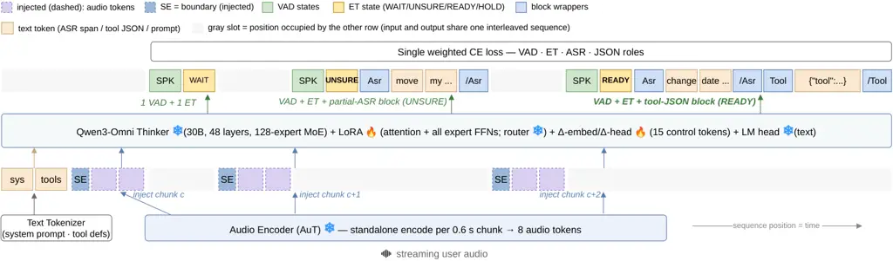

# Heard Enough to Act: Early Tool Calling in Spoken Dialogue Systems

Yizhou Peng    Chen Chen    Donghang Wu    Hexin Liu    Eng Siong Chng

###### Abstract

Latency-sensitive spoken agents must know not only which tool to call,
but also when they have heard enough to act. Waiting for the turn to
complete delays execution even when the request is already actionable.
However, neither existing spoken agents nor spoken dialogue corpora
define the earliest point at which a request becomes actionable. We
introduce a synthetic spoken-dialogue pipeline that provides
earliest-actionable-point supervision, marking when the observed speech
grounds a tool and its required arguments. Through controlled task
generation, speech synthesis and alignment, and gated annotation, we
construct 26,694 dialogues totaling 786 hours across 48 domains, with
disjoint training and test argument values. We additionally create an
audio rendering of $`\tau^{2}`$-bench for external evaluation. We train
an omni-modal language model on this corpus, enabling causal,
chunk-level decisions and partial-transcript generation for downstream
call completion. The model achieves tool-state macro-F1 scores of 0.48
and 0.47 on held-out dialogues and the external benchmark, respectively.
For correct calls, the estimated mean lead over a turn-end cascade,
using the same formatter, is 1.8–2.0 seconds in-domain and 1.1 seconds
on the $`\tau^{2}`$. These results demonstrate a data-driven path toward
spoken agents that act while listening. We will open-source the pipeline
and the training scripts.

###### Index Terms: 

full-duplex interaction, low latency, tool calling, spoken dialogue
systems

^(†)^(†)address: ¹ Nanyang Technological University, Singapore  ² AI
Singapore, Singapore

## 1 Introduction

People keep conversation flowing by planning their reply while the other
person is still talking, so turns follow within a fraction of a second
\[26, 14\]. A tool-using voice agent, cascaded or end-to-end, still
waits for the user to finish before doing anything: only then does it
work out what was said, commit to a tool and its arguments, place the
call, and await the result; these delays stack rather than overlap. Even
systems engineered to respond within a couple of hundred milliseconds
start that clock at the end of the turn \[10\], and the wait routinely
reaches seconds, which users can notice \[15\]. We do not attack
transcription speed or the tool’s own round-trip here; we ask whether
the step in the middle, deciding on the call and filling in its
arguments, must wait for the turn to end at all.

Much of the field has made this wait _feel_ shorter instead. Incremental
generators bridge it with fillers, the way people say “um” while
composing a reply \[25\]; a recently deployed dialogue robot even
detects mid-utterance that a request is becoming clear, yet spends that
head start on a spoken preface while the lookup still waits for the turn
to end \[16\]. SHANKS \[4\] reasons while listening and completes more
than half of its tool calls before the user finishes; Stream RAG \[1\]
post-trains a speech model to issue tool queries during ongoing speech;
and DuplexSLA \[37\] decodes the user’s audio, the agent’s speech, and a
dedicated planning-and-tool-call stream on one shared clock for
car-cabin and smart-home schemas. All three learn their timing from
proxies, LLM-judged offsets, or change-detection labels; none defines
the moment at which a call first becomes decidable, verifies that its
labels sit at that moment, or scores timing against it.

The rest of the landscape leaves that moment equally untouched.
Full-duplex models such as Moshi and SyncLLM \[6, 27\] and chunk-level
turn-taking predictors \[30, 3, 29, 9\] decide chunk by chunk who holds
the floor; the newest think while the user speaks in explicit tokens
\[31\] or latent embeddings \[32\], yet the choice remains silence,
thought, or speech, never a tool call. Incremental dialogue research has
shown that meaning is often settled before an utterance ends \[23, 8\],
but has never tied that insight to an irreversible external action. And
tool-calling benchmarks score which call an agent produces from a
completed turn \[36, 2, 18\]; even their recent extensions into audio
and full-duplex voice, including a rendering of $`\tau^{2}`$-bench
itself, test whether speech changes _what_ to call or whether the task
still completes, not _when_ the call became callable \[12, 17, 20\]. In
short, no existing system fixes the earliest instant at which the tool
and every argument are grounded in the audio, or scores its timing
against that instant by construction.

In this paper, we aim to fire the tool call at the moment the user has
said enough, and doing so is as much a data problem as a modeling one:
no spoken task-oriented corpus, human-recorded \[24\] or LLM-generated
\[28\], marks the earliest instant at which a call’s tool and all its
arguments are grounded in the audio heard so far, and generated corpora
invite the train–test contamination that inflates scores \[7\]. We built
a synthetic spoken-dialogue pipeline that stamps every call with that
instant, keeping training and test argument values disjoint by
construction, and adapted an omni-modal LLM with LoRA to judge whether
the instant has arrived, then either emit the call itself or hand off a
short transcribed span for downstream completion. On held-out data and
on our own audio rendering of $`\tau^{2}`$-bench \[2\], our model, when
it fires at the right moment, recovers the correct call more often than
not and starts it an estimated 1.8–2.0 s early on average; the remaining
bottleneck is the firing decision itself, which misses a fair share of
call opportunities and triggers on some turns it should leave alone. Our
contributions are:

- •
  a 786 h synthetic spoken-dialogue corpus with gated,
  alignment-anchored earliest-actionable-point label pipeline and a
  leakage-free split by construction;
- •
  a single-stream control-token model that decides, per chunk, whether
  that point has arrived;
- •
  a payload study on what the model should emit when it fires, so that
  an early fire becomes a correct tool call.

Figure 1: Data pipeline. Typed task templates are instantiated by a
deterministic entity sampler, simulated as text dialogues, rendered to
aligned speech, and annotated with gated early-tool-call events; the
green event carries the earliest-actionable-point label
($`t_{\text{fire}}`$) and its saved time. The table on the right glosses
the per-chunk labels.

## 2 Methods: Data Pipeline and Modeling

We cast early tool calling (ET) as a per-chunk decision problem. User
audio arrives in 0.6 s chunks; after each chunk, the model emits a
voice-activity token and a tool state in {wait, unsure, ready, hold} on
speech, as shown in Fig. 1. ready commits mid-utterance to a specific
call and unsure flags a likely but under-specified tool; either emission
is a _fire_. Each gold call is an event
$`(\text{tool},\text{args},t_{\text{fire}})`$, where $`t_{\text{fire}}`$
is the earliest instant at which every required argument is grounded in
the speech heard so far, and
$`\Delta_{\text{save}}=t_{\text{end}}-t_{\text{fire}}`$ is its _gold
saving_ over a turn-end call.

### 2.1 Data pipeline

Figure 1 shows the generation stack. GPT-5.5 authors 48 domains with
18–19 task _templates_ each (900 tasks) whose identity fields are typed
entity slots; a deterministic, collision-checked sampler instantiates
$`30\times 900=27{,}000`$ profiles (306 yield no usable dialogue,
leaving 26,694); two DeepSeek-V4Pro Preview sessions \[5\] simulate the
user and agent scripts; Chatterbox-turbo \[22\] synthesizes each turn
with per-persona cloned voices; and the NeMo forced aligner \[19\]
provides word-level timestamps.

Tool-call supervision is annotate-then-gate. Each profile receives a
synthesized tool pool (mean 4.5 tools), GPT-5.6-Terra proposes candidate
events, and three deterministic gates verify every proposal: Gate 1
discards non-executable calls (unknown tool, malformed or
type-mismatched arguments); Gate 2 collects arguments that the
transcript does not ground or that a later utterance supersedes; Gate 3
resolves them, repairs the argument, or delays $`t_{\text{fire}}`$ to
the instant the argument is actually grounded. The funnel prunes
$`140{,}595\to 78{,}193\to 53{,}492`$ events, and with
$`t_{\text{fire}}`$ anchored to the forced alignment,
$`\Delta_{\text{save}}`$ has mean 2.40 s, median 1.36 s, and p90 6.60 s.
Since the gates can only delay, $`t_{\text{fire}}`$ is an upper bound on
the true earliest point. We then expand events onto the 0.6 s grid:
every chunk carries a VAD label (spk/sil); the speech chunk at
$`t_{\text{fire}}`$ takes ready or unsure, and the other speech chunks
read wait before the turn’s first fire and hold after it, an
anti-duplicate guard that a fresh ready (a correction or a second tool)
can still break. Table 1 summarizes the corpus. Splitting by _task-group
holdout_ leaves zero train/test argument-value overlap. For open
benchmarking, we ran the identical pipeline on $`\tau^{2}`$-bench’s own
tasks and tool schemas \[2\]. Unlike $`\tau`$-Voice \[20\], this
rendering scores the _firing decision_ per chunk, not task completion.



Figure 2: Single-stream model design. One autoregressive, KV-cached
sequence interleaves injected audio chunks with emitted control tokens
and payload blocks; one LM head decodes VAD, ET, ASR, and tool JSON
under a single weighted cross-entropy loss. Snowflakes are frozen;
flames are trainable. The example shows the asr+json variant of Eq. (1).

### 2.2 Modeling

Fig. 2 shows the model. We keep Qwen3-Omni-30B-A3B \[34, 35\] frozen,
add fifteen control tokens (VAD and ET states, payload delimiters,
pending markers) whose embedding and output rows are initialized to the
mean of related words and trained only through small _delta_ vectors, as
in prompt tuning \[13\], and attach LoRA \[11\] to attention and all
per-expert FFN projections.

|                                             |                 |                        |
| ------------------------------------------- | --------------- | ---------------------- |
|                                             | Main corpus     | $`\tau^{2}`$ rendering |
| Dialogues                                   | 26,694          | 274                    |
| Held-out dialogues (valid / test)           | 210 / 210       | 0 / 274                |
| Domains                                     | 48              | 3                      |
| Audio                                       | 786 h           | 4.9 h                  |
| ready / unsure events                       | 28,791 / 24,701 | 238 / 11               |
| Test gold events                            | 463             | 249                    |
| Gold $`\Delta_{\text{save}}`$ med / p90 (s) | 1.36 / 6.60     | 0.00 / 3.87            |

Table 1: Corpus statistics. The $`\tau^{2}`$ column is the external,
eval-only rendering of $`\tau^{2}`$-bench tasks.

We assemble one sequence per dialogue. The system prompt and the
profile’s tool schemas are followed by a boundary token, the chunk’s 8
audio embeddings $`\mathbf{x}_{c}`$ (0.6 s of audio), and the emitted
tokens $`\mathbf{y}_{c}`$ predicted as
$`p(\mathbf{y}_{c}\mid\mathbf{x}_{\leq c},\mathbf{y}_{<c})`$. Every
$`\mathbf{y}_{c}`$ begins with a VAD token
$`v_{c}\in\{\textsc{spk},\textsc{sil}\}`$ and if
$`v_{c}{=}\textsc{spk}`$ then an ET state $`s_{c}`$. ready and unsure
open a payload block, and three _payload variants_ differ only in what
it contains:

```math
\mathbf{y}_{c}=\begin{cases}(v_{c},\,s_{c})&\textsc{none}\\
(v_{c},\,s_{c},\,a_{c}\,[s_{c}{\in}\{\textsc{r},\textsc{u}\}])&\textsc{asr}\\
(v_{c},\,s_{c},\,a_{c}\,[s_{c}{\in}\{\textsc{r},\textsc{u}\}],\,j_{c}\,[s_{c}{=}\textsc{r}])&\textsc{asr+json}\end{cases} \tag{1}
```

where $`[\cdot]`$ is the emission condition, r/u abbreviate
ready/unsure, $`a_{c}`$ is a partial-ASR span of the speech heard so far
between \<asr\> delimiters, and $`j_{c}`$ is the tool-call JSON
({"tool_name", "arguments"}, keys sorted) between \<tool\> delimiters.
Each variant answers differently how a fire becomes an executable call:
asr+json is self-contained, its ready JSON being the call; asr
externalizes formatting, sending its span, the tool schemas, and the
dialogue prefix to a frozen LLM formatter that emits the JSON; none
carries no payload, so acting on its fires also requires an external ASR
pass over the audio near the fire.

## 3 Experiments

### 3.1 Setup

All variants are trained with LoRA rank $`r{=}16`$ (843.8M trainable
parameters), under one weighted cross-entropy (VAD 0.4; ET, ASR, JSON
1.0; ready/unsure class weights 6/10) with event-count-aware
oversampling, early stopping, and a single seed. We decode the held-out
test split and the audio-rendered $`\tau^{2}`$-bench in streaming mode,
with a finite-state machine masking illegal tokens per slot, and score
at two levels of granularity. At the _state_ level, every chunk’s VAD
state and every speech chunk’s ET state are classified against gold with
exact alignment. At the _event_ level, each ready/unsure emission is a
predicted event and is _matched_ if a gold event of the same state lies
within $`\pm 2`$ chunks ($`\pm 1.2`$ s) regardless of payload. This rule
yields the event metrics of Table 2 and the _matched fires_ that form
the denominator of Table 5 and Fig. 3. The tolerance reflects the coarse
0.6 s grid: a gold $`t_{\text{fire}}`$ near a chunk boundary is
legitimately answered from the neighboring chunk. We report event
recall/precision/F1, ET/VAD-state macro-F1, per-state F1, and word error
rate (WER) of emitted partial-ASR spans; at the call level, we report on
matched ready fires, exact match (EM) of the JSON string, tool-name
accuracy, and argument accuracy (micro-averaged over gold slots). The
formatter is Qwen3-235B-A22B or Qwen3-30B-A3B \[35\], prompted with the
tool pool, the completed turns before the event, previous calls, and the
model’s emissions.

The _achieved saving_ is
$`t_{\text{end}}-t^{\text{pred}}_{\text{fire}}`$, charging a predicted
fire at the end of its chunk. It estimates the savings over the turn-end
cascade turn, which transcribes the completed turn and hands it to the
same formatter, which also decides whether to call. turn-asr uses
Parakeet-TDT-CTC 1.1B \[21, 33\], the aligner of our data pipeline, as
external ASR; turn-gold uses the gold transcript; none runs the same ASR
over the audio window around its fire. The baseline transcript is
charged at zero latency, an ideal streaming recognizer, and the
assumption most favorable to the baseline.

### 3.2 Results

| Payload variant      | none  |              | asr   |              | asr+json |              |
| -------------------- | ----- | ------------ | ----- | ------------ | -------- | ------------ |
| Test split           | ID    | $`\tau^{2}`$ | ID    | $`\tau^{2}`$ | ID       | $`\tau^{2}`$ |
| Event recall         | 0.553 | 0.558        | 0.510 | 0.562        | 0.495    | 0.582        |
| Event precision      | 0.123 | 0.147        | 0.349 | 0.412        | 0.329    | 0.409        |
| Event F1             | 0.201 | 0.232        | 0.414 | 0.475        | 0.395    | 0.480        |
| ET-state macro-F1    | 0.477 | 0.425        | 0.484 | 0.474        | 0.463    | 0.461        |
| VAD-state macro-F1   | 0.993 | 0.976        | 0.996 | 0.982        | 0.994    | 0.979        |
| Partial-ASR span WER | —     | —            | 0.120 | 0.551        | 0.112    | 0.478        |

Table 2: Decision quality on the in-domain (ID) and audio-rendered
$`\tau^{2}`$-bench splits for event, state, and WER across three
variants. Bold marks the best variant per row within each split.

|          |         | wait  | ready | unsure | hold  | Macro |
| -------- | ------- | ----- | ----- | ------ | ----- | ----- |
| none     | @0      | 0.936 | 0.309 | 0.175  | 0.488 | 0.477 |
|          | @$`+1`$ | 0.938 | 0.405 | 0.242  | 0.493 | 0.519 |
|          | @$`+3`$ | 0.938 | 0.432 | 0.272  | 0.493 | 0.534 |
| asr      | @0      | 0.932 | 0.315 | 0.206  | 0.483 | 0.484 |
|          | @$`+1`$ | 0.934 | 0.384 | 0.244  | 0.487 | 0.512 |
|          | @$`+3`$ | 0.934 | 0.406 | 0.277  | 0.487 | 0.526 |
| asr+json | @0      | 0.927 | 0.299 | 0.158  | 0.469 | 0.463 |
|          | @$`+1`$ | 0.929 | 0.359 | 0.205  | 0.471 | 0.491 |
|          | @$`+3`$ | 0.929 | 0.367 | 0.232  | 0.471 | 0.500 |

Table 3: Per-class ET F1, computed per chunk over all speech chunks for
the in-domain test split. F1@$`+k`$ credits a prediction up to $`k`$
chunks ($`0.6k`$ s) late via exact matching; @0 is exact alignment. Bold
marks the best variant per column at @0.

Table 2 reports the decision layer on both domains. All three variants
detect events with recall around 0.5 on ID and 0.56–0.58 on
$`\tau^{2}`$, though emitting a payload does sharpen the decision: the
payload-free none fires far too often, with precision of only 0.123 and
0.147 for ID and $`\tau^{2}`$, while asr, which transcribes at the fire,
gives the best ID event F1 of 0.414 and the best state classification
for both ET and VAD; the asr/asr+json differences are small. The
decision layer carries over to $`\tau^{2}`$ largely intact: ET-state
macro-F1 is unchanged for the span variants (only none drops by 0.05),
and event F1 comes out even higher, with precision of 0.412. The payload
is where transfer breaks: partial-ASR WER is 0.11–0.12 in domain but
rises to 0.48 and 0.55 for asr+json and asr on $`\tau^{2}`$’s unseen
entity-value patterns.

Table 3 splits the ET-state macro-F1 by state and by lateness tolerance.
wait is nearly solved and ready/unsure carry the errors: false-positive
ready fires are the precision bottleneck, and every variant learns
unsure where asr gets best F1 of 0.206. Granting one chunk of lateness
tolerance lifts ready F1 by 0.06–0.10 and the macro by 0.03–0.04, with
little further gain at $`+3`$: a sizeable share of the apparent errors
are fires one chunk late.

| Variant   | Decision from | Fired | P     | R     | F1    |
| --------- | ------------- | ----- | ----- | ----- | ----- |
| asr       | model ready   | 458   | 0.376 | 0.589 | 0.459 |
| asr+json  | model ready   | 418   | 0.409 | 0.586 | 0.482 |
| turn-asr  | Parakeet text | 789   | 0.331 | 0.894 | 0.483 |
| turn-gold | gold text     | 751   | 0.348 | 0.894 | 0.500 |

Table 4: Firing decision under one turn-level rule for in-domain test
split (1,499 user turns, 292 with a gold ready event). A system fires on
a turn if it emits at least one ready in it; a fire is a true positive
if that turn holds a gold ready. The payload variants fire from their
own streaming ready decisions; turn fires when the formatter decides to
call. Bold marks the best per column.

Table 4 answers the question: on a turn that needs a call, did the
system fire? It scores every system under one turn-level rule, so our
systems can be set against the turn-end cascade turn. turn is
recall-heavy; at recall 0.894 it fires on 751–789 of the 1,499 turns,
two-thirds of them without a gold ready, whereas asr+json gives up 0.3
of recall for the highest precision of 0.409; F1 is within 0.05 across
all four. Deciding early thus trades off recall for precision at the
same F1. Even so, 59% of early fires are spurious at this operating
point, so the precision an agent needs before committing a call has not
yet been reached.

Figure 3: Achieved saving of _correct_ early calls (Qwen3-235B-A22B
formatter) over the turn baseline: fraction of calls saving more than
$`x`$ seconds. Dots mark means (legend); the value at $`x{=}0`$ is the
fraction that fires before the turn ends; medians over all correct calls
are 0.0 s (asr) and 0.7 s (asr+json) on ID.

Figure 3 shows the distribution of the achieved saving restricted to
_correct_ calls, with the Qwen3-235B-A22B formatter, for both variants
and both domains. The distributions are heavily right-skewed. For ID,
about half of the correct calls fire before the turn ends (50% for asr,
54% for asr+json); the rest fire in the turn’s final chunk. The median
saving over all correct calls is therefore 0.0 s (asr) and 0.7 s
(asr+json); among the calls that do fire early, the median is 2.6 s, and
44% and 47% of correct calls save more than 1 s, so the means (1.83 and
2.01 s, legend) are carried by a long tail. On $`\tau^{2}`$, gold
$`\Delta_{\text{save}}`$ has a median of 0 because its turns place tool
evidence at the turn end, which makes the timing task easier; even so,
54–55% of the correct calls fire before the turn end, with a median
saving of 1.8 s among them.

|          |            |           |       |       |       |              |       |       |
| -------- | ---------- | --------- | ----- | ----- | ----- | ------------ | ----- | ----- |
|          |            |           | ID    |       |       | $`\tau^{2}`$ |       |       |
| Variant  | Call from  | Formatter | EM    | Tool  | Arg   | EM           | Tool  | Arg   |
| asr+json | model JSON | —         | 0.173 | 0.232 | 0.519 | 0.000        | 0.073 | 0.054 |
| asr+json | model ASR  | 235B      | 0.536 | 0.833 | 0.710 | 0.681        | 0.978 | 0.844 |
| asr+json | model ASR  | 30B       | 0.530 | 0.833 | 0.707 | 0.674        | 0.964 | 0.839 |
| asr      | model ASR  | 235B      | 0.578 | 0.840 | 0.711 | 0.618        | 0.971 | 0.770 |
| asr      | model ASR  | 30B       | 0.535 | 0.845 | 0.683 | 0.588        | 0.963 | 0.776 |
| asr      | GT ASR     | 235B      | 0.626 | 0.840 | 0.760 | 0.838        | 0.963 | 0.888 |
| asr      | GT ASR     | 30B       | 0.588 | 0.856 | 0.737 | 0.831        | 0.963 | 0.893 |
| none     | ext. ASR   | 235B      | 0.038 | 0.870 | 0.493 | 0.090        | 0.955 | 0.696 |
| turn     | ext. ASR   | 235B      | 0.103 | 0.789 | 0.634 | 0.073        | 0.744 | 0.753 |
| turn     | GT ASR     | 235B      | 0.605 | 0.751 | 0.832 | 0.558        | 0.694 | 0.915 |

Table 5: Call quality by payload variant. _Variant_: whose ready fires
trigger the call. _Call from_: the text the call is built from, with the
model’s own JSON (no formatter), the model’s own span ($`a_{c}`$), a
Parakeet transcript, or the gold transcript; the latter three are via
the formatter. For turn the text covers the completed turn; for all
other variants, the audio up to the fire. EM, tool-name, and argument
accuracy on matched fires (turn: on true-positive turns). Bold marks the
best per column (except GT ASR).

## 4 Ablation: producing the call

Table 5 compares the strategies on the models’ own ready fires.

_Externalizing the call is clearly better._ On asr+json’s own fires, the
formatter given the model’s span reaches EM 0.536, against 0.173 for the
JSON the model emits itself, and the decomposition shows why: the
trained JSON head names the tool on only 23% of matched fires and fills
52% of argument slots, whereas the formatter reaches 0.83 and 0.71 from
the same span. The asr variant, trained without a JSON head, still
performs slightly better with EM of 0.578.

_Span fidelity, not the formatter, is the residual._ The gold-text rows
bound the remaining loss: tool naming is unchanged with ACC of 0.84
while argument accuracy rises to 0.76 and EM to 0.63, so what the model
transcribes at the fire moment is the dominant error; the 30B formatter
concedes at most 4.3 EM points.

_A bare decision is not enough._ The decision-only none variant names
the tool from a Parakeet pass over the fire window with Tool ACC of
0.87, but fills only half the argument slots, and its EM falls to 0.038
because Parakeet output carries spoken-form entities that never
string-match the gold JSON. The model’s own transcribe-at-fire span is
what makes the call executable (on $`\tau^{2}`$, the same variant
improves to EM 0.090 on shorter, more regular payloads, still roughly
$`7\times`$ below the span variants).

_Against the turn-end cascade._ The turn rows are the deployed
alternative. With Parakeet text, turn-asr names the tool on 79% of its
true-positive turns and fills 63% of argument slots, against 83% of
slots with gold text, yet scores EM 0.103: the same normalization
failure, not timing. With gold text, it reaches EM 0.605. The pattern
transfers: on $`\tau^{2}`$, the Parakeet arm again falls to EM 0.073
while gold text holds 0.558.

## 5 Conclusion

This paper presented spoken tool calling as an earliest-actionable-point
decision. A synthetic pipeline labels, for 26,694 dialogues, the instant
each call’s tool and arguments are grounded in the audio, with disjoint
train/test values; a LoRA-adapted Qwen3-Omni-30B-A3B decides per 0.6 s
chunk whether that instant has arrived and emits the call as JSON or a
partial transcript for an off-the-shelf formatter. Under streaming
decoding on held-out dialogues and audio-rendered $`\tau^{2}`$-bench,
the decision reaches macro-F1 of 0.48 and 0.47, and correct early calls
start an estimated 1.8–2.0 s sooner than a turn-end cascade with the
same formatter. The transcript yields exact calls $`3\times`$ as often
as self-emitted JSON (0.54 vs. 0.17 on the same fires), and a
payload-free decision plus external ASR fills half the argument slots.
The evidence is single-seed on one base model; with 59% of early fires
spurious, fire precision is the open gap.

## References

- \[1\] S. Arora et al. (2025) Stream RAG: instant and accurate spoken
  dialogue systems with streaming tool usage. arXiv:2510.02044. Cited
  by: §1.
- \[2\] V. Barres, H. Dong, S. Ray, X. Si, and K. Narasimhan (2025)
  $`\tau^{2}`$-Bench: evaluating conversational agents in a dual-control
  environment. arXiv:2506.07982. Cited by: §1, §1, §2.1.
- \[3\] Q. Chen et al. (2025) MinMo: a multimodal large language model
  for seamless voice interaction. arXiv:2501.06282. Cited by: §1.
- \[4\] C. Chiang et al. (2025) SHANKS: simultaneous hearing and
  thinking for spoken language models. arXiv:2510.06917. Cited by: §1.
- \[5\] DeepSeek-AI (2026) DeepSeek-V4: towards highly efficient
  million-token context intelligence. arXiv:2606.19348. Cited by: §2.1.
- \[6\] A. Défossez et al. (2024) Moshi: a speech-text foundation model
  for real-time dialogue. arXiv:2410.00037. Cited by: §1.
- \[7\] C. Deng, Y. Zhao, X. Tang, M. Gerstein, and A. Cohan (2024)
  Investigating data contamination in modern benchmarks for large
  language models. In Proc. NAACL, Cited by: §1.
- \[8\] D. DeVault, K. Sagae, and D. Traum (2009) Can I finish? Learning
  when to respond to incremental interpretation results in interactive
  dialogue. In Proc. SIGDIAL, Cited by: §1.
- \[9\] E. Ekstedt and G. Skantze (2022) Voice activity projection:
  self-supervised learning of turn-taking events. In Proc. Interspeech,
  Cited by: §1.
- \[10\] Q. Fang et al. (2025) LLaMA-Omni: seamless speech interaction
  with large language models. In Proc. ICLR, Cited by: §1.
- \[11\] E. J. Hu et al. (2022) LoRA: low-rank adaptation of large
  language models. In Proc. ICLR, Cited by: §2.2.
- \[12\] M. T. R. Laskar et al. (2026) From text to voice: a
  reproducible and verifiable framework for evaluating tool calling LLM
  agents. arXiv:2605.15104. Cited by: §1.
- \[13\] B. Lester, R. Al-Rfou, and N. Constant (2021) The power of
  scale for parameter-efficient prompt tuning. In Proc. EMNLP, Cited by:
  §2.2.
- \[14\] S. C. Levinson and F. Torreira (2015) Timing in turn-taking and
  its implications for processing models of language. Front. Psychol. 6,
  pp. 731. Cited by: §1.
- \[15\] M. Maslych et al. (2025) Mitigating response delays in
  free-form conversations with LLM-powered intelligent virtual agents.
  In Proc. ACM CUI, Cited by: §1.
- \[16\] Y. Okafuji, K. Inoue, and Y. Ohira (2026) Low-latency
  turn-taking via context-aware preface generation in a real-world
  dialogue robot. arXiv:2607.23204. Cited by: §1.
- \[17\] R. Pahwa et al. (2026) Audio2Tool: speak, call, act — a dataset
  for benchmarking speech tool use. arXiv:2604.22821. Cited by: §1.
- \[18\] S. G. Patil et al. (2025) The Berkeley function calling
  leaderboard (BFCL): from tool use to agentic evaluation of large
  language models. In Proc. ICML, Cited by: §1.
- \[19\] E. Rastorgueva, V. Lavrukhin, and B. Ginsburg (2023) NeMo
  forced aligner and its application to word alignment for subtitle
  generation. In Proc. Interspeech (Show & Tell), Cited by: §2.1.
- \[20\] S. Ray et al. (2026) $`\tau`$-Voice: benchmarking full-duplex
  voice agents on real-world domains. arXiv:2603.13686. Cited by: §1,
  §2.1.
- \[21\] D. Rekesh et al. (2023) Fast conformer with linearly scalable
  attention for efficient speech recognition. In Proc. IEEE ASRU, Cited
  by: §3.1.
- \[22\] Resemble AI (2025) Chatterbox-TTS. Note:
  https://github.com/resemble-ai/chatterboxGitHub repository Cited by:
  §2.1.
- \[23\] D. Schlangen and G. Skantze (2009) A general, abstract model of
  incremental dialogue processing. In Proc. EACL, Cited by: §1.
- \[24\] S. Si et al. (2023) SpokenWOZ: a large-scale speech-text
  benchmark for spoken task-oriented dialogue agents. In Proc. NeurIPS
  Datasets and Benchmarks, Cited by: §1.
- \[25\] G. Skantze and A. Hjalmarsson (2013) Towards incremental speech
  generation in conversational systems. Comput. Speech Lang. 27 (1),
  pp. 243–262. Cited by: §1.
- \[26\] T. Stivers et al. (2009) Universals and cultural variation in
  turn-taking in conversation. Proc. Natl. Acad. Sci. 106 (26),
  pp. 10587–10592. Cited by: §1.
- \[27\] B. Veluri et al. (2024) Beyond turn-based interfaces:
  synchronous LLMs as full-duplex dialogue agents. In Proc. EMNLP, Cited
  by: §1.
- \[28\] M. Wang et al. (2025) SpeechDialogueFactory: generating
  high-quality speech dialogue data to accelerate your Speech-LLM
  development. arXiv:2503.23848. Cited by: §1.
- \[29\] P. Wang, S. Lu, Y. Tang, S. Yan, W. Xia, and Y. Xiong (2024) A
  full-duplex speech dialogue scheme based on large language model. In
  Proc. NeurIPS, Cited by: §1.
- \[30\] X. Wang et al. (2024) Freeze-omni: a smart and low latency
  speech-to-speech dialogue model with frozen LLM. arXiv:2411.00774.
  Cited by: §1.
- \[31\] D. Wu et al. (2026) Chronological thinking in full-duplex
  spoken dialogue language models. In Proc. SIGDIAL, pp. 473–485. Cited
  by: §1.
- \[32\] D. Wu et al. (2026) The silent thought: modeling internal
  cognition in full-duplex spoken dialogue models via latent reasoning.
  arXiv:2603.17837. Cited by: §1.
- \[33\] H. Xu et al. (2023) Efficient sequence transduction by jointly
  predicting tokens and durations. In Proc. ICML, Cited by: §3.1.
- \[34\] J. Xu et al. (2025) Qwen3-omni technical report.
  arXiv:2509.17765. Cited by: §2.2.
- \[35\] A. Yang et al. (2025) Qwen3 technical report. arXiv:2505.09388.
  Cited by: §2.2, §3.1.
- \[36\] S. Yao, N. Shinn, P. Razavi, and K. Narasimhan (2024)
  $`\tau`$-Bench: a benchmark for tool-agent-user interaction in
  real-world domains. arXiv:2406.12045. Cited by: §1.
- \[37\] H. Zhang et al. (2026) DuplexSLA: a full-duplex spoken language
  model with synchronized speech, language, and action.
  arXiv:2605.20755. Cited by: §1.
