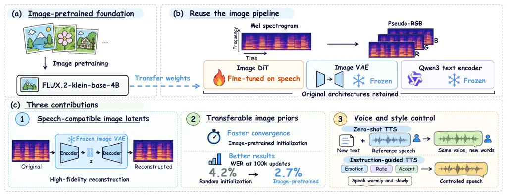
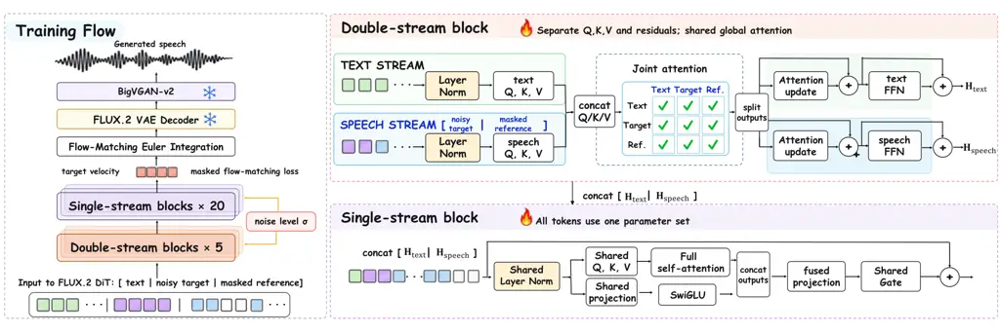
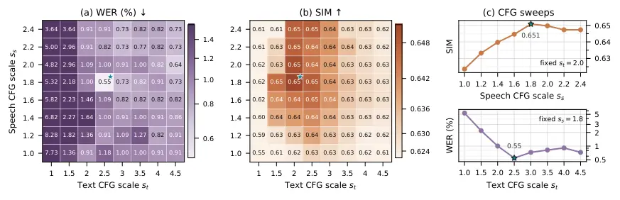

# ImageTTS: Repurposing Pretrained Image Diffusion Transformers for Speech Synthesis

Hanchen Pei¹  Shujie Liu²  Yayue Deng³  Fangyun Wei²  
Yanqing Liu²  Jianwei Yu²  Gongping Huang¹  
¹Electronic Information School, Wuhan University, Wuhan, China
²Microsoft Corporation, Redmond, US ³The Chinese University of Hong
Kong, Hong Kong, China
phc_whu@whu.edu.cn shujliu@microsoft.com yayue.apply@gmail.com  
Fangyun.Wei@microsoft.com yanqliu@microsoft.com  
tomasyu@foxmail.com gongpinghuang@whu.edu.cn

###### Abstract

Pretrained image-generation models have been successfully repurposed for
various downstream visual tasks. Whether their learned representations
and generative priors can transfer beyond vision to other modalities
remains largely unresolved, particularly for speech synthesis, which
requires linguistic fidelity and preservation of speaker identity from a
short reference. We present ImageTTS, which repurposes FLUX.2 for speech
synthesis by encoding pseudo-RGB log-mel spectrograms with its frozen
image VAE and adapting only its pretrained Diffusion Transformer (DiT)
using conditional latent flow matching. This formulation disentangles
two forms of vision-to-speech transfer: representation transfer through
the image VAE and generative-prior transfer through DiT initialization.
The frozen image VAE largely preserves intelligibility and speaker
identity with 0.99 STOI and 0.95 speaker similarity, while
image-pretrained DiT initialization accelerates convergence and improves
linguistic accuracy, reducing WER from 4.2% to 2.7% at 100k matched
updates relative to random initialization. The same framework supports
both zero-shot and instruction-guided TTS and, when scaled to 100K hours
of speech data, achieves 1.12% WER on Seed-TTS test-en and a Style-ACC
of 0.66 on CapSpeech, outperforming speech-native baselines trained on
comparable data across both tasks. These results suggest that pretrained
image models can transfer beyond architectural reuse, supplying useful
latent representations and generative priors for intelligible and
controllable speech synthesis.

|     |
| --- |
|     |

## 1 Introduction

Pretrained generative models are increasingly repurposed beyond the
tasks and data modalities on which they were originally trained. For
image generation, diffusion and flow-based models have shown that
learned representations and denoising priors can support a range of
downstream visual problems, including image editing, geometric
prediction, and video generation (Blattmann et al., 2023; Ke et al.,
2024; Fu et al., 2024). However, nearly all successful adaptations
remain within the visual domain, leaving unresolved whether a
text-to-image model can provide not only a reusable architecture but
also the _latent representation_ and _pretrained generative prior_ for
speech synthesis.

Speech synthesis offers a demanding test of this cross-modal transfer.
Unlike many generation tasks in which text specifies high-level
semantics, speech synthesis requires both faithful realization of the
linguistic content and preservation of speaker identity from a reference
utterance. Recent speech generation systems have adopted architectural
and algorithmic innovations originating from image generation. For
example, diffusion-based speech models apply iterative denoising to
waveform and mel-spectrogram generation (Kong et al., 2021; Popov et
al., 2021), while F5-TTS and MaskGCT further adopted Diffusion
Transformers (DiTs) and MaskGIT-style architectures, respectively (Chen
et al., 2025b; Peebles and Xie, 2023; Wang et al., 2025d; Chang et al.,
2022). Riffusion (Forsgren and Martiros, 2022) provides an early
exception by fine-tuning Stable Diffusion (Rombach et al., 2022) on
spectrogram images for text-conditioned music generation, which offers
initial evidence that representations and generative priors acquired
from images can be useful for spectrogram modeling.

Despite this early evidence, systematic transfer of pretrained image
knowledge to speech remains underexplored. We therefore study
vision-to-speech transfer through three related but separable
evaluations, focusing on representation transfer, initialization
transfer, and downstream scaling: Q1: Can a pretrained image latent
space faithfully represent speech? Q2: Do image-generation priors
improve speech synthesis relative to random initialization? and Q3: How
competitive can a vision-to-speech transfer paradigm become at scale?



Figure 1: Overview of ImageTTS. (a) FLUX.2 is pretrained on images and
provides the DiT initialization for speech generation. (b) Log-mel
spectrograms are converted into pseudo-RGB inputs; the image VAE and
Qwen3 text encoder remain frozen, while the DiT is fine-tuned for
speech. (c) Three findings: the image VAE supports high-fidelity speech
reconstruction, image-pretrained initialization accelerates convergence
and improves WER over random initialization, and the framework supports
zero-shot TTS and instruction-guided TTS.

To investigate these questions, we present ImageTTS, a framework that
repurposes FLUX.2-klein-base-4B (hereafter FLUX.2) for speech
generation, as shown in Figure 1. ImageTTS converts log-mel spectrograms
into pseudo-RGB images, encodes them with the frozen FLUX.2 image VAE,
and fine-tunes only the pretrained DiT backbone using conditional latent
flow matching. Within this formulation, zero-shot TTS is cast as
reference-conditioned latent infilling, whereas instruction-guided TTS
is formulated as full latent generation conditioned on a transcript and
a description. Our contributions are threefold:

- •
  A direct vision-to-speech bridge: We introduce ImageTTS, a controlled
  framework for studying transfer from a pretrained text-to-image model
  to speech synthesis, separating image-latent representation transfer
  from image-pretrained generative-prior transfer.
- •
  Evidence of transfer: We provide evidence for transfer at both levels.
  The frozen image VAE preserves high speech intelligibility and speaker
  identity information, and image-pretrained DiT initialization improves
  convergence and linguistic accuracy over a randomly initialized model
  under matched training conditions.
- •
  Scaling to zero-shot and instruction-guided TTS: With approximately
  100K hours of speech pretraining, ImageTTS-base achieves competitive
  zero-shot TTS performance. Further trained on CapSpeech,
  ImageTTS-instruct enables natural-language control of speaker
  attributes and speaking styles, outperforming comparable baselines.

## 2 Related work

### 2.1 Diffusion and flow models for zero-shot TTS

NaturalSpeech 2 was among the earliest large-scale non-autoregressive
systems for zero-shot TTS, generating speech latents conditioned on
explicit phoneme alignments and acoustic priors (Shen et al., 2024).
DiTTo-TTS subsequently introduces a scalable Diffusion Transformer
(DiT), supplying variable-length text tokens through
cross-attention (Lee et al., 2025). A parallel line of work formulates
zero-shot TTS as flow-matching-based mel-spectrogram infilling. While
Voicebox establishes this formulation using frame-aligned phoneme
conditions (Le et al., 2023), E2-TTS removes the external phoneme
aligner by padding text tokens with fillers to match speech
length (Eskimez et al., 2024). F5-TTS retains this equal-length
conditioning scheme while replacing the U-Net-style Transformer with a
DiT backbone (Chen et al., 2025b). M3-TTS further removes filler-based
pseudo-alignment by applying shared self-attention to concatenated text
and speech tokens in its Joint-DiT, after which it discards the text
branch and processes only the speech tokens with its Single-DiT (Wang et
al., 2025b). ImageTTS similarly avoids token-level alignment, but
differs in how multimodal information is aggregated. Instead of early
shared fusion followed by speech-only refinement, ImageTTS retains
modality-specific representations in early double-stream blocks,
followed by fully unified multimodal modeling in subsequent
single-stream blocks.

### 2.2 Representation spaces for speech synthesis

Speech generation systems predominantly rely on discrete or continuous
acoustic targets. Discrete codec tokens allow speech to be modeled using
autoregressive or masked prediction across multiple or factorized
codebooks (Chen et al., 2025a; Wang et al., 2025d; Ju et al., 2024; Li
et al., 2024; Wang et al., 2025c; Du et al., 2024). Conversely,
waveform-space methods bypass intermediate tokens entirely by directly
generating raw audio patches (Gao et al., 2023; Chen et al., 2026b),
though at the expense of high temporal redundancy. To retain continuous
acoustic details without discrete quantization, models typically operate
on mel-spectrograms or continuous latent tokens. Mel-spectrograms serve
as fixed, continuous 2D acoustic features and are widely modeled via
diffusion, flow matching, or continuous autoregressive prediction (Popov
et al., 2021; Mehta et al., 2024; Zhu et al., 2025; Meng et al., 2025).
To achieve higher temporal compression, other continuous methods train
dedicated speech-specific autoencoders to extract continuous latent
representations (Jiang et al., 2025; Jia et al., 2025; Luo et al.,
2026). ImageTTS investigates an alternative continuous latent space.
Instead of training a speech-specific encoder, it encodes pseudo-RGB
mel-spectrograms using an off-the-shelf, frozen image VAE. This allows
us to examine whether a visual latent space can effectively preserve
speech information and support conditional synthesis.

### 2.3 Instruction-guided TTS

Natural-language instruction-guided TTS enables flexible control over
not only what to say but also how to say it, including speaking style,
emotion, and speaker attributes. Early approaches use dedicated prompt
encoders to derive style representations from natural-language
descriptions and condition speech synthesis alongside the input
transcript (Guo et al., 2023; Yang et al., 2024). More recent systems
instead place the transcript and description in a unified language
interface, allowing a single instruction sequence to condition
codec-token generation and support finer-grained control (Zhou et al.,
2024; Chen et al., 2026a). These developments are supported by speech
datasets paired with natural-language descriptions (Guo et al., 2023; Ji
et al., 2025; Wang et al., 2025a). ImageTTS reuses the pretrained image
text encoder for both the transcript and the style description, which
provides a test of whether an image-generation pipeline can understand
natural-language vocal descriptions and ground them in controllable
speech generation.

## 3 Method

In this section, we introduce ImageTTS. We first describe how
mel-spectrograms are converted into pseudo-RGB inputs and represented in
the latent space of the frozen image VAE. We then formulate speech
generation as conditional flow matching in this image latent space.
Finally, we instantiate this formulation for zero-shot TTS and
instruction-guided TTS.



Figure 2: Architecture of ImageTTS-base. The framework adopts a
Flow-Matching DiT backbone comprising double-stream blocks and
single-stream blocks conditioned on timestep $`\sigma`$. High-fidelity
speech is synthesized via Euler integration, a frozen FLUX.2 VAE
decoder, and BigVGAN-v2.

### 3.1 Speech representation in the pretrained image latent space

Speech is represented in the latent space of the frozen FLUX.2 image
VAE. Given a waveform, a single-channel log-mel spectrogram
$`\mathbf{M}_{\mathrm{mel}}\in\mathbb{R}^{F_{\mathrm{mel}}\times T_{\mathrm{mel}}}`$
is first extracted, where $`F_{\mathrm{mel}}=100`$ denotes the number of
mel-frequency bins and $`T_{\mathrm{mel}}`$ denotes the number of
temporal frames. The frequency and temporal axes are interpreted as the
height and width axes of an image, respectively. The FLUX.2 VAE
downsamples each spatial dimension by a factor of $`8`$, and is
subsequently rearranged into $`2\times 2`$ patches for DiT processing.
Accordingly, both input spatial dimensions are required to be divisible
by $`16`$. The mel-spectrogram is bilinearly resized from $`100`$ to
$`F`$ frequency bins and right-padded to a multiple of $`16`$ frames
using the utterance’s minimum log-mel value to approximate silence. It
is then linearly normalized to $`[-1,1]`$ using the training-set minimum
and maximum log-mel values and replicated across three channels,
yielding a pseudo-RGB input of shape $`3\times F\times T`$, where $`T`$
is the padded temporal length. The frozen VAE encoder maps this input to
a latent representation, which is standardized using the pretrained VAE
latent statistics.

### 3.2 Multi-task conditional flow matching

Let $`p_{0}`$ denote the standard Gaussian distribution and $`p_{1}`$
denote the empirical distribution of target speech latents. For a target
latent $`\mathbf{z}^{\mathrm{tgt}}\sim p_{1}`$ and Gaussian noise
$`\bm{\epsilon}\sim p_{0}`$, we obtain a noise level $`\sigma`$ from the
scheduler for a sampled training timestep. We then construct the linear
interpolation path and its corresponding target velocity as

```math
\mathbf{z}_{\sigma}=(1-\sigma)\mathbf{z}^{\mathrm{tgt}}+\sigma\bm{\epsilon},\qquad\mathbf{u}_{\sigma}=\frac{\partial\mathbf{z}_{\sigma}}{\partial\sigma}=\bm{\epsilon}-\mathbf{z}^{\mathrm{tgt}}. \tag{1}
```

Here, $`\sigma=1`$ corresponds to Gaussian noise and $`\sigma=0`$ to the
clean target latent. Let $`\mathbf{y}`$ denote the text-token sequence,
and let $`\mathbf{z}^{\mathrm{ref}}`$ denote an optional reference
speech latent. Conditioned on these inputs, the FLUX.2 DiT predicts the
velocity field

```math
\widehat{\mathbf{v}}_{\sigma}=\mathbf{v}_{\theta}\left(\mathbf{z}_{\sigma},\sigma\mid\mathbf{y},\mathbf{z}^{\mathrm{ref}}\right). \tag{2}
```

Let $`\overline{\mathbf{m}}`$ be a task-specific binary loss mask with
the same shape as $`\mathbf{z}^{\mathrm{tgt}}`$. We train the model with
the masked conditional flow-matching objective

```math
\mathcal{L}_{\mathrm{CFM}}=\mathbb{E}_{\sigma,\mathbf{z}^{\mathrm{tgt}},\bm{\epsilon}}\left[\frac{\left\|\overline{\mathbf{m}}\odot\left(\widehat{\mathbf{v}}_{\sigma}-\mathbf{u}_{\sigma}\right)\right\|_{2}^{2}}{\left\|\overline{\mathbf{m}}\right\|_{1}}\right], \tag{3}
```

where $`\odot`$ denotes element-wise multiplication. During inference,
we initialize the target latent as
$`\mathbf{z}_{\sigma_{0}}\sim\mathcal{N}(\mathbf{0},\mathbf{I}),\sigma_{0}=1`$.
We then solve the conditional ordinary differential equation (ODE) along
the scheduler’s decreasing noise levels. The resulting
$`\mathbf{z}_{\sigma_{N}}`$, with $`\sigma_{N}=0`$, is decoded as the
generated speech latent. A numerical ODE solver evaluates the velocity
field at a finite number of scheduler noise levels. This number of
function evaluations (NFE) controls the trade-off between sampling
accuracy and computational cost.

##### Zero-shot TTS.

Zero-shot TTS is formulated as reference-conditioned latent infilling,
implemented with masked flow matching. During training, for each
utterance, we sample a contiguous temporal region with a random duration
and starting position as the region to be generated. The binary temporal
mask $`\overline{\mathbf{m}}`$, whose entries are set to one within the
selected region and to zero elsewhere, is broadcast across the channel
and frequency dimensions. The reference speech is provided through a
masked reference-conditioning stream,
$`\mathbf{z}^{\mathrm{ref}}=(\mathbf{1}-\overline{\mathbf{m}})\odot\mathbf{z}^{\mathrm{tgt}}`$,
which retains the observed speech latent outside the selected region and
is set to zero within the region to be generated. The text stream is
encoded with the frozen Qwen3 text encoder. The noisy target latent
$`\mathbf{z}_{\sigma}`$ and the masked reference-conditioning latent
$`\mathbf{z}^{\mathrm{ref}}`$ are projected into separate token
sequences and concatenated to form the speech stream. As illustrated in
Fig. 2, each double-stream block applies separate query, key, and value
(Q, K, V) projections, feed-forward networks, and residual pathways to
the text and speech streams. The resulting Q, K, and V tensors from the
two streams are concatenated for joint bidirectional attention, enabling
global interaction among the text, noisy target, and reference speech
tokens. The resulting text and speech hidden states,
$`\mathbf{H}_{\mathrm{text}}`$ and $`\mathbf{H}_{\mathrm{speech}}`$, are
then concatenated along the sequence dimension and processed by the
single-stream blocks through shared self-attention and feed-forward
layers. The flow-matching loss in Eq. 3 is evaluated only within the
selected region. During inference, the reference-conditioning stream
contains the reference speech prefix and zeros over the continuation
region, and is kept fixed throughout sampling. The target latent is
updated over the full requested duration. After sampling, only the
continuation suffix is retained and decoded as the output.

##### Instruction-guided TTS.

Instruction-guided TTS generates the utterance from a transcript and a
natural-language style instruction $`\mathbf{i}`$. We combine the two
text inputs using the fixed prompt template

Transcript: {transcript}  
Style instruction: {instruction}

and encode the resulting prompt with the same frozen Qwen3 text encoder.
No reference-speech tokens are appended to the speech stream. We
therefore set $`\overline{\mathbf{m}}=\mathbf{1}`$ in Eq. 3, so that the
flow-matching loss is evaluated over the complete target speech latent.

##### Classifier-free guidance.

We enable task-specific classifier-free guidance (CFG) through selective
condition dropout during training. For zero-shot TTS, the transcript is
replaced with an empty string with probability $`p_{\mathrm{text}}`$. In
addition, the sampled temporal mask may cover the entire utterance. In
this case, $`\overline{\mathbf{m}}=\mathbf{1}`$ and
$`\mathbf{z}^{\mathrm{ref}}=\mathbf{0}`$, exposing the model to training
examples without speech reference. At inference, we independently
control the strengths of the text guidance and speech guidance as

```math
\displaystyle\widetilde{\mathbf{v}}_{\mathrm{ZS}}={} \displaystyle\mathbf{v}_{\mathbf{y},\mathbf{a}}+(s_{\mathrm{t}}-1)\left(\mathbf{v}_{\mathbf{y},\mathbf{a}}-\mathbf{v}_{\varnothing,\mathbf{a}}\right) \tag{4}
```

```math
\displaystyle+(s_{\mathrm{s}}-1)\left(\mathbf{v}_{\mathbf{y},\mathbf{a}}-\mathbf{v}_{\mathbf{y},\varnothing}\right),
```

where $`\mathbf{y}`$ denotes the text condition,
$`\mathbf{a}=\mathbf{z}^{\mathrm{ref}}_{\mathrm{inf}}`$ denotes the
reference speech condition, and $`\varnothing`$ denotes the absence of
the corresponding condition. The text CFG scale $`s_{\mathrm{t}}`$
strengthens conditioning on the transcript to improve linguistic content
fidelity, whereas the speech CFG scale $`s_{\mathrm{s}}`$ strengthens
conditioning on the reference speech to preserve speaker identity.

For instruction-guided TTS, classifier-free guidance is applied only to
the style instruction. During training, the style instruction is
independently replaced with an empty instruction with probability
$`p_{\mathrm{style}}`$, while the transcript condition $`\mathbf{y}`$ is
always retained. At inference, the guided velocity is computed as

```math
\widetilde{\mathbf{v}}_{\mathrm{IT}}=\mathbf{v}_{\mathbf{y},\mathbf{i}}+(s_{\mathrm{i}}-1)\left(\mathbf{v}_{\mathbf{y},\mathbf{i}}-\mathbf{v}_{\mathbf{y},\varnothing}\right), \tag{5}
```

where $`\mathbf{i}`$ denotes the style instruction and
$`s_{\mathrm{i}}`$ is the style CFG scale.

## 4 Analyzing transfer from image generation to speech

### 4.1 Speech reconstruction with a frozen image VAE

To assess whether the frozen FLUX.2 VAE can serve as a latent interface
for mel-spectrograms, we evaluate speech reconstruction after VAE
encoding and decoding. We sample 100 utterances from each of the
LibriTTS (24kHz) (Zen et al., 2019) and LibriSpeech (16kHz) (Panayotov
et al., 2015) datasets. The original waveforms serve as references. As a
vocoder-only baseline, we synthesize waveforms directly from the
mel-spectrograms using BigVGAN-v2 (Lee et al., 2023). For VAE
reconstruction, we preprocess each mel-spectrogram and use bilinear
interpolation to set its frequency-axis size to
$`F\in\{96,128,256,512,1024\}`$. We then encode and decode it with the
frozen VAE, invert the preprocessing, and synthesize a waveform with the
same vocoder. Table 1 reports the results, while definitions of the
evaluation metrics are provided in Appendix C.

For FLUX.2, reconstruction quality improves with increasing $`F`$ on
both datasets, although the gains diminish at higher resolutions.
Increasing $`F`$ from 256 to 512 improves PESQ by 0.40 on LibriTTS and
0.34 on LibriSpeech, whereas a further doubling to 1024 yields gains of
only 0.12 and 0.09, respectively. Although $`F=1024`$ achieves slightly
better reconstruction metrics, it doubles the number of latent positions
relative to $`F=512`$. We therefore use $`F=512`$ in subsequent
generation experiments to balance reconstruction quality and latent
sequence length. At this resolution, STOI reaches 0.99 on LibriTTS and
0.98 on LibriSpeech, while SIM reaches 0.95 and 0.96, respectively.
These values approach the vocoder-only baseline, although PESQ remains
0.57 lower on both datasets, indicating that this setting largely
preserves intelligibility and speaker identity while leaving room for
improvement in reconstruction quality.

We further compare FLUX.2 with the VAE used in Riffusion (Forsgren and
Martiros, 2022), a spectrogram-oriented image-VAE baseline. We evaluate
this VAE with both the original Riffusion preprocessing, denoted as
Riffusion-o, and preprocessing matched to ImageTTS, denoted as
Riffusion-n. Details of the preprocessing protocols are provided in
Appendix D. Results show that the reconstruction quality of the
Riffusion VAE is highly sensitive to preprocessing. Even with the
matched preprocessing and the same frequency resolution of $`F=512`$,
Riffusion-n remains substantially worse than FLUX.2, indicating that the
latter is more compatible with speech.

|                        |                   |                   |                  |                     |                    |                      |                   |                  |                     |                    |
| ---------------------- | ----------------- | ----------------- | ---------------- | ------------------- | ------------------ | -------------------- | ----------------- | ---------------- | ------------------- | ------------------ |
| Method                 | LibriTTS (24 kHz) |                   |                  |                     |                    | LibriSpeech (16 kHz) |                   |                  |                     |                    |
|                        | PESQ $`\uparrow`$ | STOI $`\uparrow`$ | SIM $`\uparrow`$ | DNSMOS $`\uparrow`$ | UTMOS $`\uparrow`$ | PESQ $`\uparrow`$    | STOI $`\uparrow`$ | SIM $`\uparrow`$ | DNSMOS $`\uparrow`$ | UTMOS $`\uparrow`$ |
| Original waveform      | 4.64              | 1.00              | 1.00             | 3.74                | 4.01               | 4.64                 | 1.00              | 1.00             | 3.93                | 4.13               |
| Vocoder only           | 4.43              | 1.00              | 0.98             | 3.75                | 3.99               | 4.36                 | 0.99              | 0.98             | 3.89                | 3.99               |
| Riffusion-o            | 1.40              | 0.82              | 0.72             | 3.34                | 1.40               | 1.42                 | 0.81              | 0.79             | 3.46                | 1.33               |
| Riffusion-n, $`F=512`$ | 2.45              | 0.92              | 0.86             | 3.56                | 2.41               | 2.51                 | 0.92              | 0.89             | 3.67                | 2.28               |
| FLUX.2, $`F=96`$       | 2.67              | 0.94              | 0.90             | 3.50                | 2.66               | 2.61                 | 0.94              | 0.91             | 3.57                | 2.51               |
| FLUX.2, $`F=128`$      | 3.01              | 0.96              | 0.91             | 3.58                | 2.88               | 2.98                 | 0.95              | 0.93             | 3.69                | 2.76               |
| FLUX.2, $`F=256`$      | 3.46              | 0.97              | 0.93             | 3.66                | 3.24               | 3.45                 | 0.97              | 0.95             | 3.79                | 3.16               |
| FLUX.2, $`F=512`$      | 3.86              | 0.99              | 0.95             | 3.72                | 3.58               | 3.79                 | 0.98              | 0.96             | 3.86                | 3.55               |
| FLUX.2, $`F=1024`$     | 3.98              | 0.99              | 0.96             | 3.72                | 3.71               | 3.88                 | 0.99              | 0.96             | 3.88                | 3.69               |

Table 1: Speech reconstruction using different frozen image VAEs. The
best results among the evaluated VAE configurations are shown in bold.

### 4.2 Effect of image-pretrained initialization on speech adaptation

Figure 3: Training loss on LibriTTS for image-pretrained and randomly
initialized DiTs operating in the frozen image-VAE latent space. Curves
show the batch-averaged training loss at each update, smoothed with a
500-update moving-average window in the main panel. The inset enlarges
the low-loss region between 0.4 and 0.6 and applies a 10,000-update
smoothing window to highlight the long-term trend.

This section investigates whether initializing the DiT with
image-generation weights facilitates adaptation to speech. To isolate
the effect of initialization, all compared models share the DiT
architecture, image-VAE latent space, and optimization schedule,
differing only in their initial weights. Models are trained for
zero-shot TTS on LibriTTS, a widely used medium-scale TTS corpus
containing approximately 585 hours of 24kHz read English speech from
2,456 speakers (Zen et al., 2019). Evaluation is conducted on 200
utterances from the official LibriSpeech test-clean split (Panayotov et
al., 2015). Following Chen et al. (2025a), we adopt a
speech-continuation protocol: the first three seconds of each utterance
serve as the acoustic prompt, and the model generates the remainder
conditioned on the transcript. Detailed configurations are provided in
Appendix E.

We first examine the convergence behavior of the two initializations.
Figure 3 shows the complete training-loss curves in the main panel and
enlarges the low-loss region between 0.4 and 0.6 in the inset. The
image-pretrained DiT starts from a substantially lower loss and remains
ahead throughout the overlapping training range. Notably, at 100k
updates, it reaches approximately the same loss attained by the randomly
initialized model only after 150k updates. This result indicates that
image-pretrained initialization improves training efficiency, enabling
the model to reach a comparable loss with fewer optimization steps and
fewer sample exposures.

Next, we evaluate the performance gap after sufficient training in
Figure 4. At the same training budget of 100k updates, the
image-pretrained model outperforms the randomly initialized model on all
three metrics. Across checkpoints, WER decreases steadily with training,
while SIM remains consistently higher for the pretrained model, ranging
from 0.78 to 0.79 compared with 0.75 to 0.77 for the randomly
initialized model. Even after the randomly initialized model is trained
for 150k updates and reaches a comparable training loss, a substantial
WER gap remains: 3.8% for random initialization versus 2.7% for image
pretraining at 100k updates. These results suggest that the image prior
provides a transferable generative prior that primarily benefits
linguistic content generation while also modestly improving speaker
preservation.

Figure 4: Generation metrics across training stages for image-pretrained
and randomly initialized DiTs in the image-VAE latent space.
Classifier-free guidance is fixed to 4. Markers denote evaluated
checkpoints; connecting lines are visual guides. WER is reported as a
percentage.

### 4.3 Interaction between generation space and pretrained initialization

We further compare flow-matching modeling in two representation spaces:
modeling in the image-VAE latent space and the normalized
mel-spectrograms. For direct mel modeling, we first normalize the
mel-spectrogram using the global mean and standard deviation computed
over the training set. We then patchify the normalized mel-spectrogram
using patch sizes of $`4`$ and $`8`$ along the frequency and time
dimensions, respectively, to shorten the sequence and reduce memory
usage. Next, a bias-free linear input adapter maps the 32-dimensional
feature of each mel patch to the 128-dimensional input space expected by
the pretrained DiT. The DiT output is then mapped back to a
32-dimensional patch representation through a symmetric linear adapter.

|                  | Image-pretrained       |                  |                     | Random initialization  |                  |                     |
| ---------------- | ---------------------- | ---------------- | ------------------- | ---------------------- | ---------------- | ------------------- |
| Generation space | WER (%) $`\downarrow`$ | SIM $`\uparrow`$ | DNSMOS $`\uparrow`$ | WER (%) $`\downarrow`$ | SIM $`\uparrow`$ | DNSMOS $`\uparrow`$ |
| Image-VAE latent | 2.7                    | 0.78             | 3.78                | 4.2                    | 0.77             | 3.72                |
| Direct mel       | 3.1                    | 0.80             | 3.56                | 4.2                    | 0.80             | 3.51                |

Table 2: Effects of initialization and generation space at 100k training
updates. Bold indicates the best result across all models.

Table 2 reports all four combinations of the two initialization
strategies and two modeling spaces. All models are evaluated at the same
100k-update checkpoint. Image-pretrained initialization reduces WER in
both modeling spaces, indicating a consistent improvement in content
accuracy. In contrast, the choice of modeling space involves a trade-off
between speech quality and speaker similarity: across both
initialization strategies, modeling in the image-VAE latent space
achieves higher DNSMOS, whereas direct mel modeling yields higher
speaker similarity. We hypothesize that the VAE latent representation
provides a smoother and more structured prediction target. Although
direct mel modeling preserves more speaker-related spectral information,
it requires modeling longer sequences and finer-grained local
variations, which may make spectral reconstruction less stable.

|                                          |                |                   |                 |                   |                   |                 |                   |                   |                 |
| ---------------------------------------- | -------------- | ----------------- | --------------- | ----------------- | ----------------- | --------------- | ----------------- | ----------------- | --------------- |
| Method                                   | Training hours | Seed-TTS test-en  |                 |                   | Seed-TTS test-zh  |                 |                   | Internal test-en  |                 |
|                                          |                | WER$`\downarrow`$ | SIM$`\uparrow`$ | MOS$`\uparrow`$   | CER$`\downarrow`$ | SIM$`\uparrow`$ | MOS$`\uparrow`$   | WER$`\downarrow`$ | SIM$`\uparrow`$ |
| Ground Truth                             | –              | 0.88              | 0.73            | $`4.17\pm 0.19`$  | 1.25              | 0.76            | $`4.25\pm 0.16`$  | –                 | –               |
| Reconstructed                            | –              | 0.90              | 0.71            | –                 | 1.34              | 0.73            | –                 | –                 | –               |
| Qwen3-TTS (Hu et al., 2026)              | $`>`$5M        | 0.96              | 0.72            | $`4.06\pm 0.16`$  | 1.23              | 0.77            | $`3.91\pm 0.19`$  | 0.72              | 0.69            |
| FireRedTTS3-Instruct (Shen et al., 2026) | $`>`$2.6M      | 1.55              | 0.64            | $`4.04\pm 0.18`$  | 1.09              | 0.71            | $`3.67\pm 0.20`$  | 0.84              | 0.59            |
| VoxCPM2 (Zhou et al., 2026)              | $`>`$2M        | 1.20              | 0.68            | $`3.90\pm 0.19`$  | 1.04              | 0.74            | $`4.24\pm 0.17`$  | 0.51              | 0.55            |
| F5-TTS ^(∗) (Chen et al., 2025b)         | 95K            | 1.17              | 0.67            | $`3.33\pm 0.20`$  | 1.70              | 0.76            | $`3.53\pm 0.19`$  | 0.94              | 0.64            |
| MaskGCT ^(∗) (Wang et al., 2025d)        | 100K           | 2.33              | 0.71            | $`3.95\pm 0.19`$  | 2.36              | 0.77            | $`3.34\pm 0.18`$  | 1.45              | 0.65            |
| ImageTTS-base                            | 100K           | 1.12              | 0.66            | 4.08 $`\pm`$ 0.18 | 1.68              | 0.72            | 4.01 $`\pm`$ 0.17 | 0.72              | 0.64            |

^(∗) denotes the primary baselines trained on comparable amounts of
Emilia data to ImageTTS-base.

Table 3: Zero-shot TTS results on Seed-TTS test-en, Seed-TTS test-zh,
and the internal English test set. MOS is reported as the mean score
with a confidence interval (CI). The best and second-best results among
models trained on the same source dataset (Emilia) are shown in bold and
underlined, respectively; ties receive the same marking. Missing results
are denoted by –.

### 4.4 Zero-shot TTS results

Table 3 reports zero-shot TTS results on the Seed-TTS test sets and our
internal English test set, which is described in Appendix G. We
re-evaluate all baselines on all test sets using their official
implementations and report results under a unified evaluation protocol.
We group the baselines by training data. Systems marked with ^(∗) are
trained on approximately 100k hours of Emilia speech, comparable to
ImageTTS-base, and serve as the primary baselines. The remaining systems
are trained on substantially larger, non-public speech datasets and are
included for reference.

Among systems trained on comparable amounts of Emilia data,
ImageTTS-base achieves the lowest text error rate in every evaluation
setting, indicating stable linguistic content generation across
datasets. It also obtains the highest MOS on both the English and
Chinese Seed-TTS test sets, reaching 4.08 and 4.01, respectively. Its
speaker similarity is comparable to F5-TTS on the two English test sets,
but lower than those of F5-TTS and MaskGCT on the Chinese set. Systems
trained on substantially larger datasets achieve strong objective
performance overall, with Qwen3-TTS leading most metrics and VoxCPM2
performing particularly well in Chinese content accuracy. Nevertheless,
ImageTTS-base outperforms FireRedTTS3-Instruct on seven of the eight
reported metrics and remains competitive in linguistic accuracy and
perceived quality. Its main limitation is speaker similarity, especially
on the Chinese Seed-TTS test set. We attribute this gap to limitations
in the speaker-identity information preserved by the frozen image VAE.
This interpretation is supported by the reconstruction results in
Table 1, where image-VAE reconstruction achieves a speaker similarity of
0.95, compared with 0.98 for direct mel-spectrogram modeling followed by
the same vocoder.



Figure 5: Effects of text and speech CFG scales. Panels (a) and (b)
report WER and SIM, respectively, over a grid search of the text and
speech CFG scales $`s_{t}`$ and $`s_{s}`$. Stars indicate the
configurations with the lowest WER and highest SIM, respectively. Panel
(c) plots WER as a function of $`s_{t}`$ with $`s_{s}=1.8`$, and SIM as
a function of $`s_{s}`$ with $`s_{t}=2.0`$.

#### 4.4.1 Effect of dual classifier-free guidance

We perform a grid search over the text and speech CFG scales on the
first 100 examples of the Seed-TTS test-en set to examine their effects
on linguistic accuracy and speaker similarity. For ease of
interpretation, we first fix the text CFG scale at $`s_{t}=2.0`$ and
vary the speech CFG scale. As shown in the upper plot of Fig. 5 (c),
speaker similarity increases with $`s_{s}`$ up to 1.8, reaching a
maximum of 0.651, and then remains nearly unchanged or slightly
decreases. We next fix $`s_{s}=1.8`$ and vary $`s_{t}`$. As shown in the
lower plot, WER decreases from 5.32% at $`s_{t}=1.0`$ to a minimum of
0.55% at $`s_{t}=2.5`$, after which it increases again. The heatmaps in
Fig. 5 (a,b) further show that excessively strong text guidance can
slightly reduce speaker similarity, whereas increasing the speech
guidance beyond $`s_{s}=1.8`$ provides little additional benefit. These
results suggest that the two CFG scales should be tuned jointly; in this
sweep, $`(s_{t},s_{s})=(2.5,1.8)`$ provides a favorable balance between
linguistic accuracy and speaker similarity.

|                      |                  |                  |                     |                    |                             |                        |                         |                    |
| -------------------- | ---------------- | ---------------- | ------------------- | ------------------ | --------------------------- | ---------------------- | ----------------------- | ------------------ |
| Method               | Instruction data | Age $`\uparrow`$ | Gender $`\uparrow`$ | Pitch $`\uparrow`$ | Expressiveness $`\uparrow`$ | Style-ACC $`\uparrow`$ | CLSP-Score $`\uparrow`$ | WER $`\downarrow`$ |
| PromptTTS            | $`\sim`$0.3K h   | 0.48             | 0.59                | 0.12               | 0.09                        | 0.32                   | 0.45                    | 6.3                |
| VoxInstruct          | 2.6K h           | 0.76             | 0.99                | 0.23               | 0.41                        | 0.60                   | 0.50                    | 8.6                |
| FireRedTTS3-Instruct | 330K h           | 0.56             | 0.92                | 0.22               | 0.47                        | 0.54                   | 0.48                    | 6.7                |
| Qwen3-TTS-VD         | N/A              | 0.66             | 0.90                | 0.18               | 0.42                        | 0.54                   | 0.50                    | 6.1                |
| VoxCPM2              | $`\sim`$10K h    | 0.87             | 0.97                | 0.46               | 0.48                        | 0.69                   | 0.48                    | 5.7                |
| CapTTS-AR            | 33.6K h          | 0.55             | 0.98                | 0.18               | 0.36                        | 0.52                   | 0.45                    | 11.9               |
| CapTTS-NAR           | 33.6K h          | 0.79             | 0.95                | 0.36               | 0.41                        | 0.62                   | 0.49                    | 10.8               |
| ImageTTS-instruct    | 9K h             | 0.88             | 0.89                | 0.39               | 0.49                        | 0.66                   | 0.49                    | 8.8                |

Table 4: Instruction-guided TTS results on the CapSpeech test set. The
best and second-best results among models trained on CapSpeech
instruction data are shown in bold and underlined, respectively. N/A
indicates that the amount of instruction data is not available.

### 4.5 Instruction-guided TTS results

Having established ImageTTS-base for zero-shot TTS, we next extend the
framework to instruction-guided TTS to investigate natural-language
control over speaking style. In the zero-shot setting, Qwen3 receives
only the transcript and encodes the linguistic content required for
speech generation. Instruction-guided TTS therefore requires Qwen3 to
interpret the semantics of the instruction, while the DiT must learn to
ground these semantics in the speech generation space. We initialize
ImageTTS-instruct from ImageTTS-base and continue training it on paired
speech–instruction data from CapSpeech. Implementation details are
provided in Appendix F. Table 4 compares instruction-guided speech
synthesis methods on a 200-example subset of the CapSpeech test set.
Detailed metric definitions are provided in Appendix C.

Among models trained on CapSpeech instruction data, ImageTTS-instruct
achieves the best performance on nearly all metrics despite using only
9K hours of instruction data, as some subsets are excluded from
training, compared with 33.6K hours for the CapTTS baselines. When
further compared with systems trained on other instruction datasets,
ImageTTS-instruct remains competitive on the two overall
instruction-following metrics, achieving a Style-ACC of 0.66 and a
CLSP-Score of 0.49, with only a small gap from VoxCPM2. These results
suggest that the frozen Qwen3 text encoder provides effective semantic
representations of natural-language instructions, while the generative
backbone can learn their relation with the speech generation space. With
larger and higher-quality instruction data, this modeling paradigm may
offer further potential.

## 5 Conclusion

We presented ImageTTS, a framework that repurposes the FLUX.2
text-to-image pipeline for speech synthesis by modeling pseudo-RGB
mel-spectrograms in the latent space of a frozen image VAE. In
controlled LibriTTS experiments, the frozen FLUX.2 VAE preserves speech
intelligibility and speaker identity, achieving 0.99 STOI and 0.95
speaker similarity, while image-pretrained DiT initialization
substantially improves adaptation efficiency and reduces WER relative to
matched training from scratch. When scaled to 100K hours of speech and
applied to both zero-shot and instruction-guided TTS, ImageTTS achieves
1.12% WER on the Seed-TTS test-en set and a Style-ACC of 0.66. These
results suggest that pretrained image-generation models can transfer
beyond vision, while also highlighting the importance of the chosen
latent space and adaptation strategy. A natural direction for future
work is to adapt the image VAE to speech to improve speaker preservation
and perceptual speech quality.

## AI Use Statement

We used generative AI tools to assist with manuscript language editing
and to obtain feedback on the presentation and interpretation of
experimental results and possible follow-up analyses. The authors
independently checked the resulting text and interpretations against the
experimental results and relevant literature. The authors are
responsible for all claims and content in this paper.

## Reproducibility Statement

We provide training and inference scripts, together with the reference
speech prompts and target transcripts for our internal English test set,
in the supplementary material for review. Experimental settings and
evaluation protocols are described in the main paper and appendix. Upon
acceptance, we will publicly release the complete codebase and trained
model checkpoints.Here is the anonymous demo page of ImageTTS:
[https://paperdemos.github.io/ImageTTS-demos/.](https://paperdemos.github.io/ImageTTS-demos/.)

## References

- Blattmann et al. (2023) A. Blattmann, T. Dockhorn, S. Kulal, D.
  Mendelevitch, M. Kilian, D. Lorenz, Y. Levi, Z. English, V. Voleti, A.
  Letts, et al. Stable video diffusion: scaling latent video diffusion
  models to large datasets. arXiv preprint arXiv:2311.15127. Cited by:
  §1.
- Chang et al. (2022) H. Chang, H. Zhang, L. Jiang, C. Liu, and W. T.
  Freeman Maskgit: masked generative image transformer. In Proc.
  IEEE/CVF Conf. Comput. Vis. Pattern Recognit. (CVPR), pp. 11315–11325.
  Cited by: §1.
- Chen et al. (2026a) D. Chen, X. Zhang, Y. Wang, K. Dai, L. Ma, and Z.
  Wu FlexiVoice: enabling flexible style control in zero-shot TTS with
  natural language instructions. In Proc. Int. Conf. Learn.
  Representations (ICLR), External Links:
  [Link](https://openreview.net/forum?id=F7GmbfyVg9) Cited by: §2.3.
- Chen et al. (2022) S. Chen, C. Wang, Z. Chen, Y. Wu, S. Liu, Z.
  Chen, J. Li, N. Kanda, T. Yoshioka, X. Xiao, et al. WavLM: large-scale
  self-supervised pre-training for full stack speech processing. IEEE J.
  Sel. Topics Signal Process. 16 (6), pp. 1505–1518. Cited by: §C.1.
- Chen et al. (2025a) S. Chen, C. Wang, Y. Wu, Z. Zhang, L. Zhou, S.
  Liu, Z. Chen, Y. Liu, H. Wang, J. Li, L. He, S. Zhao, and F. Wei
  Neural codec language models are zero-shot text to speech
  synthesizers. IEEE Transactions on Audio, Speech and Language
  Processing 33 (), pp. 705–718. Cited by: §2.2, §4.2.
- Chen et al. (2026b) W. Chen, D. Jia, Y. Chen, Z. Niu, Y. Liang, X.
  Li, R. Yan, Z. Ma, G. Yang, S. Chen, et al. WavTTS: towards
  high-quality zero-shot TTS via direct raw waveform modeling. arXiv
  preprint arXiv:2606.03455. Cited by: §2.2.
- Chen et al. (2025b) Y. Chen, Z. Niu, Z. Ma, K. Deng, C. Wang, J.
  Zhao, K. Yu, and X. Chen F5-TTS: a fairytaler that fakes fluent and
  faithful speech with flow matching. In Proc. Annu. Meeting Assoc.
  Comput. Linguistics (ACL), pp. 6255–6271. Cited by: Appendix B,
  Appendix B, §1, §2.1, Table 3.
- Du et al. (2024) Z. Du, Q. Chen, S. Zhang, K. Hu, H. Lu, Y. Yang, H.
  Hu, S. Zheng, Y. Gu, Z. Ma, et al. Cosyvoice: a scalable multilingual
  zero-shot text-to-speech synthesizer based on supervised semantic
  tokens. arXiv preprint arXiv:2407.05407. Cited by: §2.2.
- Eskimez et al. (2024) S. E. Eskimez, X. Wang, M. Thakker, C. Li, C.
  Tsai, Z. Xiao, H. Yang, Z. Zhu, M. Tang, X. Tan, et al. E2-TTS:
  embarrassingly easy fully non-autoregressive zero-shot TTS. In Proc.
  IEEE Spoken Lang. Technol. Workshop (SLT), pp. 682–689. Cited by:
  §2.1.
- Forsgren and Martiros (2022) S. Forsgren and H. Martiros Riffusion -
  Stable diffusion for real-time music generation. External Links:
  [Link](https://riffusion.com/about) Cited by: §1, §4.1.
- Fu et al. (2024) X. Fu, W. Yin, M. Hu, K. Wang, Y. Ma, P. Tan, S.
  Shen, D. Lin, and X. Long Geowizard: unleashing the diffusion priors
  for 3d geometry estimation from a single image. In Proc. Eur. Conf.
  Comput. Vis. (ECCV), pp. 241–258. Cited by: §1.
- Gao et al. (2023) Y. Gao, N. Morioka, Y. Zhang, and N. Chen E3-TTS:
  easy end-to-end diffusion-based text to speech. In 2023 IEEE Automatic
  Speech Recognition and Understanding Workshop (ASRU), Cited by: §2.2.
- Gao et al. (2022) Z. Gao, S. Zhang, I. McLoughlin, and Z. Yan
  Paraformer: fast and accurate parallel transformer for
  non-autoregressive end-to-end speech recognition. In Proc.
  INTERSPEECH, Cited by: §C.1.
- Gulati et al. (2020) A. Gulati, J. Qin, C. Chiu, N. Parmar, Y.
  Zhang, J. Yu, W. Han, S. Wang, Z. Zhang, Y. Wu, et al. Conformer:
  convolution-augmented transformer for speech recognition. In Proc.
  INTERSPEECH, pp. 5036–5040. Cited by: §C.1.
- Guo et al. (2023) Z. Guo, Y. Leng, Y. Wu, S. Zhao, and X. Tan
  PromptTTS: controllable text-to-speech with text descriptions. In
  Proc. IEEE ICASSP, pp. 1–5. Cited by: §2.3.
- Hu et al. (2026) H. Hu, X. Zhu, T. He, D. Guo, B. Zhang, X. Wang, Z.
  Guo, Z. Jiang, H. Hao, Z. Guo, et al. Qwen3-TTS technical report.
  arXiv preprint arXiv:2601.15621. Cited by: Appendix B, Table 3.
- Ji et al. (2025) S. Ji, Q. Chen, W. Wang, J. Zuo, M. Fang, Z.
  Jiang, H. Huang, Z. Wang, X. Cheng, S. Zheng, et al. Controlspeech:
  towards simultaneous and independent zero-shot speaker cloning and
  zero-shot language style control. In Proc. Annu. Meeting Assoc.
  Comput. Linguistics (ACL), pp. 6966–6981. Cited by: §2.3.
- Jia et al. (2025) D. Jia, Z. Chen, J. Chen, C. Du, J. Wu, J. Cong, X.
  Zhuang, C. Li, Z. Wei, Y. Wang, and Y. Wang DiTAR: diffusion
  transformer autoregressive modeling for speech generation. In Proc.
  Int. Conf. Mach. Learn. (ICML), External Links:
  [Link](https://openreview.net/forum?id=8tRtweTTwv) Cited by: §2.2.
- Jiang et al. (2025) Z. Jiang, Y. Ren, R. Li, S. Ji, B. Zhang, Z.
  Ye, C. Zhang, B. Jionghao, X. Yang, J. Zuo, Y. Zhang, R. Liu, X. Yin,
  and Z. Zhao MegaTTS 3: sparse alignment enhanced latent diffusion
  transformer for zero-shot speech synthesis. Cited by: §2.2.
- Ju et al. (2024) Z. Ju, Y. Wang, K. Shen, X. Tan, D. Xin, D. Yang, Y.
  Liu, Y. Leng, K. Song, S. Tang, et al. NaturalSpeech 3: zero-shot
  speech synthesis with factorized codec and diffusion models. In Proc.
  Int. Conf. Mach. Learn. (ICML), pp. 22605–22623. Cited by: §2.2.
- Ke et al. (2024) B. Ke, A. Obukhov, S. Huang, N. Metzger, R. C. Daudt,
  and K. Schindler Repurposing diffusion-based image generators for
  monocular depth estimation. In Proc. IEEE/CVF Conf. Comput. Vis.
  Pattern Recognit. (CVPR), pp. 9492–9502. Cited by: §1.
- Kong et al. (2021) Z. Kong, W. Ping, J. Huang, K. Zhao, and B.
  Catanzaro DiffWave: a versatile diffusion model for audio synthesis.
  In Proc. Int. Conf. Learn. Representations (ICLR), Cited by: §1.
- Le et al. (2023) M. Le, A. Vyas, B. Shi, B. Karrer, L. Sari, R.
  Moritz, M. Williamson, V. Manohar, Y. Adi, J. Mahadeokar, et al.
  Voicebox: text-guided multilingual universal speech generation at
  scale. In Proc. Advances in Neural Information Processing Systems,
  Vol. 36, pp. 14005–14034. Cited by: §2.1.
- Lee et al. (2025) K. Lee, D. W. Kim, J. Kim, S. Chung, and J. Cho
  DiTTo-TTS: diffusion transformers for scalable text-to-speech without
  domain-specific factors. In Proc. Int. Conf. Learn. Representations
  (ICLR), pp. 52022–52055. Cited by: §2.1.
- Lee et al. (2023) S. Lee, W. Ping, B. Ginsburg, B. Catanzaro, and S.
  Yoon BigVGAN: a universal neural vocoder with large-scale training. In
  Proc. Int. Conf. Learn. Representations (ICLR), Cited by: §4.1.
- Leng et al. (2024) Y. Leng, Z. Guo, K. Shen, Z. Ju, X. Tan, E. Liu, Y.
  Liu, D. Yang, K. Song, L. He, et al. PromptTTS 2: describing and
  generating voices with text prompt. In Proc. Int. Conf. Learn.
  Representations (ICLR), Cited by: Appendix B.
- Li et al. (2024) H. Li, L. Xue, H. Guo, X. Zhu, Y. Lv, L. Xie, Y.
  Chen, H. Yin, and Z. Li Single-Codec: Single-codebook speech codec
  towards high-performance speech generation. In Proc. INTERSPEECH,
  pp. 3390–3394. Cited by: §2.2.
- Luo et al. (2026) Y. Luo, R. Gu, and J. Yao Stable autoregressive
  speech generation with low-frame-rate high-dimensional continuous
  tokens. arXiv preprint arXiv:2607.29363. Cited by: §2.2.
- Mehta et al. (2024) S. Mehta, R. Tu, J. Beskow, É. Székely, and G. E.
  Henter Matcha-TTS: a fast TTS architecture with conditional flow
  matching. In Proc. IEEE ICASSP, Cited by: §2.2.
- Meng et al. (2025) L. Meng, L. Zhou, S. Liu, S. Chen, B. Han, S.
  Hu, Y. Liu, J. Li, S. Zhao, X. Wu, et al. Autoregressive speech
  synthesis without vector quantization. In Proc. Annu. Meeting Assoc.
  Comput. Linguistics (ACL), pp. 1287–1300. Cited by: §2.2.
- Panayotov et al. (2015) V. Panayotov, G. Chen, D. Povey, and S.
  Khudanpur Librispeech: an asr corpus based on public domain audio
  books. In Proc. IEEE ICASSP, pp. 5206–5210. Cited by: §4.1, §4.2.
- Peebles and Xie (2023) W. Peebles and S. Xie Scalable diffusion models
  with transformers. In Proc. IEEE/CVF Conf. Comput. Vis. Pattern
  Recognit. (CVPR), pp. 4195–4205. Cited by: §1.
- Popov et al. (2021) V. Popov, I. Vovk, V. Gogoryan, T. Sadekova,
  and M. Kudinov Grad-tts: a diffusion probabilistic model for
  text-to-speech. In Proc. Int. Conf. Mach. Learn. (ICML),
  pp. 8599–8608. Cited by: §1, §2.2.
- Reddy et al. (2021) C. K. Reddy, V. Gopal, and R. Cutler DNSMOS: a
  non-intrusive perceptual objective speech quality metric to evaluate
  noise suppressors. In Proc. IEEE ICASSP, pp. 6493–6497. Cited by:
  §C.1.
- Rix et al. (2001) A. W. Rix, J. G. Beerends, M. P. Hollier, and A. P.
  Hekstra Perceptual evaluation of speech quality (PESQ)-a new method
  for speech quality assessment of telephone networks and codecs. In
  Proc. IEEE ICASSP, Vol. 2, pp. 749–752. Cited by: §C.1.
- Rombach et al. (2022) R. Rombach, A. Blattmann, D. Lorenz, P. Esser,
  and B. Ommer High-resolution image synthesis with latent diffusion
  models. In Proc. IEEE/CVF Conf. Comput. Vis. Pattern Recognit. (CVPR),
  pp. 10674–10685. Cited by: §1.
- Saeki et al. (2022) T. Saeki, D. Xin, W. Nakata, T. Koriyama, S.
  Takamichi, and H. Saruwatari UTMOS: UTokyo-SaruLab System for VoiceMOS
  Challenge 2022. In Interspeech 2022, pp. 4521–4525. External Links:
  [Document](https://dx.doi.org/10.21437/Interspeech.2022-439), ISSN
  2958-1796 Cited by: §C.1.
- Shen et al. (2026) F. Shen, K. Xie, Y. Wu, Z. Dai, Y. Han, J. Li, X.
  Geng, F. Xie, L. Xie, X. Tang, et al. FireRedTTS3: unified speech
  generation and editing with semantically enriched speech
  representations. arXiv preprint arXiv:2608.17492. Cited by: Appendix
  B, Table 3.
- Shen et al. (2024) K. Shen, Z. Ju, X. Tan, E. Liu, Y. Leng, L. He, T.
  Qin, J. Bian, et al. Naturalspeech 2: latent diffusion models are
  natural and zero-shot speech and singing synthesizers. In Proc. Int.
  Conf. Learn. Representations (ICLR), Vol. 2024, pp. 698–722. Cited by:
  §2.1.
- Taal et al. (2010) C. H. Taal, R. C. Hendriks, R. Heusdens, and J.
  Jensen A short-time objective intelligibility measure for
  time-frequency weighted noisy speech. In Proc. IEEE ICASSP,
  pp. 4214–4217. Cited by: §C.1.
- Wang et al. (2025a) H. Wang, J. Hai, D. Chong, K. Thakkar, T. Feng, D.
  Yang, J. Lee, T. Thebaud, L. M. Velazquez, J. Villalba, et al.
  Capspeech: enabling downstream applications in style-captioned
  text-to-speech. arXiv preprint arXiv:2506.02863. Cited by: Appendix B,
  §C.3, §C.3, §C.3, §2.3.
- Wang et al. (2025b) X. Wang, C. Qiang, R. Fu, Z. Wen, X. Liu, Y.
  Liu, Y. Liang, K. Yin, Y. Xie, H. Xie, et al. M3-tts: multi-modal dit
  alignment mel-latent for zero-shot high-fidelity speech synthesis.
  arXiv preprint arXiv:2512.04720. Cited by: §2.1.
- Wang et al. (2025c) X. Wang, M. Jiang, Z. Ma, Z. Zhang, S. Liu, L.
  Li, Z. Liang, Q. Zheng, R. Wang, X. Feng, et al. Spark-TTS: an
  efficient llm-based text-to-speech model with single-stream decoupled
  speech tokens. arXiv preprint arXiv:2503.01710. Cited by: §2.2.
- Wang et al. (2025d) Y. Wang, H. Zhan, L. Liu, R. Zeng, H. Guo, J.
  Zheng, Q. Zhang, X. Zhang, S. Zhang, and Z. Wu MaskGCT: zero-shot
  text-to-speech with masked generative codec transformer. In Proc. Int.
  Conf. Learn. Representations (ICLR), Cited by: Appendix B, §1, §2.2,
  Table 3.
- Yang et al. (2024) D. Yang, S. Liu, R. Huang, C. Weng, and H. Meng
  Instructtts: modelling expressive tts in discrete latent space with
  natural language style prompt. IEEE/ACM Transactions on Audio, Speech,
  and Language Processing 32, pp. 2913–2925. Cited by: §2.3.
- Yang et al. (2026) Y. Yang, B. Han, H. Wang, W. Wang, Z. Ma, L.
  Zhou, Z. Jin, G. Yang, T. Wang, X. Tan, and X. Chen Towards
  fine-grained and multi-granular contrastive language-speech
  pre-training. In Proc. ACL, San Diego. Cited by: §C.3.
- Zen et al. (2019) H. Zen, V. Dang, R. Clark, Y. Zhang, R. J. Weiss, Y.
  Jia, Z. Chen, and Y. Wu LibriTTS: A Corpus Derived from LibriSpeech
  for Text-to-Speech. In Interspeech 2019, pp. 1526–1530. External
  Links: [Document](https://dx.doi.org/10.21437/Interspeech.2019-2441),
  ISSN 2958-1796 Cited by: §4.1, §4.2.
- Zhou et al. (2024) Y. Zhou, X. Qin, Z. Jin, S. Zhou, S. Lei, S.
  Zhou, Z. Wu, and J. Jia Voxinstruct: expressive human
  instruction-to-speech generation with unified multilingual codec
  language modelling. In Proc. ACM Int. Conf. Multimedia (ACM MM),
  pp. 554–563. Cited by: Appendix B, §2.3.
- Zhou et al. (2026) Y. Zhou, G. Zeng, X. Liu, X. Li, R. Yu, J. Gui, J.
  Wu, Z. Wang, X. Shen, R. Ye, et al. Voxcpm2 technical report. arXiv
  preprint arXiv:2606.06928. Cited by: Appendix B, Table 3.
- Zhu et al. (2025) H. Zhu, W. Kang, Z. Yao, L. Guo, F. Kuang, Z. Li, W.
  Zhuang, L. Lin, and D. Povey ZipVoice: fast and high-quality zero-shot
  text-to-speech with flow matching. arXiv preprint arXiv:2506.13053.
  Cited by: §2.2.

## Appendix A Preliminaries: the FLUX.2-Klein-4B pipeline

FLUX.2-klein-base-4B is a conditional flow-based generative model
composed of three principal components: a Qwen3 text encoder, a
variational autoencoder (VAE), and a $`3.9`$B-parameter multimodal
Transformer. The text encoder converts natural-language prompts into
contextual representations, while the VAE maps images between the pixel
space and a compact continuous latent space. The FLUX.2 Transformer
jointly processes the textual and visual representations and predicts
the velocity field used to generate latent samples through flow
integration.

##### Text Encoder.

The pipeline uses a pretrained Qwen3 language model to encode the input
prompt. Given a tokenized text sequence $`\mathbf{y}`$ of length $`L`$,
the language model produces a hierarchy of contextual hidden states.
FLUX.2-Klein-4B extracts representations from three intermediate layers,
indexed by $`\{9,18,27\}`$, and concatenates them along the feature
dimension:

```math
\mathbf{c}=\operatorname{Concat}\left(\mathbf{h}^{(9)},\mathbf{h}^{(18)},\mathbf{h}^{(27)}\right)\in\mathbb{R}^{L\times 7680}, \tag{6}
```

where $`\mathbf{h}^{(\ell)}\in\mathbb{R}^{L\times 2560}`$ denotes the
hidden representation from the $`\ell`$-th layer. A learned context
projection subsequently maps the concatenated representation to the
Transformer hidden dimension:

```math
\widetilde{\mathbf{c}}=W_{\mathrm{ctx}}\mathbf{c}\in\mathbb{R}^{L\times 3072}. \tag{7}
```

The use of multiple intermediate layers provides the generative
Transformer with contextual features at different levels of abstraction.
The text encoder remains frozen during the training of the generative
model.

##### Variational Autoencoder.

FLUX.2 operates in a compressed continuous latent space defined by a
pretrained VAE. Given an input image
$`\mathbf{I}\in\mathbb{R}^{3\times H\times W}`$, the VAE encoder
produces a spatial latent representation

```math
\mathbf{z}=\mathcal{E}_{\mathrm{VAE}}(\mathbf{I})\in\mathbb{R}^{32\times H/8\times W/8}. \tag{8}
```

A subsequent $`2\times 2`$ patchification operation folds each spatial
neighborhood into the channel dimension:

```math
\mathbf{z}_{p}\in\mathbb{R}^{128\times H/16\times W/16}. \tag{9}
```

Flattening the spatial dimensions yields a sequence of continuous visual
tokens,

```math
\mathbf{x}\in\mathbb{R}^{N\times 128},\qquad N=\frac{HW}{256}. \tag{10}
```

The latent tokens are standardized using the VAE latent statistics and
projected into the Transformer hidden space:

```math
\widetilde{\mathbf{x}}=W_{\mathrm{in}}\mathbf{x}\in\mathbb{R}^{N\times 3072}. \tag{11}
```

After generation, the inverse patchification operation reconstructs the
spatial latent tensor, which is mapped back to the pixel space by the
VAE decoder $`\mathcal{D}_{\mathrm{VAE}}`$.

##### FLUX.2 Transformer.

The FLUX.2-klein-base-4B denoiser contains approximately $`3.9`$B
parameters and uses a hidden dimension of $`3072`$. Its backbone
consists of five double-stream Transformer blocks followed by twenty
single-stream Transformer blocks. Each block contains $`24`$ attention
heads with a head dimension of $`128`$ and a feed-forward expansion
ratio of $`3`$.

In the double-stream stage, textual and visual tokens retain separate
residual streams. Each modality is processed by its own normalization
layers, query–key–value projections, output projections, and
feed-forward networks. Cross-modal communication is introduced by
concatenating the text and visual queries, keys, and values before
computing attention:

```math
\displaystyle\mathbf{Q} \displaystyle=[\mathbf{Q}_{\mathrm{text}};\mathbf{Q}_{\mathrm{vis}}], \tag{12}
```

```math
\displaystyle\mathbf{K} \displaystyle=[\mathbf{K}_{\mathrm{text}};\mathbf{K}_{\mathrm{vis}}],
```

```math
\displaystyle\mathbf{V} \displaystyle=[\mathbf{V}_{\mathrm{text}};\mathbf{V}_{\mathrm{vis}}],
```

followed by

```math
\operatorname{Attn}(\mathbf{Q},\mathbf{K},\mathbf{V})=\operatorname{softmax}\left(\frac{\mathbf{Q}\mathbf{K}^{\top}}{\sqrt{d}}\right)\mathbf{V}. \tag{13}
```

This formulation allows text and visual tokens to exchange information
through bidirectional joint attention while preserving modality-specific
transformations in the first five blocks.

After the double-stream stage, the updated representations are
concatenated into a unified sequence:

```math
\mathbf{s}=[\widetilde{\mathbf{c}};\widetilde{\mathbf{x}}], \tag{14}
```

which is processed by twenty single-stream Transformer blocks. These
blocks apply shared attention and feed-forward transformations to all
tokens, enabling fully fused multimodal processing. The visual portion
of the final sequence is projected back to the latent dimensionality to
produce the model output.

FLUX.2 uses multi-axis rotary positional embeddings to represent the
heterogeneous structures of the two modalities. Text tokens are indexed
along a one-dimensional sequence axis, whereas visual tokens are
assigned two-dimensional spatial coordinates. The rotary embedding
dimensions are distributed across four positional axes, with each axis
occupying $`32`$ dimensions of the $`128`$-dimensional attention head.
The flow timestep is encoded separately through sinusoidal embeddings
and injected into each Transformer block through adaptive normalization.

## Appendix B Baselines

F5-TTS (Chen et al., 2025b). A fully non-autoregressive mel-spectrogram
generator based on flow matching and a Diffusion Transformer, trained on
approximately 95k hours of Emilia speech.

MaskGCT (Wang et al., 2025d). A two-stage masked codec Transformer that
generates semantic and acoustic tokens non-autoregressively and is
trained on the same 100k-hour bilingual Emilia corpus as ImageTTS-base.

Qwen3-TTS (Hu et al., 2026). A large-scale dual-track
language-model-based TTS system for which we use the Base checkpoint for
zero-shot voice cloning and the separate VoiceDesign checkpoint, denoted
as Qwen3-TTS-VD, for instruction-guided synthesis.

FireRedTTS3-Instruct (Shen et al., 2026). A continuous autoregressive
model with semantically enriched speech representations, of which
FireRedTTS3-Instruct is evaluated in our experiments.

VoxCPM2 (Zhou et al., 2026). A hierarchical autoregressive-diffusion
model that supports multilingual voice cloning and natural-language
voice control within a single unified checkpoint.

PromptTTS (Leng et al., 2024). A natural-language-guided TTS system that
separately encodes content and style descriptions to control the
generated speech.

VoxInstruct (Zhou et al., 2024). A multilingual codec language model
that directly generates expressive speech from free-form human
instructions.

CapTTS-AR and CapTTS-NAR (Wang et al., 2025a). The autoregressive and
non-autoregressive baselines released with CapSpeech, trained on the
same style-captioned data as ImageTTS-instruct. The baselines released
with CapSpeech comprise an autoregressive model (CapTTS-AR), initialized
from the publicly available Parler-TTS Mini v1 checkpoint ¹¹ 1
https://huggingface.co/parler-tts/parler-tts-mini-v1, and a
non-autoregressive model (CapTTS-NAR) based on the F5-TTS
architecture (Chen et al., 2025b).

## Appendix C Evaluation metrics

### C.1 General metrics for TTS

Perceptual Evaluation of Speech Quality (PESQ) (Rix et al., 2001):
measures the perceptual quality of the synthesized speech relative to
the reference speech.

Short-Time Objective Intelligibility (STOI) (Taal et al., 2010):
evaluates speech intelligibility by comparing the temporal structures of
the synthesized and reference speech.

Speaker Similarity (SIM) (Chen et al., 2022): measures speaker identity
preservation as the cosine similarity between the WavLM-TDNN embeddings
of the synthesized speech and the reference speech.

Deep Noise Suppression Mean Opinion Score (DNSMOS) (Reddy et al., 2021):
estimates the perceptual quality of synthesized speech.

UTokyo-SaruLab Mean Opinion Score (UTMOS) (Saeki et al., 2022): predicts
the mean opinion score of synthesized speech.

Word Error Rate (WER): measures recognition errors at the word level
obtained using a Conformer-Transducer model (Gulati et al., 2020).

Character Error Rate (CER): measures recognition errors at the character
level and is computed using Paraformer-zh (Gao et al., 2022) for Chinese
speech.

### C.2 Subjective metric for TTS

We conduct a subjective mean opinion score (MOS) evaluation to assess
the perceptual quality of zero-shot TTS samples on a 1-5 scale. For each
system, we evaluate 30 generated utterances, including 15 English and 15
Chinese samples, with each utterance independently rated by 10
listeners. We report the average MOS with a 95% confidence interval
(CI).

### C.3 Metrics for Instruction-guided TTS

We report attribute-level classification accuracy for age, gender,
pitch, and expressiveness, together with the aggregate Style-ACC
following Wang et al. (2025a). We omit duration accuracy because
non-autoregressive systems rely on externally estimated durations,
making this metric partly reflect the duration estimation procedure
rather than the model’s instruction-following ability.

Age & Gender accuracy: Evaluated using Wav2Vec 2.0 backbone ²² 2
https://huggingface.co/audeering/wav2vec2-large-robust-6-ft-age-gender.
For age, the model outputs a continuous value
$`\text{logits}_{\text{age}}\times 100`$, which is discretized into five
categories: child ($`\leq 12`$), teenager ($`\leq 19`$), young adult
($`\leq 39`$), middle-aged adult ($`\leq 64`$), and elderly ($`>64`$).
For gender, the prediction is determined by taking the argmax over the
binary logits (female vs. male), disregarding the intermediate child
class.

Pitch: Extracted via the PENN ³³ 3
https://github.com/interactiveaudiolab/penn. We compute the mean
frame-level $`F_{0}`$ and discretize it into 7 pitch tiers using
calibrated, gender-dependent threshold tables following Wang et al.
(2025a).

Expressiveness: Expressiveness is proxied by the frame-level pitch
standard deviation estimated by the same PENN. This metric reflects
speech melody and dynamic range, which is mapped into 5 categorical bins
ranging from very monotone to very expressive and animated according to
pre-calibrated monotony thresholds following Wang et al. (2025a).

Style-ACC: Style-ACC is a sample-level average classification accuracy
across the evaluated style attributes.

CLSP-Score: Cross-modal semantic consistency between the instruction
prompt and the generated speech waveform is measured using the CLSP
model (Yang et al., 2026). For each sample, normalized text embedding
and audio embedding are extracted. The global CLSP-Score is reported as
the average cosine similarity over the test set.

## Appendix D Riffusion preprocessing

We first compute a 100-bin Mel spectrogram in the linear-amplitude
domain from the input waveform. To satisfy the input-size requirements
of the Riffusion VAE, we pad the frequency and temporal dimensions to
multiples of 32, expanding the frequency dimension from 100 to 128 bins
and padding the temporal dimension accordingly. The padding value is set
to the minimum spectrogram amplitude. We then apply Riffusion’s image
preprocessing, including maximum-value normalization, a power transform
with $`\text{power}=0.25`$, image-intensity inversion, and vertical
flipping, before converting the result to RGB format for VAE encoding.
After VAE reconstruction, we apply the corresponding inverse
transformations, remove the padded regions, and recover the 100-bin
log-Mel representation required by BigVGAN.

## Appendix E Image-pretrained initialization for speech adaptation

This appendix details the initialization study in Section 4.2. Both
models use the same architecture, data, objective, and training
procedure; only the DiT initialization differs. The image-pretrained
model loads DiT parameters from FLUX.2-Klein-base-4B, whereas the
randomly initialized model uses the same configuration with default
initialization and a fixed random seed. The image VAE and Qwen3 text
encoder remain frozen. We train the models on 16 NVIDIA A100 GPUs with
40 GB memory using BF16 mixed precision. Optimization uses AdamW with a
constant learning rate of $`1\times 10^{-4}`$ and an effective batch
size of 128. The image-pretrained model is trained for 100k updates,
while the randomly initialized model is trained for 150k updates to
reach a comparable training loss. For convergence analysis, we evaluate
checkpoints at 30k, 40k, 50k, 80k, and 100k updates on the same fixed
set of 200 test utterances. The text and speech CFG scales are fixed to
$`s_{\mathrm{t}}=4`$ and $`s_{\mathrm{s}}=1`$ for all checkpoints to
ensure a consistent comparison. We additionally evaluate the 150k-update
checkpoint of the randomly initialized model. At this checkpoint, it
achieves a WER of $`3.8\%`$, a speaker similarity of $`0.76`$, and a
DNSMOS score of $`3.75`$.

## Appendix F Experimental setup for scaling task

Datasets. For zero-shot TTS, we train on the English and Chinese subsets
of Emilia, which contain approximately 100k hours of publicly available
speech collected from diverse in-the-wild sources. We evaluate on
Seed-TTS test-en and test-zh, using 1,088 English and 2,020 Chinese
samples, respectively. For instruction-guided TTS, we use the publicly
released CapSpeech dataset, which pairs speech with natural-language
descriptions of speaker characteristics and speaking styles. We use 3.47
million speech-caption pairs, totaling approximately 9K hours of speech,
from the MLS-English, Emilia-English, and Common Voice portions of
train-PT-CapTTS. Our training data comes from the same collection as
that used by CapTTS, but differs in size because some datasets were
unavailable and some audio paths could not be reliably resolved. All
log-mel spectrograms are extracted with 100 mel filterbanks using a
Short-Time Fourier Transform (STFT) configured with an FFT size of 1024,
a Hann window of length 1024, and a hop length of 256.

Training. We initialize ImageTTS from FLUX.2-klein-base-4B and fine-tune
all DiT parameters on 64 NVIDIA A100 GPUs (40 GB each) using BF16 mixed
precision. We use AdamW with a constant learning rate of
$`2\times 10^{-4}`$ and an effective batch size of 256, corresponding to
approximately 0.7 hours of speech. The zero-shot TTS model is trained
for 180k updates and is denoted as ImageTTS-base. For instruction-guided
TTS, we further train the model for 50k updates, mixing
instruction-guided and zero-shot TTS samples at a 1:1 ratio by sample
count. The resulting checkpoint, denoted as ImageTTS-instruct, supports
both zero-shot and instruction-guided TTS. We independently replace the
transcript and style instruction with an empty string with probabilities
$`p_{\mathrm{text}}=0.1`$ and $`p_{\mathrm{style}}=0.1`$, respectively.

|     |                                                                                                                                                                                                                                                                       |
| --- | --------------------------------------------------------------------------------------------------------------------------------------------------------------------------------------------------------------------------------------------------------------------- |
|     | Input: a reference speech latent $`\mathbf{z}^{\mathrm{ref}}`$, text condition $`\mathbf{y}`$, and the requested total target width $`L_{\mathrm{req}}`$, which covers time columns of both the reference speech $`\ell_{\mathrm{ref}}`$ and the continuation target. |
| 1   | Initialize the complete target latent with standard Gaussian noise: $`\mathbf{z}_{\sigma_{0}}\sim\mathcal{N}(\mathbf{0},\mathbf{I})`$.                                                                                                                                |
| 2   | Construct the full-size reference conditioning stream: $`\mathbf{c}\leftarrow\mathbf{0}`$, $`\mathbf{c}[...,:\ell_{\mathrm{ref}}]\leftarrow\mathbf{z}^{\mathrm{ref}}`$.                                                                                               |
| 3   | For $`k=0,\ldots,NFE-1`$:                                                                                                                                                                                                                                             |
| 4   | Predict the full conditional velocity: $`\mathbf{v}^{\mathrm{full}}_{k}\leftarrow v_{\theta}\!\left(\operatorname{Concat}(\mathbf{z}_{k},\mathbf{c}),\sigma_{k}\mid\mathbf{y}\right)`$.                                                                               |
| 5   | If text guidance is enabled, $`\mathbf{v}_{k}\leftarrow\mathbf{v}^{\mathrm{full}}_{k}+(s_{t}-1)\left(\mathbf{v}^{\mathrm{full}}_{k}-\mathbf{v}^{\mathrm{no\text{-}text}}_{k}\right).`$                                                                                |
| 6   | If speech guidance is enabled, $`\mathbf{v}_{k}\leftarrow\mathbf{v}_{k}+(s_{s}-1)\left(\mathbf{v}^{\mathrm{full}}_{k}-\mathbf{v}^{\mathrm{no\text{-}speech}}_{k}\right).`$                                                                                            |
| 7   | Update using one step of the Euler ODE solver: $`\mathbf{z}_{k+1}\leftarrow\mathbf{z}_{k}+(\sigma_{k+1}-\sigma_{k})\mathbf{v}_{k},`$ where $`\{\sigma_{k}\}_{k=0}^{NFE}`$ is the noise level.                                                                         |
| 8   | End for.                                                                                                                                                                                                                                                              |
| 9   | Recover the waveform by inverting preprocessing pipeline, and applying BigVGAN-v2.                                                                                                                                                                                    |

Table 5: Pseudo-code for zero-shot TTS inference.

Inference. We encode the reference speech into a standardized latent
using the preprocessing pipeline and frozen VAE described in
Section 3.1. We then construct a conditioning tensor $`\mathbf{c}`$ with
the same shape as the complete target latent $`\mathbf{z_{0}}`$, place
the reference latent in its temporal prefix, and keep $`\mathbf{c}`$
fixed throughout sampling. The target latent is initialized with
Gaussian noise and iteratively updated using an Euler ODE solver with
dual classifier-free guidance and $`NFE=50`$. All of its positions,
including the prefix according to the reference speech, are updated
during sampling. Finally, we invert the latent and mel transformations,
decode the mel-spectrogram with the frozen VAE and synthesize the
waveform using BigVGAN-v2.

## Appendix G Internal English test set

We collect 20 reference utterances from 11 speakers across different
countries. The utterances achieve an average UTMOS score of 4.15 and are
manually screened for clear and natural pronunciation. For each
reference utterance, GPT-5 generates five text prompts covering diverse
sentence structures and levels of linguistic complexity. The internal
evaluation set will be released after the anonymous review period.

## Appendix H Duration estimation

For zero-shot TTS, we remove leading and trailing silence from the
reference speech and estimate the speaking rate by dividing the number
of valid Chinese characters or English phonemes by the speech duration.
To avoid distortion from extreme speaking rates, we constrain the rate:
Chinese rates below 3 characters/s are set to 3, while rates above 6
characters/s are reduced to 6 characters/s.

For instruction-guided TTS, we additionally estimate the target duration
from the speaking-rate description in the instruction. We use base rates
of 5 Chinese characters/s and 14 English phonemes/s, and scale them by
factors of (0.6), (0.8), (1.0), (1.1), and (1.2) for very slow, slow,
moderate, fast, and very fast speech, respectively. Because the duration
is explicitly determined by this procedure rather than predicted by the
model, we exclude duration control from the style-control accuracy
metric for instruction-guided TTS.

## Appendix I An analysis of text encoder

[TABLE]

Pinyin is automatically converted from ASR text and is not an
independent phonetic transcription. Automatic conversion may misresolve
polyphonic characters. $`\varnothing`$ denotes a missing syllable. In
ZH-02, the residual CER error is the homophonic substitution “赖”/“癞”
(lai4).

Table 6: Pronunciation sensitivity to punctuation-induced changes in
text conditioning. Each case pairs the original input (O) with its
punctuation-modified version (M). Metrics are sentence-level rates in
percent; the displayed text and Pinyin cover only the target spans.

We examine four selected Chinese failure cases by inserting commas while
preserving the original Chinese characters and their order. Table 6
reports the resulting tokenization changes and recognition errors.
Besides CER, we measure a tone-aware Pinyin syllable error rate (PSER)
by converting the reference and ASR transcription into syllables with
tone numbers and computing their Levenshtein distance, normalized by the
reference syllable count. Both metrics use complete sentences; aggregate
scores pool edit counts and reference lengths.

Across these cases, CER decreases from 21.21% to 1.52%, and ASR-derived
PSER decreases from 13.64% to 0.00%. The remaining character
substitution in ZH-02, “赖” versus “癞”, maps to the same syllable,
lai4, and therefore contributes no PSER error. These results indicate
agreement with the reference at the level of converted Pinyin, rather
than direct phonetic verification of the generated audio.

The interventions alter how the same character sequence is represented.
For example, “贡献力量” changes from one token to two lexical tokens
separated by a comma, while ZH-02 changes from “武汉 / 麻 / 将以” to
“武汉 / 麻将 / ， / 以”. This suggests that the organization of text
conditioning can affect pronunciation. However, commas also change
contextual representations and may affect phrasing, so these cases do
not isolate tokenization as the cause. The edits are diagnostic, with no
claim of improved prosodic naturalness or generalization beyond the
selected examples. Our exploratory English analysis also found higher
ASR word-error rates among words represented by multiple BPE tokens.
This association does not separate tokenization from word length,
frequency, or proper-name status.
