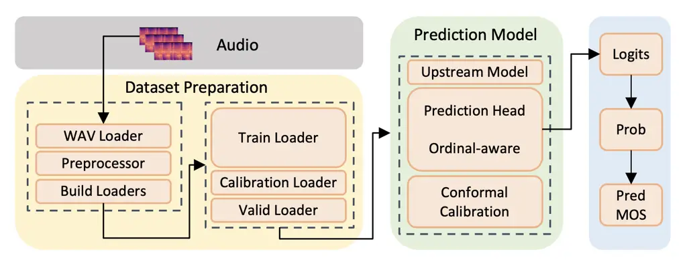
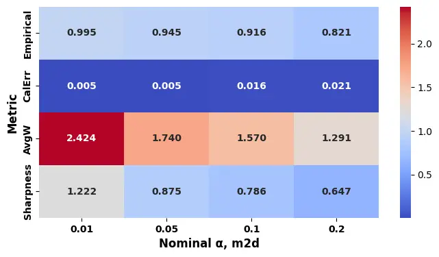
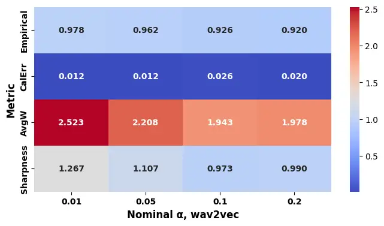

Elelu Siegel Saffary Ahmed Babatunde Okpala

# ConformalMOS: Uncertainty-Aware MOS Prediction with Conformal Intervals and Ordinal Modeling

Kehinde    Joshua E    Mohammadali    Tashfain    Simeon    Ebuka

###### Abstract

Accurate prediction of human Mean Opinion Scores (MOS) is crucial for
evaluating synthetic speech quality in text-to-speech (TTS) and voice
conversion (VC). Most MOS predictors output only point estimates and
ignore uncertainty, limiting reliability in model selection and
deployment. We propose ConformalMOS, a framework that augments MOS
prediction with conformal prediction to produce statistically valid
prediction intervals with guaranteed coverage under exchangeability,
alongside point estimates. During training, MOS labels are modeled in an
ordinal-aware manner by converting one-hot targets into
Gaussian-smoothed distributions, preserving score ordering. This
improves uncertainty calibration, particularly when softmax confidence
is overconfident on out-of-distribution speech. On BVCC datasets,
ConformalMOS achieves competitive accuracy (MSE = 0.08) while delivering
empirically validated coverage, enhancing reliability for real-world TTS
and VC deployment.

###### keywords

Mean Opinion Score prediction, speech quality assessment, conformal
prediction, uncertainty quantification, text-to-speech, voice conversion

^(†)^(†)address: ¹ Michigan State University, East Lansing, MI, USA  
² Clemson University, Clemson, SC, USA ^(†)^(†)email: elulukeh@msu.edu,
jsiegel@msu.edu, saffarym@msu.edu, ahmedt11@msu.edu,
sbabatu@g.clemson.edu, okpalaje@gmail.com

## 1 Introduction

Accurately predicting human Mean Opinion Scores (MOS) is essential for
evaluating the quality of synthetic speech and music. However, the task
remains challenging due to the inherent subjectivity of human ratings
and variability introduced by noise conditions, accents, and listener
bias \[1, 2\]. Large-scale benchmarking studies show that even
state-of-the-art systems achieve only moderate utterance-level
correlation with human scores \[3, 4\], underscoring the difficulty of
reliable automatic MOS estimation.

Recent deep learning approaches leverage transfer learning and
self-supervised representations to improve predictive accuracy. For
example, UTMOSv2 combines spectrogram-based image encoders with
self-supervised speech embeddings \[5\], while waveform–spectrogram
fusion and cross-modal encoders further enhance performance \[6\].
Despite these advances, existing systems typically output only point
estimates of MOS without quantifying predictive uncertainty. This
limitation makes them vulnerable in real-world conditions where unseen
acoustic variations degrade reliability. As highlighted by \[7\], the
lack of principled uncertainty modeling limits safe deployment in
applications such as game development, movie production, and virtual
assistants.

Although some probabilistic approaches attempt to model uncertainty \[7,
6\], they do not provide formal guarantees that predicted intervals
contain the true MOS. Given the subjective and noisy nature of human
ratings, reliable uncertainty estimation is critical for trustworthy
deployment.

To address this limitation, we introduce ConformalMOS, an
uncertainty-aware MOS prediction framework built upon existing MOS
models \[8, 9\]. Our method integrates conformal prediction, a
distribution-free framework that produces statistically valid prediction
intervals with formal coverage guarantees under the assumption of
exchangeability between calibration and test data \[10\]. Unlike
heuristic uncertainty measures, conformal prediction offers theoretical
reliability guarantees.

We further incorporate ordinal-aware modeling to respect the discrete
and ranked structure of MOS labels. Instead of treating MOS as purely
categorical or continuous, we convert one-hot score labels into
Gaussian-smoothed probability distributions over discrete score levels
\[11\]. This captures the partial correctness of neighboring scores and
better aligns the training objective with human rating behavior.

The main contributions of this work are:

- •
  Conformal Uncertainty Intervals: Integration of conformal prediction
  to produce statistically valid MOS prediction intervals with formal
  coverage guarantees \[10\].
- •
  Ordinal-Aware Modeling: Gaussian-smoothed label distributions that
  explicitly model MOS ordinality \[11\], improving point estimation
  accuracy.
- •
  Improved Accuracy and Robustness: On the BVCC dataset, our M2D2
  backbone with $`\alpha=0.05`$ achieves a system-level MSE of 0.08, a
  7.0% reduction from FUSE-MOS \[6\], while providing calibrated
  uncertainty for low-confidence and out-of-distribution inputs.

## 2 Methodology

The proposed framework estimates Mean Opinion Scores (MOS) by combining
ordinal regression with uncertainty quantification through split
conformal calibration. Pretrained audio representations are passed to an
ordinal-aware prediction head that outputs a probability distribution
over evenly spaced MOS bins. These probabilities are aggregated to
produce a scalar MOS estimate. During training, Gaussian-smoothed
ordinal targets enforce the ranked structure of MOS labels. In a
separate calibration stage, split conformal prediction computes a scalar
half-width from calibration residuals, yielding finite-sample valid
prediction intervals after clipping to the MOS range (Figure 1).



Figure 1: Overview of the proposed ConformalMOS framework. Input audio
representations are first processed by a frozen upstream feature
extractor. These features are fed into an ordinal prediction head, which
uses Gaussian label smoothing to produce point MOS estimates. Finally,
post-hoc conformal calibration generates statistically valid prediction
intervals, providing reliability-aware predictions.

### 2.1 Upstream Model Extraction

The upstream encoder $`\phi`$ transforms an input waveform $`x`$ into a
high-level representation suitable for MOS prediction \[12\]. Rather
than learning from raw signals, the downstream head operates on compact
embeddings that capture acoustic and prosodic structure. Formally, the
encoder produces an embedding $`\mathbf{z}\in\mathbb{R}^{D}`$:

```math
\mathbf{z}=\phi(x). \tag{1}
```

Many pretrained speech models, such as M2D2 or Wav2Vec2, produce
frame-level embeddings $`\mathbf{Z}\in\mathbb{R}^{T\times D}`$, where
$`T`$ denotes the number of frames and $`D`$ denotes the embedding
dimension:

```math
\mathbf{Z}=(\mathbf{h}_{1},\dots,\mathbf{h}_{T}). \tag{2}
```

We apply temporal mean pooling to obtain a fixed-dimensional
representation $`\bar{\mathbf{h}}\in\mathbb{R}^{D}`$:

```math
\bar{\mathbf{h}}=\frac{1}{T}\sum_{t=1}^{T}\mathbf{h}_{t}. \tag{3}
```

The upstream encoder remains frozen during training to preserve
pretrained knowledge and reduce overfitting.

### 2.2 Prediction Head

The prediction head $`g_{\theta}`$ maps $`\bar{h}`$ to (i) logits over
$`K`$ ordinal bins, (ii) class probabilities, and (iii) a scalar MOS
estimate \[13\]. We implement $`g_{\theta}`$ as a lightweight two-layer
MLP with LayerNorm and dropout.

MOS lies in $`[1,5]`$. Direct regression with $`\ell_{1}`$ loss does not
align with ranking-based metrics such as SRCC \[14\]. Instead, we
discretize MOS into $`K`$ equal-width bins spanning $`[1,5]`$ following
\[11\], with bin centers $`c_{k}=1+\frac{4(k-1)}{K-1}`$ for
$`k=1,\dots,K`$.

This formulation encourages correct relative ordering. To encode
ordinality, we replace one-hot labels with Gaussian-smoothed soft
targets. For MOS $`y\in[1,5]`$,

```math
\displaystyle\tilde{q}_{k}(y)=\frac{\exp\left(-\frac{(y-c_{k})^{2}}{2\sigma^{2}}\right)}{\sum_{j=1}^{K}\exp\left(-\frac{(y-c_{j})^{2}}{2\sigma^{2}}\right)}. \tag{4}
```

Following \[11\], $`\sigma`$ is set slightly larger than the bin width
to preserve local continuity. This reduces penalties for near-miss
predictions while maintaining rank structure across bins.

The scalar prediction is computed as the expected value of bin centers:

```math
\hat{y}(x)=\sum_{k=1}^{K}c_{k}\,p_{k}(x), \tag{5}
```

ensuring $`\hat{y}(x)\in[1,5]`$. Training minimizes KL divergence
between predicted and smoothed targets, combined with an auxiliary
$`\ell_{1}`$ loss for stability.

### 2.3 Conformal Calibration

Point estimates alone do not reflect uncertainty. We therefore apply
split conformal prediction, which provides finite-sample coverage
guarantees without distributional assumptions \[15, 16\]. The labeled
data are divided into a training set and a calibration set (10%). After
training, absolute residuals on the calibration set are computed, and
their empirical $`(1-\alpha)`$ quantile defines the half-width
$`\hat{q}`$. For a new input,

```math
I(x)=\left[\hat{y}(x)-\hat{q},\ \hat{y}(x)+\hat{q}\right]\cap[1,5]. \tag{6}
```

These intervals satisfy
$`\mathbb{P}\left(Y\in I(X)\right)\geq 1-\alpha`$ under exchangeability.
Larger calibration residuals produce wider intervals, signaling higher
uncertainty or distribution shift.

Conformal calibration is post-hoc and computationally efficient:
residual computation scales linearly with calibration size, and
inference requires only adding and subtracting $`\hat{q}`$ from
$`\hat{y}(x)`$. This provides reliability-aware MOS prediction with
minimal overhead.

|                           |           |       |       |       |        |       |       |       |
| ------------------------- | --------- | ----- | ----- | ----- | ------ | ----- | ----- | ----- |
| Model                     | Utterance |       |       |       | System |       |       |       |
|                           | MSE↓      | LCC↑  | SRCC↑ | KTAU↑ | MSE↓   | LCC↑  | SRCC↑ | KTAU↑ |
| UTMOS                     | 0.165     | 0.899 | 0.896 | 0.730 | 0.090  | 0.936 | 0.936 | 0.795 |
| FUSE-MOS                  | 0.191     | 0.887 | 0.887 | \-    | 0.086  | 0.946 | 0.947 | \-    |
| Our Models:               |           |       |       |       |        |       |       |       |
| M2D2 ($`\alpha=0.01`$)    | 0.229     | 0.877 | 0.875 | 0.697 | 0.082  | 0.952 | 0.941 | 0.802 |
| M2D2 ($`\alpha=0.05`$)    | 0.228     | 0.878 | 0.876 | 0.698 | 0.080  | 0.953 | 0.943 | 0.805 |
| M2D2 ($`\alpha=0.1`$)     | 0.228     | 0.877 | 0.875 | 0.697 | 0.081  | 0.952 | 0.941 | 0.802 |
| M2D2 ($`\alpha=0.2`$)     | 0.229     | 0.877 | 0.876 | 0.697 | 0.083  | 0.951 | 0.941 | 0.801 |
| wav2vec ($`\alpha=0.01`$) | 0.329     | 0.815 | 0.808 | 0.621 | 0.153  | 0.909 | 0.905 | 0.737 |
| wav2vec ($`\alpha=0.05`$) | 0.334     | 0.814 | 0.808 | 0.620 | 0.162  | 0.908 | 0.906 | 0.739 |
| wav2vec ($`\alpha=0.1`$)  | 0.335     | 0.813 | 0.807 | 0.619 | 0.164  | 0.906 | 0.905 | 0.735 |
| wav2vec ($`\alpha=0.2`$)  | 0.348     | 0.808 | 0.800 | 0.612 | 0.181  | 0.898 | 0.904 | 0.736 |

Table 1: Comparison of FUSE-MOS, prior methods, and Conformal-MOS (Ours)
on BVCC datasets. Best values in each column are in boldface.

## 3 Experimental Setup

### 3.1 Dataset Preparation

In our experiments, we utilize the BVCC dataset  \[17\] for training,
which comprises 7,106 English audio samples collected from 187 TTS and
Voice Conversion (VC) systems included in previous challenges. Although
the dataset contains a modest number of samples, it is widely used in
speech MOS prediction research and provides diverse samples from
multiple TTS and VC systems. Each audio clip is annotated by multiple
human raters, ensuring high-quality labels, and such dataset sizes are
standard in the field due to the cost and effort of collecting human MOS
annotations. For model training and evaluation, we split the BVCC
dataset according to the standard partitions defined in the VoiceMOS
Challenge: 1,066 samples are reserved for testing, and 1,066 samples for
validation. Of the remaining 4,974 samples in the development pool, we
reserved a calibration subset of 497 samples (10%) for conformal
interval estimation, leaving 4,477 samples for the final model training.

### 3.2 Training Details

MOS prediction models were trained on BVCC using NVIDIA RTX A5000 GPUs
(24 GB) for up to 1000 epochs with early stopping (patience 20)
monitored on validation loss; most runs stopped after 300–400 epochs.
Batch size was 32 for training and 8 for validation/testing \[18\]. We
used SGD with momentum (LR $`1\times 10^{-4}`$, momentum 0.9, weight
decay $`1\times 10^{-4}`$) and froze the upstream encoder, updating only
the prediction head. Checkpoints were saved at lowest validation loss.
Training typically took  2 hours per run, balancing stable convergence
and generalization while preventing overfitting.

### 3.3 Evaluation Metrics

To assess point-prediction quality, we report the following standard
evaluation metrics for MOS at both the utterance and system levels:

- •
  Mean Squared Error (MSE): Measures the average squared difference
  between predicted and ground-truth MOS scores.
- •
  Linear Correlation Coefficient (LCC): Quantifies the linear
  relationship between predictions and true scores.
- •
  Spearman’s Rank Correlation Coefficient (SRCC): Evaluates the
  monotonic ordering of predictions with respect to ground-truth MOS.
- •
  Kendall Tau Rank Correlation Coefficient (KTAU): Measures the ordinal
  association between predicted and true rankings.

To assess the quality of our uncertainty estimates, we evaluate the
conformal prediction intervals using the following metrics:

- •
  Coverage: Measures the proportion of test samples for which the
  ground-truth MOS falls within the predicted interval $`I(x)`$,
  indicating how well the intervals capture the true values \[19, 20\]:

  ```math
  \text{Coverage}=\frac{1}{N}\sum_{i=1}^{N}\mathbf{1}\{y_{i}\in I(x_{i})\}, \tag{7}
  ```

  where $`N`$ is the number of test samples. Coverage is compared to the
  nominal level $`1-\alpha`$.

- •
  Calibration Error: Measures the absolute deviation between empirical
  coverage and the nominal coverage, reflecting how accurately the
  intervals are calibrated \[21, 20\].

  ```math
  \text{Calibration Error}=\big|\text{Coverage}-(1-\alpha)\big| \tag{8}
  ```

- •
  Average Interval Width: Represents the mean width of the conformal
  intervals across all samples, capturing the overall sharpness of the
  uncertainty estimates \[19, 22\].

  ```math
  \text{Average Width}=\frac{1}{N}\sum_{i=1}^{N}\big(\overline{y}_{i}-\underline{y}_{i}\big), \tag{9}
  ```

  where $`I(x_{i})=[\underline{y}_{i},\overline{y}_{i}]`$.

- •
  Sharpness (RMS Radius): Measures a model’s overall uncertainty level
  on a dataset through the root-mean-square of the half-widths of the
  intervals, providing an alternative concentration measure \[22\].

  ```math
  \text{Sharpness (RMS)}=\sqrt{\frac{1}{N}\sum_{i=1}^{N}\left(\frac{\overline{y}_{i}-\underline{y}_{i}}{2}\right)^{2}} \tag{10}
  ```



(a) M2D2 Result



(b) Wav2Vec Result

Figure 2: Calibration performance of Conformal-MOS on the BVCC dataset
using two different backbones. (a) M2D2 achieves empirical coverage
closely matching nominal targets across multiple $`\alpha`$ levels, with
low calibration error and relatively narrow (sharp) intervals,
indicating reliable uncertainty estimates. (b) Wav2Vec shows larger
calibration error, empirical coverage that falls short at low $`\alpha`$
levels, and wider intervals, highlighting less reliable uncertainty
estimation.

## 4 Experimental Results

### 4.1 Evaluating ConformalMOS on BVCC

We assess the performance of our proposed ConformalMOS framework on the
BVCC dataset at both the utterance and system levels, and compare it
with prior state-of-the-art models (UTMOS and FUSE-MOS). Table 1
summarizes the results. We first observe that UTMOS and FUSE-MOS provide
strong baselines, achieving low MSE and high correlation metrics. While
UTMOS attains slightly better utterance-level accuracy, FUSE-MOS
performs best in system-level ranking. By incorporating the upstream
model M2D2, conformal prediction, and ordinal-aware modeling into the
MOS estimation pipeline, our ConformalMOS models achieve competitive or
superior system-level performance. In particular, the ConformalMOS M2D2
models consistently reach the highest system-level LCC while maintaining
the lowest MSE. Our evaluation is limited to in-domain BVCC data, so
out-of-domain robustness remains untested; we also omit heuristic
comparisons because they lack conformal prediction’s finite-sample
coverage guarantee.

We evaluated multiple $`\alpha`$ values 0.01, 0.05, 0.1, and 0.2 to
examine their impact on conformal prediction intervals for MOS
estimation. The choice of $`\alpha`$ directly affects the width of the
intervals and the associated coverage probability. Larger $`\alpha`$
values produce narrower intervals (improved sharpness) but increase the
risk of undercoverage, while smaller $`\alpha`$ values yield wider
intervals to ensure higher nominal coverage. Selecting multiple levels
allows us to study the trade-off between interval tightness and
reliability, aiming for intervals that are both informative and
statistically valid. Empirical studies have shown that appropriate
selection of $`\alpha`$ is essential for controlling error rates and
ensuring valid coverage in conformal prediction \[23\]. Based on these
considerations, we selected an $`\alpha`$ of 0.05 as our primary
setting, corresponding to 95% nominal coverage, which balances interval
width with reliability while maintaining the best overall performance.
This shows that the novel pipeline improves the reliability of
predictions without degrading point-estimation accuracy. At the
utterance level, ConformalMOS M2D2 maintains strong correlations close
to UTMOS and FUSE-MOS, with only a slight increase in MSE. In contrast,
the ConformalMOS wav2vec models underperform notably across all metrics,
indicating that the choice of backbone strongly affects performance
under the conformal framework. Overall, these results highlight that
conformal and ordinal prediction enhance system-level robustness,
especially when combined with the M2D2 backbone. Our best-performing
ConformalMOS M2D2 $`\alpha=0.05`$ configuration surpasses baselines at
the system level, while retaining competitive utterance-level accuracy.
This confirms that conformal prediction can be effectively integrated
into MOS estimation pipelines to improve prediction reliability without
compromising prediction quality.

### 4.2 Backbone Effects on Conformal-MOS Calibration

Figures 2(a) and 2(b) present the calibration performance of our
Conformal-MOS models on the BVCC dataset. Ideally, empirical coverage
should closely match the nominal coverage, calibration error should be
small, and intervals should be as narrow (sharp) as possible while
remaining well-calibrated. The M2D2 models exhibit consistently accurate
coverage. Empirical coverage aligns closely with nominal targets at most
$`\alpha`$ levels, with low calibration error, especially for the M2D2
backbone. As expected, increasing $`\alpha`$ leads to narrower
prediction intervals and improved sharpness. This demonstrates the
expected coverage-sharpness trade-off and confirms that the conformal
calibration procedure is functioning properly on this backbone. In
contrast, the wav2vec models show higher calibration error and less
precise coverage, particularly at lower $`\alpha`$ values. During the
$`\alpha`$ of $`0.01`$, the empirical coverage falls short of the target
0.99, and the intervals are much wider with higher sharpness values.
This indicates that the weaker wav2vec backbone produces less reliable
uncertainty estimates under the conformal framework. Overall, these
results confirm that conformal prediction produces well-calibrated
uncertainty intervals when combined with a strong backbone like M2D2,
while performance degrades when the underlying point predictions are
less accurate. This highlights the importance of backbone choice for
reliable uncertainty estimation.

## 5 Conclusion

We introduce ConformalMOS, a reliability-aware MOS prediction framework
combining ordinal modeling with split conformal calibration. Unlike
standard regression producing only point estimates, ConformalMOS outputs
prediction intervals with formal coverage guarantees, capturing the
subjectivity and variability of human MOS ratings. Experiments on BVCC
show improved system-level performance with competitive utterance-level
accuracy. The M2D2 backbone yields well-calibrated intervals with
empirical coverage matching nominal targets, while wav2vec shows wider
intervals and higher calibration error, emphasizing the need for strong
base predictors. Analysis confirms the coverage–sharpness trade-off:
increasing $`\alpha`$ narrows intervals but reduces coverage. By
integrating ordinal-aware training with conformal uncertainty,
ConformalMOS enhances interpretability and reliability, offering a
practical, theoretically grounded approach for trustworthy MOS
prediction in real-world applications. Listener disagreement and
rater-specific effects remain important future work.

## 6 Acknowledgments

This work was supported by the Michigan Translational Research and
Commercialization (MTRAC) Program, funded by the Michigan Strategic Fund
and administered by the Michigan Economic Development Corporation
(MEDC). This includes support by Grant Case-48166 of the 21st Century
Jobs Trust Fund received through the MSF from the State of Michigan.
This report was further supported using Federal funds under award
06-79-06452 (subaward agreement 006) from the U.S. Economic Development
Administration, U.S. Department of Commerce. The statements, findings,
conclusions, and recommendations are those of the author(s) and do not
necessarily reflect the views of the U.S. Economic Development
Administration or the U.S. Department of Commerce.

## 7 Use of Generative AI Disclosure

Generative AI tools were used only for limited language editing and
writing refinement. All scientific content, methodology, experiments,
results, analysis, and conclusions were produced, reviewed, and verified
by the authors.

## References

- \[1\] A. Rosenberg and B. Ramabhadran (2017) Bias and statistical
  significance in evaluating speech synthesis with mean opinion scores..
  In Interspeech, pp. 3976–3980. Cited by: §1.
- \[2\] D. Wells, A. L. A. Blanco, C. Valentini-Botinhao, E. Cooper, A.
  Pine, J. Yamagishi, and K. Richmond (2024) Experimental evaluation of
  mos, ab and bws listening test designs. INTERSPEECH 2024: Speech and
  Beyond. Cited by: §1.
- \[3\] C. Liu, H. Wang, J. Zhao, S. Zhao, H. Bu, X. Xu, J. Zhou, H.
  Sun, and Y. Qin (2025) MusicEval: a generative music corpus with
  expert ratings for automatic text-to-music evaluation. arXiv preprint
  arXiv:2501.10811. External Links:
  [Link](https://arxiv.org/abs/2501.10811) Cited by: §1.
- \[4\] W. Huang, H. Wang, C. Liu, Y. Wu, A. Tjandra, W. Hsu, E.
  Cooper, Y. Qin, and T. Toda (2025) The audiomos challenge 2025. arXiv
  preprint arXiv:2509.01336. Cited by: §1.
- \[5\] K. Baba, W. Nakata, Y. Saito, and H. Saruwatari (2024) The t05
  system for the voicemos challenge 2024: transfer learning from deep
  image classifier to naturalness mos prediction of high-quality
  synthetic speech. In Proc. IEEE Spoken Language Technology Workshop
  (SLT), Cited by: §1.
- \[6\] E. Hoq, N. Gupta, D. Omondi, and I. Nwogu (2025) FUSE-mos:
  fusion of speech embeddings for mos prediction with uncertainty
  quantification. In Proc. Interspeech, pp. 2350–2354. Cited by: 3rd
  item, §1, §1.
- \[7\] H. Wang, S. Zhao, J. Zhou, X. Zheng, H. Sun, X. Wang, and Y.
  Qin (2024) Uncertainty-aware mean opinion score prediction. In Proc.
  Interspeech, pp. 1215–1219. Cited by: §1, §1.
- \[8\] K. A. Elelu and J. E. Siegel (2025) ComformalMOS:
  uncertainty-aware mos prediction with conformal intervals and ordinal
  modeling. arxiv. Cited by: §1.
- \[9\] K. A. Elelu, J. E. Siegel, S. Ali, B. Simeon, E. Okpala, et
  al. (2025) Convm2d2: improving generative music evaluation using
  self-supervised alternative to clap. In TTIC Summer Workshop on
  Foundations of Speech and Audio Foundation Models 2025, Cited by: §1.
- \[10\] G. Shafer and V. Vovk (2008) A tutorial on conformal
  prediction. Journal of Machine Learning Research 9, pp. 371–421. Cited
  by: 1st item, §1.
- \[11\] F. Ritter-Gutierrez, Y. Lin, J. Wei, J. H. M. Wong, N. F. Chen,
  and H. Lee (2025) ASTAR-ntu solution to audiomos challenge 2025
  track1. arXiv preprint arXiv:2507.09904. Note: submitted to ASRU 2025
  Cited by: 2nd item, §1, §2.2, §2.2.
- \[12\] D. Niizumi, D. Takeuchi, M. Yasuda, B. T. Nguyen, Y. Ohishi,
  and N. Harada (2025) M2D2: exploring general-purpose audio-language
  representations beyond clap. arXiv preprint arXiv:2503.22104. External
  Links: [Link](https://arxiv.org/abs/2503.22104) Cited by: §2.1.
- \[13\] W. Cao, V. Mirjalili, and S. Raschka (2020) Rank consistent
  ordinal regression for neural networks with application to age
  estimation. Pattern Recognition Letters 140, pp. 325–331. Cited by:
  §2.2.
- \[14\] C. Wang, K. Huang, C. Yang, H. Lee, H. Wang, and B. Chen (2025)
  QAMRO: quality-aware adaptive margin ranking optimization for
  human-aligned assessment of audio generation systems. arXiv preprint
  arXiv:2508.08957. Cited by: §2.2.
- \[15\] J. Lei, J. Robins, and L. Wasserman (2013) Distribution-free
  prediction sets. Journal of the American Statistical Association 108
  (501), pp. 278–287. Cited by: §2.3.
- \[16\] G. S. Dhillon, G. Deligiannidis, and T. Rainforth (2024) On the
  expected size of conformal prediction sets. In International
  Conference on Artificial Intelligence and Statistics, pp. 1549–1557.
  Cited by: §2.3.
- \[17\] W. Huang, E. Cooper, Y. Tsao, H. Wang, T. Toda, and J.
  Yamagishi (2022) The voicemos challenge 2022. arXiv preprint
  arXiv:2203.11389. Cited by: §3.1.
- \[18\] D. Masters and C. Luschi (2018) Revisiting small batch training
  for deep neural networks. arXiv preprint arXiv:1804.07612. Cited by:
  §3.2.
- \[19\] H. Chen, Z. Huang, H. Lam, H. Qian, and H. Zhang (2021)
  Learning prediction intervals for regression: generalization and
  calibration. In Proceedings of The 24th International Conference on
  Artificial Intelligence and Statistics, pp. 820–828. Cited by: 1st
  item, 3rd item.
- \[20\] B. Kompa, J. Snoek, and A. L. Beam (2021) Empirical frequentist
  coverage of deep learning uncertainty quantification procedures.
  Entropy 23 (12), pp. 1608. Cited by: 1st item, 2nd item.
- \[21\] B. Stephen (2021) A gentle introduction to conformal prediction
  and distribution-free uncertainty quantification. arXiv preprint
  arXiv: 2107.07511. Cited by: 2nd item.
- \[22\] J. Jonkers, F. Coopman, L. Duchateau, G. Van Wallendael, and S.
  Van Hoecke (2025) Reliable uncertainty quantification for 2d/3d
  anatomical landmark localization using multi-output conformal
  prediction. Medical Image Analysis. Cited by: 3rd item, 4th item.
- \[23\] V. Chernozhukov, K. Wüthrich, and Z. Yinchu (2018) Exact and
  robust conformal inference methods for predictive machine learning
  with dependent data. In Conference On learning theory, pp. 732–749.
  Cited by: §4.1.
