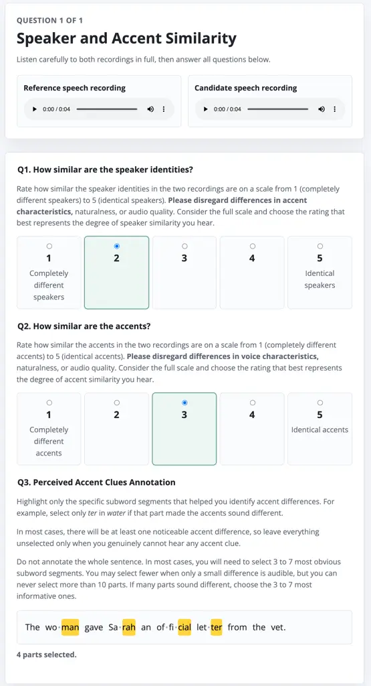

# Beyond Utterance-Level Speaker Similarity: Perception-Aligned Segmental Evaluation of Accent in Speech Generation

Jinzuomu Zhong    Alice Ross    Catherine Lai    Korin Richmond

###### Abstract

Utterance-level similarity ratings do not reveal where perceived accent
differences occur in generated speech. We introduce a segmental
evaluation protocol combining speaker and accent similarity ratings with
subword annotations of perceived accent differences provided by
listeners from target accent regions. Using newly collected recordings,
47 retained listeners evaluate 200 content-matched reference–candidate
pairs spanning four Scottish and Australian voices, two zero-shot TTS
systems, and an articulation-based voice conversion system. Subword
annotations locate salient pronunciation differences and sometimes yield
different system rankings from similarity ratings. Speaker and accent
ratings remain strongly associated ($`\rho=0.71`$), highlighting the
value of examining local perceptual evidence beyond these scores.
Evaluation of seven objective distances reveals weak correspondence with
subword selections, with correlations reaching at most $`\rho=0.22`$. We
release code, data, and an interactive demo to support the development
of perceptually grounded segmental accent evaluation.

###### Index Terms: 

segmental evaluation, listening test, objective metric, accent, speech
synthesis

^(†)^(†)address: Centre for Speech Technology Research, University of
Edinburgh

## 1 Introduction

Zero-Shot Text-to-Speech (ZS-TTS)systems have made substantial progress
in voice cloning, with recent models reporting utterance-level speaker
similarity scores comparable to, or even exceeding, those of
ground-truth recordings \[20, 3\]. However, claims of “human-parity”
based on these scores do not necessarily reflect how speakers perceive
their own cloned voices in personalised applications, such as assistive
communication for users with voice impairment. Recent perception studies
suggest that, when evaluating unfamiliar speakers’ voices on common
benchmark datasets, listeners may find speech generated by
State-of-the-art (SOTA)TTSsystems perceptually indistinguishable from
human recordings \[18\]. Yet, in an own-voice evaluation setup, speakers
can distinguish real recordings from synthetic counterparts with 87%
accuracy, utilising accent and prosody as main cues \[16\]. This
contrast raises a crucial question: how can we design listening tests
and objective metrics that better reflect users’ perceptions of cloned
voices?

Accent¹¹ 1 Here, we define accent as a pattern of pronunciation
characteristics used by an individual speaker or, more generally, by a
community or social group. It encompasses both segmental features such
as vowel and consonant realisations and suprasegmental features such as
intonation and rhythm \[21, Ch. 1\]. provides a compelling case through
which to investigate this discrepancy. It conveys regional, social, and
linguistic identity \[13\], yet speech-generation systems often produce
an accent that deviates from the reference recording, a phenomenon
termed accent hallucination \[24\]. Growing efforts towards
high-fidelity accent generation \[24, 22, 19\] make reliable evaluation
increasingly important.

Recent work has explored complementary approaches to accent evaluation.
CodecMOS-Accent \[11\] uses accent Similarity MOS (SMOS), alongside
other metrics, to benchmark speech codec resynthesis and TTSsystems.
However, its ratings are collected predominantly from American
listeners, whose familiarity with the target accents is not established.
It therefore remains unclear how well these ratings reflect
pronunciation differences perceived by speakers from the target accent
communities. Meanwhile, the enhanced XAB listening test in \[23\]
supplements pairwise judgements with character-level annotations of
perceived accent differences, aiming to improve judgement consistency.
These annotations provide a means of locating segmental accent
differences, but are not analysed further. Pairwise comparisons also
become increasingly costly as the number of systems grows, and the study
covers limited systems and listeners.

To address these limitations, we combine utterance-level speaker and
accent SMOSwith subword annotations of perceived accent differences.
Building on \[23\], we analyse segment annotations as an evaluation
outcome rather than as an auxiliary task, and examine their
correspondence with utterance-level ratings and objective metrics. Our
contributions are threefold:

1\) We introduce a subword-level annotation protocol that captures
listeners’ perceptions of segmental accent differences, complementing
existing utterance-level speaker and accent SMOSratings.

2\) We construct a perceptually annotated evaluation set using newly
collected, content-matched reference–candidate pairs and listeners from
the target accent regions, and analyse how segmental annotations relate
to utterance-level ratings and system rankings.

3\) We assess seven objective distances against utterance-level ratings
and subword-level annotations, using temporal alignment and
frame-to-subword aggregation for local comparison. Our analysis
identifies limited correlation between the evaluated distance metrics
and listeners’ segmental annotations.

To facilitate reproducibility and future investigation, we release the
code, data, and an interactive results demo here²² 2 Code:
[https://github.com/jzmzhong/segmental_accent_evaluation](https://github.com/jzmzhong/segmental_accent_evaluation)  
Data:
[https://huggingface.co/datasets/jzmzhong/segmental_accent_annotation](https://huggingface.co/datasets/jzmzhong/segmental_accent_annotation)  
Demo:
[https://jzmzhong.github.io/Segmental-Accent-Evaluation/results.html](https://jzmzhong.github.io/Segmental-Accent-Evaluation/results.html)
.

## 2 Grounding Human Perception: Subjective Rating and Segmental Annotation

### 2.1 Three-Stage: Recording, Synthesis, and Evaluation

To ground accent evaluation in human perception, we conduct a
three-stage data collection: recording natural speech, synthesising
speech, and collecting listener ratings and segmental annotations.

In the first stage, participants record prepared utterances and provide
demographic information. Collecting new recordings allows us to sample
contemporary regional varieties of English and document participants’
linguistic and residential backgrounds. This provides greater control
over speaker recruitment and recording recency than relying on existing
benchmark corpora. Newly collected recordings also reduce the risk of
overlap with the training data of the speech generation systems under
evaluation.

In the second stage, we apply DeepFilterNet \[17\] to reduce background
noise. We then generate candidate speech using the TTS systems under
evaluation, each conditioned on a randomly selected recording from the
same speaker as voice prompt. Unlike existing benchmarks such as
CoedcMOS-Accent \[11\] and Seed-TTS-Eval³³ 3
[https://github.com/BytedanceSpeech/seed-tts-eval](https://github.com/BytedanceSpeech/seed-tts-eval),
each generated utterance is paired with a content-matched reference,
rather than the voice prompt. Matching the linguistic content
facilitates direct comparison of corresponding segments for accent
similarity ratings and accent clue annotation.

In the third stage, listeners from the same accent region as the target
speaker separately rate speaker and accent SMOSand highlight transcript
segments that reveal perceived accent differences. Fig. 1 shows the
evaluation interface.



Figure 1: Listening-test interface for speaker SMOS, accent SMOS, and
segmental annotation of perceived accent differences.

### 2.2 Iterative Listening Test Design

We refine the instructions and annotation procedures iteratively through
pilot studies, focusing on separate assessment of speaker identity and
accent, and consistent selection of accent clues.

Disentangling accent and speaker similarity ratings: Listeners are
explicitly instructed to judge speaker identity independently of accent
and accent independently of voice characteristics (Q1 and Q2 in Fig. 1).
Alongside the evaluated TTS systems, we include speech reconstructed
using SPARC \[4\], an articulation-based voice conversion system. SPARC
reconstructs the content-matched reference using a speaker embedding
extracted from another utterance by the same speaker. Its
articulation-based representation and lightweight speaker encoding
motivate its use as an accent-preserving reference with reduced speaker
fidelity, providing an expected top-line for accent similarity and
bottom-line for speaker similarity.

Encouraging consistent segmental annotation: Motivated by the low
inter-annotator agreement observed for character-level annotations in
\[23\], we use subword segments as a coarser annotation unit. Subword
segments approximate syllables in the written transcript without
requiring annotators to have prior phonetic training. We use Pyphen ⁴⁴ 4
[https://github.com/Kozea/Pyphen](https://github.com/Kozea/Pyphen) for
subword segmentation, with subsequent manual review. Pilot studies
reveal substantial variation in annotation tendencies: some listeners
select very few segments, whereas others mark large portions of the
transcript. We therefore encourage listeners to select 3–7 informative
segments in most cases, with a maximum of 10 segments allowed (Q3 in
Fig. 1). Listeners may leave the transcript unmarked when they perceive
no accent difference.

## 3 Finding Instrumental Correlates: Adapting Objective Metrics for Segmental Comparison

To investigate whether objective metrics correlate with listeners’
perceptions, we first compute utterance-level distances using seven
metrics (Sec. 3.1). We then derive frame-level distances (Sec. 3.2) and
map them to the subword segments annotated by listeners (Sec. 3.3),
enabling correlation analysis at both utterance and subword levels.

### 3.1 Utterance-Level Distances

Speaker and accent representations: We use two Speaker Verification
(SV)models, ECAPA-TDNN \[6\] and WavLM-SV \[2\], for speaker embeddings,
and two Accent Identification (AID)models, GenAID \[24\] and Voxlect
\[8\] for accent embeddings. For each model, we obtain reference and
candidate utterance embeddings in the last latent layer and calculate
their cosine distances.

Phonetic and acoustic features: We use three metrics to examine
pronunciation and prosodic differences: PPG distance, formant distance,
and F0 distance. We extract Phonetic Posteriorgrams (PPGs)using a model
trained on General American English \[5\], which predicts a distribution
over phonetic categories at each frame. We also extract the first three
formants (F1–F3) to characterise differences in vowel realisation \[9\],
and fundamental frequency (F0) to characterise prosodic differences.

To account for differences in length, we align the feature sequences of
each reference–candidate pair using Dynamic Time Wrapping (DTW). For
PPGs, we use Jensen–Shannon (JS)distance as both the alignment cost and
the local distance between aligned frames. For acoustic features, we
compute a shared alignment using the Root Mean Squared Error
(RMSE)between frame-level vectors
$`[\mathrm{F0},\mathrm{F1},\mathrm{F2},\mathrm{F3}]`$. Along this shared
path, we calculate separate local distances using absolute error for F0
and RMSEacross F1–F3 for formants. For each of the three metrics, we
obtain the utterance-level distance $`D_{\mathrm{utt}}`$ by averaging
the distances over all aligned frame pairs:

```math
D_{\mathrm{utt}}=\frac{1}{|\mathcal{P}|}\sum_{(i,j)\in\mathcal{P}}\delta(\mathbf{x}_{i},\mathbf{y}_{j}),\vskip-5.0pt \tag{1}
```

where $`\mathcal{P}`$ is the DTW alignment path, $`\mathbf{x}_{i}`$ and
$`\mathbf{y}_{j}`$ are the reference and candidate frame features, and
$`\delta`$ is the metric-specific local distance: JSdistance, absolute
F0 error, or RMSEacross F1–F3.

### 3.2 Frame-Level Distances

For speaker and accent embeddings, utterance-level distances compare
embeddings obtained after temporal pooling. To calculate frame-level
distances, we instead extract the representations immediately before
pooling and align the reference and candidate sequences using DTW, with
cosine distance as both the alignment cost and the local distance.
Although these representations are not explicitly trained to measure
local speaker or accent similarity, they preserve a temporal sequence
that may support segmental comparison. For PPGs, F0, and formants, we
retain the alignment paths and local distance functions used for
utterance-level analysis.

For all seven metrics, we assign distance $`d_{j}`$ to each candidate
frame by averaging the local distances over its aligned reference
frame(s):

```math
d_{j}=\frac{1}{|\mathcal{A}_{j}|}\sum_{i\in\mathcal{A}_{j}}\delta(\mathbf{x}_{i},\mathbf{y}_{j}),\qquad\mathcal{A}_{j}=\{i:(i,j)\in\mathcal{P}\},\vskip-10.00002pt \tag{2}
```

where $`\mathcal{A}_{j}`$ contains a set of reference frame indices
$`i`$ aligned to candidate frame $`j`$. This produces one distance value
per candidate frame for each metric.

### 3.3 Mapping Frame-Level Distances to Subword Annotations

To compare frame-level objective distances with subword-level subjective
annotations, we map acoustic frames to the subword segments used in the
perceptual task. We first obtain the phone boundaries of each utterance
using Montreal Forced Aligner (MFA)\[12\], aligning frames to phones. We
then use a Grapheme-to-Phoneme (G2P)aligner \[15\], a probabilistic
alignment algorithm that scores candidate letter-to-phone(s)
correspondences against a pre-computed table of empirical alignment
probabilities, to align phones to letters of each word, and consequently
onto the subword segments used for annotation. Both alignment stages use
an accent-independent pronunciation lexicon (with ARPABET phones),
avoiding the reliance on accent-specific lexicon for each accent.

For each metric, we derive three alternative distances from the
candidate frames associated with each subword segment: the maximum
frame-level distance (Max), the mean frame-level distance (Mean), and
the distance at the frame nearest the segment’s temporal midpoint
(Midpoint). These quantify the largest discrepancy within the segment,
its average discrepancy, and the discrepancy at its centre,
respectively. We compare these subword-level distances with the
corresponding listener annotations.

## 4 Experiments

### 4.1 Subjective Listening Tests

Test stimuli and systems: For recording, participants read two passages
commonly used in phonetic research on English varieties: Comma Gets a
Cure⁵⁵ 5
[https://www.dialectsarchive.com/comma-gets-a-cure](https://www.dialectsarchive.com/comma-gets-a-cure)
and The Boy Who Cried Wolf \[7\]. For synthesis, we select two
representative SOTAZS-TTSsystems: MaskGCT \[20\] and F5-TTS \[3\],
representing two-stage and one-stage acoustic modelling, respectively.
Both systems achieve top speaker similarity performances on the TTSDS2
benchmark \[14\].

For evaluation, to limit listener fatigue, we design the test to last
approximately 40 minutes and use the first 20 utterances of Comma Gets a
Cure. We synthesise these utterances using a randomly selected recording
from The Boy Who Cried Wolf by the same speaker as the voice prompt. We
additionally reconstruct the first 10 utterances using SPARC as a
reference system. Each listener evaluates 50 content-matched
reference–candidate pairs: 20 from MaskGCT, 20 from F5-TTS, and 10 from
SPARC, comprising 1,035 subwords.

Participants recruitment and filtering: We evaluate four target voices:
one male and one female speaker from each of Scotland and Australia. For
each voice, we recruit 15 listeners through Prolific from the
corresponding accent region, each of whom rates and annotates all 50
pairs, yielding 60 listeners before exclusions.

We apply two listener exclusion criteria motivated by the pilot
observations in Sec. 2.2. First, we exclude listeners whose mean number
of selected segments across all evaluation trials is below 2 or above 8,
, identifying unusually sparse or extensive annotation relative to the
requested selection range. Second, we exclude listeners who assign
identical speaker and accent similarity ratings on more than 80% of
trials, flagging possible conflation of the two perceptual dimensions.
After exclusions, 47 listeners remain, contributing 4,700 SMOSratings
and approximately 48,600 binary subword annotation decisions across 200
reference–candidate pairs.

### 4.2 Subjective-Objective Correlation

Processing subjective scores: We calculate all subjective scores using
retained listeners’ responses. For each reference–candidate pair, we
average speaker and accent similarity ratings across listeners to obtain
S-SPK-SMOS and S-ACC-SMOS, respectively. We calculate S-Anno-Freq as the
mean percentage of subword segments selected by each listener for that
pair. At the subword level, we calculate S-Anno-Score – the proportion
of listeners who selected the segment, with higher values indicating
greater agreement that the segment reveals an accent difference.

Calculating correlation: At the utterance level, we calculate pairwise
Spearman’s Rank Correlation Coefficient (SRCC)among the three subjective
scores to examine the relationships between speaker similarity, accent
similarity, and annotation frequency. We then calculate SRCCbetween each
of the seven objective distances in Sec. 3.1 and each subjective score
across all 200 reference–candidate pairs. At the subword level, we
evaluate the three aggregation methods defined in Sec. 3.3: Mean, Max,
and Midpoint. For each of the seven metrics and each scoring method, we
calculate SRCCbetween the resulting subword distances and S-ACC-Anno
across 4,140 subword instances in the 200 pairs. Both analyses pool
observations across the four target voices and three speech generation
systems.

|                   | Inter-annotator agreement $`\uparrow`$ |                               | S-Anno-Freq (%) $`\downarrow`$ |                    |                    | S-ACC-SMOS $`\uparrow`$ |                   |                   | S-SPK-SMOS $`\uparrow`$ |                   |                   |
| ----------------- | -------------------------------------- | ----------------------------- | ------------------------------ | ------------------ | ------------------ | ----------------------- | ----------------- | ----------------- | ----------------------- | ----------------- | ----------------- |
| Speaker           | Fleiss’ $`\kappa`$                     | Krippendorff’s $`\alpha^{*}`$ | F5-TTS                         | MaskGCT            | SPARC              | F5-TTS                  | MaskGCT           | SPARC             | F5-TTS                  | MaskGCT           | SPARC             |
| Australian female | 0.184                                  | 0.192                         | 17.95 $`\pm`$ 1.45             | 20.11 $`\pm`$ 1.88 | 15.92 $`\pm`$ 1.98 | 3.14 $`\pm`$ 0.16       | 2.94 $`\pm`$ 0.17 | 2.77 $`\pm`$ 0.24 | 3.62 $`\pm`$ 0.16       | 3.30 $`\pm`$ 0.17 | 1.14 $`\pm`$ 0.11 |
| Australian male   | 0.234                                  | 0.240                         | 22.07 $`\pm`$ 1.53             | 22.37 $`\pm`$ 1.44 | 19.95 $`\pm`$ 2.15 | 2.81 $`\pm`$ 0.17       | 3.16 $`\pm`$ 0.17 | 3.10 $`\pm`$ 0.27 | 3.11 $`\pm`$ 0.18       | 3.51 $`\pm`$ 0.17 | 2.99 $`\pm`$ 0.27 |
| Scottish female   | 0.232                                  | 0.237                         | 23.92 $`\pm`$ 1.69             | 23.57 $`\pm`$ 1.55 | 17.05 $`\pm`$ 2.23 | 1.98 $`\pm`$ 0.13       | 2.54 $`\pm`$ 0.15 | 3.91 $`\pm`$ 0.18 | 2.32 $`\pm`$ 0.14       | 2.65 $`\pm`$ 0.15 | 3.73 $`\pm`$ 0.19 |
| Scottish male     | 0.184                                  | 0.187                         | 22.74 $`\pm`$ 1.31             | 22.83 $`\pm`$ 1.36 | 18.20 $`\pm`$ 2.07 | 2.06 $`\pm`$ 0.13       | 2.48 $`\pm`$ 0.13 | 3.57 $`\pm`$ 0.18 | 2.22 $`\pm`$ 0.14       | 2.41 $`\pm`$ 0.15 | 2.83 $`\pm`$ 0.21 |

Table 1: Inter-annotator agreement and subjective evaluation results by
target speaker. Best system for each target speaker within each metric
is bolded. $`*`$: Krippendorff’s $`\alpha`$ calculation excludes
utterances with no or all subwords annotated.

## 5 Results & Analysis

### 5.1 Overall Results

Table 1 summarises inter-annotator agreement and subjective evaluation
results by target speaker and synthesis system. Annotators show modest
agreement on the segmental annotation task, with Fleiss’ $`\kappa`$
ranging from 0.184 to 0.234 across speakers. After excluding responses
marking no or all subwords, Krippendorff’s $`\alpha`$ ranges from 0.187
to 0.240. These values are numerically comparable to agreement reported
for related perceptual annotation tasks: prosodic error annotation
($`\alpha=0.18`$–$`0.28`$ \[10\]) or prominence annotation
($`\kappa=0.18`$–$`0.24`$ \[1\]).

Both accent and speaker SMOSfavour F5-TTS for the Australian female
speaker, MaskGCT for the Australian male speaker, and SPARC for both
Scottish speakers, with identical system rankings for three of the four
target speakers. In contrast, SPARC has the lowest proportion of
annotated subwords for all four speakers, indicating fewer marked
segmental accent differences and aligning with its intended role as an
accent-preserving reference. The clearest divergence occurs for the
Australian female speaker: SPARC receives the lowest accent and speaker
SMOS (2.77 and 1.14, respectively), yet also has the lowest annotation
rate (15.92%). The similar rankings produced by the two SMOS measures
are consistent with overlap between accent and speaker similarity
judgements despite instructions to assess them separately. Segmental
annotation provides a complementary perspective by directing listeners
towards specific pronunciation differences.

### 5.2 Utterance-Level Correlation

|                        |                |            |            |
| ---------------------- | -------------- | ---------- | ---------- |
| Utterance-level Metric | S-ACC-Freq^(∗) | S-ACC-SMOS | S-SPK-SMOS |
| S-ACC-Freq^(∗)         | 1.00           |            |            |
| S-ACC-SMOS             | 0.48           | 1.00       |            |
| S-SPK-SMOS             | 0.27           | 0.71       | 1.00       |
| O-F0^(∗)               | -0.07          | 0.12       | 0.05       |
| O-Formants^(∗)         | -0.09          | 0.30       | 0.27       |
| O-PPG^(∗)              | 0.22           | 0.15       | -0.25      |
| O-SPK (ECAPA-TDNN)^(∗) | 0.18           | -0.32      | -0.11      |
| O-SPK (WavLM-SV)^(∗)   | 0.30           | -0.09      | 0.05       |
| O-ACC (GenAID)^(∗)     | 0.09           | 0.11       | 0.13       |
| O-ACC (Voxlect)^(∗)    | 0.46           | 0.27       | 0.08       |

Table 2: Utterance-level SRCCbetween evaluation metrics across 200
reference–candidate pairs. Distance metrics (marked with $`*`$) are
negated to align with similarity scores. Larger positive coefficients
indicate stronger ranking agreement.

Utterance-level correlations are shown in Tab. 2. Among the subjective
metrics, S-ACC-SMOS and S-SPK-SMOS are strongly correlated
($`\rho=0.71`$), consistent with the close association between accent
and speaker SMOSreported in \[11\]. To investigate whether the high
correlation is caused by actual covariation between accent and speaker
similarity in the evaluated stimuli, or by the entangled perceptual
judgements by listeners, we separately analyse 40 SPARC
reference–candidate pairs. Informal expert listening confirms that these
candidates largely preserve the reference accent and articulation while
exhibiting noticeable artefacts in timbre. Within this subset,
S-ACC-SMOS and S-SPK-SMOS remain quite strongly correlated
($`\rho=0.57`$), suggesting persistent overlap between accent and
speaker similarity judgements despite the iterative refinements intended
to distinguish these perceptual dimensions in Sec. 2.2.

Negated S-ACC-Freq correlates moderately with S-ACC-SMOS ($`\rho=0.48`$)
and more weakly with S-SPK-SMOS ($`\rho=0.27`$), suggesting closer
alignment with perceived accent similarity. The partial agreement with
the two SMOSratings indicates that segmental annotation may provide
complementary perceptual information not fully reflected in holistic
ratings. Qualitative inspection supports the accent relevance of the
annotations: e.g. most listeners successfully identify pronunciation
differences such as \[”fju:taIl\] in the reference versus \[”fju:t@l\]
in the candidate for the word “futile”.

For the objective metrics, negated cosine distances between speaker
embeddings (the O-SPK metrics) show negative or weak correlations with
S-ACC-SMOS and S-SPK-SMOS. These results suggest that the
embedding-based scores do not closely track perceived accent or speaker
similarity in this evaluation, which uses content-matched
reference–candidate pairs and enhanced, self-recorded reference speech.
Recording conditions and speech enhancement may contribute to this
mismatch, although their effects cannot be isolated from the present
correlation analysis. O-ACC (Voxlect) shows the strongest
objective–subjective association, moderately correlating with S-ACC-Freq
($`\rho=0.46`$). This finding suggests that Voxlect embeddings at the
utterance level may be used as proxies for ranking utterances with
different accent generation quality.

### 5.3 Subword-Level Correlation

| Subword-level Metric | Mean | Max  | Midpoint |
| -------------------- | ---- | ---- | -------- |
| O-F0                 | 0.10 | 0.14 | 0.08     |
| O-Formants           | 0.00 | 0.06 | 0.02     |
| O-PPG                | 0.07 | 0.15 | 0.05     |
| O-SPK (ECAPA-TDNN)   | 0.08 | 0.15 | 0.04     |
| O-SPK (WavLM-SV)     | 0.19 | 0.22 | 0.16     |
| O-ACC (GenAID)       | 0.11 | 0.16 | 0.09     |
| O-ACC (Voxlect)      | 0.14 | 0.22 | 0.11     |

Table 3: Subword-level SRCCbetween S-Anno-Score (proportion of listeners
who select the segment) and objective distances across 4,140 subwords,
using mean/max/midpoint scoring.

Table 3 shows that max aggregation gives the highest observed
correlation for all seven metrics (Table 3). This pattern suggests that
local peaks in objective dissimilarity may better reflect listeners’
segmental perception. Nevertheless, correlations remain weak across all
metrics and scoring methods, reaching at most $`\rho=0.22`$ for WavLM-SV
and Voxlect. Thus, even with max aggregation, the evaluated objective
metrics show limited alignment with perceived subword-level accent
differences.

## 6 Conclusions

We presented a segmental accent evaluation protocol combining
utterance-level similarity ratings with subword annotations from
listeners in the target accent regions. Speaker and accent ratings
remain strongly associated, while local annotations identify salient
pronunciation differences and sometimes yield different system rankings.
The seven evaluated objective distances show limited correspondence with
these annotations, highlighting the challenges of relating existing
representations to local perceptual judgements. These findings motivate
evaluating accent generation through both utterance-level ratings and
segmental annotations. Modest inter-annotator agreement and the limited
number of speakers and samples evaluated under budget constraints
warrant further validation. The released resources provide a basis for
segmental annotation protocols and developing objective metrics better
informed by listeners’ perceptions.

## 7 Acknowledgement

This work was supported in part by the UKRI AI CDT in Responsible and
Trustworthy in-the-world NLP (Grant EP/Y030656/1) and UKRI CDT in NLP
(Grant EP/S022481/1), the University of Edinburgh.

## References

- \[1\] J. Bishop, G. Kuo, and B. Kim (2020) Phonology, phonetics, and
  signal-extrinsic factors in the perception of prosodic prominence:
  evidence from rapid prosody transcription. Journal of Phonetics 82,
  pp. 100977. Cited by: §5.1.
- \[2\] S. Chen, C. Wang, Z. Chen, Y. Wu, S. Liu, Z. Chen, J. Li, N.
  Kanda, T. Yoshioka, X. Xiao, J. Wu, L. Zhou, S. Ren, Y. Qian, Y.
  Qian, J. Wu, M. Zeng, X. Yu, and F. Wei (2022) WavLM: Large-Scale
  Self-Supervised Pre-Training for Full Stack Speech Processing. IEEE
  Journal of Selected Topics in Signal Processing 16 (6), pp. 1505–1518.
  Cited by: §3.1.
- \[3\] Y. Chen, Z. Niu, Z. Ma, K. Deng, C. Wang, J. Zhao, K. Yu, and X.
  Chen (2025) F5-TTS: A Fairytaler that Fakes Fluent and Faithful Speech
  with Flow Matching. In Proc. ACL, Vienna, Austria, pp. 6255–6271.
  External Links: [Link](https://aclanthology.org/2025.acl-long.313/),
  [Document](https://dx.doi.org/10.18653/v1/2025.acl-long.313), ISBN
  979-8-89176-251-0 Cited by: §1, §4.1.
- \[4\] C. J. Cho, P. Wu, T. S. Prabhune, D. Agarwal, and G. K.
  Anumanchipalli (2024) Coding Speech through Vocal Tract Kinematics.
  IEEE Journal of Selected Topics in Signal Processing 18 (8),
  pp. 1427–1440. Cited by: §2.2.
- \[5\] C. Churchwell, M. Morrison, and B. Pardo (2024) High-Fidelity
  Neural Phonetic Posteriorgrams. In IEEE ICASSP Workshops, Vol. ,
  pp. 823–827. External Links:
  [Document](https://dx.doi.org/10.1109/ICASSPW62465.2024.10669905)
  Cited by: §3.1.
- \[6\] B. Desplanques, J. Thienpondt, and K. Demuynck (2020)
  ECAPA-TDNN: Emphasized Channel Attention, Propagation and Aggregation
  in TDNN Based Speaker Verification. In Proc. Interspeech,
  pp. 3830–3834. External Links:
  [Document](https://dx.doi.org/10.21437/Interspeech.2020-2650), ISSN
  2958-1796 Cited by: §3.1.
- \[7\] D. Deterding (2006) The North Wind versus a Wolf: Short Texts
  for the Description and Measurement of English Pronunciation. Journal
  of the International Phonetic Association 36 (2), pp. 187–196. Cited
  by: §4.1.
- \[8\] T. Feng, K. Huang, A. Xu, X. Shi, T. Lertpetchpun, J. Lee, Y.
  Lee, D. Byrd, and S. Narayanan (2026) Voxlect: A Speech Foundation
  Model Benchmark for Modeling Dialects and Regional Languages Around
  the Globe. In Proc. ACM SIGKDD, KDD ’26, New York, NY, USA,
  pp. 2640–2651. External Links: ISBN 9798400722585,
  [Link](https://doi.org/10.1145/3770854.3785687),
  [Document](https://dx.doi.org/10.1145/3770854.3785687) Cited by: §3.1.
- \[9\] S. Ghorshi, S. Vaseghi, and Q. Yan (2006) Comparative Analysis
  of Formants of British, American and Australian Accents. In Proc.
  Interspeech, pp. paper 1252–Mon1BuP.9. External Links:
  [Document](https://dx.doi.org/10.21437/Interspeech.2006-35), ISSN
  2958-1796 Cited by: §3.1.
- \[10\] E. Gutierrez, P. Oplustil-Gallegos, and C. Lai (2021) Location,
  Location: Enhancing the Evaluation of Text-to-Speech synthesis using
  the Rapid Prosody Transcription Paradigm. In 11th Speech Synthesis
  Workshop, pp. 25–30. External Links:
  [Document](https://dx.doi.org/10.21437/SSW.2021-5) Cited by: §5.1.
- \[11\] W. Huang, N. Sanders, and E. Cooper (2026) CodecMOS-Accent: A
  MOS Benchmark of Resynthesized and TTS Speech from Neural Codecs
  Across English Accents. In Proc. Interspeech, pp. 6130–6135. External
  Links: [Document](https://dx.doi.org/10.21437/Interspeech.2026-1273),
  ISSN 2958-1796 Cited by: §1, §2.1, §5.2.
- \[12\] M. McAuliffe, M. Socolof, S. Mihuc, M. Wagner, and M.
  Sonderegger (2017) Montreal Forced Aligner: Trainable Text-Speech
  Alignment Using Kaldi. In Proc. Interspeech, pp. 498–502. External
  Links: [Document](https://dx.doi.org/10.21437/Interspeech.2017-1386),
  ISSN 2958-1796 Cited by: §3.3.
- \[13\] S. Michel, S. Kaur, S. E. Gillespie, J. Gleason, C. Wilson,
  and A. Ghosh (2025) “It’s not a representation of me”: Examining
  Accent Bias and Digital Exclusion in Synthetic AI Voice Services. In
  Proc. ACM FAccT, pp. 228–245. Cited by: §1.
- \[14\] C. Minixhofer, O. Klejch, and P. Bell (2026) TTSDS2: Resources
  and Benchmark for Evaluating Human-Quality Text to Speech Systems. In
  ICLR, Vol. 2026, pp. 29228–29247. Cited by: §4.1.
- \[15\] K. Richmond, R. A. J. Clark, and S. Fitt (2009) Robust LTS
  rules with the Combilex speech technology lexicon. In Proc.
  Interspeech, pp. 1295–1298. External Links:
  [Document](https://dx.doi.org/10.21437/Interspeech.2009-405), ISSN
  2958-1796 Cited by: §3.3.
- \[16\] A. Sanchez, J. Zhong, A. Deligianni, A. Ross, and S.
  King (2026) When Text-to-Speech Speaks in Your Voice: A Study on
  Public Perception. In Proc. ACM CUI, New York, NY, USA. External
  Links: ISBN 9798400727412,
  [Link](https://doi.org/10.1145/3816046.3816200) Cited by: §1.
- \[17\] H. Schröter, A. N. Escalante-B., T. Rosenkranz, and A.
  Maier (2022) DeepFilterNet2: Towards Real-Time Speech Enhancement on
  Embedded Devices for Full-Band Audio. In 17th International Workshop
  on Acoustic Signal Enhancement (IWAENC), Cited by: §2.1.
- \[18\] P. Srinivasa Varadhan, S. Thomas, S. Teja M S, S. Bhooshan,
  and M. M. Khapra (2025) The State Of TTS: A Case Study with Human
  Fooling Rates. In Proc. Interspeech, pp. 2285–2289. External Links:
  [Document](https://dx.doi.org/10.21437/Interspeech.2025-2765), ISSN
  2958-1796 Cited by: §1.
- \[19\] X. Wang and Y. Wang (2026) Joycent: Diffusion-based Accent TTS
  without Accented Phone Prediction. arXiv preprint arXiv:2606.16417.
  Cited by: §1.
- \[20\] Y. Wang, H. Zhan, L. Liu, R. Zeng, H. Guo, J. Zheng, Q.
  Zhang, X. Zhang, S. Zhang, and Z. Wu (2025) MaskGCT: Zero-Shot
  Text-to-Speech with Masked Generative Codec Transformer. In Proc.
  ICLR, Vol. 2025, pp. 47127–47150. Cited by: §1, §4.1.
- \[21\] J. C. Wells (1982) Accents of English: Volume 1. Vol. 1,
  Cambridge University Press. Cited by: footnote 1.
- \[22\] H. L. Xinyuan, Z. Cai, A. Garg, K. Duh, L. P. García-Perera, S.
  Khudanpur, N. Andrews, and M. Wiesner (2025) Scalable controllable
  accented tts. In IEEE ASRU, Vol. , pp. 1–8. External Links:
  [Document](https://dx.doi.org/10.1109/ASRU65441.2025.11434737) Cited
  by: §1.
- \[23\] J. Zhong, S. Liu, D. Wells, and K. Richmond (2025) Pairwise
  Evaluation of Accent Similarity in Speech Synthesis. In Proc.
  Interspeech, pp. 2290–2294. External Links:
  [Document](https://dx.doi.org/10.21437/Interspeech.2025-2283), ISSN
  2958-1796 Cited by: §1, §1, §2.2.
- \[24\] J. Zhong, K. Richmond, Z. Su, and S. Sun (2025) AccentBox:
  Towards High-Fidelity Zero-Shot Accent Generation. In IEEE ICASSP,
  Vol. , pp. 1–5. External Links:
  [Document](https://dx.doi.org/10.1109/ICASSP49660.2025.10888332) Cited
  by: §1, §3.1.
