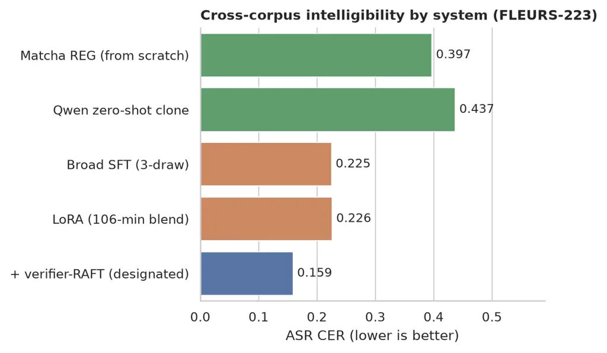
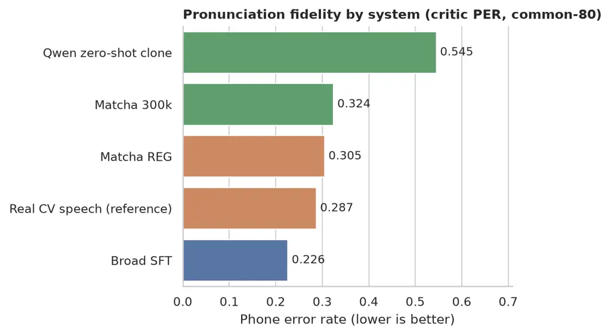
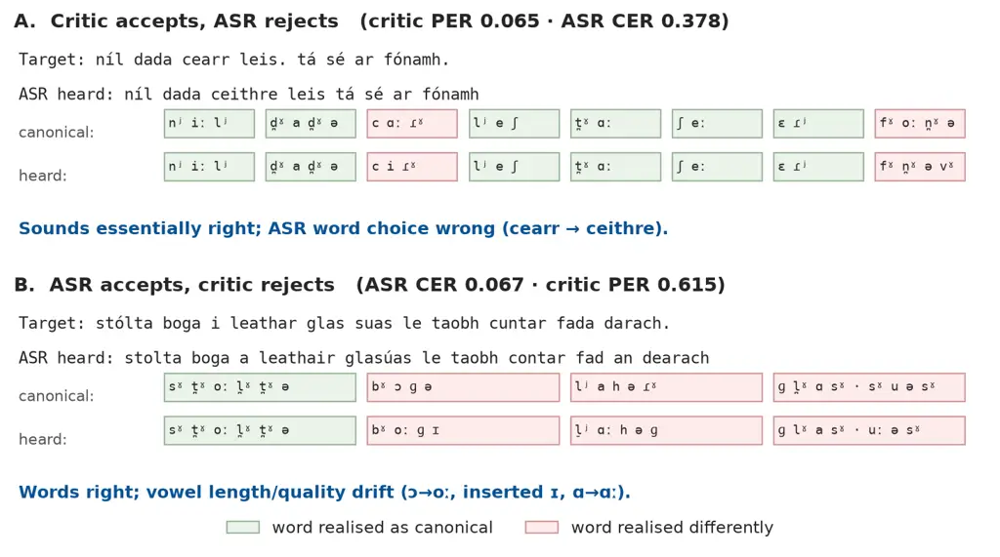
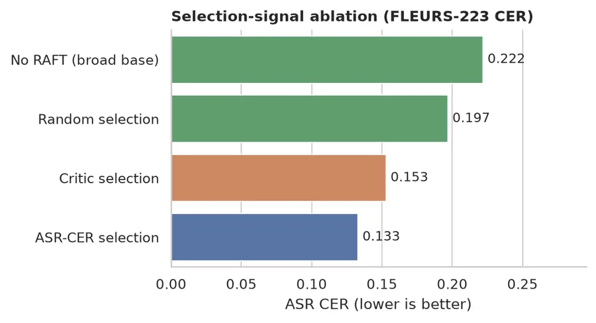
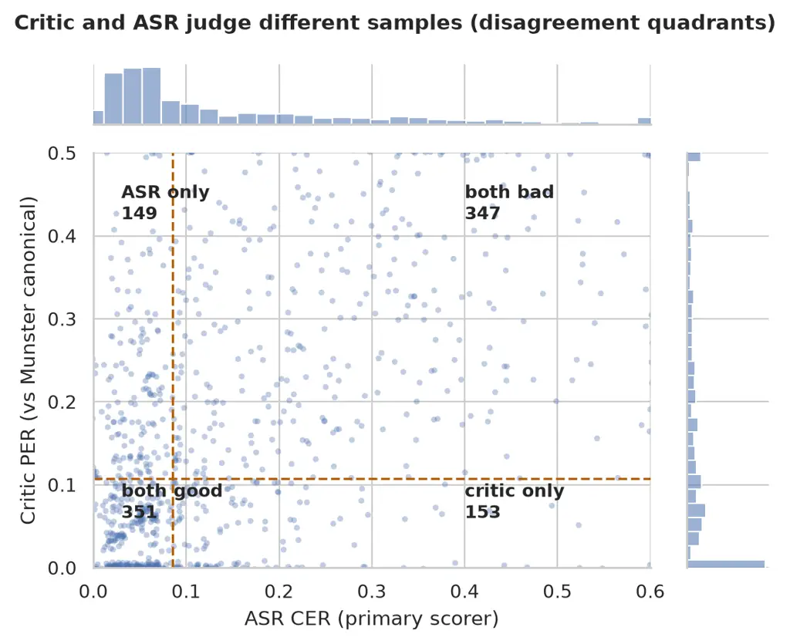
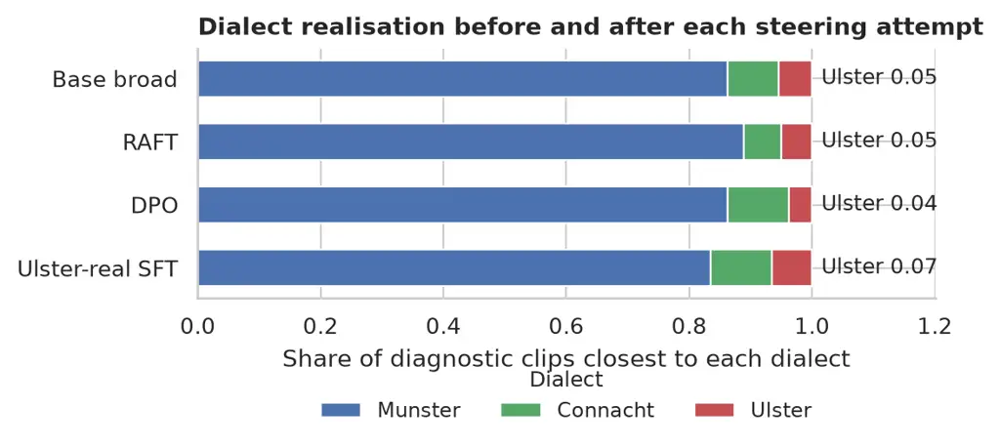
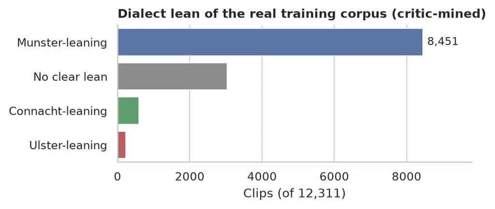
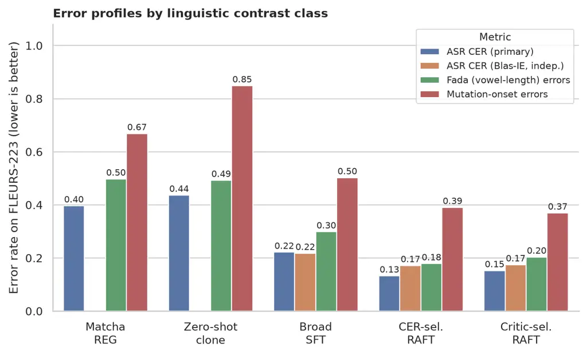

# Pronunciation-Supervised Text-to-Speech for Irish (Gaeilge)

William Lane Affiliation: Laneguage Email: [will@laneguage.com](mailto:)

###### Abstract

Speech technology for Irish must be built from very little transcribed
speech, yet the language’s pronunciation is thoroughly documented in
dictionaries and dialect descriptions. We ask whether that documentation
can supervise the adaptation of a large pre-trained text-to-speech model
to a language it was never trained on. We adapt Qwen3-TTS to Irish using
12.8 hours of crowdsourced Common Voice speech, correcting two defects
in the vendor fine-tuning script that training loss does not reveal
(Appendix A), and reach character error rate (CER) 0.225 on held-out
cross-corpus text, against 0.397 for an exhaustively tuned from-scratch
system and 0.437 for zero-shot cloning. We then compile the Wiktionary
pronunciation record into a lexicon and a phoneme critic, and use that
critic as the verifier in one round of rejection fine-tuning: CER 0.159
cross-corpus and 0.067 in-domain, with the voice still anonymous across
all 202 training speakers. The same critic explains why the voice cannot
yet be steered to a minority dialect: 229 of 12,311 training clips lean
Ulster against 8,451 Munster. Pronunciation documentation, converted
into a verifier, is a practical lever for low-resource speech synthesis,
and a way to measure what the available data cannot support.

## 1 Introduction

Irish is an official language of Ireland and the European Union, with
three major dialects (Ulster, Connacht and Munster), a deep orthography
(spelling that does not determine sound), and productive initial
mutations (lenition and eclipsis, which change a word’s opening
consonant in grammatical context). These properties make pronunciation
central to Irish speech technology: a system that reads the letters
without the sound system behind them will mispronounce a substantial
share of ordinary words. At the same time, transcribed Irish speech is
scarce. The largest open corpus, Common Voice, provides some 13 hours of
validated read speech, much of it recorded by learners; the reference
Irish synthesis programme, ABAIR at Trinity College Dublin, rests on
roughly 40 hours of project-collected studio and field recordings that
are not public artefacts Murphy et al. (2023).

Large pre-trained text-to-speech models have changed what a small team
can reasonably attempt, but they cover only their training languages,
and the strongest open systems either exclude Irish or carry
non-commercial terms. This leaves a practical question with a
methodological core: _how should a pre-trained model be adapted to an
unsupported language when speech is scarce but pronunciation is
documented?_ Irish is a good test case precisely because the imbalance
is so clear: a dictionary tradition with dialect-tagged pronunciations,
against a handful of hours of usable speech.

The methodological claim can be stated in one line: _the dictionary is
the reward model_. Where alignment methods for speech generation
ordinarily require human preferences or a strong ASR system in the
target language, many low-resource languages possess neither, yet they
very often possess a pronunciation dictionary. We treat that static
document as a verifier: compiled into a lexicon and a phoneme critic, it
scores synthetic speech at the level of phones, selects training
samples, and audits the corpus itself. We are careful about what that
substitution buys: as a selector it matches, rather than beats, a strong
ASR-based selector, and its distinctive contributions are that it
measures pronunciation and dialect directly and that it needs no
target-language ASR of record. The remainder of the paper tests how far
the substitution carries.

We make four contributions. (1) Evidence that a large pre-trained TTS
model can be adapted to a language absent from its pre-training with
12.8 hours of crowdsourced speech, into a single anonymous voice that
outperforms both an exhaustively tuned from-scratch system and zero-shot
voice cloning (the adaptation required two corrections to the vendor
fine-tuning script, documented in Appendix A). (2) A population voice
construction (all training speakers under one voice tag) that passes a
nearest-speaker anonymity test where small-donor blending measurably
fails. (3) A pronunciation critic built entirely from static public
resources (a Wiktionary-derived, dialect-tagged lexicon and
lexicon-labelled speech), validated as a measurement instrument, and
used as the verifier in rejection fine-tuning. (4) A measured account of
dialect in the available data: the critic mines the corpus’s dialect
distribution (69% Munster-leaning; 229 Ulster-leaning clips), which
explains why minority-dialect steering fails by every route we tried.
Every claim we make is a machine measurement; native-listener
evaluation, the remaining gate for naturalness and dialect authenticity,
has not been run, and Section 9 states what that leaves open.

## 2 Related Work

ABAIR’s synthesis line evolved from concatenative and
statistical-parametric systems to multi-dialect FastPitch with HiFi-GAN,
trained on project-collected recordings with dialect letter-to-sound
rules Murphy et al. (2023). Their ASR work reports dialect-stratified
error rates and warns that crowdsourced Irish is predominantly
non-native Lonergan et al. (2025); Lonergan et al. (2022); BlasBench now
provides an open Irish ASR benchmark, whose leading system we use as an
independent scorer Raj and Conway (2026).

#### Adapting large TTS models.

Among large pre-trained TTS systems, none supports Irish, and XTTS-v2
and MMS carry non-commercial terms Casanova et al. (2024); Pratap et al.
(2024). Qwen3-TTS is, to our knowledge, the only current frontier-class
system released under Apache-2.0 Qwen Team (2026). Fine-tuning such
models for lower-resource languages is an active area: LoRA adaptation
of VoxCPM2 has been reported for Khmer and Korean Pov et al. (2026), and
adapter-based adaptation to unseen languages has been studied for
lightweight TTS Falai et al. (2025). Our setting differs in three
respects: the target language is absent from the base model’s
pre-training languages (not merely low-resource); the adapted voice must
be anonymous rather than a cloned or single-speaker voice; and every
comparison is powered and replicated under a frozen protocol (§9).

#### Pronunciation knowledge and assessment.

Dictionary knowledge has previously been injected into end-to-end TTS at
scale Jiang et al. (2022), and phone-versus-grapheme inputs have been
compared for low-resource transfer Do et al. (2023). Pronunciation
scoring itself descends from goodness-of-pronunciation in
computer-assisted pronunciation training Witt and Young (2000). We use
that lineage differently: the scorer is trained from dictionary
pronunciations alone, validated as an instrument, and then used as a
data-selection verifier and corpus-mining tool.

#### Preference and rejection methods for TTS.

Rejection fine-tuning (best-of-$`n`$ selection followed by supervised
training) originates in language-model alignment Dong et al. (2023). For
speech, SpeechAlign aligns codec language models to human preferences
with iterative preference optimisation Zhang et al. (2024), INTP applies
DPO with an intelligibility-preference dataset Zhang et al. (2025), and
recent analyses of fine-tuning failure in LLM-based TTS emphasise data
diversity over naive supervised updates Purwar and Choudhary (2026). Our
verifier is neither human preference nor ASR agreement: it is a
dictionary-derived phoneme critic, and we compare it directly against
ASR-CER selection under matched conditions (§7).

#### Voice anonymisation.

Speaker anonymisation is usually framed as post-hoc transformation of
speaker embeddings, classically averaging or resampling x-vectors under
the VoicePrivacy evaluation framework Tomashenko et al. (2020);
Panariello et al. (2024). Our construction differs: anonymity is
obtained at training time by pooling all speakers under one voice tag,
and evaluated by a nearest-speaker test over the training population
(§5.3). We are not aware of prior work that evaluates small-donor
_blending_ this way, nor of dictionary-derived dialect pronunciations
used as a verifier for sample selection.

## 3 Data and Rights

All components are recorded in a rights ledger with three states
(commercial-cleared, research-only, blocked-pending-counsel), and
product-path runs fail closed on uncleared components. Training speech
is Common Voice Irish (CC0): after hard checks, 12,311 clips from 202
speakers, 12.84 hours Ardila et al. (2020). FLEURS and FLEURS-R Irish
(CC BY 4.0) are held out for evaluation Conneau et al. (2022); Ma et al.
(2024). The pronunciation lexicon derives from the English Wiktionary
dump via kaikki.org (CC BY-SA), acquired with dump date and hash
recorded. Self-reported accent labels exist for 21% of Common Voice
clips and are used only as weak validation signal; no dialect labels
exist for the training speakers, which is the motivation for the
pronunciation-based mining in Section 8.

## 4 The From-Scratch Baseline

We first trained Matcha-TTS Mehta et al. (2024) with a HiFi-GAN vocoder
Kong et al. (2020), both from scratch, under a frozen evaluation
protocol (Section 9). The campaign was extensive (step scaling,
augmentation, oversampling, checkpoint averaging, inference variants and
an additional corpus ingest were each measured), and it converges to a
clear conclusion: at this data scale the ceiling is set by the data, not
by tuning. The best from-scratch system reaches CER 0.397 on held-out
cross-corpus text (FLEURS-223; ground-truth floor 0.096) and the authors
judged it unnatural in informal listening. Run-to-run seed variance
(0.013–0.027 CER) is of the same order as most intervention effects, a
finding that shapes the replication requirements in Section 9. We report
this phase briefly because its role is to establish the baseline that
adaptation must beat, and because its negative results motivate the
change of approach.

## 5 Adapting a Pre-trained Model to an Unseen Language

### 5.1 Zero-shot transfer

Qwen3-TTS 1.7B, prompted with a single Irish reference clip, synthesises
a language absent from its ten pre-training languages: on the powered
comparison of Section 9 it scores CER 0.437 cross-corpus, with the
highest quality proxy (DNSMOS OVRL 3.42) of any early system. It does so
by cloning the reference speaker, however, which our voice-identity
posture excludes from any product path; it also remains unstable on
short prompts (2 of 277 evaluation clips ran to the token cap). We treat
zero-shot cloning as a research baseline and a measure of what
pre-training already knows about Irish phonology.

### 5.2 Adaptation recipe

Our target is a single anonymous voice, so we fine-tune the 0.6B base
model under one voice tag, with the speaker slot set to the mean of
donor reference embeddings (provenance recorded). We call the resulting
voice _Glór Nua_ (“new voice”); its release is described with the other
artifacts in Section 11. The vendor fine-tuning script required two
corrections before any run could be trusted (a double label shift, and a
sub-talker objective whose input already contains its target codes),
together with a lower learning rate (1e-5 rather than the default 2e-5);
we verified the corrections with a teacher-forced alignment probe before
training (details and probe measurements in Appendix A). These are
implementation matters, reported for reproducibility; no claim in what
follows depends on them beyond the fact that the adapted models below
were trained with the corrected recipe. At that recipe, the adapted
models cross over the baseline decisively (Table 1, Figure 1). Training
on the full 202-speaker population under one voice tag outperforms the
quality-gated three-donor blend at both model scales, and rank-16 LoRA
adapters on the 106-minute blend match the 12.8-hour full fine-tune
cross-corpus: on small, clean

data, adapter regularisation substitutes for roughly seven times the
data volume. Pure greedy decoding collapses to silence at the token cap;
the vendor sampling defaults stand.

| System               | common-80 | FLEURS-223 | Anon. |
| -------------------- | --------- | ---------- | ----- |
| Matcha REG           | 0.216     | 0.397      | fixed |
| Qwen zero-shot clone | 0.317     | 0.437      | clone |
| Broad SFT (3-draw)   | 0.102     | 0.225      | PASS  |
| LoRA, 106 min blend  | 0.117     | 0.226      | FAIL  |
| + verifier-RAFT      | 0.067     | 0.159      | PASS  |

Table 1: Final systems (ASR CER, lower is better; three-draw means where
noted; “verifier-RAFT” is rejection fine-tuning, Section 7).
Ground-truth floors: common-80 0.054, FLEURS-223 0.096 (same scorer on
real speech). Anonymity: donor / nearest-speaker similarity against its
bar.



Figure 1: Cross-corpus intelligibility by system. Adaptation, not
further tuning of the from-scratch recipe, closes the gap.

### 5.3 Voice anonymity

A blended voice is not automatically an anonymous one. Our three-donor
blends, pitch-shifted and pooled under one tag, sit at similarity
0.88–0.90 to their nearest donor against a gate bar of 0.82 (donor
self-similarity 0.94–0.98): the voice collapses toward one donor, and
similarity _rises_ as the model learns the donors’ Irish better.
Training instead on the whole 202-speaker population under one tag
passes a nearest-speaker generalisation of the same test (0.87–0.88
against a bar of 0.93, over centroids from every training speaker). The
two tests use different bars because their comparison sets differ: the
donor test asks whether a voice is unusually close to one of three
donors, the population test whether it approaches the population’s
maximum inter-speaker similarity (0.962). Anonymity, in this setting, is
a property of population averaging, not of blending a few voices. Both
tests use a single speaker-embedding model and a single protocol, so
this result is evidence rather than a guarantee.

## 6 The Dictionary as Verifier: Lexicon and Critic

The lexicon is built from the Wiktionary dump without any institutional
cooperation: 11,532 words with IPA transcriptions, dialect-tagged for
Ulster (9,253 transcriptions), Munster (6,545) and Connacht (5,473,
including subdialect tags mapped to their major group). Of these, 4,354
word types carry different pronunciations across dialect groups, and
such dialect-diagnostic words make up 33% of running tokens in our
corpora; overall token coverage is 82%. A small dialect-conditioned
grapheme-to-phoneme model trained on the lexicon reaches only 0.51 phone
error rate (PER) on held-out words: the source transcriptions are too
variable for it to be a label source, so it is used as an auxiliary
only. Silver phone labels for the full training corpus come directly
from the lexicon (out-of-vocabulary words, 15% of tokens, are omitted;
the diagnostic vocabulary is in-lexicon by construction).

The critic is a wav2vec2-XLS-R (300M) CTC phoneme recogniser fine-tuned
on those silver labels Babu et al. (2022). It reaches held-out phone
error rate 0.164 on speakers it never saw in training. As a system
scorer it orders our checkpoints by PER on common-80 (Broad SFT 0.226
$`<`$ Matcha REG 0.305 $`<`$ Matcha 300k 0.324 $`<`$ zero-shot clone
0.545, on a scale that is not comparable to the CER numbers of Table 1),
consistent with the CER ordering, but not redundant with it: the clone,
which the quality proxy ranks highest, pronounces worst (Figures 2 and
3). One validation result determines how the critic may be used. Scored
against a single canonical pronunciation, native speakers from the
Gaeltacht (Irish-speaking regions) in held-out data score PER 0.61
against 0.23 for unlabeled speakers. The critic therefore measures
conformity to a standard-leaning canonical, not nativeness; dialect
speakers deviate from it by design. Any reward or filter built on the
critic must use dialect-matched canonicals, and nativeness-band PER is
rejected as a validation gate. This is the kind of instrument error that
is cheap to find before the critic is trusted with selection, and
expensive afterwards.



Figure 2: Pronunciation fidelity as heard by the critic. ASR-based
scoring alone does not separate these systems this way.



Figure 3: Two clips the two scorers judge oppositely (from the
1,000-sample pool). (A) The pronunciation is essentially canonical, but
the ASR substitutes a real word (_cearr_ $`\rightarrow`$ _ceithre_), so
CER counts a pronunciation success as failure. (B) The ASR transcript is
near-perfect while vowel length and quality drift from the canonical
phones, which CER cannot see. This asymmetry is the scientific reason
for a pronunciation-level verifier.

## 7 Verifier-Guided Fine-tuning from Dictionary Rewards

Rejection fine-tuning (RAFT) is the simplest way to let a verifier
improve a generator: sample candidates, keep those the verifier scores
best, and fine-tune on them. From the broad SFT checkpoint we sampled
four candidates for each of 250 prompts at temperature 1.0, scored each
with the critic (phone error rate against the canonical pronunciation, a
dialect margin term, and an ASR-CER guard against unintelligible
samples), kept the best sample per prompt where it cleared a margin
floor (84 of 1,000 clips) and trained a rank-16 LoRA adapter on them
under the same single voice. One such round moves FLEURS-223 CER from
0.222 to 0.153 and in-domain CER from 0.090 to 0.059, with the quality
proxy unchanged and anonymity intact (single draw; the three-draw means
behind the headline comparison are 0.225 and 0.159, Section 9). A second
round changes nothing (paired difference not significant): the model’s
own samples are already near the verifier’s ceiling, so there is little
left to select. The mechanism is worth stating plainly: temperature
sampling produces variation, the verifier finds the unusually clean
cases, and training moves the model’s average output toward its own best
behaviour.

What does the critic contribute over the obvious alternative, selecting
by ASR CER? The two signals are nearly independent over the sample pool
(correlation 0.097; they agree on the best of four samples in only 137
of 250 prompts; Figure 5 shows where each fails). Retraining identical
arms on matched 84-clip selections gives: no RAFT 0.222, random
selection 0.197, critic selection 0.153, CER selection 0.133
(FLEURS-223; Figure 4). Selection itself is therefore the large effect,
and CER selection’s edge on CER endpoints is partly by construction,
since it optimises the metric family that grades it. Under the
independent Blas-IE scorer the two selections tie cross-corpus (0.172 vs
0.175, difference not significant), while critic selection retains the
best phone fidelity (PER 0.056 vs 0.059; random 0.081). We do not claim
the critic is the better _general_ selector. Its contribution is that it
measures pronunciation directly, independently of any ASR family, and
that the same instrument supports the dialect analysis of the next
section, which no CER signal can perform.



Figure 4: Selection-signal ablation (matched 84-clip arms from one
sample pool). Selection matters more than which strong signal selects.



Figure 5: Joint behaviour of the two selection signals over the 1,000
sampled clips. The quadrants at the medians are almost balanced
(both-good 351, both-bad 347, critic-only 153, ASR-only 149): the
signals fail on largely different clips, which is why each can select a
winning arm and why neither dominates under the other’s metric.

## 8 The Dialect Question

Can the same machinery give the voice a chosen regional accent? The base
voice is already Munster-dominant on held-out diagnostic sentences: 86%
of clips are pronounced closest to the Munster canonical, 5% to Ulster.
RAFT raises the Munster share to 89majority-dialect amplifier.
Preference optimisation on verifier-ranked margin pairs (DPO) leaves
dialect unchanged, and for a measurable reason: only 25 of the 1,000
policy samples realise Ulster-leaning phones at all, and the
chosen/rejected pairs differ mainly in clarity, so there is no
systematic dialect contrast in the pair signal for any optimiser to
learn. Training adapters on the real Ulster-leaning clips the critic can
find degrades the voice without steering it. The critic’s mining of the
full corpus explains the pattern (Figure 7): 8,451 of 12,311 clips lean
Munster, 593 Connacht, and 229 Ulster (185 strongly, across 61
speakers), mirroring the dialect bias reported for Irish ASR Lonergan
et al. (2025). Minority-dialect synthesis from this resource is not an
optimisation problem awaiting a better algorithm; it is short of the
majority dialect by a factor of about forty in raw clips and by more
still in the samples the model actually produces, and the verifier is
what makes that shortage measurable rather than anecdotal (Figure 6).



Figure 6: Dialect realisation of the voice before and after each
steering attempt. The Munster share never falls.



Figure 7: Dialect lean of the real training corpus, as mined by the
critic. Figure 6 is explained by this distribution.



Figure 8: Error profiles by linguistic contrast class (FLEURS-223).
Adaptation and verifier fine-tuning reduce not only overall CER but
specifically fada (vowel-length) and mutation-onset errors; the
zero-shot clone’s mutation rate (0.85) exposes what its quality proxy
hides. The two RAFT selection signals end within noise of each other on
every class.

## 9 Evaluation Protocol

Machine metrics are screening instruments. The claims that ultimately
matter (naturalness, pronunciation acceptability, dialect authenticity)
require native listeners, and that study is not part of this paper: its
design is fixed and waits on recruitment, with a validated challenge set
(29 items covering fadas, lenition, eclipsis, broad/slender contexts,
dialect-sensitive items, numbers, names and code-switching; inter-rater
$`\kappa\geq 0.6`$ required). We therefore make no naturalness,
acceptability or dialect-authenticity claim anywhere in this paper.
Until then we hold the machine evaluation to a strict standard: frozen
speaker-disjoint sets (common-80; FLEURS-76/223; in-domain-400;
FLEURS-train-200; long-form probes; gate phrases) reported with
ground-truth floors; paired bootstrap confidence intervals; and
replication across sampling draws and training seeds before any system
is designated. Under that standard the designated candidate’s advantages
are: three-draw FLEURS-223 0.159 vs 0.225 ($`\Delta`$ $`-0.066`$
\[$`-0.076`$,$`-0.056`$\]); in-domain-400 0.087 vs 0.123;
FLEURS-train-200 0.178 vs 0.262; a second RAFT seed at 0.161 (difference
not significant); no long-form regression (long-form concatenated 0.254
vs 0.296; natural-long 0.146 vs 0.154); contrast-class error rates fall
in step, with fada and mutation-onset errors dropping furthest for the
designated voice (Figure 8). Because the primary scorer was itself
fine-tuned on related corpora, ranking and headline wins were
cross-checked with Blas-IE Raj and Conway (2026), the leading open Irish
ASR system, under greedy CTC decoding with no shared training pipeline:
the ordering and the RAFT win replicate (FLEURS-223 0.175 vs 0.218). One
early anonymity “pass” in our records, measured on unintelligible
output, is retracted; gates are only ever reported on intelligible
speech.

## 10 Limitations and Ethics

No system here clones an identifiable person: the designated voice is a
population average that passes its anonymity test, while small-donor
blends fail theirs and are not product candidates. A single flagship
voice, if wanted, requires dedicated recordings with explicit consent,
which we treat as blocked pending legal advice. Dialect representation
is the sharpest limitation. Irish speakers are entitled to systems that
speak their own variety; our results show the open corpus cannot
currently support that for Ulster or Connacht, and we regard targeted,
consented dialect data collection (not further optimisation) as the
correct next investment. The critic has not been validated against human
pronunciation judgments in this version, so its scores are conformity to
the lexicon rather than evidence about nativeness; it also inherits the
limits of its silver labels (lexicon coverage and transcription
variability), and its canonicals are standard-leaning. We have scoped
every claim accordingly. Absolute error rates are scorer-dependent and
are reported only as within-pipeline comparisons alongside an
independent cross-check. Finally, Common Voice Irish skews toward
learner speech, and any model trained on it inherits that skew; the
critic measures pronunciation conformity, not nativeness, and we do not
present it as doing more.

## 11 Discussion

Table 2 collects the answers to the questions posed in Section 1. Three
points deserve emphasis. First, the adaptation result (RQ1) is not a
prompt-engineering artefact: the fine-tuned voice halves the zero-shot
clone’s error on powered sets while satisfying an anonymity constraint
the clone cannot meet. Second, the critic’s value (RQ2/RQ3) is
instrumental before it is optimising: it ranks systems by pronunciation
where ASR scoring cannot, it exposes its own canonical-conformity bias
before that bias can contaminate rewards, and only then does it improve
the model as a RAFT verifier, where it matches, rather than beats, the
metric-optimising CER selector under an independent scorer. Third, the
dialect result (RQ4) should be read as a resource finding, not a
modelling failure: three distinct steering mechanisms fail for the same
measured reason, and the verifier quantifies the missing resource (229
target-dialect clips; 2.5% target realisations in policy samples). For
other low-resource languages the transferable sequence is: build the
lexicon first, validate the critic as an instrument, mine the corpus
before promising dialect coverage, and only then spend optimisation
effort.

| Question                                                                               | Answer (evidence)                                                                                                          |
| -------------------------------------------------------------------------------------- | -------------------------------------------------------------------------------------------------------------------------- |
| RQ1: Can a pre-trained model be adapted to an unseen language into an anonymous voice? | Yes. CER 0.225 vs 0.397 (from scratch) and 0.437 (zero-shot); anonymity PASS for the population voice, FAIL for blends.    |
| RQ2: Does documented pronunciation, as a critic, measure and improve synthesis?        | Critic PER 0.164 (unseen speakers); ranks systems independently of ASR; one RAFT round: CER 0.222 $`\rightarrow`$ 0.153.   |
| RQ3: Is the critic a better selection signal than ASR CER or quality scores?           | Not for general CER (tie under independent scorer); uniquely enables phone-level measurement, dialect analysis and mining. |
| RQ4: Can the voice be steered to a minority dialect?                                   | No, by RAFT, DPO or real-subset SFT. Corpus is 69% majority-leaning; 229/12,311 target clips.                              |

Table 2: Research questions and their measured answers.

#### Artifacts and reproducibility.

Available now: the released voice, its model card, demonstration audio
and a generation script. Accompanying the code repository, subject to
the rights ledger: the pronunciation lexicon and diagnostic word lists
(CC BY-SA, with attribution), the critic and G2P code, the corrected
trainer and evaluation scripts, and per-clip scores for every reported
system. The designated voice is released as _Glór Nua_ (the population
voice that passes the anonymity test), with its model card,
demonstration audio and a generation script, under Apache-2.0 at
[https://huggingface.co/Laneguage/glor-nua-irish-tts-0.6b](https://huggingface.co/Laneguage/glor-nua-irish-tts-0.6b)
Lane (2026); the small-donor blends that fail the nearest-speaker test
are deliberately not released. Every run record carries the vendor
commit, data-manifest hash, seed and full configuration.

## 12 Conclusion

Adapting a large pre-trained TTS model to a language it was never
trained on proved tractable with remarkably little speech: a single
anonymous Irish voice at CER 0.16 cross-corpus from 12.8 hours of
crowdsourced recordings, outperforming both the from-scratch recipe and
the model’s own zero-shot cloning. The methodological point generalises
beyond Irish. Low-resource languages are often documented better than
they are recorded: pronunciation dictionaries, dialect descriptions and
word lists exist where transcribed speech does not. Converted into a
lexicon and a validated critic, that documentation becomes a verifier
that can select training samples, score systems at the level of phones,
and measure the dialect composition of a corpus. It improved our voice;
it also told us, with numbers, which improvement the data cannot yet
support. We regard both as progress toward speech technology that serves
the varieties people actually speak.

## References

- Ardila et al. (2020) Rosana Ardila, Megan Branson, Kelly Davis,
  Michael Henretty, Michael Kohler, Josh Meyer, Reuben Morais, Lindsay
  Saunders, Francis M. Tyers, and Gregor Weber. 2020. [Common voice: A
  massively-multilingual speech
  corpus](https://aclanthology.org/2020.lrec-1.520/). In _Proceedings of
  the Twelfth Language Resources and Evaluation Conference (LREC)_,
  pages 4218–4222, Marseille, France. European Language Resources
  Association.
- Babu et al. (2022) Arun Babu, Changhan Wang, Andros Tjandra, Kushal
  Lakhotia, Qiantong Xu, Naman Goyal, Kritika Singh, Patrick von Platen,
  Yatharth Saraf, Juan Pino, Alexei Baevski, Alexis Conneau, and Michael
  Auli. 2022. XLS-R: Self-supervised cross-lingual speech representation
  learning at scale. In _Proc. Interspeech_. ArXiv:2111.09296.
- Casanova et al. (2024) Edresson Casanova, Kelly Davis, Eren Gölge,
  Görkem Göknar, Iulian Gulea, Logan Hart, Aya Aljafari, Joshua Meyer,
  Reuben Morais, Samuel Olayemi, and Julian Weber. 2024. XTTS: A
  massively multilingual zero-shot text-to-speech model. In _Proc.
  Interspeech_. ArXiv:2406.04904.
- Conneau et al. (2022) Alexis Conneau, Min Ma, Simran Khanuja,
  Yu Zhang, Vera Axelrod, Siddharth Dalmia, Jason Riesa, Clara Rivera,
  and Ankur Bapna. 2022. FLEURS: Few-shot learning evaluation of
  universal representations of speech. In _Proc. IEEE Spoken Language
  Technology Workshop (SLT)_. ArXiv:2205.12446.
- Do et al. (2023) Phat Do, Matt Coler, Jelske Dijkstra, and Esther
  Klabbers. 2023. The effects of input type and pronunciation dictionary
  usage in transfer learning for low-resource text-to-speech. In _Proc.
  Interspeech_. ArXiv:2306.00535.
- Dong et al. (2023) Hanze Dong, Wei Xiong, Deepanshu Goyal, Yihan
  Zhang, Winnie Chow, Rui Pan, Shizhe Diao, Jipeng Zhang, KaShun Shum,
  and Tong Zhang. 2023. RAFT: Reward ranked finetuning for generative
  foundation model alignment. _arXiv:2304.06767_.
- Falai et al. (2025) Alessio Falai, Ziyao Zhang, and Akos
  Gangoly. 2025. Unseen speaker and language adaptation for lightweight
  text-to-speech with adapters. _arXiv:2508.18006_.
- Jiang et al. (2022) Ziyue Jiang, Zhe Su, Zhou Zhao, Qian Yang, Yi Ren,
  Jinglin Liu, and Zhenhui Ye. 2022. Dict-TTS: Learning to pronounce
  with prior dictionary knowledge for text-to-speech. In _Advances in
  Neural Information Processing Systems 35 (NeurIPS)_. ArXiv:2205.10400.
- Kong et al. (2020) Jungil Kong, Jaehyeon Kim, and Jaekyoung Bae. 2020.
  HiFi-GAN: Generative adversarial networks for efficient and high
  fidelity speech synthesis. In _Advances in Neural Information
  Processing Systems 33 (NeurIPS)_, pages 17022–17033.
- Lane (2026) William Lane. 2026. Glór Nua: Pronunciation-supervised
  text-to-speech for irish (gaeilge). Model release, Apache-2.0, gated
  access.
  [https://huggingface.co/Laneguage/glor-nua-irish-tts-0.6b](https://huggingface.co/Laneguage/glor-nua-irish-tts-0.6b).
- Lonergan et al. (2022) Liam Lonergan, Mengjie Qian, Harald Berthelsen,
  Andrew Murphy, Christoph Wendler, Neasa Ní Chiaráin, Christer Gobl,
  and Ailbhe Ní Chasaide. 2022. [Automatic speech recognition for irish:
  the ABAIR-EIST system](https://aclanthology.org/2022.cltw-1.7/). In
  _Proceedings of the 4th Celtic Language Technology Workshop (CLTW) at
  LREC_, Marseille, France.
- Lonergan et al. (2025) Liam Lonergan, Ibon Saratxaga, John Sloan,
  Oscar Maharog, Mengjie Qian, Neasa Ní Chiaráin, Christer Gobl, and
  Ailbhe Ní Chasaide. 2025. Fotheidil: an automatic transcription system
  for the irish language. In _Proceedings of the 5th Celtic Language
  Technology Workshop (CLTW)_. ArXiv:2501.00509.
- Ma et al. (2024) Min Ma, Yuma Koizumi, Shigeki Karita, Heiga Zen,
  Jason Riesa, Haruko Ishikawa, and Michiel Bacchiani. 2024. FLEURS-R: A
  restored multilingual speech corpus for generation tasks. In _Proc.
  Interspeech_. ArXiv:2408.06227.
- Mehta et al. (2024) Shivam Mehta, Ruibo Tu, Jonas Beskow, Éva Székely,
  and Gustav Eje Henter. 2024. Matcha-TTS: A fast TTS architecture with
  conditional flow matching. In _Proc. IEEE International Conference on
  Acoustics, Speech and Signal Processing (ICASSP)_. ArXiv:2309.03199.
- Murphy et al. (2023) Andy Murphy, Liam Lonergan, Mengjie Qian, Harald
  Berthelsen, Christoph Wendler, Neasa Ní Chiaráin, Ailbhe Ní Chasaide,
  and Christer Gobl. 2023. [ABAIR & EIST: A demonstration of speech
  technologies for irish](https://doi.org/10.21437/SIGUL.2023-26). In
  _Proceedings of the 2nd Annual Meeting of the ELRA/ISCA SIG on
  Under-resourced Languages (SIGUL)_, pages 121–123, Dublin, Ireland.
- Panariello et al. (2024) Michele Panariello, Francesco Nespoli,
  Massimiliano Todisco, and Nicholas Evans. 2024. Speaker anonymization
  using neural audio codec language models. In _Proc. IEEE International
  Conference on Acoustics, Speech and Signal Processing (ICASSP)_.
  ArXiv:2309.14129.
- Pov et al. (2026) Phannet Pov, Hyun Woo Park, Voneat Pen, Sovandara
  Chhoun, Wan-Sup Cho, and Saksonita Khoeurn. 2026. Closing the quality
  gap in low-resource text-to-speech: LoRA fine-tuning of VoxCPM2 for
  khmer and korean. _arXiv:2606.26618_.
- Pratap et al. (2024) Vineel Pratap, Andros Tjandra, Bowen Shi, Paden
  Tomasello, Arun Babu, Sayani Kundu, Ali Elkahky, Zhaoheng Ni, Apoorv
  Vyas, Maryam Fazel-Zarandi, Alexei Baevski, Yossi Adi, Xiaohui Zhang,
  Wei-Ning Hsu, Alexis Conneau, and Michael Auli. 2024. Scaling speech
  technology to 1,000+ languages. _Journal of Machine Learning
  Research_, 25(97):1–52. ArXiv:2305.13516.
- Purwar and Choudhary (2026) Anupam Purwar and Aditya Choudhary. 2026.
  When fine-tuning fails and when it generalises: Role of data diversity
  and mixed training in LLM-based TTS. _arXiv:2603.10904_.
- Qwen Team (2026) Qwen Team. 2026. Qwen3-TTS technical report.
  _arXiv:2601.15621_. Apache-2.0; vendor commit 022e286.
- Raj and Conway (2026) Jyoutir Raj and John Conway. 2026. BlasBench: An
  open benchmark for irish speech recognition. _arXiv:2604.10736_.
- Tomashenko et al. (2020) Natalia Tomashenko, Brij Mohan Lal
  Srivastava, Xin Wang, Emmanuel Vincent, Andreas Nautsch, Junichi
  Yamagishi, Nicholas Evans, Jose Patino, Jean-François Bonastre,
  Paul-Gauthier Noé, and Massimiliano Todisco. 2020. Introducing the
  VoicePrivacy initiative. In _Proc. Interspeech_. ArXiv:2005.01387.
- Witt and Young (2000) Silke M. Witt and Steve J. Young. 2000.
  Phone-level pronunciation scoring and assessment for interactive
  language learning. _Speech Communication_, 30(2–3):95–108.
- Zhang et al. (2024) Dong Zhang, Zhaowei Li, Shimin Li, Xin Zhang,
  Pengyu Wang, Yaqian Zhou, and Xipeng Qiu. 2024. SpeechAlign: Aligning
  speech generation to human preferences. In _Advances in Neural
  Information Processing Systems 37 (NeurIPS)_. ArXiv:2404.05600.
- Zhang et al. (2025) Xueyao Zhang, Yuancheng Wang, Chaoren Wang, Ziniu
  Li, Zhuo Chen, and Zhizheng Wu. 2025. [Advancing zero-shot
  text-to-speech intelligibility across diverse domains via preference
  alignment](https://aclanthology.org/2025.acl-long.598/). In
  _Proceedings of the 63rd Annual Meeting of the Association for
  Computational Linguistics (ACL)_.

## Appendix A Adaptation diagnostics (implementation note)

Vendor fine-tuning (Qwen3-TTS, commit 022e286) failed identically at
both model scales: training loss fell normally and teacher-forced
end-of-sequence prediction was near-perfect, yet free-running generation
did not stop and produced Irish-like babble. We isolated the two defects
with a teacher-forced alignment probe that scores argmax accuracy at
controlled temporal offsets. (i) The trainer pre-shifts codec labels and
the Transformers loss shifts again, so the talker is trained two frames
ahead; the same applies to the sub-talker, and one residual group
receives no gradient. The community documents this defect independently,
along with a missing text-projection call Qwen Team (2026).
(ii) Sub-talker supervision pairs each frame’s codes with the hidden
state at that frame’s own input position, whose embedding already sums
all 16 code-group embeddings of that frame. Measured on held-out clips
under the pairing that generation actually uses, code-predictor accuracy
per group is 0.05–0.17 for the base model and 0.01–0.06 for
vendor-recipe SFT; under the leaky training pairing the same SFT scores
0.32–0.53. The corrected trainer supervises the sub-talker at the
generation pairing, computes explicit per-group cross-entropy including
group 15, fixes the speaker slot deterministically, and defaults to
learning rate $`2\times 10^{-6}`$ for the smoke gate.

## Appendix B Training configuration

Table 3 gives the configuration of the two runs behind the released
voice: the adaptation run, and the rejection fine-tuning round of
Section 7.

|                |                       |                                  |
| -------------- | --------------------- | -------------------------------- |
|                | Adaptation            | Rejection FT                     |
| Initialisation | Qwen3-TTS 0.6B        | adapted, epoch 2                 |
| Data           | 12,311 clips          | 84 selected clips                |
| Epochs         | 3                     | 3                                |
| Batch          | 2 $`\times`$ 4 accum. | 2 $`\times`$ 4 accum.            |
| Learning rate  | 1e-5                  | 1e-4                             |
| Optimiser      | AdamW, wd 0.01        | AdamW, wd 0.01                   |
| Precision      | bf16                  | bf16                             |
| Adapter        | full model            | LoRA $`r{=}16`$, $`\alpha{=}32`$ |
| Trainable      | all                   | 11.9M                            |
| Seed           | 42                    | 42 (replicate 777)               |

Table 3: Training configuration. Both runs use the corrected trainer, a
single voice tag (ga_blend_m1) and one RTX PRO 6000 (96 GB).

The speaker embedding is the mean of the donor reference embeddings,
computed before training over the distinct reference clips in the
manifest and recorded in the checkpoint metadata; the rejection round
conditions on that existing slot rather than a new one. Checkpoints are
scored at the end of every epoch, and the epoch-2 checkpoint was carried
forward on cross-corpus character error rate.

## Appendix C Rejection fine-tuning: prompts and reward

Candidates are sampled from the adapted checkpoint with the same prompt
set in every round: 200 sentences from a 1,194-sentence diagnostic set
drawn from the pronunciation knowledge base, which covers the contrast
classes of interest (vowel length and fadas, lenition and eclipsis
onsets, broad and slender contexts), plus 50 sentences sampled at even
intervals from the training-corpus transcripts. Four candidates are
drawn per prompt at temperature 1.0 for the talker and the sub-talker,
giving 1,000 clips.

Each clip is decoded once by the critic and compared with the canonical
pronunciation of its prompt, giving the reward

```math
\mathrm{reward}\;=\;-\mathrm{PER}_{\mathrm{target}}\;+\;0.5\,\mathrm{margin},
```

```math
\mathrm{margin}\;=\;\min_{d}\mathrm{PER}_{d}\;-\;\mathrm{PER}_{\mathrm{target}}.
```

where the margin compares the target canonical with the other dialect
canonicals, and a penalty of 1.0 is applied when the ASR character error
rate exceeds 0.35, which rejects the candidate in practice since rewards
are of order $`-0.1`$. The best candidate per prompt is kept when its
margin clears $`-0.05`$; 84 of 1,000 clips survive. The designated round
scores against the general canonical lexicon. The dialect-steering
experiments of Section 8 instead score against a single dialect
canonical; that choice is what puts native speakers at PER 0.61 against
0.23 for unlabelled speakers. Sampling uses seed 1234; training uses
seed 42, replicated at 777.

## Appendix D Decoding configuration

Evaluation and demonstration use the sampling defaults stored with the
checkpoint: temperature 0.9, top-$`k`$ 50, top-$`p`$ 1.0 and repetition
penalty 1.05, matched for the sub-talker, with a 1,024-token cap per
utterance. Sampling is not optional: pure greedy decoding collapses to
silence at the cap. Because output is stochastic, headline numbers are
means over three draws with paired bootstrap intervals, and rare
runaways to the cap (at most 2 of 319 clips across the reported sets)
are counted rather than discarded. Audio is 24 kHz.

## Appendix E Evaluation details

Machine scoring uses two systems that share no training pipeline. The
primary scorer is a fine-tuned Irish Whisper
(Eimhin03/MCV_Fleurs_Combined_Irish_ASR); it overlaps our training
corpora, so it ranks systems but does not set absolute values. The
independent cross-check is Blas-IE (jyoutir/blas-m3-lm), a
wav2vec2-XLS-R CTC system transcribed greedily without a language model
Raj and Conway (2026). Normalisation and metrics are Irish-aware: fadas
and initial mutations are preserved, and beside character error rate we
report fada and mutation-onset error rates.

All sets are frozen and speaker-disjoint from training. Common-80 and
FLEURS-223 are the primary held-out sets, in-domain-400 and
FLEURS-train-200 the powered extensions, the long-form probes
concatenate utterances into paragraph-length input, and the gate set is
16 fixed phrases that check whether generation terminates at all.
Ground-truth floors from the same scorer on real speech are CER 0.054 on
common-80 and 0.096 on FLEURS; absolute values are scorer-dependent, so
only within-scorer comparisons carry weight.

## Appendix F Data and artifacts

Training speech is Common Voice Irish 27.0, obtained through the Mozilla
Data Collective (record cmu5uww2f0095nq07fx63w1tc, SHA256
21e7f007...62ee1), licensed CC0: 13,473 validated clips reduce to 12,311
after hard checks, which excluded 31 pathological-silence clips. FLEURS
and FLEURS-R Irish (CC BY 4.0) are evaluation-only here. The lexicon
derives from the English Wiktionary dump via kaikki.org (CC BY-SA),
acquired with dump date and hash recorded.

Every component carries a row in a rights ledger in one of three states
(commercial-cleared, research-only, blocked-pending-counsel), and runs
fail closed if an uncleared component reaches a product path. The
released voice Lane (2026) is the population voice that passes the
nearest-speaker anonymity test; the small-donor blends that fail it are
not released. Training audio is not redistributed, per the terms of the
corpus host.
