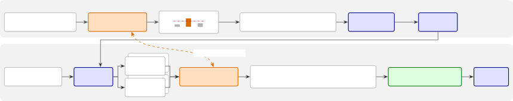
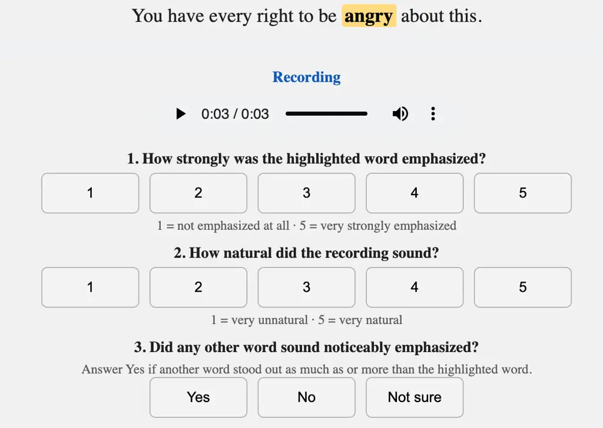

# EmpDPO: Enabling Emphasis Control in TTS via Direct Preference Optimization

Haonan Chen    Yunyun Wang    Megan Wei    Zeyu Jin ^(†)^(†)thanks:
Audio samples:
[https://chaonan99.github.io/empdpo-demo/](https://chaonan99.github.io/empdpo-demo/)

###### Abstract

Word-level emphasis conveys meaning that text alone cannot express and
is therefore essential for a practical text-to-speech (TTS) system. In
this work, we study how to add emphasis control post hoc to a pretrained
TTS model that has never been trained with emphasis annotations. We
present EmpDPO, a simple, efficient, and effective two-stage recipe that
adds emphasis control to a multilingual zero-shot diffusion TTS model
through supervised fine-tuning followed by direct preference
optimization (DPO). The training signals for both stages come from an
off-the-shelf multilingual emphasis detector, so that no manual emphasis
annotation or task-specific reward design is needed. We find that DPO
can substantially strengthen emphasis control with only a few thousand
preference pairs and training steps. Objective and subjective
evaluations against strong public systems show that our model produces
perceptible emphasis while preserving naturalness and overall quality.

###### Index Terms: 

text-to-speech, emphasis control, direct preference optimization,
multilingual, diffusion models

^(†)^(†)address: ¹Adobe Research, USA   ²Brown University, USA

## 1 Introduction

Current text-to-speech (TTS) systems can already generate highly
realistic and natural speech \[1, 2\]. However, human speech carries
information that is difficult to fully convey through text alone.
Emphasis is one such example: emphasizing different words in the same
sentence leads to different contrastive focus \[3\]. For example,
consider the sentence “She called today.”

> _She_ called today (not someone else).  
> She _called_ today (not messaged).  
> She called _today_ (not yesterday).

Therefore, when TTS systems are used in practice, users may need
finer-grained control to accurately convey the intended meaning.

A straightforward approach to fine-grained control is to treat control
signals as additional input and learn their realization through
supervised training. For emphasis control, there are two groups of
methods: (1) directly learning emphasis from emphasis tags or features
fed to the model \[4, 5, 6, 7, 8\]; and (2) controlling emphasis
indirectly through more concrete prosodic attributes, such as pitch,
energy, and duration \[9, 10, 11, 12\]. The former leaves the acoustic
realization of emphasis entirely to the model, but requires training
data with word-level emphasis annotations, which are costly to obtain;
the latter restricts emphasis to a few prosodic parameters and tends to
be language-dependent and less natural than end-to-end generation.

To further improve the adherence to control signals, recent work has
explored feedback-based post-training for fine-grained speech control,
ranging from online reinforcement learning such as Group Relative Policy
Optimization (GRPO) \[13\] to offline methods such as Direct Preference
Optimization (DPO) \[14, 15\]. For example, EMORL-TTS \[16\] defines
emphasis as a pitch/energy contrast reward computed on generated speech
and reinforces it with a GRPO-style objective. Fish Audio S2 \[17\]
first uses supervised fine-tuning (SFT) to teach localized vocal
instructions such as \[emphasis\], and then applies GRPO to generated
speech, using a rich transcriber to penalize omitted instructions.

Inspired by these approaches, we adopt a two-stage recipe—SFT followed
by preference optimization—to add multilingual emphasis control to a
pretrained TTS system that has never seen emphasis labels. Our method
involves three key design choices. First, for preference optimization,
we use DPO, which learns directly from fixed chosen/rejected pairs
without requiring a separate reward model. Second, we use the same
off-the-shelf multilingual emphasis detector \[18\] to generate
pseudo-labels for both SFT and preference optimization, eliminating the
need for manually annotated emphasis data. Third, we build on a latent
diffusion TTS backbone trained with flow matching \[19\], similar to the
teacher model of DMOSpeech \[20\], which provides strong zero-shot voice
cloning and efficient inference. Our main contributions are as follows:

- A simple recipe. We present a detector-in-the-loop SFT and
  Diffusion-DPO recipe for emphasis control that needs no manual
  emphasis annotation or task-specific reward design.

- Efficient training. We show that DPO substantially strengthens
  emphasis control with only a few thousand preference pairs and
  training steps, and that the gain holds across six languages.

- Effective control. Objective and subjective evaluations against strong
  public systems show that our model produces perceptible emphasis while
  preserving naturalness and overall quality.



Figure 1: Overview of EmpDPO. SFT stage: a multilingual emphasis
detector labels real speech with emphasis markers. DPO stage: the same
detector scores candidates sampled from the SFT model to build
chosen/rejected pairs for Diffusion-DPO.

## 2 Method

### 2.1 Base model

Our base model is a multilingual zero-shot latent diffusion TTS model,
similar to the teacher model of DMOSpeech \[20\]. Its input consists of
three parts: the raw text $`x`$, an IPA phoneme sequence $`p`$, and a
reference audio $`r`$. The text is encoded by a frozen pretrained T5
encoder into $`e_{x}=E_{\mathrm{T5}}(x)`$ \[21\], and the phonemes by a
learned embedding table into $`e_{p}=E_{\mathrm{ipa}}(p)`$. Both the
target audio $`y`$ and the reference audio $`r`$ are encoded by the same
frozen Descript Audio Codec (DAC) \[22\] into latent frames
$`z=E_{\mathrm{DAC}}(y)`$ and $`z^{r}=E_{\mathrm{DAC}}(r)`$. The
generation process can be written as a single conditional distribution:

```math
\hat{z}\sim\pi_{\theta}(\cdot\mid e_{x},\,e_{p},\,z^{r}) \tag{1}
```

and DAC then decodes the result back to a waveform
$`\hat{y}=D_{\mathrm{DAC}}(\hat{z})`$.

The diffusion model is trained to denoise Gaussian noise into the latent
$`z`$. Specifically, $`z`$ is interpolated with noise $`\epsilon`$ to
obtain a noisy latent $`z_{t}=(1-t)z+t\epsilon`$, where $`t\in[0,1]`$ is
the noise level. The model predicts a velocity $`v_{\theta}`$, which is
trained to match the true velocity $`v`$ \[23, 19\]:

```math
\mathcal{L}(\theta)=\mathbb{E}_{t,\,z,\,\epsilon}\left\|v_{\theta}(z_{t},\,t,\,e_{x},\,e_{p},\,z^{r})-v\right\|^{2} \tag{2}
```

where $`v=\mathrm{d}z_{t}/\mathrm{d}t=\epsilon-z`$. At inference, we
start from pure noise and numerically integrate the predicted velocity
(e.g., with Euler steps) to obtain the clean latent $`\hat{z}`$.

### 2.2 Supervised fine-tuning with emphasis

To add emphasis control on top of the base model, we wrap each
emphasized word with markers on both the text and phoneme paths. For
example,

Text input: She \<emp\>called\</emp\> today.  
Phoneme input: Si: \<emp\>kO:ld\</emp\> t@deI

We use an off-the-shelf multilingual emphasis detector \[18\]. The
detector is trained on seven languages (en, de, es, fr, it, pt, zh) and
is applied zero-shot to other languages. Given a waveform and its
transcript, it assigns an emphasis score to each word. We further pick a
threshold (0.35) and mark every word whose score exceeds it, on both the
text and phoneme paths. The model is then fine-tuned on a mixture of
marked and unmarked data, giving it an initial ability to follow
emphasis markers.

### 2.3 Direct preference optimization (DPO)

After SFT, we further strengthen the emphasis-following ability with
DPO. DPO training requires a pair of _chosen_ and _rejected_ targets for
the same input, where the chosen one is preferred. For emphasis control,
the chosen audio should sound more emphasized than the rejected one.
Both are encoded by the same DAC encoder into a chosen latent $`z_{w}`$
and a rejected latent $`z_{l}`$ (winner/loser). We denote the
conditioning input by $`c=(e_{x},e_{p},z^{r})`$. The original DPO
objective raises the likelihood of the chosen latent relative to a
reference model and lowers that of the rejected one:

```math
\mathcal{L}_{\mathrm{DPO}}(\theta)=-\mathbb{E}_{(z_{w},\,z_{l})}\,\log\sigma\!\big(\beta\,[\,r_{\theta}(z_{w})-r_{\theta}(z_{l})\,]\big) \tag{3}
```

where
$`r_{\theta}(z)=\log\big(\pi_{\theta}(z\mid c)/\pi_{\mathrm{ref}}(z\mid c)\big)`$
is the log-likelihood ratio against the reference model
$`\pi_{\mathrm{ref}}`$, the final model of the SFT stage, which serves
as the anchor. $`\beta`$ controls the allowed deviation, and $`\sigma`$
is the sigmoid function. Unlike online reinforcement learning, DPO
requires only offline preference pairs, with no separate reward model.

For a diffusion model, the log-likelihood cannot be evaluated directly,
so Diffusion-DPO \[15\] replaces it with the denoising objective and
applies the same relative comparison at each noise level:

```math
\mathcal{L}_{\mathrm{diff}}(\theta)=-\mathbb{E}\,\log\sigma\!\left(-\beta\left[\left(E_{\theta}^{w}-E_{\mathrm{ref}}^{w}\right)-\left(E_{\theta}^{l}-E_{\mathrm{ref}}^{l}\right)\right]\right) \tag{4}
```

$`E_{\theta}=\left\|v_{\theta}(z_{t},\,t,\,c)-v\right\|^{2}`$ is the
velocity-prediction error on the corresponding sample. Intuitively, this
asks the policy to drive the denoising error on chosen below that of the
frozen reference model, and to push the error on rejected above it.

In practice, optimizing the preference loss alone is unstable: the model
drifts away from the reference and the denoising quality of both chosen
and rejected samples degrades. We therefore add a replay term, i.e., the
original denoising loss of Eq. (2) on additional data, and optimize the
total loss
$`\mathcal{L}=\mathcal{L}_{\mathrm{replay}}+\lambda\,\mathcal{L}_{\mathrm{diff}}`$
with $`\lambda=0.1`$. The replay data can come from two sources: the
real speech used for SFT (_corpus replay_), or the chosen samples of the
preference pairs themselves (_chosen replay_). Corpus replay anchors the
model to the real data distribution, whereas chosen replay requires no
additional data pipeline; we compare both in Sec. 4.2.

### 2.4 DPO pair construction

Given input text $`x`$ and reference audio $`r`$ (markers are added to
$`x`$ and $`p`$ identically; we write only $`x`$ below), we use the SFT
model to generate $`K`$ candidates whose text carries emphasis markers,
and $`N`$ baselines without markers. We score all candidates and
baselines with the emphasis detector.

Denote the set of marked target words in $`x`$ by $`\mathcal{T}`$; the
improvement of a target word $`\tau\in\mathcal{T}`$ in candidate $`k`$
and the selectivity of candidate $`k`$ are defined as

```math
\delta_{k}(\tau)=s_{k}(\tau)-\bar{s}^{0}(\tau),\quad\rho_{k}=\frac{\big|\{u\notin\mathcal{T}:s_{k}(u)<s_{k}^{\min}\}\big|}{\big|\{u\notin\mathcal{T}\}\big|} \tag{5}
```

where $`s_{k}(\tau)`$ is the detector score of target word $`\tau`$ in
candidate $`k`$, $`\bar{s}^{0}(\tau)`$ is its average score over the
$`N`$ baseline samples, and the selectivity $`\rho_{k}`$ is the fraction
of non-target words whose scores fall below the lowest target-word score
$`s_{k}^{\min}=\min_{\tau\in\mathcal{T}}s_{k}(\tau)`$. The composite
score of candidate $`k`$ is:

```math
g_{k}=\lambda_{\mathrm{min}}\,\delta^{\mathrm{min}}_{k}+\lambda_{\mathrm{avg}}\,\bar{\delta}_{k}+\lambda_{\mathrm{sel}}\,\rho_{k} \tag{6}
```

where
$`\delta^{\mathrm{min}}_{k}=\min_{\tau\in\mathcal{T}}\delta_{k}(\tau)`$
is the smallest improvement across target words,
$`\bar{\delta}_{k}=\mathrm{avg}_{\tau\in\mathcal{T}}\,\delta_{k}(\tau)`$
is the average improvement, and $`\lambda_{\mathrm{min}}`$,
$`\lambda_{\mathrm{avg}}`$, $`\lambda_{\mathrm{sel}}`$ are the weights
of the three terms. We use
$`(\lambda_{\mathrm{min}},\lambda_{\mathrm{avg}},\lambda_{\mathrm{sel}})=(0.6,0.4,0.3)`$.
Intuitively, the first two terms reward candidates that emphasize every
target word (the minimum term penalizes leaving any of them out), while
the selectivity term rewards candidates in which non-target words stay
unemphasized, so the emphasis is not simply achieved by making the whole
utterance louder. When $`|\mathcal{T}|=1`$, i.e., with a single
emphasized target word,
$`\delta^{\mathrm{min}}_{k}=\bar{\delta}_{k}=\delta_{k}`$, and
$`\rho_{k}`$ reduces to the fraction of non-target words scoring below
the target word. We take the candidates with the highest and lowest
$`g_{k}`$ as chosen $`z_{w}`$ and rejected $`z_{l}`$, respectively.

## 3 Experimental setup

### 3.1 Training configuration

The model is trained in three stages: pre-training without emphasis
markers, SFT on the marked/unmarked mixture, and DPO with preference
pairs and replay. During pre-training, the model is trained for 700k
steps on 300k hours of internal speech data across 21 languages,
including the six evaluation languages. SFT uses about 258k high-quality
training samples (711 hours), 45% of which carry \<emp\> markers.

We then use the SFT model to generate the preference pairs. For each
input, we generate $`K=5`$ candidates and $`N=3`$ baselines. In addition
to the composite ranking score defined in Sec. 2.4, we apply the
following filters:

1.  1.  The candidate must satisfy $`\delta_{k}^{\min}\geq 0.20`$
        ($`\geq 0.15`$ for ja/zh), ensuring that it realizes the intended
        emphasis to some degree.
2.  2.  Both chosen and rejected outputs must satisfy CER $`\leq 0.20`$,
        NISQA $`\geq 2.0`$, SIM $`\geq 0.15`$, and a clipping fraction
        $`\leq 0.001`$ to ensure speech quality.

Here, CER is the character error rate between the Qwen3-ASR \[24\]
transcript and the reference text; NISQA is the MOS predicted by a
no-reference speech-quality model \[25\]; and SIM is the cosine
similarity between the speaker embeddings of the generated audio and the
reference audio, computed by an ECAPA-TDNN speaker-verification model on
WavLM-Large features \[26, 27\]. Only pairs satisfying all of the above
hard filters are included in the DPO dataset. The resulting dataset
contains 5,171 preference pairs (en 957, de 878, es 1,314, fr 796, ja
662, zh 564). We run DPO for 10k steps on 8 GPUs with a batch of 32
pairs plus 64 replay clips per step, using AdamW with a learning rate of
$`2\times 10^{-5}`$ and $`\beta=0.1`$.

### 3.2 Baselines

| System            | $`\bar{\delta}\uparrow`$ | CER plain / emph. $`\downarrow`$ | SIM plain / emph. $`\uparrow`$ | UTMOS plain / emph. $`\uparrow`$ | NISQA plain / emph. $`\uparrow`$ |
| ----------------- | ------------------------ | -------------------------------- | ------------------------------ | -------------------------------- | -------------------------------- |
| Ours-Base         | —                        | 0.008 / —                        | 0.49 / —                       | 3.61 / —                         | 4.34 / —                         |
| Ours-SFT          | 0.069 $`\pm`$ 0.003      | 0.008 / 0.007                    | 0.47 / 0.47                    | 3.60 / 3.58                      | 4.42 / 4.42                      |
| Ours-DPO          | 0.136 $`\pm`$ 0.005      | 0.008 / 0.008                    | 0.49 / 0.49                    | 3.60 / 3.55                      | 4.36 / 4.34                      |
| Fish-S2           | 0.129 $`\pm`$ 0.005      | 0.039 / 0.034                    | 0.51 / 0.51                    | 4.20 / 4.20                      | 4.42 / 4.39                      |
| Qwen3-TTS         | 0.017 $`\pm`$ 0.003      | 0.034 / 0.036                    | N/A                            | 3.56 / 3.48                      | 4.18 / 4.06                      |
| WordVoice (en/zh) | 0.074 $`\pm`$ 0.008      | 0.047 / 0.040                    | 0.46 / 0.46                    | 3.92 / 3.86                      | 4.77 / 4.74                      |

Table 1: Objective evaluation results (210 sentences $`\times`$ 8 voices
= 1,680 inputs per system; 560 for WordVoice).

We compare our approach against three public systems.

Fish-S2 \[17\] (Fish Audio S2 Pro) supports zero-shot voice cloning from
a reference audio and provides an inline \[emphasis\] tag, which makes
it the closest match to our setting.

WordVoice \[12\] introduces discrete word-level (character-level for
Chinese) attribute tokens for duration, energy, pitch, boundary, and
tone. Attributes not specified are predicted by the model itself. It has
no explicit notion of emphasis and supports only English and Chinese. To
use it, we first perform a generation pass and do force-alignment on the
output to obtain the timing of each word. We then generate a second time
with the target word’s pitch set to the mean pitch of the input
reference audio $`+4.5`$ semitones, its energy set to the mean
$`+4`$ dB, and its duration set to $`1.45\times`$ ($`1.35\times`$ for
Chinese) the duration of that word in the first pass, to simulate
emphasis. These values were chosen in a small-scale listening test to
balance emphasis strength and naturalness.

Qwen3-TTS \[28\] (CustomVoice variant) controls emphasis through a
natural-language instruct field but does not support voice cloning. We
therefore instruct the model to emphasize the target word and use its
built-in voices.

### 3.3 Evaluation protocol and metrics



Figure 2: Listening test interface (English version): emphasis strength
of the highlighted word (Q1) and naturalness (Q2) on a 1–5 scale, and
whether another word sounds emphasized (Q3).

We conduct objective and subjective evaluations of word-level emphasis
control in six languages, measuring how strongly each model emphasizes
the target word and how natural the resulting speech is.

The evaluation texts cover six languages (de, en, es, fr, ja, zh), with
35 sentences per language and one annotated target word per sentence,
for 210 sentences in total. None of them overlap with the training
texts. We use 8 reference audio clips, 4 male and 4 female. This yields
$`210\times 8=1{,}680`$ distinct inputs per model. Since WordVoice
supports only en and zh, it covers $`8\times 35\times 2=560`$ inputs.
Qwen3-TTS uses 8 of its preset voices (also 4 male and 4 female) and is
included only in the objective evaluation, since its voices differ from
the reference audio. To reduce the effect of sampling randomness, we
generate 3 outputs with emphasis markers and 3 without for every input.
For the subjective evaluation, one of the 3 marked outputs is selected
at random. The objective metrics are:

- •
  $`\boldsymbol{\bar{\delta}}`$ is the target-word gain $`\delta_{k}`$
  defined in Sec. 2.4 averaged over all 3 outputs and all inputs.
- •
  CER, SIM, and NISQA are defined as in Sec. 3.1; SIM is not reported
  for Qwen3-TTS, which takes no reference audio.
- •
  UTMOS is the naturalness score of a neural MOS predictor \[29\];
  together with NISQA it serves as an audio quality metric.

For all metrics other than $`\bar{\delta}`$, we report the mean over all
marked inputs and over all unmarked inputs separately, denoted
_emphasis_ and _plain_, respectively.

Subjective listening tests remain the more reliable way to evaluate
emphasis generation \[9, 10, 11, 12, 16\]. We use the same input set as
in the objective evaluation and evaluate Ours-Base, Ours-SFT, Ours-DPO,
Fish-S2, and WordVoice (en and zh only). Ours-Base is the pre-trained
model without any emphasis marker, serving as a no-emphasis control.
Native speakers of each of the six languages are recruited through
Prolific. Each participant completes 20 trials; the interface and the
three questions are shown in Fig. 2: emphasis strength of the
highlighted target word (Q1) and overall naturalness (Q2) on a 1–5
scale, and whether any other word sounds emphasized (Q3). Each
participant’s 20 trials cover all systems, and between-system
comparisons use within-subject paired $`t`$-tests.

## 4 Results

### 4.1 Comparison with existing systems

Table 1 reports the objective results; $`\pm`$ denotes the 95%
confidence interval (CI). Main observations are:

- •
  SFT responds to the marker only weakly ($`\bar{\delta}=0.069`$); DPO
  reaches $`0.136`$, slightly above the strongest public system, Fish-S2
  (0.129). The explicit acoustic control of WordVoice works to some
  extent (0.074), while the natural-language instruction of Qwen3-TTS
  has almost no effect (0.017).
- •
  The higher CER of the public systems is equally high on plain inputs,
  i.e., intrinsic to these models rather than caused by the emphasis
  marker.
- •
  All systems have similar SIM, UTMOS, and NISQA, suggesting no obvious
  quality issues.

| System            | $`N`$ | Q1 $`\uparrow`$   | Q2 $`\uparrow`$   | Q3 $`\downarrow`$ |
| ----------------- | ----- | ----------------- | ----------------- | ----------------- |
| Ours-Base         | 364   | 2.73 $`\pm`$ 0.08 | 3.45 $`\pm`$ 0.08 | 42%               |
| Ours-SFT          | 364   | 3.15 $`\pm`$ 0.08 | 3.52 $`\pm`$ 0.08 | 34%               |
| Ours-DPO          | 364   | 3.56 $`\pm`$ 0.07 | 3.47 $`\pm`$ 0.08 | 32%               |
| Fish-S2           | 364   | 3.25 $`\pm`$ 0.08 | 2.90 $`\pm`$ 0.11 | 29%               |
| WordVoice (en/zh) | 140   | 3.37 $`\pm`$ 0.12 | 3.13 $`\pm`$ 0.15 | 36%               |

Table 2: Subjective evaluation results: emphasis strength (Q1),
naturalness (Q2), and mis-emphasis rate (Q3). $`N`$: number of native
listeners; mean $`\pm`$ 95% CI over participants.

Figure 3: Per-language subjective results: Q1 emphasis strength (top)
and Q2 naturalness (bottom). WordVoice covers only en/zh. Bars: mean
over participants; error bars: 95% CI.

| Variant      | $`\bar{\delta}\uparrow`$ | CER$`\downarrow`$ | LUFS      | UTMOS$`\uparrow`$ | NISQA$`\uparrow`$ |
| ------------ | ------------------------ | ----------------- | --------- | ----------------- | ----------------- |
| SFT (init)   | 0.069 $`\pm`$ 0.003      | 0.007             | $`-`$19.7 | 3.58              | 4.42              |
| SFT $`+`$10k | 0.069 $`\pm`$ 0.003      | 0.005             | $`-`$19.7 | 3.56              | 4.41              |
| DPO-chosen   | 0.136 $`\pm`$ 0.005      | 0.006             | $`-`$14.0 | 3.59              | 3.74              |
| DPO-corpus   | 0.136 $`\pm`$ 0.005      | 0.008             | $`-`$19.6 | 3.55              | 4.34              |

Table 3: Replay strategies, evaluated on the emphasis outputs. SFT
$`+`$10k: SFT trained for 10k more steps; corpus / chosen: replay on
real speech / on self-generated chosen samples; LUFS: integrated
loudness.

Table 2 reports the subjective results and Fig. 3 breaks them down by
language. Main observations are:

- •
  Emphasis strength (Q1): DPO is rated highest, significantly above
  Base, SFT, and Fish-S2, and on par with WordVoice on en/zh.
- •
  Naturalness (Q2): DPO stays at the level of Base and SFT, whereas
  Fish-S2 and WordVoice are significantly lower. Together with Q1, this
  shows that DPO strengthens emphasis control with only a few thousand
  training steps and pairs.
- •
  Mis-emphasis rate (Q3): DPO is comparable to SFT and slightly worse
  than Fish-S2.
- •
  Per language, Fish-S2 beats DPO on en but loses on the others. By
  checking the Chinese (zh) samples (see the audio samples page), we
  found that Fish-S2 output carries a noticeable foreign accent. We
  suspect that Fish-S2 carries over the accent of the English reference
  audio together with the voice, which would explain why it does well
  only on en.
- •
  WordVoice matches DPO in strength but not in naturalness. By checking
  samples, we found that with fixed pitch/energy/duration settings it
  merely raises the loudness of the target word, which sounds natural
  only in some contexts.

### 4.2 Comparison of replay strategies

Table 3 compares the two replay sources of Sec. 2.3—the real SFT corpus
(corpus) and the model’s own chosen samples (chosen)—with identical
initialization, preference pairs, and hyperparameters; an additional row
continues SFT for another 10k steps as a control. Besides the metrics of
Table 1, we report the integrated loudness (LUFS); all metrics are
computed on the emphasis outputs only.

Training SFT for 10k more steps barely changes any metric, so the DPO
gain does not come from the additional updates. We also tried DPO
without any replay, but the denoising errors on both chosen and rejected
samples explode after about 2k steps, and the final model can no longer
generate intelligible speech. We suspect that the DPO loss constrains
only the difference between the two denoising errors and does not
prevent the policy from drifting away from both samples simultaneously.
Replay provides the missing anchor.

The two replay sources reach the same $`\bar{\delta}`$ but differ in a
side effect: with chosen replay, the output becomes 5.7 dB louder than
SFT and NISQA drops from 4.4 to 3.7, whereas corpus replay keeps
loudness at the SFT level. Given this result, we use corpus replay in
the objective and subjective evaluations.

## 5 Conclusion

We presented EmpDPO, a simple, efficient, and effective recipe for
word-level emphasis control in a multilingual zero-shot diffusion TTS
model. A single off-the-shelf emphasis detector supplies the training
signal for both SFT and DPO, so no manual emphasis annotation or
task-specific reward design is needed. DPO substantially strengthens
emphasis control with only a few thousand preference pairs and training
steps, provided that a replay term anchors the model to real speech.
Objective and subjective evaluations against strong public systems show
that our model produces perceptible emphasis while preserving
naturalness and overall quality.

Acknowledgments (AI-use disclosure). LLM-based coding agents (Anthropic
Claude, OpenAI GPT, and Moonshot Kimi models) assisted with the
training/evaluation code, produced Fig. 1 and Fig. 3 from the authors’
design and data, and rephrased and proofread the text of all sections;
the authors verified all content.

## References

- \[1\] Yushen Chen, Zhikang Niu, Ziyang Ma, Keqi Deng, Chunhui Wang,
  Jian Zhao, Kai Yu, and Xie Chen, “F5-TTS: A fairytaler that fakes
  fluent and faithful speech with flow matching,” arXiv preprint
  arXiv:2410.06885, 2024.
- \[2\] Tianxin Xie, Yan Rong, Pengfei Zhang, Wenwu Wang, and Li Liu,
  “Towards controllable speech synthesis in the era of large language
  models: A systematic survey,” in Proc. EMNLP, 2025.
- \[3\] Maureen de Seyssel, Antony D’Avirro, Adina Williams, and
  Emmanuel Dupoux, “EmphAssess: A prosodic benchmark on assessing
  emphasis transfer in speech-to-speech models,” in Proc. EMNLP, 2024.
- \[4\] Antti Suni, Sofoklis Kakouros, Martti Vainio, and Juraj Šimko,
  “Prosodic prominence and boundaries in sequence-to-sequence speech
  synthesis,” in Proc. Speech Prosody, 2020.
- \[5\] Liangqi Liu, Jiankun Hu, Zhiyong Wu, Song Yang, Songfan Yang,
  Jia Jia, and Helen Meng, “Controllable emphatic speech synthesis based
  on forward attention for expressive speech synthesis,” in Proc. IEEE
  Spoken Language Technology Workshop (SLT), 2021.
- \[6\] Slava Shechtman, Raul Fernandez, and David Haws, “Supervised and
  unsupervised approaches for controlling narrow lexical focus in
  sequence-to-sequence speech synthesis,” in Proc. IEEE Spoken Language
  Technology Workshop (SLT), 2021.
- \[7\] Yiwei Guo, Chenpeng Du, and Kai Yu, “Unsupervised word-level
  prosody tagging for controllable speech synthesis,” in Proc.
  ICASSP, 2022.
- \[8\] Yi Zhong, Chen Zhang, Xule Liu, Chenxi Sun, Weishan Deng, and
  Haifeng Hu, “EE-TTS: Emphatic expressive TTS with linguistic
  information,” in Proc. Interspeech, 2023.
- \[9\] Shreyas Seshadri, Tuomo Raitio, Dan Castellani, and Jiangchuan
  Li, “Emphasis control for parallel neural TTS,” in Proc.
  Interspeech, 2022.
- \[10\] Judith Bauer, Frank Zalkow, Meinard Müller, and Christian
  Dittmar, “Explicit emphasis control in text-to-speech synthesis,” in
  Proc. 13th ISCA Speech Synthesis Workshop (SSW), 2025.
- \[11\] Arnaud Joly, Marco Nicolis, Ekaterina Peterova, Alessandro
  Lombardi, Ammar Abbas, and Arent van Korlaar, “Controllable emphasis
  with zero data for text-to-speech,” in Proc. 12th ISCA Speech
  Synthesis Workshop (SSW), 2023.
- \[12\] Sihang Nie, Jinxin Ji, Xiaofen Xing, Deyi Tuo, et al.,
  “WordVoice: Explicit and decoupled multi-dimensional word-level
  control for LLM-based TTS,” arXiv preprint arXiv:2607.06461, 2026.
- \[13\] Zhihong Shao, Peiyi Wang, Qihao Zhu, Runxin Xu, Junxiao Song,
  et al., “DeepSeekMath: Pushing the limits of mathematical reasoning in
  open language models,” arXiv preprint arXiv:2402.03300, 2024.
- \[14\] Rafael Rafailov, Archit Sharma, Eric Mitchell, Stefano Ermon,
  Christopher D. Manning, and Chelsea Finn, “Direct preference
  optimization: Your language model is secretly a reward model,” in
  Proc. NeurIPS, 2023.
- \[15\] Bram Wallace, Meihua Dang, Rafael Rafailov, Linqi Zhou, Aaron
  Lou, Senthil Purushwalkam, Stefano Ermon, Caiming Xiong, Shafiq Joty,
  and Nikhil Naik, “Diffusion model alignment using direct preference
  optimization,” in Proc. CVPR, 2024.
- \[16\] Haoxun Li, Yu Liu, Yuqing Sun, Hanlei Shi, Leyuan Qu, and
  Taihao Li, “EMORL-TTS: Reinforcement learning for fine-grained emotion
  control in LLM-based TTS,” in Proc. ICASSP, 2026.
- \[17\] Shijia Liao, Yuxuan Wang, Songting Liu, Yifan Cheng, et al.,
  “Fish audio S2 technical report,” arXiv preprint
  arXiv:2603.08823, 2026.
- \[18\] Megan Wei, Deepali Aneja, Jiaqi Su, Yunyun Wang, Haonan Chen,
  and Zeyu Jin, “Do speech emphasis models generalize across languages
  and emotions?,” arXiv preprint arXiv:2606.27717, 2026.
- \[19\] Yaron Lipman, Ricky T. Q. Chen, Heli Ben-Hamu, Maximilian
  Nickel, and Matt Le, “Flow matching for generative modeling,” in Proc.
  ICLR, 2023.
- \[20\] Yinghao Aaron Li, Rithesh Kumar, and Zeyu Jin, “DMOSpeech:
  Direct metric optimization via distilled diffusion model in zero-shot
  speech synthesis,” arXiv preprint arXiv:2410.11097, 2024.
- \[21\] Colin Raffel, Noam Shazeer, Adam Roberts, Katherine Lee, Sharan
  Narang, Michael Matena, Yanqi Zhou, Wei Li, and Peter J. Liu,
  “Exploring the limits of transfer learning with a unified text-to-text
  transformer,” Journal of Machine Learning Research, vol. 21, no. 140,
  pp. 1–67, 2020.
- \[22\] Rithesh Kumar, Prem Seetharaman, Alejandro Luebs, Ishaan Kumar,
  and Kundan Kumar, “High-fidelity audio compression with improved
  RVQGAN,” in Proc. NeurIPS, 2023.
- \[23\] Tim Salimans and Jonathan Ho, “Progressive distillation for
  fast sampling of diffusion models,” in Proc. ICLR, 2022.
- \[24\] Xian Shi, Xiong Wang, Zhifang Guo, Yongqi Wang, Pei Zhang,
  Xinyu Zhang, Zishan Guo, Hongkun Hao, Yu Xi, et al., “Qwen3-ASR
  technical report,” arXiv preprint arXiv:2601.21337, 2026.
- \[25\] Gabriel Mittag, Babak Naderi, Assmaa Chehadi, and Sebastian
  Möller, “NISQA: A deep CNN-self-attention model for multidimensional
  speech quality prediction with crowdsourced datasets,” in Proc.
  Interspeech, 2021.
- \[26\] Sanyuan Chen, Chengyi Wang, Zhengyang Chen, Yu Wu, Shujie Liu,
  Zhuo Chen, Jinyu Li, Naoyuki Kanda, Takuya Yoshioka, Xiong Xiao,
  et al., “WavLM: Large-scale self-supervised pre-training for full
  stack speech processing,” IEEE Journal of Selected Topics in Signal
  Processing, vol. 16, no. 6, pp. 1505–1518, 2022.
- \[27\] Brecht Desplanques, Jenthe Thienpondt, and Kris Demuynck,
  “ECAPA-TDNN: Emphasized channel attention, propagation and aggregation
  in TDNN based speaker verification,” in Proc. Interspeech, 2020.
- \[28\] Hangrui Hu, Xinfa Zhu, Ting He, Dake Guo, Bin Zhang, Xiong
  Wang, Zhifang Guo, Ziyue Jiang, Hongkun Hao, et al., “Qwen3-TTS
  technical report,” arXiv preprint arXiv:2601.15621, 2026.
- \[29\] Takaaki Saeki, Detai Xin, Wataru Nakata, Tomoki Koriyama,
  Shinnosuke Takamichi, and Hiroshi Saruwatari, “UTMOS: UTokyo-SaruLab
  system for VoiceMOS challenge 2022,” in Proc. Interspeech, 2022.
