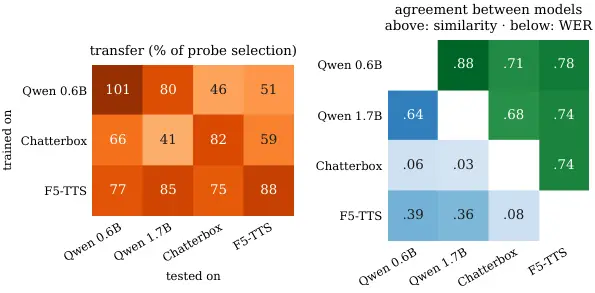

# What Makes a Good Audio Prompt for Zero-Shot TTS? Learning Prompt Selection from Synthesis Outcomes

Arnon Turetzky    Yossi Adi Affiliation: The Hebrew University of
Jerusalem

###### Abstract

Zero-shot text-to-speech (TTS) models clone a target voice from a short
reference clip, commonly referred to as the _prompt_. In practice, the
prompt has to be cut from a longer recording of the speaker, so which
part to use must be chosen. To understand what makes a good prompt, we
analyze hundreds of thousands of outputs synthesized by four TTS models
from candidate prompts of YouTube recordings. The choice of prompt
substantially changes intelligibility, naturalness and speaker
similarity. Standard predicted-quality scores capture mainly the
naturalness part but miss most of the intelligibility gain. We find that
the models largely agree on which prompt yields the highest measured
speaker similarity, but much less on which prompt yields intelligible
speech. We propose a small network that learns from the outputs a TTS
model produced to rank a recording’s candidate prompts from their audio
alone. Without synthesizing anything at selection time, it picks prompts
that lower the word error rate on held-out recordings by a third
(Qwen3-TTS) to two fifths (F5-TTS) relative to a randomly chosen prompt,
more than predicted quality achieves and nearly as much as synthesizing
a dozen test sentences from every candidate first.

## 1 Introduction

Figure 1: Our audio selector, a small network trained on a TTS model’s
synthesis outcomes, picks prompts that lower WER more than choosing by
predicted quality, without synthesizing anything. WER gain over a random
prompt (pp, higher is better) on 400 held-out test recordings. Probe
selection uses 12 syntheses per candidate, and Qwen3-TTS 1.7B uses the
0.6B selector and descriptor. Error bars: 95% intervals. Details in §7
and Appendix D.

Zero-shot TTS models can generate speech in a new voice from just a few
seconds of that speaker’s audio, the _prompt_ (Wang et al., 2023;
Anastassiou and others, 2024; Roth et al., 2024; Chen et al., 2025; Du
et al., 2024; Wang et al., 2025; Meng et al., 2025; Turetzky et al.,
2025). In benchmarks each test sentence comes with its prompt, but in
practice the prompt is not given: a user has a longer recording of the
speaker, such as a video, a podcast or a voice message, and has to
decide which few seconds to use. We ask whether this choice matters, and
how to make it well.

Prior work chooses prompts mainly to match a target style or emotion, or
screens them by annotated or predicted quality (§2). Among one speaker’s
candidates, the common practice is to take the one with the best
predicted audio quality, as scored by non-intrusive predictors such as
DNSMOS and UTMOS (Saeki et al., 2022), standard tools for filtering TTS
training data (He et al., 2024) and evaluating synthesized speech (Chen
et al., 2025). Yet a prompt that sounds clean need not be the one from
which a model speaks clearly, and it remains unclear whether quality
scores rank a speaker’s candidate prompts by the speech a TTS model
produces from them.

To find out, we synthesize speech from every candidate prompt of over
1,500 YouTube recordings with four TTS models, and measure how
intelligible, natural and similar to the speaker each output is. The
choice turns out to matter on every metric, and not only by chance: part
of the difference is a stable property of the prompt. Choosing by
predicted quality, however, captures mainly the naturalness part and
misses most of the gain in intelligibility.

Synthesizing from every candidate tells us which prompt is good, but it
is too costly to repeat for every new speaker. We therefore learn to
predict it: a small network that hears only the candidates’ audio is
trained to rank them by the outputs a TTS model produced from them. On
held-out recordings, its choice lowers word error rate by a third to two
fifths relative to a randomly chosen prompt, without synthesizing
anything (Table 1, Figure 1). This is more than the quality-based choice
gains, and close to what synthesizing a dozen test sentences from every
candidate would find.

### Our contributions:

- •
  We frame prompt selection as choosing, among a speaker’s candidate
  prompts, the one that leads to the best speech, and measure it at
  scale for four TTS models (§3).
- •
  We find that models largely agree on which prompt yields the highest
  measured speaker similarity but much less on which yields intelligible
  speech, and that choosing by predicted quality improves mainly
  naturalness (§4, §7, §8).
- •
  We train a small neural network that ranks a speaker’s candidate
  prompts from their audio alone, learning from the quality of speech a
  TTS model synthesized from other prompts, and that picks better
  prompts without synthesizing anything (§5, §6).

We will release our code upon acceptance.

## 2 Related Work

Zero-shot TTS is evaluated with one given prompt per test sentence
(Anastassiou and others, 2024); recent benchmarks vary the prompt’s
acoustic condition (clean, noisy, in the wild, expressive) to test the
robustness of the models (Kim et al., 2026). Prompt choice has received
attention mainly for style and emotion: prompts are retrieved whose text
or style matches the target sentence (Gong et al., 2022; Luo et al.,
2025), or screened for emotional expressiveness, audio quality and fit
with the text, tested with the TTS model and matched to the input text
(Wang et al., 2024); M³PDB selects prompts from a database by annotated
labels (Zhu et al., 2025). For in-the-wild data, Giraldo et al. (2026)
enhance noisy prompts and find that prompt quality and length affect the
output, and Sun et al. (2026) filter prompts with scores from audio and
text language models. Another way to avoid bad outputs is to synthesize
several and keep the best by a learned score (Betker, 2023), which
multiplies the cost of every sentence. We ask a different question:
among prompts cut from the same recording, which one makes a fixed TTS
model produce good speech for sentences not known in advance, measured
by synthesis outcomes; and we learn a selector from those outcomes, once
per TTS model, then make a single prompt choice per speaker.

Non-intrusive predictors estimate the naturalness or quality of speech
from the audio alone (Saeki et al., 2022; Reddy et al., 2022; Tjandra et
al., 2025); they filter TTS training data (He et al., 2024) and evaluate
TTS systems (Chen et al., 2025). We show where they fall short as a rule
for choosing prompts, and how they flatter such a rule when they also
judge it.

For codec language models, voice cloning has been described as
in-context learning (Wang et al., 2023). In text, in-context learning is
sensitive to the choice and order of the examples (Zhao et al., 2021; Lu
et al., 2022), and examples are selected or learned from downstream
outcomes (Liu et al., 2022; Rubin et al., 2022); for speech recognition
with multimodal language models, in-context examples are retrieved by
text similarity (Zheng et al., 2025). Our selector likewise learns from
downstream outcomes which prompt to use.

## 3 Setup

|                                                |               |                 |                 |                  |                    |                |
| ---------------------------------------------- | ------------- | --------------- | --------------- | ---------------- | ------------------ | -------------- |
| selector                                       | $`\Delta`$WER | $`\Delta`$fail. | $`\Delta`$UTMOS | $`\Delta`$DNSMOS | $`\Delta`$Audiobox | $`\Delta`$sim. |
| UTMOS rule                                     | 0.83          | 0.81            | 0.095           | 0.024            | 0.035              | -0.006         |
| DNSMOS rule                                    | 0.33          | 0.54            | 0.038^(‡)       | 0.032            | 0.019              | 0.027^(†)      |
| best single descriptor (transcript confidence) | 0.96          | 0.55            | -0.002^(‡)      | 0.006^(‡)        | -0.010^(‡)         | 0.017^(†)      |
| descriptor ranker                              | 1.00          | 0.41            | 0.069           | 0.028            | 0.033              | -0.007         |
| audio selector (ours)                          | 1.36^(†)      | 0.87            | 0.050^(‡)       | 0.014            | 0.022              | -0.002         |
|    + UTMOS head ($`w=0.25`$, §5)               | 1.33^(†)      | 0.67            | 0.060^(‡)       | 0.019            | 0.038              | -0.004         |
| probe selection (12 syntheses per candidate)   | 1.35^(†)      | 0.88            | 0.206^(†)       | 0.098^(†)        | 0.282^(†)          | 0.091^(†)      |

Table 1: Test results for Qwen3-TTS 0.6B (400 held-out recordings, all
19 candidates of a recording in one selection). $`\Delta`$: improvement
over a randomly chosen candidate of the same recording ($`\uparrow`$
better; for WER and failures, the reduction in pp); Audiobox is the
held-out judge. ^(†)/^(‡): better/worse than the UTMOS rule (interval of
the difference above/below zero).

### Task.

Each speaker comes with one _recording_, from which a set of _candidate
prompts_ is cut. A selector picks one candidate before any synthesis. It
may use the candidates’ audio and automatic _prompt transcripts_; our
audio selector uses the audio alone, and the chosen prompt’s transcript
is then given to the TTS models that read one. As in practice, the
prompt is chosen once and then used for any sentence, so the selector
does not see the sentences that will be synthesized. We judge a prompt
by the speech it leads to: its _outcome_ on a metric is the average over
the outputs synthesized from it. We judge a selector by its _gain_: how
much better its pick’s outcome is than that of a randomly chosen
candidate (the mean over the recording’s candidates).

### Recordings and prompts.

The recordings are English YouTube videos from YODAS (Li et al., 2023)
(CC-BY). Since many videos contain several voices (interviews, hosts and
guests), we keep only the utterances of a video’s main speaker,
identified by speaker embeddings, and only videos that this speaker
dominates; we also require English speech, 3–30 minutes of audio and,
since some videos have low-bandwidth, telephone-like audio, full-band
audio (details in Appendix A). In each recording, a random 30 s stretch
that is mostly the main speaker, so that prompts rarely contain another
voice, is cut, at equal total audio, into 10 prompts of 3 s, 6 of 5 s
and 3 of 10 s, at random positions with edges snapped to low energy; two
prompts of the same length share at most half of their audio. All 19
candidates of a recording compete in one selection, since a user could
choose any of them. Five _target sentences_ (4–10 s) and three anchor
utterances, against which speaker similarity is measured (rather than
against the prompt itself), come from the same recording, outside the
30 s stretch. All transcripts are produced automatically by Whisper
large-v3 (Radford et al., 2023), as a user without transcripts would. We
split the recordings into training, development and test sets with no
overlap (Table 6).

### TTS models and outcomes.

We use four open zero-shot TTS models from three families with their
default inference settings: Qwen3-TTS (Hu et al., 2026) (0.6B and 1.7B
parameters), an autoregressive codec language model that continues the
prompt and reads its transcript; F5-TTS (Chen et al., 2025) (0.3B), a
non-autoregressive flow-matching model that also reads the prompt
transcript; and Chatterbox (Resemble AI, 2025) (0.5B), which conditions
on the prompt audio only. Every candidate prompt is used for the
recording’s five target sentences with three sampling seeds each, and
every output is scored for _intelligibility_, by the word error rate
(WER) of Whisper large-v3 against the target sentence, and by the
_failure rate_, the share of outputs with a WER of at least 50% or a
runaway generation; _naturalness_, by UTMOS (Saeki et al., 2022), DNSMOS
P.835 (Reddy et al., 2022) and Audiobox Aesthetics production quality
(Tjandra et al., 2025), which no selector uses and which serves as a
held-out judge; and _speaker similarity_, by the cosine between
ECAPA-TDNN speaker embeddings (Desplanques et al., 2020) of the output
and of the anchors. A prompt’s outcome on a metric is its mean over its
15 outputs. WER and failure rates are percentages, so we give
differences between them in percentage points (pp).

### Protocol.

The same person can appear in several recordings, so training recordings
whose voice matches a development or test recording are removed, and
cross-validation folds keep same-voice recordings together. To keep the
test honest, all design choices were made by cross-validation on the
training recordings, and the selector, the output it selects by and the
main comparison (against the UTMOS rule) were fixed before the test sets
were scored, so test results could not influence them. All intervals in
the paper are 95% bootstrap intervals over recordings, resampling
same-voice recordings together; we mark a difference (^(†) better, ^(‡)
worse) when its interval excludes zero.

## 4 How Much Does the Prompt Matter, and Does Predicted Quality Find Good Prompts?

|            |        | random prompt |       |       |       | $`\Delta`$ with probe selection ($`\uparrow`$ better) |       |       |          | ICC  |       |      |
| ---------- | ------ | ------------- | ----- | ----- | ----- | ----------------------------------------------------- | ----- | ----- | -------- | ---- | ----- | ---- |
| model      | prompt | WER           | fail. | UTMOS | sim.  | WER                                                   | UTMOS | sim.  | Audiobox | WER  | UTMOS | sim. |
| Qwen3-TTS  | 3 s    | 4.31          | 3.05  | 3.81  | 0.556 | 1.42                                                  | 0.190 | 0.077 | 0.253    | 0.26 | 0.26  | 0.50 |
|            | 5 s    | 4.16          | 2.24  | 3.80  | 0.604 | 1.21                                                  | 0.152 | 0.052 | 0.176    | 0.22 | 0.25  | 0.38 |
|            | 10 s   | 4.01          | 1.64  | 3.78  | 0.650 | 1.10                                                  | 0.097 | 0.023 | 0.104    | 0.15 | 0.20  | 0.22 |
| Chatterbox | 3 s    | 2.82          | 0.43  | 3.77  | 0.522 | 0.24                                                  | 0.203 | 0.098 | 0.330    | 0.10 | 0.44  | 0.70 |
|            | 5 s    | 2.77          | 0.49  | 3.79  | 0.573 | 0.20                                                  | 0.148 | 0.064 | 0.219    | 0.07 | 0.34  | 0.57 |
|            | 10 s   | 2.65          | 0.47  | 3.81  | 0.622 | 0.17                                                  | 0.073 | 0.033 | 0.090    | 0.04 | 0.20  | 0.35 |
| F5-TTS     | 3 s    | 6.24          | 3.18  | 3.26  | 0.538 | 3.28                                                  | 0.253 | 0.099 | 0.402    | 0.35 | 0.43  | 0.70 |
|            | 5 s    | 5.50          | 2.53  | 3.25  | 0.603 | 2.40                                                  | 0.184 | 0.066 | 0.311    | 0.26 | 0.34  | 0.62 |
|            | 10 s   | 4.72          | 1.37  | 3.24  | 0.663 | 1.27                                                  | 0.102 | 0.031 | 0.160    | 0.15 | 0.22  | 0.43 |

Table 2: How much the prompt matters (400 training recordings,
candidates of one prompt length). With a random prompt: average over a
recording’s candidates, WER and failures in % (failure: WER of at least
50% or a runaway output of 25 s or longer). $`\Delta`$: improvement by
probe selection, in pp of WER or in metric units (UTMOS 1–5, Audiobox
1–10, similarity as a cosine). ICC: share of the output variance for one
target sentence that is due to the prompt rather than the seed.

We answer both questions on 400 training recordings, on which no
selector is evaluated. As a yardstick for what selection can achieve, we
use _probe selection_, which chooses by actually synthesizing from the
candidates. For each target sentence in turn, it picks the candidate
whose 12 outputs for the other four sentences score best on average and
scores it by its outputs for the held-out sentence, so the choice and
its evaluation never share outputs; this is done for each metric
separately and averaged over the five sentences. Probe selection is a
practical reference, not a ceiling: judging each prompt from only 12
outputs, it can miss the best one, so a selector can match or exceed it.

### The prompt matters, and partly as a stable property of the prompt.

Choosing among the 3 s prompts of a recording by probe selection lowers
the WER of Qwen3-TTS by about a third relative to a random prompt and
that of F5-TTS by half, and it improves naturalness, by every judge, and
speaker similarity (Table 2). These differences are not only sampling
noise. For a fixed target sentence, a sizeable share of the variation
between outputs is due to which prompt was used rather than to the
random seed: the intraclass correlation (ICC; Shrout and Fleiss, 1979)
in Table 2 measures this share, from 0 if the prompt does not matter
beyond chance to 1 if it explains all of the variation. The share is
larger for similarity than for intelligibility, so how good a prompt is
can in principle be predicted from the prompt. Chatterbox, which does
not read the prompt transcript, is much less sensitive in
intelligibility but at least as sensitive in naturalness and similarity.
Longer prompts give more similar voices, but they differ less from each
other and fewer of them fit the 30 s budget, so the room for selection
shrinks from 3 to 10 s.

### Predicted quality recovers mainly the naturalness part.

The common practice is to pick the candidate with the best predicted
quality. We use UTMOS, which targets the naturalness of synthesized and
read speech, as the main predictor (the _UTMOS rule_), and DNSMOS, which
targets the quality of noise-suppressed speech and filters TTS training
data, as the second (the _DNSMOS rule_). Both improve the naturalness of
the outputs, which is what they predict, but recover only part of the
intelligibility gain that probe selection shows is available and leave
speaker similarity unchanged (all rules in Appendix C). The UTMOS rule
also strongly favours short prompts: among all 19 candidates it picks a
3 s prompt for 80% of the recordings, although only about half of the
candidates are that short.

### Judging the rule with its own predictor flatters it.

For Qwen3-TTS, the UTMOS rule captures 41% of probe selection’s UTMOS
gain but only 18% of its gain by the held-out Audiobox judge, and for
F5-TTS none of it; the other models show the same pattern (Appendix C).
Part of a quality rule’s apparent benefit is thus agreement between the
selector and the judge, which is why we report every metric and keep
Audiobox out of all selectors.

## 5 Can Synthesis Outcomes Teach Which Prompt Is Better?

Figure 2: Intelligibility gain against naturalness gain on the test
(Qwen3-TTS 0.6B), by UTMOS (left) and by the held-out Audiobox judge
(right). The curve adds the audio selector’s UTMOS head with weight
$`w`$; probe selection’s naturalness gains lie above the plotted range.

### From quality rules to learned selection.

Quality rules rank the candidates by a single predictor. We extend them
in two steps, both learned from the synthesis outcomes of one TTS model
at a time. First, a _descriptor ranker_ learns how to weigh 21
descriptors of a prompt: the quality predictors’ scores together with
speaking rate, pauses and Whisper’s confidence in the prompt transcript
(all 21 in Appendix A). Second, the _audio selector_ needs no
descriptors: it reads the prompt audio through a frozen Whisper-base
encoder (Radford et al., 2023) (21M parameters), and a small trained
network (two transformer layers and attention pooling, 1.4M parameters)
turns the encoder’s output into a score for each prompt, comparing it
with the recording’s other candidates; we average the scores of five
such networks trained from different random initializations, which makes
the scores less dependent on one training run (Lakshminarayanan et al.,
2017). Both are trained to rank each recording’s candidates in the order
of their outcomes, with a listwise softmax loss (Cao et al., 2007,
ListNet;); a pointwise regression loss works as well (§6). They predict
several outcomes (the mean WER, the candidate’s mean WER rank among its
recording’s candidates, the failure rate, UTMOS and similarity), and
select by the WER rank, since intelligibility is what predicted quality
misses and the rank is less sensitive to a few catastrophic outputs
(fixed before testing). All design choices were made by cross-validation
on the training recordings (details in Appendix A).

### Results on held-out recordings.

On the 400 test recordings, the audio selector lowers the WER of
Qwen3-TTS 0.6B by 1.36 pp, 32% relative to a random prompt (Table 1,
Figure 2). This matches probe selection with 12 syntheses per candidate,
228 per recording, while the selector synthesizes nothing (Figure 3); it
is 0.54 pp more than the UTMOS rule (the pre-specified comparison;
positive in both test sets and across three training seeds, Appendix B),
more than the DNSMOS rule and more than the best single descriptor
chosen on the training recordings (Whisper’s confidence in the prompt
transcript), and it also fails less often than a random prompt. The
descriptor ranker gains less among all 19 candidates, although it nearly
matches the audio selector among 3 s prompts (Appendix B); the audio
selector needs none of its inputs, which require running UTMOS, DNSMOS,
a speaker model and Whisper decoding on every candidate.

### Predicted naturalness is not a reliable judge on its own, and can be traded.

Selecting for intelligibility gives up part of the UTMOS rule’s gain in
predicted naturalness (Figure 2), but how large this gap is depends on
the judge. It is large on UTMOS, the predictor the rule selects by; on
DNSMOS and the held-out Audiobox judge, the rule’s own gain and the gap
are both a few hundredths of a MOS point (Table 1); and listeners do not
prefer the rule’s outputs on naturalness (below). A quality predictor
that both selects and judges overstates the naturalness of its own
picks, so we do not read the UTMOS gap as a perceived naturalness cost.
Where predicted naturalness matters nonetheless, it can be traded
without retraining: the selector already predicts UTMOS, and adding its
UTMOS head with weight $`w`$ to the WER-rank head moves it along the
curve in Figure 2. With $`w=0.25`$, chosen on the development recordings
before testing, it keeps a WER gain of 1.33 pp, 0.51 pp more than the
UTMOS rule, and matches the rule on DNSMOS and Audiobox; only UTMOS
itself still prefers the rule.

### The listening test finds no evidence of a naturalness cost.

In a pairwise listening test on 72 recordings where the picks differ,
listeners compared outputs from the selector’s and UTMOS rule’s prompts
for the same target sentence and seed, judging clarity and naturalness
(Appendix F). Listeners did not prefer the rule’s outputs on
naturalness, although UTMOS rates them higher. On clarity, most pairs
were judged similar, as by Whisper: the selector’s advantage lies in
avoiding less frequent errors that one output per pair rarely samples,
so a test of this size cannot resolve it (Appendix F). Where outputs
differ in word errors, listeners lean towards the one with fewer errors.

Figure 3: What probing costs (Qwen3-TTS 0.6B, test): WER gain over a
random prompt of probe selection with 1–12 syntheses per candidate
(19–228 per recording), with intervals, against the audio selector and
the UTMOS rule, which synthesize nothing.

## 6 Where Does the Gain Come From?

### Not from prompt length, failures, the recognizer or the transcripts.

The selector’s advantage does not come from preferring some prompt
length: it beats the UTMOS rule among candidates of each single length,
and also with equal numbers of candidates of each length. Nor does it
come only from avoiding failed outputs: with failed outputs excluded,
its gain is still about three times the rule’s. Whisper plays three
roles: it transcribes the prompts, provides the selector’s encoder and
judges the outputs, so the selector might learn Whisper’s quirks rather
than intelligibility. We therefore re-judged all outputs with a second,
unrelated recognizer, wav2vec 2.0 (Baevski et al., 2020), with a
different architecture and training data; by its WER the advantage over
the UTMOS rule is even larger (0.71 pp). A TTS model that reads the
prompt transcript also depends on that transcript, so we resynthesized
one of the two test sets with an independent transcript, the YouTube
captions shipped with YODAS: the frozen selector, which never saw these
transcripts, keeps its margin over the UTMOS rule, nearly unchanged for
Qwen3-TTS and slightly smaller for F5-TTS. Its picks’ transcripts are
about as reliable as the rule’s, and among prompts whose Whisper
transcript and YouTube caption agree it stays ahead of the rule. Nor
does selecting for intelligibility reduce pitch variability more than
the quality rule: it drops slightly under both, and measured against the
speaker’s own reading of each target sentence, the selector’s outputs
match its pitch variability as well as a random prompt’s and its tempo
slightly better (Appendix B). Details of all these checks are in
Appendix B.

| variant (cross-validation) | WER  | $`\Delta`$ | descr. ranker |
| -------------------------- | ---- | ---------- | ------------- |
| final recipe               | 1.25 |            | 0.90          |
| pointwise loss             | 1.18 | -0.07      | 0.90          |
| labels: prompt’s UTMOS     | 0.63 | -0.62      | 0.55          |
| Whisper-large-v3 encoder   | 1.22 | -0.03      | 0.90          |
| CLAP encoder               | 0.42 | -0.82      | 0.90          |

Table 3: Selected ablations by cross-validation on the training
recordings (mean of three seeds): WER gain over a random prompt (pp),
its change from the final recipe, and the descriptor ranker trained with
the same labels on the same folds. All ablations in Appendix B.



Figure 4: Left: transfer between TTS models, as the WER gain of a
selector trained on one model (rows) for another (columns), in percent
of the second model’s probe-selection gain. Right: do two models prefer
the same prompts? Within-recording Spearman correlation between the
candidates’ speaker similarity (above the diagonal) and WER (below)
under two models, averaged over the 400 test recordings and corrected
for how consistently each model ranks the candidates between two halves
of its own outputs (split-half reliability; uncorrected values in
Appendix D).

### What matters is the supervision by synthesis outcomes.

Varying one choice at a time by cross-validation (Table 3), the
architecture hardly matters: a pointwise regression loss instead of the
listwise one, a single network instead of five, or attention across a
recording’s candidates all stay within the spread between training seeds
(about 0.1 pp). We found that speech encoders work better than a
general-audio encoder (CLAP, Wu et al., 2023), which gains little, and
that a small one suffices: Whisper-base does as well as Whisper-large-v3
with a thirtieth of its parameters, and WavLM (Chen et al., 2022), which
is not trained for recognition, does as well. What matters is the
training signal: the same model trained to reproduce each candidate’s
own predicted quality instead of its synthesis outcomes gains about half
as much. A good prompt is defined by what the TTS model makes of it, and
that has to be measured.

## 7 Do TTS Models Agree on What Makes a Good Prompt?

### Trained for each model, the selector matches or beats the strongest simple baseline.

We train the same recipe on the outcomes of F5-TTS and of Chatterbox and
compare each selector with the quality rules and with the best single
descriptor chosen on that model’s training recordings (Figure 1). Which
simple baseline is strongest depends on the model, and the selector is
ahead of it for three of the four models: clearly for F5-TTS, whose WER
it lowers by 43% relative to a random prompt, 1.45 pp more than its
strongest baseline (the DNSMOS rule), and for Qwen3-TTS 1.7B, and
narrowly for Qwen3-TTS 0.6B, against Whisper’s confidence in the prompt
transcript; for Chatterbox, which has little room for selection, the two
are level. On the other metrics it stays level with the UTMOS rule or
better, except UTMOS itself (Appendix D).

### Models largely agree on prompts for speaker similarity.

A selector trained on one model’s outcomes transfers to the other models
without retraining, to varying degrees (Figure 4, left): the selector
trained on Qwen3-TTS 0.6B gains 80% of probe selection’s gain for the
1.7B model, where the UTMOS rule barely helps, and 51% for F5-TTS, and
the selector trained on F5-TTS transfers best of all, with 77–85% for
the Qwen models. Speaker similarity is where the models agree most:
which candidate yields the highest measured speaker similarity is
largely the same for all four models (Figure 4, right, above the
diagonal; corrected correlations 0.68–0.88), a property of the prompt
rather than of the model.

| prompt property       | Qwen 0.6B | Qwen 1.7B | Chat- terbox | F5- TTS   |
| --------------------- | --------- | --------- | ------------ | --------- |
| UTMOS                 | +0.04^(†) | +0.05^(†) | +0.05^(†)    | +0.09^(†) |
| typical voice         | -0.00     | -0.01     | +0.05^(†)    | +0.07^(†) |
| ends in silence       | +0.16^(†) | +0.16^(†) | +0.01        | +0.11^(†) |
| transcript confidence | +0.10^(†) | +0.10^(†) | +0.03^(†)    | +0.10^(†) |

Table 4: Prompt properties and intelligibility, per TTS model:
within-recording Spearman correlation between a property of the prompt
and the intelligibility of its outputs (fewer word errors = higher),
averaged over the 400 test recordings. Typical voice: speaker embedding
close to the recording’s mean; ends in silence: length of the trailing
silence; transcript confidence: Whisper’s mean token log-probability.
^(†): interval excludes zero. All 21 descriptors in Appendix A.

### The rest depends on how the model uses the prompt.

For each model with training outcomes, the selector trained on that
model is the best one for it (Figure 4, left), and which candidates give
intelligible speech is largely model-specific (right, below the
diagonal). The two Qwen models agree most (0.64), Qwen3-TTS and F5-TTS,
which both read the prompt transcript, agree in part (0.39), and
Chatterbox, which does not, agrees with neither (at most 0.08). The
prompt properties show the same split (Table 4): for the models that
read the transcript, prompts that end in silence rather than in speech,
and prompts whose transcript Whisper is confident about, give more
intelligible outputs, while neither matters for Chatterbox; how typical
the prompt’s voice is of the recording matters for Chatterbox and
F5-TTS, and predicted quality only a little for any model. Transfer
follows this agreement only loosely (rank correlation 0.67 over the 9
pairs of models), because a selector also carries the part that all
models share. No single descriptor correlates with a prompt’s
intelligibility by more than about 0.17 within a recording, for any
model, so the model-specific part has to be learned from that model’s
outcomes.

## 8 What If Prompts Differ in Noise?

On YouTube recordings the candidates of a recording share their
recording conditions, and predicted quality recovers little of what
makes a good prompt. Prompts may also differ mainly in recording
quality, e.g., when recorded in different places or with different
devices. To study this under controlled conditions, we start with clean
read speech (LibriSpeech (Panayotov et al., 2015)) and add noise of
random type and level to some candidates, retaining knowledge of which
version is clean (Appendix E). Outputs come from Qwen3-TTS 1.7B, while
the selector is the frozen audio selector trained on YouTube outcomes
from Qwen3-TTS 0.6B, which has seen no added noise.

| selector        | WER  | fail. | UTMOS | sim.  | clean |
| --------------- | ---- | ----- | ----- | ----- | ----- |
| UTMOS rule      | 0.21 | -0.05 | 0.550 | 0.113 | 79%   |
| audio selector  | 0.63 | 0.26  | 0.349 | 0.070 | 31%   |
| \+ UTMOS head   | 0.66 | 0.26  | 0.415 | 0.080 | 39%   |
| probe selection | 0.42 | 0.18  | 0.570 | 0.165 |       |

Table 5: Candidates differing in noise (LibriSpeech, Qwen3-TTS 1.7B, all
lengths in one selection): gain over a random prompt, WER and failures
in pp, and the share of picks that are the clean version of a prompt (by
chance: 14%, one of seven conditions); the UTMOS head is added with
$`w=0.25`$. The selectors were trained on YouTube outcomes of Qwen3-TTS
0.6B.

Here the quality rule does what it is meant to do: it picks the clean
version of a prompt 79% of the time and gains the most naturalness and
similarity (Table 5). It does not find intelligible prompts, though: the
audio selector lowers WER by 0.42 pp more and fails less often, while it
picks the clean version only 31% of the time and gives up UTMOS and
similarity. Adding the UTMOS head moves the selector towards the rule on
naturalness and keeps its intelligibility. Probe selection, ranking
candidates by a dozen outputs each, gains less WER than the selector at
this low error rate. When prompts differ in noise, predicted quality is
the right tool for naturalness and similarity, but intelligibility
depends on other properties of the prompt, which the selector has
learned from the outcomes.

## 9 Conclusion

We asked what makes a good audio prompt for zero-shot TTS, judging each
prompt by the speech a model produces from it. The answer lies in both
the prompt and the model. TTS models largely agree on which prompt
yields the highest measured speaker similarity, but much less on which
yields intelligible speech. Choosing by predicted audio quality, the
common practice, improves mainly naturalness, looks better than it is
when the same predictor also judges the result, and finds the clean
prompt rather than the intelligible one. Learning from synthesis
outcomes recovers what predicted quality misses. A small network that
hears only the candidates’ audio comes close to choosing by synthesizing
a dozen test sentences from every candidate, and works best when trained
on the model it selects for.

These findings have three practical implications. For users of zero-shot
TTS, a prompt is worth choosing by what the model makes of it rather
than by how clean it sounds, and a small selector makes this cheap. For
benchmarks, pairing each sentence with one fixed prompt partly mixes up
the quality of the model with the luck of the prompt; reporting how much
outputs vary across prompts would separate the two. For model
developers, the fact that sensitivity to the prompt differs between
models suggests that it can be reduced.

Our selector works at inference time, for a fixed model. The same
outcomes could also guide training, for example which prompts a
zero-shot model is trained with, or an objective that makes it less
sensitive to the prompt. Collecting outcomes could be made cheaper, with
fewer outputs per prompt, as our ablations suggest, or by sharing them
across models. A selector could also take the target sentence into
account when it is known in advance.

## Limitations

We study four TTS models from three families, on English YouTube
recordings and on LibriSpeech with added noise; other languages, for
which zero-shot models are often trained on weakly supervised
in-the-wild speech (He et al., 2024; Turetzky et al., 2024; Sankar et
al., 2024; Roth et al., 2024), and other recording conditions are open;
the method itself uses no language-specific component apart from
Whisper, which is multilingual. The best selector for a model is trained
on that model’s outcomes, which costs one labelling run of a few hundred
thousand syntheses per model (Appendix A), paid once per model rather
than per voice; how far fewer labels or a selector trained for another
model can replace it is only partly explored (Appendix B, §7). A
prompt’s outcome averages 15 outputs and WER is heavy-tailed, so
outcomes are noisy, and probe selection, estimated from 12 outputs per
candidate, is not an upper bound. Apart from the listening test, all
measurements are automatic; the listening test, with 7 listeners and one
output per pair, finds no evidence of a naturalness cost but is too
small to resolve the selector’s clarity advantage (Appendix F). Beyond
pitch variability and tempo (Appendix B), we do not evaluate prosody,
e.g. emphasis, expressiveness and context-appropriate stress, which
dedicated benchmarks measure (de Seyssel et al., 2024; Turetzky et al.,
2026; Manku et al., 2025); how the prompt affects them is open. The test
has 400 recordings, and the selector’s margin over the UTMOS rule varies
between training seeds (Appendix B). We fix a 30 s budget and prompts of
3–10 s; longer prompts and concatenations of several prompts are not
studied.

## Ethical Considerations

Voice cloning can be misused for impersonation and fraud. Selecting a
better prompt makes clones more intelligible rather than more similar to
the speaker (our selectors improve speaker similarity little or not at
all), but it lowers the effort of producing usable clones. We use public
CC-BY YouTube speech (YODAS) and LibriSpeech for research only,
distribute no voice models, speaker audio or synthesized speech of the
speakers, and report aggregate results. A Creative Commons license
permits reuse of the recordings, but it is not the speakers’ consent to
having their voices cloned, so all synthesized speech stays internal,
used only for evaluation and the listening test.

## References

- Anastassiou et al. (2024) P. Anastassiou et al. Seed-TTS: a family of
  high-quality versatile speech generation models. arXiv preprint
  arXiv:2406.02430. Cited by: §1, §2.
- Baevski et al. (2020) A. Baevski, H. Zhou, A. Mohamed, and M. Auli
  Wav2vec 2.0: a framework for self-supervised learning of speech
  representations. In Proceedings of NeurIPS, Cited by: §6.
- Betker (2023) J. Betker Better speech synthesis through scaling. arXiv
  preprint arXiv:2305.07243. Cited by: §2.
- Cao et al. (2007) Z. Cao, T. Qin, T. Liu, M. Tsai, and H. Li Learning
  to rank: from pairwise approach to listwise approach. In Proceedings
  of ICML, Cited by: §5.
- Chen et al. (2022) S. Chen, C. Wang, Z. Chen, Y. Wu, S. Liu, Z.
  Chen, J. Li, N. Kanda, T. Yoshioka, X. Xiao, et al. WavLM: large-scale
  self-supervised pre-training for full stack speech processing. IEEE
  Journal of Selected Topics in Signal Processing. Cited by: §6.
- Chen et al. (2025) Y. Chen, Z. Niu, Z. Ma, K. Deng, C. Wang, J.
  Zhao, K. Yu, and X. Chen F5-TTS: a fairytaler that fakes fluent and
  faithful speech with flow matching. In Proceedings of ACL,
  pp. 6255–6271. External Links:
  [Document](https://dx.doi.org/10.18653/v1/2025.acl-long.313) Cited by:
  §1, §1, §2, §3.
- de Seyssel et al. (2024) M. de Seyssel, A. D’Avirro, A. Williams,
  and E. Dupoux EmphAssess: a prosodic benchmark on assessing emphasis
  transfer in speech-to-speech models. In Proceedings of EMNLP, Cited
  by: Limitations.
- Desplanques et al. (2020) B. Desplanques, J. Thienpondt, and K.
  Demuynck ECAPA-TDNN: emphasized channel attention, propagation and
  aggregation in TDNN based speaker verification. In Proceedings of
  Interspeech, Cited by: §3.
- Du et al. (2024) Z. Du, Y. Wang, Q. Chen, X. Shi, X. Lv, T. Zhao, Z.
  Gao, Y. Yang, C. Gao, H. Wang, F. Yu, H. Liu, Z. Sheng, Y. Gu, C.
  Deng, W. Wang, S. Zhang, Z. Yan, and J. Zhou CosyVoice 2: scalable
  streaming speech synthesis with large language models. arXiv preprint
  arXiv:2412.10117. Cited by: §1.
- Giraldo et al. (2026) J. Giraldo, A. Peiró-Lilja, R. Zevallos, and C.
  España-Bonet Zero-shot TTS with enhanced audio prompts: BSC submission
  for the 2026 WildSpoof challenge TTS track. In Proceedings of ICASSP,
  Cited by: §2.
- Gong et al. (2022) C. Gong, L. Wang, Z. Ling, J. Zhang, and J. Dang
  Using multiple reference audios and style embedding constraints for
  speech synthesis. In Proceedings of ICASSP, Cited by: §2.
- He et al. (2024) H. He, Z. Shang, C. Wang, X. Li, Y. Gu, H. Hua, L.
  Liu, C. Yang, J. Li, P. Shi, Y. Wang, K. Chen, P. Zhang, and Z. Wu
  Emilia: an extensive, multilingual, and diverse speech dataset for
  large-scale speech generation. In Proceedings of SLT, Cited by: §1,
  §2, Limitations.
- Hu et al. (2026) H. Hu, X. Zhu, T. He, D. Guo, B. Zhang, X. Wang, Z.
  Guo, Z. Jiang, H. Hao, Z. Guo, X. Zhang, P. Zhang, B. Yang, J. Xu, J.
  Zhou, and J. Lin Qwen3-TTS technical report. arXiv preprint
  arXiv:2601.15621. Cited by: §3.
- Kim et al. (2026) S. Kim, S. Chung, T. Moon, S. Lee, M. Ahn, K.
  Lee, N. S. Kim, J. Cho, L. Schmidt, K. Lee, and D. Park Raon-OpenTTS:
  open models and data for robust text-to-speech. arXiv preprint
  arXiv:2605.20830. Cited by: §2.
- Lakshminarayanan et al. (2017) B. Lakshminarayanan, A. Pritzel, and C.
  Blundell Simple and scalable predictive uncertainty estimation using
  deep ensembles. In Proceedings of NeurIPS, Cited by: §5.
- Li et al. (2023) X. Li, S. Takamichi, T. Saeki, W. Chen, S. Shiota,
  and S. Watanabe YODAS: youtube-oriented dataset for audio and speech.
  In Proceedings of ASRU, Cited by: §3.
- Liu et al. (2022) J. Liu, D. Shen, Y. Zhang, B. Dolan, L. Carin,
  and W. Chen What makes good in-context examples for GPT-3?. In
  Proceedings of DeeLIO, Cited by: §2.
- Lu et al. (2022) Y. Lu, M. Bartolo, A. Moore, S. Riedel, and P.
  Stenetorp Fantastically ordered prompts and where to find them:
  overcoming few-shot prompt order sensitivity. In Proceedings of ACL,
  Cited by: §2.
- Luo et al. (2025) D. Luo, C. Ma, W. Li, J. Wang, W. Chen, and Z. Wu
  AutoStyle-TTS: retrieval-augmented generation based automatic style
  matching text-to-speech synthesis. In Proceedings of ICME, Cited by:
  §2.
- Manku et al. (2025) R. R. Manku, Y. Tang, X. Shi, M. Li, and A. Smola
  EmergentTTS-Eval: evaluating TTS models on complex prosodic,
  expressiveness, and linguistic challenges using model-as-a-judge. In
  Proceedings of NeurIPS (Datasets and Benchmarks Track), Cited by:
  Limitations.
- Meng et al. (2025) L. Meng, L. Zhou, S. Liu, S. Chen, B. Han, S.
  Hu, Y. Liu, J. Li, S. Zhao, X. Wu, H. M. Meng, and F. Wei
  Autoregressive speech synthesis without vector quantization. In
  Proceedings of ACL, Cited by: §1.
- Panayotov et al. (2015) V. Panayotov, G. Chen, D. Povey, and S.
  Khudanpur Librispeech: an asr corpus based on public domain audio
  books. In 2015 IEEE International Conference on Acoustics, Speech and
  Signal Processing (ICASSP), pp. 5206–5210. Cited by: §8.
- Radford et al. (2023) A. Radford, J. W. Kim, T. Xu, G. Brockman, C.
  McLeavey, and I. Sutskever Robust speech recognition via large-scale
  weak supervision. In Proceedings of ICML, Cited by: §3, §5.
- Reddy et al. (2022) C. K. A. Reddy, V. Gopal, and R. Cutler DNSMOS
  P.835: a non-intrusive perceptual objective speech quality metric to
  evaluate noise suppressors. In Proceedings of ICASSP, Cited by: §2,
  §3.
- Resemble AI (2025) Resemble AI Chatterbox TTS. Note:
  [https://github.com/resemble-ai/chatterbox](https://github.com/resemble-ai/chatterbox)
  Cited by: §3.
- Roth et al. (2024) A. Roth, A. Turetzky, and Y. Adi A language
  modeling approach to diacritic-free Hebrew TTS. In Proceedings of
  Interspeech, pp. 2775–2779. Cited by: §1, Limitations.
- Rubin et al. (2022) O. Rubin, J. Herzig, and J. Berant Learning to
  retrieve prompts for in-context learning. In Proceedings of NAACL,
  Cited by: §2.
- Saeki et al. (2022) T. Saeki, D. Xin, W. Nakata, T. Koriyama, S.
  Takamichi, and H. Saruwatari UTMOS: UTokyo-SaruLab system for VoiceMOS
  challenge 2022. In Proceedings of Interspeech, Cited by: §1, §2, §3.
- Sankar et al. (2024) A. Sankar, S. Anand, P. S. Varadhan, S.
  Thomas, M. Singal, S. Kumar, D. Mehendale, A. Krishana, G. Raju,
  and M. Khapra IndicVoices-R: unlocking a massive multilingual
  multi-speaker speech corpus for scaling Indian TTS. In Proceedings of
  NeurIPS (Datasets and Benchmarks Track), Cited by: Limitations.
- Shrout and Fleiss (1979) P. E. Shrout and J. L. Fleiss Intraclass
  correlations: uses in assessing rater reliability. Psychological
  Bulletin 86 (2), pp. 420–428. Cited by: §4.
- Sun et al. (2026) R. Sun, J. Zhou, H. He, Y. Feng, and J. Liu Natural
  yet challenging to detect: robust in-the-wild TTS through EMA and
  dual-scoring prompt selection – submission for WildSpoof 2026 TTS
  track. arXiv preprint arXiv:2605.23859. Cited by: §2.
- Thiemann et al. (2013) J. Thiemann, N. Ito, and E. Vincent The diverse
  environments multi-channel acoustic noise database (DEMAND): a
  database of multichannel environmental noise recordings. In
  Proceedings of Meetings on Acoustics (ICA 2013), Vol. 19. Cited by:
  Appendix E.
- Tjandra et al. (2025) A. Tjandra, Y. Wu, B. Guo, J. Hoffman, B.
  Ellis, A. Vyas, B. Shi, S. Chen, M. Le, N. Zacharov, C. Wood, A. Lee,
  and W. Hsu Meta audiobox aesthetics: unified automatic quality
  assessment for speech, music, and sound. arXiv preprint
  arXiv:2502.05139. Cited by: §2, §3.
- Turetzky et al. (2026) A. Turetzky, A. Dekel, H. Aronowitz, R. Hoory,
  and Y. Adi Knowing what to stress: a discourse-conditioned
  text-to-speech benchmark. In Proceedings of Interspeech,
  pp. 2932–2936. External Links:
  [Document](https://dx.doi.org/10.21437/Interspeech.2026-2743) Cited
  by: Limitations.
- Turetzky et al. (2025) A. Turetzky, A. Dekel, N. Shabtay, S.
  Shechtman, D. Haws, H. Aronowitz, R. Hoory, and Y. Adi Speech
  synthesis from continuous features using per-token latent diffusion.
  In Proceedings of ASRU, pp. 1–8. External Links:
  [Document](https://dx.doi.org/10.1109/ASRU65441.2025.11434698) Cited
  by: §1.
- Turetzky et al. (2024) A. Turetzky, O. Tal, Y. Segal-Feldman, Y.
  Dissen, E. Zeldes, A. Roth, E. Cohen, Y. Shrem, B. R. Chernyak, O.
  Seleznova, J. Keshet, and Y. Adi HebDB: a weakly supervised dataset
  for Hebrew speech processing. In Proceedings of Interspeech,
  pp. 1360–1364. Cited by: Limitations.
- Wang et al. (2023) C. Wang, S. Chen, Y. Wu, Z. Zhang, L. Zhou, S.
  Liu, Z. Chen, Y. Liu, H. Wang, J. Li, L. He, S. Zhao, and F. Wei
  Neural codec language models are zero-shot text to speech
  synthesizers. arXiv preprint arXiv:2301.02111. Cited by: §1, §2.
- Wang et al. (2024) H. Wang, C. Qiang, T. Wang, C. Gong, Y. Jiang, Y.
  Lu, C. Zhang, L. Wang, and J. Dang Expressive prompting: improving
  emotion intensity and speaker consistency in zero-shot TTS. arXiv
  preprint arXiv:2409.18512. Cited by: §2.
- Wang et al. (2025) Y. Wang, H. Zhan, L. Liu, R. Zeng, H. Guo, J.
  Zheng, Q. Zhang, X. Zhang, S. Zhang, and Z. Wu MaskGCT: zero-shot
  text-to-speech with masked generative codec transformer. In
  Proceedings of ICLR, Cited by: §1.
- Wu et al. (2023) Y. Wu, K. Chen, T. Zhang, Y. Hui, T.
  Berg-Kirkpatrick, and S. Dubnov Large-scale contrastive language-audio
  pretraining with feature fusion and keyword-to-caption augmentation.
  In Proceedings of ICASSP, Cited by: §6.
- Zhao et al. (2021) T. Z. Zhao, E. Wallace, S. Feng, D. Klein, and S.
  Singh Calibrate before use: improving few-shot performance of language
  models. In Proceedings of ICML, Cited by: §2.
- Zheng et al. (2025) H. Zheng, Y. Yegorova, and M. Hasegawa-Johnson
  TICL: text-embedding KNN for speech in-context learning unlocks speech
  recognition abilities of large multimodal models. arXiv preprint
  arXiv:2509.13395. Cited by: §2.
- Zhu et al. (2025) B. Zhu, C. Gong, M. Wu, R. Jing, F. Liu, X.
  Zhang, C. Zhang, and X. Li M$`{}^{3}`$PDB: a multimodal, multi-label,
  multilingual prompt database for speech generation. arXiv preprint
  arXiv:2508.09702. Cited by: §2.

## Appendix A Data, Models and Training

| set   | recordings | prompts (3/5/10 s) | outputs per model | TTS models                    |
| ----- | ---------- | ------------------ | ----------------- | ----------------------------- |
| train | 400        | 3993 / 2389 / 1170 | 113,280           | Qwen3-TTS, Chatterbox, F5-TTS |
| train | 544        | 5429 / 3249 / 1588 | 153,990           | Qwen3-TTS, Chatterbox, F5-TTS |
| dev   | 200        | 2000 / 1194 / 583  | 56,655            | Qwen3-TTS, Chatterbox         |
| test  | 200        | 1994 / 1194 / 591  | 56,685            | Qwen3-TTS, Chatterbox, F5-TTS |
| test  | 200        | 1997 / 1194 / 588  | 56,685            | Qwen3-TTS, Chatterbox, F5-TTS |

Table 6: Recording sets (disjoint YODAS shards): two training sets, a
development set and two test sets. Outputs per model: every candidate
prompt $`\times`$ 5 target sentences $`\times`$ 3 seeds.

### Data processing.

YODAS English shards 0000–0002 (development), 0003–0006 and 0009–0012
(training), 0007–0008 and 0013–0014 (test). Videos of 3–30 minutes with
at least 7 kHz bandwidth; caption lines are merged into 3–20 s
utterances; the main speaker keeps the utterances whose speaker
embedding has a cosine of at least 0.88 to that of the video’s most
typical utterance (the one most similar to all others), and these must
make up at least 70% of the utterances; the spoken language is English
by majority vote of Whisper large-v3 language identification on three
clips. Each recording is scaled to a peak amplitude of 0.99. The 30 s
stretch is drawn so that the main speaker covers at least 80% of it and
of every prompt, so that prompts rarely contain another voice; target
sentences and anchors are taken at least 2 s away from it. Prompt
transcripts with a zlib compression ratio above 2.4 or more than 6 words
per second are decoded again with Whisper’s temperature fallback
(temperatures 0–1, compression threshold 1.35, log-probability threshold
$`-1`$); target sentences that still fail the same test are excluded
from all outcomes.

### TTS settings.

Qwen3-TTS (12 Hz Base, in-context mode with prompt audio and
transcript): temperature 0.9, top-$`k`$ 50, repetition penalty 1.05,
batches of 16. Chatterbox (prompt audio only): temperature 0.8,
top-$`p`$ 1.0, min-$`p`$ 0.05, repetition penalty 1.2, classifier-free
guidance weight 0.5, at most 750 tokens. F5-TTS v1 Base (prompt audio
and transcript): 32 flow steps, guidance strength 2, sway sampling
$`-1`$; the output length follows the prompt’s speaking rate, and when
this exceeds the model’s maximum length (a transcript that is short for
its prompt) the output is capped at 30 s, which counts as a failure.
Every (prompt, sentence, seed) output has its own derived seed, so
outputs are reproducible.

### Outcomes.

WER: Whisper large-v3, English, both texts normalized with Whisper’s
English normalizer followed by removal of tokens without letters or
digits, capped at 100% per output; failure: raw WER of at least 50% or
an output of at least 25 s. UTMOS: UTMOS22 strong (SpeechMOS v1.2.0);
DNSMOS: P.835 overall; AES: Audiobox Aesthetics production quality;
similarity: SpeechBrain ECAPA-TDNN (VoxCeleb), cosine between the output
and the mean embedding of three anchor utterances.

### Audio selector.

Encoder: frozen Whisper-base encoder, last layer, averaged to 40 ms
frames; each input dimension standardized with training statistics.
Prompt model: linear projection to 256 dimensions, sinusoidal positions,
two transformer layers (4 heads, feed-forward 512, dropout 0.1),
attention pooling with one learned query. Comparison with the recording:
the prompt vector concatenated with its difference from the mean prompt
vector of the recording; scoring head:
512$`\rightarrow`$256$`\rightarrow`$6 (GELU). Heads: mean WER, WER rank
within the recording, failure rate, UTMOS, DNSMOS, ECAPA similarity;
selection by the WER-rank head. Training: ListNet (temperature 1) over
all candidates of a recording, AdamW (learning rate $`10^{-4}`$, weight
decay $`10^{-2}`$), 16 recordings per batch, 10 epochs, bf16 training
and fp32 inference; five models with different initializations, scores
averaged. Training on the 782 training recordings (14.8k prompts) takes
a few minutes on one GPU.

### Descriptor ranker.

Linear listwise ranker with the same loss and labels on the 21
descriptors of Table 7, each also z-scored within the recording (typical
voice: speaker-embedding cosine to the recording’s mean prompt;
transcript log-probabilities: Whisper’s token log-probabilities of the
prompt transcript). AdamW (learning rate $`10^{-3}`$, weight decay
$`10^{-4}`$), 32 recordings per batch, 100 epochs.

### Splits, leakage and model selection.

Training recordings whose voice matches a development or test recording
(symmetric ECAPA cosine between one recording’s anchors and another’s
target sentences above 0.5) are removed (162 of 944). Cross-validation:
5 folds over the remaining training recordings, keeping connected
components of the same-voice graph in one fold; all hyperparameters were
chosen this way. The same components are the clusters that the bootstrap
resamples together.

### Compute.

Labelling costs about 1–2.5 s of GPU time per output (NVIDIA L40S), i.e.
about 100–270 GPU hours per model for the training sets. The recordings
are available from YODAS.

| descriptor                | Qwen3-TTS 0.6B | Qwen3-TTS 1.7B | Chatterbox | F5-TTS    |
| ------------------------- | -------------- | -------------- | ---------- | --------- |
| UTMOS                     | +0.04^(†)      | +0.05^(†)      | +0.05^(†)  | +0.09^(†) |
| DNSMOS overall            | +0.02          | -0.01          | +0.05^(†)  | +0.09^(†) |
| DNSMOS signal             | +0.01          | +0.01          | +0.05^(†)  | +0.08^(†) |
| DNSMOS background         | +0.01          | -0.01          | +0.05^(†)  | +0.06^(†) |
| duration                  | +0.00          | -0.03^(†)      | +0.04^(†)  | +0.04^(†) |
| words per second          | -0.04^(†)      | -0.01          | -0.01      | +0.00     |
| typical voice             | -0.00          | -0.01          | +0.05^(†)  | +0.07^(†) |
| energy, first 50 ms       | -0.05^(†)      | -0.03^(†)      | -0.07^(†)  | -0.04^(†) |
| energy, last 50 ms        | -0.15^(†)      | -0.17^(†)      | -0.02      | -0.11^(†) |
| leading silence           | +0.04^(†)      | +0.02          | +0.06^(†)  | +0.02     |
| trailing silence          | +0.16^(†)      | +0.16^(†)      | +0.01      | +0.11^(†) |
| pause ratio               | -0.02          | -0.04^(†)      | +0.04^(†)  | +0.03     |
| longest pause             | -0.03^(†)      | -0.05^(†)      | +0.05^(†)  | +0.04^(†) |
| dynamic range             | +0.01          | +0.02          | +0.06^(†)  | +0.07^(†) |
| ends a sentence           | -0.01          | -0.00          | -0.03^(†)  | -0.06^(†) |
| ends with comma           | +0.04^(†)      | +0.02          | +0.01      | +0.02     |
| number of words           | -0.03^(†)      | -0.03^(†)      | +0.05^(†)  | +0.04^(†) |
| transcript log-prob, mean | +0.10^(†)      | +0.10^(†)      | +0.03^(†)  | +0.10^(†) |
| transcript log-prob, min  | +0.11^(†)      | +0.11^(†)      | -0.01      | +0.07^(†) |
| transcript log-prob, end  | -0.00          | +0.01          | -0.01      | +0.00     |
| no-speech probability     | -0.05^(†)      | -0.04^(†)      | -0.02      | -0.09^(†) |

Table 7: All 21 prompt descriptors (Table 4): within-recording Spearman
correlation with the prompt’s intelligibility (fewer word errors =
higher), averaged over the 400 test recordings. ^(†): interval excludes
zero.

## Appendix B Robustness and Ablations

Table 8 collects further results for Qwen3-TTS 0.6B on the 400 test
recordings (WER gain over a random prompt in pp unless noted). Two rows
check the prompt transcripts behind the selector’s gain. _Transcript
disagreement_ is the word error rate between Whisper’s and wav2vec 2.0’s
transcripts of a prompt, a sign of an unreliable transcript; the
selector’s picks are about as reliable as the UTMOS rule’s, both better
than an average candidate. _Consensus prompts_ are those whose Whisper
transcript and YouTube caption agree; restricting every recording’s
candidates to them, the selector stays ahead of the rule. _Caption
resynthesis_ repeats one test set with the YouTube captions as prompt
transcripts.

| quantity                                                                                                                                              | value                                                  |
| ----------------------------------------------------------------------------------------------------------------------------------------------------- | ------------------------------------------------------ |
| audio selector $`-`$ UTMOS rule (pre-specified)                                                                                                       | $`+0.54`$ $`[0.14,0.93]`$                              |
| same, training seeds 1 and 2 (same recipe and data)                                                                                                   | $`+0.53`$ $`[-0.06,1.03]`$; $`+0.38`$ $`[-0.24,0.90]`$ |
| selecting by the mean-WER head instead of the WER rank (not pre-specified)                                                                            | 1.38                                                   |
| failed outputs excluded: audio selector, UTMOS rule                                                                                                   | 0.77, 0.25                                             |
| wav2vec 2.0 as WER judge: audio selector, UTMOS rule                                                                                                  | 1.59, 0.88                                             |
| prompt-transcript disagreement (Whisper vs. wav2vec 2.0) of the pick: audio selector, UTMOS rule, all candidates                                      | 0.23, 0.26, 0.30                                       |
| share of 3/5/10 s picks (%): audio selector, descriptor ranker, UTMOS rule, all candidates                                                            | 63/32/5, 67/30/4, 80/18/2, 53/32/16                    |
| candidates whose Whisper transcript and YouTube caption agree (24% of prompts, 307 recordings): audio selector $`-`$ UTMOS rule, Qwen3-TTS and F5-TTS | $`+0.31`$, $`+0.86`$                                   |
| caption resynthesis (one test set): audio selector $`-`$ UTMOS rule, Qwen3-TTS and F5-TTS, Whisper vs. caption transcripts                            | $`+0.63`$ vs. $`+0.66`$; $`+1.22`$ vs. $`+1.05`$       |
| caption resynthesis: probe selection, Whisper vs. caption transcripts                                                                                 | 1.48, 2.35                                             |

Table 8: Further test results for Qwen3-TTS 0.6B (and F5-TTS where
noted).

| candidates                   | audio selector | descriptor ranker | UTMOS rule | audio $`-`$ rule |
| ---------------------------- | -------------- | ----------------- | ---------- | ---------------- |
| all 19 candidates            | 1.36           | 1.00              | 0.83       | +0.54^(†)        |
| only 3 s prompts             | 1.37           | 1.34              | 0.80       | +0.57^(†)        |
| only 5 s prompts             | 0.90           | 0.73              | 0.27       | +0.63^(†)        |
| only 10 s prompts            | 0.64           | 0.46              | 0.06       | +0.58            |
| equal numbers of each length | 1.20           | 0.92              | 0.34       | +0.86^(†)        |

Table 9: WER gain over a random prompt on the test (Qwen3-TTS 0.6B) for
different candidate sets: all 19 candidates of a recording (10, 6 and 3
prompts of 3, 5 and 10 s), candidates of one length only, and equal
numbers of each length (30 random draws). ^(†): audio selector better
than the UTMOS rule.

| variant (cross-validation)                         | WER  | change | descriptor ranker |
| -------------------------------------------------- | ---- | ------ | ----------------- |
| audio selector (final recipe)                      | 1.25 |        | 0.90              |
|    single model (no ensemble)                      | 1.20 | -0.05  | 0.93              |
|    pointwise loss                                  | 1.18 | -0.07  | 0.90              |
|    no comparison with the recording’s mean         | 1.27 | +0.03  | –                 |
|    attention across candidates                     | 1.29 | +0.04  | –                 |
|    + transcript stream                             | 1.15 | -0.10  | –                 |
|    labels: prompt’s own UTMOS (no synthesis)       | 0.63 | -0.62  | 0.55              |
|    labels: prompt’s own DNSMOS (no synthesis)      | 0.43 | -0.82  | 0.59              |
|    25% of training recordings                      | 1.10 | -0.15  | 0.74              |
|    50% of training recordings                      | 1.21 | -0.04  | 0.82              |
|    labels from one seed (a third of the syntheses) | 1.14 | -0.11  | 0.87              |
|    25% of recordings, one seed (a twelfth)         | 1.11 | -0.14  | 0.78              |
|    Whisper-small encoder (88M)                     | 1.14 | -0.11  | –                 |
|    Whisper-large-v3 encoder (637M)                 | 1.22 | -0.03  | –                 |
|    WavLM-base+ encoder (94M)                       | 1.24 | -0.00  | –                 |
|    CLAP audio encoder (69M)                        | 0.42 | -0.82  | –                 |

Table 10: All ablations by cross-validation on the training recordings
(folds keep same-voice recordings together; mean of three seeds): WER
gain over a random prompt, its change from the final recipe (differences
below about 0.1 are within the spread between seeds), and the descriptor
ranker trained with the same labels on the same folds (–: the variant
does not concern it).

### Prosody.

For Qwen3-TTS 0.6B on the test, we tracked F0 (Praat, 10 ms steps) in
every output and in the speaker’s own reading of each target sentence,
and measured an output’s pitch variability (standard deviation of F0 in
semitones), its absolute difference from that of the speaker’s reading,
and its tempo error (absolute log ratio of the voiced durations of
output and reading). With a random prompt these are 3.67 st, 1.78 st and
0.29. All three selections lower pitch variability slightly (audio
selector $`-0.06`$ $`[-0.11,-0.01]`$ st, UTMOS rule $`-0.07`$
$`[-0.12,-0.02]`$, DNSMOS rule $`-0.04`$ $`[-0.09,+0.01]`$), the audio
selector no more than the UTMOS rule (difference $`+0.01`$
$`[-0.06,+0.08]`$). Measured against the speaker’s reading, the audio
selector matches its pitch variability as well as a random prompt does
(error $`-0.01`$ $`[-0.05,+0.03]`$ st) and its tempo slightly better
(error $`-0.013`$ $`[-0.019,-0.006]`$). These measures cover global
prosody only, not emphasis or context-appropriate stress.

## Appendix C Quality Rules

Table 11 gives the two quality rules on the 400 training recordings of
§4 for all three TTS models, among the 3 s candidates as in Table 2,
which gives probe selection’s gains.

|                |      |          |       |        |          |            |
| -------------- | ---- | -------- | ----- | ------ | -------- | ---------- |
| rule           | WER  | failures | UTMOS | DNSMOS | Audiobox | similarity |
| Qwen3-TTS 0.6B |      |          |       |        |          |            |
| UTMOS rule     | 0.37 | 0.33     | 0.078 | 0.022  | 0.046    | 0.029      |
| DNSMOS rule    | 0.18 | 0.43     | 0.065 | 0.033  | 0.034    | 0.023      |
| Chatterbox     |      |          |       |        |          |            |
| UTMOS rule     | 0.12 | -0.10    | 0.085 | 0.028  | 0.053    | 0.024      |
| DNSMOS rule    | 0.18 | 0.01     | 0.071 | 0.040  | 0.056    | 0.020      |
| F5-TTS         |      |          |       |        |          |            |
| UTMOS rule     | 1.31 | 1.27     | 0.083 | 0.021  | -0.005   | 0.032      |
| DNSMOS rule    | 1.79 | 1.95     | 0.056 | 0.026  | 0.014    | 0.029      |

Table 11: Quality rules on 400 training recordings, among the 3 s
candidates: gain over a random prompt (probe selection in Table 2).

| TTS model     | UTMOS rule | DNSMOS rule | best descriptor | audio selector | probe selection |
| ------------- | ---------- | ----------- | --------------- | -------------- | --------------- |
| Qwen 0.6B     | 0.83       | 0.33        | 0.96            | 1.36^(a,b)     | 1.35            |
| Qwen 1.7B^(∗) | 0.28       | -0.25       | 0.44            | 1.49^(a,b,c)   | 1.86            |
| Chatterbox    | 0.03       | -0.01       | 0.13            | 0.25^(b)       | 0.30            |
| F5-TTS        | 0.97       | 1.19        | 0.66            | 2.64^(a,b,c)   | 3.00            |

Table 12: WER gain over a random prompt on the 400 test recordings
(Figure 1). The best descriptor is chosen per model on its training
recordings (^(∗): Qwen3-TTS 1.7B has no training outcomes and uses the
0.6B choice and selector). Superscripts on the selector: better than the
UTMOS rule (a), the DNSMOS rule (b) or the best descriptor (c).

|                                           | UTMOS     |       | Audiobox   |       | similarity |        |
| ----------------------------------------- | --------- | ----- | ---------- | ----- | ---------- | ------ |
| TTS model, selector                       | selector  | rule  | selector   | rule  | selector   | rule   |
| Qwen3-TTS 1.7B, selector trained on 0.6B  | 0.054^(‡) | 0.092 | 0.011      | 0.038 | -0.000     | -0.005 |
| Chatterbox, own selector                  | 0.046     | 0.069 | 0.029      | 0.048 | 0.005^(†)  | -0.008 |
| Chatterbox, selector trained on Qwen 0.6B | 0.039^(‡) | 0.069 | -0.003^(‡) | 0.048 | -0.005     | -0.008 |
| F5-TTS, own selector                      | 0.052^(‡) | 0.103 | 0.030      | 0.045 | 0.000      | -0.009 |
| F5-TTS, selector trained on Qwen 0.6B     | 0.021^(‡) | 0.103 | 0.006      | 0.045 | -0.001     | -0.009 |

Table 13: Other TTS models on the 400 test recordings: gain over a
random prompt of the audio selector and the UTMOS rule on naturalness
and similarity (WER in Table 12 and §D). ^(†)/^(‡): selector
better/worse than the rule.

## Appendix D Other TTS Models

### Agreement between models.

For a metric, a prompt’s outcome under model $`a`$ is its mean over its
15 outputs. The agreement $`\rho_{ab}`$ of two models is the Spearman
correlation between their outcomes over the candidates of a recording,
averaged over the 400 test recordings. It is limited by how reproducible
each model’s outcomes are. We therefore split every prompt’s outputs
into two halves (alternating combinations of target sentence and seed,
7–8 outputs each), compute the same within-recording Spearman
correlation between the means of the two halves, average it over
recordings ($`r^{\mathrm{half}}_{a}`$), and take the Spearman–Brown
reliability of the full mean,
$`r_{a}=2r^{\mathrm{half}}_{a}/(1+r^{\mathrm{half}}_{a})`$. The
corrected agreement (Figure 4, right) is

```math
\rho^{\mathrm{corr}}_{ab}=\frac{\rho_{ab}}{\sqrt{r_{a}\,r_{b}}},
```

computed after averaging over recordings. Averaging
Fisher-$`z`$-transformed correlations instead changes the corrected
values by at most 0.04 and leaves their order unchanged. The
reliabilities range from 0.29 (Chatterbox, WER) to 0.97 (F5-TTS,
similarity), none near zero; for WER they are 0.52 and 0.59 (Qwen3-TTS
0.6B and 1.7B), 0.29 (Chatterbox) and 0.64 (F5-TTS). Uncorrected, the
agreement on WER is 0.35 between the two Qwen models, 0.22–0.23 between
them and F5-TTS, and at most 0.03 with Chatterbox.

### Transfer.

Figure 4 (left) gives transfer in percent of probe selection’s gain; in
WER gain (pp), the selector trained on Qwen3-TTS 0.6B gains 1.49, 0.14
and 1.53 on Qwen3-TTS 1.7B, Chatterbox and F5-TTS, the one trained on
Chatterbox 0.88, 0.77 and 1.77 on Qwen3-TTS 0.6B, 1.7B and F5-TTS, and
the one trained on F5-TTS 1.04, 1.57 and 0.23 on Qwen3-TTS 0.6B, 1.7B
and Chatterbox. Table 12 gives each model’s WER gains and Table 13 the
other metrics.

## Appendix E Prompts Differing in Noise

From the first 20 speakers of LibriSpeech dev-clean we cut 8 candidate
prompts each of 3, 5 and 10 s and add white noise or DEMAND noise
(Thiemann et al., 2013) at 20, 10 and 5 dB SNR; each selection draws
every candidate’s condition at random among the clean version and these
six, and all candidates of a speaker compete in one selection (200 draws
per speaker). Prompt transcripts are the LibriSpeech references; outputs
come from Qwen3-TTS 1.7B with the same five target sentences and three
seeds per prompt as on YouTube. Gains are averaged over the draws of a
speaker, and intervals resample the 20 speakers, not the draws.

## Appendix F Listening Test

### Design.

Qwen3-TTS 0.6B on the two test sets; among the recordings where the
audio selector and the UTMOS rule pick different prompts (excluding
recordings used in a pilot), 72 were drawn at random, each with one
random target sentence and sampling seed, the same for both outputs.
Each listener rated half of the pairs (about 15 minutes), after one
practice pair, with three attention checks mixed in: the same sentence
and seed from a failed output (WER of at least 80%) and a perfect one.
Order and sides were randomized per listener. For each pair, listeners
answered “Which says the sentence more accurately and clearly?” and
“Which sounds more natural?” on a five-point scale (much better,
slightly better, about the same, for either side), scored from $`+2`$ to
$`-2`$ in favour of the selector. The protocol was fixed before any
rating, including the exclusion rule (a listener who does not prefer the
correct output on clarity in at least two of the three checks); no
listener was excluded.

### Results.

Each pair has 2–5 ratings; we average a pair’s ratings and then the
pairs, so that every pair counts equally; intervals resample both pairs
and listeners. Clarity: mean $`+0.02`$ $`[-0.20,0.23]`$; naturalness:
mean $`+0.08`$ $`[-0.16,0.31]`$. By the automatic WER of the two
outputs, the selector’s output has fewer errors in 12 pairs, the rule’s
in 11, and both are free of errors in 44. Mean clarity is $`+0.39`$
where the selector’s output has fewer errors and $`-0.14`$ where the
rule’s has. Agreement between listeners (Krippendorff’s $`\alpha`$) is
0.33–0.69 for clarity and 0.17–0.23 for naturalness.

### What one output per pair can show.

Over all test recordings where the two prompts differ, and all of their
sentences and seeds, Whisper finds the selector’s output better in 20%
of the output pairs, the rule’s in 13%, and both equal in 67%. A
listener who agreed with Whisper on every pair ($`+1`$, $`0`$ or $`-1`$)
would thus score $`+0.06`$ on average with a standard deviation of about
$`0.6`$ per pair, so its 95% interval excludes zero only from about 305
pairs; real listeners, who tie more often and disagree with each other,
need more. In the 23 test pairs where the outputs differ in word errors,
62% of the ratings that prefer a side prefer the side with fewer errors
by Whisper (mean clarity in Whisper’s direction $`+0.25`$, interval
$`[-0.29,0.81]`$).
