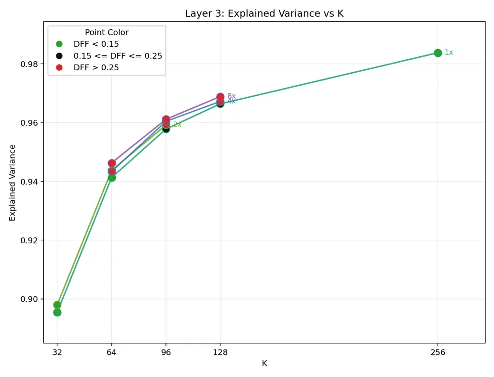
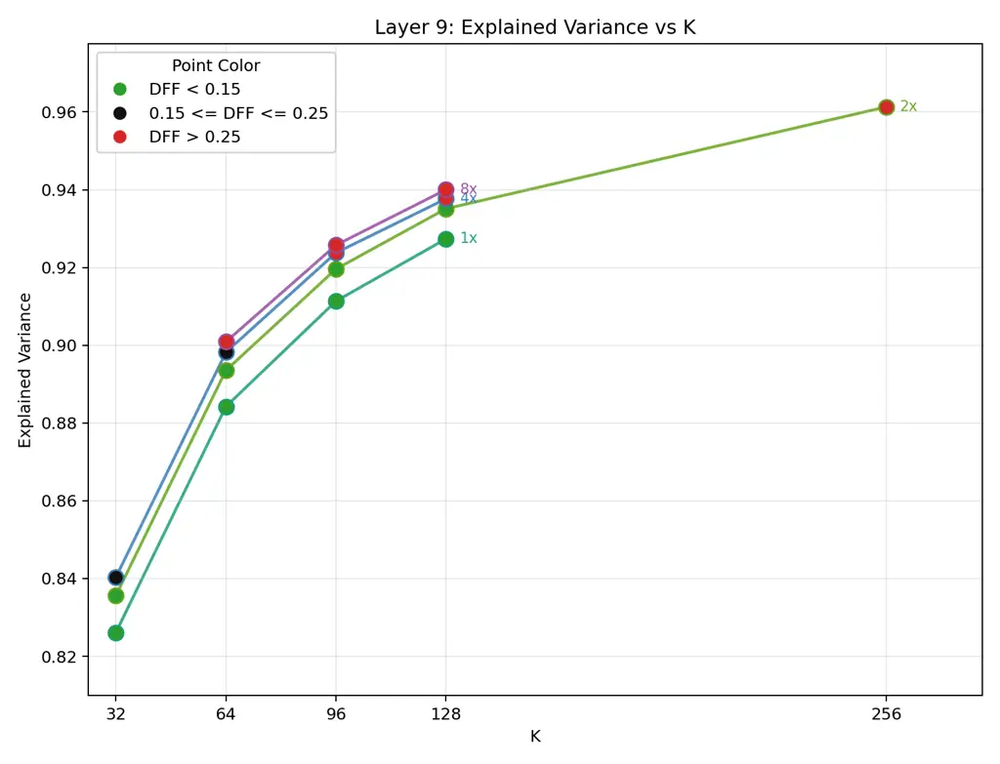
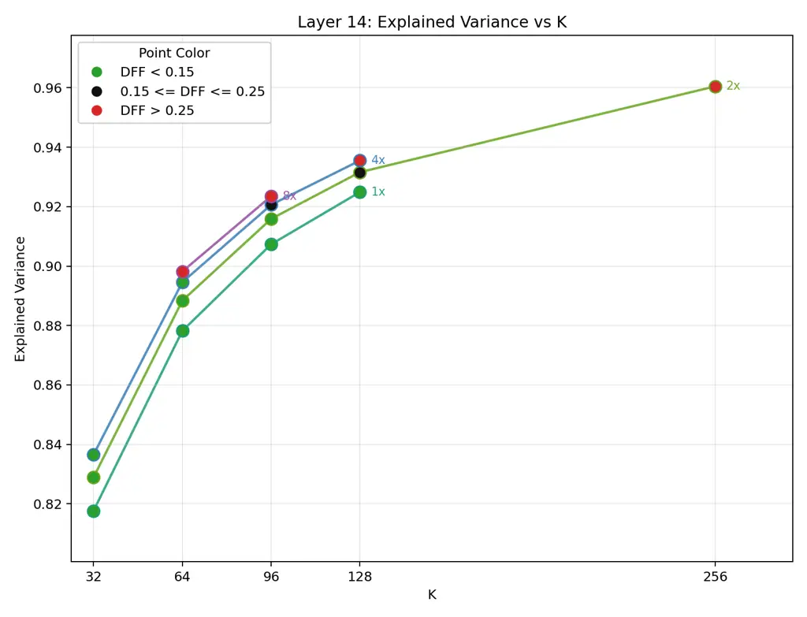
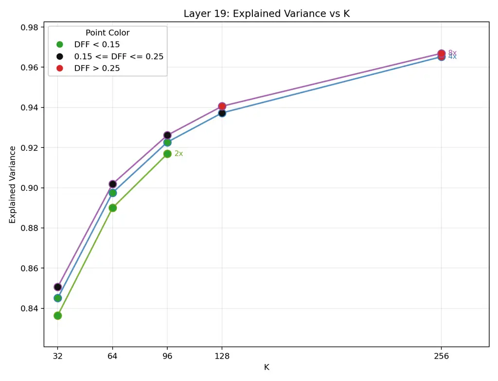
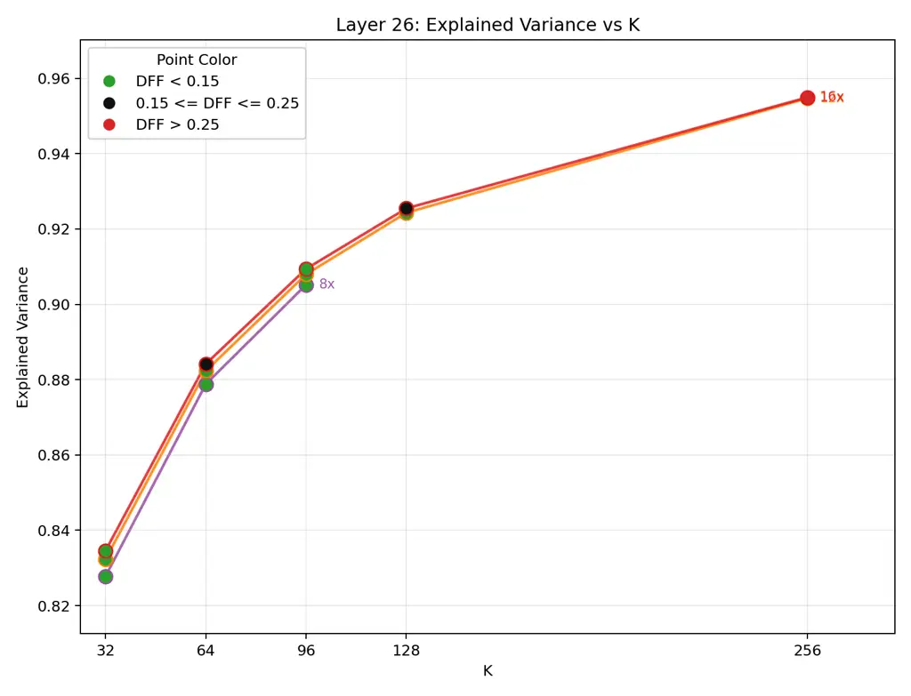

# Discovering Interpretable Acoustic Features in Autoregressive Voice-Cloning TTS Models

Anuj Diwan Affiliation: University of Texas at Austin
Email: [anuj.diwan@utexas.edu](mailto:)    David Harwath
Affiliation: University of Texas at Austin
Email: [harwath@utexas.edu](mailto:)    Eunsol Choi Affiliation: New
York University Email: [eunsol@nyu.edu](mailto:)

###### Abstract

Voice-cloning TTS models synthesize an unseen speaker’s voice from brief
speech prompts, but it remains unclear which acoustic properties they
represent and use. We introduce a feature-based interpretability
framework for autoregressive voice-cloning TTS models, analyzing
features from sparse autoencoders (SAEs), PCA, and random directions via
sparse probing, steering, and quantitative auto-interpretability. We
focus on Qwen3-TTS and extend probing and steering to $`5`$ additional
models to test generalization across architectures. These models encode
concepts like pitch, energy, noise, and accent, but sparse prediction
and steering are effective only for some concepts. Strong probing does
not always translate to steering or vice-versa. SAEs are useful for
sparse probing of human-labelled concepts and novel-concept discovery,
while PCA is competitive for dense probing and steering.
Auto-interpretability finds $`684`$ automatically validated SAE features
in Qwen3-TTS covering speaker clusters, speaking style, and recording
conditions beyond known concepts. Overall, we perform a comprehensive
interpretability study of autoregressive voice-cloning TTS models.

|     |
| --- |
|     |

## 1 Introduction

Zero-shot voice-cloning TTS models (Chen et al., 2025; Du et al., 2024;
Hu et al., 2026) synthesize speech in an unseen speaker’s voice from a
few seconds of prompt speech. Speech entangles speaker identity, vocal
texture, emotion, and pacing. We ask which concepts these models
represent, whether they can be predicted from a few features and steered
during generation, and what their features capture beyond predefined
labels. We study these questions through sparse probing, generation-time
steering, and quantitative auto-interpretability for novel concept
discovery. This provides a way to test acoustic controls in TTS models
and inspect speech properties beyond predefined labels.

Our analysis builds on sparse-autoencoder (SAE) work (Huben et al.,
2024; Gao et al., 2025) that decomposes activations into interpretable
feature dictionaries. Earlier speech SAE work (Aparin et al., 2026)
studies encoders, while earlier TTS work (Varshavsky-Hassid et al.,
2024; Lenglet et al., 2026) studies known concepts in non-voice-cloning
models. We instead study known and novel concepts in zero-shot
voice-cloning models. The closest speech auto-interpretability work,
AudioSAE (Aparin et al., 2026), uses natural-language labels for
qualitative inspection; we quantitatively test whether labels are
coherent, predictive of held-out audio, and stable under relabeling.
While CoCoEmo (Wang et al., 2026) uses supervised steering directions
and controllable TTS systems (Diwan et al., 2025; Du et al., 2024) use
explicit style labels, we steer using unsupervised feature dictionaries.
While contemporaneous work on CosyVoice3 (Koriagin et al., 2026) also
performs SAE probing and steering, we compare feature methods across
$`6`$ TTS models to test generalization across architectures. Rather
than $`3`$ select concepts, our steering evaluation covers $`55`$
extractor concepts.

Figure 1: Our main interpretability evaluation pipeline. We evaluate
feature sets via known-concept probing and steering across $`6`$
voice-cloning TTS models, and through quantitative auto-interpretability
in Qwen3-TTS for novel concept discovery.

We study Qwen3-TTS (Hu et al., 2026) as our primary model, and extend
probing and steering to $`5`$ additional Fish, Higgs, and CosyVoice2
models to test generalization across architectures. We convert
activations into utterance-level features using SAE, PCA, random
directions, and untrained SAEs. We find that models encode pitch,
energy, noise, accent, and emotion, but only some concepts are
predictable from a few features. PCA and random directions are strong
baselines, while SAEs outperform PCA on average in sparse prediction of
human-labelled concepts. Feature directions can steer pitch, energy,
noise, and spectral properties, with effects varying by model and
concept. Strong sparse prediction does not always translate to steering
or vice-versa. Auto-interpretability yields $`684`$ automatically
validated SAE features in Qwen3-TTS spanning shared voice profiles,
speaking styles, and recording conditions beyond known concepts.

Future studies could use our probing setup to track representation
changes during fine-tuning. Discovered features could also guide
investigations of unwanted transfer of background music or reverberation
from reference speech. Steering demos and discovered features are at
[https://anonymous.4open.science/w/tts_interp_demo/](https://anonymous.4open.science/w/tts_interp_demo/).
Code will be released at
[https://github.com/ajd12342/voice-cloning-interp](https://github.com/ajd12342/voice-cloning-interp).

In summary, our contributions are:

- •
  We introduce a feature-based interpretability framework for zero-shot
  voice-cloning TTS, comparing SAE, PCA, and random features through
  sparse probing and generation-time steering. We probe $`55`$
  extractor-derived and $`21`$ human-labelled concepts and steer all
  extractor concepts.
- •
  We test the generalizability of our pipeline and findings across
  architectures, extending probing and steering from our detailed
  Qwen3-TTS study to $`5`$ additional Fish, Higgs, and CosyVoice2
  models.
- •
  We develop a quantitative auto-interpretability pipeline that tests
  labeled features for coherence, predictive fit, and stability,
  discovering $`684`$ automatically validated SAE features in Qwen3-TTS
  spanning voice profiles, speaking styles, and recording conditions.

## 2 Models, Features, and Data

We use Qwen3-TTS-12Hz-0.6B-Base (Hu et al., 2026) (Qwen3-TTS) for our
main probing, steering, and novel-concept analyses. We extend probing
and steering to Fish S1-mini (Liao et al., 2024), Fish S2 Pro (Liao et
al., 2026), Higgs TTS 2 (Boson AI, 2025), Higgs TTS 3 (Boson AI, 2026),
and CosyVoice2-0.5B (Du et al., 2024) to test the generalization of our
pipeline.

Figure 2 shows how we convert residual-stream activations into
utterance-level features using TopK SAEs (Gao et al., 2025), PCA, random
directions, and untrained SAEs.

### 2.1 Models and Activation Extraction

We restrict analysis to the autoregressive backbone residual stream in
each model. During inference, we prefill each model with the reference
text, target text and reference speech, autoregressively generate target
speech, and finally use their respective decoders to decode the
generated tokens into a waveform akin to other autoregressive TTS
models (Du et al., 2024; Chen et al., 2025).

Qwen3-TTS We select Qwen3-TTS for its architectural compatibility with
text SAEs (Gao et al., 2025), competitive TTS performance (Hu et al.,
2026), and lack of explicit style supervision. We use the $`0.6`$B
variant, which represents speech with $`16`$ codebooks at $`12`$Hz. Its
$`28`$-layer backbone with hidden size $`d=1024`$ predicts the
first-codebook token for each speech frame, and a $`5`$-layer
multi-token prediction (MTP) module predicts the remaining $`15`$
codebook tokens.

Other Models Fish S1-mini is a $`0.5`$B model with a $`28`$-layer
backbone and hidden size $`d=1024`$, while Fish S2 Pro has a $`4`$B
backbone with $`36`$ layers and $`d=2560`$, followed by a $`400`$M fast
transformer. Both use $`10`$ codec streams, the autoregressive backbone
predicts the first stream, and a fast transformer predicts the remaining
$`9`$. Higgs TTS 2 has $`28`$ backbone layers with $`d=3072`$ and
$`5.8`$B parameters: $`3.6`$B in the language model and $`2.2`$B in
audio-specific feed-forward layers. Higgs TTS 3 (Boson AI, 2026) uses a
$`4`$B backbone with $`36`$ layers and $`d=2560`$. Both predict all
$`8`$ codec streams directly in the backbone, with the streams offset
across generation steps. CosyVoice2 uses a $`0.5`$B autoregressive
language model with $`24`$ layers and $`d=896`$ to predict a single
stream of semantic speech tokens. A conditional flow model converts
these into mel features, followed by a vocoder. The flow model also
receives reference speech tokens and reference mel features.

Activation Extraction For Qwen3-TTS, we tokenize each utterance’s
transcript and observed speech, run a teacher-forced forward pass, and
extract speech-region activations from layers $`\{3,9,14,19,26\}`$
(early, $`\tfrac{1}{3}`$-depth, $`\tfrac{1}{2}`$-depth,
$`\tfrac{2}{3}`$-depth, near-final). For the additional models, we
extract activations at only one layer, approximately the same relative
depth as Qwen3-TTS layer $`19`$: layer $`19`$ for Fish S1-mini and Higgs
TTS 2, $`24`$ for Fish S2 Pro and Higgs TTS 3, and $`16`$ for
CosyVoice2. We use stride-$`3`$ token subsampling for feature fitting
and no subsampling otherwise.

### 2.2 Corpora and Splits

Main Corpus We use a $`3.3`$k-hr main corpus ($`1.5`$M utterances,
$`151.2`$k speaker IDs) spanning clean audiobooks, in-the-wild speech,
accents and emotional data drawn from LibriTTS-R (Koizumi et al., 2023),
MSP-Podcast (Lotfian and Busso, 2019), Emilia (He et al., 2024),
VoxCeleb (Nagrani et al., 2020) and more. We split it $`85`$%/$`15`$% by
speaker ID into disjoint feature-fitting and analysis splits containing
$`1.2`$M and $`218.4`$k utterances, respectively. The feature-fitting
split trains SAEs, fits PCA, and instantiates the remaining feature
sets; the analysis split is used during evaluation. We use the full
feature-fitting split for Qwen3-TTS and CosyVoice2, and a $`20\%`$
random subset for the Fish and Higgs models due to compute constraints.

Other Evaluation Corpora The ParaSpeechCaps tag concept set is built
from ParaSpeechCaps-Base (Diwan et al., 2025) and provides
human-labelled annotations for $`102.4`$k utterances from $`566`$
speakers, filtered to $`21`$ concepts that have enough speakers. The
steering eval set contains $`100`$ source utterances from $`32`$
speakers and $`100`$ target transcripts sampled from LibriTTS-R (Koizumi
et al., 2023) test-clean. Full corpus statistics and details are in
Appendix A.

Figure 2: Feature extraction from TTS residual-stream activations using
SAE, PCA, random directions, and untrained SAEs. We study multiple
layers in Qwen3-TTS and one in other models.

### 2.3 Feature Sets

SAE We train a TopK SAE (Gao et al., 2025) for each studied layer on
activations from the feature-fitting split. Each SAE learns an
$`M`$-feature dictionary with at most $`K`$ active features per token.
For Qwen3-TTS, we sweep $`M`$ and $`K`$ to balance reconstruction
quality and the fraction of inactive features, selecting
$`M=\{d,2d,2d,4d,12d\}`$ for layers $`\{3,9,14,19,26\}`$ and $`K=96`$
throughout. For Fish, Higgs and CosyVoice2, we fix $`M=4d`$ and $`K=96`$
following Qwen3-TTS layer $`19`$ without separate sweeps. We train with
Adam, learning rate $`5\times 10^{-4}`$, and batches of $`4096`$ token
activations. Full training settings and sweep results are in
Appendices B and B.1. We max-pool each feature over tokens to obtain
utterance-level features, as in Aparin et al. (2026).

Other Feature Sets For PCA, we fit principal components on mean-pooled
activations from a $`20\%`$ random subset of the feature-fitting split.
For random directions, we project mean-pooled activations onto random
unit vectors, matching the corresponding SAE width at each layer. We
also use features from untrained SAEs with the same architecture as the
trained SAEs.

## 3 Probing and Steering Known Concepts

Figure 1 summarizes our evaluation of predefined acoustic and
paralinguistic concepts, inspired by Wu et al. (2025). We compare
prediction from a few features with the full feature set using Karvonen
et al. (2025)’s sparse top-$`k`$ probing, then steer aligned features to
test whether they causally affect generated speech without changing
other concepts.

### 3.1 Known-Concept Labels

Extractor Concepts We run extractors for pitch, energy, voicing, timing,
noise, formants, emotion dimensions, and gender over the main corpus
analysis split. We apply reliability filters, such as minimum voiced
frames, so each concept is evaluated only when well-defined, and average
frame-level outputs when needed. These extractors are also run on
generated waveforms during steering.

Human-Labelled Concepts We use the ParaSpeechCaps tag concept set
defined in Section 2.2. Its annotations cover speaker and style concepts
including vocal texture, clarity, loudness, emotion, and accent. These
tags are used for sparse probing but not for steering because reliably
assigning them to generated waveforms would require collecting human
annotations.

### 3.2 Sparse Probing Setup

Binary Dataset Setup We convert extractor and human labels into binary
concepts. Continuous-valued concepts such as pitch become low- and
high-tail concepts; probabilistic concepts, such as emotion, stay only
high-tail; and human-labelled tags become binary concepts with tagged
utterances as positives. We split each dataset $`70`$%/$`10`$%/$`20`$%
by speaker ID into disjoint train, val, and test splits for probing.
This yields $`55`$ extractor concepts and $`21`$ final human-labelled
concepts. More details in Appendix C.

Feature Selection and Probe Training For every concept, feature set, and
layer, we rank features by the absolute positive-negative mean
difference on the train split. We then train an $`\ell_{2}`$-regularized
logistic probe on the top $`k\in\{1,2,5,10,\mathrm{all}\}`$ features,
tune the decision threshold on val F1, and evaluate F1 on the test
split. All models use the same splits for probe-training and held-out
test sets. Comparisons across models use Qwen3-TTS layer $`19`$ and the
layers specified in Section 2.1 for the other models. Additional
Qwen3-TTS details are in Appendix C.1.

Evaluation Metrics We report normalized F1 to compare concepts with
different positive rates. For a given concept, let
$`\mathrm{F1}_{\mathrm{null}}`$ be the F1 of an always-positive
classifier on the test split and define normalized
$`\mathrm{nF1}_{k}=(\mathrm{F1}_{k}-\mathrm{F1}_{\mathrm{null}})/(1-\mathrm{F1}_{\mathrm{null}})`$.

_Recoverability_ is $`\mathrm{nF1}_{k=\mathrm{all}}`$, measuring how
well the full feature set recovers the concept. _Sparse recoverability_
is $`\mathrm{nF1}_{k=2}`$, measuring how well the concept can be
recovered from only $`2`$ features.

### 3.3 Sparse Probing Results

Figure 3(a) reports all-feature and top-$`2`$ nF1 for the top $`10`$
extractor and human-labelled concepts by SAE recoverability at Qwen3-TTS
layer $`19`$; full lists are in Appendix E.1. Figure 3(b) compares
all-feature and top-$`2`$ recoverability across all six models.

(a) Qwen3-TTS layer $`19`$

(b) Six-model comparison

Figure 3: All-feature and top-$`2`$ nF1. (a) Top $`10`$ extractor and
human-labelled concepts by SAE recoverability in Qwen3-TTS. _Takeaway_:
Many concepts, especially extractor concepts, are recoverable but few
are sparsely predicted from $`2`$ features. (b) Mean nF1 over $`55`$
extractor and $`21`$ human-labelled concepts across $`6`$ models (layers
in Section 2.1). Full lists in Appendix E.1. _Takeaway_: PCA and random
directions have higher all-feature extractor nF1 than SAE, while SAE has
higher top-$`2`$ human-labelled nF1 than PCA across all six models.

Extractor concepts are broadly recoverable, with duration, energy,
pitch, spectral tilt, and gender among the strongest. Pitch, energy, and
gender also have strong sparse recoverability, while speaking rate,
accent, and many spectral properties are much better predicted using all
features.

Human-labelled concepts are less consistently recoverable; only accents
and some styles are. Whispered has strong SAE sparse recoverability
across all models. British accent is more sparsely recoverable from SAEs
in Fish and CosyVoice2 than at Qwen3-TTS layer $`19`$, although
Qwen3-TTS improves at layer $`26`$ (Appendix E.3).

Comparing feature sets, we find that across models, PCA and random
directions have higher extractor-concept recoverability than SAE, while
SAE exceeds PCA in sparse recoverability of human-labelled concepts
(Figure 3(b)). SAE leads in sparse extractor-concept recoverability only
in Qwen3-TTS. Results comparing various $`k`$ values are in
Appendix E.2.

Comparing models, we find broadly similar all-feature nF1 for extractor
concepts in Qwen3-TTS, Fish, and Higgs. With only $`2`$ features,
Qwen3-TTS and Fish have higher mean nF1 than Higgs and CosyVoice2
(Figure 3(b)). CosyVoice2 also has lower all-feature nF1, particularly
for energy and spectral concepts, although duration and speaking rate
remain well predicted.

Layerwise analysis plots for Qwen3-TTS are in Appendix E.3. For SAE
features, extractor concepts are already recoverable in early layers,
but sparse recoverability is strongest later. Human-labelled concepts
improve in both metrics from early to later layers.

### 3.4 Steering Setup

Steering asks whether features associated with known concepts can
causally affect generation. We steer all $`55`$ extractor concepts using
their top-$`2`$ SAE, PCA, or random features. Like prior text (Subramani
et al., 2022; Turner et al., 2024; Rimsky et al., 2024) and speech (Wang
et al., 2026; Xie et al., 2025) steering, we intervene at inference
rather than learning style conditioning through training (Wang et al.,
2018; Diwan et al., 2025).

Generation Setup Each example pairs source audio and transcript with a
target transcript. After prefilling with the source, we add $`\lambda`$
times a steering vector to one layer’s residual stream during
generation (Turner et al., 2024). Uniform steering compounded over time
in Qwen3-TTS, so we linearly decay the intervention to zero over the
expected generation length (Appendix C.2). We generate unsteered and
steered speech at $`\lambda=1`$ on the same $`100`$ examples across
models, using Qwen3-TTS layers $`19`$ and $`26`$ and the other models’
layers from Section 2.1.

Steering Vectors For SAE, PCA, and random directions, we sum the
concept’s signed top-$`2`$ unit directions, each scaled by its cached
activation standard deviation. Prior work instead tunes steering
strength (Rimsky et al., 2024; Durmus et al., 2024; Chalnev et al.,
2024). A supervised DiffMean topline (Marks and Tegmark, 2024) uses the
positive-minus-negative mean activation, unit-normalized and scaled by
the std along that direction (Appendix C.2).

Evaluation Metrics We compare extractor scores between steered and
unsteered waveforms, normalizing paired changes by each concept’s
analysis-split $`95`$th–$`5`$th percentile range. Measurements and
changes are not clipped, so scores can exceed $`1`$.

_Target Change_ measures intended change (Rimsky et al., 2024; Durmus et
al., 2024) as the median signed normalized change across utterances,
positive in the requested direction.

_Off-target change_ measures side effects (Durmus et al., 2024; Chalnev
et al., 2024) on protected concepts: non-target concepts we aim to
preserve, excluding those strongly correlated with the target on the
analysis split. We take the median absolute normalized change across
utterances for each protected concept, then the median across concepts
(Appendix C.2).

For _Quality_, we report paired mean $`\Delta`$WER (percentage points)
using Whisper large-v3 (Radford et al., 2023) and $`\Delta`$UTMOS using
UTMOS (Saeki et al., 2022).

### 3.5 Steering Results

Figure 4 compares models, averaging metrics across all $`55`$ extractor
concepts. Figure 5 shows the top $`10`$ concepts by SAE Target Change at
Qwen3-TTS layer $`19`$ ($`\lambda=1`$), and Figure 6 shows Qwen3-TTS
strength sweeps. Expanded results are in Appendix C.3. We exclude
human-labelled concepts because reliably evaluating them on generated
speech would require new human annotations.

Figure 4: Steering at $`\lambda=1`$, averaged across $`55`$ extractor
concepts on $`100`$ examples. Higgs TTS 3, where SAE steering severely
degraded speech, is shown in Appendix C.3. _Takeaway_: In Qwen3-TTS and
Fish, SAE target changes are competitive with PCA and supervised
DiffMean, with smaller off-target changes than PCA; DiffMean has smaller
UTMOS losses. Mean target changes are smaller in Higgs TTS 2 and
CosyVoice2.

Comparing feature sets, we find that SAE, PCA, and DiffMean increase
Target Change with strength. Stronger steering also increases off-target
change and sometimes reduces quality (Figure 6). Random directions have
near-zero Target Change despite competitive probing performance. In
Qwen3-TTS and Fish, supervised DiffMean has the lowest off-target
change, followed by SAE and PCA. SAE has smaller $`\Delta`$WER and
$`\Delta`$UTMOS costs than PCA, while DiffMean has smaller UTMOS drops
(Figure 4).

Figure 5: Top $`10`$ Qwen3-TTS layer-$`19`$ concepts by SAE median
Target Change, comparing all four methods at $`\lambda=1`$ on $`100`$
examples. _Takeaway_: SAE target changes are largest for energy, pitch,
spectral and voice-quality properties. Quality losses partly reflect
deliberately reducing SNR or pushing RMS toward either extreme.

Comparing concepts, we find that steering works well for RMS, low-SNR,
pitch, and spectral and voice-quality properties (Figure 5). Low-SNR and
RMS quality costs are partly expected: low-SNR steering should add
noise, while RMS interventions deliberately make speech much louder or
quieter. Spectral and voice-quality effects also appear in Fish. Most
SAE changes in accent and emotion scores are small, while timing results
are mixed.

Comparing models, we find larger mean Target Change from SAE, PCA, and
DiffMean in Qwen3-TTS and Fish than in Higgs TTS 2 and CosyVoice2
(Figure 4). At the studied layers, SAE pitch steering is strong in
Qwen3-TTS and Fish but weak in Higgs TTS 2, where PCA and DiffMean are
more effective. SAE instead steers RMS and formants in Higgs TTS 2. In
Higgs TTS 3, SAE severely degrades speech (Figure 9).

Figure 6: Qwen3-TTS strength sweeps, averaged across a fixed set of
$`9`$ probing-selected targets on the same $`100`$ utterances
(Appendix C.2). Layers $`19`$/$`26`$ use solid/dotted lines. _Takeaway_:
SAE, PCA, and DiffMean increase target change with strength while random
directions remain ineffective. SAE has lower off-target change than PCA
but pays a WER/UTMOS cost.

Uniform steering in Qwen3-TTS can compound over time (e.g. progressively
increasing pitch), motivating our decay schedule (Section 3.4). This
anecdote suggests that the model may encode pitch locally rather than at
the utterance-level, opening the possibility of temporally varying
controls.

Comparing probing and steering, we find that strong probing does not
always translate to steering. SAE sparse recoverability correlates
weakly with Target Change across concepts in Qwen3-TTS, and barely at
all in Fish (Appendix C.2). In Qwen3-TTS, top-$`2`$ SAE steering barely
changes duration at layer $`19`$ despite strong sparse recoverability,
but increases spectral centroid at layer $`26`$ despite weak sparse
recoverability.

## 4 Discovering Novel Concepts

Known-concept evaluations test whether model features can capture
predefined concepts. To study model behavior beyond those, we
auto-interpret (Bills et al., 2023) features leveraging an audio LLM to
label features using highly activating audio examples, as depicted in
Figure 1. Due to API costs, we restrict this analysis to Qwen3-TTS.
AudioSAE (Aparin et al., 2026) uses natural-language labels
qualitatively. We instead evaluate labeled features using three
quantitative metrics: Coherence, Label Fit, and Label Stability.

### 4.1 Auto-Interpretability Setup

Features and Utterances We randomly sample $`500`$ features per set at
Qwen3-TTS layer $`19`$. For SAE features, we z-score nonzero
activations, selecting utterances with $`z>2`$ as activating and
activation $`0`$ as contrasts. For PCA and random directions, we z-score
over all utterances and use $`z>2`$ as activating and $`z\leq 0`$ as
contrasts.

Label Generation For each feature, we randomly sample $`5`$ activating
and $`5`$ contrast utterances and ask Gemini $`3.5`$ Flash for the
acoustic property that best separates them (Appendix D). An example of a
generated label is ‘Whispered or highly breathy, hushed speech’.

Label Evaluation Our metrics assess the coherence of activating
utterances, the predictive fit of labels on held-out audio, and their
stability across reruns and resampling. Since Gemini is used both to
generate and evaluate labels, these automated metrics alone do not
establish independent ground-truth validation, but jointly test Gemini’s
labeling abilities and feature-label alignment. They compare how
consistently features can be described and predicted under a fixed audio
LLM and protocol. We additionally measure human Label Fit on a subset of
SAE features as an independent check (Section 4.2).

_Coherence_ is the mean accuracy over $`5`$ trials where Gemini
identifies the outlier among $`10`$ activating and $`1`$ contrast
utterance, following intruder-style evaluation (Paulo and Belrose,
2026).

_Label Fit_ is the accuracy when Gemini classifies held-out utterances
($`10`$ activating, $`10`$ contrast) as matching the label or not,
following detection-based scoring (Paulo et al., 2025; Bills et al.,
2023).

_Label Stability_ compares labels regenerated from the original
utterances and a disjoint set of $`5`$ activating and $`5`$ contrast
utterances against the main label. Gemini scores each comparison as
$`1.0`$ for same, $`0.5`$ for overlapping, and $`0`$ for
different/unclear; we average the two scores.

_Automatically validated features_ have Coherence $`\geq 3/5`$, Label
Fit $`\geq 0.75`$, and Label Stability $`\geq 0.5`$.

Controls *Random guessing* gives $`\nicefrac{{1}}{{11}}`$ Coherence,
$`0.5`$ Label Fit, and $`0.375`$ Stability under uniform verdicts.
_Shuffled labels_ tests Label Fit with another feature’s label; _random
audio_ tests Coherence and Label Fit with randomly sampled utterances.

### 4.2 Auto-Interpretability Results

|                                    |                                               |                                               |                                               |                 |
| ---------------------------------- | --------------------------------------------- | --------------------------------------------- | --------------------------------------------- | --------------- |
| Feature Set                        | Coherence                                     | Label Fit                                     | Label Stab.                                   | Valid.          |
| Rand. Guess                        | $`0.09{\scriptscriptstyle\pm 0.03}`$          | $`0.50{\scriptscriptstyle\pm 0.04}`$          | $`0.38{\scriptscriptstyle\pm 0.04}`$          | –               |
| Rand. Dir.                         | $`0.25{\scriptscriptstyle\pm 0.02}`$          | $`0.60{\scriptscriptstyle\pm 0.01}`$          | $`0.32{\scriptscriptstyle\pm 0.02}`$          | $`17`$          |
| PCA                                | $`0.08{\scriptscriptstyle\pm 0.01}`$          | $`0.50{\scriptscriptstyle\pm 0.01}`$          | $`0.22{\scriptscriptstyle\pm 0.02}`$          | $`1`$           |
| SAE                                | $`\mathbf{0.43}{\scriptscriptstyle\pm 0.03}`$ | $`\mathbf{0.63}{\scriptscriptstyle\pm 0.01}`$ | $`\mathbf{0.41}{\scriptscriptstyle\pm 0.03}`$ | $`\mathbf{92}`$ |
| $`\hookrightarrow`$ *shuf. labels* | –                                             | $`0.50{\scriptscriptstyle\pm 0.01}`$          | –                                             | –               |
| $`\hookrightarrow`$ *rand. audio*  | $`0.10{\scriptscriptstyle\pm 0.01}`$          | $`0.50{\scriptscriptstyle\pm 0.01}`$          | –                                             | –               |

Table 1: Auto-interpretability of $`500`$ Qwen3-TTS layer-$`19`$
features per set ($`95\%`$ bootstrap intervals). _Takeaway_: SAE scores
highest on all three metrics and yields the most validated features.

Comparing feature sets, we find that SAE scores highest on all three
metrics and yields the most validated features ($`92`$, versus $`17`$
random and $`1`$ PCA; Table 1). Random directions approach SAE on Label
Fit but trail on Coherence and Stability, suggesting that Label Fit
alone is insufficient for interpretability. PCA is near chance on
Coherence and Label Fit. Shuffled-label and random-audio controls score
near chance, indicating that the results depend on feature-matched
labels and audio.

Human evaluation We measure human Label Fit on $`50`$ validated and
$`50`$ nonvalidated SAE features randomly sampled from the original
$`500`$ layer-$`19`$ SAE features. For each feature, Amazon Mechanical
Turk annotators judge whether its label matches each of $`5`$ activating
and $`5`$ contrast utterances, with $`2`$–$`3`$ ratings per clip.
Validated features achieve higher human Label Fit ($`64.4\%`$ vs.
$`51.0\%`$, averaged across features), with nonvalidated features near
the $`50\%`$ chance baseline. This suggests that validation selects
labels that better distinguish activating from contrast utterances.

Discovered concepts We manually grouped the $`92`$ validated SAE
features by their primary label. Of these, $`72`$ are _speaker cluster
features_ describing timbre and accent: $`37`$ male narration and
synthetic-sounding reading voices, $`14`$ female voices spanning British
narration, conversation and breathy storytelling, and $`21`$ other
profiles including sports and podcast voices, gravelly male voices, and
accented instruction. The remaining $`20`$ cover accent ($`5`$),
laughter ($`4`$), recording conditions ($`3`$), whispering and
synthetic-sounding speech ($`2`$ each), plus vocal fry, disfluencies,
sports commentary, and expressive podcast delivery.

Since SAEs performed best, we extend discovery to the remaining eligible
layer-$`19`$ features, yielding $`592`$ additional validated SAE
features. These distinguish finer narration styles (deep audiobook
voices, British academic reading, dramatic storytelling, robotic
delivery), conversational profiles (raspy sports commentary, youthful
gaming voices, gravelly lecturing), and laughter (during speech, amused
delivery, background laughter). Other labels describe shouting,
preaching, slow pacing, background music, reverberation, coughs, throat
clearing, and backchannels.

Speaker diversity analysis Auto-interpretability found many speaker
cluster features, motivating further analysis. For each SAE feature, we
extract speaker embeddings (Ravanelli et al., 2021) and apply cosine
agglomerative clustering (Appendix D). Speaker clusters differ from
speaker IDs: validated SAE features span a median of $`26`$ path-derived
IDs across stored activating examples. Features with at most $`5`$
embedding clusters account for $`19.5\%`$ of eligible SAE features but
$`63.7\%`$ of the $`684`$ validated features. This enrichment may
reflect the substantial timbre capacity needed for voice-cloning, but
also the auto-interpretability pipeline: timbre may be easier for the
judge to perceive, describe, and verify, making such features more
likely to pass all three checks.

## 5 Related Work

SAEs for mechanistic interpretability SAEs learn overcomplete sparse
dictionaries whose latents are often more interpretable than
neurons (Huben et al., 2024; Bricken et al., 2023). We follow recent
work in evaluating their usefulness through sparse prediction, causal
interventions, and steering (Gao et al., 2025; Karvonen et al., 2025; Wu
et al., 2025).

Interpreting speech and audio encoders SAEs, PCA, and related
decompositions have been applied to speech/audio encoders (Chen et al.,
2022; Hsu et al., 2021; Défossez et al., 2023), revealing features
aligned with pitch, emotion, accent, and loudness (Aparin et al., 2026;
Mariotte et al., 2025; Paek et al., 2025; van Rensburg et al., 2026).
Some features can steer vocoders (Paek et al., 2025; van Rensburg et
al., 2026) or reduce transcription errors (Aparin et al., 2026). Unlike
this encoder-focused work, we study generative voice-cloning TTS models.
Most of this work evaluates prespecified concepts. AudioSAE (Aparin et
al., 2026) uses natural-language labels for qualitative inspection; we
instead evaluate labels quantitatively.

TTS interpretability Prior TTS work finds PCA components for gender and
intensity in Grad-TTS (Varshavsky-Hassid et al., 2024) and probes
encoder-decoder TTS models for syllabic and phonemic features (Lenglet
et al., 2026). These studies focus on known concepts in
non-voice-cloning models. We instead compare multiple feature sets
through probing and steering of known concepts across $`6`$ zero-shot
voice-cloning TTS models, and discover novel concepts in Qwen3-TTS.
While contemporaneous work on CosyVoice3 (Koriagin et al., 2026)
demonstrates steering with $`3`$ selected SAE features, we
systematically compare SAE and PCA steering across all $`55`$ extractor
targets, including off-target changes and speech quality. Our probing
and steering comparisons span $`6`$ TTS models, testing generalization
across architectures.

Controllable TTS Most controllable TTS trains models on labels, style
instructions, or reference audio (Guo et al., 2023; Yang et al., 2024;
Liu et al., 2023; Diwan et al., 2025; Du et al., 2024; Chen et al.,
2026). CoCoEmo and EmoSteer-TTS (Wang et al., 2026; Xie et al., 2025)
use activation steering, but only along supervised emotion directions.
Related emotion-sensitive neuron studies (Zhao et al., 2026a; Zhao et
al., 2026b) also target predefined emotions in audio understanding and
generation. Our steering experiments instead ask whether features from
unsupervised dictionaries can serve directly as training-free controls
for diverse acoustic concepts across frozen voice-cloning models.

## 6 Conclusion

We introduce a feature-based interpretability framework for
voice-cloning TTS, combining probing and steering across $`6`$ models
with novel-concept discovery in Qwen3-TTS. Many acoustic and
paralinguistic concepts are recoverable, but only some are strongly
predicted from a few features. Steering effects vary by model and
concept, and strong sparse prediction does not always translate to
effective steering. PCA and random directions are strong probing
baselines, while SAEs are useful for sparse prediction of human-labelled
concepts and novel-concept discovery. Auto-interpretability identifies
$`684`$ automatically validated SAE features spanning speaker clusters,
speaking style, and recording conditions in Qwen3-TTS. Future work
should extend analysis to multilingual speech, study how features vary
temporally, and explore composition of controls.

#### Acknowledgements

We thank Shauli Ravfogel and members of the UT NLP community for helpful
feedback, and the Amazon Mechanical Turk annotators who participated in
our human evaluation. We thank the Google Gemini Academic Program for
providing Google Cloud credits.

## AI Use Statement

We used generative AI tools to implement methods and write code, refine
experimental setups, and support qualitative analysis. All research
ideas originated with the authors. Additionally, we used these tools to
create plots, edit prose, fix LaTeX errors, and assist with literature
searches. Gemini’s role in feature labeling and evaluation is described
in Section 4. We reviewed all AI-assisted work, checking results against
saved outputs, citations against original papers, and inspecting plots,
feature groupings, and prose. We take responsibility for the final text,
claims, code and artifacts.

## References

- Aparin et al. (2026) G. Aparin, T. Sadekova, A. Rukhovich, A.
  Yermekova, L. Kushnareva, V. Popov, K. Kuznetsov, and I. Piontkovskaya
  AudioSAE: towards understanding of audio-processing models with sparse
  autoencoders. External Links: 2602.05027,
  [Link](https://arxiv.org/abs/2602.05027) Cited by: §1, §2.3, §4, §5.
- Bills et al. (2023) S. Bills, N. Cammarata, D. Mossing, H. Tillman, L.
  Gao, G. Goh, I. Sutskever, J. Leike, J. Wu, and W. Saunders Language
  models can explain neurons in language models. Note:
  [https://openaipublic.blob.core.windows.net/neuron-explainer/paper/index.html](https://openaipublic.blob.core.windows.net/neuron-explainer/paper/index.html)
  Cited by: §4.1, §4.
- Boson AI (2025) Boson AI Higgs Audio V2: Redefining Expressiveness in
  Audio Generation. Note:
  [https://github.com/boson-ai/higgs-audio](https://github.com/boson-ai/higgs-audio)GitHub
  repository. Release blog available at
  [https://www.boson.ai/blog/higgs-audio-v2](https://www.boson.ai/blog/higgs-audio-v2)
  Cited by: §2.
- Boson AI (2026) Boson AI Higgs tts 3: conversational speech for voice
  ai from boson ai. Note: https://huggingface.co/bosonai/higgs-tts-3-4b
  Cited by: §2.1, §2.
- Bricken et al. (2023) T. Bricken, A. Templeton, J. Batson, B. Chen, A.
  Jermyn, T. Conerly, N. Turner, C. Anil, C. Denison, A. Askell, R.
  Lasenby, Y. Wu, S. Kravec, N. Schiefer, T. Maxwell, N. Joseph, Z.
  Hatfield-Dodds, A. Tamkin, K. Nguyen, B. McLean, J. E. Burke, T.
  Hume, S. Carter, T. Henighan, and C. Olah Towards monosemanticity:
  decomposing language models with dictionary learning. Transformer
  Circuits Thread. Note:
  https://transformer-circuits.pub/2023/monosemantic-features/index.html
  Cited by: Appendix B, §5.
- Chalnev et al. (2024) S. Chalnev, M. Siu, and A. Conmy Improving
  steering vectors by targeting sparse autoencoder features. External
  Links: 2411.02193, [Link](https://arxiv.org/abs/2411.02193) Cited by:
  §3.4, §3.4.
- Chen et al. (2026) D. Chen, X. Zhang, Y. Wang, K. Dai, L. Ma, and Z.
  Wu FlexiVoice: enabling flexible style control in zero-shot TTS with
  natural language instructions. In The Fourteenth International
  Conference on Learning Representations, External Links:
  [Link](https://openreview.net/forum?id=F7GmbfyVg9) Cited by: §5.
- Chen et al. (2022) S. Chen, C. Wang, Z. Chen, Y. Wu, S. Liu, Z.
  Chen, J. Li, N. Kanda, T. Yoshioka, X. Xiao, J. Wu, L. Zhou, S.
  Ren, Y. Qian, Y. Qian, J. Wu, M. Zeng, X. Yu, and F. Wei WavLM:
  large-scale self-supervised pre-training for full stack speech
  processing. IEEE Journal of Selected Topics in Signal Processing 16
  (6), pp. 1505–1518. External Links: ISSN 1941-0484,
  [Link](http://dx.doi.org/10.1109/JSTSP.2022.3188113),
  [Document](https://dx.doi.org/10.1109/jstsp.2022.3188113) Cited by:
  §5.
- Chen et al. (2025) S. Chen, C. Wang, Y. Wu, Z. Zhang, L. Zhou, S.
  Liu, Z. Chen, Y. Liu, H. Wang, J. Li, L. He, S. Zhao, and F. Wei
  Neural codec language models are zero-shot text to speech
  synthesizers. IEEE Transactions on Audio, Speech and Language
  Processing 33 (), pp. 705–718. External Links:
  [Document](https://dx.doi.org/10.1109/TASLPRO.2025.3530270) Cited by:
  §1, §2.1.
- Défossez et al. (2023) A. Défossez, J. Copet, G. Synnaeve, and Y. Adi
  High fidelity neural audio compression. Transactions on Machine
  Learning Research. Note: Featured Certification, Reproducibility
  Certification External Links: ISSN 2835-8856,
  [Link](https://openreview.net/forum?id=ivCd8z8zR2) Cited by: §5.
- Diwan et al. (2025) A. Diwan, Z. Zheng, D. Harwath, and E. Choi
  Scaling rich style-prompted text-to-speech datasets. In Proceedings of
  the 2025 Conference on Empirical Methods in Natural Language
  Processing, C. Christodoulopoulos, T. Chakraborty, C. Rose, and V.
  Peng (Eds.), Suzhou, China, pp. 3639–3659. External Links:
  [Link](https://aclanthology.org/2025.emnlp-main.180/),
  [Document](https://dx.doi.org/10.18653/v1/2025.emnlp-main.180), ISBN
  979-8-89176-332-6 Cited by: Appendix A, §1, §2.2, §3.4, §5.
- Du et al. (2024) Z. Du, Y. Wang, Q. Chen, X. Shi, X. Lv, T. Zhao, Z.
  Gao, Y. Yang, C. Gao, H. Wang, F. Yu, H. Liu, Z. Sheng, Y. Gu, C.
  Deng, W. Wang, S. Zhang, Z. Yan, and J. Zhou CosyVoice 2: scalable
  streaming speech synthesis with large language models. External Links:
  2412.10117, [Link](https://arxiv.org/abs/2412.10117) Cited by: §1, §1,
  §2.1, §2, §5.
- Durmus et al. (2024) E. Durmus, A. Tamkin, J. Clark, J. Wei, J.
  Marcus, J. Batson, K. Handa, L. Lovitt, M. Tong, M. McCain, O.
  Rausch, S. Huang, S. Bowman, S. Ritchie, T. Henighan, and D. Ganguli
  Evaluating feature steering: a case study in mitigating social biases.
  External Links:
  [Link](https://anthropic.com/research/evaluating-feature-steering)
  Cited by: §3.4, §3.4, §3.4.
- Feng et al. (2025) T. Feng, J. Lee, A. Xu, Y. Lee, T. Lertpetchpun, X.
  Shi, H. Wang, T. Thebaud, L. Moro-Velazquez, D. Byrd, et al.
  Vox-profile: a speech foundation model benchmark for characterizing
  diverse speaker and speech traits. arXiv preprint arXiv:2505.14648.
  Cited by: Table 5.
- Gao et al. (2025) L. Gao, T. Dupre la Tour, H. Tillman, G. Goh, R.
  Troll, A. Radford, I. Sutskever, J. Leike, and J. Wu Scaling and
  evaluating sparse autoencoders. In International Conference on
  Learning Representations, Y. Yue, A. Garg, N. Peng, F. Sha, and R. Yu
  (Eds.), Vol. 2025, pp. 26721–26754. External Links:
  [Link](https://proceedings.iclr.cc/paper_files/paper/2025/file/42ef3308c230942d223c411adf182c88-Paper-Conference.pdf)
  Cited by: Appendix B, Appendix B, §1, §2.1, §2.3, §2, §5.
- Guo et al. (2023) Z. Guo, Y. Leng, Y. Wu, S. Zhao, and X. Tan
  Prompttts: controllable text-to-speech with text descriptions. In
  ICASSP 2023 - 2023 IEEE International Conference on Acoustics, Speech
  and Signal Processing (ICASSP), Vol. , pp. 1–5. External Links:
  [Document](https://dx.doi.org/10.1109/ICASSP49357.2023.10096285) Cited
  by: §5.
- He et al. (2024) H. He, Z. Shang, C. Wang, X. Li, Y. Gu, H. Hua, L.
  Liu, C. Yang, J. Li, P. Shi, Y. Wang, K. Chen, P. Zhang, and Z. Wu
  Emilia: an extensive, multilingual, and diverse speech dataset for
  large-scale speech generation. In 2024 IEEE Spoken Language Technology
  Workshop (SLT), Vol. , pp. 885–890. External Links:
  [Document](https://dx.doi.org/10.1109/SLT61566.2024.10832365) Cited
  by: Table 4, §2.2.
- Hsu et al. (2021) W. Hsu, B. Bolte, Y. H. Tsai, K. Lakhotia, R.
  Salakhutdinov, and A. Mohamed HuBERT: self-supervised speech
  representation learning by masked prediction of hidden units. IEEE/ACM
  Transactions on Audio, Speech, and Language Processing 29 (),
  pp. 3451–3460. External Links:
  [Document](https://dx.doi.org/10.1109/TASLP.2021.3122291) Cited by:
  §5.
- Hu et al. (2026) H. Hu, X. Zhu, T. He, D. Guo, B. Zhang, X. Wang, Z.
  Guo, Z. Jiang, H. Hao, Z. Guo, X. Zhang, P. Zhang, B. Yang, J. Xu, J.
  Zhou, and J. Lin Qwen3-tts technical report. arXiv preprint
  arXiv:2601.15621. Cited by: §1, §1, §2.1, §2.
- Huben et al. (2024) R. Huben, H. Cunningham, L. R. Smith, A. Ewart,
  and L. Sharkey Sparse autoencoders find highly interpretable features
  in language models. In The Twelfth International Conference on
  Learning Representations, External Links:
  [Link](https://openreview.net/forum?id=F76bwRSLeK) Cited by: Appendix
  B, §1, §5.
- Jadoul et al. (2018) Y. Jadoul, B. Thompson, and B. de Boer
  Introducing Parselmouth: A Python interface to Praat. Journal of
  Phonetics 71, pp. 1–15. External Links:
  [Document](https://dx.doi.org/10.1016/j.wocn.2018.07.001) Cited by:
  Table 5.
- Karvonen et al. (2025) A. Karvonen, C. Rager, J. Lin, C. Tigges, J. I.
  Bloom, D. Chanin, Y. Lau, E. Farrell, C. S. McDougall, K.
  Ayonrinde, D. Till, M. Wearden, A. Conmy, S. Marks, and N. Nanda
  SAEBench: a comprehensive benchmark for sparse autoencoders in
  language model interpretability. In Forty-second International
  Conference on Machine Learning, External Links:
  [Link](https://openreview.net/forum?id=qrU3yNfX0d) Cited by: Appendix
  B, §3, §5.
- Koizumi et al. (2023) Y. Koizumi, H. Zen, S. Karita, Y. Ding, K.
  Yatabe, N. Morioka, M. Bacchiani, Y. Zhang, W. Han, and A. Bapna
  LibriTTS-R: A Restored Multi-Speaker Text-to-Speech Corpus. In
  Interspeech 2023, pp. 5496–5500. External Links:
  [Document](https://dx.doi.org/10.21437/Interspeech.2023-1584), ISSN
  2958-1796 Cited by: Table 4, §2.2, §2.2.
- Koriagin et al. (2026) N. Koriagin, G. Aparin, N. Balagansky, and D.
  Gavrilov Interpreting and steering a text-to-speech language model
  with sparse autoencoders. External Links: 2606.10029,
  [Link](https://arxiv.org/abs/2606.10029) Cited by: §1, §5.
- Lavechin et al. (2023) M. Lavechin, M. Métais, H. Titeux, A.
  Boissonnet, J. Copet, M. Rivière, E. Bergelson, A. Cristia, E. Dupoux,
  and H. Bredin Brouhaha: multi-task training for voice activity
  detection, speech-to-noise ratio, and C50 room acoustics estimation.
  ASRU. Cited by: Table 5.
- Lenglet et al. (2026) M. Lenglet, O. Perrotin, and G. Bailly A closer
  look at internal representations of end-to-end text-to-speech models:
  how is phonetic and acoustic information encoded?. Computer Speech and
  Language 100, pp. 101985. External Links: ISSN 0885-2308,
  [Document](https://dx.doi.org/https%3A//doi.org/10.1016/j.csl.2026.101985),
  [Link](https://www.sciencedirect.com/science/article/pii/S0885230826000483)
  Cited by: §1, §5.
- Liao et al. (2024) S. Liao, Y. Wang, T. Li, Y. Cheng, R. Zhang, R.
  Zhou, and Y. Xing Fish-speech: leveraging large language models for
  advanced multilingual text-to-speech synthesis. External Links:
  2411.01156, [Link](https://arxiv.org/abs/2411.01156) Cited by: §2.
- Liao et al. (2026) S. Liao, Y. Wang, S. Liu, Y. Cheng, R. Zhang, T.
  Li, S. Li, Y. Zheng, X. Liu, Q. Wang, Z. Zhou, J. Liu, X. Chen, and D.
  Han Fish audio s2 technical report. External Links: 2603.08823,
  [Link](https://arxiv.org/abs/2603.08823) Cited by: §2.
- Liu et al. (2023) G. Liu, Y. Zhang, Y. Lei, Y. Chen, R. Wang, L. Xie,
  and Z. Li PromptStyle: Controllable Style Transfer for Text-to-Speech
  with Natural Language Descriptions. In Interspeech 2023,
  pp. 4888–4892. External Links:
  [Document](https://dx.doi.org/10.21437/Interspeech.2023-1779), ISSN
  2958-1796 Cited by: §5.
- Livingstone and Russo (2018) S. R. Livingstone and F. A. Russo The
  ryerson audio-visual database of emotional speech and song (ravdess):
  a dynamic, multimodal set of facial and vocal expressions in north
  american english. PloS one 13 (5), pp. e0196391. Cited by: Table 4.
- Lotfian and Busso (2019) R. Lotfian and C. Busso Building naturalistic
  emotionally balanced speech corpus by retrieving emotional speech from
  existing podcast recordings. IEEE Transactions on Affective Computing
  10 (4), pp. 471–483. External Links:
  [Document](https://dx.doi.org/10.1109/TAFFC.2017.2736999) Cited by:
  Table 4, §2.2.
- Ma et al. (2024) Z. Ma, Z. Zheng, J. Ye, J. Li, Z. Gao, S. Zhang,
  and X. Chen Emotion2vec: self-supervised pre-training for speech
  emotion representation. Proc. ACL 2024 Findings. Cited by: Table 5.
- Mariotte et al. (2025) T. Mariotte, M. Lebourdais, A. Almudévar, M.
  Tahon, A. Ortega, and N. Dugué Sparse autoencoders make audio
  foundation models more explainable. External Links: 2509.24793,
  [Link](https://arxiv.org/abs/2509.24793) Cited by: §5.
- Marks and Tegmark (2024) S. Marks and M. Tegmark The geometry of
  truth: emergent linear structure in large language model
  representations of true/false datasets. In First Conference on
  Language Modeling, External Links:
  [Link](https://openreview.net/forum?id=aajyHYjjsk) Cited by: §3.4.
- Morrison et al. (2023) M. Morrison, C. Hsieh, N. Pruyne, and B. Pardo
  Cross-domain neural pitch and periodicity estimation. In arXiv
  preprint arXiv:2301.12258, Cited by: Table 5.
- Nagrani et al. (2020) A. Nagrani, J. S. Chung, W. Xie, and A.
  Zisserman Voxceleb: large-scale speaker verification in the wild.
  Computer Speech and Language 60, pp. 101027. External Links: ISSN
  0885-2308,
  [Document](https://dx.doi.org/https%3A//doi.org/10.1016/j.csl.2019.101027),
  [Link](https://www.sciencedirect.com/science/article/pii/S0885230819302712)
  Cited by: Table 4, §2.2.
- Paek et al. (2025) N. Paek, Y. Zang, Q. Yang, and R. Leistikow
  Learning interpretable features in audio latent spaces via sparse
  autoencoders. In Mechanistic Interpretability Workshop at NeurIPS
  2025, External Links:
  [Link](https://openreview.net/forum?id=5fsYFQzzMX) Cited by: §5.
- Paulo and Belrose (2026) G. Paulo and N. Belrose Evaluating SAE
  interpretability without generating explanations. In The Fourteenth
  International Conference on Learning Representations, External Links:
  [Link](https://openreview.net/forum?id=kHhMs642rR) Cited by: §4.1.
- Paulo et al. (2025) G. S. Paulo, A. T. Mallen, C. Juang, and N.
  Belrose Automatically interpreting millions of features in large
  language models. In Forty-second International Conference on Machine
  Learning, External Links:
  [Link](https://openreview.net/forum?id=EemtbhJOXc) Cited by: §4.1.
- Radford et al. (2023) A. Radford, J. W. Kim, T. Xu, G. Brockman, C.
  McLeavey, and I. Sutskever Robust speech recognition via large-scale
  weak supervision. In International conference on machine learning,
  pp. 28492–28518. Cited by: §3.4.
- Ravanelli et al. (2021) M. Ravanelli, T. Parcollet, P. Plantinga, A.
  Rouhe, S. Cornell, L. Lugosch, C. Subakan, N. Dawalatabad, A. Heba, J.
  Zhong, J. Chou, S. Yeh, S. Fu, C. Liao, E. Rastorgueva, F. Grondin, W.
  Aris, H. Na, Y. Gao, R. D. Mori, and Y. Bengio SpeechBrain: a
  general-purpose speech toolkit. Note: arXiv:2106.04624 External Links:
  2106.04624 Cited by: §4.2.
- Richter et al. (2024) J. Richter, Y. Wu, S. Krenn, S. Welker, B.
  Lay, S. Watanabe, A. Richard, and T. Gerkmann EARS: An Anechoic
  Fullband Speech Dataset Benchmarked for Speech Enhancement and
  Dereverberation. In Interspeech 2024, pp. 4873–4877. External Links:
  [Document](https://dx.doi.org/10.21437/Interspeech.2024-153), ISSN
  2958-1796 Cited by: Table 4.
- Rimsky et al. (2024) N. Rimsky, N. Gabrieli, J. Schulz, M. Tong, E.
  Hubinger, and A. Turner Steering llama 2 via contrastive activation
  addition. In Proceedings of the 62nd Annual Meeting of the Association
  for Computational Linguistics (Volume 1: Long Papers), L. Ku, A.
  Martins, and V. Srikumar (Eds.), Bangkok, Thailand, pp. 15504–15522.
  External Links: [Link](https://aclanthology.org/2024.acl-long.828/),
  [Document](https://dx.doi.org/10.18653/v1/2024.acl-long.828) Cited by:
  §3.4, §3.4, §3.4.
- Saeki et al. (2022) T. Saeki, D. Xin, W. Nakata, T. Koriyama, S.
  Takamichi, and H. Saruwatari UTMOS: UTokyo-SaruLab System for VoiceMOS
  Challenge 2022. In Interspeech 2022, pp. 4521–4525. External Links:
  [Document](https://dx.doi.org/10.21437/Interspeech.2022-439), ISSN
  2958-1796 Cited by: §3.4.
- Subramani et al. (2022) N. Subramani, N. Suresh, and M. Peters
  Extracting latent steering vectors from pretrained language models. In
  Findings of the Association for Computational Linguistics: ACL
  2022, S. Muresan, P. Nakov, and A. Villavicencio (Eds.), Dublin,
  Ireland, pp. 566–581. External Links:
  [Link](https://aclanthology.org/2022.findings-acl.48/),
  [Document](https://dx.doi.org/10.18653/v1/2022.findings-acl.48) Cited
  by: §3.4.
- Turner et al. (2024) A. M. Turner, L. Thiergart, G. Leech, D.
  Udell, J. J. Vazquez, U. Mini, and M. MacDiarmid Steering language
  models with activation engineering. External Links: 2308.10248,
  [Link](https://arxiv.org/abs/2308.10248) Cited by: §3.4, §3.4.
- van Rensburg et al. (2026) K. J. van Rensburg, B. van Niekerk, and H.
  Kamper Interpreting speaker characteristics in the dimensions of
  self-supervised speech features. External Links: 2603.03096,
  [Link](https://arxiv.org/abs/2603.03096) Cited by: §5.
- Varshavsky-Hassid et al. (2024) M. Varshavsky-Hassid, R. Hirsch, R.
  Cohen, T. Golany, D. Freedman, and E. Rivlin On the semantic latent
  space of diffusion-based text-to-speech models. In Proceedings of the
  62nd Annual Meeting of the Association for Computational Linguistics
  (Volume 2: Short Papers), L. Ku, A. Martins, and V. Srikumar (Eds.),
  Bangkok, Thailand, pp. 246–255. External Links:
  [Link](https://aclanthology.org/2024.acl-short.24/),
  [Document](https://dx.doi.org/10.18653/v1/2024.acl-short.24) Cited by:
  §1, §5.
- Wang et al. (2026) S. Wang, S. Tan, S. Liu, H. Jia, G. Huang, J.
  Bailey, and T. Dang CoCoEmo: composable and controllable human-like
  emotional tts via activation steering. External Links: 2602.03420,
  [Link](https://arxiv.org/abs/2602.03420) Cited by: §1, §3.4, §5.
- Wang et al. (2018) Y. Wang, D. Stanton, Y. Zhang, R. Ryan, E.
  Battenberg, J. Shor, Y. Xiao, Y. Jia, F. Ren, and R. A. Saurous Style
  tokens: unsupervised style modeling, control and transfer in
  end-to-end speech synthesis. In Proceedings of the 35th International
  Conference on Machine Learning, J. Dy and A. Krause (Eds.),
  Proceedings of Machine Learning Research, Vol. 80, pp. 5180–5189.
  External Links: [Link](https://proceedings.mlr.press/v80/wang18h.html)
  Cited by: §3.4.
- Wu et al. (2025) Z. Wu, A. Arora, A. Geiger, Z. Wang, J. Huang, D.
  Jurafsky, C. D. Manning, and C. Potts AxBench: steering LLMs? even
  simple baselines outperform sparse autoencoders. In Forty-second
  International Conference on Machine Learning, External Links:
  [Link](https://openreview.net/forum?id=K2CckZjNy0) Cited by: §3, §5.
- Xie et al. (2025) T. Xie, S. Yang, C. Li, D. Yu, and L. Liu
  EmoSteer-tts: fine-grained and training-free emotion-controllable
  text-to-speech via activation steering. External Links: 2508.03543,
  [Link](https://arxiv.org/abs/2508.03543) Cited by: §3.4, §5.
- Yamagishi et al. (2019) J. Yamagishi, C. Veaux, and K. MacDonald CSTR
  vctk corpus: english multi-speaker corpus for cstr voice cloning
  toolkit (version 0.92). University of Edinburgh. The Centre for Speech
  Technology Research (CSTR). External Links:
  [Document](https://dx.doi.org/10.7488/DS/2645),
  [Link](https://datashare.is.ed.ac.uk/handle/10283/3443) Cited by:
  Table 4.
- Yang et al. (2024) D. Yang, S. Liu, R. Huang, C. Weng, and H. Meng
  InstructTTS: modelling expressive tts in discrete latent space with
  natural language style prompt. IEEE/ACM Transactions on Audio, Speech,
  and Language Processing 32 (), pp. 2913–2925. External Links:
  [Document](https://dx.doi.org/10.1109/TASLP.2024.3402088) Cited by:
  §5.
- Zhao et al. (2026a) X. Zhao, B. Schuller, and B. Sisman Discovering
  and causally validating emotion-sensitive neurons in large
  audio-language models. In Proceedings of the 64th Annual Meeting of
  the Association for Computational Linguistics (Volume 1: Long
  Papers), M. Liakata, V. P. Moreira, J. Zhang, and D. Jurgens (Eds.),
  San Diego, California, United States, pp. 15056–15071. External Links:
  [Link](https://aclanthology.org/2026.acl-long.687/),
  [Document](https://dx.doi.org/10.18653/v1/2026.acl-long.687), ISBN
  979-8-89176-390-6 Cited by: §5.
- Zhao et al. (2026b) X. Zhao, I. R. Ulgen, P. Koehn, B. Schuller,
  and B. Sisman Neuron-level emotion control in speech-generative large
  audio-language models. External Links: 2603.17231,
  [Link](https://arxiv.org/abs/2603.17231) Cited by: §5.
- Zhou et al. (2022) K. Zhou, B. Sisman, R. Liu, and H. Li Emotional
  voice conversion: theory, databases and esd. Speech Communication 137,
  pp. 1–18. External Links: ISSN 0167-6393,
  [Document](https://dx.doi.org/https%3A//doi.org/10.1016/j.specom.2021.11.006),
  [Link](https://www.sciencedirect.com/science/article/pii/S0167639321001308)
  Cited by: Table 4.

## Appendix A Data Details

Tables 4–4 report corpus and split statistics.

|             |            |           |            |
| ----------- | ---------- | --------- | ---------- |
| Dataset     | Utts       | Hrs       | IDs        |
| LibriTTS-R  | $`230.7`$k | $`489.5`$ | $`2.3`$k   |
| MSP-Podcast | $`157.8`$k | $`247.9`$ | $`54.3`$k  |
| Emilia      | $`766.0`$k | $`2.0`$k  | $`88.8`$k  |
| VCTK        | $`49.0`$k  | $`55.4`$  | $`109`$    |
| VoxCeleb    | $`234.4`$k | $`500.0`$ | $`5.6`$k   |
| ESD         | $`5.5`$k   | $`5.4`$   | $`10`$     |
| RAVDESS     | $`1.4`$k   | $`1.5`$   | $`24`$     |
| EARS        | $`11.4`$k  | $`45.8`$  | $`75`$     |
| Total       | $`1.5`$M   | $`3.3`$k  | $`151.2`$k |

Table 2: Main corpus before splitting.

|                 |            |           |            |
| --------------- | ---------- | --------- | ---------- |
| Split           | Utts       | Hrs       | IDs        |
| Feature-fitting | $`1.2`$M   | $`2.8`$k  | $`128.1`$k |
| Analysis        | $`218.4`$k | $`506.1`$ | $`23.2`$k  |
| Total           | $`1.5`$M   | $`3.3`$k  | $`151.2`$k |

|          |            |           |         |
| -------- | ---------- | --------- | ------- |
| Dataset  | Utts       | Hrs       | IDs     |
| PSC tags | $`102.4`$k | $`224.3`$ | $`566`$ |
| Steering | $`100`$    | $`0.22`$  | $`32`$  |

Table 3: Corpus split by speaker ID.

Table 4: Held-out evaluation corpora.

Sources: LibriTTS-R (Koizumi et al., 2023), MSP-Podcast (Lotfian and
Busso, 2019), Emilia (He et al., 2024), VCTK (Yamagishi et al., 2019),
VoxCeleb (Nagrani et al., 2020), ESD (Zhou et al., 2022),
RAVDESS (Livingstone and Russo, 2018), and EARS (Richter et al., 2024).

Speaker IDs. Tables 4–4 count corpus-specific IDs. LibriTTS-R, VCTK,
VoxCeleb, EARS, ESD, and RAVDESS use their speaker or actor IDs. Emilia
uses batch-local speaker IDs. MSP-Podcast uses annotated speaker IDs
when available and a separate utterance ID otherwise. Splits keep each
ID together.

ParaSpeechCaps tag concept set. We build the ParaSpeechCaps tag concept
set from ParaSpeechCaps-Base (Diwan et al., 2025). We first filter tags
that have fewer than $`500`$ positive examples, leaving $`35`$ concepts.
After splitting $`70\%`$/$`10\%`$/$`20\%`$ by speaker ID into disjoint
train/val/test for probing, we filter any concepts that have at most
$`5`$ positive test speakers. This leaves a final list of $`21`$
concepts, listed in Appendix C.

## Appendix B Model and SAE Training Details

TopK SAE. For each studied layer, we train a TopK SAE (Gao et al., 2025)
on speech-region residual-stream token activations. Given an activation
$`\mathbf{x}\in\mathbb{R}^{d}`$, the SAE computes

```math
\displaystyle\mathbf{z} \displaystyle=W_{\mathrm{enc}}(\mathbf{x}-\mathbf{b}_{\mathrm{dec}})+\mathbf{b}_{\mathrm{enc}}, \tag{1}
```

```math
\displaystyle\mathbf{f} \displaystyle=\mathrm{ReLU}\bigl(\mathrm{TopK}(\mathbf{z})\bigr), \tag{2}
```

```math
\displaystyle\hat{\mathbf{x}} \displaystyle=W_{\mathrm{dec}}^{\top}\mathbf{f}+\mathbf{b}_{\mathrm{dec}}, \tag{3}
```

where $`\mathrm{TopK}(\cdot)`$ keeps the $`K`$ largest values in
$`\mathbf{z}`$ and zeros the rest,
$`W_{\mathrm{enc}},W_{\mathrm{dec}}\in\mathbb{R}^{M\times d}`$ are the
encoder and decoder weights, each row $`W_{\mathrm{dec},j}`$ is a
decoder direction, and $`M`$ is the dictionary size. Hard sparsity via
$`\mathrm{TopK}`$ replaces the $`L_{1}`$ penalty used in earlier SAE
variants (Huben et al., 2024).

Objective and dead-feature loss. We minimize reconstruction error with
an auxiliary dead-feature loss following Gao et al. (Gao et al., 2025):

```math
\mathcal{L}=\|\mathbf{x}-\hat{\mathbf{x}}\|_{2}^{2}+\alpha\mathcal{L}_{\mathrm{aux}}, \tag{4}
```

with $`\alpha=\nicefrac{{1}}{{32}}`$. A feature is considered dead if it
has not activated in the last $`5000`$ training steps. The auxiliary
loss asks dead features to reconstruct the current residual
$`\mathbf{x}-\hat{\mathbf{x}}`$, giving them gradient signal on variance
not explained by live features.

Qwen3-TTS training setup. We hold out $`1`$% of utterances for
validation and train each SAE for $`30`$ epochs. A preliminary streaming
pass samples up to $`400`$k train tokens for preprocessing statistics.
We use Adam with batch size $`4096`$, learning rate $`5\times 10^{-4}`$,
and a linear warmup of $`5000`$ steps. We otherwise follow common SAE
training practice (Bricken et al., 2023; Karvonen et al., 2025): decoder
directions are projected to unit norm after every optimizer step, the
component of $`\nabla W_{\mathrm{dec}}`$ parallel to each decoder
direction is removed before the optimizer step, and encoder weights are
initialized to match decoder directions. We normalize inputs by a
per-layer scalar $`s`$ chosen so that
$`\mathbb{E}[\|s\mathbf{x}\|_{2}^{2}]=d`$. The decoder bias
$`\mathbf{b}_{\mathrm{dec}}`$ is initialized to the geometric median of
the same train-token statistics pool.

Other models’ training setup. We use $`M=4d`$, $`K=96`$, and train with
Adam for $`100000`$ steps with batch size $`4096`$ token activations,
learning rate $`5\times 10^{-4}`$, and $`2000`$ warmup steps. We select
the checkpoint with the best reconstruction-validation performance.
Higgs TTS 3 uses the checkpoint at step $`42000`$ as its SAE training
deteriorated later.

Diagnostic metrics. We compute diagnostics on held-out activations
$`\{\mathbf{x}_{i}\}_{i=1}^{N}`$ with reconstructions
$`\{\hat{\mathbf{x}}_{i}\}_{i=1}^{N}`$ and SAE activations
$`\{\mathbf{f}_{i}\}_{i=1}^{N}`$. Explained variance (EV) is

```math
\mathrm{EV}=1-\frac{\sum_{i}\|\mathbf{x}_{i}-\hat{\mathbf{x}}_{i}\|_{2}^{2}}{\sum_{i}\|\mathbf{x}_{i}-\bar{\mathbf{x}}\|_{2}^{2}}, \tag{5}
```

where $`\bar{\mathbf{x}}`$ is the held-out activation mean. For each
feature $`j`$, its density is
$`p_{j}=\frac{1}{N}\sum_{i}\mathbf{1}[f_{ij}>0]`$. Dead-feature fraction
(DFF) is $`\frac{1}{M}\sum_{j}\mathbf{1}[p_{j}=0]`$.

### B.1 SAE Hyperparameter Sweeps

We compare $`10`$-epoch Qwen3-TTS runs with widths
$`M\in\{d,2d,4d,8d,12d,16d\}`$ and $`K\in\{32,64,96,128,256\}`$;
evaluated combinations are shown in Figure 7. We choose the $`M`$ for
which DFF remained roughly below $`0.15`$ across $`K\in\{32,64,96\}`$.
Only layer $`3`$ did not cleanly satisfy this rule, so we simply
selected the smallest $`M=1024`$ since larger $`M`$ made the DFF worse.
This selected $`M=\{d,2d,2d,4d,12d\}`$ for layers $`\{3,9,14,19,26\}`$,
showing that earlier layers prefer smaller dictionaries while later ones
prefer wider dictionaries.

After choosing width, we selected $`K`$ from the EV-vs-$`K`$ curve.
Figure 7 shows these curves for each probed layer. EV always rises with
$`K`$, but DFF tends to jump once $`K`$ becomes too large. We use
$`K=96`$ for all layers as it was a good shoulder point: it gives high
EV while avoiding the larger DFF penalties seen at $`K=128`$ for some
layers.











Figure 7: EV-vs-$`K`$ curves at epoch $`10`$ for layers $`3`$, $`9`$
(top), $`14`$, $`19`$ (middle), and $`26`$ (bottom). Lines vary $`M`$;
point colors indicate DFF. We choose widths with DFF roughly below
$`0.15`$ across $`K\in\{32,64,96\}`$, except at layer $`3`$, and select
$`K`$ near the curve’s shoulder.

## Appendix C Known Concepts

Known-concept probing uses extractor concepts from audio and metadata
extractors run on the main-corpus analysis split, and human-labelled
concepts from the ParaSpeechCaps tag concept set described in
Appendix A.

Extractor inventory. Table 5 lists the automatic extractors and scalar
values used before binarization. Each extractor writes scalar values and
per-value reliability masks. Probing abstains on rows where an extractor
marks a value unreliable, the value is missing, or the value is
non-finite.

|                     |                                                                                                                           |                                                                                                                                        |
| ------------------- | ------------------------------------------------------------------------------------------------------------------------- | -------------------------------------------------------------------------------------------------------------------------------------- |
| Family              | Extractor                                                                                                                 | Scalar outputs used                                                                                                                    |
| Pitch and voicing   | PENN (Morrison et al., 2023)                                                                                              | _f0 mean_, _voiced fraction_, _mean voiced run sec_, _f0 slope_                                                                        |
| Energy and spectrum | librosa RMS and spectral centroid                                                                                         | _rms mean_, _rms slope_, _spectral centroid mean_                                                                                      |
| Timing              | WebRTC VAD, g2p speaking rate, manifest duration                                                                          | _pause fraction_, _mean pause sec_, _speaking rate_, _duration_                                                                        |
| Recording quality   | Brouhaha (Lavechin et al., 2023); librosa STFT spectral tilt                                                              | _snr_, _c50_, _spectral tilt_                                                                                                          |
| Voice quality       | Praat/Parselmouth (Jadoul et al., 2018)                                                                                   | _jitter local_, _shimmer local_, _hnr db_                                                                                              |
| Formants            | Praat/Parselmouth                                                                                                         | _f1 median_, _f2 median_, _f3 median_                                                                                                  |
| Gender              | [wav2vec2/XLS-R gender classifier](https://huggingface.co/alefiury/wav2vec2-large-xlsr-53-gender-recognition-librispeech) | _gender male prob_                                                                                                                     |
| Emotion             | emotion2vec (Ma et al., 2024); [MSP-DIM](https://huggingface.co/audeering/wav2vec2-large-robust-12-ft-emotion-msp-dim)    | _emo2vec happy_, _emo2vec sad_, _arousal_, _valence_                                                                                   |
| Accent              | VoxProfile/Whisper (Feng et al., 2025)                                                                                    | _accent east asia_, _accent english_, _accent germanic_, _accent north america_, _accent oceania_, _accent romance_, _accent scottish_ |

Table 5: Automatic concept extractors. Each scalar yields high- and
low-tail concepts except emotion2vec and accent scores, which yield only
high-tail concepts, giving $`55`$ targets in total.

Binarization. We convert scalar values into $`55`$ binary concepts. For
scalars with both directions, we create high-tail and low-tail labels
using the top and bottom $`20`$% of reliable finite utterances. Positive
examples are the corresponding tail, and negative examples are a random
sample from reliable non-tail utterances, balanced to the number of
positives. For emotion2vec and accent scores, we keep only
high-confidence labels using the top $`5`$% tail. Their negatives are
high-confidence positives from other kept classes in the same family. We
split each binary dataset $`70`$%/$`10`$%/$`20`$% by speaker ID into
disjoint train, val, and test splits before probing.

Human-labelled concepts. The $`21`$ ParaSpeechCaps tags retained after
filtering (Appendix A) are:

- •
  Intrinsic: American, authoritative, booming, British, crisp, deep,
  flowing, hesitant, husky, loud, nasal, raspy, shrill, silky, slurred,
  and stammering.
- •
  Situational: confused, disgusted, happy, saddened, and whispered.

### C.1 Sparse Probing Details

Qwen3-TTS and CosyVoice2 additionally evaluate
$`k\in\{20,50,100,200\}`$. Features that are nonzero on less than
$`0.1\%`$ of probe-training utterances are excluded for probing. For
each concept, feature set, and layer, features are ranked by the
absolute positive-minus-negative mean activation difference. Ties are
broken by feature index. After ranking, selected features are
standardized using train means and stds before fitting.

Each probe is an $`\ell_{2}`$-regularized logistic regression fit with
the sklearn liblinear solver, inverse regularization strength $`C=1.0`$,
and at most $`1000`$ iterations. The decision threshold is selected on
validation rows to maximize F1, with precision and then the smallest
threshold possible used as tie-breakers.

### C.2 Steering Details

Steering vectors. For SAE steering, the intervention vector for concept
$`c`$ is

```math
\Delta_{c}(\lambda)=\lambda\sum_{j\in J_{c}}\sigma_{j}s_{j}W_{\mathrm{dec},j}/s_{\mathrm{in}},
```

where $`J_{c}`$ contains the top $`2`$ sparse-probing features,
$`\sigma_{j}`$ is the feature’s cached nonzero activation standard
deviation, $`s_{j}\in\{-1,1\}`$ is the train-split association sign,
$`W_{\mathrm{dec},j}`$ is the SAE decoder direction, and
$`s_{\mathrm{in}}`$ is the SAE input scale. PCA and random-direction
steering use the same formula with the corresponding unit basis vector
in place of $`W_{\mathrm{dec},j}/s_{\mathrm{in}}`$; these bases are
unit-normalized before steering. The difference-of-means topline uses

```math
\Delta_{c}(\lambda)=\lambda\sigma_{c}v_{c},
```

where $`v_{c}`$ is the unit-normalized difference between positive and
negative train-row mean hidden states and $`\sigma_{c}`$ is the
train-row standard deviation along that axis.

Qwen3-TTS strength sweep.  We sweep $`\lambda\in\{0.5,0.75,1.0,1.25\}`$
at Qwen3-TTS layers $`19`$ and $`26`$ on $`100`$ examples. Both layers
and all methods use the same $`9`$ targets selected across the original
probing sweep: duration $`\uparrow`$, F0 mean $`\uparrow/\downarrow`$,
male probability $`\uparrow/\downarrow`$, pause length $`\uparrow`$, RMS
mean $`\uparrow/\downarrow`$, and SNR $`\downarrow`$.

Temporal schedule. The intervention is applied only during
generated-token steps, leaving the source-prompt prefill unmodified. For
generated step $`t`$, we multiply the intervention by

```math
\alpha_{t}=\max(0,1-t/T),
```

where $`T`$ is the expected generated length estimated as the
target/source transcript non-space character ratio times the number of
source prompt codec tokens.

Protected concepts. We exclude the target scalar and concepts with
analysis-split absolute Spearman correlation $`\geq 0.35`$ with the
target. High/low labels of the same scalar count as one protected
property.

Metric aggregation. For model comparisons and strength sweeps, we
average available per-concept scores with equal weight, treating
high/low directions separately. Missing scores are excluded from each
metric’s average. Each protected property uses pairs with valid target
and property measurements. Off-target change is omitted if any protected
property has no valid pairs. Within each concept, $`\Delta`$WER and
$`\Delta`$UTMOS are paired means across utterances, with WER in
percentage points.

Probing and steering.  Across $`55`$ targets, SAE top-$`2`$ nF1 and
Target Change have Spearman $`\rho=0.20/0.22`$ at Qwen3-TTS layers
$`19/26`$, and $`-0.07/0.00`$ in Fish S1/S2.

### C.3 Additional Steering Results

Figure 8: Steering results for all $`55`$ concepts at Qwen3-TTS layer
$`19`$, extending Figure 5. Concepts are ordered by descending SAE
Target Change.

Figure 9: Expanded model comparison from Figure 4, including Higgs TTS 3
on separate axes. Additional panels show larger off-target changes
($`90`$th percentile across protected-concept medians) and quality
losses ($`90`$th/$`10`$th percentiles of utterance-level
$`\Delta`$WER/$`\Delta`$UTMOS), averaged across target concepts. Hollow
markers indicate $`51/55`$ target and $`31/55`$ off-target scores for
Higgs TTS 3 SAE due to unavailable extractor measurements; all quality
means retain $`55/55`$, including degraded speech.

## Appendix D Auto-Interpretability Details

Feature sampling. All experiments use layer-$`19`$ features on the
analysis split, with activating and contrast candidates defined in
Section 4. Features must have at least $`20`$ candidates of each type.
We sample $`500`$ per set from $`3583`$ eligible SAE features (out of
$`4096`$), $`1024`$ PCA features, and $`4096`$ random directions.

Utterance sets. Sample counts follow Section 4. Label Fit uses held-out
audio; Label Stability repeats the original evidence and uses a disjoint
evidence set. Coherence trials randomize clip order. Audio is truncated
to at most $`20`$ seconds.

Validation. Features must pass all three thresholds in Section 4. The
Coherence threshold of $`3`$ correct trials out of $`5`$ is the smallest
integer threshold with one-sided binomial probability below $`0.05`$
under random guessing ($`p=\nicefrac{{1}}{{11}}`$). Stability averages
the original-clip and disjoint-clip comparisons. Among the $`684`$
passing features, these components average $`0.849`$ and $`0.662`$,
respectively.

Baselines and controls. Random-guessing baselines are analytical. The
Stability reference assumes uniform guesses over same, overlapping,
different, and unclear, giving expected support
$`0.25\cdot 1.0+0.25\cdot 0.5=0.375`$. Shuffled-label controls assign
labels from another feature in the same set and layer, with no feature
retaining its own label. Random-audio controls replace each clip with a
random utterance. Both retain the original prompts and response formats.

Speaker diversity. We cluster speaker embeddings from all strongly
activating utterances per feature ($`20`$–$`11778`$ for classified
features), using average linkage and a cosine-distance cutoff of
$`0.4`$. Of all $`4096`$ SAE features, $`518`$ have $`1`$–$`2`$
embedding clusters, $`181`$ have $`3`$–$`5`$, $`2903`$ have more than
$`5`$, and $`494`$ have fewer than $`20`$ activating utterances and
remain unclassified. The main comparison uses the $`3583`$
auto-interpretability-eligible features of which $`699`$ have at most
$`5`$ clusters.

### D.1 Gemini Prompt Templates

We use Gemini $`3.5`$ Flash for all API calls. The exact prompts used
for auto-interpretability are below. The request builder interleaves
these prompts with text labels and inline audio attachments.

Label generation prompt.

I’m studying learned features inside a speech synthesis model. I’ve
attached two

groups of short speech clips for a given feature.

The clips are attached inline in this message. Each audio attachment is

immediately preceded by a text label. Treat these labels as the source
of truth:

labels ACTIVATING_1, ACTIVATING_2, ... are Group A, and labels
CONTRAST_1,

CONTRAST_2, ... are Group B.

GROUP A (labels ACTIVATING\_\*): These clips all strongly activate a
specific

internal feature of the model.

GROUP B (labels CONTRAST\_\*): These are random clips that do NOT
activate this

feature.

Your task: Listen carefully to both groups and identify what acoustic,
vocal, or

recording property consistently distinguishes Group A from Group B.

First, listen for the most salient pattern without assuming it belongs
to any

predefined category. Learned model features can correspond to subtle,
unusual,

or cross-cutting properties.

After forming your initial hypothesis, use the following list only as a

checklist of possibilities you may have missed, not as a constraint on
the

answer:

- Voice quality (breathy, creaky, nasal, hoarse, resonant, thin, etc.)

- Recording conditions (reverb, background noise type, microphone
  quality, room

size, phone vs studio)

- Prosody (monotone vs expressive, rising/falling intonation patterns,
  rhythm)

- Speaking style (read speech vs conversational, formal vs casual, acted
  vs

natural)

- Tempo and pacing (fast, slow, many pauses, rushed)

- Pitch register (not just high/low, but placement - head voice, chest
  voice)

- Energy dynamics (consistently loud, quiet, dynamic range, fading)

- Emotional tone (but be specific - not just "happy" but "politely

enthusiastic" or "suppressed frustration")

- Articulatory features (mumbling, crisp enunciation, specific vowel
  qualities,

accent features)

- Any other pattern you notice, even if subtle, weird, mixed, or hard to
  name

Be specific and concrete. Don’t say "Group A sounds different" - say
exactly

how. If you notice multiple distinguishing properties, list them in
order of how

consistent they are across all Group A clips. If you’re uncertain, say
so and

give your best guess with a confidence level.

Prefer the pattern that best separates Group A from Group B, even if it
does not

fit cleanly into any category above. It is acceptable for the best
explanation

to combine multiple cues, such as "female speaker with close-mic studio
audio"

or "fast conversational delivery with clipped endings."

Important: this is a multimodal audio request. Do not answer as if you
only have

text labels. If your first instinct is to say you cannot access or play
the

audio, double-check the attached inline audio parts and use them. If the
provider

truly fails to expose the audio to you, still return the JSON schema
below with

confidence "low", explain the access problem in
notes_for_human_reviewer, and do

not invent acoustic observations.

Return only one valid JSON object. Do not wrap it in markdown. Use
exactly these

keys:

- primary_pattern: one-line description

- confidence: one of "high", "medium", or "low"

- details: 2-3 sentences elaborating the pattern

- secondary_patterns: list of additional distinguishing features, if
  present

- counter_examples: list noting any Group A clips that don’t fit the
  pattern, or

Group B clips that do

- distinguishing_cues: list of short concrete acoustic/vocal/recording
  cues

- label_short: concise lowercase dashboard-friendly label

- is_likely_speaker_identity: boolean

- notes_for_human_reviewer: string

Coherence prompt.

I’m studying whether a learned speech-model feature captures a coherent
audio

concept. I attached several short clips. Most clips belong together
because

they strongly activate the same internal feature; exactly one clip is a
random

non-activating intruder.

Each audio attachment is immediately preceded by a label CLIP_1, CLIP_2,
...

Listen to all clips and identify the one clip that does NOT belong with
the

others. Use the audio content, not the label names.

Return only one valid JSON object with exactly these keys:

- intruder_label: one of the provided CLIP\_\* labels

- confidence: one of "high", "medium", or "low"

- reason: short explanation of the acoustic/vocal/recording cue that
  made the

selected clip seem different

Label Fit prompt.

I’m evaluating an automatically generated description of a learned
speech-model

feature.

Description: "{label}"

Listen to the attached speech clip. Does this clip match the description
above?

Answer based on the audio, not on the file name or metadata.

Return only one valid JSON object with exactly these keys:

- answer: "YES" or "NO"

- confidence: one of "high", "medium", or "low"

- reason: short explanation of the acoustic/vocal/recording cue you used

Label Stability prompt.

I’m evaluating cross-validation consistency for automatic labels of
learned

speech-model features.

Each label was generated by an automatic labeling model that compared

activating audio clips for one learned feature against non-activating
contrast

clips, then wrote a short primary_pattern description of the acoustic,
vocal,

speaking-style, or recording property the feature appears to capture.

The main reported label was generated from the main labeling utterance
set and

is the label used for downstream detection scoring. The held-out label
was

generated independently from disjoint held-out audio clips for the same
feature,

again by comparing activating clips against non-activating contrast
clips.

Main reported label:

"{main_label}"

Held-out label ({heldout_name}):

"{heldout_label}"

Decide whether the held-out label supports the same underlying concept
as the

main reported label. Treat paraphrases, different wording, and different
levels

of specificity as the same if they point to a compatible acoustic/vocal/

recording property. Mark them different if their central claims are

incompatible or mainly describe different properties.

Use this rubric:

- same: The labels refer to substantially the same concept, even if
  phrased differently.

- overlapping: The labels are compatible but one is broader, narrower,
  or captures only part of the other.

- different: The labels describe different concepts.

- unclear: There is not enough information to decide.

Return only one valid JSON object with exactly these keys:

- verdict: one of "same", "overlapping", "different", or "unclear"

- support_score: one of 1.0, 0.5, or 0.0

- confidence: one of "high", "medium", or "low"

- reason: one short sentence explaining the judgment

## Appendix E Additional Results

### E.1 Expanded Concept Metrics

Figures 10 and 11 show all human-labelled and extractor concepts at
Qwen3-TTS layer $`19`$ for all four methods, ordered by descending SAE
all-feature nF1.

Figure 10: All-feature and top-$`2`$ nF1 for all $`21`$ human-labelled
concepts.

Figure 11: All-feature and top-$`2`$ nF1 for all $`55`$ extractor
concepts at Qwen3-TTS layer $`19`$, ordered by descending SAE
all-feature nF1.

### E.2 Probing Across Feature Counts

Figure 12: Mean nF1 over all $`55`$ extractor concepts as $`k`$
increases. _Takeaway_: Extractor prediction improves with more features
across all six models and four methods.

Figure 13: Mean nF1 over all $`21`$ human-labelled concepts. _Takeaway_:
Prediction generally improves with more features, with SAE exceeding PCA
at $`k=2,5,10`$ across all six models.

### E.3 Known-Concept Layerwise Trends

Extractor concepts: all features

Extractor concepts: top-$`2`$ features

Human-labelled concepts: all features

Human-labelled concepts: top-$`2`$ features

Figure 14: Mean nF1 across Qwen3-TTS layers. From top to bottom:
extractor all-feature, extractor top-$`2`$, human-labelled all-feature,
and human-labelled top-$`2`$ scores. _Takeaway_: SAE top-$`2`$
prediction peaks at layer $`19`$ for extractor concepts and layer $`26`$
for human-labelled concepts.
