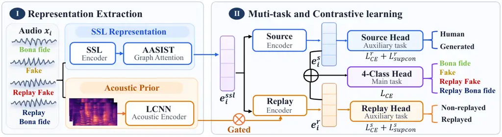
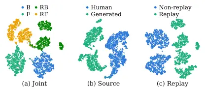
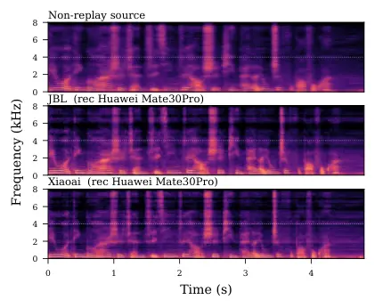

# ReplayFactor: Replay-Aware Dual-Attribute Learning for Practical Speech Deepfake Detection

Miao He    Jiayi Zhou    Yu Zheng    Zhongjie Ba    Peng Cheng    Yuxi
Zhou    Junjie Zhu    Changhao Zhang    Jian Liu

###### Abstract

Advances in synthesis techniques have made deepfake speech increasingly
realistic, amplifying voice security threats, including unauthorized
voice cloning and impersonation. Although existing deepfake detectors
perform well on digitally generated speech, their performance often
degrades on physically replayed deepfakes, which constitute a low-cost
and practical threat to real-world systems. Existing research focuses
primarily on dataset construction and evaluation, while available
dataset diversity and replay-aware detector design remain limited. We
propose ReplayFactor, a dual-attribute framework that enhances replay
evidence by fusing self-supervised learning (SSL) representations with
an acoustic prior, while leveraging multi-task learning and supervised
contrastive learning to promote robust, generalizable representations.
We also construct ReplayFake-CN, a large-scale, multi-device Chinese
dataset comprising approximately 185k replayed synthetic utterances to
complement public benchmarks. Our framework improves macro-F1 from
60.99% to 76.44% and reduces EER from 11.86% to 3.05% on the EchoFake
open set over the baseline, demonstrating strong potential for practical
replayed deepfake detection.

###### Index Terms: 

speech deepfake detection, physical replay, acoustic prior, supervised
contrastive learning

^(†)^(†)address: ¹ The State Key Laboratory of Blockchain and Data
Security, Zhejiang University  
² Hangzhou High-Tech Zone (Binjiang) Institute of Blockchain and Data
Security  
³ Ant Group

## 1 Introduction

Advances in speech synthesis have enabled highly realistic speech
generation, raising concerns about the reliability of voice-based
services and voice impersonation. As a countermeasure, self-supervised
learning (SSL) based speech deepfake detectors have achieved strong
performance on digitally generated speech \[17, 7, 12, 5\], but their
performance often degrades when synthetic speech is played through a
loudspeaker and re-recorded by a microphone \[3\]. Such physical replay
deepfake attacks constitute a low-cost and practical threat to Automatic
Speaker Verification systems in real-word, yet have received limited
research attention.

Physical replay introduces various distortions through the playback
device, acoustic environment, and recording conditions, which can alter
or mask synthesis artifacts \[13\]. These distortions can shift feature
distributions and cause existing detectors to misclassify replayed
synthetic speech as genuine \[3, 13\]. Moreover, Variations in synthesis
models and playback–recording configurations further challenge detection
generalization to unseen conditions \[21\].

Recent works ReplayDF \[13\] and EchoFake \[21\] provide public
benchmarks for replayed synthetic speech, but their coverage of
synthesis methods, replay devices, and languages remains limited.
Evaluations on these benchmarks show that detectors trained on
non-replayed speech can suffer substantial performance degradation under
replay. Even when trained on replayed synthetic speech, detectors still
struggle to generalize to unseen synthesis methods and replay
devices \[21\]. Existing approaches primarily rely on data
augmentation \[3\] or replay simulation \[15\] to improve robustness to
replayed speech, while replay-aware detector design remains
underexplored, especially for cross-condition generalization.

To address these limitations, we propose ReplayFactor, a dual-attribute
framework for replay-aware speech deepfake detection. At the feature
level, we fuse the SSL-based representation with an acoustic prior to
enhance replay cues. For representation learning, it combines multi-task
learning with dual-space supervised contrastive learning to promote the
cross-condition consistency of source and replay attributes and improve
generalization. To complement existing public benchmarks, We also
construct ReplayFake-CN^(\*), a large-scale Chinese dataset comprising
approximately 185k replayed synthetic utterances across 90
playback–recording device pairs. Experiments on EchoFake, ReplayDF, and
ReplayFake-CN validate the effectiveness and generalization of the
proposed framework. On the EchoFake open set, compared with the baseline
reported in EchoFake \[21\], our method improves macro-F1 from 60.99% to
76.44% and reduces EER from 11.86% to 3.05%, demonstrating strong
potential for realistic replayed deepfake detection.

¹¹footnotetext: The full dataset will be released soon at
[https://huggingface.co/datasets/Ahola/ReplayFake-CN](https://huggingface.co/datasets/Ahola/ReplayFake-CN).



Figure 1: Overview of the proposed framework, comprising (I)
Representation extraction with SSL and acoustic-prior fusion; and (II)
multi-task and supervised contrastive learning.

## 2 Related Work

Speech Deepfake Detection. Speech deepfake detection has evolved from
handcrafted acoustic features utilization \[14, 18, 4\], to end-to-end
models such as RawNet2 \[16\] and AASIST \[9\], and more recently to
SSL-based detectors with improved transferability \[17, 7, 12\].
However, most studies focus on non-replay synthetic speech, with limited
attention to realistic scenarios where synthetic speech is physically
replayed \[3\].

Replay-Aware Deepfake Datasets and Detection. ReplayDF \[13\] and
EchoFake \[21\] provide public benchmarks for replayed synthetic speech.
However, ReplayDF covers only a limited set of synthesis methods, while
EchoFake is English-only and includes few replay devices. Neither
benchmark covers Chinese speech or replay through smart wearable devices
such as smart glasses. Existing studies primarily analyze replay-induced
degradation \[3\] or simulate replay effects \[15\], while replay-aware
detector design remains underexplored. Even when detectors are trained
on replayed speech, generalization to unseen synthesis methods and
replay devices remains challenging \[21\]. To address these gaps, we
introduce ReplayFake-CN, a large-scale Chinese dataset of replayed
synthetic speech to complement existing datasets, and propose a
dual-attribute learning framework for replay-aware deepfake detection.

## 3 Proposed Method

### 3.1 Problem Formulation

As illustrated in Fig. 1, each utterance $`x_{i}`$ is assigned with a
label $`y_{i}\in\{B,F,RB,RF\}`$, denoting bona fide, fake, replayed bona
fide, and replayed fake speech, respectively. We factorize $`y_{i}`$
into a source attribute $`y_{i}^{s}`$, distinguishing human speech
$`\{B,RB\}`$ from generated speech $`\{F,RF\}`$, and a replay attribute
$`y_{i}^{r}`$, distinguishing non-replayed speech $`\{B,F\}`$ from
replayed speech $`\{RB,RF\}`$. This factorization enables explicit
learning of each attribute across variations in the other. The framework
consists of two components: (1) _Replay-Aware Feature Fusion_, which
enhances SSL representations with an acoustic prior through gated
fusion; and (2) _Multi-Task and Contrastive Learning_, which jointly
optimizes the four-class main classification task and two auxiliary
attribute tasks, with dual-space contrastive learning to promote source
and replay attribute consistency across diverse conditions.

### 3.2 Replay-Aware Feature Fusion

We first extract a shared representation $`e_{i}^{ssl}`$ using a
pretrained SSL encoder followed by an AASIST graph backend. Then, two
attribute-specific encoders map this representation into a source
embedding $`e_{i}^{s}`$ and a replay embedding
$`e_{i,\mathrm{ssl}}^{r}`$, respectively. The source branch targets
human-versus-generated discrimination, whereas the replay branch targets
non-replayed-versus-replayed discrimination. To strengthen the replay
branch, we further introduce an acoustic prior that complements SSL
representations with low-level replay-sensitive cues, such as subtle
high-frequency differences and channel response distortions \[19, 1\].

Specifically, we used constant-Q cepstral coefficients (CQCCs) as the
acoustic prior, which have been shown to be effective in replay attack
detection \[18, 4\]. We concatenate the static coefficient $`c_{i}`$
with their first- and second-order temporal derivatives and encode them
using an LCNN \[11\]. They are computed as:

```math
\begin{split}c_{i}&=\operatorname{DCT}\!\left(\operatorname{Resample}\left(\log\left(|\operatorname{CQT}(x_{i})|^{2}+\epsilon\right)\right)\right),\\
q_{i}&=[c_{i},\Delta c_{i},\Delta^{2}c_{i}],\quad e_{i}^{a}=\operatorname{LCNN}(q_{i}).\end{split} \tag{1}
```

Here, $`\epsilon`$ is a small constant for numerical stability, and
$`e_{i}^{a}`$ provides the acoustic representation used to enhance the
replay branch.

We fuse the acoustic embedding into the SSL-based replay embedding
through a sample-wise gate:

```math
e_{i}^{r}=e_{i,\mathrm{ssl}}^{r}+g_{i}e_{i}^{a}, \tag{2}
```

where $`g_{i}\in(0,1)`$ adaptively controls the acoustic contribution
for each utterance. This residual formulation retains the SSL-based
representation while incorporating complementary acoustic cues. The
resulting replay embedding $`e_{i}^{r}`$, together with the source
embedding $`e_{i}^{s}`$, is used for the classification and contrastive
objectives below.

### 3.3 Multi-Task and Dual-Space Contrastive Learning

We jointly optimize a four-class classification task and two auxiliary
attribute classification tasks. The main classifier takes the
concatenated representation $`[e_{i}^{s};e_{i}^{r}]`$ to distinguish
$`B`$, $`F`$, $`RB`$, and $`RF`$. The source and replay classifiers take
$`e_{i}^{s}`$ and $`e_{i}^{r}`$, respectively, to predict the
corresponding binary attribute labels $`y_{i}^{s}`$ and $`y_{i}^{r}`$.
Their cross-entropy losses are denoted by
$`\mathcal{L}_{\mathrm{CE}}^{4}`$, $`\mathcal{L}_{\mathrm{CE}}^{s}`$,
and $`\mathcal{L}_{\mathrm{CE}}^{r}`$.

Beyond classification supervision, we further apply supervised
contrastive learning \[10\] separately in the source and replay spaces
to encourage consistency within each attribute. In the source space,
$`B`$ and $`RB`$ share the human label, while $`F`$ and $`RF`$ share the
generated label, encouraging source consistency across diverse replay
states. In the replay space, $`B`$ and $`F`$ share the non-replayed
label, while $`RB`$ and $`RF`$ share the replayed label, encouraging
replay consistency across source types.

For a mini-batch $`\mathcal{B}`$ of size $`N`$, the positive set for
anchor $`i`$ in space $`u\in{s,r}`$ is
$`P_{i}^{u}=\{p\in\mathcal{B}\setminus{i}:y_{p}^{u}=y_{i}^{u}\}`$. Let
$`z_{i}^{u}`$ denote the $`\ell_{2}`$-normalized contrastive
representation in space $`u`$, and define
$`s_{ij}^{u}=(z_{i}^{u})^{\top}z_{j}^{u}/\tau_{u}`$ as the
temperature-scaled cosine similarity, where $`\tau_{u}`$ is the
temperature. The supervised contrastive loss is:

```math
\mathcal{L}_{\mathrm{sup}}^{u}-\frac{1}{N}\sum_{i=1}^{N}\frac{1}{|P_{i}^{u}|}\sum_{p\in P_{i}^{u}}\log\frac{\exp(s_{ip}^{u})}{\sum_{a\in\mathcal{B}\setminus{i}}\exp(s_{ia}^{u})}. \tag{3}
```

The overall training objective is:

```math
\mathcal{L}=\mathcal{L}_{\mathrm{CE}}^{4}+\alpha_{s}\mathcal{L}_{\mathrm{CE}}^{s}+\alpha_{r}\mathcal{L}_{\mathrm{CE}}^{r}+\lambda_{s}\mathcal{L}_{\mathrm{sup}}^{s}+\lambda_{r}\mathcal{L}_{\mathrm{sup}}^{r}. \tag{4}
```

where $`\alpha_{s},\alpha_{r}`$ weight the auxiliary classification
losses and $`\lambda_{s},\lambda_{r}`$ weight the contrastive losses.
Together, these objectives supervise four-class discrimination while
encouraging attribute-specific consistency in the two embedding spaces.

## 4 ReplayFake-CN Dataset

To complement existing public benchmarks \[13, 21\] and systematically
evaluate replay-aware deepfake detection across more synthesis methods
and replay devices, we introduce ReplayFake-CN, a large-scale
multi-device Chinese dataset containing approximately 185k replayed
synthetic utterances (232.5 hours). The source corpus comprises
recordings from 1,921 speakers, while the texts cover daily-life and
payment-related content. We employ 22 state-of-art TTS models to
generate deepfake speech, such as CosyVoice3 \[6\] and LLaSA-1B \[20\],
etc. To simulate practical spoofing scenarios, the generated speech is
physically played through 9 loudspeakers and re-recorded using 8 phones
and 2 smart glasses, yielding 90 playback–recording device pairs. More
details are provided in Table 1. Each utterance is released with
fine-grained metadata, including speaker ID, TTS model, playback and
recording devices, distance, and text. We also provide training,
development, and evaluation protocols, including out-of-domain protocols
with unseen synthesis models, unseen devices, and unseen model–device
combinations, enabling evaluation of cross-domain generalization.

| Variable       | Configuration                                                                                |
| -------------- | -------------------------------------------------------------------------------------------- |
| Data scale     | 184,954 utterances, 232.5 hours                                                              |
| Source speech  | Utterances from 1,921 speakers                                                               |
| Language       | Chinese                                                                                      |
| Text           | Daily-life and payment-related scenarios                                                     |
| TTS models     | 22 models, e.g., CosyVoice3 \[6\], F5-TTS \[2\], Step-Audio \[8\], LLaSA-1B \[20\], and etc. |
| Play devices   | 6 consumer and 3 high-fidelity loudspeakers, e.g., JBL, HP-speaker, Edifier-MR4, etc.        |
| Record devices | 8 phones and 2 smart-glasses, e.g., iPhone, OPPO, HuaweiMate, and Rokid_glasses, etc.        |
| Combinations   | 90 playback–recording device pairs                                                           |
| Distance       | 10, 30, and 50 cm                                                                            |

Table 1: Statistics of ReplayFake-CN.

| Model                              | Test     | EER$`\downarrow`$ | F1-score$`\uparrow`$ |       |        |       |        |
| ---------------------------------- | -------- | ----------------- | -------------------- | ----- | ------ | ----- | ------ |
|                                    |          |                   | macro.               | $`B`$ | $`RB`$ | $`F`$ | $`RF`$ |
| XLSR-Linear ^(†)Reported in \[21\] | Closed   | 0.27              | 98.81                | 99.63 | 98.16  | 99.43 | 98.02  |
|                                    | Open     | 11.86             | 60.99                | 78.83 | 40.13  | 75.64 | 49.34  |
|                                    | ReplayDF | –                 | –                    | –     | 7.72   | –     | 19.02  |
| XLSR-AASIST                        | Closed   | 0.47              | 98.33                | 98.68 | 97.97  | 98.66 | 98.02  |
|                                    | Open     | 8.17              | 56.99                | 86.69 | 19.96  | 71.91 | 49.40  |
|                                    | ReplayDF | –                 | –                    | –     | 7.02   | –     | 13.69  |
| WavLM-Nes2Net                      | Closed   | 1.68              | 76.75                | 78.15 | 66.01  | 84.08 | 78.77  |
|                                    | Open     | 21.72             | 46.13                | 67.84 | 20.45  | 56.81 | 39.42  |
|                                    | ReplayDF | –                 | –                    | –     | 0.82   | –     | 19.75  |
| MMS-Linear                         | Closed   | 0.13              | 97.37                | 99.73 | 94.81  | 99.70 | 95.24  |
|                                    | Open     | 8.09              | 59.80                | 88.09 | 8.79   | 82.99 | 59.34  |
|                                    | ReplayDF | –                 | –                    | –     | 1.97   | –     | 18.26  |
| MMS-AASIST                         | Closed   | 0.54              | 98.40                | 99.30 | 97.59  | 99.17 | 97.53  |
|                                    | Open     | 7.26              | 62.27                | 90.14 | 25.93  | 77.99 | 55.02  |
|                                    | ReplayDF | –                 | –                    | –     | 6.73   | –     | 25.94  |
| Ours                               | Closed   | 0.53              | 97.93                | 99.04 | 97.16  | 98.72 | 96.81  |
|                                    | Open     | 3.05              | 76.44                | 93.91 | 61.12  | 82.01 | 68.72  |
|                                    | ReplayDF | –                 | –                    | –     | 38.31  | –     | 40.32  |

Table 2: Results (%) on EchoFake and ReplayDF. Closed and Open denote
the EchoFake evaluation sets. ReplayDF reports $`RB`$ and $`RF`$ F1
scores from EchoFake-trained models.

|                                                |             |                  |                |                       |
| ---------------------------------------------- | ----------- | ---------------- | -------------- | --------------------- |
| Method                                         | Overall ACC | Unseen Synthesis | Unseen Devices | Unseen Synth.–Devices |
| _Binary public checkpoint: AntiDeepfake \[7\]_ |             |                  |                |                       |
| MMS-300M                                       | 55.43       | 64.04            | 46.63          | 62.98                 |
| MMS-AASIST                                     | 84.22       | 93.97            | 82.59          | 73.30                 |
| Ours                                           | 85.44       | 96.95            | 83.00          | 73.75                 |

Table 3: Accuracy (%) on ReplayFake-CN under unseen conditions. Binary
and four-class models are reported separately.

## 5 Experiments

### 5.1 Experimental Setup

Datasets and Evaluation. We evaluate on EchoFake \[21\],
ReplayDF \[13\], and ReplayFake-CN. For EchoFake, we follow the official
Train, Dev, Eval-closed, and Eval-open splits to assess performance
under both closed and open conditions. For cross-dataset evaluation,
models trained on EchoFake are directly tested on ReplayDF, which
contains only $`RB`$ and $`RF`$. For ReplayFake-CN, we train models
using its $`RF`$ training split together with separate, non-public
internal data from the $`B`$, $`F`$, and $`RB`$ classes, nearly 400k
samples in total. We report $`RF`$ classification accuracy on the
ReplayFake-CN eval split under unseen synthesis models, unseen devices,
and unseen model–device combinations, with the held-out conditions
excluded from all training data. We report F1-score for four-class
classification and binary EER for anti-spoofing, treating $`B`$ as bona
fide and $`{F,RB,RF}`$ as spoofing attacks.

Baselines. We compare with XLSR-Linear (baseline in \[21\]),
XLSR-AASIST \[17\], AntiDeepfake \[7\], and Nes2Net \[12\]. For a fair
comparison, we replace their binary output layer with four-class and
reproduce all methods under the same protocol and settings.

Implementation Details. We use MMS-300M from AntiDeepfake \[7\] as SSL
encoder and fully fine-tune it with an AASIST backend using Adam with a
weight decay of $`10^{-4}`$. The learning rate is $`10^{-6}`$ for SSL
and AASIST, and $`10^{-4}`$ for the LCNN. Each mini-batch contains all
four classes, and the checkpoint with the highest development macro-F1
is selected for evaluation.

### 5.2 Main Results

Performance on public datasets. Table 2 summarizes the results on
EchoFake and ReplayDF. Although our method yields slightly lower
closed-set performance, it achieves substantial gains on the open set.
Compared with XLSR-Linear as reported in EchoFake \[21\], our method
reduces EER from 11.86% to 3.05% and improves macro-F1 from 60.99% to
76.44%, demonstrating stronger generalization to unseen conditions. On
ReplayDF, our method achieves F1 scores of 38.31% and 40.32% for $`RB`$
and $`RF`$, respectively, outperforming the corresponding best baseline
scores of 6.73% and 25.94%. Nevertheless, the cross-dataset performance
remains limited, indicating that generalization across languages,
synthesis methods, and playback devices remains challenging.

Performance on ReplayFake-CN. Table 3 reports results on ReplayFake-CN
under unseen synthesis models, unseen devices, and jointly unseen
synthesis models and devices. The public AntiDeepfake \[7\] checkpoint,
evaluated without fine-tuning, achieves 55.43% low binary detection
accuracy, indicating limited detection effectiveness on ReplayFake-CN.
MMS-AASIST and our method are trained on the same large training set,
comprising the $`RF`$ from ReplayFake-CN training split and separate
internal $`B`$, $`F`$, and $`RB`$ data. Our method consistently
outperforms MMS-AASIST across all three protocols, improving overall
$`RF`$ classification accuracy from 84.22% to 85.44%. The largest gain
is observed under unseen synthesis models, increasing from 93.97% to
96.95%, while accuracy reaches 83.00% and 73.75% under unseen devices
and jointly unseen conditions, indicating that device-related domain
shifts remain challenging. The modest overall gain may partly reflect
the substantially larger training set (400k vs 40k samples on EchoFake),
which could strengthen the baseline and leave less room for additional
gains from model design. Our method nevertheless provides consistent
improvements in this setting and achieves larger gains in the
smaller-training-set EchoFake experiments (Table 2).

### 5.3 Ablation Study

Table 4 conducts an ablation study on the EchoFake open set. We first
compare our model with a four-class baseline using the same MMS-AASIST
backbone, and then remove individual components from the full model. The
_w/o acoustic prior_ variant removes the acoustic prior and gated
fusion, while _w/o SupCon_ removes the dual-space contrastive learning.
Finally, _w/o 4-class head_ retains the two attribute heads but removes
the 4-class head.

|                    |                   |                      |       |        |       |        |
| ------------------ | ----------------- | -------------------- | ----- | ------ | ----- | ------ |
| Configuration      | EER$`\downarrow`$ | F1-score$`\uparrow`$ |       |        |       |        |
|                    |                   | macro-F1             | $`B`$ | $`RB`$ | $`F`$ | $`RF`$ |
| 4-class baseline   | 7.26              | 62.27                | 90.14 | 25.93  | 77.99 | 55.02  |
| Ours (full)        | 3.05              | 76.44                | 93.91 | 61.12  | 82.01 | 68.72  |
| w/o acoustic prior | 8.11              | 73.54                | 89.07 | 61.44  | 84.28 | 59.37  |
| w/o SupCon         | 2.70              | 73.89                | 93.82 | 50.77  | 82.85 | 68.14  |
| w/o 4-class head   | 4.31              | 69.22                | 94.84 | 32.97  | 84.03 | 65.03  |

Table 4: Ablation results on the EchoFake open set (%).

The full model reduces EER from 7.26% to 3.05% and improves macro-F1
from 62.27% to 76.44% over the 4-class baseline, demonstrating the
overall benefit of dual-attribute auxiliary learning. Removing the
acoustic prior increases EER to 8.11% with obvious drop of F1 score on
$`RF`$, suggesting that low-level acoustic prior contributes
replay-sensitive evidence beyond SSL features. Removing SupCon slightly
lowers EER but reduces macro-F1 to 73.89%, mainly due to the drop in
$`RB`$ F1, suggesting that it helps maintain source–replay attribute
consistency for this challenging class. Finally, removing the 4-class
head causes the largest macro-F1 drop, suggesting that joint supervision
task complements the two attribute tasks by capturing source–replay
interactions.

### 5.4 Further Analysis



Figure 2: t-SNE visualizations on the EchoFake closed set: (a) joint,
(b) source, and (c) replay representations.

Representation Visualization. Figure 2 presents t-SNE visualizations on
the EchoFake closed set. The representations exhibit clear overall
separation among the joint four classes, as well as source and replay
attribute spaces. Nevertheless, slight overlap remains between $`RB`$
and $`RF`$ in the joint space, suggesting that distinguishing human from
synthetic speech under physical replay remains challenging.



Figure 3: Spectrograms of the original non-replay utterance (top) and
its replays through JBL (middle) and Xiaoai (bottom) loudspeakers, both
recorded with a Huawei Mate30Pro phone.

Replay Effect Analysis. We also analyze replay effects across playback
devices, recording devices, and TTS systems. As shown in Fig. 3, the
same utterance played by the JBL and Xiaoai loudspeaker exhibits
distinct patterns of high-frequency attenuation, particularly above
4 kHz, suggesting that replay affects high-frequency energy differently
across loudspeakers. Beyond the illustrated examples, we further observe
that recording devices also introduce different spectral distortions,
with smart glasses tending to exhibit greater frequency-response
distortion than smartphones. Moreover, synthesis artifacts from
different TTS models are affected by replay to varying degrees. These
observations highlight the need for future research to jointly consider
device and synthesis characteristics when developing robust replay-aware
deepfake detectors.

## 6 Conclusion

In this paper, we propose a dual-attribute learning framework for
replay-aware speech deepfake detection that explicitly learns source and
replay attributes by enhancing SSL representations with an acoustic
prior and combining multi-task learning with supervised contrastive
learning. We also construct ReplayFake-CN, a large-scale Chinese dataset
covering diverse synthesis methods and replay devices, to broaden
existing datasets and support our evaluation of cross-condition
generalization, facilitating future research. Experiments on two public
datasets and ReplayFake-CN validate the effectiveness of our framework,
highlighting its potential for replayed deepfake attack detection in
realistic scenarios.

## References

- \[1\] A. R. Avila, J. Alam, D. O’Shaughnessy, and T. H. Falk (2019)
  Blind channel response estimation for replay attack detection. In
  Proceedings of Interspeech, pp. 2893–2897. External Links:
  [Document](https://dx.doi.org/10.21437/Interspeech.2019-2956) Cited
  by: §3.2.
- \[2\] Y. Chen, Z. Niu, Z. Ma, K. Deng, C. Wang, J. JianZhao, K. Yu,
  and X. Chen (2025) F5-tts: a fairytaler that fakes fluent and faithful
  speech with flow matching. In Proceedings of the 63rd Annual Meeting
  of the Association for Computational Linguistics (ACL), pp. 6255–6271.
  Cited by: Table 1.
- \[3\] H. Delgado, G. Ramondetti, E. Dalmasso, G. Karvitsky, D.
  Colibro, and H. Talib (2026) On deepfake voice detection-it’s all in
  the presentation. In Proceedings of the IEEE International Conference
  on Acoustics, Speech and Signal Processing (ICASSP), pp. 16242–16246.
  Cited by: §1, §1, §1, §2, §2.
- \[4\] H. Delgado, M. Todisco, M. Sahidullah, N. Evans, T.
  Kinnunen, K. A. Lee, and J. Yamagishi (2018) ASVspoof 2017 version
  2.0: meta-data analysis and baseline enhancements. In Proceedings of
  the Speaker and Language Recognition Workshop (Odyssey), pp. 296–303.
  External Links:
  [Document](https://dx.doi.org/10.21437/Odyssey.2018-42) Cited by: §2,
  §3.2.
- \[5\] S. Dowerah, A. Kulkarni, A. Kulkarni, H. M. Tran, J. Kalda, A.
  Fedorchenko, B. Fauve, D. Lolive, T. Alumäe, and M. M. Doss (2026)
  Speech df arena: a leaderboard for speech deepfake detection models.
  IEEE Open Journal of Signal Processing (OJSP). Cited by: §1.
- \[6\] Z. Du, C. Gao, Y. Wang, F. Yu, T. Zhao, H. Wang, X. Lv, H.
  Wang, C. Ni, X. Shi, et al. (2025) Cosyvoice 3: towards in-the-wild
  speech generation via scaling-up and post-training. arXiv preprint
  arXiv:2505.17589. Cited by: Table 1, §4.
- \[7\] W. Ge, X. Wang, X. Liu, and J. Yamagishi (2025) Post-training
  for deepfake speech detection. In IEEE Automatic Speech Recognition
  and Understanding Workshop (ASRU), pp. 1–8. Cited by: §1, §2, Table 3,
  §5.1, §5.1, §5.2.
- \[8\] A. Huang, B. Wu, B. Wang, C. Yan, C. Hu, C. Feng, F. Tian, F.
  Shen, J. Li, M. Chen, et al. (2025) Step-audio: unified understanding
  and generation in intelligent speech interaction. arXiv preprint
  arXiv:2502.11946. Cited by: Table 1.
- \[9\] J. W. Jung, H. S. Heo, H. Tak, H. J. Shim, J. S. Chung, B.
  Lee, H. Yu, and N. Evans (2022) AASIST: audio anti-spoofing using
  integrated spectro-temporal graph attention networks. In Proceedings
  of the IEEE International Conference on Acoustics, Speech and Signal
  Processing (ICASSP), pp. 2405–2409. Cited by: §2.
- \[10\] P. Khosla, P. Teterwak, C. Wang, A. Sarna, Y. Tian, P.
  Isola, A. Maschinot, C. Liu, and D. Krishnan (2020) Supervised
  contrastive learning. Advances in neural information processing
  systems (NeurIPS) 33, pp. 18661–18673. Cited by: §3.3.
- \[11\] H. Kotta, A. T. Patil, R. Acharya, and H. A. Patil (2020)
  Subband channel selection using TEO for replay spoof detection in
  voice assistants. In Asia-Pacific Signal and Information Processing
  Association Annual Summit and Conference (APSIPA ASC), pp. 538–542.
  Cited by: §3.2.
- \[12\] T. Liu, D. Truong, R. K. Das, K. A. Lee, and H. Li (2025)
  Nes2net: a lightweight nested architecture for foundation model driven
  speech anti-spoofing. IEEE Transactions on Information Forensics and
  Security (TIFS) 20, pp. 12005–12018. Cited by: §1, §2, §5.1.
- \[13\] N. Müller, P. Kawa, W. Choong, A. Stan, A. T. Bukkapatnam, K.
  Pizzi, A. Wagner, and P. Sperl (2025) Replay attacks against audio
  deepfake detection. In Proceedings of Interspeech, pp. 2245–2249.
  Cited by: §1, §1, §2, §4, §5.1.
- \[14\] Md. Sahidullah, T. Kinnunen, and C. Hanilçi (2015) A comparison
  of features for synthetic speech detection. In Proceedings of
  Interspeech, pp. 2087–2091. Cited by: §2.
- \[15\] J. C. Sanchez-Valera, A. M. Peinado, J. M. Martin-Doñas, A.
  Gomez-Alanis, A. M. Gomez, and M. Todisco (2026) RIRplay: generation
  of a replay stereo corpus for voice biometrics anti-spoofing. IEEE
  Transactions on Information Forensics and Security (TIFS). Cited by:
  §1, §2.
- \[16\] H. Tak, J. Patino, M. Todisco, A. Nautsch, N. Evans, and A.
  Larcher (2021) End-to-end anti-spoofing with rawnet2. In Proceedings
  of the IEEE International Conference on Acoustics, Speech and Signal
  Processing (ICASSP), pp. 6369–6373. Cited by: §2.
- \[17\] H. Tak, M. Todisco, X. Wang, J. Jung, J. Yamagishi, and N.
  Evans (2022) Automatic speaker verification spoofing and deepfake
  detection using wav2vec 2.0 and data augmentation. arXiv preprint
  arXiv:2202.12233. Cited by: §1, §2, §5.1.
- \[18\] M. Todisco, H. Delgado, and N. Evans (2016) A new feature for
  automatic speaker verification anti-spoofing: constant Q cepstral
  coefficients. In Proceedings of the Speaker and Language Recognition
  Workshop (Odyssey), pp. 283–290. External Links:
  [Document](https://dx.doi.org/10.21437/Odyssey.2016-41) Cited by: §2,
  §3.2.
- \[19\] M. Witkowski, S. Kacprzak, P. Żelasko, K. Kowalczyk, and J.
  Gałka (2017) Audio replay attack detection using high-frequency
  features. In Proceedings of Interspeech, pp. 27–31. External Links:
  [Document](https://dx.doi.org/10.21437/Interspeech.2017-776) Cited by:
  §3.2.
- \[20\] Z. Ye, X. Zhu, C. Chan, X. Wang, X. Tan, J. Lei, Y. Peng, H.
  Liu, Y. Jin, Z. Dai, et al. (2025) Llasa: scaling train-time and
  inference-time compute for llama-based speech synthesis. arXiv
  preprint arXiv:2502.04128. Cited by: Table 1, §4.
- \[21\] T. Zhang, Y. Huang, and Y. Ren (2026) EchoFake: a replay-aware
  dataset for practical speech deepfake detection. In Proceedings of the
  IEEE International Conference on Acoustics, Speech and Signal
  Processing (ICASSP), pp. 15502–15506. Cited by: §1, §1, §1, §2, Table
  2, §4, §5.1, §5.1, §5.2.
