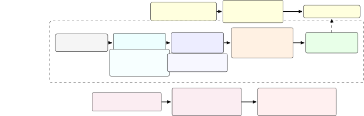

# NepTTS-Bench: Native-Speaker Benchmarking and NepaliMOS for Nepali Text-to-Speech

Ashish Thapa Affiliation: Ampixa Labs Email: ashish@ampixa.com    Rupak
Ghimire Affiliation: Kathmandu University Email: rupakghimire@gmail.com
   Lekhnath Sharma Pathak Affiliation: Central Department of Linguistics
Tribhuvan University Email: lekhnath.pathak@cdl.tu.edu.np

###### Abstract

Nepali TTS has reached a point where multiple systems are available, but
there is no shared evaluation to compare them. NepTTS-Bench was created
to address what existing automated and manual evaluation systems lack
for Nepali TTS. A controlled benchmark with phonological grounding which
contains 205 sentences (77 minimal pairs targeting aspiration,
retroflex/dental contrasts, nasalization, gemination, and schwa
deletion) which is rated by 180 speakers. There are 6,962 ratings for 10
TTS configurations and two human references. Along with this 7 ASR
systems were evaluated for round-trip CER. SCOREQ was also run as an
automated baseline. The key finding is that automated evaluation like
SCOREQ prefers proprietary systems like ElevenLabs but native listeners
prefer Piper. This is contributed by the fact that most of the systems
not properly tuned for Nepali tend to show Hindi phonological behaviour
and our minimal pairs are designed to surface such contrasts. We also
present NepaliMOS predictor which is fine tuned on collected ratings.
NepaliMOS achieves system-level $`\rho=0.90`$ on the dense panel but
drops to utterance-level $`\rho=0.43`$ under leave-one-system-out
evaluation. This is statistically significant and confirms that
NepaliMOS captures genuine signal but cross-provider transfer is
limited. A human calibration is recommended for new systems for which we
release a Python evaluation package for practitioners to run the
benchmark against new systems.

## I Introduction

Nepali TTS are available through open models and commercial APIs, but we
don’t have a proper framework to compare them on nepali prompts based on
native judgements. Systems designed for English do not transfer cleanly,
and published evaluations have never shared a common test set, a common
listener pool, or a common protocol. Among the different papers
examined, the numbers don’t line up. There is no shared benchmark that
captures language-specific pronunciation errors with native-speaker
ratings attached. MOS depends on its protocol \[5\]. The listener pool,
interface design, and test material all shift the result. Without a
common setting, it is not possible to tell whether a gap between two
reported scores is real or an artifact of how the studies were run.

NepTTS-Bench is our answer to this. It has 205 Nepali sentences, 77 of
which are minimal pairs targeting aspiration, retroflex and dental
contrasts, nasalization, gemination, and schwa deletion. The remaining
58 cover prosodic variation, homographs, code-mixed text, and other
cases that matter in practice. Audio from 40 named systems or voices is
rated under one controlled protocol by 180 native Nepali speakers. An
evaluation CLI and rating web app will be released with the data upon
acceptance. Which signals can actually be trusted for Nepali TTS
evaluation, and where do they break down?

NepTTS-Bench is the infrastructure for the whole judgement pipeline. The
contribution here is the evaluation setting: phonologically motivated
prompts, native-speaker MOS under one protocol across proprietary, open,
and reference conditions, an analysis of where automated metrics diverge
from native-speaker judgment, and NepaliMOS — a Nepali-supervised MOS
predictor with its practical limits tested and reported directly.

## II Related Work

MOS is the standard subjective measure for TTS naturalness and quality
\[25, 5\]. Shared tasks such as VoiceMOS encouraged automated MOS
prediction with systems such as UTMOS \[10, 21\]. Recent no-reference
quality models, including SCOREQ \[19\] and DNSMOS \[20\], are useful
general tools, but their validation is dominated by higher-resource
settings. ASR round-trip evaluation is a complementary intelligibility
proxy; TTSDS2 shows that ASR and metric choice can change TTS rankings
\[16\]. For Nepali, this prior work suggests that metric behavior should
be reported as evidence.

Nepali TTS has moved from rule-based and concatenative work to neural
systems. Early systems include ESNOLA synthesis \[3\], TD-PSOLA work
\[15\], and FreeTTS/formant-style approaches \[22\]. The Bhasa
Sanchar/Festival line focused on unit selection, corpus design, and
preprocessing/postprocessing for quality \[9, 1\]. Open low-resource
voice-building efforts also included Nepali \[24\]. Recent Nepali work
uses Tacotron2, FastPitch/HiFi-GAN, FastSpeech/MelGAN, vocoder
comparisons, and few-shot voice cloning \[12, 7, 14, 6, 23\]. These show
that Nepali neural TTS is feasible, but they do not provide a reusable
native-speaker benchmark across current proprietary and open systems.

Nepali speech resources and ASR systems provide useful infrastructure
for round-trip evaluation. FLEURS covers Nepali in a multilingual speech
benchmark \[4\], XLS-R checkpoints have been fine-tuned for Nepali ASR
\[8\], and NepConformer gives a recent Conformer-based Nepali ASR
baseline \[18\]. Our target is TTS benchmarking: controlled Nepali
prompts with native MOS ratings, cross-category system comparison, and a
language-matched quality predictor tested against the native ratings we
collected.

## III Methodology

### III-A Benchmark Dataset Preparation

The benchmark contains 205 sentences informed by Nepali phonology \[13,
17, 2\]. Its core is 147 sentences arranged into 77 minimal pairs. These
pairs test contrasts that matter for intelligibility and perceived
accent in Nepali TTS: laryngeal contrast across stop and affricate
series, retroflex/dental opposition, oral/nasal vowel contrasts,
gemination, and schwa deletion. The remaining 58 sentences cover a range
of non-minimal-pair cases: question intonation, emotion, contrastive
stress, homographs, code-mixed robustness sentences, tongue twisters,
newspaper text, and common phrases.

Sentence preparation was an engineering audit rather than a formal
phonological validation. Each minimal pair candidate was checked for
grammaticality and spelling; we also verified that the target contrast
was isolated and not confounded by other differences. Twelve pairs were
replaced and six corrected. We treat the resulting set as phonologically
motivated test material. It is not a validated account of the Nepali
phonological system, and we do not claim it as one \[5\].

### III-B NepaliMOS Architecture

NepaliMOS exists because we discovered early that running SCOREQ alone
penalizes nothing on signal cleanliness without flagging pronunciation
errors that native listeners immediately notice. SCOREQ training cannot
detect vowels and aspiration in Hindi accents, but Nepali listeners
capture them. The purpose of NepaliMOS is to test whether
Nepali-specific supervision can recover those native speaker preferences
better than general-purpose metrics. It is not a replacement for human
evaluation on systems outside the training distribution.

Figure 1 summarizes the architecture and validation protocol. The model
fine-tunes IndicWav2Vec base \[11\]. Audio is encoded by the SSL
backbone, frame representations are mean-pooled, and a two-layer
regression head maps $`768\rightarrow 256\rightarrow 1`$ with ReLU and
dropout 0.1. The top four transformer layers are unfrozen and lower
backbone layers remain frozen. The training target is the audio-level
mean MOS label for each unique TTS clip, and training uses MSE loss. The
final matched set contains 1,697 unique TTS clips aggregated from 5,865
matched-audio ratings, 5,804 of them from native-speaker registrations.
The main checkpoint uses a stratified 90/10 utterance-level split,
giving 1,530 training clips and 167 held-out validation clips. The
prediction head has 197k parameters and the unfrozen backbone has 28.4M
trainable parameters. We use differential learning rates ($`10^{-4}`$
for the head, $`10^{-5}`$ for the unfrozen backbone), dropout, batch
size 2, and best-validation-loss checkpoint selection. To test whether
NepaliMOS works on a provider it has not seen before, we also run
leave-one-system-out validation: all clips from one TTS system are
removed from training and used only for testing.

Fig. 1: NepaliMOS architecture and evaluation protocol. The implemented
checkpoint is an audio-only MOS predictor: Nepali TTS audio is encoded
with IndicWav2Vec, pooled to a clip representation, and mapped to a
scalar MOS by a lightweight regression head. Supervision is the
clip-level mean of native-speaker MOS ratings, optimized with MSE. The
utterance split measures within-panel prediction, while
leave-one-system-out (LOSO) validation tests transfer to systems unseen
during training and motivates human calibration for new providers.

## IV Experiments

The full deployed corpus contains audio for 40 named systems or voices.
The main statistical panel is smaller by design: it uses the 10 TTS
configurations with dense, comparable rating coverage, plus two human
reference conditions. On the proprietary side, this panel covers
ElevenLabs v3, Google Gemini Flash, Microsoft Edge TTS (two voices:
Sagar and Hemkala), TingTing.io (three voices: Asmita, Subina,
Sambriddhi), and gTTS. Piper is the open/local representative, evaluated
as a VITS-based system. Human read speech and natural speech were
blinded and included as references. Gemini required special handling:
raw Devanagari input often produces Hindi-accented output, so we
evaluated it in two modes and label the default-input variant “Gemini
(Hindi)” to reflect this.

The remaining generated systems are pilot and screening material, not
full statistical conditions. These span a wide range: SpeechT5
checkpoints from several contributors, eSpeak, MMS-TTS, VITS and VITS2
Nepali checkpoints, VoxCPM-family variants, multiple Parler-TTS Nepali
fine-tunes, and internal voice experiments. Some have full prompt
coverage but only sparse ratings; the newest have between two and 41
rated prompts. They are kept separate from the main MOS confidence
intervals but remain part of the public release.

Native Nepali speakers rated blinded audio on a 1–5 MOS scale through a
web application. Raters received balanced randomized samples across
systems and never saw system identity. Same-sentence stimuli were spaced
at least three positions apart. We report this setup because subjective
synthetic-speech scores are protocol-dependent and should not be
compared as if they were absolute system properties \[5\].

ASR round-trip CER was computed with Google Chirp 2, Meta mms-1b-all,
XLS-R Nepali, NepConformer CTC-BPE \[18\], Whisper-small, Whisper
large-v2, and Whisper large-v3-turbo. Whisper large-v3-turbo is retained
only as a negative-finding run because of hallucination. SCOREQ is run
as an external no-reference quality metric \[19\]. Human MOS confidence
intervals use 95% cluster bootstrap over raters with 2,000 resamples. We
report Spearman’s $`\rho`$ for ranking agreement, Benjamini–Hochberg
correction for automated-metric tests, and Krippendorff’s $`\alpha`$ on
the rater-by-sample matrix.

## V Results and Discussion

| System           | Access     | MOS  | 95% CI        | $`n`$ | System              | Access | MOS  | 95% CI        | $`n`$ |
| ---------------- | ---------- | ---- | ------------- | ----- | ------------------- | ------ | ---- | ------------- | ----- |
| Natural speech   | Ref.       | 3.95 | \[3.79,4.15\] | 597   | Gemini (Hindi)      | Prop.  | 3.34 | \[3.15,3.53\] | 514   |
| Human (read)     | Ref.       | 3.64 | \[3.44,3.82\] | 552   | Gemini Flash        | Prop.  | 3.25 | \[2.90,3.68\] | 618   |
| TingTing Asmita  | Prop.      | 3.55 | \[3.27,3.88\] | 651   | TingTing Sambriddhi | Prop.  | 3.20 | \[2.91,3.55\] | 617   |
| Piper            | Open/local | 3.50 | \[3.31,3.69\] | 515   | gTTS                | Prop.  | 2.60 | \[2.38,2.83\] | 510   |
| TingTing Subina  | Prop.      | 3.47 | \[3.24,3.79\] | 644   |                     |        |      |               |       |
| ElevenLabs v3    | Prop.      | 3.47 | \[3.28,3.66\] | 516   |                     |        |      |               |       |
| Edge TTS Sagar   | Prop.      | 3.38 | \[3.02,3.77\] | 609   |                     |        |      |               |       |
| Edge TTS Hemkala | Prop.      | 3.37 | \[3.10,3.67\] | 619   |                     |        |      |               |       |

TABLE I: Human MOS ratings from 180 contributing native Nepali speakers.
Confidence intervals are 95% cluster-bootstrap intervals over raters.

Table I tells a cleaner story about the bottom than the top. gTTS sits
clearly below every other system; that gap is real. What is less clear
is any ordering within the top cluster, where the confidence intervals
overlap for most systems and the data do not support naming a single
winner. Nepali-specific, cloud, and open-source systems can all be
competitive here. The low inter-rater agreement (Krippendorff’s
$`\alpha=0.17`$) is part of that result, not a flaw to set aside. It
limits how precisely any protocol can rank systems that are close in
quality \[5\], which is relevant context for anyone interpreting these
scores.

The metric disagreements are informative. A generic no-reference quality
model and ASR-based intelligibility both reward clean,
easy-to-transcribe audio. Native listeners care about more than that:
accent, rhythm, and Nepali-specific phonological realizations all factor
in, and those are not what SCOREQ or Whisper was trained to detect.
Table II shows NepaliMOS as the only metric that survives
Benjamini-Hochberg correction at $`n=9`$ systems. Among the ASR metrics,
Chirp 2 and MMS give the most useful round-trip signal, but with nine
systems there is not enough statistical power to separate them. The
modest $`\rho=0.40`$ for SCOREQ is worth flagging: signal-level quality
alone is an unreliable proxy for what Nepali listeners actually judge.

| Metric               | $`\rho`$ vs. human MOS | Raw $`p`$ |
| -------------------- | ---------------------- | --------- |
| NepaliMOS (ours)     | 0.90                   | 0.001     |
| Chirp 2 CER          | 0.60                   | 0.09      |
| MMS CER              | 0.58                   | 0.10      |
| XLS-R Nepali CER     | 0.53                   | 0.14      |
| SCOREQ               | 0.40                   | 0.29      |
| NepConformer CER     | 0.30                   | 0.43      |
| Whisper large-v2 CER | 0.22                   | 0.58      |
| Whisper-small CER    | 0.17                   | 0.67      |

TABLE II: Agreement between automated metrics and human MOS over the
nine systems with automated coverage. CER metrics are ranked with lower
CER as better.

The divergence is sharpest at the extremes. Proprietary APIs like
ElevenLabs should have won: it scores highest on SCOREQ but native
listeners did not prefer it. ElevenLabs v3 leads on SCOREQ (rank 1) but
places fourth when sorted by human MOS. Piper runs the other direction:
SCOREQ ranks it eighth, yet native listeners rated it second. Gemini
Flash adds a third pattern. It has the best Whisper-small CER in the
panel, and competitive CER under Chirp 2 and MMS too, yet its human MOS
still falls below the top systems. A system can be easy for ASR to
transcribe while not sounding right to Nepali listeners — and that gap
is itself a diagnostic the benchmark is designed to surface.

Whisper large-v3-turbo is a negative finding worth documenting. Among
the nine TTS systems, 2% to 10% of files hit $`\text{CER}>1.0`$, with
individual cases of Edge TTS Hemkala reaching CER 186 and gTTS reaching
CER 1,115. These are illusions rather than transcription errors: the ASR
system produces believable Nepali text that is independent of the input
audio. Median CER is far lower, so naive per-system averages get pulled
upward by rare but extreme hallucinations. We exclude it from the main
automated table. For Nepali round-trip work, hallucination filtering is
not optional with this model.

NepaliMOS shows that language-matched supervision helps, but the effect
has limits that matter in practice. On a random 90/10 utterance split
within the dense panel, it reaches $`\rho=0.59`$ at utterance level and
$`\rho=0.90`$ at system level against human MOS. Those numbers look
strong, but they are in-distribution: the model has seen clips from
every system in the test set. Leave-one-system-out testing tells a
different story. When all clips from one TTS system are removed from
training and reserved for testing, utterance-level transfer drops to
$`\rho=0.43`$ and held-out system means are not ranked reliably. LOSO
results show that NepaliMOS transfers poorly to unseen providers, and
that was not expected. That is the relevant test for anyone wanting to
apply NepaliMOS to a new provider. For that use case, a small human
calibration set should come first. Uncertainty-aware prediction,
attentive pooling, and ranking-aware training objectives are all worth
exploring in future work; none of these are part of the current
checkpoint.

Post-analysis pilots on the wider 40-system release, including
VoxCPM-family models and Dragneel Nepali Whisper ASR checks, were also
run. These are not part of the main statistical claims because their
rating coverage is sparse and not directly comparable to the dense
panel. They are useful for triage. One pattern that shows up repeatedly:
unsupported multilingual speech models can produce output that looks
fluent in text but is unusable as Nepali audio. The benchmark is
designed to surface exactly that kind of divergence.

## VI Conclusion

NepTTS-Bench is a shared evaluation setting for Nepali TTS: 205 prompts
with 77 minimal pairs, audio from 40 named systems or voices, dense MOS
data from 180 native speakers across 10 TTS configurations and two human
references, ASR round-trip CER from seven models, SCOREQ output, and
NepaliMOS. The most valid conclusions that can be drawn from the human
data are comparative. Inter-rater agreement at 0.17 shows that native
listeners have genuinely varied opinions on TTS. The scores for several
current systems fall within confidence intervals of each other, and with
Krippendorff’s $`\alpha=0.17`$, this protocol does not have enough
resolution to completely separate them.

Automated metrics are useful, but only partially. SCOREQ and ASR-CER can
help diagnose certain failure modes and should not be ignored. They are
not a replacement for native speaker MOS, and the ASR model you choose
affects which systems are ranked where. Of the seven ASR systems we
tested, Chirp 2 and MMS matched human scores best. NepConformer is the
only Nepali-trained ASR in the set and works well as a baseline, but
does not outperform Chirp 2 or MMS here. Whisper large-v3-turbo requires
hallucination filtering to be usable on Nepali at all. NepaliMOS has the
strongest automatic signal on the dense panel, but LOSO testing shows
that human calibration is needed before use with a new provider. The
core output is the benchmark package itself. Upon acceptance, it will
include Nepali prompts, native speaker ratings, generated audio, an
evaluation CLI, and NepaliMOS as a language-matched quality predictor
whose limits are measured and reported.

## AI-Generated Content Disclosure

Generative AI tools were used solely for language polishing and editing
during the preparation of this manuscript. These tools assisted with
improving clarity, grammar, and conciseness of the writing. No
generative AI system was used to generate experimental results,
analyses, figures, or scientific conclusions. All technical content,
experiments, and interpretations were developed and verified by the
authors.

## References

- \[1\] R. Bajracharya, S. Regmi, B. K. Bal, and B. Prasain (2018)
  Building a natural sounding text-to-speech system for the Nepali
  language – research and development challenges and solutions. In
  Proceedings of the 6th Workshop on Spoken Language Technologies for
  Under-Resourced Languages, pp. 152–156. External Links:
  [Document](https://dx.doi.org/10.21437/SLTU.2018-32) Cited by: §II.
- \[2\] C. Bandhu et al. (1971) A syntactic analysis of Nepali. Summer
  Institute of Linguistics. Cited by: §III-A.
- \[3\] B. Chettri and K. B. Shah (2013) Nepali text to speech synthesis
  system using ESNOLA method of concatenation. International Journal of
  Computer Applications 62 (2), pp. 24–28. External Links:
  [Document](https://dx.doi.org/10.5120/10053-4909) Cited by: §II.
- \[4\] A. Conneau, M. Ma, S. Khanuja, Y. Zhang, V. Axelrod, S.
  Dalmia, J. Riesa, C. Rivera, and A. Bapna (2022) FLEURS: few-shot
  learning evaluation of universal representations of speech. In IEEE
  Spoken Language Technology Workshop (SLT), Note: arXiv:2205.12446
  Cited by: §II.
- \[5\] E. Cooper, W. Huang, Y. Tsao, H. Wang, T. Toda, and J.
  Yamagishi (2024) A review on subjective and objective evaluation of
  synthetic speech. Acoustical Science and Technology 45 (4),
  pp. 161–183. External Links:
  [Document](https://dx.doi.org/10.1250/ast.e24.12) Cited by: §I, §II,
  §III-A, §IV, §V.
- \[6\] G. Bdr. Dhakal Chhetri, K. C. Dahal, and P. Poudyal (2025)
  Impacts of vocoder selection on Tacotron-based Nepali text-to-speech
  synthesis. In Proceedings of the First Workshop on Challenges in
  Processing South Asian Languages (CHiPSAL 2025), Abu Dhabi, UAE,
  pp. 185–192. External Links:
  [Link](https://aclanthology.org/2025.chipsal-1.18/) Cited by: §II.
- \[7\] I. Dongol and B. K. Bal (2023) Transformer-based Nepali
  text-to-speech. In Proceedings of the 20th International Conference on
  Natural Language Processing, Goa University, Goa, India, pp. 651–656.
  External Links: [Link](https://aclanthology.org/2023.icon-1.64/) Cited
  by: §II.
- \[8\] Gagan (2023) Wav2Vec2-XLS-R fine-tuned for Nepali ASR. Note:
  https://huggingface.co/gagan3012/wav2vec2-xlsr-nepali Cited by: §II.
- \[9\] R. R. Ghimire and B. K. Bal (2017) Enhancing the quality of
  Nepali text-to-speech systems. In Creativity in Intelligent
  Technologies and Data Science, A. Kravets, M. Shcherbakov, M.
  Kultsova, and P. Groumpos (Eds.), Communications in Computer and
  Information Science, Vol. 754, pp. 187–197. External Links:
  [Document](https://dx.doi.org/10.1007/978-3-319-65551-2%5F14) Cited
  by: §II.
- \[10\] W. Huang, E. Cooper, Y. Tsao, H. Wang, T. Toda, and J.
  Yamagishi (2022) The VoiceMOS challenge 2022. In Proc. Interspeech
  2022, pp. 4536–4540. External Links:
  [Document](https://dx.doi.org/10.21437/Interspeech.2022-970) Cited by:
  §II.
- \[11\] T. Javed, S. Doddapaneni, A. Bali, et al. (2022) IndicWav2Vec:
  exploring Wav2Vec 2.0 for Indian languages. In Proc. ICASSP,
  pp. 8337–8341. Cited by: §III-B.
- \[12\] S. Khadka, R. G.C., P. Paudel, R. Shah, and B. Joshi (2023)
  Nepali text-to-speech synthesis using Tacotron2 for melspectrogram
  generation. In Proceedings of the 2nd Annual Meeting of the ELRA/ISCA
  Special Interest Group on Under-resourced Languages, pp. 73–77.
  External Links: [Document](https://dx.doi.org/10.21437/SIGUL.2023-16)
  Cited by: §II.
- \[13\] R. Khatiwada (2009) Nepali. Journal of the International
  Phonetic Association 39 (3), pp. 373–380. Note: Illustration of the
  IPA Cited by: §III-A.
- \[14\] A. Lamichhane, B. Joshi, and B. Sthapit (2023) Nepali
  text-to-speech using FastSpeech and MelGAN model. In Proceedings of
  the 14th IOE Graduate Conference, pp. 313–317. External Links:
  [Link](https://conference.ioe.edu.np/publications/ioegc14/IOEGC-14-046-C3-3-435.pdf)
  Cited by: §II.
- \[15\] P. Malla (2015) Nepali text to speech using time domain pitch
  synchronous overlap add method. Master’s Thesis, Pulchowk Campus,
  Tribhuvan University. External Links:
  [Link](https://elibrary.tucl.edu.np/items/0d3d13ba-e108-4b6f-80d7-20adc0bfa4ea)
  Cited by: §II.
- \[16\] C. Minixhofer, O. Klejch, and P. Bell (2025) TTSDS2: robust
  objective evaluation for human-quality synthetic speech. In Proc. 13th
  Speech Synthesis Workshop, pp. 68–75. External Links:
  [Document](https://dx.doi.org/10.21437/SSW.2025-11) Cited by: §II.
- \[17\] M. P. Pokharel (1989) Nepali linguistics (in nepali). Royal
  Nepal Academy. Cited by: §III-A.
- \[18\] J. Poudel, A. Dahal, R. K. Sharma, R. Tiwari, R. R. Ghimire,
  and B. K. Bal (2026) NepConformer: a conformer-based Nepali automatic
  speech recognition system. In Computing and Machine Learning, J. C.
  Bansal, S. Borah, S. Hussain, and S. Salhi (Eds.), Lecture Notes in
  Networks and Systems, Vol. 1612, pp. 167–178. External Links:
  [Document](https://dx.doi.org/10.1007/978-981-95-2872-1%5F13),
  [Link](https://doi.org/10.1007/978-981-95-2872-1_13) Cited by: §II,
  §IV.
- \[19\] A. Ragano, J. Skoglund, and A. Hines (2024) SCOREQ: speech
  quality assessment with contrastive regression. In Advances in Neural
  Information Processing Systems, Vol. 37, pp. 105702–105729. Note:
  NeurIPS 2024 Main Conference Track Cited by: §II, §IV.
- \[20\] C. K. Reddy, V. Gopal, and R. Cutler (2022) DNSMOS P.835: a
  non-intrusive perceptual objective speech quality metric to evaluate
  noise suppressors. In Proc. ICASSP 2022, pp. 886–890. External Links:
  [Document](https://dx.doi.org/10.1109/ICASSP43922.2022.9746108) Cited
  by: §II.
- \[21\] T. Saeki, D. Xin, W. Nakata, T. Koriyama, S. Takamichi, and H.
  Saruwatari (2022) UTMOS: UTokyo-SaruLab system for VoiceMOS challenge 2022. In Proc. Interspeech 2022, pp. 4521–4525. External Links:
  [Document](https://dx.doi.org/10.21437/Interspeech.2022-439) Cited by:
  §II.
- \[22\] K. B. Shah, K. K. Chaudhary, and A. Ghimire (2018) Nepali text
  to speech synthesis system using FreeTTS. SCITECH Nepal 13 (1),
  pp. 24–31. External Links:
  [Document](https://dx.doi.org/10.3126/scitech.v13i1.23498) Cited by:
  §II.
- \[23\] A. M. Shrestha, A. Bajracharya, P. Shakya, and D. B.
  Kshatri (2026) Neural multi-speaker voice cloning for Nepali in
  low-resource settings. External Links: 2601.18694,
  [Document](https://dx.doi.org/10.48550/arXiv.2601.18694) Cited by:
  §II.
- \[24\] K. Sodimana, P. De Silva, S. Sarin, O. Kjartansson, M.
  Jansche, K. Pipatsrisawat, and L. Ha (2018) A step-by-step process for
  building TTS voices using open source data and frameworks for Bangla,
  Javanese, Khmer, Nepali, Sinhala, and Sundanese. In Proceedings of the
  6th Workshop on Spoken Language Technologies for Under-Resourced
  Languages, pp. 66–70. External Links:
  [Document](https://dx.doi.org/10.21437/SLTU.2018-14) Cited by: §II.
- \[25\] R. C. Streijl, S. Winkler, and D. S. Hands (2016) Mean opinion
  score (MOS) revisited: methods and applications, limitations and
  alternatives. Multimedia Systems 22 (2), pp. 213–227. Cited by: §II.
