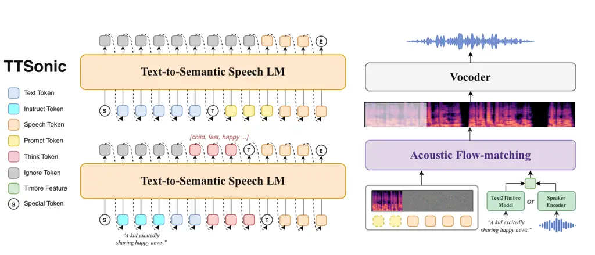
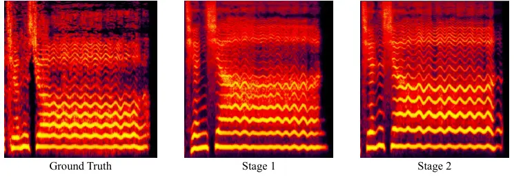

1\]ByteDance Douyin Content Group \emails{zhangzhedong.zzd,
zhoukaiwen.0124, junyanwu, shengqiangli.01, chixuran, zengxingui,
yanrui.001, chenxu.722}@bytedance.com \contribution\[\*\]Equal
contribution. \contribution\[†\]Work was done during internship at
ByteDance Douyin Content Group. \contribution\[‡\]Corresponding author.
\demopage[https://bytedance.github.io/TTSonic/](https://bytedance.github.io/TTSonic/)

# TTSonic: A Unified Framework for Composable and Controllable Speech Generation

Zhedong Zhang    Kaiwen Zhou    Junyan Wu    Shengqiang Li    Xuran Chi
   Xingui Zeng    Rui Yan    Xu Chen Affiliation: \[

###### Abstract

Modern text-to-speech (TTS) systems can synthesize natural and
expressive speech, yet a practical speech foundation model must go
beyond naturalness to offer stable quality, precise controllability, and
a broad set of composable capabilities within a unified framework. We
present TTSonic, a unified speech generation model that supports
zero-shot TTS, voice cloning, prosody cloning, instruction following,
voice conversion, and cloning from noisy reference speech. Rather than
relying on separate task-specific models, TTSonic accommodates diverse
conditioning signals, including text, natural-language instructions,
reference speech, and text-described timbre, within the same model
framework. Specifically, we develop a semantic–acoustic disentangled
speech tokenizer through ASR-supervised semantic learning and
reconstruction-guided generative refinement. Serving as the
representational foundation of our unified framework, the tokenizer
enables the Text-to-Semantic autoregressive model to focus on semantic
and prosodic planning, while the acoustic flow-matching model
specializes in high-quality speech rendering under diverse acoustic and
timbre conditions. Building on this framework, we incorporate CoT-guided
instruction-following planning and Text2Timbre voice design to support
controllable speech generation. Experiments across zero-shot synthesis,
multilingual and cross-lingual TTS, instruction following, voice design,
voice conversion, and noisy-reference cloning demonstrate the
competitive performance and broad applicability of TTSonic.

## 1 Introduction

Text-to-speech (TTS) synthesis has progressed from producing
intelligible speech to generating natural, expressive, and
speaker-faithful audio \[31, 27\]. Modern systems trained on large-scale
multi-speaker corpora can synthesize high-quality speech from only a few
seconds of reference audio, while recent advances further enable
multilingual generation, long-form synthesis, and natural-language
control \[8, 7, 11, 32\]. As TTS becomes an enabling technology for
conversational agents\[28, 37\], content creation\[43, 4\], live
streaming, and interactive services\[34\], the objective is no longer
merely to produce speech that is natural and intelligible. Instead, a
practical TTS system must offer stable synthesis quality, precise
controllability, robust voice cloning from imperfect references, and a
unified interface for deciding _what is said_, _how it is said_, and
_who says it_.

Despite these advances, integrating diverse speech generation
capabilities into a single model remains an open challenge. Many
existing speech generation models are optimized for a narrow operating
mode, such as zero-shot TTS, prompt-based voice cloning, cloning from
noisy prompt, instruction-following synthesis, text-guided voice design,
or voice conversion. Extending a system from one capability to another
often requires separately trained models, making it difficult to
maintain consistent quality and predictable control across applications.
A useful speech foundation model should therefore accept diverse
conditioning signals and compose multiple generation capabilities
instead of treating each task as an isolated problem.

To this end, we introduce TTSonic, a unified and composable speech
generation framework that adapts to diverse tasks and available
conditions by recomposing shared modules: the speech tokenizer,
Text-to-Semantic Speech LM, acoustic flow-matching decoder.
Specifically, we train the TTSonic Speech Tokenizer through a two-stage
learning process. In the first stage, ASR-supervised semantic
pre-training encourages the encoder to extract semantic and prosodic
representations that are disentangled from speaker-dependent acoustic
characteristics. In the second stage, we freeze the semantic encoder and
refine the FSQ mapping with reconstruction feedback from a pre-warmed
acoustic branch, together with an auxiliary speech-understanding
objective. This generative refinement preserves the semantic structure
learned in the first stage while making the resulting discrete tokens
better suited for downstream speech generation. Built on this semantic
representation, the text-to-semantic autoregressive language model
performs long-context semantic and prosodic planning from text and
optional natural-language instructions. The acoustic flow-matching model
then renders accurate and high-quality speech conditioned on
user-provided reference audio or voice design instruction. This
factorized design makes TTSonic composable within a unified framework:
task-dependent generation paths are formed by selecting, adding, or
reusing semantic, prosodic, reference-speech, and timbre conditions,
rather than training separate end-to-end models for individual
capabilities. The shared representation and acoustic generation
framework assign complementary roles to these conditions, allowing
semantic content, speaking style, and speaker identity to be controlled
and recombined across diverse speech generation tasks.

Under this unified generation paradigm, TTSonic supports zero-shot TTS,
voice cloning, prosody cloning, controllable cloning, voice conversion,
and cloning from noisy reference speech. A separate Text2Timbre model
generates speaker embeddings from textual descriptions and supplies them
to the acoustic model, enabling flexible voice design and timbre
switching without modifying the unified generation model. We further
employ CoT-guided style planning as an explicit intermediate
representation for instruction-following control.

| Generation Mode                 | Model        | Generation Paradigm                                                  |
| ------------------------------- | ------------ | -------------------------------------------------------------------- |
| Speech Enhancement              | codec,fm     | Noise speech $`\rightarrow`$ Clean speech                            |
| Voice Conversion                | codec,fm     | Content Speech, Timbre Speech $`\rightarrow`$ Conversion Speech      |
| Voice Cloning                   | llm,fm       | Text, Prompt Speech $`\rightarrow`$ Target Speech                    |
| Prosody Cloning                 | codec,llm,fm | Text, Prompt Speech, Prosody Speech $`\rightarrow`$ Target Speech    |
| Voice Design (TTS)              | llm,fm,vd    | Text, Voice Description $`\rightarrow`$ Target Speech                |
| Voice Design (Voice Conversion) | codec,fm,vd  | Content Speech, Voice Description $`\rightarrow`$ Target Speech      |
| Controllable Cloning            | llm,fm       | Text, Style Description, Prompt Speech $`\rightarrow`$ Target Speech |
| Instruct Following              | llm,fm,vd    | Text, Instruction $`\rightarrow`$ Target Speech                      |

Table 1: Generation paradigms supported by TTSonic.

As summarized in Table 1, TTSonic supports diverse speech generation and
transformation tasks through flexible compositions of the speech
tokenizer, Text-to-Semantic Speech LM, acoustic flow-matching model, and
the separate Text2Timbre module.

Our contributions can be summarized as follows:

- •
  We propose TTSonic, a unified, composable, and controllable speech
  generation framework that supports a broad set of capabilities,
  including zero-shot TTS, voice cloning, prosody cloning, controllable
  cloning, voice conversion, and robust cloning from noisy reference
  speech. These capabilities arise from task-dependent compositions of
  shared modules rather than task-specific end-to-end models. A separate
  Text2Timbre module further enables flexible voice design and timbre
  switching.
- •
  We propose a semantic–acoustic disentangled speech tokenizer through
  ASR-supervised semantic learning and reconstruction-guided generative
  refinement, serving as the representational foundation of our unified
  model. The resulting discrete representations preserve semantic and
  prosodic information while disentangling speaker-dependent acoustic
  characteristics.
- •
  Extensive experiments across zero-shot synthesis, multilingual and
  cross-lingual TTS, instruction following, voice design, voice
  conversion, and noisy-reference cloning demonstrate the competitive
  performance and broad applicability of TTSonic.

## 2 Method

Figure 1: Training pipeline of the TTSonic Speech Tokenizer. Stage I
inserts the FSQ bottleneck after the first 19 E-Branchformer blocks,
then upsamples the quantized features and processes them with 13
additional blocks under encoder–decoder ASR, CTC, and consistency
supervision. Stage II freezes the first 19 blocks and updates only the
FSQ mapping, using speech reconstruction and speech understanding for
multi-task supervised learning.

### 2.1 TTSonic Speech Tokenizer

##### Architecture.

The TTSonic Speech Tokenizer converts speech into a compact sequence of
semantic speech tokens for subsequent language-model training. Given a
16-kHz waveform $`x`$, an 80-dimensional filter-bank frontend followed
by the first 19 blocks of a 512-dimensional E-Branchformer encoder
\[15\] produces continuous semantic representations

```math
H=E_{\mathrm{sem}}^{1:19}(x). \tag{1}
```

The encoder reduces the temporal resolution to 25 Hz. We quantize $`H`$
with finite scalar quantization (FSQ) \[23\]. The quantizer first
projects every 512-dimensional frame into a five-dimensional latent,
whose scalar levels are $`[8,8,8,8,4]`$, and maps the quantized latent
back to 512 dimensions:

```math
s_{t}=Q_{\mathrm{sem}}(h_{t}),\qquad z_{t}=\mathrm{Dec}_{Q}(s_{t}). \tag{2}
```

This construction defines a single implicit codebook of $`16{,}384`$
entries and produces one discrete speech token every 40 ms. The deployed
tokenizer consists of the 19 E-Branchformer blocks and the FSQ mapping.
The downstream text-to-speech system consumes this frame-level token
sequence as the semantic representation predicted by the language model.

##### Two-stage training.

Figure 1 summarizes the two-stage tokenizer training pipeline. The
training strategy first builds a stable semantic encoder and then uses
multi-task supervised learning to optimize the discrete token mapping
used by the generative model.

Stage I: ASR semantic pre-training with CTC regularization. We first
train the tokenizer in an encoder–decoder automatic speech recognition
framework, augmented with connectionist temporal classification (CTC)
loss \[10\] and consistency regularization \[39\]. As shown in Figure 1,
the FSQ bottleneck is inserted after the first 19 E-Branchformer blocks
(layer index 18). The quantized features are then upsampled and
processed by 13 additional E-Branchformer blocks before being fed to the
Transformer ASR decoder and CTC decoder. These 13 blocks form the
Stage-I supervision stack and are not part of the deployed tokenizer.
The ASR decoder objective provides strong recognition supervision, while
the CTC loss directly constrains the encoder-side frame-level
representations. Placing the FSQ bottleneck at this intermediate-late
position encourages the discrete tokens to retain linguistic and
prosodic information. In ablations over the FSQ insertion point, moving
the bottleneck to an intermediate-late encoder layer improves semantic
feature extraction, while excessively late insertion becomes suboptimal.
This suggests that the upper E-Branchformer blocks provide cleaner
abstractions for tokenization up to a suitable depth, after which
further delaying discretization may reduce the usefulness of the
discrete representation. In addition, paired stochastic views of an
utterance are regularized by the frame-level divergence between their
posterior distributions. The objective is

```math
\mathcal{L}_{\mathrm{ASR}}=\mathcal{L}_{\mathrm{dec}}+\lambda_{\mathrm{ctc}}\mathcal{L}_{\mathrm{CTC}}+\lambda_{\mathrm{cr}}\mathcal{L}_{\mathrm{cons}}. \tag{3}
```

This combined supervision prevents the autoregressive decoder from
absorbing all linguistic modeling and encourages the E-Branchformer
semantic encoder to learn a relatively clean representation of phonetic,
lexical, and prosodic structure.



Figure 2: Overview of TTSonic. TTSonic consists of three main
components: the TTSonic Speech Tokenizer, a Text-to-Semantic Speech LM,
and an acoustic flow-matching model. The Text-to-Semantic Speech LM
supports both standard voice cloning and CoT-guided instruction
following, while the flow-matching model can be conditioned on speaker
features extracted from reference audio or on timbre embeddings designed
by the Text2Timbre model.

Stage II: multi-task supervised learning. We initialize the 19-block
semantic encoder from Stage I and keep it frozen throughout the second
stage. Only the FSQ module on top of this frozen encoder is updated; the
additional 13-block ASR supervision stack used in Stage I is no longer
part of the tokenization path. This lets us adjust the mapping from
continuous semantic features to discrete speech tokens while preserving
the encoder representation learned in Stage I.

This refinement stage combines two complementary tasks. The
reconstruction task uses a pre-warmed acoustic branch to reconstruct
speech from the current discrete tokens. An ECAPA-TDNN-style speaker
encoder \[6\] extracts a hierarchy of speaker features from a 128-bin
log-mel spectrogram. A Perceiver resampler compresses these features
into 32 global latents of 128 dimensions. A separate FSQ bottleneck with
scalar levels $`[4,4,4,4,4,4]`$ quantizes each latent, after which the
complete set of global speaker tokens is projected into a
512-dimensional conditioning vector $`g`$. The semantic token features
$`z_{1:T}`$ and the global acoustic condition $`g`$ are combined by a
12-layer conditional feature decoder:

```math
U=D_{\mathrm{cond}}(z_{1:T},g). \tag{4}
```

A HiFi-GAN generator \[16\] then reconstructs the waveform from $`U`$,
using upsampling factors $`[10,4,4,2,2]`$:

```math
\hat{x}=G_{\mathrm{wav}}(U,g). \tag{5}
```

The reconstruction branch is trained with multi-period and
multi-resolution discriminators. Its generator objective combines
mel-spectrogram reconstruction, multi-resolution STFT losses,
adversarial and feature-matching losses, and a speaker-quantization
consistency loss:

```math
\begin{split}\mathcal{L}_{\mathrm{rec}}={}&\lambda_{\mathrm{mel}}\mathcal{L}_{\mathrm{mel}}+\lambda_{\mathrm{STFT}}\mathcal{L}_{\mathrm{STFT}}+\lambda_{\mathrm{adv}}\mathcal{L}_{\mathrm{adv/FM}}\\
&+\lambda_{\mathrm{spk}}\mathcal{L}_{\mathrm{spk}}.\end{split} \tag{6}
```

Here, $`\mathcal{L}_{\mathrm{spk}}`$ aligns the continuous and quantized
speaker representations. Reconstruction is initially conditioned on the
continuous speaker feature and subsequently switched to its quantized
counterpart. This curriculum stabilizes waveform learning before
exposing the decoder to the discrete acoustic bottleneck.

To balance the generative reconstruction signal, we also attach an
adaptor and a small LLM backbone on top of the discrete speech tokens
and optimize a multi-task speech understanding objective. This auxiliary
understanding task encourages the refined token distribution to remain
useful for content-centric speech reasoning rather than being shaped
only by waveform reconstruction.

##### Unified generation interface.

As illustrated in Figure 2, the same Text-to-Semantic Speech LM and
acoustic flow-matching decoder support multiple generation modes by
composing different semantic, prosodic, and timbre conditions. Table 1
summarizes the inputs supplied to the two modules in each mode. The
language model predicts semantic–prosodic speech tokens, while the
flow-matching decoder combines these tokens with the available acoustic
or timbre conditions. Speech enhancement and voice conversion instead
bypass the language model and directly use speech tokens extracted by
the codec. For speech enhancement, tokens from the degraded input are
rendered as clean speech; for voice conversion, tokens from the source
utterance are rendered under the target-speaker condition.

### 2.2 Text-to-Semantic Language Model

##### Pre-training.

We follow the scalable token-based generation recipe established by the
CosyVoice series \[8, 7\] and train an autoregressive language model to
predict the semantic–prosodic speech tokens introduced in section 2.1.
We initialize the autoregressive language-model weights from Qwen3.5
\[25\] and then adapt the model to speech-token generation. Given a text
sequence $`y`$ and its target speech-token sequence
$`s=(s_{1},\ldots,s_{T})`$, the pre-training objective is the standard
next-token negative log-likelihood

```math
\mathcal{L}_{\mathrm{LM}}=-\sum_{t=1}^{T}\log p_{\theta}(s_{t}\mid y,s_{<t}). \tag{7}
```

Rather than introducing an isolated output space for speech, we extend
the text vocabulary with the complete set of speech tokens. Text and
speech therefore share a unified vocabulary, token embedding, and
language-modeling head. This formulation preserves the linguistic
knowledge of the text backbone while allowing lexical context,
punctuation, and speech units to interact in the same autoregressive
space, improving the model’s overall text understanding and speech-token
generation capability.

### 2.3 Acoustic Flow Matching

##### Token-to-mel generation.

We follow the causal conditional flow-matching design of CosyVoice 3
\[7\] to convert the discrete semantic–prosodic sequence into an
acoustic representation. The model takes the speech tokens and, when the
generation mode provides one, a 192-dimensional speaker embedding
extracted by CAM++ \[35\] or generated by Text2Timbre. Since the
tokenizer operates at 25 Hz whereas the 80-bin mel-spectrogram is
represented at 50 Hz, every speech-token feature is repeated over two
mel frames, establishing a fixed token-to-mel ratio of $`1{:}2`$. A
causal Diffusion Transformer then estimates the conditional vector field
\[19\] and generates the target mel-spectrogram. Finally, a causal
HiFi-GAN/HiFT vocoder \[16\] converts the generated mel features into a
24-kHz waveform.

##### Prompt-based cloning condition.

In addition to the speech tokens and an optional global speaker
embedding, the decoder can optionally receive a prompt mel-spectrogram
as an observed acoustic prefix. The prompt mel is aligned with its
corresponding prompt speech tokens under the same $`1{:}2`$ ratio and
prepended to the target generation sequence. During flow generation,
this prefix is kept as a known condition while the model predicts the
subsequent target mel frames; the prompt portion is removed before
waveform decoding. The two acoustic conditions are complementary: the
CAM++ embedding specifies global speaker identity, whereas prompt mel
supplies fine-grained local acoustic evidence for higher-fidelity
cloning. Omitting the prompt mel retains a unified path for standard TTS
and text-guided voice design.

##### Training strategy.

The acoustic model and the language model place different demands on
their training corpora. Language-model training benefits primarily from
broad coverage of languages, text forms, domains, and difficult
pronunciation patterns. In contrast, flow-matching training is more
sensitive to the fidelity of its acoustic targets. We therefore
construct its training mixture with audio quality as the primary
criterion, emphasizing clean single-speaker recordings, reliable
segmentation, sufficient speech occupancy, and high perceptual quality.
We initialize the flow module from CosyVoice 3 flow-matching weights and
continue training it with our speech tokens, CAM++ speaker space, and
acoustic data distribution. After this supervised flow-matching training
stage, we further post-train the acoustic flow model with FlowTTS-GRPO
\[33\] to further improve acoustic quality, speaker similarity, and
content preservation. Empirically, the CosyVoice 3 initialization
stabilizes optimization and provides a modest improvement in speaker and
timbre similarity over training the acoustic model from scratch. During
acoustic flow-matching training, speech tokens and speaker embeddings
are always extracted from the same utterance. No cross-speaker
token–speaker conditioning pairs are introduced during training.

### 2.4 Instruction Following

#### 2.4.1 Controllable Cloning

##### Problem formulation.

Controllable cloning aims to preserve the identity of a reference
speaker while rendering the target text according to a natural-language
style instruction. Let $`r`$ denote the reference speech, $`y`$ the text
to be synthesized, and $`i`$ the instruction. In our factorized
architecture, the speaker encoder extracts a timbre condition $`g_{r}`$
from $`r`$, whereas the autoregressive LLM maps $`(i,y)`$ to a
semantic–prosodic token sequence $`s`$. The two conditions are combined
only by the flow-matching decoder:

```math
g_{r}=E_{\mathrm{spk}}(r),\qquad s\sim p_{\theta}(s\mid i,y),\qquad\hat{x}=F_{\phi}(s,g_{r}). \tag{8}
```

This separation assigns complementary roles to the two inputs: the
reference speech specifies _who_ is speaking, while the instruction
controls _how_ the target content is delivered.

##### Multi-view instruction annotation.

High-quality instruction data is essential because expressive speech
admits multiple valid textual interpretations at different levels of
abstraction. We therefore use a state-of-the-art proprietary omni model
to annotate each training utterance multiple times under two
complementary protocols. The first produces attribute-wise descriptions
of perceptually grounded factors, such as pitch, speaking rate,
loudness, emotion, intonation, and rhythm. The second produces free-form
descriptions that summarize the overall speaking style, communicative
context, or role embodied by the utterance. For each view, we retain
multiple annotation realizations rather than collapsing them into a
single canonical prompt. During training, we randomly sample an
annotation view and one of its realizations for the same speech target.
This stochastic pairing exposes the model to both precise local controls
and holistic, open-ended requests, while reducing sensitivity to a
particular wording or prompt granularity.

##### CoT-guided instruction following.

Directly mapping an unconstrained description to a long sequence of
speech tokens requires the LLM to infer the intended acoustic attributes
and realize them autoregressively in a single step. This is particularly
unstable for free-form instructions, which may express several
correlated attributes implicitly. We introduce a chain-of-thought (CoT)
generation strategy that inserts a compact style plan
$`c=(c_{1},\ldots,c_{M})`$ between the instruction and the speech tokens
$`s=(s_{1},\ldots,s_{T})`$. The joint distribution is factorized as

```math
\begin{split}p_{\theta}(c,s\mid i,y)={}&\prod_{m=1}^{M}p_{\theta}(c_{m}\mid i,y,c_{<m})\\
&\times\prod_{t=1}^{T}p_{\theta}(s_{t}\mid i,y,c,s_{<t}).\end{split} \tag{9}
```

Accordingly, the model is optimized with next-token supervision over
both the CoT plan and the target speech sequence:

```math
\mathcal{L}_{\mathrm{ctrl}}=-\sum_{m=1}^{M}\log p_{\theta}(c_{m}\mid i,y,c_{<m})-\sum_{t=1}^{T}\log p_{\theta}(s_{t}\mid i,y,c,s_{<t}). \tag{10}
```

We serialize the plan as text labels within a delimited
\<think\>$`\ldots`$\</think\> span immediately before the speech tokens.
Samples without CoT annotations remain usable through an empty thinking
span. At inference time, no oracle labels are required: the LLM first
predicts the CoT plan from the user instruction and target text, and
then continues autoregressively with speech-token generation. The
resulting train–inference consistency is intended to help the model
resolve an open-ended instruction into an explicit set of acoustic and
prosodic decisions before realizing the waveform.

#### 2.4.2 Voice Design

##### Modular voice design.

Benefiting from the factorized codec, instruction control over prosody
and voice design can be handled by separate modules. Controllable
cloning operates primarily on the semantic–prosodic speech tokens,
whereas voice design supplies the timbre condition required by the
shared flow-matching decoder. We therefore implement voice design as a
standalone instruction-to-speaker-embedding module. Given a textual
voice description, the module replaces the reference-audio speaker
encoder with a generated speaker embedding, without modifying either the
text-to-semantic language model or the downstream acoustic decoder. This
plug-and-play interface allows the same speech-token sequence to be
rendered with a newly designed voice in the absence of any reference
recording.

##### Text-to-timbre generation.

Our voice-design module builds on the Text-to-Timbre conditional
flow-matching framework of DeepDubbing \[5\]. A frozen Qwen3-Embedding
encoder \[42\] maps each natural language description to a pooled and
normalized sentence representation. Conditioned on this representation,
a Diffusion Transformer parameterizes a conditional vector field that
transports Gaussian noise to a 192-dimensional speaker embedding. The
model is trained with the conditional flow-matching objective \[19\],
using speaker embeddings extracted from the corresponding speech by
CAM++ \[35\] as targets. Consequently, the generated embeddings lie in
the same speaker-conditioning space consumed by our acoustic flow model.
We randomly drop the text condition during training and apply
classifier-free guidance at inference, enabling controlled stochastic
sampling of multiple plausible timbres from the same description.

##### CoT-hybrid conditioning.

Free-form descriptions can implicitly entangle several voice attributes
or leave important acoustic properties underspecified. To improve
robustness, we adopt a CoT-hybrid strategy with matched conditioning
formats at training and inference. During training, we randomly select
an attribute-based description, a holistic style description, or a
role-play description for each utterance, and append its structured CoT
attribute profile to the selected text. At inference, the
instruction-following LLM first derives the CoT profile from the user’s
original natural-language request; the serialized profile is then
concatenated with the original request and encoded jointly by the
voice-design module. The two components are complementary: the original
description preserves open-ended semantics and role information that
support voice diversity, while the CoT profile provides an explicit
acoustic anchor that reduces ambiguity. Together, this conditioning
scheme is designed to support free-form requests while preserving the
open-ended semantics needed for voice diversity.

## 3 Experiments

### 3.1 Experimental Setup

##### Benchmarks.

Seed-TTS-Eval is a standard Chinese–English zero-shot TTS benchmark with
Chinese (_test-zh_), English (_test-en_), and challenging Chinese
(_test-hard_) subsets. CV3-Eval evaluates multilingual and cross-lingual
zero-shot synthesis on standard Chinese and English subsets, hard
Chinese and English subsets, and cross-lingual English-to-Chinese and
Chinese-to-English subsets. InstructTTSEval \[13\] evaluates
natural-language-guided speech generation in Chinese and English through
acoustic-parameter specification (APS), descriptive-style directive
(DSD), and role-play (RP) tasks. Seed VC uses the English and Chinese
subsets of Seed-TTS-Eval \[1\] to evaluate zero-shot voice conversion.
Given a source utterance and a target-speaker reference, a system should
preserve the source linguistic content while rendering it in the target
voice. VoiceBank-DEMAND-16k \[14\] is used to evaluate noisy-reference
voice cloning, where the system must synthesize clean and faithful
target speech from reference audio corrupted by background noise.

##### Comparison systems.

For Seed-TTS-Eval, we group comparison systems by capability scope. The
TTS-only baselines include F5-TTS \[2\], VibeVoice \[24\],
dots.tts(Pre.) \[18\], MiniMax-Speech \[40\], FireRedTTS2 \[38\],
CosyVoice 2 \[8\], CosyVoice 3 \[7\], Qwen3-TTS-Base \[11\], IndexTTS2
\[45\], and FireRedTTS3-Base \[30\]. The unified baselines, which
support broader speech generation or editing capabilities, include
MiMo-Audio \[41\], VoxCPM2 \[32\], Auk-Flash, and Auk \[22\]. For
CV3-Eval, we compare with VoxCPM2, dots.tts(Pre.), CosyVoice 3-0.5B,
CosyVoice 3-1.5B, Qwen3-TTS-12Hz-1.7B-Base, Qwen-Audio-3.0-TTS \[36\],
IndexTTS2.5, and IndexTTS2.5-RL \[17\]. For InstructTTSEval, we compare
with MiMo-Audio-7B-Instruct, VoiceSculptor-VD \[12\],
Qwen3-TTS-12Hz-1.7B-VD, VoxCPM2, Auk, and FireRedTTS3-Instruct. For Seed
VC, we compare with three dedicated zero-shot VC systems: Seed-VC
\[20\], MeanVC2 \[21\], and X-VC \[44\]. For VoiceBank-DEMAND-16k, we
compare noisy-reference cloning against CosyVoice 3. Baseline values are
taken from the corresponding publications, official releases, or our
reproduced evaluation. A dash indicates that a value is unavailable or
undisclosed.

##### Metrics.

We evaluate content preservation with word error rate (WER) or character
error rate (CER), using Whisper-large-v3 \[26\] for English and
Paraformer \[9\] for Chinese. Following the respective comparison
protocols, Seed-TTS-Eval reports CER for _test-zh_ and _test-hard_ and
WER for _test-en_; CV3-Eval and Seed VC report WER for all subsets.
Speaker similarity (SIM) is the cosine similarity between WavLM-based
\[3\] embeddings of the generated and reference speech. For
InstructTTSEval, we use the official evaluation protocol and report the
accuracy of APS, DSD, and RP; higher is better for all three. We
additionally use ERes2Net speaker similarity for noisy-reference cloning
and UTMOS \[29\] as a non-intrusive estimate of perceptual quality for
Seed VC and VoiceBank-DEMAND-16k. For voice-design diversity, we report
the high-similarity speaker collision rate, defined as the percentage of
within-gender–age WavLM embedding pairs whose cosine similarity exceeds
a specified threshold. Individual-pass uses each model’s own
judge-passing samples, whereas Joint-pass uses samples that pass jointly
for all three systems in the diversity comparison; lower collision rates
indicate greater diversity. The objective tokenizer ablation
additionally reports DNSMOS OVRL and Spectrum MAE in dB, while the
subjective ablation reports NMOS for perceived naturalness, SMOS for
perceived speaker similarity, and CMOS for comparative preference. Lower
WER/CER, Spectrum MAE, and collision rates are better, while higher SIM,
DNSMOS, UTMOS, InstructTTSEval, NMOS, SMOS, and CMOS scores are better.

### 3.2 Zero-Shot Synthesis on Seed-TTS-Eval

|                         |          |            |                   |                 |                   |                 |                   |                 |
| ----------------------- | -------- | ---------- | ----------------- | --------------- | ----------------- | --------------- | ----------------- | --------------- |
| Model                   | Params   | Capability | test-zh           |                 | test-en           |                 | test-hard         |                 |
|                         |          |            | CER$`\downarrow`$ | SIM$`\uparrow`$ | WER$`\downarrow`$ | SIM$`\uparrow`$ | CER$`\downarrow`$ | SIM$`\uparrow`$ |
| Human                   | –        | –          | 1.26              | 0.755           | 2.14              | 0.734           | –                 | –               |
| F5-TTS \[2\]            | 0.3B     | TTS-only   | 1.52              | 0.741           | 2.00              | 0.647           | 8.67              | 0.713           |
| VibeVoice \[24\]        | 1.5B     |            | 1.16              | 0.744           | 3.04              | 0.689           | –                 | –               |
| dots.tts(Pre.) \[18\]   | 2B       |            | 0.96              | 0.805           | 1.34              | 0.768           | 6.46              | 0.792           |
| MiniMax-Speech \[40\]   | –        |            | 0.83              | 0.783           | 1.65              | 0.692           | –                 | –               |
| FireRedTTS2 \[38\]      | 1.5B     |            | 1.14              | 0.732           | 1.95              | 0.665           | 8.98              | 0.703           |
| CosyVoice 2 \[8\]       | 0.5B     |            | 1.45              | 0.748           | 2.57              | 0.652           | 6.83              | 0.724           |
| CosyVoice 3 \[7\]       | 1.5B     |            | 1.12              | 0.781           | 2.22              | 0.720           | 5.83              | 0.758           |
| Qwen3-TTS-Base \[11\]   | 1.7B     |            | 1.22              | 0.770           | 1.23              | 0.717           | 6.76              | 0.748           |
| IndexTTS2 \[45\]        | 1.5B     |            | 1.03              | 0.765           | 2.23              | 0.706           | 7.12              | 0.755           |
| FireRedTTS3-Base \[30\] | 1.7B     |            | 1.01              | 0.809           | 1.64              | 0.772           | 6.50              | 0.784           |
| MiMo-Audio \[41\]       | 7B       | Unified    | 1.96              | \-              | 5.37              | \-              | 14.14             | \-              |
| VoxCPM2 \[32\]          | 2B       |            | 0.97              | 0.795           | 1.84              | 0.753           | 8.13              | 0.753           |
| Auk-Flash \[22\]        | 1.5B^(∗) |            | 1.10              | 0.814           | 1.03              | 0.772           | 6.43              | 0.784           |
| Auk \[22\]              | 1.5B^(∗) |            | 1.02              | 0.814           | 1.02              | 0.788           | 5.91              | 0.782           |
| TTSonic                 | 2B       | Unified    | 0.78              | 0.784           | 1.66              | 0.717           | 5.64              | 0.774           |

Table 2: Zero-shot synthesis on Seed-TTS-Eval. Models are grouped by
capability scope. TTS-only models are specialized for text-to-speech
synthesis, whereas unified models support broader speech generation or
editing capabilities. Among unified models, bold and underlined values
denote the best and second-best results in each column, respectively.
Tied best results are bolded, and the next distinct value is underlined.
Parameter counts marked with ^(∗) exclude the frozen pre-trained
Qwen2.5-Omni used by the model. “–” denotes unavailable or undisclosed
information.

Table 2 reports the core zero-shot TTS performance of models with
different capability scopes. TTSonic achieves 0.78% CER and 0.784 SIM on
_test-zh_, 1.66% WER and 0.717 SIM on _test-en_, and 5.64% CER and 0.774
SIM on _test-hard_. These results demonstrate that TTSonic maintains
competitive content accuracy and reference-speaker similarity while
supporting a broader unified speech generation framework beyond TTS-only
synthesis.

### 3.3 Multilingual and Cross-Lingual Synthesis on CV3-Eval

| Model                           | Params | zh                |                 | en                |                 | hard zh           |                 | hard en           |                 | en-to-zh          |                 | zh-to-en          |                 |
| ------------------------------- | ------ | ----------------- | --------------- | ----------------- | --------------- | ----------------- | --------------- | ----------------- | --------------- | ----------------- | --------------- | ----------------- | --------------- |
|                                 |        | WER$`\downarrow`$ | SIM$`\uparrow`$ | WER$`\downarrow`$ | SIM$`\uparrow`$ | WER$`\downarrow`$ | SIM$`\uparrow`$ | WER$`\downarrow`$ | SIM$`\uparrow`$ | WER$`\downarrow`$ | SIM$`\uparrow`$ | WER$`\downarrow`$ | SIM$`\uparrow`$ |
| VoxCPM2 \[32\]                  | 2B     | 3.55              | 0.750           | 6.21              | 0.716           | 8.10              | 0.699           | 7.48              | 0.670           | 7.76              | –               | 6.22              | 0.643           |
| dots.tts(Pre.) \[18\]           | 2B     | 3.51              | -               | 5.24              | -               | 8.55              | -               | 8.48              | -               | 10.88             | 0.746           | 4.97              | 0.719           |
| CosyVoice 3-0.5B \[7\]          | 0.5B   | 3.89              | 0.800           | 5.24              | 0.742           | 14.25             | 0.786           | 9.04              | 0.759           | 8.48              | 0.674           | 4.99              | 0.678           |
| CosyVoice 3-1.5B \[7\]          | 1.5B   | 3.91              | –               | 4.99              | –               | 9.77              | 0.785           | 10.55             | 0.761           | 8.01              | 0.669           | 4.32              | 0.664           |
| Qwen3-TTS-12Hz-1.7B-Base \[11\] | 1.7B   | 3.09              | 0.730           | 3.68              | 0.672           | 11.24             | 0.691           | 6.53              | 0.661           | 4.77              | –               | 2.77              | –               |
| Qwen-Audio-3.0-TTS \[36\]       | –      | 3.35              | –               | 4.25              | –               | 7.44              | 0.787           | 6.71              | 0.766           | 5.23              | –               | 2.40              | –               |
| IndexTTS2.5 \[17\]              | 0.8B   | 4.36              | 0.771           | 5.12              | 0.681           | –                 | –               | –                 | –               | –                 | –               | 3.62              | 0.638           |
| IndexTTS2.5-RL \[17\]           | 0.8B   | 3.93              | 0.779           | 3.89              | 0.678           | –                 | –               | –                 | –               | –                 | –               | 3.55              | 0.675           |
| TTSonic                         | 2B     | 3.19              | 0.811           | 4.03              | 0.769           | 8.68              | 0.802           | 7.79              | 0.770           | 3.44              | 0.745           | 4.06              | 0.729           |

Table 3: Multilingual and cross-lingual synthesis on CV3-Eval. WER is
reported in percent, and SIM is reported as cosine similarity. Across
all systems, bold and underlined values denote the best and second-best
results in each column, respectively. “–” denotes unavailable or
undisclosed information.

Table 3 reports the multilingual and cross-lingual synthesis performance
of TTSonic. It achieves WER/SIM results of 3.19%/0.811 on Chinese,
4.03%/0.769 on English, 8.68%/0.802 on hard Chinese, 7.79%/0.770 on hard
English, 3.44%/0.745 on English-to-Chinese, and 4.06%/0.729 on
Chinese-to-English. Across all compared systems, TTSonic obtains the
highest speaker similarity on five of the six subsets and the
second-highest similarity on English-to-Chinese. It also achieves the
lowest English-to-Chinese WER and the second-lowest Chinese WER,
demonstrating competitive multilingual content accuracy together with
consistent speaker preservation across standard, challenging, and
cross-lingual settings.

### 3.4 Instruction Following on InstructTTSEval

#### 3.4.1 Instruction-Following Performance

|                               |                    |                 |                |                    |                 |                |
| ----------------------------- | ------------------ | --------------- | -------------- | ------------------ | --------------- | -------------- |
| Model                         | InstructTTSEval-ZH |                 |                | InstructTTSEval-EN |                 |                |
|                               | APS$`\uparrow`$    | DSD$`\uparrow`$ | RP$`\uparrow`$ | APS$`\uparrow`$    | DSD$`\uparrow`$ | RP$`\uparrow`$ |
| Reference Audio               | 91.0               | 83.7            | 64.1           | 92.5               | 86.7            | 66.6           |
| MiMo-Audio-7B-Instruct \[41\] | 75.7               | 74.3            | 61.5           | 80.6               | 77.6            | 59.5           |
| VoiceSculptor-VD \[12\]       | 75.7               | 64.7            | 61.5           | –                  | –               | –              |
| Qwen3-TTS-12Hz-1.7B-VD \[11\] | 85.2               | 81.1            | 65.1           | 82.9               | 82.4            | 68.4           |
| VoxCPM2 \[32\]                | 85.2               | 71.5            | 60.8           | 84.2               | 83.2            | 71.4           |
| Auk \[22\]                    | 83.3               | 83.4            | 68.2           | 75.6               | 81.6            | 65.9           |
| FireRedTTS3-Instruct \[30\]   | 85.8               | 82.0            | 69.7           | 80.7               | 82.3            | 72.0           |
| TTSonic                       | 88.8               | 82.3            | 69.4           | 77.6               | 78.4            | 64.4           |

Table 4: Instruction following on InstructTTSEval. APS, DSD, and RP are
reported as percentages; higher is better. Bold and underlined values
denote the best and second-best model results in each column,
respectively. “–” denotes unavailable or undisclosed information.

Table 4 shows the instruction-following performance of TTSonic on
InstructTTSEval. On the Chinese subset, it achieves the best APS score
of 88.8 and the second-best RP score of 69.4, while its DSD score of
82.3 remains competitive with the strongest systems. These results
demonstrate effective control of both structured acoustic parameters and
more open-ended role-play descriptions. On the English subset, the model
obtains APS, DSD, and RP scores of 77.6, 78.4, and 64.4, respectively,
but trails the strongest English baselines. Thus, the unified model
provides competitive Chinese instruction-following capability, while
broader cross-lingual instruction generalization remains an important
direction for future improvement.

#### 3.4.2 Voice-Design Diversity

We evaluate timbre diversity using Chinese APS samples under two
judge-passing protocols. The Individual-pass protocol uses each model’s
own Gemini-passing samples, while the Joint-pass protocol uses only
samples that pass for Qwen3-TTS, VoxCPM2, and the corresponding TTSonic
repeat. Samples are divided into six gender–age groups, and we measure
the fraction of within-group WavLM speaker-embedding pairs whose cosine
similarity is strictly above a threshold. This Micro collision rate is
lower when fewer highly similar or near-duplicate voices are generated.

| Model                                                   | $`>0.50`$ | $`>0.55`$ | $`>0.60`$ | $`>0.65`$ | $`>0.70`$ |
| ------------------------------------------------------- | --------- | --------- | --------- | --------- | --------- |
| Individual-pass: each model’s own judge-passing samples |           |           |           |           |           |
| Qwen3-TTS-12Hz-1.7B-VD \[11\]                           | 67.68     | 52.16     | 35.29     | 19.86     | 8.65      |
| VoxCPM2 \[32\]                                          | 68.32     | 52.35     | 35.40     | 20.54     | 9.46      |
| TTSonic                                                 | 58.77     | 43.24     | 27.99     | 15.28     | 6.52      |
| Joint-pass: shared judge-passing samples                |           |           |           |           |           |
| Qwen3-TTS-12Hz-1.7B-VD \[11\]                           | 67.54     | 52.23     | 35.58     | 20.16     | 8.75      |
| VoxCPM2 \[32\]                                          | 67.51     | 52.01     | 35.49     | 20.92     | 9.88      |
| TTSonic                                                 | 62.00     | 46.31     | 30.35     | 16.72     | 7.22      |

Table 5: High-similarity speaker collision rates on InstructTTSEval-ZH.
Results are percentages of within-group WavLM pairs whose cosine
similarity is strictly above each threshold; lower is better.
Individual-pass uses each model’s own judge-passing samples, and
Joint-pass uses samples jointly passing Qwen3-TTS, VoxCPM2, and the
corresponding TTSonic repeat. TTSonic is averaged over three independent
generations.

As shown in Table 5, TTSonic has the lowest collision rate at all five
thresholds under both protocols. Under Individual-pass, at thresholds of
0.50, 0.60, and 0.70, its rates are 58.77%, 27.99%, and 6.52%, compared
with 67.68%, 35.29%, and 8.65% for Qwen3-TTS and 68.32%, 35.40%, and
9.46% for VoxCPM2. Under the stricter Joint-pass protocol, the
corresponding TTSonic rates are 62.00%, 30.35%, and 7.22%, still below
Qwen3-TTS (67.54%, 35.58%, and 8.75%) and VoxCPM2 (67.51%, 35.49%, and
9.88%). This consistent reduction indicates fewer highly similar voices
after controlling for gender, age, and instruction compliance. The
metric reflects diversity in WavLM speaker-embedding space and does not
by itself measure audio quality, naturalness, or human preference.

Taken together, the instruction-following and collision-rate results
show that the TTSonic combines competitive instruction adherence with
greater within-group timbre diversity.

### 3.5 Voice Conversion and Noisy Cloning

|                      |                   |                 |                   |                   |                 |                   |
| -------------------- | ----------------- | --------------- | ----------------- | ----------------- | --------------- | ----------------- |
| Model                | Seed-TTS test-en  |                 |                   | Seed-TTS test-zh  |                 |                   |
|                      | WER$`\downarrow`$ | SIM$`\uparrow`$ | UTMOS$`\uparrow`$ | WER$`\downarrow`$ | SIM$`\uparrow`$ | UTMOS$`\uparrow`$ |
| Ground Truth         | 1.96              | 0.09            | –                 | 1.33              | 0.30            | –                 |
| Seed-VC small \[20\] | 2.71              | 0.57            | 3.37              | 2.31              | 0.74            | 2.72              |
| MeanVC2 \[21\]       | 8.42              | 0.60            | 3.54              | 5.05              | 0.73            | 2.99              |
| X-VC \[44\]          | 3.10              | 0.62            | 3.26              | 1.99              | 0.73            | 2.63              |
| TTSonic              | 3.20              | 0.67            | 4.05              | 1.85              | 0.78            | 3.42              |

Table 6: Zero-shot voice conversion on Seed VC. WER is reported in
percent. Lower WER is better; higher SIM and UTMOS are better. Bold and
underlined values denote the best and second-best model results in each
column, respectively. “–” denotes unavailable or undisclosed
information.

Voice conversion evaluates whether a system can preserve the linguistic
content of the source utterance while matching the target speaker and
maintaining natural audio quality. Our VC path bypasses the language
model: the speech codec first converts the source utterance into
discrete tokens, and the acoustic decoder then synthesizes speech from
these tokens conditioned on the target speaker embedding. Notably,
TTSonic is trained without any voice-conversion targets or paired VC
supervision. During acoustic flow-matching training, the model observes
only matched token–speaker conditions, with the speech tokens and
speaker embedding extracted from the same utterance. Voice conversion is
therefore evaluated as an unseen cross-speaker recombination setting,
where the source speech tokens and target speaker embedding originate
from different speakers.

As shown in Table 6, this direct path performs particularly well on the
Chinese subset, where TTSonic achieves the best results on all three
dimensions, with 1.85% WER, 0.78 SIM, and 3.42 UTMOS. On the English
subset, it obtains the highest SIM of 0.67 and UTMOS of 4.05, while its
WER of 3.20% trails Seed-VC and X-VC. Averaged equally across the two
languages, TTSonic reaches 0.73 SIM and 3.74 UTMOS, the highest averages
among the compared systems, with an average WER of 2.53%. These results
indicate that the direct codec-based path prioritizes speaker similarity
and perceptual quality while retaining competitive content accuracy.
More importantly, this successful zero-shot cross-speaker recombination
provides functional evidence that the learned speech representation
supports the separation of linguistic content and speaker-dependent
acoustic characteristics.

| Model       | WavLM SIM$`\uparrow`$ | ERes2Net SIM$`\uparrow`$ | WER$`\downarrow`$ | UTMOS$`\uparrow`$ |
| ----------- | --------------------- | ------------------------ | ----------------- | ----------------- |
| CosyVoice 3 | 0.299                 | 0.564                    | 1.90              | 4.23              |
| TTSonic     | 0.369                 | 0.601                    | 1.45              | 4.37              |

Table 7: Noisy-reference cloning on VoiceBank-DEMAND-16k. WER is
reported in percent. Lower WER is better; higher SIM and UTMOS are
better.

We further evaluate noisy-reference voice cloning on
VoiceBank-DEMAND-16k \[14\], where the reference audio contains
background noise. As shown in Table 7, TTSonic improves both
speaker-similarity metrics over CosyVoice 3, increasing WavLM SIM from
0.299 to 0.369 and ERes2Net SIM from 0.564 to 0.601. It also reduces WER
from 1.90% to 1.45% and improves UTMOS from 4.23 to 4.37. These results
indicate that the TTSonic model maintains stronger content accuracy,
speaker similarity, and perceptual quality when cloning from noisy
reference speech.

### 3.6 Ablation of Speech Tokenizer

##### FSQ insertion layer.

| FSQ Insert Layer | WER$`\downarrow`$ |
| ---------------- | ----------------- |
| 6                | 7.16              |
| 12               | 6.83              |
| 18               | 6.17              |
| 24               | 6.46              |
| 30               | 7.06              |

Table 8: Ablation of FSQ insertion layer in the speech tokenizer. WER is
reported in percent; lower is better.

We first ablate the insertion depth of the FSQ bottleneck in the
E-Branchformer encoder to determine where discretization should be
applied for the speech tokenizer. As shown in Table 8, moving the FSQ
module from layer 6 to layer 18 steadily reduces WER from 7.16% to
6.17%, indicating that later encoder layers provide more mature semantic
representations for discrete token generation. Placing FSQ at even
deeper layers then increases WER to 6.46% at layer 24 and 7.06% at layer
30, suggesting that excessively late discretization is also suboptimal.
We therefore select layer 18 as the default FSQ insertion point because
it provides the best balance for extracting semantic and prosodic
information.

##### Training strategy ablation.

To fairly evaluate the downstream generative utility of the two
tokenizer variants, we train separate acoustic decoders for the Stage-I
and Stage-II tokenizers, respectively. Both decoders share the same
architecture, training dataset, optimization settings, and training
budget, differing only in the discrete speech tokens provided by their
corresponding tokenizers. Since the two tokenizers induce different
token distributions, independently adapting the decoders avoids the
distribution mismatch that would arise from directly replacing the
tokenizer of a fixed decoder. This controlled comparison evaluates the
effectiveness of each tokenizer as a discrete representation for
downstream speech generation.

| Setting          | Language | Tokenizer | WER$`\downarrow`$ | SIM$`\uparrow`$ | DNSMOS$`\uparrow`$ | Spectrum MAE$`\downarrow`$ |
| ---------------- | -------- | --------- | ----------------- | --------------- | ------------------ | -------------------------- |
| Reconstruction   | English  | Stage I   | 2.82              | 0.687           | 3.215              | 5.812                      |
|                  |          | Stage II  | 2.94              | 0.705           | 3.209              | 5.580                      |
|                  | Chinese  | Stage I   | 0.74              | 0.782           | 3.298              | 5.787                      |
|                  |          | Stage II  | 0.71              | 0.799           | 3.286              | 5.543                      |
| Voice Conversion | English  | Stage I   | 2.67              | 0.610           | 3.199              | -                          |
|                  |          | Stage II  | 3.13              | 0.597           | 3.180              | -                          |
|                  | Chinese  | Stage I   | 0.71              | 0.759           | 3.316              | -                          |
|                  |          | Stage II  | 0.81              | 0.751           | 3.300              | -                          |

Table 9: Objective comparison of the two tokenizer training stages on
reconstruction and voice conversion. WER is reported in percent, DNSMOS
denotes the OVRL score, and Spectrum MAE is reported in dB. Lower WER
and Spectrum MAE are better, while higher WavLM SIM and DNSMOS are
better.

| Setting          | Tokenizer | NMOS$`\uparrow`$ | SMOS$`\uparrow`$ | CMOS$`\uparrow`$ |
| ---------------- | --------- | ---------------- | ---------------- | ---------------- |
| Reconstruction   | Stage I   | 3.94             | 4.11             | -0.12            |
|                  | Stage II  | 4.08             | 4.11             | +0.12            |
| Voice Conversion | Stage I   | 3.64             | 4.03             | -0.29            |
|                  | Stage II  | 3.91             | 4.03             | +0.29            |

Table 10: Subjective comparison of the two tokenizer training stages.
NMOS measures perceived naturalness, SMOS measures perceived speaker
similarity, and CMOS measures comparative preference. Higher is better
for all metrics.

Tables 9 and 10 compare the two tokenizers under matched decoder
training conditions. On objective metrics, the Stage-I tokenizer
performs better in voice conversion, including higher speaker similarity
and pronunciation accuracy, which is consistent with its ASR-supervised
objective for learning semantic–acoustic separation. The Stage-II
tokenizer introduces modest trade-offs in objective content accuracy,
especially in voice conversion.

Under the same controlled decoder training setup, however, the Stage-II
tokenizer consistently enables higher perceptual naturalness in both
reconstruction and voice conversion. Its NMOS improves from 3.94 to 4.08
in reconstruction and from 3.64 to 3.91 in voice conversion, and CMOS
also favors Stage II in both settings, while SMOS remains comparable at
4.11 and 4.03. These results suggest that reconstruction-guided
refinement produces discrete representations that are more favorable for
downstream acoustic generation, despite modest trade-offs in objective
content accuracy. Figure 3 provides a complementary visualization, where
the Stage-II reconstructed spectrogram more closely matches the ground
truth.



Figure 3: Spectrogram reconstruction comparison for tokenizer
refinement. We compare the ground-truth spectrogram with reconstructions
produced by the speech tokenizer after Stage-I training and after
Stage-II refinement.

## 4 Conclusion

In this report, we presented TTSonic, a unified speech generation
framework that composes a semantic–acoustic disentangled speech
tokenizer, a Text-to-Semantic autoregressive language model, and an
acoustic flow-matching model. The tokenizer provides a shared discrete
representation that allows the language model to focus on semantic and
prosodic planning while the flow-matching model specializes in acoustic
rendering. This factorized framework supports zero-shot TTS, voice
cloning, prosody cloning, controllable cloning, voice conversion, and
cloning from noisy reference speech. A separate Text2Timbre module
further enables flexible voice design and timbre switching.

Experiments across zero-shot, multilingual, and cross-lingual synthesis
demonstrate competitive TTS performance across the evaluated
configurations. The complete system also achieves competitive Chinese
instruction following and timbre diversity, while the voice-conversion
and noisy-reference-cloning results demonstrate effective content
preservation, speaker control, and synthesis robustness. Taken together,
these results establish TTSonic as a practical foundation for
composable, controllable, and reliable speech generation.

## References

- \[1\] Philip Anastassiou, Jiawei Chen, Jitong Chen, Yuanzhe Chen, Zhuo
  Chen, Ziyi Chen, Jian Cong, Lelai Deng, Chuang Ding, Lu Gao, et al.
  Seed-TTS: A family of high-quality versatile speech generation models.
  arXiv preprint arXiv:2406.02430, 2024.
- \[2\] Yushen Chen, Zhikang Niu, Ziyang Ma, Keqi Deng, Chunhui Wang,
  Jian Zhao, Kai Yu, and Xie Chen. F5-TTS: A fairytaler that fakes
  fluent and faithful speech with flow matching. In Proceedings of the
  63rd Annual Meeting of the Association for Computational Linguistics,
  pages 6255–6271, 2025.
- \[3\] Zhengyang Chen, Sanyuan Chen, Yu Wu, Yao Qian, Chengyi Wang,
  Shujie Liu, Yanmin Qian, and Michael Zeng. Large-scale self-supervised
  speech representation learning for automatic speaker verification. In
  IEEE International Conference on Acoustics, Speech and Signal
  Processing, pages 6147–6151, 2022.
- \[4\] Gaoxiang Cong, Liang Li, Jiaxin Ye, Zhedong Zhang, Hongming
  Shan, Yuankai Qi, and Qingming Huang. Cosyncdit: Cognitive synchronous
  diffusion transformer for movie dubbing. arXiv preprint
  arXiv:2604.12292, 2026.
- \[5\] Ziqi Dai, Yiting Chen, Jiacheng Xu, Liufei Xie, Yuchen Wang,
  Zhenchuan Yang, Bingsong Bai, Yangsheng Gao, Wenjiang Zhou, Weifeng
  Zhao, and Ruohua Zhou. Deep dubbing: End-to-end auto-audiobook system
  with text-to-timbre and context-aware instruct-TTS. arXiv preprint
  arXiv:2509.15845, 2025.
- \[6\] Brecht Desplanques, Jenthe Thienpondt, and Kris Demuynck.
  ECAPA-TDNN: Emphasized channel attention, propagation and aggregation
  in TDNN based speaker verification. In Interspeech, pages
  3830–3834, 2020.
- \[7\] Zhihao Du, Changfeng Gao, Yuxuan Wang, Fan Yu, Tianyu Zhao, Hao
  Wang, Xiang Lv, Hui Wang, Chongjia Ni, Xian Shi, et al. CosyVoice 3:
  Towards in-the-wild speech generation via scaling-up and
  post-training. arXiv preprint arXiv:2505.17589, 2025.
- \[8\] Zhihao Du, Yuxuan Wang, Qian Chen, Xian Shi, Xiang Lv, Tianyu
  Zhao, Zhifu Gao, Yexin Yang, Changfeng Gao, Hui Wang, et al. CosyVoice
  2: Scalable streaming speech synthesis with large language models.
  arXiv preprint arXiv:2412.10117, 2024.
- \[9\] Zhifu Gao, Shiliang Zhang, Ian McLoughlin, and Zhijie Yan.
  Paraformer: Fast and accurate parallel transformer for
  non-autoregressive end-to-end speech recognition. In Interspeech,
  pages 2063–2067, 2022.
- \[10\] Alex Graves, Santiago Fernández, Faustino Gomez, and Jürgen
  Schmidhuber. Connectionist temporal classification: Labelling
  unsegmented sequence data with recurrent neural networks. In
  Proceedings of the 23rd International Conference on Machine Learning,
  pages 369–376, 2006.
- \[11\] Hangrui Hu, Xinfa Zhu, Ting He, Dake Guo, Bin Zhang, Xiong
  Wang, Zhifang Guo, Ziyue Jiang, Hongkun Hao, Zishan Guo, et al.
  Qwen3-TTS technical report. arXiv preprint arXiv:2601.15621, 2026.
- \[12\] Jingbin Hu, Huakang Chen, Linhan Ma, Dake Guo, Qirui Zhan,
  Wenhao Li, Haoyu Zhang, Kangxiang Xia, Ziyu Zhang, Wenjie Tian, et al.
  VoiceSculptor: Your voice, designed by you. arXiv preprint
  arXiv:2601.10629, 2026.
- \[13\] Kexin Huang, Qian Tu, Liwei Fan, Chenchen Yang, Dong Zhang,
  Shimin Li, Zhaoye Fei, Qinyuan Cheng, and Xipeng Qiu. InstructTTSEval:
  Benchmarking complex natural-language instruction following in
  text-to-speech systems. arXiv preprint arXiv:2506.16381, 2025.
- \[14\] JacobLinCool. VoiceBank-DEMAND-16k. Hugging Face dataset, 2024.
- \[15\] Kwangyoun Kim, Felix Wu, Yifan Peng, Jing Pan, Prashant
  Sridhar, Kyu J. Han, and Shinji Watanabe. E-Branchformer: Branchformer
  with enhanced merging for speech recognition. In IEEE Spoken Language
  Technology Workshop, pages 84–91, 2023.
- \[16\] Jungil Kong, Jaehyeon Kim, and Jaekyoung Bae. HiFi-GAN:
  Generative adversarial networks for efficient and high fidelity speech
  synthesis. In Advances in Neural Information Processing Systems,
  volume 33, pages 17022–17033, 2020.
- \[17\] Yunpei Li, Xun Zhou, Jinchao Wang, Lu Wang, Yong Wu, Siyi Zhou,
  Yiquan Zhou, and Jingchen Shu. Indextts 2.5 technical report. arXiv
  preprint arXiv:2601.03888, 2026.
- \[18\] Shi Lian, Changtao Li, Bohan Li, Hankun Wang, Da Zheng, Junfeng
  Tian, Yufeng Ma, Colin Zhang, and Kai Yu. dots. tts technical report.
  arXiv preprint arXiv:2606.07080, 2026.
- \[19\] Yaron Lipman, Ricky T. Q. Chen, Heli Ben-Hamu, Maximilian
  Nickel, and Matthew Le. Flow matching for generative modeling. In
  International Conference on Learning Representations, 2023.
- \[20\] Songting Liu. Zero-shot voice conversion with diffusion
  transformers. arXiv preprint arXiv:2411.09943, 2024.
- \[21\] Guobin Ma, Yuxuan Xia, Yuepeng Jiang, Dake Guo, Hanke Xie,
  Jingbin Hu, Yanbo Wang, Lei Xie, and Pengcheng Zhu. MeanVC 2: Robust
  low-latency streaming zero-shot voice conversion. arXiv preprint
  arXiv:2606.09050, 2026.
- \[22\] Ziyang Ma, Zhikang Niu, Wenming Tu, Tianrui Wang, Ruiqi Yan,
  Junxi Liu, Yanru Huo, Nickk Huang, Yang Liu, Qicong Xie, et al. Auk
  technical report: An open-source foundational model for speech
  generation and editing. arXiv preprint arXiv:2609.08936, 2026.
- \[23\] Fabian Mentzer, David Minnen, Eirikur Agustsson, and Michael
  Tschannen. Finite scalar quantization: VQ-VAE made simple. In
  International Conference on Learning Representations, 2024.
- \[24\] Zhiliang Peng, Jianwei Yu, Wenhui Wang, Yaoyao Chang, Yutao
  Sun, Li Dong, Yi Zhu, Weijiang Xu, Hangbo Bao, Zehua Wang, et al.
  VibeVoice technical report. arXiv preprint arXiv:2508.19205, 2025.
- \[25\] Qwen Team. Qwen3.5: Towards native multimodal agents,
  February 2026.
- \[26\] Alec Radford, Jong Wook Kim, Tao Xu, Greg Brockman, Christine
  McLeavey, and Ilya Sutskever. Robust speech recognition via
  large-scale weak supervision. In International Conference on Machine
  Learning, volume 202, pages 28492–28518, 2023.
- \[27\] Yi Ren, Chenxu Hu, Xu Tan, Tao Qin, Sheng Zhao, Zhou Zhao, and
  Tie-Yan Liu. FastSpeech 2: Fast and high-quality end-to-end text to
  speech. In International Conference on Learning Representations, 2021.
- \[28\] Rajarshi Roy, Jonathan Raiman, Sang-gil Lee, Teodor-Dumitru
  Ene, Robert Kirby, Sungwon Kim, Jaehyeon Kim, and Bryan Catanzaro.
  Personaplex: Voice and role control for full duplex conversational
  speech models. In ICASSP 2026-2026 IEEE International Conference on
  Acoustics, Speech and Signal Processing (ICASSP), pages 16137–16141.
  IEEE, 2026.
- \[29\] Takaaki Saeki, Detai Xin, Wataru Nakata, Tomoki Koriyama,
  Shinnosuke Takamichi, and Hiroshi Saruwatari. UTMOS: UTokyo-SaruLab
  system for VoiceMOS challenge 2022. In Interspeech, pages
  4521–4525, 2022.
- \[30\] Feiyu Shen, Kun Xie, Yichen Wu, Ziqi Dai, Yichen Han, Junjie
  Li, Xuelong Geng, Fenglong Xie, Lei Xie, Xu Tang, et al. Fireredtts3:
  Unified speech generation and editing with semantically enriched
  speech representations. arXiv preprint arXiv:2608.17492, 2026.
- \[31\] Jonathan Shen, Ruoming Pang, Ron J. Weiss, Mike Schuster,
  Navdeep Jaitly, Zongheng Yang, Zhifeng Chen, Yu Zhang, Yuxuan
  Wang, R. J. Skerry-Ryan, et al. Natural TTS synthesis by conditioning
  WaveNet on mel spectrogram predictions. In IEEE International
  Conference on Acoustics, Speech and Signal Processing, pages
  4779–4783, 2018.
- \[32\] VoxCPM Team. VoxCPM2 technical report. arXiv preprint
  arXiv:2606.06928, 2026.
- \[33\] Haoxu Wang, Biao Tian, Weiqin Li, Xiang Lv, Han Zhao, and
  Xiangang Li. FlowTTS-GRPO: Online reinforcement learning with
  multi-objective reward optimization for flow-matching based
  text-to-speech. arXiv preprint arXiv:2606.23190, 2026.
- \[34\] Hui Wang, Yifan Yang, Shujie Liu, Jinyu Li, Lingwei Meng,
  Yanqing Liu, Jiaming Zhou, Haoqin Sun, Yan Lu, and Yong Qin.
  Streammel: Real-time zero-shot text-to-speech via interleaved
  continuous autoregressive modeling. IEEE Signal Processing
  Letters, 2025.
- \[35\] Hui Wang, Siqi Zheng, Yafeng Chen, Luyao Cheng, and Qian Chen.
  CAM++: A fast and efficient network for speaker verification using
  context-aware masking. In Interspeech, pages 5301–5305, 2023.
- \[36\] Bajian Xiang, Cheng Wen, Han Zhao, Hao Wang, Haoxu Wang, Jiawei
  Jin, Jiayan Cui, Jie Chen, Mengxi Nie, Tianyu Zhao, et al.
  Qwen-audio-3.0-tts: Freely controllable and highly robust speech
  synthesis with multi-stage training paradigm. arXiv preprint
  arXiv:2607.23938, 2026.
- \[37\] Kun Xie, Feiyu Shen, Junjie Li, Fenglong Xie, Xu Tang, and Yao
  Hu. Fireredtts-2: Towards long conversational speech generation for
  podcast and chatbot. arXiv preprint arXiv:2509.02020, 2025.
- \[38\] Kun Xie, Feiyu Shen, Junjie Li, Fenglong Xie, Xu Tang, and Yao
  Hu. FireRedTTS-2: Towards long conversational speech generation for
  podcast and chatbot. arXiv preprint arXiv:2509.02020, 2025.
- \[39\] Zengwei Yao, Wei Kang, Xiaoyu Yang, Fangjun Kuang, Liyong Guo,
  Han Zhu, Zengrui Jin, Zhaoqing Li, Long Lin, and Daniel Povey. CR-CTC:
  Consistency regularization on CTC for improved speech recognition. In
  International Conference on Learning Representations, 2025.
- \[40\] Bowen Zhang, Congchao Guo, Geng Yang, Hang Yu, Haozhe Zhang,
  Heidi Lei, Jialong Mai, Junjie Yan, Kaiyue Yang, Mingqi Yang, et al.
  MiniMax-Speech: Intrinsic zero-shot text-to-speech with a learnable
  speaker encoder. arXiv preprint arXiv:2505.07916, 2025.
- \[41\] Dong Zhang, Gang Wang, Jinlong Xue, Kai Fang, Liang Zhao, Rui
  Ma, Shuhuai Ren, Shuo Liu, Tao Guo, Weiji Zhuang, et al. MiMo-Audio:
  Audio language models are few-shot learners. arXiv preprint
  arXiv:2512.23808, 2025.
- \[42\] Yanzhao Zhang, Mingxin Li, Dingkun Long, Xin Zhang, Huan Lin,
  Baosong Yang, Pengjun Xie, An Yang, Dayiheng Liu, Junyang Lin, Fei
  Huang, and Jingren Zhou. Qwen3 Embedding: Advancing text embedding and
  reranking through foundation models. arXiv preprint
  arXiv:2506.05176, 2025.
- \[43\] Zhedong Zhang, Liang Li, Gaoxiang Cong, Chunshan Liu, Yuhan
  Gao, Xiaowan Wang, Tao Gu, and Yuankai Qi. Instructdubber:
  Instruction-based alignment for zero-shot movie dubbing. In
  Proceedings of the AAAI Conference on Artificial Intelligence, volume
  40, pages 12988–12996, 2026.
- \[44\] Qixi Zheng, Yuxiang Zhao, Tianrui Wang, Wenxi Chen, Kele Xu,
  Yikang Li, Qinyuan Chen, Xipeng Qiu, Kai Yu, and Xie Chen. X-VC:
  Zero-shot streaming voice conversion in codec space. arXiv preprint
  arXiv:2604.12456, 2026.
- \[45\] Siyi Zhou, Yiquan Zhou, Yi He, Xun Zhou, Jinchao Wang, Wei
  Deng, and Jingchen Shu. IndexTTS2: A breakthrough in emotionally
  expressive and duration-controlled auto-regressive zero-shot
  text-to-speech. In Proceedings of the AAAI Conference on Artificial
  Intelligence, volume 40, pages 35139–35148, 2026.
