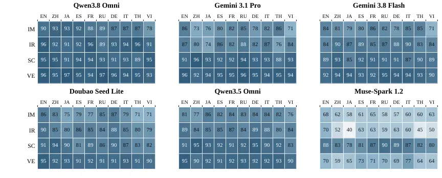
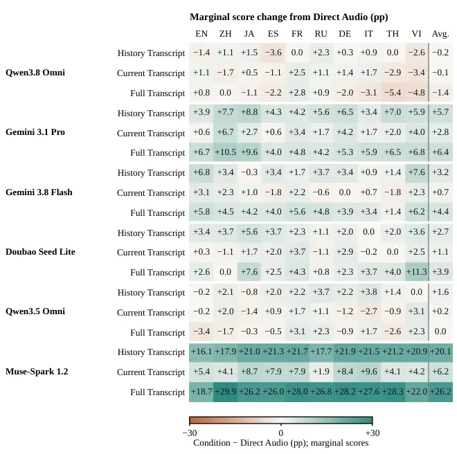
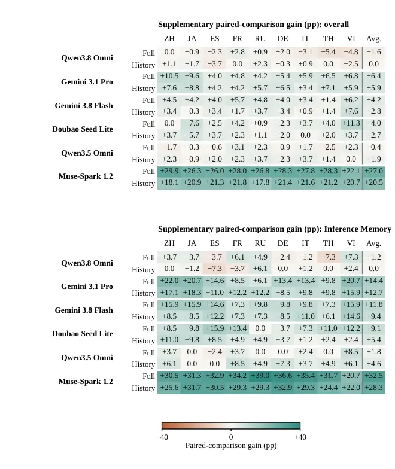

# Do Multi-Turn Conversational Capabilities Carry Over from Text to Speech? A Parallel Multilingual Benchmark

Jiaming Zhou^(1,2)  Pei Zhang²  Shiwan Zhao¹  Zhijun Wang²  Baosong
Yang²  Yong Qin¹  ¹College of Computer Science, Nankai University
 ²Alibaba Token Hub, Alibaba Group ^(†)^(†)thanks: Work done during an
internship at Alibaba Token Hub, Alibaba Group.^(†)^(†)thanks: Yong Qin
is corresponding author. Correspondence to: qinyong@nankai.edu.cn

###### Abstract

Successful multi-turn voice interaction requires models to retain
information from earlier turns, follow persistent instructions, and
track revisions to conversational state. Yet these abilities are often
evaluated from transcripts, leaving open whether successes demonstrated
from text carry over when the same user turns are presented as speech,
and whether this transfer is consistent across languages. We introduce
Omnilingua-AudioMC, a strictly parallel multilingual extension of Audio
MultiChallenge, to study this question under controlled conditions. The
benchmark contains 354 conversations and 1,404 rubric items across ten
languages, with conversational content, turn structure, cross-turn
dependencies, and evaluation criteria aligned across transcript and
speech conditions. Across six speech-language models, the shift from
reference transcripts to direct speech input is strongly model- and
language-dependent: models with similar transcript performance can
diverge substantially under speech, and their relative strengths across
languages can change. Paired rubric-level analysis further shows that
aggregate transcript–speech gaps can obscure which conversational
requirements are actually preserved, because losses of
transcript-demonstrated successes can be offset by gains on other items.
We then diagnose recoverable speech degradation by selectively replacing
preceding user turns, the current user turn, or both with transcripts
generated by the evaluated model. For the two models with the largest
transcript–speech gaps, replacing preceding user turns yields a
significantly larger macro-level improvement than replacing only the
current turn, and the same numerical ordering holds across all ten
languages; in contrast, the strongest direct-speech model gains little
from either intervention. These results show that transcript performance
is an unreliable proxy for multilingual spoken conversational
performance and, for models most affected by speech, identify the
representation of preceding spoken context as an important source of
recoverable degradation. Our code is publicly available at
[https://github.com/QwenLM/Omnilingua-Bench/tree/main/Omnilingua-AudioMC](https://github.com/QwenLM/Omnilingua-Bench/tree/main/Omnilingua-AudioMC).

|     |
| --- |
|     |

## 1 Introduction

Speech-language models are increasingly expected to sustain
conversations across languages (Qwen Team, 2026b; Xu et al., 2025b).
Successful interaction, however, requires more than understanding the
current utterance. A response may depend on information introduced
several turns earlier, instructions that remain active throughout the
dialogue, or corrections that revise previously established
conversational state. A model may therefore satisfy a conversational
requirement when given a transcript of the interaction yet fail when the
same user turns must be processed from speech. Understanding whether
conversational successes demonstrated from transcripts carry over to
speech is thus central to evaluating multilingual voice interaction.

Reference transcripts provide a controlled diagnostic baseline for this
question. They preserve the wording of the spoken interaction—including
hesitation, repetition, false starts, and self-repair—while removing the
need to process audio. Comparing reference transcripts with speech
therefore asks whether a model can satisfy the same conversational
requirements when the user turns are represented in a different
modality, rather than comparing different tasks or independently
constructed examples.

To enable this comparison, we construct Omnilingua-AudioMC, a strictly
parallel multilingual extension of Audio MultiChallenge (AudioMC) (Gosai
et al., 2026). The benchmark contains 354 conversations and 1,404 rubric
items covering Inference Memory, Instruction Retention, Self Coherence,
and Voice Editing. Starting from human-recorded English conversations,
we construct aligned conditions in nine additional languages while
preserving conversational content, turn structure, cross-turn
dependencies, and evaluation criteria. English retains the original
human recording, while the nine non-English versions are localized and
synthesized; a synthetic-English condition provides a separate control
for speech realization. Details of the multilingual construction and
validation pipeline are provided in Section 2.

Our first question is whether conversational performance demonstrated
from reference transcripts carries over to direct speech input
consistently across models and languages. The answer is clearly
model-dependent. Among the six primary models, Muse-Spark has the
highest average Reference Transcript instance success but suffers the
largest drop under Direct Audio, whereas Qwen3.8 retains nearly the same
aggregate performance and achieves the strongest Direct Audio results.
The size of the shift also varies across languages, and relative
language strengths can be reordered after moving from transcripts to
speech (Figure 1). Reference-transcript performance is therefore not a
reliable proxy for multilingual spoken conversational performance.

Figure 1: Overview of the six primary models: gray segments connect
Reference Transcript and Direct Audio; teal points show History
Transcript, which replaces preceding user turns with model-generated
transcripts. Values are ten-language macro-mean instance success.

Aggregate scores alone, however, do not determine whether the same
conversational requirements survive the modality change. On matched
rubric items, some successes under Reference Transcript become failures
under Direct Audio, while other items change in the opposite direction.
These transitions can offset one another in the aggregate: even a model
with a small overall transcript–speech gap need not preserve every
reference-transcript success. We therefore complement marginal scores
with paired rubric-level analysis that explicitly tracks which
requirements remain satisfied under speech.

We next ask where the recoverable portion of this speech degradation
arises. Using the same fixed-history evaluation protocol, we vary the
representation of two parts of the user input: preceding user turns and
the current user turn. This yields four intervention conditions. In
Direct Audio, both preceding and current user turns are presented as
speech. In History Transcript, only preceding user turns are replaced by
transcripts generated by the evaluated model, while the current user
turn remains audio. Current Transcript makes the opposite substitution,
retaining preceding user turns as audio and replacing only the current
user turn with its model-generated transcript. Full Transcript replaces
both preceding and current user turns with model-generated transcripts.
Historical assistant responses remain fixed as text throughout. These
four conditions form a $`2\times 2`$ diagnostic over history and
current-turn representation, with Reference Transcript retained as a
separate diagnostic baseline (Section 3.1).

The intervention results reveal a strong model-dependent contrast.
Muse-Spark and Gemini 3.1 Pro have the two largest
Reference-Transcript–Direct-Audio gaps, and for both models History
Transcript produces a larger macro-level improvement than Current
Transcript, with the History–Current difference supported by
conversation-level bootstrap intervals. The same numerical ordering
holds across all ten evaluated languages. Qwen3.8 provides a different
regime: its Direct Audio performance already remains close to its
Reference Transcript performance, and neither history nor current-turn
transcription produces a meaningful average improvement. The remaining
models exhibit smaller and more language-dependent effects. These
results show that transcript substitution is not intrinsically
beneficial; rather, its benefit depends on where changing the
representation of spoken input can recover performance.

For the models most affected by speech, these behavioral interventions
point to preceding spoken context as an important source of recoverable
degradation. They do not, however, identify a particular internal memory
mechanism. History Transcript replaces several preceding user turns
whereas Current Transcript replaces only the current turn, so the
comparison does not isolate the position of the information from the
amount of audio being replaced. The joint Full Transcript condition
provides an additional diagnostic of how history- and
current-turn-associated effects combine, but the corresponding
interaction estimates remain secondary to the main localization result.

Our contributions are threefold:

- •
  We introduce Omnilingua-AudioMC, a strictly parallel multilingual
  benchmark for persistent multi-turn conversational capabilities,
  containing 354 conversations and 1,404 rubric items across ten
  languages, with conversational content, cross-turn dependencies, and
  evaluation criteria aligned across transcript and speech conditions.
- •
  We show that transcript-to-speech transfer varies substantially across
  models and languages, and use paired rubric-level analysis to
  demonstrate that aggregate score gaps can obscure which conversational
  requirements are actually preserved under speech.
- •
  We introduce a controlled $`2\times 2`$ intervention over preceding
  user history and the current user turn. For the two models with the
  largest transcript–speech gaps, replacing preceding user turns with
  model-generated transcripts yields a larger macro-level improvement
  than replacing only the current turn, while a strong Direct Audio
  model gains little from either intervention.

## 2 Benchmark and Evaluation Framework

### 2.1 Benchmark Overview

Our benchmark tests whether persistent conversational capabilities
demonstrated under Reference Transcript remain available when the same
content is presented as speech, building on Audio MultiChallenge
(AudioMC; Gosai et al., 2026). We retain four capabilities: Inference
Memory (IM), Instruction Retention (IR), Self Coherence (SC), and Voice
Editing (VE). These capabilities require a model to preserve or update
information, instructions, and conversational states established in
earlier turns.

| Dataset and conditions                                                                                                                    |         |
| ----------------------------------------------------------------------------------------------------------------------------------------- | ------- |
| Conversations                                                                                                                             | 354     |
| User turns                                                                                                                                | 1,827   |
| Rubric items                                                                                                                              | 1,404   |
| Reference Transcript / speech conditions                                                                                                  | 10 / 11 |
| Conversations by capability                                                                                                               |         |
| Inference Memory (IM)                                                                                                                     | 82      |
| Instruction Retention (IR)                                                                                                                | 95      |
| Self Coherence (SC)                                                                                                                       | 77      |
| Voice Editing (VE)                                                                                                                        | 100     |
| Languages (10)                                                                                                                            |         |
| English (en), Chinese (zh), Japanese (ja), Spanish (es), French (fr), Russian (ru), German (de), Italian (it), Thai (th), Vietnamese (vi) |         |

Table 1: Benchmark composition. Dataset sizes are reported per aligned
condition.

The central design principle is strict parallelism. Each benchmark item
is instantiated across languages and modalities while preserving the
same conversation, turn structure, cross-turn dependencies, and
evaluation criteria. This alignment is essential for attributing
differences across conditions to language and input representation
rather than to changes in conversational content or task requirements.
The benchmark covers English and nine non-English languages (Table 1),
and headline analyses average over these ten languages. Each language
has an aligned Reference Transcript condition and a speech condition.
For English, the speech condition is the original human recording; we
additionally synthesize a controlled English TTS speech condition
(EN-TTS) that shares the English transcripts, isolating synthesis
effects from language effects and reported separately (Section 3.3).

For each conversation, the Reference Transcript and speech conditions
form a matched pair evaluated with aligned rubric items: at the
designated turn, user turns are presented as reference transcripts or
speech with preceding assistant turns as fixed text, and the model
generates only the designated response. We report rubric-level success
and conversation-level success, the latter requiring all associated
rubric items to be satisfied.

All conditions are built from the same final conversation set: if a
conversation cannot be reliably realized in a required language,
parallel filtering removes it from the corresponding conditions
(Section 2.2), keeping comparisons aligned at the conversation and
rubric levels. The same filtering also removes the upstream benchmark’s
memory-capability conversations that embed background sounds, a
non-speech acoustic-event design; this work considers speech only.

### 2.2 Speech-Grounded Parallel Multilingual Construction

##### Preserving interactional structure.

Construction starts from AudioMC’s human-recorded English conversations
and transcripts (Gosai et al., 2026). Rather than translating utterances
independently, localization preserves task-relevant content,
conversational state transitions, cross-turn dependencies, and
evaluation requirements in natural target-language speech; each user
turn is localized with access to the English source history and
previously localized turns, maintaining consistent entities, references,
terminology, and state updates.

Source-transcript analysis identifies task-relevant spoken phenomena,
including hesitation, repetition, false starts, and self-repair, whose
interactional structure is retained during localization. Self-repair is
particularly important because earlier content may be explicitly
withdrawn or revised: retaining only the final value of “5 sticks of
butter, make that 10, actually stick with 5” would remove the
conversational reasoning required by the original interaction. The
resulting spoken-form text serves both as the Reference Transcript input
and as the linguistic content for speech synthesis, anchoring the two
modalities to the same intended interaction.

##### Controlling speech realization.

A single multilingual TTS system realizes the localized user turns with
a fixed speaker-to-voice mapping per conversation, reused across
synthesized languages; this reduces variation in speaker assignment
without assuming that multilingual voice presets correspond to
acoustically identical speakers. A synthetic-English condition using the
unchanged English reference transcript and the same pipeline provides a
within-language comparison with the original recordings. Detailed
synthesis settings, delivery guidance, and recovery procedures appear in
Appendix C.

##### Validating content and maintaining parallelism.

Validation preserves task-relevant content and cross-condition
alignment. Text review checks semantic fidelity, naturalness, cross-turn
entity consistency, rubric applicability, and the order of task-critical
revisions. Audio review combines transcripts from multiple ASR systems
with model-based semantic comparison against the spoken-form reference
to identify omissions, additions, or meaning-changing substitutions;
because recognition errors can resemble synthesis defects, ambiguous
cases receive additional review rather than automatic rejection.

Confirmed defects trigger resynthesis with the same reference text and
voice assignment, followed by renewed validation. During construction,
parallel filtering propagates conversation-level exclusions across
aligned conditions, preserving a shared evaluation set, and subsequent
repairs retain the same conversational content and evaluation criteria.
Appendix C provides the full localization, synthesis, validation, and
repair procedures.

## 3 Experiments and Analysis

### 3.1 Experimental Setup

##### Models and evaluation.

We evaluate six primary models: Muse-Spark 1.2 (Meta AI, 2026), Gemini
3.1 Pro (Google DeepMind, 2026a), Gemini 3.8 Flash (Google DeepMind,
2026b), Qwen3.8/3.5 Omni (Qwen Team, 2026b; Qwen Team, 2026a), and
Doubao Seed Lite (ByteDance, 2026). Following AudioMC’s fixed-context,
binary-rubric protocol (Gosai et al., 2026), o4-mini (OpenAI, 2025)
judges the response generated at the designated turn; robustness to this
judge choice is assessed in Appendix D. Rubric success pools passed
criteria over scored criteria, while instance success requires all
criteria of a conversation to pass. Unless a table states otherwise,
macro averages weight the ten languages equally, with English human
recordings included; English TTS is a synthesis control reported
separately, and paired-comparison averages that lack an English export
are noted in their captions. Marginal scores use available judgments,
whereas paired and factorial analyses use comparison-specific common
items or conversations. Marginal tables report point estimates, while
conversation-level bootstrap intervals accompany the headline contrasts
(Appendix A.3); aggregation details appear in Appendix A.1.

##### Core input conditions.

Reference Transcript supplies the disfluency-preserving spoken-form text
and serves as a diagnostic baseline. The remaining four conditions form
a $`2\times 2`$ intervention over the representation of preceding user
turns and the current user turn: Direct Audio presents both as audio;
History Transcript replaces only preceding user turns with
model-generated transcripts; Current Transcript replaces only the
current user turn; and Full Transcript replaces both. In the three
transcript interventions, each evaluated model generates the transcript
substitutions once, and those frozen substitutions are reused across its
corresponding conditions. The factorial design probes where transcript
substitution can recover performance. Improvements under History
Transcript indicate greater behavioral sensitivity to the representation
of preceding user turns, while improvements under Current Transcript
indicate sensitivity to the representation of the current query. Full
Transcript examines how the two intervention effects combine. These
interventions localize recoverable degradation at the level of input
representation rather than identifying a particular internal processing
mechanism. Additional transcript-source diagnostics, including
shared-recognizer transcripts and reference-transcript history, are
reported in Appendix A.7. These procedures add processing and are not
compute-matched to Direct Audio.

##### Additional open models.

Qwen2.5-Omni (Xu et al., 2025a), Voxtral-Mini (Mistral AI, 2025),
Qwen3-Omni (Xu et al., 2025b), and Voxtral-Small are evaluated locally
under Reference Transcript and Direct Audio with the same judge and
rubrics. Their condition-specific retained sets differ, so they are
reported separately without paired or transcript-intervention analyses
(Appendix B).

### 3.2 Overall Multilingual Direct-Audio Performance

Table 2 reports Direct Audio instance success for every language and
primary model; the Avg., Std., and Range columns summarize its variation
across the ten languages, and capability-level panels appear in Appendix
Table A.1. Qwen3.8 Omni achieves the highest overall Direct Audio
instance success in each of the ten languages, with mean 60.2%, followed
by Gemini 3.1 Pro at 54.4%; Muse-Spark reaches only 32.4% (Table 3).
These absolute scores locate weaknesses; the matched Reference
Transcript comparisons below establish modality-associated losses.
Table 5 reports the Reference Transcript baseline and the four core
intervention conditions.

| Model            | EN   | ZH   | JA   | ES   | FR   | RU   | DE   | IT   | TH   | VI   | Avg. | Std. | Range |
| ---------------- | ---- | ---- | ---- | ---- | ---- | ---- | ---- | ---- | ---- | ---- | ---- | ---- | ----- |
| Qwen3.8 Omni     | 61.6 | 60.7 | 60.5 | 64.1 | 59.6 | 61.0 | 61.6 | 60.7 | 54.0 | 58.2 | 60.2 | 2.5  | 10.1  |
| Gemini 3.1 Pro   | 60.2 | 50.8 | 53.1 | 57.6 | 54.8 | 56.5 | 53.7 | 55.4 | 50.3 | 51.4 | 54.4 | 3.0  | 9.9   |
| Gemini 3.8 Flash | 52.0 | 51.7 | 48.6 | 51.4 | 48.9 | 53.1 | 50.6 | 51.4 | 48.0 | 44.4 | 50.0 | 2.4  | 8.7   |
| Doubao Seed Lite | 47.7 | 46.3 | 42.1 | 40.4 | 41.2 | 45.2 | 41.5 | 44.6 | 38.7 | 35.9 | 42.4 | 3.4  | 11.8  |
| Qwen3.5 Omni     | 42.9 | 39.8 | 38.7 | 38.4 | 37.3 | 38.4 | 37.6 | 38.4 | 36.2 | 33.6 | 38.1 | 2.3  | 9.3   |
| Muse-Spark 1.2   | 39.8 | 28.7 | 29.4 | 34.2 | 32.5 | 37.9 | 33.7 | 32.6 | 27.1 | 28.3 | 32.4 | 4.0  | 12.7  |

Table 2: Direct Audio overall instance success (%) by language and
model. Avg., population Std., and Range (max$`-`$min, in points)
summarize the ten languages; EN uses human speech, other languages TTS;
bold marks the highest value per column.

### 3.3 RQ1: How does conversational capability change from Reference Transcript to Direct Audio across languages?

|                  |                                                     |             |             |             |             |             |             |             |             |             |               |      |             |
| ---------------- | --------------------------------------------------- | ----------- | ----------- | ----------- | ----------- | ----------- | ----------- | ----------- | ----------- | ----------- | ------------- | ---- | ----------- |
|                  | Direct Audio $`-`$ Reference Transcript by language |             |             |             |             |             |             |             |             |             | Macro summary |      |             |
| Model            | EN                                                  | ZH          | JA          | ES          | FR          | RU          | DE          | IT          | TH          | VI          | Ref.          | Aud. | $`\Delta`$  |
| Qwen3.8 Omni     | ($`0.0`$)                                           | ($`-1.7`$)  | ($`+1.6`$)  | ($`-2.6`$)  | ($`0.0`$)   | ($`-2.0`$)  | ($`-2.8`$)  | ($`0.0`$)   | ($`+3.2`$)  | ($`-3.1`$)  | 60.9          | 60.2 | ($`-0.7`$)  |
| Gemini 3.1 Pro   | ($`-2.8`$)                                          | ($`-14.7`$) | ($`-11.9`$) | ($`-6.5`$)  | ($`-8.5`$)  | ($`-4.0`$)  | ($`-9.6`$)  | ($`-7.9`$)  | ($`-11.6`$) | ($`-8.2`$)  | 63.0          | 54.4 | ($`-8.6`$)  |
| Gemini 3.8 Flash | ($`-7.3`$)                                          | ($`-7.1`$)  | ($`-9.3`$)  | ($`-3.1`$)  | ($`-5.6`$)  | ($`-3.4`$)  | ($`-8.2`$)  | ($`-5.4`$)  | ($`-7.9`$)  | ($`-12.1`$) | 57.0          | 50.0 | ($`-6.9`$)  |
| Doubao Seed Lite | ($`+0.8`$)                                          | ($`-4.3`$)  | ($`-8.5`$)  | ($`-8.8`$)  | ($`-5.7`$)  | ($`-3.7`$)  | ($`-5.7`$)  | ($`-3.7`$)  | ($`-6.5`$)  | ($`-14.4`$) | 48.4          | 42.4 | ($`-6.1`$)  |
| Qwen3.5 Omni     | ($`+0.5`$)                                          | ($`-1.2`$)  | ($`-2.3`$)  | ($`-3.1`$)  | ($`-3.1`$)  | ($`-2.0`$)  | ($`-1.7`$)  | ($`-0.9`$)  | ($`+0.9`$)  | ($`-6.8`$)  | 40.1          | 38.1 | ($`-2.0`$)  |
| Muse-Spark 1.2   | ($`-24.9`$)                                         | ($`-33.7`$) | ($`-34.6`$) | ($`-29.6`$) | ($`-34.2`$) | ($`-29.6`$) | ($`-31.3`$) | ($`-31.0`$) | ($`-34.2`$) | ($`-32.6`$) | 64.0          | 32.4 | ($`-31.6`$) |

Table 3: Reference Transcript to Direct Audio shift in instance success
(%) by language and model. Language cells give Direct Audio minus
Reference Transcript (positive in teal, negative in red);
Ref./Aud./$`\Delta`$ give ten-language macro means.

##### The strongest primary model on reference transcripts becomes the weakest in speech.

Table 3 contrasts the two conditions for the six primary models.
Muse-Spark has the highest instance-level Reference Transcript mean,
64.0%, but falls to 32.4% under Direct Audio, a decline of 31.6
percentage points. Gemini 3.1 Pro drops from 63.0% to 54.4%. Qwen3.8, in
contrast, remains close to its Reference Transcript performance: 60.9%
versus 60.2%. Its small gap accompanies high absolute speech
performance, unlike Qwen3.5, whose smaller decline occurs at a much
lower Direct Audio score of 38.1%. The headline gaps are stable under
conversation-level resampling: ten-language 95% bootstrap intervals are
\[$`+28.0`$, $`+35.1`$\] percentage points for Muse-Spark and
\[$`+6.3`$, $`+10.8`$\] for Gemini 3.1 Pro (Appendix A.3). These
comparisons separate a large modality-associated deficit from low
performance shared by both input conditions.

##### Language strengths under reference transcripts do not reliably predict speech strengths.

The shift is strongly language-dependent (Table 3): Muse-Spark loses
25–35 points in every language, Gemini 3.1 Pro ranges from 3 to 15
points, and Qwen3.8 stays within about 3 points throughout. The
per-language ordering also changes rather than being a uniform penalty
on an otherwise unchanged ranking: Chinese is Gemini 3.1 Pro’s strongest
non-English reference language yet among its weakest under Direct Audio,
while other models reorder their profiles in different ways. Qwen3.8
supplies a counterexample to a universal decline: Direct Audio exceeds
Reference Transcript in Japanese and Thai, although Thai remains its
weakest Direct Audio language overall (Table 3).

##### English TTS provides a within-language realization control.

Replacing human-recorded English with synthetic English changes Muse’s
instance success by -0.3 points and Gemini 3.1 Pro’s by +0.6 points,
small relative to their non-English gaps, whereas Qwen3.5 loses 4.5
points (Table A.12). This control measures sensitivity to the English
realization; it neither decomposes the reference–audio gap nor
establishes synthesis effects in the target languages.

The four local open models provide a further check on the distinction
between absolute performance and modality gaps; because they use
condition-specific retained sets, they are reported without paired
outcomes (Appendix B).

### 3.4 RQ2: Do aggregate Reference-Transcript–Direct-Audio gaps reflect preservation of the same conversational capabilities?

Aggregate gaps can hide changes in which criteria are satisfied.
Figure 2 therefore separates paired rubric outcomes into success in both
modalities, reference only, audio only, and neither. It also reports
survival: the fraction of reference-passing rubric items that remain
successful under audio. These analyses use rubric-level pairs, whereas
the overall scores discussed in RQ1 use instance success. The figure
shows the six primary models in the same order as Table 2: Qwen3.8 Omni,
Gemini 3.1 Pro, Gemini 3.8 Flash, Doubao Seed Lite, Qwen3.5 Omni, and
Muse-Spark 1.2. This overview spans broad degradation,
capability-specific vulnerabilities, and small net gaps. Full paired
counts appear in Appendix A.

(a) Paired outcomes

(b) Capability survival

Figure 2: Top: paired Reference Transcript / Direct Audio rubric
outcomes, pooled over ten languages. Bottom: survival of
reference-passing items by language; counts appear in Table A.9.

| Model            | IM   | IR   | SC   | VE   |
| ---------------- | ---- | ---- | ---- | ---- |
| Qwen3.8 Omni     | 88.4 | 92.9 | 92.9 | 95.3 |
| Gemini 3.1 Pro   | 79.8 | 82.7 | 92.6 | 94.5 |
| Gemini 3.8 Flash | 80.9 | 86.6 | 89.7 | 92.9 |
| Doubao Seed Lite | 79.4 | 84.3 | 87.1 | 91.9 |
| Qwen3.5 Omni     | 81.9 | 85.3 | 91.4 | 92.1 |
| Muse-Spark 1.2   | 61.3 | 56.9 | 84.6 | 68.0 |

Table 4: Survival of reference-passing rubric items under Direct Audio
(%), pooled over ten languages; language-level survival appears in
Figure 2(b).

##### Memory and instruction retention are vulnerable, but the failure profile is broader for Muse.

For Gemini 3.1 Pro, IM and IR show the largest reference-only shares
among its capabilities, and only 79.8% of its reference-passing IM
criteria survive under audio, versus 94.5% for VE (Table 4); the
vulnerability is language-specific, with IM survival at 72.6% in Chinese
and 71.2% in Vietnamese but 86.2% in Thai (Figure 2b). Muse’s losses
extend beyond memory: IR survival is 56.9% and VE survival 68.0%, with
Japanese IR survival just 40.4% (Table 4). A memory-only account would
therefore miss substantial instruction and revision failures in this
model.

Doubao likewise retains fewer reference-passing IM criteria (79.4%) than
of other capabilities (IR 84.3%, SC 87.1%, VE 91.9%; Table 4), and its
reference-only share exceeds its audio-only share by roughly 1.7 to 1,
with uneven language-level IM survival from 86.7% in German to 70.7% in
Thai (Figure 2). Its moderate net decline therefore conceals more lost
successes than the aggregate gap suggests; the lower absolute audio
score also reflects criteria that fail in both modalities.

##### A small net gap does not imply preservation of the same successes.

Qwen3.8’s reference-only and audio-only shares are nearly balanced, at
roughly 1.1 to 1, so opposing transitions largely cancel in its small
aggregate gap, yet its IM survival falls to 77.8% in Vietnamese against
93.0% in Chinese (Figure 2). Conversely, Gemini 3.1 Pro’s relatively
stable SC score coexists with nearly balanced shares. Paired outcomes
thus identify failures that neither the overall gap nor the marginal
capability scores can resolve.

### 3.5 RQ3: Where does recoverable speech degradation arise: preceding history, the current turn, or both?

The four intervention conditions vary the representation of preceding
user history and the current turn, with Reference Transcript a
diagnostic baseline outside this factorial design (Section 3.1). Table 5
reports absolute ten-language macro-mean instance success, with each
intervention’s marginal contrast with Direct Audio in parentheses; these
are marginal scores computed from available judgments, providing the
descriptive condition-level comparison. For statistical comparisons,
each contrast is re-estimated on its corresponding complete common
conversation set, with conversation-level bootstrap intervals in
Appendix A.3.

|                  | Diagnostic baseline      | $`2\times 2`$ intervention |                    |                    |                  |
| ---------------- | ------------------------ | -------------------------- | ------------------ | ------------------ | ---------------- |
| Model            | Reference Transcript     | Direct Audio               | History Transcript | Current Transcript | Full Transcript  |
| Qwen3.8 Omni     | 60.9                     | 60.2                       | 60.1 ($`-0.2`$)    | 60.1 ($`-0.1`$)    | 58.8 ($`-1.4`$)  |
| Gemini 3.1 Pro   | 63.0                     | 54.4                       | 60.1 ($`+5.7`$)    | 57.1 ($`+2.8`$)    | 60.8 ($`+6.4`$)  |
| Gemini 3.8 Flash | 57.0                     | 50.0                       | 53.2 ($`+3.2`$)    | 50.8 ($`+0.7`$)    | 54.4 ($`+4.4`$)  |
| Doubao Seed Lite | 48.4                     | 42.4                       | 45.1 ($`+2.7`$)    | 43.4 ($`+1.1`$)    | 46.3 ($`+3.9`$)  |
| Qwen3.5 Omni     | 40.1                     | 38.1                       | 39.8 ($`+1.6`$)    | 38.4 ($`+0.2`$)    | 38.1 ($`0.0`$)   |
| Muse-Spark 1.2   | 64.0                     | 32.4                       | 52.5 ($`+20.1`$)   | 38.6 ($`+6.2`$)    | 58.6 ($`+26.2`$) |

Table 5: Ten-language macro-mean instance success (%). Reference
Transcript is a diagnostic baseline outside the $`2\times 2`$
intervention. Parenthesized values give the marginal contrast with
Direct Audio in points (positive in teal, negative in red).

Figure 3: History versus Current Transcript marginal contrasts (pp)
relative to Direct Audio, per language, for the two models with the
largest Direct-Audio deficits; bars above zero mark languages where the
substitution raises instance success. Common-set bootstrap intervals
appear in Appendix A.3.

##### History replacement is most informative in the models with the largest Direct-Audio deficits.

Muse gains 20.1 points under History Transcript, compared with 6.2 under
Current Transcript (Table 5); Gemini 3.1 Pro gains 5.7 and 2.8 points,
respectively. The History–Current difference itself is positive for both
models: $`+13.6`$ points for Muse-Spark (95% CI \[$`+10.2`$,
$`+17.1`$\]), with per-language intervals excluding zero in all ten
languages, and $`+3.0`$ points for Gemini 3.1 Pro (\[$`+1.0`$,
$`+5.1`$\]). For both models, the History Transcript contrast is
numerically larger than the Current Transcript contrast in every
language (Figure 3). History Transcript produces the larger improvement,
indicating greater behavioral sensitivity to the representation of
preceding spoken context; because it replaces several preceding turns
while Current Transcript replaces only the current turn, the design does
not separate history content from the amount of audio replaced. Full
Transcript supplies the joint intervention, improving Muse by 26.2
points and Gemini 3.1 Pro by 6.4 points.

##### The observed benefit is not universal.

Qwen3.8, the strongest Direct Audio model, has near-zero average
single-substitution contrasts and does not improve under Full
Transcript; its language-level results are not uniformly zero, but this
observational pattern shows that transcript substitution does not yield
an average improvement for every model. The remaining models likewise do
not support a universal history rule, showing language-dependent
reversals in which substituting the current turn is the more beneficial
intervention (Appendix Figure A.1 and Table A.5).

##### The two substitutions recover partially overlapping sets of lost successes.

Among conversations that succeed under Reference Transcript but fail
under Direct Audio, History and Current Transcript each rescue cases
that the other does not: across the six models, 50–70% of recovered
conversations are rescued by only one of the two substitutions, and
History-only rescues exceed Current-only rescues in five of the six
(Appendix A.4). This overlap evidence is separate from the
aggregate-level question of additivity: the Full Transcript point
estimate is close to the sum of the two single-substitution contrasts
for several models, but the common-set interaction intervals span or
nearly span zero, so departures from additivity are not established
(Appendix A.3).

## 4 Related Work

##### Parallel multilingual evaluation.

XNLI and MGSM extend inference and mathematical reasoning across aligned
examples (Conneau et al., 2018; Shi et al., 2023), and Multi-IF brings
multilingual evaluation to multi-turn instruction following (He et al.,
2024). These text benchmarks motivate controlling task content across
languages; ours additionally varies how the conversational context is
presented, pairing reference transcripts with speech.

##### Spoken instructions and multimodal context.

Speech-IFEval separates instruction-following assessment from speech
perception (Lu et al., 2025). DOWIS provides parallel written and
human-recorded spoken prompts across languages (Züfle et al., 2026), and
MCIF evaluates crosslingual instructions over speech, text, and visual
content from scientific talks (Papi et al., 2026). Our focus is
complementary: preserving conversational information, constraints, and
revisions across turns, and testing which input procedures recover
failures on the same dialogue.

##### Multi-turn speech and transcript-mediated inference.

AudioMC provides the human-recorded conversations and capability
framework on which we build (Gosai et al., 2026), comparing Direct Audio
with a shared-ASR cascade with model-dependent gains and losses. We
extend this comparison to strictly parallel multilingual conditions,
track matched capability transitions, and localize recoverable
degradation by varying the transcript representation of preceding
history and the current turn. M3-DuplexBench examines multilingual
full-duplex interaction (Fukuda et al., 2026); our fixed-context
protocol instead targets content-dependent response correctness under
controlled changes to input representation.

## 5 Conclusion

This work introduces Omnilingua-AudioMC, a strictly parallel
multilingual benchmark for persistent conversational capabilities,
grounded in human-recorded dialogue. The resulting comparisons show that
reference-transcript performance is an unreliable proxy for spoken
conversational ability: models can change their relative language
strengths under speech, and small average modality gaps can conceal the
loss of individual successes. Memory-related failures are prominent in
several models, while instruction retention and revision tracking reveal
additional vulnerabilities that an overall score would miss. In the
models with the largest Reference-Transcript–Direct-Audio gaps, History
Transcript produces larger marginal recovery than Current Transcript in
every language, with positive macro-level History–Current differences
whose bootstrap intervals exclude zero. Qwen3.8’s near-zero average
interventions show that transcript substitution does not help every
model, and other models contain language-level reversals in the
preferred substitution. History and Current Transcript recover partially
overlapping subsets of these lost successes, and the common-set
interaction intervals span or nearly span zero, so departures from
additivity are not established. These findings make history
representation a key design consideration for multilingual voice
interaction.

### AI use statement

In this work, we used generative AI tools to help implement and debug
the evaluation and analysis code that produces the reported results; the
code was reviewed and tested for correctness by the authors. We have not
used generative AI tools for generating research ideas, experimental
designs, or other tasks with required disclosure beyond the above, and
the remaining required-disclosure categories are not applicable to this
work. Additionally, we used generative AI tools to assist with surveying
and organizing related literature; all cited works were verified against
their original sources. We have reviewed all AI-assisted work. We take
responsibility for the final content of this work, including code and
artifacts produced with the aid of generative AI.

### Ethics statement

Our benchmark builds on the publicly released Audio MultiChallenge
conversations and synthesizes all non-English speech with a commercial
text-to-speech system; no new human-subject data collection is involved,
and the source recordings are used under the terms of the original
dataset. The English human/TTS control (Appendix A.12) reports the
sensitivity of this synthetic realization. The evaluation measures
publicly available speech-enabled models in a fixed-context diagnostic
protocol and does not involve personal data beyond the source
conversations; we are not aware of harmful dual-use implications of the
reported diagnostics.

### Reproducibility statement

The benchmark construction—localization, synthesis, validation, parallel
filtering, and repair—is documented in Section 2 and Appendix C,
including synthesis settings and delivery guidance. The evaluation
protocol, input conditions, and scoring conventions are specified in
Section 3.1 and Appendix A.1, and the conversation-level bootstrap
procedure appears in Appendix A.3. All reported numbers derive from
frozen model outputs and judge results over the same 354-conversation
set.

## References

- ByteDance (2026) ByteDance Doubao seed 2.0 lite. External Links:
  [Link](https://seed.bytedance.com/seed2) Cited by: §3.1.
- Conneau et al. (2018) A. Conneau, R. Rinott, G. Lample, A.
  Williams, S. R. Bowman, H. Schwenk, and V. Stoyanov XNLI: evaluating
  cross-lingual sentence representations. In Proceedings of the 2018
  Conference on Empirical Methods in Natural Language Processing,
  pp. 2475–2485. Cited by: §4.
- Fukuda et al. (2026) R. Fukuda, A. Ando, H. Kanagawa, T. Kano, M.
  Delcroix, N. Tawara, and Y. Chiba M3-DuplexBench: a multi-turn,
  multilingual, multidomain benchmark for full-duplex spoken dialogue
  models. arXiv preprint arXiv:2607.29125. External Links:
  [Link](https://arxiv.org/abs/2607.29125) Cited by: §4.
- Google DeepMind (2026a) Google DeepMind Gemini 3.1 pro model card.
  External Links:
  [Link](https://deepmind.google/models/model-cards/gemini-3-1-pro/)
  Cited by: §3.1.
- Google DeepMind (2026b) Google DeepMind Gemini 3.8 flash model card.
  External Links:
  [Link](https://deepmind.google/models/model-cards/gemini-3-8-flash/)
  Cited by: §3.1.
- Google (2026) Google Gemini 3.1 flash tts preview. External Links:
  [Link](https://ai.google.dev/gemini-api/docs/models/gemini-3.1-flash-tts-preview)
  Cited by: §C.2.
- Gosai et al. (2026) A. Gosai, T. Vuong, U. Tyagi, S. Li, W. You, M.
  Bavare, A. Uçar, Z. Fang, B. Jang, B. Liu, and Y. He Audio
  MultiChallenge: a multi-turn evaluation of spoken dialogue systems on
  natural human interaction. In Proceedings of the 64th Annual Meeting
  of the Association for Computational Linguistics (Volume 1: Long
  Papers), pp. 35740–35770. External Links:
  [Link](https://aclanthology.org/2026.acl-long.1654/) Cited by: §1,
  §2.1, §2.2, §3.1, §4.
- He et al. (2024) Y. He, D. Jin, C. Wang, C. Bi, K. Mandyam, H.
  Zhang, C. Zhu, N. Li, T. Xu, H. Lv, S. Bhosale, C. Zhu, K. A.
  Sankararaman, E. Helenowski, M. Kambadur, A. Tayade, H. Ma, H. Fang,
  and S. Wang Multi-IF: benchmarking LLMs on multi-turn and multilingual
  instructions following. arXiv preprint arXiv:2410.15553. Cited by: §4.
- Lu et al. (2025) K. Lu, C. Kuan, and H. Lee Speech-IFEval: evaluating
  instruction-following and quantifying catastrophic forgetting in
  speech-aware language models. In Interspeech 2025, Cited by: §4.
- Meta AI (2026) Meta AI Introducing muse code and muse spark 1.2.
  External Links:
  [Link](https://research.meta.ai/blog/introducing-muse-code-and-muse-spark-1-2)
  Cited by: §3.1.
- Mistral AI (2025) Mistral AI Voxtral. External Links:
  [Link](https://mistral.ai/news/voxtral/) Cited by: §3.1.
- OpenAI (2025) OpenAI Introducing openai o3 and o4-mini. External
  Links: [Link](https://openai.com/index/introducing-o3-and-o4-mini/)
  Cited by: §3.1.
- OpenAI (2026) OpenAI GPT-5.6 terra. External Links:
  [Link](https://developers.openai.com/api/docs/models/gpt-5.6-terra)
  Cited by: Appendix D.
- Papi et al. (2026) S. Papi, M. Züfle, M. Gaido, B. Savoldi, D. Liu, I.
  Douros, L. Bentivogli, and J. Niehues MCIF: multimodal crosslingual
  instruction-following benchmark from scientific talks. In The
  Fourteenth International Conference on Learning Representations, Cited
  by: §4.
- Qwen Team (2026a) Qwen Team Qwen3.5-omni technical report. External
  Links: 2604.15804, [Link](https://arxiv.org/abs/2604.15804) Cited by:
  §3.1.
- Qwen Team (2026b) Qwen Team Qwen3.8-omni: towards native omni-modal
  agents. External Links: 2609.25611,
  [Link](https://arxiv.org/abs/2609.25611) Cited by: §1, §3.1.
- Shi et al. (2023) F. Shi, M. Suzgun, M. Freitag, X. Wang, S.
  Srivats, S. Vosoughi, H. W. Chung, Y. Tay, S. Ruder, D. Zhou, D. Das,
  and J. Wei Language models are multilingual chain-of-thought
  reasoners. In International Conference on Learning Representations,
  Cited by: §4.
- Xu et al. (2025a) J. Xu, Z. Guo, J. He, H. Hu, T. He, S. Bai, K.
  Chen, J. Wang, Y. Fan, K. Dang, B. Zhang, X. Wang, Y. Chu, and J. Lin
  Qwen2.5-omni technical report. arXiv preprint arXiv:2503.20215.
  External Links: [Link](https://arxiv.org/abs/2503.20215) Cited by:
  §3.1.
- Xu et al. (2025b) J. Xu, Z. Guo, H. Hu, Y. Chu, X. Wang, J. He, Y.
  Wang, X. Shi, T. He, X. Zhu, et al. Qwen3-omni technical report. arXiv
  preprint arXiv:2509.17765. External Links:
  [Link](https://arxiv.org/abs/2509.17765) Cited by: §1, §3.1.
- Züfle et al. (2026) M. Züfle, S. Papi, F. Retkowski, S. Mazurek, M.
  Kasztelnik, A. Waibel, L. Bentivogli, and J. Niehues Do what I say: a
  spoken prompt dataset for instruction-following. arXiv preprint
  arXiv:2603.09881. Cited by: §4.

## Appendix A Additional Experimental Results

### A.1 Coverage and Comparison Scope

All primary conditions target the same 354 conversations and 1,404
rubric items. A small number of judgments remained unavailable because
of API failures and are not re-run. Marginal results use available
judgments, whereas paired and factorial analyses use the corresponding
comparison-specific common sets, so their denominators can differ from
one another and from the marginal tables. Marginal tables report point
estimates, and conversation-level bootstrap intervals accompany the
headline contrasts (Appendix A.3).

The evaluation uses AudioMC’s fixed-context, binary-rubric protocol, but
our rubric success pools criteria within each language. AudioMC’s
average rubric score first averages within each conversation; these
aggregations differ when conversations have unequal numbers of criteria.
Survival conditions on reference-passing paired rubric items.
Transcription gains and recovery use comparison-specific common
conversation sets. Recovery is the fraction of
reference-success/audio-failure conversations that an intervention makes
successful; it does not count new failures introduced elsewhere and
should be read alongside net paired gain.

Historical assistant responses remain fixed text in every procedure:
models generate only the designated response, rather than an online
rollout of their own conversation histories.

Additional transcript-source diagnostics and implementation exceptions
are described in Appendix A.7.

Avg. is the ten-language macro mean (English human recordings plus nine
non-English languages); the paired-comparison gains of Appendix A.7 lack
an English export and their Avg. is the nine non-English languages, as
noted in their captions. Std. is the population standard deviation and
Range is the maximum minus minimum, both in percentage points. These
dispersion measures use the reported language scores, rounded to one
decimal place, and do not measure sampling uncertainty. A dash denotes
unavailable results rather than zero.

| (a) Inference Memory (IM)      |           |           |           |           |           |           |           |           |           |           |
| ------------------------------ | --------- | --------- | --------- | --------- | --------- | --------- | --------- | --------- | --------- | --------- |
| Model                          | EN        | ZH        | JA        | ES        | FR        | RU        | DE        | IT        | TH        | VI        |
| Qwen3.8 Omni                   | 72.5/58.5 | 74.5/61.0 | 75.2/61.0 | 79.1/67.1 | 73.9/61.0 | 73.9/61.0 | 73.2/62.2 | 73.2/61.0 | 69.3/53.7 | 66.0/51.2 |
| Gemini 3.1 Pro                 | 75.2/59.8 | 60.8/43.9 | 66.0/48.8 | 64.7/51.2 | 68.0/50.0 | 69.3/52.4 | 64.7/48.8 | 66.0/51.2 | 68.0/53.7 | 60.1/43.9 |
| Gemini 3.8 Flash               | 72.5/59.8 | 64.1/47.6 | 64.1/47.6 | 62.7/43.9 | 63.4/46.3 | 68.6/56.1 | 66.0/50.0 | 64.7/51.2 | 65.4/46.3 | 57.5/39.0 |
| Doubao Seed Lite               | 65.4/47.6 | 64.7/48.8 | 58.2/43.9 | 60.1/42.7 | 60.8/42.7 | 70.6/52.4 | 70.6/50.0 | 62.7/46.3 | 52.3/37.8 | 58.2/40.2 |
| Qwen3.5 Omni                   | 55.6/34.1 | 47.1/32.9 | 60.1/42.7 | 56.2/41.5 | 51.6/34.1 | 58.2/40.2 | 56.2/34.1 | 58.8/42.7 | 55.6/31.7 | 47.7/28.0 |
| Muse-Spark 1.2                 | 62.7/41.5 | 54.2/32.9 | 50.3/31.2 | 51.6/31.7 | 55.6/32.9 | 52.9/32.9 | 50.3/29.3 | 52.3/32.9 | 52.9/30.5 | 51.0/32.9 |
| (b) Instruction Retention (IR) |           |           |           |           |           |           |           |           |           |           |
| Model                          | EN        | ZH        | JA        | ES        | FR        | RU        | DE        | IT        | TH        | VI        |
| Qwen3.8 Omni                   | 89.9/80.0 | 86.5/69.6 | 83.8/66.3 | 86.0/75.8 | 89.2/78.9 | 83.8/67.4 | 87.4/75.8 | 87.4/75.8 | 83.1/65.3 | 85.6/71.6 |
| Gemini 3.1 Pro                 | 81.3/71.6 | 72.3/57.9 | 65.1/54.7 | 78.8/67.4 | 74.8/66.3 | 80.6/61.1 | 72.7/63.2 | 82.4/66.3 | 65.8/53.7 | 76.6/64.2 |
| Gemini 3.8 Flash               | 75.9/54.7 | 71.6/54.7 | 66.2/48.4 | 73.4/61.1 | 69.8/52.6 | 72.3/53.7 | 73.0/51.6 | 77.0/57.9 | 64.7/46.3 | 70.1/48.4 |
| Doubao Seed Lite               | 75.2/53.7 | 73.0/51.6 | 65.5/45.3 | 71.2/49.5 | 68.3/47.4 | 67.6/48.4 | 70.5/45.3 | 69.8/54.7 | 63.3/44.2 | 67.6/43.2 |
| Qwen3.5 Omni                   | 66.2/50.5 | 62.9/45.3 | 60.1/42.1 | 67.3/45.3 | 62.9/45.3 | 66.9/45.3 | 64.4/44.2 | 66.2/43.2 | 58.6/42.1 | 64.0/42.1 |
| Muse-Spark 1.2                 | 66.9/53.7 | 43.2/24.2 | 36.1/22.3 | 56.5/43.2 | 55.4/36.8 | 56.1/43.2 | 55.4/40.0 | 54.7/36.8 | 37.8/21.1 | 43.5/27.4 |
| (c) Self Coherence (SC)        |           |           |           |           |           |           |           |           |           |           |
| Model                          | EN        | ZH        | JA        | ES        | FR        | RU        | DE        | IT        | TH        | VI        |
| Qwen3.8 Omni                   | 82.3/41.6 | 81.4/49.4 | 77.9/50.6 | 83.3/48.1 | 80.4/40.3 | 80.4/45.5 | 81.1/48.1 | 80.4/42.9 | 77.9/36.4 | 83.0/48.1 |
| Gemini 3.1 Pro                 | 76.0/40.3 | 79.8/42.9 | 81.1/48.1 | 77.6/44.2 | 74.8/40.3 | 81.7/46.8 | 77.0/37.7 | 77.9/40.3 | 70.7/32.5 | 76.0/36.4 |
| Gemini 3.8 Flash               | 72.9/32.5 | 77.0/40.3 | 71.0/40.3 | 76.7/39.0 | 75.1/36.4 | 77.3/40.3 | 76.3/41.6 | 70.3/33.8 | 72.2/40.3 | 72.9/33.8 |
| Doubao Seed Lite               | 72.2/29.9 | 73.5/37.7 | 71.6/36.4 | 64.0/26.0 | 67.2/26.0 | 69.4/31.2 | 66.2/27.3 | 67.8/24.7 | 64.0/28.6 | 66.6/26.0 |
| Qwen3.5 Omni                   | 77.0/37.7 | 78.2/40.3 | 71.0/35.1 | 72.6/31.2 | 73.5/35.1 | 73.5/28.6 | 74.8/37.7 | 69.7/29.9 | 70.3/32.5 | 69.7/32.5 |
| Muse-Spark 1.2                 | 76.3/40.3 | 73.5/39.0 | 67.2/42.9 | 70.3/37.7 | 74.1/35.1 | 81.7/50.6 | 78.2/39.0 | 75.4/40.3 | 69.4/41.6 | 69.1/37.7 |
| (d) Voice Editing (VE)         |           |           |           |           |           |           |           |           |           |           |
| Model                          | EN        | ZH        | JA        | ES        | FR        | RU        | DE        | IT        | TH        | VI        |
| Qwen3.8 Omni                   | 90.9/62.0 | 89.6/61.0 | 90.4/62.0 | 90.4/63.0 | 88.4/55.0 | 92.1/67.0 | 89.5/58.0 | 88.0/60.0 | 88.3/57.0 | 87.2/59.0 |
| Gemini 3.1 Pro                 | 91.3/65.0 | 87.0/56.0 | 90.2/59.0 | 89.9/64.0 | 90.1/59.0 | 90.1/63.0 | 89.9/61.0 | 89.3/60.0 | 87.8/58.0 | 88.9/57.0 |
| Gemini 3.8 Flash               | 87.7/58.0 | 89.2/61.0 | 88.6/56.0 | 87.8/58.0 | 86.1/57.0 | 88.4/60.0 | 87.2/57.0 | 87.5/59.0 | 85.5/57.0 | 84.6/53.0 |
| Doubao Seed Lite               | 87.7/56.0 | 83.5/46.0 | 82.0/42.0 | 83.2/41.0 | 84.1/46.0 | 81.4/47.0 | 82.5/42.0 | 84.6/49.0 | 81.4/42.0 | 81.9/33.0 |
| Qwen3.5 Omni                   | 84.1/47.0 | 82.5/40.0 | 79.6/35.0 | 80.8/35.0 | 81.2/34.0 | 81.1/38.0 | 79.6/34.0 | 82.6/37.0 | 80.5/37.0 | 79.6/31.0 |
| Muse-Spark 1.2                 | 67.1/25.0 | 56.2/21.4 | 61.7/24.2 | 69.8/25.0 | 67.4/26.0 | 67.2/27.0 | 65.0/27.3 | 71.8/22.2 | 60.2/19.0 | 60.1/18.2 |
| (e) Overall                    |           |           |           |           |           |           |           |           |           |           |
| Model                          | EN        | ZH        | JA        | ES        | FR        | RU        | DE        | IT        | TH        | VI        |
| Qwen3.8 Omni                   | 86.8/61.6 | 85.5/60.7 | 84.6/60.5 | 86.7/64.1 | 85.2/59.6 | 85.8/61.0 | 85.4/61.6 | 84.5/60.7 | 82.8/54.0 | 83.6/58.2 |
| Gemini 3.1 Pro                 | 84.1/60.2 | 79.6/50.8 | 80.6/53.1 | 82.2/57.6 | 81.2/54.8 | 84.0/56.5 | 80.8/53.7 | 82.8/55.4 | 77.4/50.3 | 80.4/51.4 |
| Gemini 3.8 Flash               | 80.3/52.0 | 80.2/51.7 | 77.5/48.6 | 79.7/51.4 | 77.9/48.9 | 80.6/53.1 | 79.6/50.6 | 79.1/51.4 | 76.2/48.0 | 76.1/44.4 |
| Doubao Seed Lite               | 79.3/47.7 | 77.1/46.3 | 73.8/42.1 | 74.0/40.4 | 74.6/41.2 | 74.8/45.2 | 75.1/41.5 | 75.5/44.6 | 70.7/38.7 | 73.0/35.9 |
| Qwen3.5 Omni                   | 75.9/42.9 | 73.8/39.8 | 71.7/38.7 | 73.6/38.4 | 72.6/37.3 | 74.1/38.4 | 72.9/37.6 | 73.9/38.4 | 71.2/36.2 | 70.8/33.6 |
| Muse-Spark 1.2                 | 68.7/39.8 | 57.3/28.7 | 56.6/29.4 | 65.3/34.2 | 65.2/32.5 | 66.7/37.9 | 64.5/33.7 | 67.0/32.6 | 57.1/27.1 | 57.9/28.3 |

Table A.1: Direct-audio results in all ten languages. Each cell reports
rubric / instance success (%). EN uses human speech; other languages use
synthesized speech. Bold denotes the best displayed value separately for
each metric, language, and capability. Overall aggregates all items, not
the four capability percentages. Some runs have incomplete scoring; see
Appendix A.1.

### A.2 Full Factorial Results

The full instance-level and rubric-level factorial results behind the
marginal contrasts of Table 5 appear in Tables A.2 and A.3;
Appendix A.2.1 details the four-condition comparison scope, and
Figure A.1 visualizes the language-level contrasts.

| Model            | Input                | Avg. | EN   | ZH   | JA   | ES   | FR   | RU   | DE   | IT   | TH   | VI   |
| ---------------- | -------------------- | ---- | ---- | ---- | ---- | ---- | ---- | ---- | ---- | ---- | ---- | ---- |
| Qwen3.8 Omni     | Reference Transcript | 60.9 | 61.6 | 62.4 | 58.9 | 66.7 | 59.6 | 63.0 | 64.4 | 60.7 | 50.8 | 61.3 |
|                  | Direct Audio         | 60.2 | 61.6 | 60.7 | 60.5 | 64.1 | 59.6 | 61.0 | 61.6 | 60.7 | 54.0 | 58.2 |
|                  | History Transcript   | 60.1 | 60.2 | 61.8 | 62.0 | 60.5 | 59.6 | 63.3 | 61.9 | 61.6 | 54.0 | 55.6 |
|                  | Current Transcript   | 60.1 | 62.7 | 59.0 | 61.0 | 63.0 | 62.1 | 62.1 | 63.0 | 62.4 | 51.1 | 54.8 |
|                  | Full Transcript      | 58.8 | 62.4 | 60.7 | 59.4 | 61.9 | 62.4 | 61.9 | 59.6 | 57.6 | 48.6 | 53.4 |
| Gemini 3.1 Pro   | Reference Transcript | 63.0 | 63.0 | 65.5 | 65.0 | 64.1 | 63.3 | 60.5 | 63.3 | 63.3 | 61.9 | 59.6 |
|                  | Direct Audio         | 54.4 | 60.2 | 50.8 | 53.1 | 57.6 | 54.8 | 56.5 | 53.7 | 55.4 | 50.3 | 51.4 |
|                  | History Transcript   | 60.1 | 64.1 | 58.5 | 61.9 | 61.9 | 59.0 | 62.1 | 60.2 | 58.8 | 57.3 | 57.3 |
|                  | Current Transcript   | 57.1 | 60.8 | 57.5 | 55.8 | 58.2 | 58.2 | 58.2 | 57.9 | 57.1 | 52.3 | 55.4 |
|                  | Full Transcript      | 60.8 | 66.9 | 61.3 | 62.7 | 61.6 | 59.6 | 60.7 | 59.0 | 61.3 | 56.8 | 58.2 |
| Gemini 3.8 Flash | Reference Transcript | 57.0 | 59.3 | 58.8 | 57.9 | 54.5 | 54.5 | 56.5 | 58.8 | 56.8 | 55.9 | 56.5 |
|                  | Direct Audio         | 50.0 | 52.0 | 51.7 | 48.6 | 51.4 | 48.9 | 53.1 | 50.6 | 51.4 | 48.0 | 44.4 |
|                  | History Transcript   | 53.2 | 58.8 | 55.1 | 48.3 | 54.8 | 50.6 | 56.8 | 54.0 | 52.3 | 49.4 | 52.0 |
|                  | Current Transcript   | 50.8 | 55.1 | 54.0 | 49.6 | 49.6 | 51.1 | 52.5 | 50.6 | 52.1 | 46.2 | 46.7 |
|                  | Full Transcript      | 54.4 | 57.8 | 56.2 | 52.8 | 55.4 | 54.5 | 57.9 | 54.5 | 54.8 | 49.4 | 50.6 |
| Doubao Seed Lite | Reference Transcript | 48.4 | 46.9 | 50.6 | 50.6 | 49.2 | 46.9 | 48.9 | 47.2 | 48.3 | 45.2 | 50.3 |
|                  | Direct Audio         | 42.4 | 47.7 | 46.3 | 42.1 | 40.4 | 41.2 | 45.2 | 41.5 | 44.6 | 38.7 | 35.9 |
|                  | History Transcript   | 45.1 | 51.1 | 50.0 | 47.7 | 44.1 | 43.5 | 46.3 | 43.5 | 44.6 | 40.7 | 39.5 |
|                  | Current Transcript   | 43.4 | 48.0 | 45.2 | 43.8 | 42.4 | 44.9 | 44.1 | 44.4 | 44.4 | 38.7 | 38.4 |
|                  | Full Transcript      | 46.3 | 50.3 | 46.3 | 49.7 | 42.9 | 45.5 | 46.0 | 43.8 | 48.3 | 42.7 | 47.2 |
| Qwen3.5 Omni     | Reference Transcript | 40.1 | 42.4 | 41.0 | 41.0 | 41.5 | 40.4 | 40.4 | 39.3 | 39.3 | 35.3 | 40.4 |
|                  | Direct Audio         | 38.1 | 42.9 | 39.8 | 38.7 | 38.4 | 37.3 | 38.4 | 37.6 | 38.4 | 36.2 | 33.6 |
|                  | History Transcript   | 39.8 | 42.7 | 41.9 | 37.9 | 40.4 | 39.5 | 42.1 | 39.8 | 42.2 | 37.6 | 33.6 |
|                  | Current Transcript   | 38.4 | 42.7 | 41.8 | 37.3 | 39.3 | 39.0 | 39.5 | 36.4 | 35.7 | 35.3 | 36.7 |
|                  | Full Transcript      | 38.1 | 39.5 | 38.1 | 38.4 | 37.9 | 40.4 | 40.7 | 36.7 | 40.1 | 33.6 | 35.9 |
| Muse-Spark 1.2   | Reference Transcript | 64.0 | 64.7 | 62.4 | 64.0 | 63.8 | 66.7 | 67.5 | 65.0 | 63.6 | 61.3 | 60.9 |
|                  | Direct Audio         | 32.4 | 39.8 | 28.7 | 29.4 | 34.2 | 32.5 | 37.9 | 33.7 | 32.6 | 27.1 | 28.3 |
|                  | History Transcript   | 52.5 | 55.9 | 46.6 | 50.4 | 55.5 | 54.2 | 55.6 | 55.6 | 54.1 | 48.3 | 49.2 |
|                  | Current Transcript   | 38.6 | 45.2 | 32.8 | 38.1 | 42.1 | 40.4 | 39.8 | 42.1 | 42.2 | 31.2 | 32.5 |
|                  | Full Transcript      | 58.6 | 58.5 | 58.6 | 55.6 | 60.2 | 60.5 | 64.7 | 61.9 | 60.2 | 55.4 | 50.3 |

Table A.2: Overall instance success (%) by language and input condition.
Avg. is the ten-language macro mean (English human recordings included).
Entries use available judgments. Condition definitions and scoring
exceptions appear in Appendix A.1.

| Model            | Input                | Avg. | EN   | ZH   | JA   | ES   | FR   | RU   | DE   | IT   | TH   | VI   |
| ---------------- | -------------------- | ---- | ---- | ---- | ---- | ---- | ---- | ---- | ---- | ---- | ---- | ---- |
| Qwen3.8 Omni     | Reference Transcript | 85.7 | 85.6 | 86.2 | 84.6 | 88.0 | 85.4 | 86.5 | 87.3 | 84.6 | 82.1 | 86.8 |
|                  | Direct Audio         | 85.1 | 86.8 | 85.5 | 84.6 | 86.7 | 85.2 | 85.8 | 85.4 | 84.5 | 82.8 | 83.6 |
|                  | History Transcript   | 84.7 | 85.2 | 85.8 | 84.2 | 85.8 | 84.3 | 85.6 | 85.2 | 85.1 | 82.1 | 83.3 |
|                  | Current Transcript   | 84.9 | 86.9 | 84.3 | 84.5 | 86.4 | 86.0 | 85.8 | 86.1 | 85.4 | 80.5 | 83.2 |
|                  | Full Transcript      | 84.5 | 85.9 | 85.2 | 85.1 | 86.4 | 86.5 | 85.6 | 85.2 | 83.0 | 78.6 | 83.6 |
| Gemini 3.1 Pro   | Reference Transcript | 86.1 | 87.1 | 87.1 | 87.0 | 87.1 | 86.1 | 85.1 | 86.7 | 86.2 | 83.6 | 85.0 |
|                  | Direct Audio         | 81.3 | 84.1 | 79.6 | 80.6 | 82.2 | 81.2 | 84.0 | 80.8 | 82.8 | 77.4 | 80.4 |
|                  | History Transcript   | 84.6 | 87.1 | 84.9 | 84.8 | 85.8 | 84.4 | 85.2 | 84.7 | 84.0 | 81.6 | 83.9 |
|                  | Current Transcript   | 83.3 | 85.2 | 82.6 | 83.1 | 83.8 | 83.9 | 84.1 | 83.9 | 82.8 | 79.8 | 83.3 |
|                  | Full Transcript      | 84.6 | 88.2 | 84.5 | 85.3 | 85.4 | 84.3 | 85.0 | 85.0 | 83.6 | 81.3 | 83.8 |
| Gemini 3.8 Flash | Reference Transcript | 82.5 | 84.3 | 82.8 | 82.6 | 82.5 | 80.8 | 82.7 | 82.5 | 82.4 | 81.7 | 82.9 |
|                  | Direct Audio         | 78.7 | 80.3 | 80.2 | 77.5 | 79.7 | 77.9 | 80.6 | 79.6 | 79.1 | 76.2 | 76.1 |
|                  | History Transcript   | 80.5 | 83.0 | 80.4 | 78.1 | 81.5 | 79.0 | 81.8 | 81.1 | 80.8 | 78.1 | 81.2 |
|                  | Current Transcript   | 79.6 | 82.2 | 81.7 | 78.8 | 79.7 | 79.8 | 80.8 | 79.2 | 79.5 | 76.6 | 77.6 |
|                  | Full Transcript      | 81.4 | 83.3 | 82.4 | 80.8 | 83.0 | 81.4 | 83.4 | 81.6 | 80.1 | 77.6 | 79.9 |
| Doubao Seed Lite | Reference Transcript | 78.5 | 78.7 | 79.0 | 78.6 | 80.3 | 77.6 | 78.4 | 77.4 | 78.1 | 76.7 | 80.1 |
|                  | Direct Audio         | 74.8 | 79.3 | 77.1 | 73.8 | 74.0 | 74.6 | 74.8 | 75.1 | 75.5 | 70.7 | 73.0 |
|                  | History Transcript   | 76.8 | 80.9 | 78.4 | 77.1 | 77.0 | 75.9 | 76.2 | 76.6 | 75.6 | 74.1 | 75.7 |
|                  | Current Transcript   | 75.6 | 79.2 | 76.6 | 75.0 | 76.1 | 75.9 | 75.3 | 76.7 | 76.7 | 72.4 | 72.1 |
|                  | Full Transcript      | 77.4 | 79.9 | 78.6 | 77.1 | 75.6 | 77.4 | 76.8 | 76.7 | 78.3 | 75.8 | 77.3 |
| Qwen3.5 Omni     | Reference Transcript | 73.7 | 76.0 | 75.2 | 71.2 | 74.8 | 73.7 | 73.7 | 73.5 | 73.4 | 70.2 | 75.3 |
|                  | Direct Audio         | 73.1 | 75.9 | 73.8 | 71.7 | 73.6 | 72.6 | 74.1 | 72.9 | 73.9 | 71.2 | 70.8 |
|                  | History Transcript   | 73.5 | 75.4 | 73.0 | 70.2 | 74.3 | 72.9 | 75.3 | 74.6 | 75.2 | 71.5 | 72.6 |
|                  | Current Transcript   | 73.1 | 75.1 | 74.0 | 72.2 | 72.6 | 74.1 | 74.7 | 73.1 | 71.6 | 69.3 | 74.6 |
|                  | Full Transcript      | 72.9 | 75.5 | 73.2 | 71.1 | 72.5 | 73.2 | 74.6 | 73.8 | 73.3 | 69.5 | 72.6 |
| Muse-Spark 1.2   | Reference Transcript | 86.0 | 86.9 | 85.1 | 85.9 | 86.3 | 86.9 | 87.3 | 86.9 | 86.2 | 83.9 | 85.0 |
|                  | Direct Audio         | 62.6 | 68.7 | 57.3 | 56.6 | 65.3 | 65.2 | 66.7 | 64.5 | 67.0 | 57.1 | 57.9 |
|                  | History Transcript   | 79.9 | 82.2 | 77.5 | 77.7 | 82.5 | 78.9 | 81.6 | 81.6 | 81.6 | 77.3 | 78.4 |
|                  | Current Transcript   | 70.6 | 74.9 | 67.1 | 69.1 | 72.8 | 70.8 | 72.2 | 73.0 | 72.8 | 65.8 | 67.4 |
|                  | Full Transcript      | 83.2 | 83.0 | 83.5 | 82.2 | 84.6 | 82.5 | 85.4 | 85.0 | 84.5 | 79.8 | 81.2 |

Table A.3: Overall rubric success (%) by language and input condition.
Avg. is the ten-language macro mean (English human recordings included).
Entries use available judgments. Condition definitions and scoring
exceptions appear in Appendix A.1.

#### A.2.1 History–Current Contrasts and Scoring Scope

The two input factors are preceding user history and the current user
turn. With A denoting audio and T the frozen model-generated transcript,
(A,A) is Direct Audio, (T,A) is History Transcript, (A,T) is Current
Transcript, and (T,T) is Full Transcript. Historical assistant responses
remain fixed text. The text substitutions reuse the same frozen
transcripts. Reference Transcript and reference-history inputs are
separate controls, not cells of this factorial design.

All contrasts in Table A.4 are computed from the marginal instance
scores in Tables 5 and A.2. History and Current are the two
single-substitution contrasts relative to Direct Audio; Full substitutes
both. The arithmetic interaction TT$`-`$TA$`-`$AT$`+`$AA equals
Full$`-`$History$`-`$Current. Positive values indicate a larger
full-substitution contrast than the sum of the two single substitutions;
negative values indicate a smaller one. Neither sign establishes an
internal processing mechanism.

Marginal condition scores and contrasts in Tables 5 and A.2 use
available judgments. To separate scoring coverage from intervention
effects, Appendix A.3 re-estimates each headline contrast on its
corresponding complete common set; the factorial interaction is computed
on the intersection complete across Direct Audio, History Transcript,
Current Transcript, and Full Transcript. Its interval spans zero for
five of the six models and lies below zero for Gemini 3.1 Pro ($`-2.1`$
points, 95% CI $`[-4.1,-0.03]`$, whose upper endpoint rounds to zero at
the table’s integer precision), so interaction size and stability remain
unestablished and additivity is a point-estimate observation. Current
Transcript is reported at the Overall level in the marginal tables; the
recovery-overlap analysis of Appendix A.4 compares its
conversation-level rescues with History Transcript on the four-arm
common set.

| Model            | History | Current | Full  | Interaction |
| ---------------- | ------- | ------- | ----- | ----------- |
| Qwen3.8 Omni     | -0.2    | -0.1    | -1.4  | -1.2        |
| Gemini 3.1 Pro   | +5.7    | +2.8    | +6.4  | -2.1        |
| Gemini 3.8 Flash | +3.2    | +0.7    | +4.4  | +0.4        |
| Doubao Seed Lite | +2.7    | +1.1    | +3.9  | +0.1        |
| Qwen3.5 Omni     | +1.6    | +0.2    | 0.0   | -1.9        |
| Muse-Spark 1.2   | +20.1   | +6.2    | +26.2 | -0.2        |

Table A.4: Transcript substitutions in the $`2\times 2`$ design:
ten-language macro-mean instance-score contrasts (pp). History, Current
and Full subtract Direct Audio from History Transcript, Current
Transcript and Full Transcript, respectively. Interaction is
Full$`-`$History$`-`$Current. These are marginal contrasts, not
common-set paired effects.

The main-text Table 5 summarizes the average marginal contrasts; the
tables below retain the per-language history/current contrasts and
interaction details.

| Model            | Avg.       | EN         | ZH         | JA         | ES         | FR         | RU         | DE         | IT         | TH         | VI         |
| ---------------- | ---------- | ---------- | ---------- | ---------- | ---------- | ---------- | ---------- | ---------- | ---------- | ---------- | ---------- |
| Qwen3.8 Omni     | -0.2/-0.1  | -1.4/+1.1  | +1.1/-1.7  | +1.5/+0.5  | -3.6/-1.1  | 0.0/+2.5   | +2.3/+1.1  | +0.3/+1.4  | +0.9/+1.7  | 0.0/-2.9   | -2.6/-3.4  |
| Gemini 3.1 Pro   | +5.7/+2.8  | +3.9/+0.6  | +7.7/+6.7  | +8.8/+2.7  | +4.3/+0.6  | +4.2/+3.4  | +5.6/+1.7  | +6.5/+4.2  | +3.4/+1.7  | +7.0/+2.0  | +5.9/+4.0  |
| Gemini 3.8 Flash | +3.2/+0.7  | +6.8/+3.1  | +3.4/+2.3  | -0.3/+1.0  | +3.4/-1.8  | +1.7/+2.2  | +3.7/-0.6  | +3.4/0.0   | +0.9/+0.7  | +1.4/-1.8  | +7.6/+2.3  |
| Doubao Seed Lite | +2.7/+1.1  | +3.4/+0.3  | +3.7/-1.1  | +5.6/+1.7  | +3.7/+2.0  | +2.3/+3.7  | +1.1/-1.1  | +2.0/+2.9  | 0.0/-0.2   | +2.0/0.0   | +3.6/+2.5  |
| Qwen3.5 Omni     | +1.6/+0.2  | -0.2/-0.2  | +2.1/+2.0  | -0.8/-1.4  | +2.0/+0.9  | +2.2/+1.7  | +3.7/+1.1  | +2.2/-1.2  | +3.8/-2.7  | +1.4/-0.9  | 0.0/+3.1   |
| Muse-Spark 1.2   | +20.1/+6.2 | +16.1/+5.4 | +17.9/+4.1 | +21.0/+8.7 | +21.3/+7.9 | +21.7/+7.9 | +17.7/+1.9 | +21.9/+8.4 | +21.5/+9.6 | +21.2/+4.1 | +20.9/+4.2 |

Table A.5: Language-level history / current substitution contrasts in
instance success (pp), each relative to marginal Direct Audio. Avg. is
the ten-language macro mean (English human recordings included);
individual language values use the reported rounded scores. These are
descriptive contrasts on available judgments.

Figure A.1: Language-level marginal instance-success contrasts with
Direct Audio (pp). All six models appear in the Table 5 order, with
three rows each: History Transcript, Current Transcript, and Full
Transcript. EN is first; Avg. is the ten-language macro mean (English
human recordings included). Contrasts use available judgments rather
than a common four-condition set. The same contrasts appear numerically
in Table A.5.

### A.3 Conversation-Level Bootstrap Intervals

The headline contrasts are re-estimated by resampling source
conversations rather than rubric items. A conversation counts as
successful only when every rubric judged for it succeeds, matching the
instance scores used elsewhere. Each model block draws one
bag-of-source-conversations resample and applies the same sampled
conversation identifiers to all ten language versions and all
conditions, so the intervals exploit the parallel multilingual structure
instead of treating the ten language versions of one source conversation
as independent samples. Each contrast is computed on its own
comparison-specific common set per language: the conditions involved in
that contrast are jointly complete, and Reference Transcript therefore
never restricts the factorial contrasts. The reported point estimates
are these common-set estimates; the marginal estimates in Tables 3 and 5
use available judgments and can differ slightly.

The resulting intervals appear in Table A.6. Intervals use 10,000
replicates and report the 2.5th–97.5th percentiles; the 10-lang. column
averages the per-language replicate contrasts with English human
recordings included. These intervals measure benchmark-sample
uncertainty over the observed conversations. They do not cover
generation stochasticity; judge-family robustness is assessed in
Appendix D.

|                  |                 | Per language (95% CI) |               |               |               |               |               |               |               |                |               | Macro                        |
| ---------------- | --------------- | --------------------- | ------------- | ------------- | ------------- | ------------- | ------------- | ------------- | ------------- | -------------- | ------------- | ---------------------------- |
| Model            | Contrast        | EN                    | ZH            | JA            | ES            | FR            | RU            | DE            | IT            | TH             | VI            | 10-lang.                     |
| Qwen3.8 Omni     | Ref.$`-`$Direct | $`-5`$–$`5`$          | $`-3`$–$`6`$  | $`-6`$–$`3`$  | $`-2`$–$`7`$  | $`-5`$–$`5`$  | $`-3`$–$`7`$  | $`-2`$–$`8`$  | $`-5`$–$`5`$  | $`-8`$–$`2`$   | $`-2`$–$`8`$  | $`+0.8`$ \[$`-1`$, $`2`$\]   |
|                  | History         | $`-6`$–$`3`$          | $`-3`$–$`5`$  | $`-3`$–$`6`$  | $`-8`$–$`0`$  | $`-5`$–$`5`$  | $`-3`$–$`7`$  | $`-5`$–$`5`$  | $`-3`$–$`5`$  | $`-5`$–$`5`$   | $`-7`$–$`2`$  | $`0`$ \[$`-2`$, $`1`$\]      |
|                  | Current         | $`-3`$–$`5`$          | $`-7`$–$`3`$  | $`-4`$–$`5`$  | $`-5`$–$`3`$  | $`-2`$–$`7`$  | $`-4`$–$`6`$  | $`-3`$–$`6`$  | $`-3`$–$`6`$  | $`-8`$–$`2`$   | $`-8`$–$`1`$  | $`0`$ \[$`-1`$, $`1`$\]      |
|                  | Full            | $`-4`$–$`5`$          | $`-5`$–$`5`$  | $`-5`$–$`3`$  | $`-7`$–$`3`$  | $`-2`$–$`7`$  | $`-4`$–$`6`$  | $`-7`$–$`3`$  | $`-8`$–$`1`$  | $`-10`$–$`-1`$ | $`-10`$–$`0`$ | $`-1.4`$ \[$`-3`$, $`0`$\]   |
|                  | H$`-`$C         | $`-7`$–$`2`$          | $`-2`$–$`8`$  | $`-4`$–$`5`$  | $`-6`$–$`1`$  | $`-7`$–$`2`$  | $`-3`$–$`6`$  | $`-6`$–$`3`$  | $`-5`$–$`3`$  | $`-2`$–$`8`$   | $`-4`$–$`5`$  | $`0`$ \[$`-2`$, $`1`$\]      |
|                  | Interaction     | $`-5`$–$`7`$          | $`-6`$–$`7`$  | $`-10`$–$`3`$ | $`-3`$–$`8`$  | $`-6`$–$`6`$  | $`-9`$–$`4`$  | $`-10`$–$`3`$ | $`-12`$–$`0`$ | $`-9`$–$`4`$   | $`-5`$–$`7`$  | $`-1.2`$ \[$`-3`$, $`1`$\]   |
| Gemini 3.1 Pro   | Ref.$`-`$Direct | $`-2`$–$`7`$          | $`10`$–$`20`$ | $`7`$–$`17`$  | $`2`$–$`11`$  | $`4`$–$`13`$  | $`-1`$–$`9`$  | $`5`$–$`14`$  | $`3`$–$`12`$  | $`7`$–$`16`$   | $`3`$–$`13`$  | $`+8.6`$ \[$`6`$, $`11`$\]   |
|                  | History         | $`0`$–$`8`$           | $`3`$–$`12`$  | $`4`$–$`14`$  | $`0`$–$`9`$   | $`-1`$–$`9`$  | $`1`$–$`10`$  | $`2`$–$`11`$  | $`-1`$–$`8`$  | $`3`$–$`12`$   | $`1`$–$`11`$  | $`+5.7`$ \[$`4`$, $`8`$\]    |
|                  | Current         | $`-4`$–$`5`$          | $`3`$–$`11`$  | $`-2`$–$`7`$  | $`-3`$–$`5`$  | $`-1`$–$`8`$  | $`-3`$–$`6`$  | $`0`$–$`8`$   | $`-3`$–$`6`$  | $`-3`$–$`6`$   | $`-1`$–$`8`$  | $`+2.8`$ \[$`1`$, $`4`$\]    |
|                  | Full            | $`3`$–$`11`$          | $`6`$–$`15`$  | $`5`$–$`15`$  | $`-1`$–$`8`$  | $`0`$–$`10`$  | $`0`$–$`8`$   | $`1`$–$`10`$  | $`1`$–$`11`$  | $`1`$–$`12`$   | $`1`$–$`12`$  | $`+6.4`$ \[$`4`$, $`9`$\]    |
|                  | H$`-`$C         | $`-1`$–$`8`$          | $`-4`$–$`6`$  | $`1`$–$`11`$  | $`-1`$–$`8`$  | $`-3`$–$`5`$  | $`-1`$–$`9`$  | $`-2`$–$`7`$  | $`-3`$–$`6`$  | $`0`$–$`10`$   | $`-2`$–$`6`$  | $`+3.0`$ \[$`1`$, $`5`$\]    |
|                  | Interaction     | $`-3`$–$`8`$          | $`-10`$–$`1`$ | $`-8`$–$`4`$  | $`-6`$–$`5`$  | $`-9`$–$`3`$  | $`-9`$–$`3`$  | $`-11`$–$`0`$ | $`-4`$–$`6`$  | $`-8`$–$`3`$   | $`-9`$–$`3`$  | $`-2.1`$ \[$`-4`$, $`0`$\]   |
| Gemini 3.8 Flash | Ref.$`-`$Direct | $`2`$–$`12`$          | $`3`$–$`12`$  | $`5`$–$`14`$  | $`-2`$–$`8`$  | $`1`$–$`10`$  | $`-1`$–$`8`$  | $`3`$–$`13`$  | $`1`$–$`10`$  | $`4`$–$`12`$   | $`7`$–$`17`$  | $`+6.9`$ \[$`5`$, $`9`$\]    |
|                  | History         | $`3`$–$`11`$          | $`-1`$–$`8`$  | $`-5`$–$`5`$  | $`-1`$–$`8`$  | $`-3`$–$`6`$  | $`-1`$–$`8`$  | $`-2`$–$`8`$  | $`-4`$–$`5`$  | $`-3`$–$`6`$   | $`3`$–$`13`$  | $`+3.2`$ \[$`1`$, $`5`$\]    |
|                  | Current         | $`-2`$–$`8`$          | $`-3`$–$`7`$  | $`-3`$–$`5`$  | $`-7`$–$`3`$  | $`-2`$–$`7`$  | $`-5`$–$`4`$  | $`-5`$–$`5`$  | $`-3`$–$`5`$  | $`-6`$–$`3`$   | $`-2`$–$`7`$  | $`+0.8`$ \[$`-1`$, $`2`$\]   |
|                  | Full            | $`1`$–$`10`$          | $`0`$–$`9`$   | $`-1`$–$`9`$  | $`-1`$–$`9`$  | $`1`$–$`10`$  | $`0`$–$`10`$  | $`-1`$–$`9`$  | $`-1`$–$`8`$  | $`-3`$–$`6`$   | $`1`$–$`11`$  | $`+4.4`$ \[$`2`$, $`7`$\]    |
|                  | H$`-`$C         | $`-1`$–$`8`$          | $`-3`$–$`6`$  | $`-6`$–$`3`$  | $`0`$–$`10`$  | $`-5`$–$`4`$  | $`-1`$–$`9`$  | $`-2`$–$`8`$  | $`-5`$–$`5`$  | $`-1`$–$`8`$   | $`1`$–$`10`$  | $`+2.4`$ \[$`1`$, $`4`$\]    |
|                  | Interaction     | $`-10`$–$`2`$         | $`-7`$–$`5`$  | $`-3`$–$`9`$  | $`-3`$–$`9`$  | $`-5`$–$`8`$  | $`-4`$–$`8`$  | $`-5`$–$`6`$  | $`-4`$–$`7`$  | $`-4`$–$`8`$   | $`-10`$–$`2`$ | $`0`$ \[$`-2`$, $`2`$\]      |
| Doubao Seed Lite | Ref.$`-`$Direct | $`-6`$–$`4`$          | $`-1`$–$`9`$  | $`4`$–$`13`$  | $`4`$–$`14`$  | $`1`$–$`10`$  | $`-1`$–$`9`$  | $`1`$–$`10`$  | $`-1`$–$`8`$  | $`2`$–$`11`$   | $`9`$–$`20`$  | $`+6.0`$ \[$`4`$, $`8`$\]    |
|                  | History         | $`-2`$–$`8`$          | $`-1`$–$`8`$  | $`1`$–$`10`$  | $`0`$–$`8`$   | $`-2`$–$`6`$  | $`-4`$–$`6`$  | $`-3`$–$`7`$  | $`-5`$–$`5`$  | $`-3`$–$`6`$   | $`-1`$–$`8`$  | $`+2.7`$ \[$`1`$, $`4`$\]    |
|                  | Current         | $`-4`$–$`5`$          | $`-6`$–$`3`$  | $`-3`$–$`6`$  | $`-2`$–$`6`$  | $`-1`$–$`8`$  | $`-6`$–$`3`$  | $`-2`$–$`8`$  | $`-5`$–$`4`$  | $`-4`$–$`4`$   | $`-2`$–$`7`$  | $`+1.0`$ \[$`0`$, $`2`$\]    |
|                  | Full            | $`-3`$–$`7`$          | $`-5`$–$`5`$  | $`3`$–$`12`$  | $`-2`$–$`7`$  | $`-1`$–$`9`$  | $`-4`$–$`6`$  | $`-3`$–$`7`$  | $`-1`$–$`9`$  | $`-1`$–$`8`$   | $`6`$–$`17`$  | $`+3.9`$ \[$`2`$, $`6`$\]    |
|                  | H$`-`$C         | $`-1`$–$`7`$          | $`0`$–$`9`$   | $`-1`$–$`9`$  | $`-3`$–$`6`$  | $`-6`$–$`3`$  | $`-2`$–$`7`$  | $`-6`$–$`4`$  | $`-5`$–$`5`$  | $`-3`$–$`6`$   | $`-4`$–$`6`$  | $`+1.7`$ \[$`0`$, $`3`$\]    |
|                  | Interaction     | $`-7`$–$`5`$          | $`-8`$–$`3`$  | $`-6`$–$`6`$  | $`-8`$–$`3`$  | $`-8`$–$`5`$  | $`-5`$–$`7`$  | $`-9`$–$`4`$  | $`-2`$–$`10`$ | $`-5`$–$`8`$   | $`-1`$–$`11`$ | $`0`$ \[$`-2`$, $`2`$\]      |
| Qwen3.5 Omni     | Ref.$`-`$Direct | $`-5`$–$`4`$          | $`-3`$–$`6`$  | $`-2`$–$`7`$  | $`-1`$–$`7`$  | $`-1`$–$`7`$  | $`-3`$–$`6`$  | $`-3`$–$`6`$  | $`-3`$–$`5`$  | $`-5`$–$`4`$   | $`3`$–$`11`$  | $`+1.9`$ \[$`0`$, $`4`$\]    |
|                  | History         | $`-5`$–$`4`$          | $`-3`$–$`7`$  | $`-5`$–$`3`$  | $`-2`$–$`6`$  | $`-2`$–$`6`$  | $`-1`$–$`8`$  | $`-2`$–$`7`$  | $`-1`$–$`8`$  | $`-3`$–$`6`$   | $`-5`$–$`4`$  | $`+1.6`$ \[$`0`$, $`3`$\]    |
|                  | Current         | $`-5`$–$`4`$          | $`-2`$–$`6`$  | $`-6`$–$`3`$  | $`-3`$–$`5`$  | $`-2`$–$`6`$  | $`-3`$–$`6`$  | $`-5`$–$`3`$  | $`-7`$–$`2`$  | $`-5`$–$`3`$   | $`-1`$–$`8`$  | $`0`$ \[$`-1`$, $`2`$\]      |
|                  | Full            | $`-8`$–$`1`$          | $`-6`$–$`3`$  | $`-5`$–$`5`$  | $`-5`$–$`4`$  | $`-1`$–$`8`$  | $`-3`$–$`7`$  | $`-5`$–$`3`$  | $`-3`$–$`6`$  | $`-7`$–$`2`$   | $`-2`$–$`7`$  | $`0`$ \[$`-2`$, $`2`$\]      |
|                  | H$`-`$C         | $`-5`$–$`5`$          | $`-5`$–$`5`$  | $`-4`$–$`5`$  | $`-3`$–$`6`$  | $`-4`$–$`5`$  | $`-2`$–$`7`$  | $`-1`$–$`8`$  | $`2`$–$`11`$  | $`-2`$–$`6`$   | $`-8`$–$`1`$  | $`+1.4`$ \[$`0`$, $`3`$\]    |
|                  | Interaction     | $`-9`$–$`3`$          | $`-12`$–$`0`$ | $`-4`$–$`7`$  | $`-9`$–$`3`$  | $`-6`$–$`5`$  | $`-9`$–$`4`$  | $`-8`$–$`4`$  | $`-5`$–$`7`$  | $`-9`$–$`3`$   | $`-7`$–$`6`$  | $`-1.9`$ \[$`-4`$, $`0`$\]   |
| Muse-Spark 1.2   | Ref.$`-`$Direct | $`19`$–$`31`$         | $`27`$–$`40`$ | $`28`$–$`40`$ | $`24`$–$`36`$ | $`29`$–$`40`$ | $`24`$–$`36`$ | $`26`$–$`37`$ | $`25`$–$`37`$ | $`29`$–$`40`$  | $`27`$–$`38`$ | $`+31.5`$ \[$`28`$, $`35`$\] |
|                  | History         | $`10`$–$`22`$         | $`12`$–$`24`$ | $`15`$–$`27`$ | $`15`$–$`27`$ | $`16`$–$`27`$ | $`12`$–$`23`$ | $`16`$–$`27`$ | $`16`$–$`28`$ | $`15`$–$`27`$  | $`15`$–$`26`$ | $`+20.1`$ \[$`17`$, $`23`$\] |
|                  | Current         | $`0`$–$`11`$          | $`-1`$–$`10`$ | $`4`$–$`13`$  | $`3`$–$`13`$  | $`3`$–$`14`$  | $`-4`$–$`8`$  | $`3`$–$`14`$  | $`3`$–$`15`$  | $`-1`$–$`9`$   | $`-1`$–$`9`$  | $`+6.2`$ \[$`4`$, $`9`$\]    |
|                  | Full            | $`12`$–$`25`$         | $`24`$–$`36`$ | $`20`$–$`32`$ | $`20`$–$`32`$ | $`22`$–$`34`$ | $`21`$–$`32`$ | $`22`$–$`34`$ | $`22`$–$`34`$ | $`22`$–$`34`$  | $`16`$–$`28`$ | $`+26.2`$ \[$`23`$, $`29`$\] |
|                  | H$`-`$C         | $`5`$–$`17`$          | $`7`$–$`20`$  | $`4`$–$`18`$  | $`7`$–$`19`$  | $`8`$–$`20`$  | $`10`$–$`22`$ | $`7`$–$`19`$  | $`6`$–$`19`$  | $`11`$–$`23`$  | $`10`$–$`22`$ | $`+13.6`$ \[$`10`$, $`17`$\] |
|                  | Interaction     | $`-10`$–$`4`$         | $`1`$–$`16`$  | $`-10`$–$`3`$ | $`-10`$–$`3`$ | $`-8`$–$`5`$  | $`0`$–$`14`$  | $`-8`$–$`6`$  | $`-10`$–$`4`$ | $`-3`$–$`9`$   | $`-10`$–$`4`$ | $`0`$ \[$`-2`$, $`2`$\]      |

Table A.6: Ninety-five percent conversation-level bootstrap intervals
(pp) for six contrasts: Ref.$`-`$Direct, History, Current, and Full each
subtract Direct Audio; H$`-`$C is History minus Current; Interaction is
Full$`-`$History$`-`$Current$`+`$Direct. Each contrast uses its own
comparison-specific common set per language (322 to 354 conversations
per language); source conversations are resampled jointly across the ten
language versions, so the macro column reflects source-level
uncertainty. The macro cell gives the common-set point estimate with
2.5–97.5 percentiles of 10,000 replicates; intervals cover
benchmark-sample uncertainty only.

### A.4 Recovery-Set Overlap

For each model, Table A.7 reports the conversation-level overlap between
History and Current Transcript rescues among
Reference-success/Direct-failure cases on the four-arm common set
(Reference, Direct Audio, History, Current, complete per conversation
and language). Exclusive is the share of recovered conversations rescued
by only one substitution; Overlap is the share rescued by both.

| Model            | Eligible | H only | C only | Both | Neither | Exclusive (%) | Overlap (%) |
| ---------------- | -------- | ------ | ------ | ---- | ------- | ------------- | ----------- |
| Qwen3.8 Omni     | 374      | 60     | 69     | 128  | 117     | 50.2          | 49.8        |
| Gemini 3.1 Pro   | 530      | 167    | 62     | 177  | 124     | 56.4          | 43.6        |
| Gemini 3.8 Flash | 513      | 129    | 82     | 142  | 160     | 59.8          | 40.2        |
| Doubao Seed Lite | 491      | 115    | 63     | 130  | 183     | 57.8          | 42.2        |
| Qwen3.5 Omni     | 347      | 65     | 62     | 95   | 125     | 57.2          | 42.8        |
| Muse-Spark 1.2   | 1270     | 523    | 151    | 285  | 311     | 70.3          | 29.7        |

Table A.7: Conversation-level overlap between History and Current
Transcript rescues among Reference-success/Direct-failure conversations,
pooled over the ten languages on the four-arm common set (Reference,
Direct Audio, History, Current; complete per conversation and language).
Exclusive is the share of recovered conversations (H only $`+`$ C only
$`+`$ Both) rescued by exactly one substitution; Overlap is the share
rescued by both.

### A.5 Capability-Level Reference and Audio Results

Reference-transcript and direct-audio rubric success by capability and
language for the six primary models appears in Table A.8, complementing
the capability panels of Table A.1.

| Inference Memory (IM)      |           |           |           |           |           |           |           |           |           |           |
| -------------------------- | --------- | --------- | --------- | --------- | --------- | --------- | --------- | --------- | --------- | --------- |
| Model                      | EN        | ZH        | JA        | ES        | FR        | RU        | DE        | IT        | TH        | VI        |
| Qwen3.8 Omni               | 73.9/72.5 | 75.2/74.5 | 75.2/75.2 | 77.1/79.1 | 72.5/73.9 | 79.7/73.9 | 79.1/73.2 | 75.8/73.2 | 71.2/69.3 | 76.5/66.0 |
| Gemini 3.1 Pro             | 78.4/75.2 | 81.0/60.8 | 79.1/66.0 | 76.5/64.7 | 76.5/68.0 | 73.9/69.3 | 81.0/64.7 | 76.5/66.0 | 75.8/68.0 | 72.5/60.1 |
| Gemini 3.8 Flash           | 79.1/72.5 | 72.5/64.1 | 79.1/64.1 | 73.2/62.7 | 68.0/63.4 | 77.8/68.6 | 79.7/66.0 | 71.9/64.7 | 73.2/65.4 | 73.9/57.5 |
| Doubao Seed Lite           | 70.6/65.4 | 70.6/64.7 | 69.3/58.2 | 70.6/60.1 | 72.5/60.8 | 71.9/70.6 | 73.9/70.6 | 69.9/62.7 | 64.7/52.3 | 66.0/58.2 |
| Qwen3.5 Omni               | 58.2/55.6 | 51.6/47.1 | 54.9/60.1 | 58.8/56.2 | 55.6/51.6 | 57.5/58.2 | 56.2/56.2 | 60.1/58.8 | 47.7/55.6 | 52.3/47.7 |
| Muse-Spark 1.2             | 80.4/62.7 | 76.5/54.2 | 81.7/50.3 | 80.4/51.6 | 83.0/55.6 | 79.7/52.9 | 84.3/50.3 | 81.7/52.3 | 77.1/52.9 | 75.8/51.0 |
| Instruction Retention (IR) |           |           |           |           |           |           |           |           |           |           |
| Model                      | EN        | ZH        | JA        | ES        | FR        | RU        | DE        | IT        | TH        | VI        |
| Qwen3.8 Omni               | 88.1/89.9 | 86.9/86.5 | 85.9/83.8 | 88.8/86.0 | 82.7/89.2 | 87.8/83.8 | 86.7/87.4 | 87.4/87.4 | 76.3/83.1 | 87.1/85.6 |
| Gemini 3.1 Pro             | 91.0/81.3 | 86.0/72.3 | 84.2/65.1 | 87.4/78.8 | 88.1/74.8 | 84.2/80.6 | 83.5/72.7 | 88.1/82.4 | 82.7/65.8 | 86.3/76.6 |
| Gemini 3.8 Flash           | 80.6/75.9 | 72.7/71.6 | 73.0/66.2 | 75.9/73.4 | 75.5/69.8 | 73.4/72.3 | 75.2/73.0 | 79.5/77.0 | 75.5/64.7 | 78.8/70.1 |
| Doubao Seed Lite           | 78.1/75.2 | 79.1/73.0 | 73.4/65.5 | 78.1/71.2 | 72.3/68.3 | 73.0/67.6 | 73.7/70.5 | 74.1/69.8 | 71.6/63.3 | 78.1/67.6 |
| Qwen3.5 Omni               | 66.9/66.2 | 68.0/62.9 | 60.4/60.1 | 67.6/67.3 | 64.7/62.9 | 66.2/66.9 | 67.3/64.4 | 64.4/66.2 | 63.7/58.6 | 66.9/64.0 |
| Muse-Spark 1.2             | 86.3/66.9 | 75.9/43.2 | 81.2/36.1 | 83.8/56.5 | 83.8/55.4 | 83.1/56.1 | 79.1/55.4 | 83.8/54.7 | 77.0/37.8 | 83.0/43.5 |
| Self Coherence (SC)        |           |           |           |           |           |           |           |           |           |           |
| Model                      | EN        | ZH        | JA        | ES        | FR        | RU        | DE        | IT        | TH        | VI        |
| Qwen3.8 Omni               | 80.1/82.3 | 80.4/81.4 | 75.7/77.9 | 83.9/83.3 | 81.1/80.4 | 80.4/80.4 | 84.9/81.1 | 76.7/80.4 | 80.1/77.9 | 81.1/83.0 |
| Gemini 3.1 Pro             | 78.5/76.0 | 79.5/79.8 | 80.8/81.1 | 80.8/77.6 | 76.0/74.8 | 79.2/81.7 | 80.1/77.0 | 76.7/77.9 | 75.4/70.7 | 76.0/76.0 |
| Gemini 3.8 Flash           | 76.7/72.9 | 75.7/77.0 | 76.0/71.0 | 74.4/76.7 | 75.4/75.1 | 78.2/77.3 | 76.7/76.3 | 73.5/70.3 | 75.1/72.2 | 74.1/72.9 |
| Doubao Seed Lite           | 70.0/72.2 | 68.5/73.5 | 74.8/71.6 | 72.2/64.0 | 67.8/67.2 | 72.9/69.4 | 65.3/66.2 | 70.0/67.8 | 69.1/64.0 | 74.4/66.6 |
| Qwen3.5 Omni               | 77.0/77.0 | 71.9/78.2 | 69.1/71.0 | 70.7/72.6 | 73.2/73.5 | 71.9/73.5 | 71.6/74.8 | 69.1/69.7 | 68.5/70.3 | 77.0/69.7 |
| Muse-Spark 1.2             | 82.0/76.3 | 84.9/73.5 | 82.6/67.2 | 80.8/70.3 | 80.4/74.1 | 85.5/81.7 | 85.2/78.2 | 82.3/75.4 | 77.0/69.4 | 81.1/69.1 |
| Voice Editing (VE)         |           |           |           |           |           |           |           |           |           |           |
| Model                      | EN        | ZH        | JA        | ES        | FR        | RU        | DE        | IT        | TH        | VI        |
| Qwen3.8 Omni               | 89.9/90.9 | 91.3/89.6 | 90.5/90.4 | 92.1/90.4 | 91.6/88.4 | 90.5/92.1 | 90.7/89.5 | 89.3/88.0 | 88.1/88.3 | 91.9/87.2 |
| Gemini 3.1 Pro             | 91.6/91.3 | 92.7/87.0 | 93.0/90.2 | 92.5/89.9 | 92.4/90.1 | 91.0/90.1 | 92.5/89.9 | 92.2/89.3 | 89.8/87.8 | 91.8/88.9 |
| Gemini 3.8 Flash           | 90.7/87.7 | 92.8/89.2 | 90.7/88.6 | 91.3/87.8 | 88.6/86.1 | 89.9/88.4 | 89.2/87.2 | 90.4/87.5 | 89.5/85.5 | 91.0/84.6 |
| Doubao Seed Lite           | 85.1/87.7 | 86.0/83.5 | 84.9/82.0 | 87.3/83.2 | 85.8/84.1 | 84.9/81.4 | 85.5/82.5 | 85.5/84.6 | 85.4/81.4 | 86.9/81.9 |
| Qwen3.5 Omni               | 83.5/84.1 | 85.4/82.5 | 80.6/79.6 | 83.5/80.8 | 82.0/81.2 | 81.6/81.1 | 81.1/79.6 | 82.3/82.6 | 79.1/80.5 | 83.4/79.6 |
| Muse-Spark 1.2             | 91.0/67.1 | 91.2/56.2 | 90.5/61.7 | 91.5/69.8 | 92.2/67.4 | 91.8/67.2 | 91.6/65.0 | 90.1/71.8 | 91.8/60.2 | 89.8/60.1 |

Table A.8: Reference-transcript / direct-audio rubric success (%) by
language and capability. Both values in each cell are rubric-level
marginal rates; they are not conditional survival rates.

### A.6 Paired Capability Outcomes

The paired rubric counts and survival rates behind Figure 2 appear in
Table A.9, pooled over all ten languages.

| Model            | Capability | Both  | R only | A only | Neither | N     | Surv.% |
| ---------------- | ---------- | ----- | ------ | ------ | ------- | ----- | ------ |
| Qwen3.8 Omni     | IM         | 1023  | 134    | 95     | 278     | 1530  | 88.4   |
|                  | IR         | 2213  | 168    | 182    | 213     | 2776  | 92.9   |
|                  | SC         | 2370  | 180    | 192    | 428     | 3170  | 92.9   |
|                  | VE         | 5664  | 280    | 205    | 411     | 6560  | 95.3   |
|                  | Overall    | 11270 | 762    | 674    | 1330    | 14036 | 93.7   |
| Gemini 3.1 Pro   | IM         | 942   | 238    | 72     | 278     | 1530  | 79.8   |
|                  | IR         | 1980  | 415    | 106    | 279     | 2780  | 82.7   |
|                  | SC         | 2298  | 184    | 151    | 537     | 3170  | 92.6   |
|                  | VE         | 5700  | 332    | 169    | 359     | 6560  | 94.5   |
|                  | Overall    | 10920 | 1169   | 498    | 1453    | 14040 | 90.3   |
| Gemini 3.8 Flash | IM         | 926   | 219    | 67     | 318     | 1530  | 80.9   |
|                  | IR         | 1830  | 283    | 155    | 512     | 2780  | 86.6   |
|                  | SC         | 2150  | 246    | 201    | 573     | 3170  | 89.7   |
|                  | VE         | 5510  | 421    | 214    | 415     | 6560  | 92.9   |
|                  | Overall    | 10416 | 1169   | 637    | 1818    | 14040 | 89.9   |
| Doubao Seed Lite | IM         | 850   | 221    | 104    | 355     | 1530  | 79.4   |
|                  | IR         | 1760  | 329    | 164    | 527     | 2780  | 84.3   |
|                  | SC         | 1947  | 288    | 217    | 718     | 3170  | 87.1   |
|                  | VE         | 5167  | 457    | 293    | 643     | 6560  | 91.9   |
|                  | Overall    | 9724  | 1295   | 778    | 2243    | 14040 | 88.2   |
| Qwen3.5 Omni     | IM         | 693   | 153    | 144    | 540     | 1530  | 81.9   |
|                  | IR         | 1555  | 269    | 223    | 733     | 2780  | 85.3   |
|                  | SC         | 2085  | 197    | 230    | 658     | 3170  | 91.4   |
|                  | VE         | 4969  | 427    | 355    | 809     | 6560  | 92.1   |
|                  | Overall    | 9302  | 1046   | 952    | 2740    | 14040 | 89.9   |
| Muse-Spark 1.2   | IM         | 747   | 472    | 67     | 238     | 1524  | 61.3   |
|                  | IR         | 1290  | 977    | 112    | 396     | 2775  | 56.9   |
|                  | SC         | 2203  | 402    | 128    | 437     | 3170  | 84.6   |
|                  | VE         | 4035  | 1896   | 175    | 404     | 6510  | 68.0   |
|                  | Overall    | 8275  | 3747   | 482    | 1475    | 13979 | 68.8   |

Table A.9: Paired rubric outcomes pooled over all ten languages (English
human recordings plus nine non-English). Both, R only, A only, and
neither refer to Reference Transcript / Direct Audio success. Survival
conditions on reference-transcript success, so its denominator differs
across models.

### A.7 Additional Transcript-Source Diagnostics

The core $`2\times 2`$ analysis varies the placement of transcript
substitutions while holding their source fixed. This section instead
examines how transcript source and reference-history controls change the
observed results. These diagnostics are auxiliary to the main
conditions: they alter the transcript-generation mechanism or replace
speech history with the benchmark reference, and therefore do not belong
to the factorial intervention.

##### Shared-recognizer and model-generated transcripts.

Full Transcript, History Transcript, and Current Transcript use
transcripts generated by the evaluated model. As a source diagnostic, we
also replace all user turns with transcripts from a shared Gemini 3.5
Flash recognizer. Muse improves from 32.4% under Direct Audio to 61.9%
with the shared recognizer and 58.6% with its model-generated Full
Transcript input. Source effects are not uniform across models and
languages, so this comparison does not identify one source as generally
superior. Gemini 3.8 Flash uses fallback text for 3.1% of
model-generated transcription cases; its Full Transcript condition is
consequently not a pure self-generated-transcript condition.

##### Recovery among identifiable Direct-Audio failures.

Among instances that succeed under Reference Transcript and fail under
Direct Audio, Full Transcript recovers 883/1171 (75.4%) for Muse and
347/493 (70.4%) for Gemini 3.1 Pro. These counts connect
transcript-mediated improvements to previously lost reference successes,
but they are subset-specific and do not account for newly introduced
failures. Qwen3.8, for example, can recover some such failures even
though its average Full Transcript contrast is negative. Table A.11
reports the corresponding language-level counts and makes clear that
eligible sets may differ across procedures.

##### Reference-history control.

Replacing preceding audio with the Reference Transcript while retaining
the current turn as audio provides a reference-history control. Its
score is higher than the corresponding History Transcript score for all
six models, consistent with sensitivity to transcript quality or source.
This control is not an empirical upper bound on the Full Transcript
condition: it changes only history, and for Muse Full Transcript is
higher. Together, these diagnostics separate source and representation
questions from the core localization result while leaving the mechanism
of the observed improvements unresolved.

For these diagnostics, Table A.10 reports the condition-level scores,
Figure A.2 compares Full and History paired gains for all six models,
and Table A.11 gives instance-level recovery counts.

| Model            | Source    | Avg.      | EN        | ZH        | JA        | ES        | FR        | RU        | DE        | IT        | TH        | VI        |
| ---------------- | --------- | --------- | --------- | --------- | --------- | --------- | --------- | --------- | --------- | --------- | --------- | --------- |
| Qwen3.8 Omni     | Shared    | 84.4/59.6 | 84.5/59.6 | 83.7/57.0 | 84.5/59.9 | 86.7/63.3 | 85.9/62.7 | 85.3/64.1 | 86.5/62.7 | 84.4/59.6 | 80.6/51.1 | 82.3/55.6 |
|                  | Full      | 84.5/58.8 | 85.9/62.4 | 85.2/60.7 | 85.1/59.4 | 86.4/61.9 | 86.5/62.4 | 85.6/61.9 | 85.2/59.6 | 83.0/57.6 | 78.6/48.6 | 83.6/53.4 |
|                  | Ref.hist. | 85.8/61.4 | 86.3/61.6 | 85.4/62.7 | 85.6/61.3 | 87.0/62.1 | 85.6/62.4 | 86.5/63.6 | 87.0/64.4 | 86.8/64.4 | 82.4/52.8 | 84.9/58.8 |
| Gemini 3.1 Pro   | Shared    | 84.7/59.4 | 85.3/61.6 | 85.5/60.5 | 83.5/57.3 | 86.1/61.9 | 84.8/60.7 | 86.0/62.4 | 84.9/57.9 | 85.0/59.6 | 82.1/57.1 | 83.4/54.8 |
|                  | Full      | 84.6/60.8 | 88.2/66.9 | 84.5/61.3 | 85.3/62.7 | 85.4/61.6 | 84.3/59.6 | 85.0/60.7 | 85.0/59.0 | 83.6/61.3 | 81.3/56.8 | 83.8/58.2 |
|                  | Ref.hist. | 85.1/61.1 | 86.6/62.7 | 86.0/59.9 | 85.6/63.3 | 85.6/61.6 | 84.2/59.9 | 85.2/61.9 | 84.6/61.9 | 84.5/59.6 | 83.5/60.5 | 85.3/59.3 |
| Gemini 3.8 Flash | Shared    | 81.5/54.0 | 82.2/55.1 | 82.4/56.1 | 81.3/53.7 | 82.6/55.6 | 81.9/54.7 | 82.1/55.6 | 80.6/52.5 | 82.1/55.4 | 78.3/49.2 | 81.3/52.3 |
|                  | Full      | 81.4/54.4 | 83.3/57.8 | 82.4/56.2 | 80.8/52.8 | 83.0/55.4 | 81.4/54.5 | 83.4/57.9 | 81.6/54.5 | 80.1/54.8 | 77.6/49.4 | 79.9/50.6 |
|                  | Ref.hist. | 80.8/54.3 | 82.7/56.5 | 80.6/54.5 | 79.8/54.0 | 83.0/56.8 | 80.2/52.0 | 81.8/53.4 | 80.6/55.1 | 80.6/55.6 | 78.3/53.1 | 80.8/52.3 |
| Doubao Seed Lite | Shared    | 77.4/46.2 | 78.1/48.0 | 76.7/46.3 | 76.8/47.5 | 78.7/47.2 | 77.1/44.9 | 80.3/50.6 | 78.6/46.3 | 76.6/45.5 | 74.6/41.5 | 76.9/44.4 |
|                  | Full      | 77.4/46.3 | 79.9/50.3 | 78.6/46.3 | 77.1/49.7 | 75.6/42.9 | 77.4/45.5 | 76.8/46.0 | 76.7/43.8 | 78.3/48.3 | 75.8/42.7 | 77.3/47.2 |
|                  | Ref.hist. | 78.3/48.0 | 80.0/52.0 | 79.0/48.9 | 79.3/52.5 | 79.3/50.0 | 78.6/46.9 | 77.3/48.0 | 78.8/48.0 | 78.3/46.9 | 75.9/43.8 | 76.5/42.9 |
| Qwen3.5 Omni     | Shared    | 72.9/38.8 | 74.0/38.4 | 73.4/39.8 | 70.1/40.1 | 73.7/37.0 | 74.1/42.1 | 74.9/41.0 | 74.0/40.1 | 73.1/39.3 | 68.5/32.5 | 73.2/38.1 |
|                  | Full      | 72.9/38.1 | 75.5/39.5 | 73.2/38.1 | 71.1/38.4 | 72.5/37.9 | 73.2/40.4 | 74.6/40.7 | 73.8/36.7 | 73.3/40.1 | 69.5/33.6 | 72.6/35.9 |
|                  | Ref.hist. | 73.8/40.5 | 76.4/43.2 | 74.6/43.5 | 70.6/40.1 | 74.1/40.7 | 74.8/41.2 | 75.1/44.9 | 74.3/40.7 | 73.8/38.4 | 70.0/34.5 | 74.1/37.6 |
| Muse-Spark 1.2   | Shared    | 85.2/61.9 | 85.8/64.4 | 85.1/61.4 | 85.4/62.0 | 85.8/59.6 | 84.3/61.6 | 88.0/66.7 | 85.3/62.7 | 85.5/62.1 | 82.2/58.2 | 84.9/60.3 |
|                  | Full      | 83.2/58.6 | 83.0/58.5 | 83.5/58.6 | 82.2/55.6 | 84.6/60.2 | 82.5/60.5 | 85.4/64.7 | 85.0/61.9 | 84.5/60.2 | 79.8/55.4 | 81.2/50.3 |
|                  | Ref.hist. | 81.0/54.8 | 82.2/57.1 | 78.3/52.0 | 79.7/56.9 | 83.6/57.3 | 83.5/57.3 | 82.0/55.2 | 83.5/57.9 | 81.4/55.1 | 75.9/47.7 | 79.8/51.1 |

Table A.10: Additional transcript-source diagnostics: rubric / instance
success (%) by language. Full Transcript uses model-generated
transcripts; Shared uses a common recognizer; Full denotes Full
Transcript; Ref.hist. uses reference history and retains current audio.
Avg. is the ten-language macro mean. All entries are marginal scores.

| Model            | Input     | ZH      | JA     | ES     | FR      | RU     | DE     | IT      | TH      | VI     | Pooled% |
| ---------------- | --------- | ------- | ------ | ------ | ------- | ------ | ------ | ------- | ------- | ------ | ------- |
| Muse-Spark 1.2   | Full      | 104/140 | 93/133 | 92/126 | 103/131 | 98/125 | 99/125 | 103/126 | 104/136 | 87/129 | 75.4    |
|                  | Hist.     | 77/140  | 70/131 | 86/126 | 88/131  | 77/125 | 89/124 | 88/126  | 88/136  | 79/129 | 63.5    |
|                  | Ref.hist. | 92/141  | 93/130 | 91/126 | 95/131  | 85/125 | 86/125 | 96/126  | 77/136  | 90/129 | 68.9    |
| Gemini 3.1 Pro   | Full      | 50/71   | 47/64  | 29/49  | 36/50   | 28/45  | 38/52  | 39/51   | 44/56   | 36/55  | 70.4    |
|                  | Hist.     | 43/71   | 45/64  | 28/49  | 35/50   | 28/45  | 29/52  | 33/51   | 40/56   | 39/55  | 64.9    |
|                  | Ref.hist. | 49/71   | 43/64  | 32/49  | 37/50   | 29/45  | 28/52  | 36/51   | 40/56   | 37/55  | 67.1    |
| Qwen3.8 Omni     | Full      | 18/34   | 17/30  | 20/42  | 19/38   | 26/44  | 23/43  | 18/36   | 10/32   | 24/43  | 51.2    |
|                  | Hist.     | 19/34   | 17/30  | 16/42  | 20/38   | 26/44  | 24/43  | 18/36   | 17/32   | 17/43  | 50.9    |
|                  | Ref.hist. | 22/34   | 15/30  | 20/42  | 28/38   | 28/44  | 22/43  | 24/36   | 14/32   | 17/43  | 55.6    |
| Gemini 3.8 Flash | Full      | 30/48   | 38/57  | 25/44  | 30/48   | 24/44  | 36/54  | 31/48   | 26/47   | 39/66  | 61.2    |
|                  | Hist.     | 26/48   | 28/57  | 22/44  | 27/48   | 24/44  | 31/54  | 25/48   | 25/47   | 33/66  | 52.9    |
|                  | Ref.hist. | 28/48   | 36/57  | 20/44  | 33/48   | 23/44  | 36/54  | 30/48   | 25/47   | 33/66  | 57.9    |
| Doubao Seed Lite | Full      | 22/44   | 35/50  | 21/54  | 28/44   | 26/48  | 24/48  | 23/42   | 27/47   | 51/80  | 56.2    |
|                  | Hist.     | 21/44   | 35/50  | 21/54  | 18/44   | 23/48  | 27/48  | 17/42   | 25/47   | 36/80  | 48.8    |
|                  | Ref.hist. | 26/44   | 35/50  | 32/54  | 24/44   | 27/48  | 32/48  | 26/42   | 25/47   | 50/80  | 60.6    |
| Qwen3.5 Omni     | Full      | 14/33   | 18/36  | 14/35  | 23/33   | 18/36  | 15/36  | 18/31   | 13/30   | 22/42  | 49.7    |
|                  | Hist.     | 11/33   | 17/36  | 18/35  | 18/33   | 19/36  | 15/36  | 14/31   | 14/30   | 17/42  | 45.8    |
|                  | Ref.hist. | 20/33   | 18/36  | 19/35  | 19/33   | 23/36  | 22/36  | 16/31   | 12/30   | 19/42  | 53.8    |

Table A.11: Instance-level recovery among reference-transcript successes
that fail under direct audio. Each cell gives recovered / eligible
cases; the final column pools available language counts.
Full/Hist./Ref.hist. denote Full Transcript, History Transcript, and
reference-history input. Eligible sets can differ between procedures.
Recovery does not account for new failures.

### A.8 English Speech and History Controls

| Model            | Human audio | TTS audio | TTS shared | TTS self  | TTS clean hist. |
| ---------------- | ----------- | --------- | ---------- | --------- | --------------- |
| Qwen3.8 Omni     | 86.8/61.6   | 85.5/60.2 | 84.9/60.5  | 84.9/60.2 | 86.0/60.6       |
| Gemini 3.1 Pro   | 84.1/60.2   | 85.0/60.7 | 84.1/59.6  | 86.0/60.7 | 86.0/61.3       |
| Gemini 3.8 Flash | 80.3/52.0   | 79.7/50.6 | 81.4/53.4  | 83.0/55.7 | 81.4/54.2       |
| Doubao Seed Lite | 79.3/47.7   | 77.4/47.5 | 77.6/46.3  | 78.4/45.2 | 79.5/48.6       |
| Qwen3.5 Omni     | 75.9/42.9   | 73.4/38.4 | 72.4/39.8  | 75.6/42.9 | 76.1/45.2       |
| Muse-Spark 1.2   | 68.7/39.8   | 73.0/39.6 | 86.0/62.7  | 84.7/61.0 | 84.6/58.9       |

Table A.12: English human/TTS control. Entries are rubric / instance
success (%). Both speech versions share the same English reference
transcript. The final column uses reference-transcript history with a
current TTS turn. Synthetic English is a control condition, not an
additional language.

Figure A.2: Full-model comparison of Full Transcript and History
Transcript paired instance-level gains over Direct Audio. Each model has
Full and History rows; the two panels show overall and IM gains. Each
procedure uses its own common samples and baseline. Avg. is the
equal-weight mean of the nine non-English language gains (the paired
export has no English arm). Signed values and an orange–teal scale
distinguish losses and gains. These pairwise estimates are separate from
the four-condition marginal contrasts in Table 5. These are descriptive
point estimates.

## Appendix B Locally Evaluated Open Models

| Model         | Reference Transcript | Direct Audio |
| ------------- | -------------------- | ------------ |
| Qwen2.5-Omni  | 47.5/13.8            | 44.1/12.9    |
| Voxtral-Mini  | 57.6/20.1            | 56.1/18.5    |
| Qwen3-Omni    | 66.5/29.0            | 62.4/24.4    |
| Voxtral-Small | 69.2/30.4            | 66.8/28.1    |

Table B.1: Local open models: ten-language macro-mean rubric / instance
success (%), English human recordings included. Scores use
condition-specific retained sets; coverage is in Table B.4.

Four additional models are evaluated locally on the Reference and Audio
conditions using the same o4-mini judge and evaluation rubrics.
Conversations that embed background sounds and incomplete conversations
are excluded before scoring. Table B.1 summarizes their ten-language
macro scores, Table B.2 reports language-level scores, Table B.3
capability-level rates, and Table B.5 the English controls. Retained
sets differ across languages and conditions, so these results extend
benchmark coverage without supplying paired modality-transition
evidence. No shared-ASR, self-ASR, or hybrid results are available for
these models. Reported model names follow the evaluation export.

| Direct Audio         |           |           |           |           |           |           |           |           |           |           |           |
| -------------------- | --------- | --------- | --------- | --------- | --------- | --------- | --------- | --------- | --------- | --------- | --------- |
| Model                | Avg.      | EN        | ZH        | JA        | ES        | FR        | RU        | DE        | IT        | TH        | VI        |
| Qwen2.5-Omni         | 44.1/12.9 | 51.7/14.5 | 49.9/15.0 | 40.4/12.6 | 45.8/12.9 | 45.8/13.1 | 44.2/12.6 | 46.9/14.1 | 42.6/10.3 | 34.0/11.4 | 40.0/12.5 |
| Voxtral-Mini         | 56.1/18.5 | 61.0/22.4 | 54.1/16.3 | 52.6/16.2 | 59.7/22.1 | 59.2/20.4 | 57.3/18.8 | 58.6/18.7 | 57.2/16.7 | 47.4/14.4 | 54.0/19.0 |
| Qwen3-Omni           | 62.4/24.4 | 65.1/28.2 | 65.2/28.0 | 60.8/23.2 | 64.4/24.4 | 63.7/26.0 | 61.5/22.0 | 65.9/30.2 | 60.0/22.9 | 57.6/18.4 | 60.0/20.6 |
| Voxtral-Small        | 66.8/28.1 | 68.6/27.4 | 64.9/26.3 | 64.6/27.2 | 69.9/29.4 | 68.3/29.4 | 68.0/31.6 | 68.9/27.8 | 69.5/31.4 | 62.1/24.9 | 62.8/25.2 |
| Reference Transcript |           |           |           |           |           |           |           |           |           |           |           |
| Model                | Avg.      | EN        | ZH        | JA        | ES        | FR        | RU        | DE        | IT        | TH        | VI        |
| Qwen2.5-Omni         | 47.5/13.8 | 52.5/16.4 | 48.6/12.5 | 43.3/14.2 | 49.0/13.4 | 49.6/16.1 | 47.9/12.3 | 48.6/13.5 | 47.0/11.8 | 41.4/12.6 | 47.1/14.8 |
| Voxtral-Mini         | 57.6/20.1 | 62.3/25.1 | 59.4/19.5 | 57.6/20.5 | 59.0/20.9 | 61.6/23.3 | 55.3/19.5 | 59.2/21.6 | 56.2/15.9 | 50.1/15.0 | 55.5/19.6 |
| Qwen3-Omni           | 66.5/29.0 | 66.4/28.2 | 70.2/36.2 | 66.4/28.9 | 67.8/29.9 | 67.2/28.6 | 65.9/27.7 | 65.7/29.4 | 65.0/25.4 | 62.4/25.2 | 68.2/30.2 |
| Voxtral-Small        | 69.2/30.4 | 70.3/29.0 | 70.9/29.9 | 68.4/29.7 | 72.2/33.6 | 70.2/34.5 | 69.0/31.6 | 67.8/26.6 | 72.2/35.6 | 62.5/23.7 | 68.7/29.7 |

Table B.2: Language-level Reference and Audio scores for the locally
evaluated open models. Each cell is rubric / instance success (%); Avg.
is the ten-language macro mean (English human recordings included).
Conversation counts appear in Table B.4.

| Model         | IM        | IR        | SC        | VE        |
| ------------- | --------- | --------- | --------- | --------- |
| Qwen2.5-Omni  | 31.6/30.5 | 30.4/31.3 | 51.3/47.8 | 55.4/49.2 |
| Voxtral-Mini  | 34.6/32.8 | 42.6/41.6 | 63.2/61.8 | 65.5/63.7 |
| Qwen3-Omni    | 43.1/39.4 | 54.7/48.8 | 67.3/64.5 | 76.6/72.0 |
| Voxtral-Small | 40.3/40.3 | 55.8/52.9 | 73.1/73.4 | 79.5/75.2 |

Table B.3: Capability-level rubric success (%), averaged equally across
the nine non-English languages (no per-language English capability
export). Each cell reports Reference Transcript / Direct Audio; these
are marginal rates, not survival probabilities.

| Model         | Input                | EN  | EN-TTS | ZH  | JA  | ES  | FR  | RU  | DE  | IT  | TH  | VI  |
| ------------- | -------------------- | --- | ------ | --- | --- | --- | --- | --- | --- | --- | --- | --- |
| Qwen2.5-Omni  | Reference Transcript | 353 | 353    | 352 | 353 | 352 | 347 | 351 | 348 | 347 | 340 | 352 |
|               | Direct Audio         | 352 | 353    | 354 | 348 | 350 | 343 | 348 | 347 | 348 | 334 | 345 |
| Voxtral-Mini  | Reference Transcript | 354 | 354    | 353 | 352 | 354 | 352 | 354 | 352 | 353 | 346 | 352 |
|               | Direct Audio         | 353 | 354    | 350 | 352 | 353 | 353 | 352 | 353 | 354 | 334 | 347 |
| Qwen3-Omni    | Reference Transcript | 354 | 354    | 354 | 353 | 354 | 353 | 354 | 354 | 354 | 353 | 354 |
|               | Direct Audio         | 354 | 352    | 354 | 354 | 353 | 354 | 354 | 354 | 354 | 354 | 354 |
| Voxtral-Small | Reference Transcript | 352 | 352    | 354 | 354 | 354 | 354 | 354 | 354 | 354 | 350 | 353 |
|               | Direct Audio         | 354 | 354    | 353 | 353 | 354 | 354 | 354 | 353 | 353 | 350 | 353 |

Table B.4: Scored conversations for the local models after exclusion of
incomplete conversations. Each condition targets at most 354
conversations; differing counts do not identify the overlap of retained
sets.

| Model         | EN audio  | EN-TTS audio | EN ref.   | EN-TTS ref. |
| ------------- | --------- | ------------ | --------- | ----------- |
| Qwen2.5-Omni  | 51.7/14.5 | 49.3/13.9    | 52.5/16.4 | 52.0/14.7   |
| Voxtral-Mini  | 61.0/22.4 | 61.0/22.9    | 62.3/25.1 | 61.8/27.7   |
| Qwen3-Omni    | 65.1/28.3 | 66.6/27.8    | 66.4/28.3 | 66.8/28.3   |
| Voxtral-Small | 68.6/27.4 | 68.3/27.7    | 70.3/29.0 | 70.6/31.8   |

Table B.5: English controls for the local models, shown as rubric /
instance success (%). Unlike the primary evaluation, the EN-TTS
reference condition is an independent run; differences between its
reference score and EN reference must not be attributed to speech
synthesis.

## Appendix C Construction Details

### C.1 Localization and Text Validation

Transcript analysis extracts semantic content, final intent, and
disfluency annotations from the English conversations. Each user turn is
localized using the English source history and previously localized
target-language turns to maintain cross-turn consistency. Sequential
user-turn localization produces a spoken-form target, an auxiliary
fluent rendering, localized withdrawn and final values, and delivery
guidance. The spoken-form target supplies both the TTS content and the
reference-transcript evaluation input. The fluent rendering resolves
repairs and removes disfluencies; it supports semantic comparison of the
resolved content during construction, with disfluency structure verified
against the spoken-form target by the structural checks, and it is not
used for synthesis or as the reference-transcript evaluation condition.
Structural checks verify annotated critical values in the spoken text
and distinguish their ordered occurrences when a repair returns to an
earlier value. The core localization prompt, which renders each user
turn as speech in the target language while preserving disfluency and
repair structure, is reproduced in Listing C.1.

\# Stage 2 / Route A -- One-Step Spoken Localization

You re-say one turn of a spoken conversation in a different language,
\*\*as speech, not as prose\*\*. The speaker in the output must stumble,
hesitate, and correct themselves in the same places and for the same
reasons as the speaker in the input.

Target language: ‘{{TARGET_LANGUAGE}}‘

\## The one mistake that ruins this task

You are a translation model, so your instinct is to produce clean,
well-formed output. Here that instinct is wrong. Consider this input:

\> ‘the ground beef actually needs to be an 80%, weight, 85%, weight.
70.‘

A fluent translation says \*"70% ground beef"\*. \*\*That is a
failure.\*\* The benchmark item exists to test whether a listener can
follow a live revision, so ‘80%‘ and ‘85%‘ must still be \*\*audible\*\*
in your output, in the order they were abandoned, each marked as
withdrawn the way a native speaker of ‘{{TARGET_LANGUAGE}}‘ would mark
it. Delete a retracted value and the item becomes trivially easy -- the
data is worthless.

\## Non-negotiable rules

1. \*\*Every value in ‘retracted‘ must appear in ‘spoken_target‘.\*\*
   Not paraphrased, not summarized -- spoken, then withdrawn.

2. \*\*Every value in ‘final‘ must be the one that stands\*\* at the end
   of the utterance.

3. \*\*Preserve the order of revision.\*\* If the speaker went ‘80% -\>
   85% -\> 70%‘, your output goes through the same three values in that
   sequence. Do not reorder, do not collapse.

4. \*\*Keep the repair in the same clause.\*\* A mid-sentence correction
   must stay mid-sentence. Do not tidy it into a separate follow-up
   sentence.

5. \*\*Do not add information, opinions, or explanations\*\* that the
   speaker did not utter.

6. \*\*Do not translate word-for-word.\*\* Say what a native speaker
   would actually say.

Two things to get right regardless of language:

- \*\*Numerals and measure words.\*\* When a number is respoken, it must
  carry whatever counter, classifier, case, or agreement
  ‘{{TARGET_LANGUAGE}}‘ requires in that slot -- including the retracted
  ones. A bare digit dropped into the sentence is wrong if the language
  would not permit it there.

- \*\*Register.\*\* The whole conversation is ‘{{REGISTER}}‘. Use the
  politeness level, pronouns, and verb forms that a native speaker would
  sustain at that level, and keep it constant across every turn.

\## Output format

Return \*\*only\*\* a JSON object, no prose, no markdown fence.

{

"spoken_target": "The turn as actually spoken in {{TARGET_LANGUAGE}}:
disfluent, self-correcting, natural. This is what will be sent to
text-to-speech.",

"clean_target": "The same content in fluent {{TARGET_LANGUAGE}}, all
disfluency removed and all corrections already applied. Reference only;
not synthesized.",

"disfluency_target": \[

{

"type": "SELF_CORRECTION",

"surface_target": "verbatim substring of spoken_target that carries this
repair",

"retracted_target": \["verbatim substring of spoken_target for each
abandoned value"\],

"final_target": "verbatim substring of spoken_target for the surviving
value"

}

\],

"style_instruction": "A short delivery instruction for the TTS engine,
written in {{TARGET_LANGUAGE}}. Describe pace, hesitancy, and where the
speaker breaks off. Do not restate the sentence itself.",

"self_check": {

"retracted_all_present": true,

"final_values_correct": true,

"notes": "Leave empty if clean. If you had to deviate from the source
structure, say why in one sentence."

}

}

\### Before you answer

\*\*Every string in ‘surface_target‘, ‘retracted_target‘, and
‘final_target‘ must be copied character-for-character out of
‘spoken_target‘.\*\* Do not summarize, join, or rephrase a value for the
metadata -- a downstream step matches these strings literally against
speech recognition output, so a paraphrase silently breaks it. If a
repair spans two separate places in the utterance, pick the one
contiguous substring that carries the value.

Then verify each of these against your own ‘spoken_target‘:

- Every string in the input’s ‘retracted‘ has a counterpart in
  ‘retracted_target‘, and each of those counterparts literally occurs
  inside ‘spoken_target‘.

- ‘final_target‘ occurs inside ‘spoken_target‘, and it is the value a
  listener would act on.

- Reading ‘spoken_target‘ aloud sounds like a person talking, not a
  person reading.

- ‘clean_target‘ and ‘spoken_target‘ resolve to the same final intent.

If any check fails, fix ‘spoken_target‘ before returning. Set the
corresponding ‘self_check‘ flag to ‘false‘ only if it is genuinely
impossible in ‘{{TARGET_LANGUAGE}}‘, and explain in ‘notes‘.

Listing C.1: The one-step spoken-localization prompt (Stage 2, Route A),
used verbatim in construction.

The prompt additionally contains a table that illustrates, for a few
languages, how each disfluency device (fillers, pauses, repetition,
repair markers, and approximations) surfaces in native casual speech,
together with an explicit instruction not to copy or transliterate the
example tokens; the table’s examples are typeset in target-language
scripts and are omitted here. The template closes with three
placeholders: the conversation context, the verbatim source turn, and a
structural analysis of that turn produced by an earlier pipeline stage.
The complete prompt files for all construction stages (turn analysis,
spoken-form localization, delivery-style writing, rubric localization,
transcription, and localization auditing) are released verbatim with the
code.

Assistant turns and rubrics are localized in a conversation-level call,
with checks for nonempty rubrics, preservation of rubric counts, and
completeness of assistant turns. Text auditing presents source and
target turns together with aligned rubrics, checking naturalness and
language-dependent constraints such as word counts; rubric items that
rely on language-specific form, such as an English word-count limit, are
rewritten into a language-appropriate criterion or removed across
parallel conditions when they cannot be transferred. Fillers and
hesitation cues are assessed in context rather than by strict surface
matching. User-turn issues are primarily reported rather than
automatically rewritten; targeted terminology changes require review and
resynthesis of affected audio. Rubric defects that may affect scoring
are removed consistently across parallel conditions, with original
rubric indices retained for alignment. Source-level inconsistencies are
excluded rather than automatically corrected. The text audit also flags
conversations with severe problems in at least two target languages for
parallel removal.

### C.2 Synthesis Settings and Recovery

Synthesis uses gemini-3.1-flash-tts-preview (Google, 2026), an explicit
language tag, and a frozen conversation-to-voice mapping drawn from 30
presets. The assignment is shared across synthesized languages and is
not matched to the original English speaker’s gender. Output audio is
24 kHz, mono, 16-bit PCM. Delivery guidance, derived from punctuation,
discourse fillers, and conversational context, is supplied as a
natural-language prefix. Recovery options include the original prefixed
text, plain text, and a language-specific read-aloud frame. Read-aloud
framing instructs the synthesizer to vocalize the supplied text rather
than execute instruction-like content. Voice assignment remains fixed
throughout recovery.

For en_tts, the source English transcript is copied without translation
or rewriting. Delivery instructions are generated separately in one call
per conversation. This control therefore changes speech realization
while retaining the English reference transcripts.

### C.3 Audio Content Review and Resynthesis

Multiple ASR systems transcribe each utterance, and their outputs are
compared with the disfluency-preserving spoken-form reference. The
minimum normalized CER across recognizers prioritizes utterances for
semantic review, reducing reliance on discrepancies found in a single
transcription. It is used for screening rather than as a standalone
acceptance criterion.

A language model receives the reference together with the available
transcripts and assesses both missing reference content and unsupported
additions or substitutions. Review distinguishes potential changes to
names, quantities, negation, and other task-relevant content from
spelling, transliteration, and numeral-format differences. Disfluency
differences require contextual interpretation: variation in a filler may
leave the task unchanged, whereas omission of a withdrawn value can
remove a required revision even when the final intent is preserved.
Transcription alone cannot determine whether such smoothing occurred in
recognition or synthesis, so ambiguous cases are referred for further
review.

Semantic review also extends beyond the screened subset to cover low-CER
utterances. Targeted phonetic checks and manual review assess disputed
cases, particularly where homophonic spellings produce different written
forms for the same speech.

Utterances selected for repair are resynthesized from the same
spoken-form reference with the assigned voice retained. Replacement
candidates undergo renewed transcription and duration checks before
acceptance. Review and repair are guided by content fidelity; their
effect on task scores is assessed separately by re-evaluating affected
conversations. Audio revisions preserve the shared reference transcripts
and evaluation criteria across conditions. After iterative resynthesis
and layered review, the final audio version carries no unresolved
content defect identified by these checks.

The construction audit yields an explicit accounting. Parallel filtering
removes 91 of the 452 source conversations—42 audio-cue conversations
that embed background sounds, outside the speech-only scope of this
work, and 49 removed for confirmed defects—together with their aligned
versions in every language; seven further conversations are excluded by
the realization-level parallel filtering of Section 2.2, giving the
final 354-conversation aligned set. Rubric items follow the same
waterfall: of 1,712 localized items, 82 single-language translation
defects, 20 source-defect items flagged independently in at least three
languages, 5 language-inapplicable items, and 63 items of the audio-cue
conversations are removed, and 122 further items are lost with their
removed conversations (62 of them themselves defective); a further 16
items leave with the seven unrealizable conversations, giving the 1,404
items of the aligned set. Audio-level QC screens all 16,438 synthesized
user turns with five-ASR evidence fusion, flagging a turn only when its
minimum cross-ASR character error rate exceeds 5%—well above the
per-language median noise CER of about 2%; of 521 flagged turns,
semantic adjudication confirms 191 as true defects, and 176 are repaired
and re-synthesized. Re-scoring the affected runs on the repaired audio
changes instance success by at most 0.15 percentage points. Human
validation draws 50 conversations per language (40 per-language samples
plus 10 shared across all languages), supporting both an unconditional
defect-rate estimate and direct cross-language comparison of the same
content.

### C.4 Benchmark Validity and Robustness

The construction checks above assess content fidelity; downstream
robustness controls address whether synthesis and accepted audio repairs
materially affect the evaluation.

The English human/TTS comparison provides a complementary control for
synthesis sensitivity. To assess sensitivity to accepted audio repairs,
affected conversation–language cases are re-evaluated under the same
model and scoring settings, while unchanged cases retain their existing
results. This comparison assesses the effect of audio revisions on
benchmark scores; the transcript-mediated analysis separately tests
whether an explicit transcript supports better use of the spoken
content.

## Appendix D Judge Robustness

To separate judge sensitivity from model behavior, we re-judge frozen
responses with an alternative judge family (GPT-5.6-terra (OpenAI,
2026)) on byte-identical evaluation inputs, so score differences reflect
the judge family rather than response variation. Estimates in this
section are rubric-level pass rates on the stated subsets and are not
directly comparable to the instance-level macro means in the main
tables. The scoring prompt itself is reproduced verbatim at the end of
this appendix.

Across the full Direct Audio condition for Gemini 3.1 Pro (15,444 paired
rubric judgments over eleven language versions), the two judges agree on
94.5% of judgments, the ten-language macro instance-success rates differ
by 1.0 point, and the disagreements are nearly balanced between the
alternative judge being stricter (419) and more lenient (429),
indicating noise rather than directional bias.

On a capability-stratified panel (60 conversations, 15 per axis; three
models; five conditions; up to eleven language versions; 37,826 paired
rubric judgments), judgment agreement ranges from 93.4% to 95.3% across
the fifteen model-by-condition cells, consistent with the full-set A/B
above. The alternative judge is slightly more lenient on average (at
most 2.6 rubric points per cell), and this leniency shows no systematic
variation across conditions, so it largely cancels in contrasts: the two
judges never differ by more than 1.2 points on any of the fifteen panel
contrasts, well below the contrasts themselves. The headline contrasts
are therefore stable under both judges: the Reference–Direct gap for
Muse-Spark is 22.6 points under the primary judge versus 23.1 under the
alternative, and its History–Current contrast is 13.1 versus 13.5. For
the smaller contrasts (Gemini 3.1 Pro’s History–Current contrast and all
of Qwen3.8 Omni’s contrasts, a few points or less on the full set), the
two judges’ panel estimates likewise agree within one point, so residual
uncertainty about them reflects the 60-conversation panel’s sampling
noise rather than judge disagreement, and their full-set point estimates
and intervals appear in the main tables and Appendix A.3. Panel-level
rubric rates are subsample estimates and are not comparable to the
full-set instance-level values; instance-level panel contrasts are not
reported because binary per-conversation outcomes make them unstable:
the same Muse-Spark contrast estimated on two independently drawn panels
(40 and 60 conversations) differs by more than 14 points, while
rubric-level agreement remains stable. Same-judge repeated scoring is
not run.

The scoring prompt is identical English for every language and every
input condition, so the grading standard is comparable across languages;
only the judged content (rubric items and conversation history) is
localized. Long lines are wrapped for page width and non-ASCII
punctuation is rendered with ASCII equivalents; the wording is unchanged
from the prompt files used in the pipeline. The prompt follows the
rubric-scoring template of the upstream AudioMC benchmark; the
conversation_history and rubric_item placeholders are filled with the
assembled conversation history and one rubric item, and the judge
returns one JSON object per rubric item.

Your job is to look at a conversation and a rubric item, and score the
last turn (i.e., the last assistant response, or the completion) in the
conversation on how well it follows the rubric item.

\# Conversation History

\<\<conversation_history\>\>

\# Rubric item

\<\<rubric_item\>\>

\# Instructions

Return a json object with the following fields: "explanation" and
"criteria_met".

- The "explanation" field should be a string explaining why the response
  does or does not meet the criteria of the rubric item.

- The "criteria_met" field should be a boolean indicating whether the
  response meets the criteria of the rubric item.

\# Example 1

For example, if the response is "For tonight’s dinner, think of making a
cheese and mushroom pizza" and the rubric item is "Avoids dairy product
in the recipes", you should return a json like this:

‘‘‘json

{

"explanation": "The response includes a dairy product in the recipe, so
the criteria was not met.",

"criteria_met": false

}

‘‘‘

\# Final instruction

Return just the json object in markdown format. Do not include any other
text in the response.

Listing D.1: The rubric-scoring prompt, used verbatim for every judged
condition.

## Appendix E Limitations

The fixed-context protocol does not evaluate online error accumulation,
latency, or turn-taking. History/current interventions establish
behavioral sensitivity to input representation without identifying a
particular internal memory mechanism, and they replace different amounts
of audio. The factorial contrasts in the main tables use marginal
scores, and the common-set interaction intervals span or nearly span
zero, so interaction size and stability remain unestablished.
Transcription changes both context representation and computation, and
we do not establish how errors scale with dialogue duration. Non-English
speech is synthesized, and fixed voice assignments with English controls
cannot establish equivalent synthesis effects across languages. Results
remain conditional on scoring coverage and model-based judgments; an
alternative judge family shows no systematic bias and reproduces the
largest contrasts in direction and magnitude (Appendix D), but without
repeated generation and judging, paired transitions still describe
observed successes and failures rather than stable per-item
capabilities, and small differences warrant particular caution.
Conversation-level bootstrap intervals quantify benchmark-sample
uncertainty only, not generation stochasticity.
