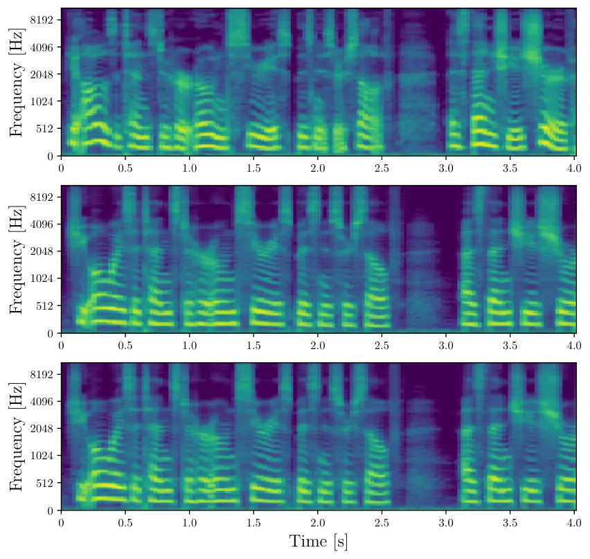
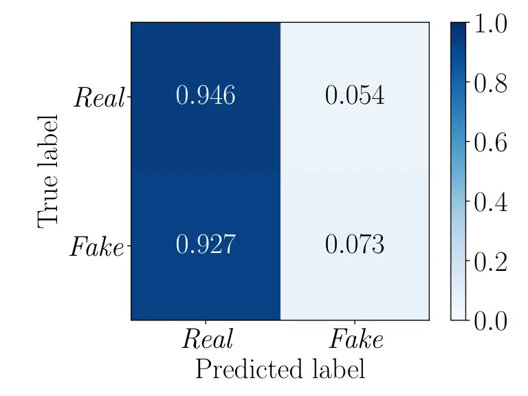

# Detector-Guided Vocoder Training for Adversarial Text-to-Speech Synthesis

Jiayan Cui, Davide Salvi, Paolo Bestagini, Stefano Tubaro Affiliation: 
Affiliation: Dipartimento di Elettronica, Informazione e Bioingegneria
(DEIB), Politecnico di Milano  
jiayan.cui@mail.polimi.it, {davide.salvi, paolo.bestagini,
stefano.tubaro}@polimi.it

###### Abstract

In this paper, we propose a novel Text-to-Speech (TTS) framework
designed to perform adversarial attacks against speech deepfake
detection systems. Given a TTS model and a detector capable of
classifying its outputs as synthetic, our approach fine-tunes the
vocoder by integrating the detector into the TTS training loop. Unlike
traditional adversarial methods that rely on post-hoc perturbations or
external noise injection, our approach enables the generation of
synthetic speech that is intrinsically adversarial, capable of lowering
the target detector’s reliability without requiring additional
post-processing steps. We evaluate the framework in both white-box and
black-box settings, showing its effectiveness against known and unseen
detectors. We also propose a multi-detector strategy that allows the
system to simultaneously learn to deceive multiple detectors, showcasing
the scalability of the method. Experimental results confirm the efficacy
of our approach, which has the potential to impact forensic security and
detection countermeasures. At the same time, subjective listening tests
reveal that the proposed method also enhances synthesized speech
quality.

###### Index Terms: 

Audio Forensics, Speech Deepfake, Adversarial Attacks, Anti-forensics,
Speech Synthesis

## I Introduction

Recent advances in speech synthesis and deep learning have led to
significant progress in text-to-speech (TTS) technologies, enabling the
generation of highly realistic speech with minimal human effort \[1, 2,
3\]. These technologies have become increasingly important for
applications such as accessibility, entertainment, education, and
human-computer interaction. At the same time, however, they have also
facilitated the creation of speech deepfakes, i.e., synthetic speech
signals that closely resemble authentic human speech and can impersonate
a target speaker or convey arbitrary spoken content. The increasing
realism of these systems has raised significant concerns regarding
misinformation, fraud, identity theft, and other malicious applications,
motivating extensive research on reliable speech deepfake detection.

To address these threats, the multimedia forensics community has
developed a wide range of speech deepfake detectors. Most of these rely
on supervised learning, ranging from the use of traditional signal
processing techniques \[4, 5\], to that of more sophisticated models,
such as Graph Attention Networks \[6\] and Transformers \[7, 8\]. Other
strategies exploit transfer learning from pre-trained systems \[9, 10\],
or analyze semantic inconsistencies in the signals \[11, 12\] to
determine their authenticity.

In parallel with the development of forensic detection tools, there has
been growing interest in anti-forensic techniques. These aim to identify
and exploit vulnerabilities in detection systems by designing
adversarial attacks \[13, 14\]. In the audio domain, adversarial attacks
have predominantly been implemented as post-processing operations. These
involve injecting learned additive noise or perturbations into audio
signals to hinder their forensic traces and deceive the detectors that
are used to process them \[15, 16, 17, 18\]. For instance, \[19\]
proposed an attack that injects convolutional noise using a linear
time-invariant filter, while \[20\] developed a noise injection attack
based on a generalized Hammerstein model to target specific speech
deepfake detectors. Similarly, \[21\] presented a joint adversarial
attack capable of deceiving both Automatic Speaker Verification (ASV)
systems and speech deepfake detectors simultaneously, while \[22\]
proposed a novel attack in a physical access context, where a replay
process is involved. Despite their efficacy, the dependence on
post-processing is a key limitation of these methods. Adversarial
processing remains a separate stage of the generation pipeline,
introducing additional computational complexity and potentially leaving
artifacts that can affect perceptual quality or be exploited by more
robust forensic methods.

In this paper, we depart from the paradigm of additive noise-based
attacks and propose a novel approach that integrates adversarial
perturbation directly into the speech synthesis process. Specifically,
we fine-tune the vocoder of a TTS system by incorporating the loss of
one or more speech deepfake detectors into the vocoder training
objective. During optimization, the detector provides differentiable
feedback that guides the vocoder towards generating speech signals that
retain high perceptual quality while being classified as authentic by
the target detector. As a result, the generated speech is intrinsically
adversarial and does not require any additional waveform perturbation or
post-processing at inference time.

The primary contributions of this work are the following:

- •
  _Detector-guided adversarial synthesis_ – We propose a detector-guided
  vocoder optimization framework that generates intrinsically
  adversarial speech without requiring post-processing operations.
- •
  _Real-time applicability_ – Since adversarial fine-tuning occurs
  offline, the system generates adversarial speech in real time without
  additional runtime overhead.
- •
  _Generalization capability_ - We evaluate the method under white-box
  and black-box conditions, showing that it effectively deceives both
  targeted and unseen detectors. Furthermore, we introduce a
  multi-detector strategy, enabling simultaneous attacks on multiple
  architectures.
- •
  _Enhanced speech quality_ – Beyond adversarial robustness, our
  fine-tuning improves perceptual quality, as validated through a
  subjective listening test.

## II Proposed Method

Fig. 1: Pipeline of the proposed TTS adversarial model.

In this paper, we propose an adversarial TTS framework that generates
speech intrinsically optimized to evade speech deepfake detectors.
Rather than applying adversarial perturbations after synthesis, our
approach incorporates the detector directly into the vocoder
optimization process, enabling the generator to learn synthesis
strategies that reduce the detector confidence while preserving speech
quality.

### II-A Problem Formulation

The speech deepfake detection problem can be formally defined as
follows. Let $`\mathbf{x}\in\mathbb{R}^{T}`$ denote a discrete-time
speech signal with class label $`y\in\{0,1\}`$, where $`y=0`$ indicates
an authentic signal and $`y=1`$ a synthetically generated one. The goal
of this task is to develop a speech deepfake detector
$`\mathcal{D}:\mathbb{R}^{T}\rightarrow[0,1]`$ able to estimate the
class of $`\mathbf{x}`$ as $`\hat{y}=\mathcal{D}(\mathbf{x})`$, where
$`\hat{y}`$ represents the likelihood of $`\mathbf{x}`$ being synthetic.

The goal of an adversarial attack is to generate a signal
$`\tilde{\mathbf{x}}`$ that is perceptually similar to $`\mathbf{x}`$
but induces an incorrect prediction by the target detector
$`\mathcal{D}`$, such as

```math
\mathcal{D}(\tilde{\mathbf{x}})<\mathcal{D}(\mathbf{x})\quad\text{subject to}\quad\mathbf{x}\approx\tilde{\mathbf{x}}, \tag{1}
```

where $`\approx`$ indicates perceptual similarity.

### II-B Adversarial TTS Architecture

Let us define a TTS generator $`\mathcal{G}`$ as a system that receives
a text string $`\mathbf{t}`$ as input and returns a speech signal
$`\mathbf{x}`$ as output, as in $`\mathbf{x}=\mathcal{G}(\mathbf{t})`$.
We consider the TTS generator $`\mathcal{G}`$ as the composition of two
cascade modules:

- •
  An Acoustic Model $`\mathcal{A}`$, that maps text $`\mathbf{t}`$ to
  mel-spectrogram $`\mathbf{M}\in\mathbb{R}^{F\times N}`$ through

  ```math
  \mathbf{M}=\mathcal{A}(\mathbf{t};\theta_{\mathcal{A}}), \tag{2}
  ```

  where $`\theta_{\mathcal{A}}`$ denotes model parameters, $`F`$ the
  mel-frequency bins, and $`N`$ the temporal frames.

- •
  A Vocoder $`\mathcal{V}`$, which synthesizes $`\mathbf{M}`$ into a
  $`T`$-samples waveform $`\mathbf{x}\in\mathbb{R}^{T}`$ via

  ```math
  \mathbf{x}=\mathcal{V}(\mathbf{M};\theta_{\mathcal{V}}). \tag{3}
  ```

The resultant speech sample is defined as
$`\mathbf{x}=\mathcal{V}(\mathcal{A}(\mathbf{t}))`$.

Since $`\mathbf{x}`$ is synthetically generated, its class label is
$`y=1`$, and an ideal detector should assign it a high $`\hat{y}`$
value, meaning a high probability of belonging to the synthetic class.
Our objective is therefore to adapt $`\mathcal{G}`$ so that the
synthesized speech $`\tilde{\mathbf{x}}`$ is instead classified as
authentic. Rather than retraining the entire TTS system, we keep the
acoustic model $`\mathcal{A}`$ fixed and fine-tune only the vocoder
$`\mathcal{V}`$. This choice preserves the linguistic and speaker
representations learned by the acoustic model while allowing the
waveform generation process to suppress detector-relevant forensic cues.

To do so, we optimize the vocoder parameters $`\theta_{\mathcal{V}}`$
using a composite loss that combines the original vocoder training
objective $`\mathcal{L}_{\text{V}}`$ with an adversarial detection loss
$`\mathcal{L}_{\text{D}}`$. The original vocoder loss preserves the
synthesis quality learned during standard training, whereas the
adversarial term encourages the generated waveform to be classified as
authentic by the target detector. Importantly, during this optimization,
the parameters of the detector $`\mathcal{D}`$ remain frozen and
gradients are back-propagated only through the detector to update the
vocoder. The overall loss is therefore defined as:

```math
\mathcal{L}_{\text{total}}=\mathcal{L}_{\text{V}}+\lambda\mathcal{L}_{\text{D}}, \tag{4}
```

where $`\lambda`$ is a weighting factor. The detection loss
$`\mathcal{L}_{\text{D}}`$ is computed by evaluating the synthesized
waveform with the target detector and encouraging the detector to
predict the authentic class. Formally, it is defined as:

```math
\mathcal{L}_{\text{D}}=\mathbb{E}_{\mathbf{t}}\left[-\log\left(1-\mathcal{D}\left(\mathcal{V}(\mathcal{A}(\mathbf{t}))\right)\right)\right]. \tag{5}
```

This corresponds to minimizing the binary cross-entropy with respect to
the authentic class. Consequently, the gradients propagated through the
detector encourage the vocoder to generate waveforms whose forensic
characteristics resemble those of genuine speech, while the original
vocoder objective prevents the optimization from degrading synthesis
quality.

The proposed formulation naturally extends to multiple target detectors.
Instead of optimizing against a single detector,
$`\mathcal{L}_{\mathcal{D}}`$ can be expressed as a weighted combination
of detector-specific losses:

```math
\mathcal{L}_{\text{D}}=\sum_{k=1}^{K}\alpha_{k}\mathbb{E}_{\mathbf{t}}\left[-\log\left(1-\mathcal{D}_{k}\left(\mathcal{V}(\mathcal{A}(\mathbf{t}))\right)\right)\right], \tag{6}
```

where $`\mathcal{D}_{k}`$ denotes the $`k`$-th detector and
$`\alpha_{k}`$ weights detector-specific objectives. By minimizing the
composite objective, the vocoder jointly optimizes speech fidelity and
adversarial effectiveness, producing synthetic speech that preserves
perceptual quality while reducing the confidence of one or more target
speech deepfake detectors. Figure 1 shows the complete adversarial TTS
pipeline.

## III Experimental setup

In this section, we describe the experimental setup adopted to evaluate
the proposed framework. We first present the considered synthesis and
detection systems, followed by the training procedure and the datasets
used throughout the experiments.

### III-A Considered Systems

The proposed framework is built upon a two-stage TTS pipeline composed
of an acoustic model and a neural vocoder. As acoustic model
$`\mathcal{A}`$, we employ an enhanced version of FastSpeech2 \[3\],
incorporating the modifications proposed in \[23, 24, 25\] to improve
speaker conditioning and synthesis quality. Specifically, the model
integrates Utterance- and Phoneme-Level Encoders, pyannote-based speaker
embeddings \[24\], a Conditional Layer for speaker adaptation, and
Random Window Discriminators (RWDs) \[25\]. We refer the reader to the
corresponding references for a detailed description of these components.

As vocoder $`\mathcal{V}`$, we adopt BigVGAN \[26\], a state-of-the-art
neural vocoder for waveform synthesis. The acoustic model remains fixed
throughout our experiments, while only the vocoder is fine-tuned using
the detector-guided objective described in Section II. This design
isolates the effect of adversarial optimization on waveform generation
while preserving the linguistic and speaker representations learned by
the acoustic model.

To assess the impact of detector-guided optimization, we train three
different vocoder variants:

- •
  $`\mathcal{V}`$: The original vocoder, trained only with the original
  loss function $`\mathcal{L}_{\text{V}}`$ proposed in \[26\], without
  any adversarial loss.
- •
  $`\mathcal{V^{\text{R}}}`$: Trained including
  $`\mathcal{L}_{\text{D}}`$ with $`K=1`$, to fool a single detector
  (RawNet2).
- •
  $`\mathcal{V^{\text{RT}}}`$: Trained with a multi-detector loss
  $`\mathcal{L}_{\text{D}}`$, aiming to deceive the $`K=2`$ detectors
  together (RawNet2 and TSSD).

Since detector-guided optimization is performed exclusively during
offline training, the computational cost is incurred only once during
fine-tuning. At inference time, the proposed framework has the same
computational complexity and latency as the original BigVGAN vocoder, as
no additional detector inference or waveform post-processing is
required.

Finally, we evaluate our adversarial framework against three end-to-end
speech deepfake detectors $`\mathcal{D}`$ that operate directly on raw
audio waveforms: RawNet2 \[27\], TSSD \[28\], and AASIST \[6\]. RawNet2
and TSSD are used both during adversarial optimization and evaluation,
representing the white-box attack scenario. In contrast, AASIST is never
involved during training and is used exclusively during testing to
assess the transferability of the proposed attack under black-box
conditions. The three vocoder configurations considered throughout the
paper are summarized in Table I.

|                             |                          |                        |
| --------------------------- | ------------------------ | ---------------------- |
| Name                        | Detector-guided training | Purpose                |
| $`\mathcal{V}`$             | None                     | Baseline synthesis     |
| $`\mathcal{V^{\text{R}}}`$  | RawNet2                  | Single-detector attack |
| $`\mathcal{V^{\text{RT}}}`$ | RawNet2 + TSSD           | Multi-detector attack  |

TABLE I: Vocoder configurations considered throughout the experiments.

### III-B Training parameters

The acoustic model was trained following the original FastSpeech2
implementation, adopting the optimization strategy described in \[3\].
Likewise, the baseline BigVGAN vocoder was trained using the
configuration proposed in \[26\]. Unless otherwise specified, we retain
the original training hyperparameters of both architectures.

The adversarial fine-tuning stage differs only in the optimization
objective. Starting from the baseline vocoder, we optimize the
parameters according to the composite loss introduced in Eq. 4,
combining the original vocoder objective with the detector-guided loss.
During this phase, the acoustic model and the detector networks remain
frozen, and gradients are back-propagated only to update the vocoder
parameters.

In practice, Eq. 5 is implemented as the binary cross-entropy loss
between the detector prediction and the authentic class, as in

```math
\mathcal{L}_{\text{D}}=\lambda\cdot\text{CE}(\text{$\mathcal{D}(\mathbf{x})$},\text{0}), \tag{7}
```

where the target label $`0`$ denotes authentic speech and
$`\lambda=0.05`$ is a scaling constant that controls the contribution of
the adversarial objective. Minimizing this loss encourages the vocoder
to generate speech that is increasingly difficult for the target
detector to classify as synthetic.

All detectors were trained under identical conditions using the Adam
optimizer with cross-entropy loss. Additional implementation details,
including optimizer parameters and learning-rate schedules, follow the
original implementations of the corresponding models. All experiments
were conducted on a workstation equipped with an Intel i9-14900K CPU, 64
GB RAM, and an NVIDIA RTX 4090 GPU. The code used for training and
evaluating the models, along with audio samples generated by the
proposed TTS systems, is accessible at this link¹¹ 1
[https://github.com/polimi-ispl/adversarial-tts/](https://github.com/polimi-ispl/adversarial-tts/).

### III-C Datasets

We trained the acoustic model $`\mathcal{A}`$ and the vocoder
$`\mathcal{V}`$ using LibriTTS \[29\], a dataset derived from
LibriSpeech \[30\] and specifically processed for TTS applications. This
provides approximately $`260`$ hours of high-quality speech from
$`1158`$ speakers sampled at
$`f_{\text{s}}=`$ $`22.05\text{\,}\mathrm{kHz}`$. Following the
preprocessing adopted in our experiments, utterances shorter than
$`3\text{\,}\mathrm{s}`$ and recordings flagged for quality issues were
discarded. The resulting dataset was randomly split into $`90`$% for
training and $`10`$% for validation.

To fine-tune BigVGAN, we considered both real and synthetic inputs,
utilizing mel-spectrograms extracted from LibriTTS signals, as well as
those generated by FastSpeech2. This approach adapts the vocoder to the
specific characteristics of the output of the acoustic model, resulting
in a more stable and coherent speech generation.

We trained the deepfake detectors $`\mathcal{D}`$ using an internal
dataset balanced between real and synthetic speech for a total of
$`251\,154`$ tracks sampled at
$`f_{\text{s}}=`$ $`22.05\text{\,}\mathrm{kHz}`$. Authentic recordings
were drawn from LibriTTS, whereas synthetic speech was generated using
the baseline TTS pipeline employing the vocoder $`\mathcal{V}`$.

To evaluate the effectiveness of detector-guided vocoder training, we
constructed three test datasets that share the same authentic speech
recordings while differing only in the synthetic samples. Specifically,
the fake speech in each dataset was generated using one of the three
vocoder variants ($`\mathcal{V}`$, $`\mathcal{V}^{\text{R}}`$, and
$`\mathcal{V}^{\text{RT}}`$). This controlled protocol isolates the
effect of adversarial fine-tuning by ensuring that the authentic data
remain identical across all evaluation scenarios.

Figure 2 presents the mel-spectrograms of a real test track alongside
its synthetic counterparts from $`\mathcal{V}`$, and
$`\mathcal{V}^{\text{R}}`$, showing that the differences between them
are almost imperceptible.



Fig. 2: Mel-spectrograms of real and synthetic signals. The real signal
(top) is from LibriTTS, the synthetic ones are from $`\mathcal{V}`$
(middle) and $`\mathcal{V}^{\text{R}}`$ (bottom).

|                             |     |         |           |        |     |        |           |        |     |        |           |        |
| --------------------------- | --- | ------- | --------- | ------ | --- | ------ | --------- | ------ | --- | ------ | --------- | ------ |
|                             |     | RawNet2 |           |        |     | TSSD   |           |        |     | AASIST |           |        |
|                             |     | EER     | Bal. Acc. | AUC    |     | EER    | Bal. Acc. | AUC    |     | EER    | Bal. Acc. | AUC    |
| $`\mathcal{V}`$             |     | 5.8%    | 94.15%    | 97.08% |     | 3.40%  | 95.73%    | 98.80% |     | 0.85%  | 99.16%    | 99.95% |
| $`\mathcal{V}^{\text{R}}`$  |     | 39.05%  | 60.85%    | 64.58% |     | 38.33% | 60.54%    | 66.08% |     | 21.09% | 78.91%    | 87.07% |
| $`\mathcal{V}^{\text{RT}}`$ |     | 43.87%  | 55.17%    | 57.72% |     | 43.31% | 57.03%    | 59.74% |     | 23.26% | 76.75%    | 84.55% |

TABLE II: Detection performance of the considered speech deepfake
detectors $`\mathcal{D}`$ against different iterations of the vocoder
$`\mathcal{V}`$.

## IV Results

In this section, we evaluate the proposed framework from three
complementary perspectives. First, we assess its ability to degrade
speech deepfake detectors under both white-box and black-box conditions.
Second, we investigate whether jointly optimizing against multiple
detectors improves attack transferability. Finally, we evaluate the
perceptual quality of the generated speech using both objective and
subjective metrics.

Detection performance is measured in terms of Area Under the Curve
(AUC), Balanced Accuracy, and Equal Error Rate (EER). While ideal
detector performance corresponds to high AUC and Balanced Accuracy and
low EER, the objective of the proposed adversarial framework is the
opposite: to reduce the detector’s ability to discriminate between
authentic and synthetic speech. Since only the synthetic signals are
modified while the authentic ones remain unchanged, the theoretical
optimum of a successful attack corresponds to 50% for all three metrics,
indicating random discrimination between the two classes.

We evaluate the three speech deepfake detectors (RawNet2, TSSD, and
AASIST) using speech synthesized by the three vocoder configurations
introduced in Section III, namely the baseline vocoder $`\mathcal{V}`$,
the single-detector adversarial vocoder $`\mathcal{V}^{\text{R}}`$, and
the multi-detector adversarial vocoder $`\mathcal{V}^{\text{RT}}`$. This
experimental protocol enables us to separately evaluate baseline
detector performance, white-box attack effectiveness, and
transferability to previously unseen detector architectures.

Table II summarizes the detection performance obtained under the three
evaluation settings. As expected, all detectors achieve excellent
performance on speech generated by the baseline vocoder $`\mathcal{V}`$,
with AUC values above 97% and EER below 6%. Since these synthetic
samples closely match those used during detector training, this
experiment establishes a strong reference point for assessing the
effectiveness of the proposed adversarial optimization. Among the
evaluated systems, AASIST achieves the highest detection accuracy,
although all three detectors reliably distinguish authentic from
synthetic speech.

Detector-guided fine-tuning substantially degrades the performance of
the targeted detectors. When optimizing exclusively against RawNet2, its
EER increases from $`5.8\%`$ to $`39.1\%`$, approaching the theoretical
upper bound of $`50\%`$ associated with random guessing. Interestingly,
TSSD also experiences a comparable degradation (EER $`=38.3\%`$) despite
not being explicitly optimized during training, suggesting that the
learned adversarial modifications suppress forensic cues that are not
entirely detector-specific. Even the unseen AASIST detector exhibits a
marked reduction in performance, with its EER increasing to $`21.1\%`$,
indicating that the proposed optimization already provides a significant
degree of transferability beyond the targeted architecture.

Joint optimization against RawNet2 and TSSD further improves the attack.
Both targeted detectors exhibit EER values above $`43\%`$, while their
Balanced Accuracy decreases to approximately $`56\%`$, indicating
detector performance close to random discrimination. More importantly,
the performance of AASIST also decreases further, reaching an EER of
$`23.3\%`$ despite never being involved during adversarial optimization.
This result indicates that jointly optimizing against multiple detectors
improves attack transferability by encouraging the vocoder to suppress
forensic cues shared across different detector architectures rather than
overfitting to a single target model.

Figure 3 shows the detection performance of RawNet2 when tested against
data generated by $`\mathcal{V}^{\text{RT}}`$, via a confusion matrix.
Almost all the synthetic tracks are misclassified as real, with an
exceptionally high True Negative Rate (TNR) ($`0.946`$) and low True
Positive Rate (TPR) ($`0.073`$), aligning with our adversarial goal.
With a balanced accuracy of $`55`$%, the proposed attack effectively
reduces the detector’s performance to near-random guessing.

Beyond evaluating adversarial effectiveness, we also investigate the
perceptual quality of the generated speech. We hypothesize that
detector-guided optimization not only suppresses detector-relevant
forensic traces but also reduces synthesis artifacts that distinguish
generated speech from authentic recordings. To test this hypothesis, we
first compute the Fréchet Audio Distance (FAD) \[31\] between authentic
speech and the three synthetic datasets using CLAP \[32\] embeddings.
The FAD decreases consistently from $`31.25`$ for the baseline vocoder
$`\mathcal{V}`$ to $`22.95`$ for $`\mathcal{V}^{\text{R}}`$ and
$`17.81`$ for $`\mathcal{V}^{\text{RT}}`$, corresponding to an
improvement of approximately $`25\%`$ at each optimization stage. This
progressive reduction suggests that adversarial fine-tuning moves the
distribution of synthesized speech closer to that of authentic
recordings while simultaneously improving resistance to forensic
detection.

To complement the objective evaluation, we conducted a MUSHRA-like
perceptual listening test with $`20`$ expert listeners to assess the
level of realism of the generated tracks. The study was anonymous and
GDPR-compliant, with informed consent obtained and no personal data
collected. Figure 4 presents the results of this analysis, indicating
that the fine-tuned vocoders $`\mathcal{V}^{\text{R}}`$ and
$`\mathcal{V}^{\text{RT}}`$ were perceived as more realistic compared to
the initial $`\mathcal{V}`$ vocoder, progressively approaching the
quality of real audio. Together with the FAD analysis, these results
indicate that our adversarial fine-tuning not only enhances attack
robustness but also increases the perceptual quality of synthesized
speech, making it a promising strategy for advancing adversarial TTS
systems.

The observed improvement in perceptual quality is particularly
interesting because the detector loss is never optimized explicitly for
human perception. A possible explanation is that speech deepfake
detectors rely on subtle synthesis artifacts that are also perceptually
undesirable. By encouraging the vocoder to suppress these
detector-relevant cues while preserving the original synthesis
objective, the optimization may simultaneously improve detector evasion
and speech naturalness. Although further investigation is required to
validate this hypothesis, the consistent improvements observed in both
FAD and the listening test suggest a strong relationship between
forensic artifacts and perceptual quality.

Overall, the experiments demonstrate three main findings. First,
detector-guided vocoder optimization substantially degrades the
performance of targeted speech deepfake detectors under white-box
conditions. Second, jointly optimizing against multiple detectors
improves transferability to previously unseen detector architectures.
Finally, adversarial fine-tuning unexpectedly improves both objective
and subjective measures of speech quality, indicating that suppressing
detector-relevant forensic cues can also increase the perceptual realism
of synthesized speech.



Fig. 3: Confusion matrix obtained by testing RawNet2 against the test
dataset containing fake tracks generated by the vocoder
$`\mathcal{V}^{\text{RT}}`$.

Fig. 4: Results of the perceptual listening test evaluating the realism
of the real and synthetic tracks generated with different iterations of
the vocoder $`\mathcal{V}`$.

## V Conclusions

In this paper, we presented a detector-guided TTS framework capable of
generating speech that is intrinsically adversarial to speech deepfake
detectors. By integrating one or more frozen detector models into the
vocoder optimization process, the proposed approach directly learns
waveform generation strategies that reduce detector confidence while
preserving the perceptual quality of the synthesized speech. Unlike
existing adversarial attacks that rely on post-processing perturbations,
the proposed framework produces adversarial speech during synthesis,
eliminating the need for any additional processing at inference time.

Extensive experiments against three state-of-the-art speech deepfake
detectors showed the effectiveness of the proposed approach under both
white-box and black-box conditions. Detector-guided optimization
substantially degraded the performance of the targeted detectors, while
joint optimization against multiple detectors further improved
transferability to previously unseen architectures. Interestingly,
objective and subjective evaluations consistently showed that
adversarial fine-tuning also enhances the perceptual realism of the
generated speech, suggesting that suppressing detector-relevant forensic
cues may simultaneously reduce synthesis artifacts.

The proposed framework also highlights the growing challenge of securing
speech synthesis systems against increasingly sophisticated adversarial
attacks. Although our objective is to expose weaknesses in current
forensic methods and support the development of more robust
countermeasures, the same techniques could potentially be misused to
generate synthetic speech that is more difficult to detect. We therefore
advocate the use of this work exclusively for defensive security
research and encourage continued investigation into robust detection
methods, benchmarking protocols, and ethical guidelines for generative
audio technologies.

While the proposed framework demonstrates strong performance against
three representative speech deepfake detectors, the evaluation is
limited to a single TTS architecture and a controlled synthesis
scenario. Future work will investigate additional vocoders, multilingual
datasets, real-world transmission conditions, and more computationally
efficient optimization strategies, with the ultimate goal of developing
speech deepfake detectors that remain robust against adversarially
trained synthesis models.

## References

- \[1\] A. v. d. Oord, S. Dieleman, H. Zen, K. Simonyan, O. Vinyals, A.
  Graves, N. Kalchbrenner, A. Senior, and K. Kavukcuoglu (2016) WaveNet:
  A generative model for raw audio. In Interspeech, Cited by: §I.
- \[2\] Y. Wang, R. Skerry-Ryan, D. Stanton, Y. Wu, R. J. Weiss, N.
  Jaitly, Z. Yang, Y. Xiao, Z. Chen, S. Bengio, et al. (2017) Tacotron:
  Towards end-to-end speech synthesis. In Interspeech, Cited by: §I.
- \[3\] Y. Ren, C. Hu, X. Tan, T. Qin, S. Zhao, Z. Zhao, and T.
  Liu (2021) Fastspeech 2: Fast and high-quality end-to-end text to
  speech. In ICLR, Cited by: §I, §III-A, §III-B.
- \[4\] E. A. AlBadawy, S. Lyu, and H. Farid (2019) Detecting
  ai-synthesized speech using bispectral analysis.. In IEEE/CVF
  Conference on Computer Vision and Pattern Recognition Workshop
  (CVPRW), Cited by: §I.
- \[5\] J. Xue, C. Fan, Z. Lv, J. Tao, J. Yi, C. Zheng, Z. Wen, M. Yuan,
  and S. Shao (2022) Audio deepfake detection based on a combination of
  f0 information and real plus imaginary spectrogram features. In
  International Workshop on Deepfake Detection for Audio Multimedia,
  Cited by: §I.
- \[6\] J. Jung, H. Heo, H. Tak, H. Shim, J. S. Chung, B. Lee, H. Yu,
  and N. Evans (2022) AASIST: Audio anti-spoofing using integrated
  spectro-temporal graph attention networks. In IEEE ICASSP, Cited by:
  §I, §III-A.
- \[7\] E. R. Bartusiak, K. Bhagtani, A. K. S. Yadav, and E. J.
  Delp (2023) Transformer ensemble for synthesized speech detection. In
  IEEE Asilomar Conference on Signals, Systems, and Computers, Cited by:
  §I.
- \[8\] L. Cuccovillo, M. Gerhardt, and P. Aichroth (2024) Audio
  transformer for synthetic speech detection via multi-formant analysis.
  In IEEE/CVF Conference on Computer Vision and Pattern Recognition
  Workshops (CVPRW), Cited by: §I.
- \[9\] L. Li, T. Lu, X. Ma, M. Yuan, and D. Wan (2023) Voice deepfake
  detection using the self-supervised pre-training model hubert. Applied
  Sciences 13 (14), pp. 8488. Cited by: §I.
- \[10\] Y. Yang, H. Qin, H. Zhou, C. Wang, T. Guo, K. Han, and Y.
  Wang (2024) A robust audio deepfake detection system via multi-view
  feature. In IEEE ICASSP, Cited by: §I.
- \[11\] E. Conti, D. Salvi, C. Borrelli, B. Hosler, P. Bestagini, F.
  Antonacci, A. Sarti, M. C. Stamm, and S. Tubaro (2022) Deepfake speech
  detection through emotion recognition: a semantic approach. In IEEE
  ICASSP, Cited by: §I.
- \[12\] L. Attorresi, D. Salvi, C. Borrelli, P. Bestagini, and S.
  Tubaro (2022) Combining automatic speaker verification and prosody
  analysis for synthetic speech detection. In International Conference
  on Pattern Recognition (ICPR), Cited by: §I.
- \[13\] Y. Xie, C. Shi, Z. Li, J. Liu, Y. Chen, and B. Yuan (2020)
  Real-time, universal, and robust adversarial attacks against speaker
  recognition systems. In IEEE ICASSP, Cited by: §I.
- \[14\] P. Neekhara, S. Hussain, P. Pandey, S. Dubnov, J. McAuley,
  and F. Koushanfar (2023) Universal adversarial perturbations for
  speech recognition systems. In Interspeech, Cited by: §I.
- \[15\] N. Carlini and D. Wagner (2018) Audio adversarial examples:
  Targeted attacks on speech-to-text. In IEEE Security and Privacy
  Workshops (SPW), Cited by: §I.
- \[16\] S. Liu, H. Wu, H. Lee, and H. Meng (2019) Adversarial attacks
  on spoofing countermeasures of automatic speaker verification. In IEEE
  ASRU, Cited by: §I.
- \[17\] W. Zhang, S. Zhao, L. Liu, J. Li, X. Cheng, T. F. Zheng, and X.
  Hu (2021) Attack on practical speaker verification system using
  universal adversarial perturbations. In IEEE ICASSP, Cited by: §I.
- \[18\] W. E. Wang, D. Salvi, V. Negroni, D. U. Leonzio, P. Bestagini,
  and S. Tubaro (2025) BIM-Based Adversarial Attacks Against Speech
  Deepfake Detectors. Electronics. Cited by: §I.
- \[19\] M. Panariello, W. Ge, H. Tak, M. Todisco, and N. Evans (2023)
  Malafide: a novel adversarial convolutive noise attack against
  deepfake and spoofing detection systems. In Interspeech, Cited by: §I.
- \[20\] M. Todisco, M. Panariello, X. Wang, H. Delgado, K. A. Lee,
  and N. Evans (2024) Malacopula: adversarial automatic speaker
  verification attacks using a neural-based generalised hammerstein
  model. In Proc. ASVspoof 2024, Cited by: §I.
- \[21\] X. Zhang, X. Zhang, W. Liu, X. Zou, M. Sun, and J. Zhao (2022)
  Waveform level adversarial example generation for joint attacks
  against both automatic speaker verification and spoofing
  countermeasures. Engineering Applications of Artificial Intelligence
  116, pp. 105469. Cited by: §I.
- \[22\] J. Li, L. Wang, L. Xue, L. Wang, and Z. Wu (2024) An initial
  investigation of neural replay simulator for over-the-air adversarial
  perturbations to automatic speaker verification. In IEEE ICASSP, Cited
  by: §I.
- \[23\] M. Chen, X. Tan, B. Li, Y. Liu, T. Qin, S. Zhao, and T.
  Liu (2021) AdaSpeech: Adaptive text to speech for custom voice. In
  ICLR, Cited by: §III-A.
- \[24\] H. Bredin, R. Yin, J. M. Coria, G. Gelly, P. Korshunov, M.
  Lavechin, D. Fustes, H. Titeux, W. Bouaziz, and M. Gill (2020)
  Pyannote. audio: neural building blocks for speaker diarization. In
  IEEE ICASSP, Cited by: §III-A.
- \[25\] M. Bińkowski, J. Donahue, S. Dieleman, A. Clark, E. Elsen, N.
  Casagrande, L. C. Cobo, and K. Simonyan (2020) High fidelity speech
  synthesis with adversarial networks. In ICLR, Cited by: §III-A.
- \[26\] S. Lee, W. Ping, B. Ginsburg, B. Catanzaro, and S. Yoon (2023)
  BigVGAN: A universal neural vocoder with large-scale training. In
  ICLR, Cited by: 1st item, §III-A, §III-B.
- \[27\] H. Tak, J. Patino, M. Todisco, A. Nautsch, N. Evans, and A.
  Larcher (2021) End-to-end anti-spoofing with RawNet2. In IEEE ICASSP,
  Cited by: §III-A.
- \[28\] G. Hua, A. B. J. Teoh, and H. Zhang (2021) Towards end-to-end
  synthetic speech detection. IEEE Signal Processing Letters 28,
  pp. 1265–1269. Cited by: §III-A.
- \[29\] H. Zen, V. Dang, R. Clark, Y. Zhang, R. J. Weiss, Y. Jia, Z.
  Chen, and Y. Wu (2019) LibriTTS: A corpus derived from librispeech for
  text-to-speech. In Interspeech, Cited by: §III-C.
- \[30\] V. Panayotov, G. Chen, D. Povey, and S. Khudanpur (2015)
  LibriSpeech: an ASR corpus based on public domain audio books. In IEEE
  ICASSP, Cited by: §III-C.
- \[31\] K. Kilgour, M. Zuluaga, D. Roblek, and M. Sharifi (2019)
  Frechet audio distance: a metric for evaluating music enhancement
  algorithms. In Interspeech, Cited by: §IV.
- \[32\] B. Elizalde, S. Deshmukh, and H. Wang (2024) Natural language
  supervision for general-purpose audio representations. In IEEE ICASSP,
  Cited by: §IV.
