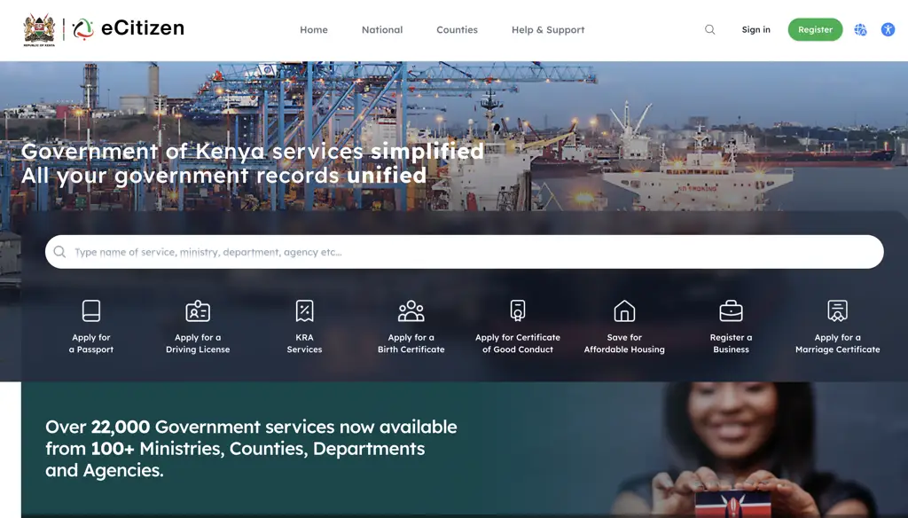
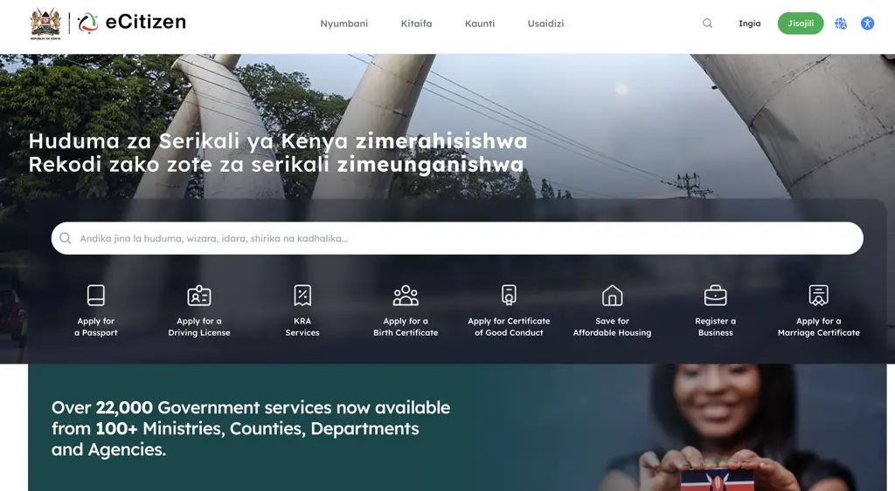

# AI for eGovernance: Leveraging Language Technologies for Digital Inclusion

Cynthia Jayne Amol Affiliation: Maseno University Affiliation: Maseno,
Kenya Email: [cynthia@maseno.ac.ke](mailto:)    Lilian Wanzare
Affiliation: Maseno University Affiliation: Maseno, Kenya
Email: [ldwanzare@maseno.ac.ke](mailto:)

###### Abstract

In a bid to champion Africa’s digital transformation as outlined in the
Kenya Digital Master Plan 2022-2032, the Kenyan government has invested
heavily in the digitisation of public service delivery. The national
eGovernment platform, eCitizen, hosts an array of services that are
vital to citizens’ livelihoods, including business registration, youth
enterprise lending, digital literacy, and tax filing. However, the
platform faces digital inclusion challenges that often limit equitable
access for marginalised groups, particularly youth in rural areas and
persons with disabilities. This exclusion is driven by a language
barrier, since the platform is primarily in English with limited Swahili
support, and by a text-only interface that excludes low-literacy and
visually impaired users. This paper reports findings from six one-on-one
interviews and an eleven-person roundtable discussion across four
platforms considered essential to citizens’ livelihoods, with a
particular focus on youth: Ajira Digital, Kenya Revenue Authority (KRA)
iTax, Higher Education Loans Board (HELB), and the Youth Enterprise
Development Fund (YEDF). Drawing on these findings, on Web Content
Accessibility Guidelines (WCAG) 2.1 principles as a design lens for
diagnosing eCitizen’s accessibility gaps, and on comparator models such
as Estonia’s Bürokratt and India’s Bhashini, the paper proposes a
human-centered, systems-minded framework for embedding Generative AI,
language technologies, including text simplification, neural machine
translation, text-to-speech and speech-to-text, into eCitizen. The paper
argues that, when deployed responsibly and supported by appropriate
human oversight, these interventions could meaningfully improve access
to government services for linguistically excluded citizens. However, it
also emphasises that AI alone cannot overcome the broader structural
barriers, including unemployment and educational inequality, that also
shape digital exclusion.

   

|     |
| --- |
|     |

*K*eywords eGovernance $`\cdot`$ digital inclusion $`\cdot`$ language
technologies $`\cdot`$ accessibility $`\cdot`$ generative AI $`\cdot`$
machine translation $`\cdot`$ Kenya

## 1 Introduction

Efficient public service delivery is an essential part of good
governance. In Africa, developing countries like Kenya are constantly
leveraging emerging technology to automate services in order to compete
globally. The Kenya Digital Master Plan 2022–2032 \[10\] documents this
investment in eGovernance, aimed at improving service delivery
efficiency and streamlining information access, an effort that affects
citizens’ livelihoods. This builds on earlier policy foundations such as
Kenya’s first eGovernment Strategy \[8\], which established the
administrative structure, training requirements, and standardisation
framework that later digitisation efforts, including eCitizen, have
built upon.

eGovernance uses Information Communication and Technologies (ICTs), such
as online portals, to deliver public services \[14\], replacing the
manual systems that previously caused delays and a lack of transparency.
Digital service delivery through eGovernment platforms ought to be fast,
user-friendly and inclusive to all citizens \[22\], fulfilling the
government’s mandate of equitable governance. In Kenya, the central
eGovernment platform, eCitizen¹¹ 1
[https://accounts.ecitizen.go.ke/en](https://accounts.ecitizen.go.ke/en),
hosts over 22,000 essential government services, including business and
company registrations, tax services, Higher Education Loans Board (HELB)
applications, Ajira Digital for digital education, passport or visa
applications and driver’s licence renewal. These services are vital to
all citizens’ livelihoods, especially the youth, who make up over 80% of
the population and are key drivers of the economy \[18\].

However, eCitizen has not yet achieved absolute digital inclusion. It
limits equitable access to services, particularly for users with limited
mastery of national languages and persons with disabilities \[6\]. A key
barrier lies in the platform’s linguistic limitations. It is primarily
in English, with Swahili support typically limited to webpage headers,
as shown in Figure 1 and Figure 2. The main content stays in English
despite Kenya’s linguistic diversity of over sixty native and eight
non-native languages \[2\]. This language gap restricts access to
services that could unlock education, employment, entrepreneurship and
social welfare, all of which directly improve livelihoods. The lack of
audio support further alienates citizens who cannot read.

Figure 1: Default (English) eCitizen landing page.

Figure 2: Translated (Swahili) eCitizen landing page.

In Kenya, English is often learned as a third language, after an
individual’s native ethnic language and Swahili \[12\]. English serves
as the official language for formal government and legal contexts, but
Swahili functions as a cross-cultural lingua franca widely spoken among
youth in both urban and rural settings \[13\], and in many rural areas,
native languages are the everyday language, not English or Swahili \[2,
12\]. This layered linguistic landscape means the eCitizen platform’s
design alienates a significant portion of the population, particularly
youth and those in rural communities. The government must move beyond
translating headers and meaningfully integrate Swahili and other native
languages, letting all citizens, regardless of literacy or physical
ability, access and benefit from eGovernance services, and fulfilling
the platform’s potential as a tool for social and economic empowerment.

Artificial Intelligence (AI)-driven language technologies offer an
interim way to close this gap. As AI for low-resource languages
advances, tools such as neural machine translation (NMT), text
summarisation, and chatbot-based user support can expand access to
digital government services. Recent research \[7, 23\] has produced
language resources for Swahili and other Kenyan languages, making such
solutions increasingly feasible to implement.

This paper first situates eCitizen among comparable empirical studies
and existing eGovernment platforms, such as Estonia’s Bürokratt and
India’s Bhashini. It then synthesises interviews and a roundtable held
with users and support staff of Ajira Digital, KRA iTax, HELB and YEDF.
These findings are discussed alongside Kenya’s and the African Union’s
AI strategies and a WCAG-based review of eCitizen’s design. The findings
inform the technical and governance recommendations proposed for
embedding language technologies into eCitizen to improve digital
inclusion.

## 2 Related Work

This section reviews prior research on language and accessibility
barriers in eGovernment, existing eGovernment technology models, and the
language technology resources available for Kenyan languages.

### 2.1 Language and Accessibility Barriers in eGovernment

Language exclusion in eGovernment is a recurring challenge across
postcolonial Africa. Many African states inherited their official
languages from colonial administrations, and digital government
platforms have largely continued to operate within these frameworks,
with limited support for indigenous languages. In South Africa,
indigenous-language users face mistranslated policy terms and rely on
literate relatives or intermediaries to complete online processes
\[21\]. These same patterns, task delegation and uncertainty from
unclear terminology, appear in the discussions from interviews presented
in Section 4. Language is only one factor shaping access to eGovernment
services. Adoption is also influenced by social, infrastructural and
trust-related factors alongside interface and usability challenges
\[6\]. Among older citizens in Kenya, non-use has been linked to digital
literacy, self-efficacy and infrastructure limitations, rather than
platform design alone \[17\]. Physical alternatives provide only partial
solutions. Huduma Centres, set up to support citizens who face barriers
to digital access, are unevenly distributed, particularly in rural and
peri-urban areas \[19\]. Similar access and participation challenges
have been reported in Ugandan local government \[15\], suggesting
language exclusion is part of a wider regional pattern in the design of
inclusive digital public services.

### 2.2 Comparator eGovernment Technology Models

The approach proposed in this paper draws on established eGovernment
models from Africa and beyond. Rwanda’s IremboGov²² 2
[https://irembo.gov.rw/](https://irembo.gov.rw/), a centralised digital
service platform, combines online services with an agent network to
support citizens who face digital literacy barriers, and its
localisation into Kinyarwanda shows the value of designing for users’
linguistic contexts. South Africa offers a policy example through its
framework of functional multilingualism. With eleven official languages,
government institutions are expected to incorporate local languages into
public communication and service delivery. Together, these examples show
that inclusive digital government needs both accessible platforms and
the institutional frameworks to support them.

Globally, AI-enabled government systems are exploring conversational
interfaces and automated assistance. Estonia’s Bürokratt³³ 3
[https://www.kratid.ee/burokratt](https://www.kratid.ee/burokratt) is an
AI virtual assistant that connects government databases so users can
file complaints or renew identification documents in one place \[20\].
India’s Bhashini⁴⁴ 4
[https://bhashini.gov.in/](https://bhashini.gov.in/) initiative develops
language technologies for translation and multimodal interaction across
Indian languages \[16\]. Both offer a useful reference for digital
public services that combine AI assistance with multilingual
interaction.

### 2.3 Language Technology Landscape

Multilingual eGovernment services need language resources such as
parallel corpora, annotated speech datasets, and pretrained translation
and speech models. Large language models (LLMs) can support clearer
communication by adapting complex information to different literacy
needs. Johnson et al. \[11\] found that AI-simplified textbook content
improved reading efficiency and comprehension for participants with
reading challenges. The study concerns educational rather than
government text, but it is a useful reference point for simplifying
public information, including business registration, tax filing and HELB
applications.

Kenya’s language technology ecosystem is still at an earlier stage than
larger national initiatives. Masakhane Web \[7\] provides open machine
translation resources for African languages including Swahili, while
Kencorpus \[23\] provides annotated corpora for Swahili, Dholuo and
Luhya that could support future translation and speech technologies.
Compared with Bhashini’s national-scale language infrastructure or
Bürokratt’s integrated architecture, Kenya’s language resources are
limited, with implications for how quickly reliable multilingual support
could be deployed on platforms such as eCitizen.

## 3 Methodology

This study uses a qualitative design. It combines one-on-one interviews
with a facilitated roundtable discussion to synthesise first-hand
accounts from users who encounter language and accessibility barriers
directly, alongside feedback from user support staff on the platforms
they support. Figure 3 outlines this end-to-end research process, from
the desk research that informed the interview and roundtable protocols,
through the two data collection phases described in Section 3.1, to the
thematic findings reported in Section 4.

Figure 3: Research process, from desk research through one-on-one
interviews and the roundtable discussion to the thematic findings
reported in Section 4.

### 3.1 Participants and Sampling

The eCitizen platform is intended for use by all members of the general
public, so the potential participant pool was large. Respondent
recruitment was based on convenience sampling, prioritising people who
(a) had used at least one of the platforms under study, giving their
accounts first-hand credibility, and (b) were reasonably accessible to
the research team, either close to the interview location or able to
attend the roundtable session which was held in-person.

Data collection took place in two phases. The first was six one-on-one
interviews with users of the platforms most used by youth, since youth
access was the study’s central focus. The second was a roundtable with
11 participants, drawn from youth users aged 18 to 35 and user support
staff from two neighbouring Huduma Centres. Both phases focused on four
platforms considered essential to citizens’ livelihoods: Ajira Digital,
KRA iTax, HELB, and YEDF.

In total, 17 people took part, 2 user support staff and 15 users. Some
users had experience of more than one platform, so the platform counts
in Table 1 are not mutually exclusive. 3 participants had used Ajira
Digital, 10 had used iTax, 12 had used HELB, and 1 had used YEDF.

| Participant category                                                      | Ajira Digital | KRA iTax | HELB | YEDF | n   |
| ------------------------------------------------------------------------- | ------------- | -------- | ---- | ---- | --- |
| Platform users (overlapping; a user may have used more than one platform) | 3             | 10       | 12   | 1    | 15  |
| User support staff (2 neighbouring Huduma Centres)                        | –             | –        | –    | –    | 2   |
| Total participants                                                        |               |          |      |      | 17  |

Table 1: Participants by role and platform of use.

### 3.2 Data Collection and Analysis

Interviews and the roundtable covered participants’ experience of
language, literacy and accessibility barriers on their platform or
platforms, and their views on what would make these platforms easier to
use independently. Responses were reviewed thematically and grouped by
platform to identify recurring barriers and suggestions, reported in
Section 4.

### 3.3 Ethical Considerations

Written consent was obtained from every participant before their
interview or the roundtable session. All participants and their
contributions are anonymised in this paper, using participant codes and
role or platform descriptors rather than names. No named individual
described in this paper is identified by their real name.

## 4 Findings

For Kenya’s youth, accessibility problems on Ajira Digital, HELB and
iTax translate to economic challenges. They limit the access citizens
need to register businesses, apply for loans, and file taxes, and the
barriers behind this run from language, through process design, to the
assumptions built into the platforms themselves. The three themes these
barriers can be classified into are language and literacy, process
complexity, and structural barriers outside the interface.

### 4.1 Language and Literacy

Bureaucratic English-language prompts have no standard Swahili or any
other native language equivalents, and on Ajira Digital, this compounds
with content that is not personalised in the first place. P-Ajira1, a
community ambassador and youth user, described course text that is long,
dense and poorly suited to new users or those with reading difficulties,
and pointed, half in jest, to the ‘TikTok and YouTube Shorts era’ as
evidence that shortened attention spans call for multimodal content,
images and short video, rather than text alone. He suggested automated
translation, including evolving local slang such as Sheng, would help
more citizens engage with content in their own language. The platform’s
lack of text-to-speech or auditory support makes the independence
question concrete. As a campus club trainer, P-Ajira1 recalled having to
read out onboarding steps and complete forms on behalf of a visually
impaired student, and in the absence of built-in support, users are left
depending on scarce specialised trainers, which denies independence and
risks alienation.

### 4.2 Process Complexity

Complexity pushes users toward intermediaries they cannot fully trust,
and the cost of that shows up differently on each platform. P-HELB1, a
first-time applicant, was forced to spend time and money at a cyber café
because the mobile HELB forms were too long and complex, an experience
echoed by other participants. Long queues at cyber cafés during
application periods lead to hurried service and data entry errors,
sometimes costing students their funding or landing them the wrong
scholarship amount, and reliance on third parties to complete forms also
raises questions about data privacy. On iTax, P-iTax1, a tech support
officer, reported that over half of all traffic still comes from cyber
cafés, where taxpayers rely on attendants to explain policy with a real
risk of being misled. She cited wrongly filed NIL returns, in place of
legitimate exemptions, as a direct and costly result of the lack of
simple educational material. Across the platform, repetitive login loops
add to this, particularly when applying for documents such as passports
or certificates of good conduct.

### 4.3 Structural Barriers

Some of what excludes citizens sits outside the interface altogether.
The platforms are designed as though every user owns a smartphone, which
alienates those who do not. Participants and support staff proposed
solutions that anticipate the framework developed later in this paper.
P-HELB2, a HELB support officer, and P-iTax1 both supported translation
and summarisation technology to reduce clients’ dependence on third
parties and the errors and privacy risks that come with it. Others
proposed a conversational ‘govbot’ modelled on the existing KRA WhatsApp
chatbot, zero-rated USSD access for citizens without smartphones, a
dedicated accessibility tab for users with disabilities, and in-line
plain-language tooltips for bureaucratic terms.

Service officers were themselves divided on the future of AI in their
roles. Those already familiar with AI tools were positive, expecting it
to free up time for complex cases and data-driven service delivery, and
pointed to institutions like the Kenya School of Revenue Administration
(KESRA) as natural venues for upskilling, while others cautioned that
integration could meet resistance from staff less able to adapt. These
discussions point to the fact that the barrier to eGovernment access is
tied to economic opportunity. A human-centred AI strategy that
prioritises independence, simplification, and multimodal and
multilingual support looks, on this evidence, like a meaningful
investment in the nation’s youth livelihoods.

## 5 Discussion

This section aligns the findings in Section 4 against Kenya’s and the
African Union’s AI strategies, weighs AI’s potential against its limits,
and sets out a WCAG-based lens for diagnosing eCitizen’s design, which
the recommendations in Section 6 build on.

### 5.1 African Union Continental and Kenya National AI Strategies

The shift to GenAI and language technologies fits Africa’s digital
ambitions. The African Union Continental AI Strategy \[1\] prioritises
the adoption of AI in the public sector to deliver efficient services
and improve people’s livelihoods, in line with Agenda 2063 \[5\]. It
frames AI as a tool for economic transformation, and it stresses
governance, inclusion, and the use of African datasets to keep results
relevant and reduce bias.

Kenya’s approach mirrors this. The Kenya National AI Strategy
(2025–2030) \[9\] rests on pillars including AI Digital Infrastructure,
Data Ecosystems, and Inclusion, Trust and Societal Impact. Better public
service delivery through automation is a named priority. Developing
localised AI models and Natural Language Processing (NLP) for Kenyan
languages is a strategic action under the Research and Innovation
pillar, which lines up with the text translation and summarisation this
paper recommends for eCitizen. Both strategies tie the success of AI in
service delivery to trust-based, ethical governance, and to closing the
existing digital divide.

### 5.2 AI is not the Silver Bullet

AI-driven tools could support youth livelihoods, but this potential is
largely untapped because of skill gaps and access barriers. Realising it
needs investment in accessible AI infrastructure, wider digital
literacy, and stronger AI skills, backed by policy that ensures ethical
adoption, responsible data governance, and fair labour practices in the
gig economy. Without these, it will be hard to create conditions where
youth can actually use AI.

AI-powered language technologies could address Kenya’s digital language
divide, but practical adoption faces real local constraints.
Infrastructure for large-scale data processing is limited, and training
AI models is costly in a developing technological landscape. On the user
side, there is uncertainty around trust and willingness to use AI-driven
tools for tasks like tax filing or licence applications. To make AI in
eGovernance work, Kenya needs affordable computing infrastructure, wider
digital literacy, and clear data protection laws so citizen data is
handled securely and transparently.

An inclusive digital future needs public service employees upskilled to
manage AI tools, alongside systems designed from a human-centred
perspective, intuitive, practical, and able to adapt to local language
and changing digital needs. But these technologies do not solve youth
unemployment on their own. They only make services easier to access. The
root causes of unemployment need deliberate action: more investment in
education, an enabling environment for business, equitable tax
regulation, policy reform, youth representation in decision-making, and
equal access to resources. Accessibility measures may carry an initial
cost, but they are a worthwhile investment in a nation that values
equity in the digital age.

### 5.3 WCAG-Informed Design Lens

Most of Kenya’s youth already have access to smartphones and laptops,
which they could use to engage with government services. Smartphone
penetration in Kenya stood at 80.8% \[4\]. This is an opportunity to
reach most citizens through digital platforms, but only if the platforms
are designed for them. Addressing only the surface-level user problem is
not enough to meet a challenge this complex. A human-centred,
systems-minded design \[3\] treats bureaucratic language and
organisational process as part of the problem alongside individual user
needs. Websites providing critical public services, such as those for
eGovernance, should be simple and self-explanatory by default.

The Web Content Accessibility Guidelines (WCAG) 2.1, developed by the
World Wide Web Consortium (W3C), organise accessibility around four
principles known as POUR. Perceivable and Understandable are about how
content is presented, so users can access and understand it. Operable
and Robust are about how functions and navigation work, so different
users can actually use the platform. This paper uses these four
principles as a design lens for the recommendations in Section 6, not as
a conducted evaluation. Table 2 outlines, based on the accounts in
Section 4, where eCitizen currently falls short of each POUR principle.
This is an illustrative reading of the evidence gathered, not a formal
conformance audit.

| WCAG Principle | Definition (WCAG)                                                                                                | eCitizen Deficit                                                                                                                                     |
| -------------- | ---------------------------------------------------------------------------------------------------------------- | ---------------------------------------------------------------------------------------------------------------------------------------------------- |
| Perceivable    | Information and interface components must be presentable to users in ways they can perceive, visual or auditory. | Text-only interface. No audio support at all.                                                                                                        |
| Operable       | Interface components and navigation must be operable.                                                            | Dense, bureaucratic English. Complex multi-step forms with no plain-language alternative. Repetitive login loops when applying for documents.        |
| Understandable | Information and the operation of the interface must be understandable.                                           | Multi-step navigation that often needs cyber café assistance to avoid errors. No tutorials, and unresponsive official support when processes change. |
| Robust         | Content must work reliably across a wide range of user agents and user groups.                                   | No integrated translation or summarisation tools. Design assumes universal smartphone ownership, with no low-bandwidth or USSD alternative.          |

Table 2: Mapping WCAG 2.1 to eCitizen.

Read against this diagnosis, Table 3 maps the features proposed in
Section 6 onto the same four POUR principles.

| POUR Principle | Proposed Feature                 | How it addresses the principle                                                                                                                      |
| -------------- | -------------------------------- | --------------------------------------------------------------------------------------------------------------------------------------------------- |
| Perceivable    | Text-to-Speech (TTS)             | Gives access to users with visual impairments or reading difficulties, who cannot use a text-only interface.                                        |
| Operable       | Speech-to-Text (STT)             | Lets citizens speak requests or enter information, helping users who struggle with typing, spelling, or small-screen input.                         |
| Understandable | Text Translation & Summarisation | Turns bureaucratic content into accessible Swahili and other native languages, and condenses long forms and policies into plain-language summaries. |
| Robust         | Agentic AI Architecture          | Integrates across government databases, so the platform works reliably across the devices and assistive technologies its users bring to it.         |

Table 3: Proposed features mapped to WCAG 2.1 POUR principles.

Figure 4 presents this same mapping between language technologies and
the WCAG 2.1 POUR principles visually, situating the four features
within eCitizen and under continuous human-in-the-loop oversight.

Figure 4: Proposed framework mapping the four AI-powered language
technologies to the WCAG 2.1 (POUR) accessibility principles, embedded
within eCitizen and subject to human-in-the-loop oversight.

The adoption of these AI-powered language tools needs caution. GenAI
systems in low-resource language environments, like many of Kenya’s
native languages, are prone to bias from unrepresentative training data,
which can introduce inaccuracies and cultural insensitivity. These
models can also hallucinate, generating false or misleading information,
an unacceptable risk for services where accuracy matters to both the
Perceivable and Understandable principles. Deploying these technologies
safely needs continuous fine-tuning and human review during piloting and
ongoing operation, so AI-generated outputs are checked and
misinformation does not reach citizens using services such as tax
filing, digital education, or business registration.

## 6 Recommendations

The findings in Section 4 and the WCAG diagnosis in Section 5 point to
five concrete actions. Together, they cover the data language
technologies need, the content citizens actually read, the governance
that keeps AI use accountable, the architecture that ties services
together, and the people who support users day to day. Actionable
recommendations for stakeholders are:

1.  1.  Fund foundational language data. Public-private partnerships and
        academic institutions need funding to build high-quality,
        large-scale linguistic datasets for key local languages. The AI
        models discussed in this paper only work as well as the local data
        behind them, data that captures cultural and administrative nuance.
2.  2.  Mandate ‘Plain Language First’. All new and updated digital public
        content should go through mandatory AI-driven text simplification
        before publication, with a target readability score set against
        cognitive accessibility standards such as PLAIN or E2R guidelines.
3.  3.  Establish an ethical AI governance mechanism. A multi-stakeholder
        committee, including language experts and representatives from
        disability and low-literacy communities, should set ethical
        guardrails for AI use in translation and simplification, so legal
        precision and the original intent of the text are preserved.
4.  4.  Adopt an agentic AI architecture. Procurement should move from
        simple, single-purpose chatbots to a comprehensive agentic AI
        platform that integrates across multiple government databases,
        letting citizens complete entire service transactions through one
        native-language, voice-enabled interface. The existing KRA WhatsApp
        chatbot is a useful local proof of concept for this kind of
        conversational interaction. Zero-rated USSD access should be
        prioritised alongside it, so citizens without a smartphone are not
        excluded from the same interface.
5.  5.  Upskill user support agents. A technology-centred redesign needs
        user support staff trained alongside it, so users trust the system
        and can actually use the improved, more accessible platform.

Figure 5 outlines in simplified form how the language technologies
recommended above would move from raw corpora to a deployed, usable
module within eCitizen: starting from Swahili and local-language
datasets, through cleaning and fine-tuning of foundation models, to
human evaluation and live deployment as translation, summarisation, TTS
and STT services.

Figure 5: Simplified implementation pipeline, from raw language corpora
to a deployed, usable eCitizen module.

## 7 Conclusion

The eCitizen platform hosts over 22,000 services central to Kenyan
citizens’ livelihoods, but its English-only, text-only design excludes
rural citizens, low-literacy users, and persons with disabilities.
Interviews and a roundtable discussion with users and support staff of
Ajira Digital, HELB, iTax and YEDF point broadly to three recurring
barriers: language and literacy, process complexity that pushes users
toward cyber cafés and intermediaries they cannot fully trust, and
structural assumptions such as universal smartphone ownership. Read
against WCAG 2.1, these barriers sit across all four POUR principles and
point to interventions worth pursuing: automated translation and
summarisation, text-to-speech and speech-to-text, and an agentic
architecture, backed by funded language data, plain-language rules,
ethical AI governance, and upskilled support staff. If deployed with
human oversight, these interventions could improve access for citizens
currently excluded from services they depend on.

## 8 Limitations and Future Work

The findings in this paper are limited to the number of interviewees and
the opinions they consented to share, since the seventeen participants
accessible by the study are not a representative sample of eCitizen’s
user base. The WCAG principles are used here as a design lens rather
than a conducted audit, and a structured WCAG 2.1 walkthrough of
eCitizen and its affiliated platforms remains a priority for future
work. Solutions proposed in Section 6 depend on the goodwill and
coordinated action of government agencies, funders, and technology
providers, none of which this paper can guarantee.

This paper also stops at the diagnostic and design stage: the framework
in Figure 4 has not yet been implemented or tested against real eCitizen
traffic. Future work will take this from framework to proof of concept
in two stages. First, curating and releasing an open, anonymised version
of the interview and roundtable data, together with the derived thematic
codebook, so other researchers and platform teams can verify, extend or
challenge these findings independently. Second, building and fine-tuning
the NMT, text summarisation, TTS and STT models set out in Figure 4 on
this released data, and integrating them into a working eCitizen
prototype, to give this framework a technical proof of concept rather
than a conceptual one, and to generate the accuracy, latency and
human-in-the-loop review data needed before any production deployment.

## Acknowledgments

This study was conducted as part of AI and Livelihoods research for The
Pan-African Women PhD Scholars Collective, an initiative by Caribou and
the Mastercard Foundation:
[https://caribou.global/projects/the-pan-african-women-phd-scholars-collective-in-ai-livelihoods-2/](https://caribou.global/projects/the-pan-african-women-phd-scholars-collective-in-ai-livelihoods-2/)

Cynthia Amol wishes to thank Dr. Savita Bailur and Ms. Grace Natabaalo
(Caribou), and the scholars at the collective, for their input. She also
thanks the focus group respondents (names anonymised) for sharing their
valuable experiences.

## References

- \[1\] African Union (2024) Continental artificial intelligence
  strategy. External Links:
  [Link](https://au.int/en/documents/20240809/continental-artificial-intelligence-strategy)
  Cited by: §5.1.
- \[2\] D. Barasa (2023) Language ideologies, policies and practices
  within the multilingual Kenyan context. Journal of Linguistics,
  Literary and Communication Studies 2 (1), pp. 55–62. Cited by: §1, §1.
- \[3\] T. Both (2018) Human-centered, systems-minded design. Stanford
  Social Innovation Review. External Links:
  [Document](https://dx.doi.org/10.48558/DWBY-RF41) Cited by: §5.3.
- \[4\] Communications Authority of Kenya (2025) Mobile, data, and
  digital services on the rise, CA report shows. External Links:
  [Link](https://www.ca.go.ke/mobile-data-and-digital-services-rise-ca-report-shows)
  Cited by: §5.3.
- \[5\] K. DeGhetto, J. R. Gray, and M. N. Kiggundu (2016) The African
  Union’s Agenda 2063: aspirations, challenges, and opportunities for
  management research. Africa Journal of Management 2 (1), pp. 93–116.
  Cited by: §5.1.
- \[6\] G. H. Djatmiko, O. Sinaga, and S. Pawirosumarto (2025) Digital
  transformation and social inclusion in public services: a qualitative
  analysis of eGovernment adoption for marginalized communities in
  sustainable governance. Sustainability 17 (7), pp. 2908. Cited by: §1,
  §2.1.
- \[7\] C. Gitau, S. Kabongo, A. Modupe, V. Marivate, T. Sindane, R.
  Lastrucci, and I. J. Dzingirai (2023) Masakhane Web: a machine
  translation platform for African languages. Cited by: §1, §2.3.
- \[8\] Government of Kenya (2004) eGovernment strategy: the strategic
  framework, administrative structure, training requirements and
  standardization framework. Cited by: §1.
- \[9\] Government of Kenya (2025) Kenya national AI strategy
  (2025–2030). Technical report Government of Kenya. External Links:
  [Link](https://ict.go.ke/sites/default/files/2025-03/Kenya%20AI%20Strategy%202025%20-%202030.pdf)
  Cited by: §5.1.
- \[10\] ICT Authority (2022) Kenya digital master plan 2022–2032.
  Technical report Republic of Kenya ICT Authority, Nairobi. External
  Links:
  [Link](https://cms.icta.go.ke//sites/default/files/2022-09/Kenya_Digital_Master_Plan_2022-2023_0.pdf)
  Cited by: §1.
- \[11\] B. G. Johnson, B. Jerome, J. S. Dittel, and R. Van
  Campenhout (2025) Improving textbook accessibility through AI
  simplification: readability improvements and meaning preservation. In
  CEUR Workshop Proceedings, Vol. 4010, pp. 1–10. External Links:
  [Link](https://ceur-ws.org/Vol-4010/itb25_s2p2.pdf) Cited by: §2.3.
- \[12\] S. N. Kerkhoff and T. Makubuya (2022) Professional development
  on digital literacy and transformative teaching in a low-income
  country: a case study of rural Kenya. Reading Research Quarterly 57
  (1), pp. 287–305. Cited by: §1.
- \[13\] D. Luvaga, T. Enaka, and I. Mwamzandi (2021) The role of
  Kiswahili in promoting intercultural communication and strengthening
  national ethos amongst the co-cultures of the Rift Valley in Kenya.
  Global Journal of Human-Social Science 31 (7), pp. 13–43. Cited by:
  §1.
- \[14\] S. Malodia, A. Dhir, M. Mishra, and Z. A. Bhatti (2021) Future
  of eGovernment: an integrated conceptual framework. Technological
  Forecasting and Social Change 173, pp. 121102. Cited by: §1.
- \[15\] K. Michael (2023) Strengthening citizen participation through
  eGovernance: taking stock and looking forward to Uganda’s local
  governments. London Journal of Research in Humanities and Social
  Sciences 23 (2), pp. 27–40. Cited by: §2.1.
- \[16\] Ministry of Electronics and Information Technology (MeitY),
  Government of India (2025) Bhashini: national language translation
  mission. Note: Government of India External Links:
  [Link](https://bhashini.gov.in) Cited by: §2.2.
- \[17\] A. Muchiri, C. Juma, J. R. A. Ndiege, and P. M. Musuva (2025)
  “Left Behind” in digital transformation: a case of eGovernment non-use
  among senior citizens in Kenya. In 2025 IST-Africa Conference
  (IST-Africa), pp. 1–10. Cited by: §2.1.
- \[18\] National Council for Population and Development (2021) Youth
  bulge in Kenya: a blessing or a curse. Technical report Technical
  Report Brief 56, NCPD. External Links:
  [Link](https://ncpd.go.ke/wp-content/uploads/2021/02/Brief-56-YOUTH-BULGE-IN-KENYA-A-BLEESING-OF-A-CURSE.pdf)
  Cited by: §1.
- \[19\] M. G. Nkanata and D. N. Ocholla (2022) Contextualising Huduma
  Centres eGovernment initiative in Kenyan public service delivery.
  Mousaion 40 (4). Cited by: §2.1.
- \[20\] OECD.AI (2025) Bürokratt – government AI virtual assistant.
  Note: OECD.AI Policy Observatory External Links:
  [Link](https://oecd.ai/en/dashboards/policy-initiatives/burokratt-government-ai-virtual-assisstant-1627)
  Cited by: §2.2.
- \[21\] J. Ramothwa (2026) Linguistic exclusion in South African
  e-governance: a qualitative study of Xitsonga-speakers’ access to
  digital public services. Digital Policy Studies 4 (1), pp. 124–140.
  Cited by: §2.1.
- \[22\] H. Srinivas (2025) Urban eGovernance: defining eGovernance.
  Note: GDRC Research Output: Explainer Series C-081, Kobe, Japan:
  Global Development Research Center External Links:
  [Link](https://www.gdrc.org/u-gov/egov-01.html) Cited by: §1.
- \[23\] B. Wanjawa, L. Wanzare, F. Indede, O. McOnyango, E. Ombui,
  and L. Muchemi (2022) Kencorpus: a Kenyan language corpus of Swahili,
  Dholuo and Luhya for natural language processing tasks. arXiv preprint
  arXiv:2208.12081. Cited by: §1, §2.3.
