# VIPBench: A Human-Aligned Benchmark for Voice Identity Perception in the Age of Voice Cloning

Xudong Tang Affiliation: Department of Computer Science
Affiliation: Northwestern University    Matthew Groh ^(†)^(†)thanks:
Corresponding author. Affiliation: Management and Organizations
Affiliation: Kellogg School of Management, Northwestern University

###### Abstract

Speaker-recognition benchmarks test how accurately a model recovers the
speaker label of a recording, treating voice identity as a property of
the person who produced it. However, these benchmarks do not evaluate
how humans perceive voice identity. Whether a listener hears two voices
as the same person has consequences for intellectual property rights,
cybersecurity, and everyday life. In this paper, we make two
contributions. First, we introduce the Voice Identity Perception
benchmark (VIPBench), which contains 124,876 same-or-different judgments
from 1,290 listeners on 9,800 recording pairs from 100 public figures.
The pairs include real recordings, voice clones generated by a
text-to-speech (TTS) system, and morphs between two speakers’ voices.
Second, we define four tasks that evaluate the alignment between
speaker-representation models and human identity perception. The first
two tasks measure how well a model’s similarity score predicts the
proportion of listeners who respond “same” and the majority response.
The other two measure whether a model and listeners find the same
speaker pairs similar, and whether a model’s relationship to listener
judgments holds equally for real and synthetic recordings. We evaluate
eleven publicly available speech models. Listener judgments diverge from
speaker labels most often for voice clones: in 41% of responses,
listeners judged a clone and a real recording of the same speaker to be
different people. No model reaches the noise ceiling; the best model
explains 61% of the explainable variance. Models trained with speaker
labels align with listeners better than self-supervised models do, yet a
model with a 12% error rate on speaker labels aligns with listeners as
well as models with error rates below 2%. VIPBench enables the
evaluation of speaker models against human perception on real, cloned,
and morphed speech, and our results motivate training speaker models
directly on listener judgments.

## 1 Introduction

A person’s voice is often treated as a credential of their identity. For
decades, the core goal of automatic speaker verification and voice
biometric authentication systems has been to identify speakers from
their voices more accurately. These systems are now widely used to
secure financial accounts, personalized smart speakers, and mobile
devices \[1, 2, 3\], and to provide evidence in forensic casework \[4\].
Traditionally, these systems have been trained almost exclusively on
speaker labels from recording metadata, which define each recording’s
target identity as the speaker who, in ground truth, produced it.
Humans, however, do not always perceive a voice as belonging to the
speaker in its metadata label. Even a subtle change to one speaker’s
voice, such as a slight increase in fundamental frequency, can alter the
identity a listener perceives \[5\], a well-documented consequence of
within-speaker variability \[6, 7\] in voice perception research.

For recordings of real voices, training verification systems only on
metadata labels is well justified. However, modern text-to-speech (TTS)
systems challenge this convention. From only a short reference
recording, they can generate high-fidelity voice clones that listeners
cannot reliably identify as synthetic \[8, 9, 10\]. By design, a voice
clone shares the metadata identity of the speaker it was generated from,
since it is built to replicate that speaker’s voice as closely as
possible. However, just as subtle changes to a real voice can shift the
identity listeners perceive, listeners may also treat a clone’s slight
differences from its source as evidence of a different speaker. Consider
a bank’s voice authentication system trained on metadata alone, which
would likely accept clones as the customer, including clones listeners
would hear as someone else. A perception-aligned model can flag those
clones, providing a defense layer that metadata-based verification
cannot.

Existing speech benchmarks rarely include human perception data. Most
benchmarks use metadata labels as targets, which are either speaker
labels indicating who produced the recordings \[11, 12, 13\], or
real-versus-synthetic flags for cloned or synthesized speech \[14, 15\].
The closest voice-domain work with human perception labels as targets is
VoiceMorph \[16\], a behavioral study of self-voice recognition with 21
participants that uses AI-cloned and continuously morphed stimuli, for
which no clean metadata speaker label exists. In adjacent domains \[17,
18, 19\], particularly vision \[20, 21\], large-scale human annotation
has proven valuable for evaluating how well learned representations
align with human perception. In the voice domain, however, no prior work
provides perception-aligned voice identity labels at the scale needed to
benchmark machine voice representations.

To fill this gap in the speech domain, we introduce VIPBench, a dataset
of 124,876 binary identity judgments from 1,290 listeners on 9,800 voice
pairs over 100 speakers that span diverse linguistic backgrounds among
English speakers in the United States. The pairs cover real recordings,
voice clones generated with a state-of-the-art TTS system \[22\], and
8,100 continuously morphed voices. We also release a small held-out
extension for robustness checks, in which 152 new listeners judged 60
pairs from 10 new speakers, with clones generated by a second TTS
system \[23\]. We then define an evaluation protocol with four tasks
that measure how well a model’s speech representations align with human
perception. We apply this protocol to eleven publicly available speech
representation models trained under different paradigms, including
supervised and self-supervised models and one weakly supervised model.

We present four main findings. First, listener perception diverges from
metadata labels, especially for voice clones, where listeners judged a
clone and a real recording of its source speaker to be different
speakers in 41% of responses, even though the metadata label of the pair
is the same speaker. Second, no model we evaluated reaches the noise
ceiling. The best model reaches 61% of the ceiling and agrees with the
listener majority more often than 72% of individual listeners do. Third,
representations from supervised models align better with listeners’
perception than those from self-supervised learning (SSL) models, and
SSL models align best at their earliest layers. Fourth, human perception
and metadata labels rank the three model types in the same order, but
their rankings diverge within each type. The top four supervised models
on metadata labels all have equal error rates (EERs) below 2%, yet
resemblyzer, with a metadata EER of 12%, aligns with listener perception
as well as any of them.

## 2 Related work and benchmark positioning

Speaker-verification benchmarks. Existing speaker-verification
benchmarks, such as VoxCeleb1 \[11\], VoxCeleb2 \[12\], and
VoxBlink2 \[13\], consist of hundreds of thousands to millions of
utterances from large speaker pools, each labeled with its speaker
identity from metadata (Table 1). These benchmarks are widely used in
speaker-verification and voice-biometrics research, where speaker
embeddings are typically evaluated using the equal error rate (EER) and
the minimum detection cost function (minDCF). However, they do not
include human perceptual labels for natural voices, voice clones, or
voice morphs. VIPBench adopts the same pair-level identity-evaluation
framework as these benchmarks but replaces the metadata-derived target
with a human-perception target.

Supervised speaker representations. A speaker representation is an
embedding vector extracted from a single utterance. Early
representations include i-vectors \[24\], which are derived from a
factor-analysis model. More recent representations are produced by
neural encoders such as x-vectors \[25\], ECAPA-TDNN \[26\],
RawNet3 \[27\], and TitaNet \[28\], which are trained with
classification or metric-learning objectives such as the generalized
end-to-end (GE2E) loss \[29\]. Open-source toolkits such as
WeSpeaker \[30\] provide implementations of many of these models. These
embeddings are designed to discriminate between speakers for
verification tasks.

General speech representations. Self-supervised models
(wav2vec 2.0 \[31\], HuBERT \[32\], WavLM \[33\], and XLS-R \[34\]) and
the weakly supervised Whisper model \[35\] are not optimized with
speaker labels. They learn general-purpose speech representations.
Different layers of these models encode different kinds of information
and are therefore suited to different downstream tasks \[36\], with
speaker information concentrated in the early-to-middle layers. We
select the best layer for each model using nested cross-validation with
speaker-disjoint folds.

Deepfake and spoofing benchmarks. Deepfake corpora that include
synthetic speech, such as ASVspoof 2021 \[14\], WaveFake \[37\],
FakeAVCeleb \[15\], DeepSpeak \[38\], SpeechFake \[39\], SCDF \[40\],
and IndieFake \[41\], are designed for training automatic deepfake
detectors, where each recording is labeled as real or synthetic
(Table 1). These corpora do not contain listener judgments and are
rarely designed around paired comparisons. VIPBench also includes AI
voice clones, and its celebrity speakers are stratified across
sociophonetic groups. However, VIPBench targets human perception of who
is speaking rather than real-versus-synthetic detection. This
distinction matters because a voice clone can be indistinguishable from
a real recording yet still fail to sound like the target speaker.

Perceptual audio benchmarks. The closest perceptual audio benchmark to
VIPBench is the Voice Conversion Challenge (VCC) series \[42, 43, 44\].
These challenges evaluate voice-conversion systems using crowdsourced
same-speaker similarity judgments, the same perceptual target as
VIPBench. VCC 2018 collected 7,716 four-point similarity ratings from
267 listeners covering 12 speakers; VCC 2020 collected 29,760 four-point
similarity ratings from 274 native and non-native listeners covering 8
speakers; and the Singing Voice Conversion Challenge (SVCC) 2023
extended the series to singing voice (Table 1). VIPBench goes beyond VCC
in both scale (124,876 judgments from 1,290 listeners on 9,800 voice
pairs from 100 sociophonetically stratified speakers) and coverage (900
pairs of real voices, 800 pairs of state-of-the-art voice clones, and
8,100 pairs of continuously morphed voices). Other perceptual audio
benchmarks focus on different perceptual targets. CDPAM \[45\] contains
approximately 30,000 triplet judgments of signal degradations for
evaluating audio-quality metrics, and Chernyak et al. \[18\] compare
self-supervised speech representations with intelligibility judgments of
spoken words.

Human voice identity perception. How listeners perceive voice identity
has been a central question in cognitive science and linguistics \[46,
47\]. Perceptual studies show that listeners are biased in perceiving
two recordings of the same speaker as coming from two different
speakers \[6, 48\], and that this bias is reduced when listeners are
familiar with the speaker \[49, 50\]. Recognizing a familiar speaker
draws on long-term memory \[51\], whereas matching unfamiliar voices
relies on comparing bundles of acoustic features and is considerably
less accurate \[47, 48\]. Previous work also shows that voice identity
is coded relative to a prototype, where a voice is represented by its
distance from an internal average of voices, which is shaped by the
listener’s experience \[52, 53, 54\]. Speaker representations from
models likewise place each voice in a high-dimensional space, where the
cosine similarity between two representations measures how similar the
two voices are. VIPBench therefore tests whether this similarity aligns
with listener judgments.

| Benchmark       | Domain    | \# Speakers | \# Stimuli | Human judgments | \# Participants | AI-gen         | Morphs         | Target              |
| --------------- | --------- | ----------- | ---------- | --------------- | --------------- | -------------- | -------------- | ------------------- |
| VoxCeleb 1+2    | Voice     | 7,363       | 1.28M      | $`\times`$      | $`\times`$      | $`\times`$     | $`\times`$     | Speaker ID          |
| VoxBlink2       | Voice     | 111,284     | 9.9M       | $`\times`$      | $`\times`$      | $`\times`$     | $`\times`$     | Speaker ID          |
| ASVspoof 2021   | Voice     | –           | 1.4M       | $`\times`$      | $`\times`$      | $`\checkmark`$ | $`\times`$     | Real/synth          |
| WaveFake        | Voice     | 2           | 105K       | $`\times`$      | $`\times`$      | $`\checkmark`$ | $`\times`$     | Real/synth          |
| FakeAVCeleb     | Voice+Vid | 500         | 20K        | $`\times`$      | $`\times`$      | $`\checkmark`$ | $`\times`$     | Real/synth          |
| DeepSpeak       | Voice+Vid | 500         | 13,025     | $`\times`$      | $`\times`$      | $`\checkmark`$ | $`\times`$     | Real/synth          |
| SpeechFake      | Voice     | 720         | 3.3M       | $`\times`$      | $`\times`$      | $`\checkmark`$ | $`\times`$     | Real/synth          |
| SCDF            | Voice     | 50          | 237K       | $`\times`$      | $`\times`$      | $`\checkmark`$ | $`\times`$     | Real/synth          |
| IndieFake       | Voice     | 50          | 19,560     | $`\times`$      | $`\times`$      | $`\checkmark`$ | $`\times`$     | Real/synth          |
| CDPAM           | Audio     | –           | –          | 85K             | –               | $`\times`$     | –              | Audio quality       |
| Fake2M/HPBench  | Image     | –           | 2M⁺        | 5K              | 50              | $`\checkmark`$ | –              | Real/synth          |
| THINGS-data     | Image     | –           | 26,107     | 4.70M           | 12,340          | $`\times`$     | –              | Visual sim          |
| VCC 2018        | Voice     | 12          | –          | 7,716           | 267             | $`\checkmark`$ | $`\times`$     | Identity perception |
| VCC 2020        | Voice     | 8           | –          | 29,760          | 274             | $`\checkmark`$ | $`\times`$     | Identity perception |
| VoiceMorph      | Voice     | 42          | 2,163      | 2,751           | 21              | $`\checkmark`$ | $`\checkmark`$ | Identity perception |
| VIPBench (ours) | Voice     | 100         | 9,800      | 124,876         | 1,290           | $`\checkmark`$ | $`\checkmark`$ | Identity perception |

Table 1: The table compares VIPBench with related benchmarks. The
speaker-verification and deepfake benchmarks have metadata labels and no
human judgments. CDPAM has human judgments of audio quality, and Fake2M
and THINGS-data are image benchmarks with human judgments from an
adjacent field. The Voice Conversion Challenges (VCC) and VoiceMorph
also have human identity judgments, with fewer judgments and listeners
than VIPBench, and only VoiceMorph has morphs. VIPBench is the first
voice benchmark with human identity judgments on real recordings, AI
voice clones, and voice morphs at a scale of more than 100,000
judgments. The columns are the size of the source corpus (_\# Speakers_,
_\# Stimuli_), the human annotations (_Human judgments_, _\#
Participants_), the stimulus content (_AI-gen_, _Morphs_), and the
evaluation _Target_. A check mark means that the benchmark has what the
column names, and a cross means that it does not. A dash means that the
entry does not apply or was not publicly reported. The citations are in
Sections 1 and 2.

## 3 The VIPBench dataset

### 3.1 Stimuli

The benchmark contains 9,800 voice pairs from 100 contemporary celebrity
speakers. The speakers are stratified into 20 cells of five speakers
each, formed by crossing five sociophonetic groups (New York City
English \[55\], Southern American English \[56\], African American
English \[57\], Latino English \[58\], and Asian American
English \[59\]), two genders (male and female), and two age brackets
(under 45 and 55 or older). The cells do not cover all sociophonetic
variation and given the subjectivity of sociophonetic groupings, these
groupings should be treated as coarse sampling strata that enable
examining demographic and dialectical breadth, and as such, we use them
to balance the speakers over group, gender, and age. The use of public
figures’ voices for cloning was approved under an IRB protocol (ID:
STU00223837). All recordings are conversational speech, with a mean
length of 11.6 seconds. The real recordings are excerpts from publicly
available interviews and podcasts on YouTube. In each synthetic
recording, the cloned or morphed voice speaks a sentence sampled at
random from the podcast transcripts in the SPoRC corpus \[60\].

Each pair consists of a reference recording and a comparison recording.
Every speaker has one fixed reference recording, which is paired with 98
comparison recordings of six types (Table 2). In different-speaker
pairs, the comparison speaker is always one of the other four speakers
in the reference speaker’s cell. For pairs whose comparison recording is
a voice clone, we generated the clone with Cartesia Sonic 3 \[22\], a
commercial text-to-speech (TTS) system, using the real comparison
recording from the matching real pair as the cloning source.

We created the morphed voices with the voice-mixing feature of Cartesia
Sonic 3 \[22\]. Each morph mixes the cloned voice of the reference
speaker with that of one of the four other speakers in the same cell,
and the scale $`s`$ is the weight given to the reference speaker’s
voice. Thus, a morph with $`s=0`$ is the other speaker’s voice alone,
and a morph with $`s=1`$ is the reference speaker’s voice alone. For
each reference speaker and each of the four other speakers, we sampled
10 values of $`s`$ uniformly at random from $`[0,0.98]`$, rounded to two
decimal places, using a fixed random seed. Each speaker has two source
recordings for morphing, and we used the same 10 values of $`s`$ for
both. Together with one unmorphed anchor at $`s=1`$, each reference
speaker has $`4\times 2\times 10+1=81`$ morphs, for a total of 8,100.
Appendix A provides the generation settings and the full sampling
procedure, and the release includes the exact value of $`s`$ for every
morph.

The release also includes a held-out extension subset, in which 152 new
listeners judged speaker identity for 60 pairs from 10 new speakers,
with clones generated by a second TTS system, CosyVoice 2 \[23\]
(Appendix A).

| Type | Comparison recording              | What the type measures                         | Pairs | Judgments | Mean $`P(\mathrm{same})`$ | Reliability |
| ---- | --------------------------------- | ---------------------------------------------- | ----- | --------- | ------------------------- | ----------- |
| 1    | Same recording, different segment | Ceiling for “same” responses                   | 100   | 3,676     | 0.91                      | 0.59        |
| 2    | Same speaker, different recording | Variation between recordings of a speaker      | 400   | 15,988    | 0.69                      | 0.87        |
| 3    | Same speaker, AI voice clone      | Whether a clone is heard as its source speaker | 400   | 4,024     | 0.59                      | 0.58        |
| 4    | Different speaker, real recording | Confusion between speakers of the same cell    | 400   | 15,675    | 0.26                      | 0.85        |
| 5    | Different speaker, AI voice clone | Confusion with the clone of another speaker    | 400   | 4,027     | 0.27                      | 0.52        |
| 6    | Morph of two speakers             | Graded targets between two speakers            | 8,100 | 81,486    | 0.38                      | 0.66        |

Table 2: Stimulus types in VIPBench (1,290 listeners, 124,876 judgments,
9,800 pairs). The comparison recording is paired with the reference
recording of the reference speaker. The metadata label is “same” for the
three same-speaker types and “different” for the two different-speaker
types, and the morphed voices have no metadata label. Pairs of real
recordings have about 39 judgments each, and the pairs with voice clones
or morphs have about 10. Reliability is the split-half reliability
within each stimulus type (Section 3.4).

### 3.2 Human annotation protocol

We recruited 1,290 English-speaking listeners through the Centaur AI
platform under the same IRB protocol. The platform administers
recruitment, panel screening, and performance-based compensation.
Listeners did the task on the platform’s English web interface, and we
set no requirement on listening equipment. Before the task, 1,258
listeners answered a questionnaire (Table 8 in the appendix). Two thirds
of them are female (67%), and most of them have English as their first
language (71%), are 18 to 34 years old (68%), and rate their hearing as
good or better (90%).

Each listener completed four practice trials before the main trials. In
each trial, the listener heard the reference recording, one second of
silence, a half-second beep, one more second of silence, and the
comparison recording, and then answered whether the two recordings came
from the same speaker. In a second question, the listener was asked “Who
is the first speaker?” and could choose from four names of speakers from
the same speaker cell or “I don’t know”. We call a trial familiar when
the chosen name is the reference speaker, and unfamiliar otherwise. Of
the 124,876 judgments, 78.4% are from unfamiliar trials (77.7% to 81.6%
across stimulus types).

Every pair has at least 8 judgments, with a median of 10 and a maximum
of 92. The median listener completed 14 trials, and the 10 most active
listeners gave 30% of all judgments. We excluded no listener and no
judgment. The 900 pairs of real recordings are gold-standard trials that
indicate each listener’s performance, and every released judgment on
them is marked as correct or incorrect. The only condition on listeners
in this paper is a minimum of 10 trials in the individual human baseline
(Section 7), which 806 listeners meet.

### 3.3 Target definition

For each pair, we define
$`P(\mathrm{same})=n_{\mathrm{same}}/n_{\mathrm{judgments}}`$, the
proportion of listeners who judged the two recordings to come from the
same speaker. The target measures perceived sameness. It is a collective
judgment of the listeners, and it is not a ground truth about who
produced the recordings. In Figure 1 (appendix), most same-recording
pairs are above 0.8, and most different-speaker pairs are below 0.5. The
perceived sameness of same-speaker clone pairs and morph pairs spans the
whole range from 0 to 1.

Listener responses are often different from the metadata label. The
metadata label is “same” for same-speaker pairs, whose comparison
recording is a real recording or a voice clone of the reference speaker.
It is “different” for different-speaker pairs, whose comparison
recording is a real recording or a voice clone of another speaker. On
same-speaker pairs, 29% of the responses are “different”, and on
different-speaker pairs, 26% of the responses are “same”. The divergence
is largest for same-speaker clones, where 41% of the responses are
“different”. Counted by pairs, the majority of the listeners disagrees
with the metadata label on 19% of the 900 same-speaker pairs and on 11%
of the 800 different-speaker pairs, and the vote is tied on another 70
and 36 pairs. For same-speaker clones, the majority answers “different”
on 26% of the 400 pairs, and the vote is tied on another 16% (Table 10
in the appendix).

### 3.4 Noise ceiling

We measure the reliability of $`P(\mathrm{same})`$ by splitting the
listeners into two random halves and correlating the
$`P(\mathrm{same})`$ values of the two halves across pairs. After the
Spearman-Brown correction to the full number of listeners, the
reliability is $`\rho_{\mathrm{SB}}=0.705`$ (mean over 100 random
splits). The reliability is the highest $`R^{2}`$ that a model can
reach, because the rest of the variance is chance variation between
listeners. We call it the noise ceiling (Appendix A).

Reliability differs between stimulus types (Table 2). It is highest for
the pairs of two different real recordings, which have about 40
judgments each. It is lower for the pairs with a voice clone or a morph,
which have about 10 judgments each. The pairs of two segments of one
recording have about 37 judgments each, and their $`P(\mathrm{same})`$
values span a narrow range (SD 0.07, compared with 0.17 to 0.24 for the
other types), so their reliability is also low.

## 4 Benchmark protocol

We propose four evaluation tasks on the 9,800 pairs. In every task, a
model’s score for a pair is the cosine similarity
$`c=\mathbf{e}_{\mathrm{ref}}\cdot\mathbf{e}_{\mathrm{comp}}/(\|\mathbf{e}_{\mathrm{ref}}\|\,\|\mathbf{e}_{\mathrm{comp}}\|)`$
between the embeddings of the reference and comparison recordings. When
a task requires fitting parameters, such as the calibration in Task 2 or
the layer choice for SSL models, we fit them to the listener judgments
using 10-fold cross-validation (CV) over speakers. We split the 100
reference speakers into 10 folds of five female and five male speakers
each, fit the parameters on the pairs from nine folds, and apply them to
the pairs from the held-out fold.

### 4.1 Task 1: Continuous $`P(\mathrm{same})`$ prediction

Task 1 measures how well a model’s cosine similarity $`c`$ predicts
$`P(\mathrm{same})`$ across all pairs. We report Pearson $`r`$,
$`R^{2}=r^{2}`$, and $`R^{2}/\rho_{\mathrm{SB}}`$, which expresses
$`R^{2}`$ as a proportion of the noise ceiling (Section 3.4). We compute
95% confidence intervals for $`r`$ by resampling the pairs with
replacement 1,000 times. To compare two models, we draw 2,000 bootstrap
resamples of the pairs and compute the difference between the two
models’ $`r`$ values on each resample. The two-sided $`p`$-value is
twice the share of resamples in which the order of the two models is
reversed. We correct the $`p`$-values of all 55 comparisons among the
eleven models with the Benjamini-Hochberg procedure \[61\] at a false
discovery rate of 0.05.

### 4.2 Task 2: Platt-calibrated verification

A decision is made between “same” and “different” only after we set a
cutoff on $`c`$ or turn $`c`$ into a probability. Task 2 thus measures
how well $`c`$ separates the pairs that most listeners judged to be the
same speaker from the pairs that most listeners judged to be different
speakers, and how well $`c`$ can be turned into a probability. We set
the label of a pair as $`y=1`$ if $`P(\mathrm{same})>0.5`$ and $`y=0`$
otherwise. We report the area under the ROC curve (AUC) on the 8,884
pairs without a tied vote. For the probability, we fit a logistic
regression on $`c`$ (Platt scaling) with the CV over speakers, which
gives a calibrated probability $`\hat{p}`$ for every pair. We report the
expected calibration error (ECE) of $`\hat{p}`$ over 10 bins with equal
numbers of pairs, in which the 916 pairs with a tied vote have $`y=0`$.
We also report a raw ECE, which compares $`c`$ itself with
$`P(\mathrm{same})`$ in 10 bins of $`c`$, without the logistic
regression (Appendix A).

### 4.3 Task 3: Speaker-level representational similarity

Studies of voice perception describe the perceived similarity between
two voices as a distance in a voice space \[5\]. Task 3 tests whether
the speaker pairs that listeners most often judge to be the same person
are also the closest pairs in a model’s embedding space. For each
reference speaker $`A`$ and each other speaker $`B`$ in its cell, the
listener dissimilarity is 1 minus the mean $`P(\mathrm{same})`$ over the
two pairs in which $`A`$’s reference recording is compared with a real
recording or a voice clone of $`B`$. The model dissimilarity is 1 minus
the mean $`c`$ over the same two pairs. The 100 speakers yield 400
ordered pairs $`(A,B)`$. We calculate a directional dissimilarity matrix
from them, analogous to the representational dissimilarity matrix used
in representational similarity analysis \[62\]. The only difference is
that it is asymmetric, as $`(A,B)`$ and $`(B,A)`$ are separate entries
computed from different recordings. We report the Spearman correlation
between the 400 listener dissimilarities and the 400 model
dissimilarities, assessed by a Mantel permutation test (5,000
permutations; Appendix A). Same-speaker pairs and morphs are excluded
from the matrix; the appendix shows the results for morphs in Figures 3
and 4.

### 4.4 Task 4: Real-to-synthetic calibration transfer

Task 4 evaluates whether the relation between $`c`$ and
$`P(\mathrm{same})`$ from Task 1 is the same for synthetic recordings as
for real recordings. To do this, we fit a line
$`\hat{P}(\mathrm{same})=\beta_{0}+\beta_{1}c`$ on the 900 pairs of real
recordings and apply it to the 8,900 pairs with a voice clone or a
morph. We report $`R^{2}_{\mathrm{transfer}}`$, which is 1 minus the
ratio of the mean squared error of the predictions to the variance of
$`P(\mathrm{same})`$ on the synthetic pairs.
$`R^{2}_{\mathrm{transfer}}`$ is lower when the predictions are farther
from the listeners’ $`P(\mathrm{same})`$. We compare it with
$`R^{2}_{\mathrm{oracle}}`$, the same quantity for a line fitted only on
the synthetic pairs, and we report the ratio of the two slopes,
$`\beta_{1}^{\mathrm{real}}/\beta_{1}^{\mathrm{synth}}`$. For 95%
intervals, we resample the 100 reference speakers with all their pairs
2,000 times and recompute every statistic. The one-sided $`p`$-value for
a slope ratio above 1 is the share of resamples with a ratio of 1 or
below, with Benjamini-Hochberg correction across models.

### 4.5 Layer selection for models with several layers

The models wav2vec 2.0, HuBERT, WavLM, XLS-R, and Whisper give an
embedding at every layer, which we average over time. For each fold of
the CV, we select the layer whose cosine similarity has the highest
Pearson $`r`$ with $`P(\mathrm{same})`$ on the nine training folds, and
we use the selected layer for the pairs of the held-out fold. The cosine
similarities from the selected layers are the scores of the five models
in all four tasks. Figure 5 in the appendix shows Pearson $`r`$ for
every layer.

## 5 Models

We evaluate eleven public models without fine-tuning (Table 3). Six are
supervised speaker models, which are trained with metadata speaker
labels. Four are SSL models, and the last one is Whisper, a speech
recognition model trained with weak supervision. WeSpeaker ResNet34-LM
(WeSpeaker for short) is the speaker embedding model in version 3.1 of
the pyannote speaker diarization pipeline \[63\]. We did not evaluate
the larger checkpoints of the SSL models and Whisper, or speaker
verification models built on SSL features \[33\].

| Model              | Type              | Training objective           | Training data                                                | Dim  |
| ------------------ | ----------------- | ---------------------------- | ------------------------------------------------------------ | ---- |
| x-vector \[25\]    | Supervised        | Softmax                      | VoxCeleb 1 and 2                                             | 512  |
| ECAPA-TDNN \[26\]  | Supervised        | AAM-Softmax                  | VoxCeleb 1 and 2                                             | 192  |
| RawNet3 \[27\]     | Supervised        | AAM-Softmax                  | VoxCeleb 1 and 2                                             | 192  |
| TitaNet \[28\]     | Supervised        | AAM-Softmax                  | VoxCeleb 1 and 2, Fisher, Switchboard, LibriSpeech, NIST SRE | 192  |
| resemblyzer \[29\] | Supervised        | GE2E                         | LibriSpeech, VoxCeleb 1 and 2                                | 256  |
| WeSpeaker \[30\]   | Supervised        | AAM-Softmax                  | VoxCeleb 2                                                   | 256  |
| wav2vec 2.0 \[31\] | SSL               | Contrastive                  | LibriSpeech (960 hours)                                      | 768  |
| HuBERT \[32\]      | SSL               | Masked prediction            | LibriSpeech (960 hours)                                      | 768  |
| WavLM \[33\]       | SSL               | Masked prediction, denoising | Libri-Light, GigaSpeech, VoxPopuli (94k hours)               | 768  |
| XLS-R \[34\]       | SSL               | Contrastive                  | 436k hours in 128 languages                                  | 1024 |
| Whisper \[35\]     | Weakly supervised | Multitask speech recognition | 680k hours of web audio                                      | 512  |

Table 3: The eleven models. Dim is the size of the embedding.
AAM-Softmax is the additive angular margin softmax loss, and GE2E is the
generalized end-to-end loss.

Table 14 in the appendix lists the model checkpoints and their sources,
and every model has 16 kHz mono audio recordings as inputs. Whisper pads
every recording to 30 s. We also evaluate the eleven models against the
metadata label of each pair (Appendix A). The six supervised models are
trained on VoxCeleb data \[11, 12\], and 26 of our 100 speakers also
appear in VoxCeleb by name. On the 5,580 pairs with both speakers
outside VoxCeleb, the mean $`r`$ of the supervised models is 0.17 above
the mean $`r`$ of the SSL models, compared with 0.15 on all pairs.

## 6 Main results

### 6.1 Task 1: Continuous $`P(\mathrm{same})`$ prediction

Table 4 reports the results for Tasks 1 to 3. Resemblyzer achieves the
highest correlation ($`r=0.656`$), corresponding to 61% of the noise
ceiling in $`R^{2}`$. The other five supervised models range from
$`r=0.597`$ to $`0.646`$, the four SSL models range from $`0.458`$ to
$`0.510`$, and Whisper reaches $`0.226`$. When we resample the 100
reference speakers, the ranking of model types is unchanged. In all
1,000 resamples, every supervised model remains above every SSL model,
and every SSL model remains above Whisper. However, the ranking within
each model type varies across resamples. For example, resemblyzer,
ECAPA-TDNN, and TitaNet do not differ significantly from one another in
the speaker-resampling test (Table 17 in the appendix).

|                     |           |           |                              |        |           |           |          |
| ------------------- | --------- | --------- | ---------------------------- | ------ | --------- | --------- | -------- |
|                     | Task 1    |           |                              | Task 2 |           |           | Task 3   |
| Model               | $`r`$     | $`R^{2}`$ | $`R^{2}/\rho_{\mathrm{SB}}`$ | AUC    | ECE (raw) | ECE (cal) | $`\rho`$ |
| _Supervised_        |           |           |                              |        |           |           |          |
| resemblyzer         | 0.656     | 0.430     | 0.609                        | 0.872  | 0.338     | 0.027     | 0.542    |
| ECAPA-TDNN          | 0.646     | 0.417     | 0.591                        | 0.862  | 0.047     | 0.018     | 0.339    |
| TitaNet             | 0.638     | 0.407     | 0.577                        | 0.861  | 0.057     | 0.019     | 0.379    |
| WeSpeaker           | 0.627     | 0.393     | 0.558                        | 0.851  | 0.054     | 0.012     | 0.389    |
| RawNet3             | 0.617     | 0.381     | 0.540                        | 0.851  | 0.086     | 0.021     | 0.386    |
| x-vector            | 0.597     | 0.357     | 0.506                        | 0.857  | 0.548     | 0.136     | 0.479    |
| _SSL_               |           |           |                              |        |           |           |          |
| WavLM               | 0.510     | 0.260     | 0.368                        | 0.790  | 0.272     | 0.022     | 0.392    |
| wav2vec 2.0         | 0.471^(†) | 0.222     | 0.315                        | 0.770  | 0.336     | 0.033     | 0.357    |
| XLS-R               | 0.465^(†) | 0.216     | 0.307                        | 0.782  | 0.502     | 0.061     | 0.377    |
| HuBERT              | 0.458^(†) | 0.210     | 0.297                        | 0.765  | 0.317     | 0.035     | 0.383    |
| _Weakly supervised_ |           |           |                              |        |           |           |          |
| Whisper             | 0.226     | 0.051     | 0.072                        | 0.651  | 0.594     | 0.037     | 0.127    |

Table 4: Tasks 1 to 3 for the eleven models, sorted by $`r`$ within each
type. The SSL models and Whisper use the layer selected by CV. The ECE
is given without the logistic regression (raw) and with it (cal). ^(†)
marks the models in the two comparisons of $`r`$ that are not
significant. The best value of each column is in bold.

### 6.2 Task 2: Platt-calibrated verification

The supervised models have an AUC from 0.851 to 0.872, and the SSL
models from 0.765 to 0.790. Whisper has 0.651 (Figure 9 in the
appendix). The raw ECE is above 0.27 for seven models, whose cosine
similarities lie far above $`P(\mathrm{same})`$ on average. After the
logistic regression, the ECE is at most 0.061 for every model except
x-vector (0.136, Figure 2 in the appendix).

### 6.3 Task 3: Speaker-level representational similarity

The correlation $`\rho`$ is above zero for every model ($`p<0.05`$).
Resemblyzer has the highest $`\rho`$ (0.542) and x-vector the second
highest (0.479). The other four supervised models and the four SSL
models lie between 0.339 and 0.392, so the supervised models are not
above the SSL models as in Task 1. ECAPA-TDNN is second in Task 1 and
lowest among these ten models in Task 3. With the entries $`(A,B)`$ and
$`(B,A)`$ averaged, the order of the models is nearly the same (rank
correlation 0.92, Table 11 in the appendix).

### 6.4 Task 4: Real-to-synthetic calibration transfer

Table 5 reports Task 4. For every model, $`R^{2}_{\mathrm{transfer}}`$
is below $`R^{2}_{\mathrm{oracle}}`$, and the 95% interval of the
difference is above zero (Table 12 in the appendix). The difference is
0.07 to 0.17 for the supervised models. The intervals of
$`R^{2}_{\mathrm{transfer}}`$ include zero for wav2vec 2.0, HuBERT, and
XLS-R, and the interval of Whisper is below zero. The slope ratio is
above 1 for every model ($`q\leq 0.014`$). For synthetic pairs with a
high cosine similarity, listeners therefore answer “same” less often
than the line fitted on real pairs predicts.

|                     |                                       |                             |                     |            |
| ------------------- | ------------------------------------- | --------------------------- | ------------------- | ---------- |
| Model               | $`R^{2}_{\mathrm{transfer}}`$         | $`R^{2}_{\mathrm{oracle}}`$ | Slope ratio         | $`q`$      |
| _Supervised_        |                                       |                             |                     |            |
| resemblyzer         | 0.297 \[0.242, 0.345\]                | 0.379 \[0.346, 0.411\]      | 1.29 \[1.21, 1.38\] | $`<`$0.001 |
| ECAPA-TDNN          | 0.282 \[0.223, 0.332\]                | 0.362 \[0.328, 0.395\]      | 1.13 \[1.06, 1.19\] | $`<`$0.001 |
| WeSpeaker           | 0.268 \[0.211, 0.317\]                | 0.335 \[0.300, 0.371\]      | 1.15 \[1.07, 1.22\] | $`<`$0.001 |
| TitaNet             | 0.266 \[0.208, 0.317\]                | 0.351 \[0.316, 0.385\]      | 1.16 \[1.09, 1.24\] | $`<`$0.001 |
| RawNet3             | 0.184 \[0.114, 0.243\]                | 0.330 \[0.293, 0.365\]      | 1.22 \[1.15, 1.30\] | $`<`$0.001 |
| x-vector            | 0.141 \[0.064, 0.206\]                | 0.312 \[0.281, 0.343\]      | 1.64 \[1.50, 1.79\] | $`<`$0.001 |
| _SSL_               |                                       |                             |                     |            |
| WavLM               | 0.131 \[0.062, 0.190\]                | 0.223 \[0.189, 0.258\]      | 1.63 \[1.45, 1.83\] | $`<`$0.001 |
| wav2vec 2.0         | 0.045 \[$`-0.026`$, 0.110\]           | 0.192 \[0.158, 0.229\]      | 1.66 \[1.50, 1.85\] | $`<`$0.001 |
| HuBERT              | 0.039 \[$`-0.034`$, 0.102\]           | 0.179 \[0.145, 0.217\]      | 1.70 \[1.51, 1.93\] | $`<`$0.001 |
| XLS-R               | 0.003 \[$`-0.079`$, 0.074\]           | 0.186 \[0.155, 0.218\]      | 1.88 \[1.68, 2.10\] | $`<`$0.001 |
| _Weakly supervised_ |                                       |                             |                     |            |
| Whisper             | $`-0.146`$ \[$`-0.272`$, $`-0.093`$\] | 0.046 \[0.026, 0.069\]      | 2.10 \[1.16, 3.40\] | 0.014      |

Table 5: Task 4 with 95% intervals from 2,000 resamples of the reference
speakers. The line is fitted on the 900 pairs of real recordings and
applied to the 8,900 pairs with a voice clone or a morph. $`q`$ is the
corrected $`p`$-value for a slope ratio above 1. Models are sorted by
$`R^{2}_{\mathrm{transfer}}`$ within each type.

### 6.5 Learned similarity functions, layers, and robustness

Learned similarity functions. We also fitted three learned similarity
functions with the CV over speakers (Tables 21 and 22 in the appendix).
A diagonal Mahalanobis metric, which learns one weight for each
dimension of the embedding, changes $`R^{2}`$ by $`-0.03`$ to $`+0.01`$
for the supervised models, by $`+0.02`$ to $`+0.03`$ for the SSL models,
and by $`+0.10`$ for Whisper. A ridge regression on pair features
reduces the difference in $`r`$ between the weakest supervised model and
the strongest SSL model from 0.09 to 0.02. The order of the three types
of models is the same for every function.

Layers of the SSL models. For the four SSL models, $`r`$ is highest at
one of the first two layers and lower at later layers (Figure 5 in the
appendix). With the last layer, the four models have an $`r`$ from 0.03
to 0.27, compared with 0.46 to 0.51 with the selected layer. The
selected layer is the same in every fold for every model except HuBERT,
which alternates between layers 0 and 1 (Table 13).

Robustness. The ranking in Task 1 is identical when we compute
$`P(\mathrm{same})`$ from unfamiliar trials alone, and the best model
then reaches 63% of the noise ceiling of that target (Table 9 in the
appendix). The ranking is also identical without the 10 most active
listeners. The appendix reports the ranking on real recordings alone and
with equal weight for each stimulus type (Table 18), on the pairs
outside VoxCeleb (Table 20), and on the CosyVoice 2 extension subset
(Table 7).

## 7 Individual human baseline

For each of the 806 listeners with at least 10 trials, we compute how
often the listener agrees with the majority of the other listeners on
the pairs that the listener judged. The mean agreement is 0.73 (median
0.74, SD 0.12). For each model, we set a cutoff on the cosine similarity
with the CV over speakers, and we compute how often the model agrees
with the majority of all listeners on the 8,884 pairs without a tied
vote. Resemblyzer agrees on 0.79 of the pairs, which is more than 72% of
the listeners reach. The other five supervised models are above 65% to
70% of the listeners, and the SSL models above 33% to 39% of the
listeners. Whisper is above 19% of the listeners (Table 16 in the
appendix).

## 8 Demographic fairness

Speech recognition systems have higher error rates for African American
speakers than for white speakers \[64\]. We therefore compare $`r`$ in
Task 1 between the pairs of female and of male speakers, and between the
pairs of the five sociophonetic groups (Figure 11 in the appendix). For
every model except Whisper, the $`r`$ for female speakers and the $`r`$
for male speakers differ by at most 0.014. For Whisper the difference is
0.12, and the lower $`r`$ is for female speakers. Across the five
sociophonetic groups, the difference between the highest and the lowest
$`r`$ is 0.11 to 0.17 for every model, and the same group has the lowest
$`r`$ for ten of the eleven models. A group has 20 speakers, so we do
not test the differences between groups.

## 9 Discussion

### 9.1 Recommendations

Recommendations for VIPBench evaluations. We recommend that evaluations
(1) report all four tasks, because a model’s rank can differ across
tasks (Section 6); (2) calibrate the cosine similarity as in Task 2
whenever a confidence estimate is needed; (3) for SSL models, use CV to
select the layer that best represents speaker identity instead of
defaulting to the last layer; and (4) when human perceptual judgments
are the target, report results for real and synthetic recordings
separately, because a regression fitted to listener judgments on real
pairs does not fully transfer to synthetic pairs.

Research directions. Our results suggest three research directions.
First, none of the models we evaluate reaches the noise ceiling of human
perception, and none was trained on listener judgments. Speaker models
trained on human perceptual judgments may close the gap towards the
ceiling, which would make them useful in human–AI collaboration tasks.
Second, calibration fitted on real pairs does not fully transfer to
synthetic pairs, so calibration and training methods that generalize
from real to synthetic voices would be useful in settings where voice
clones are common. Third, the weak correlation between model confidence
and listener disagreement (at most $`r=0.34`$) leaves human-aligned
uncertainty estimation as an open problem.

### 9.2 Limitations

VIPBench includes 100 speakers, all public figures who speak American
English, and its real recordings come from interviews and podcasts. The
benchmark therefore does not cover other languages or recording
conditions, and because it includes no speakers who are not public
figures, we cannot compare how listeners perceive the voices of public
figures and private individuals. All voice clones and morphs in the main
set come from a single commercial system, so the magnitude of the slope
ratio in Task 4 may be specific to that system, and the CosyVoice 2
subset is too small to resolve this question (Table 7). No listener
judged the same pair twice, so we cannot estimate test-retest
reliability for individual listeners (Appendix A).

### 9.3 Ethics, access, and responsible use

Knowledge of which voice clones listeners accept could help someone make
fraudulent calls more convincing. The same knowledge helps defenses,
because a model that predicts the judgments of listeners can find the
clones that listeners accept. We release the benchmark on Hugging Face¹¹
1
[https://huggingface.co/datasets/sendfuze/vipbench](https://huggingface.co/datasets/sendfuze/vipbench)
with Croissant metadata, which includes the Responsible AI fields. We do
not release guidance for making voice clones that listeners accept more
often. The datasheet documents the generation settings that are needed
to verify the stimuli. We generated all voice clones from public
recordings of public figures under an IRB protocol (Section 3), and the
listeners gave consent on the Centaur platform.

## Acknowledgments and Disclosure of Funding

We gratefully acknowledge comments and feedback from Erik Duhaime and
Michelle Morgenthal at Centaur AI, and funding and support from VeryAI.
The authors declare no competing interests.

## References

- \[1\] Douglas A. Reynolds. An overview of automatic speaker
  recognition technology. In _2002 IEEE International Conference on
  Acoustics, Speech, and Signal Processing (ICASSP)_, volume 4, pages
  IV–4072–IV–4075, 2002. doi: 10.1109/ICASSP.2002.5745552.
- \[2\] John H. L. Hansen and Taufiq Hasan. Speaker recognition by
  machines and humans: A tutorial review. _IEEE Signal Processing
  Magazine_, 32(6):74–99, 2015. doi: 10.1109/MSP.2015.2462851.
- \[3\] Zhongxin Bai and Xiao-Lei Zhang. Speaker recognition based on
  deep learning: An overview. _Neural Networks_, 140:65–99, 2021. doi:
  10.1016/j.neunet.2021.03.004.
- \[4\] Amy Neustein and Hemant A. Patil, editors. _Forensic Speaker
  Recognition: Law Enforcement and Counter-Terrorism_. Springer, New
  York, NY, 2012. ISBN 978-1-4614-0262-6. doi:
  10.1007/978-1-4614-0263-3.
- \[5\] Oliver Baumann and Pascal Belin. Perceptual scaling of voice
  identity: common dimensions for different vowels and speakers.
  _Psychological Research_, 74(1):110–120, 2010. ISSN 0340-0727. doi:
  10.1007/s00426-008-0185-z.
- \[6\] Nadine Lavan, A. Mike Burton, Sophie K. Scott, and Carolyn
  McGettigan. Flexible voices: Identity perception from variable vocal
  signals. _Psychonomic Bulletin & Review_, 26(1):90–102, 2019a.
- \[7\] Elise Kanber, Nadine Lavan, and Carolyn McGettigan. Highly
  accurate and robust identity perception from personally familiar
  voices. _Journal of Experimental Psychology: General_,
  151(4):897–911, 2022. doi: 10.1037/xge0001112.
- \[8\] Kimberly T. Mai, Sergi Bray, Toby Davies, and Lewis D. Griffin.
  Warning: Humans cannot reliably detect speech deepfakes. _PLOS ONE_,
  18(8):e0285333, August 2023. ISSN 1932-6203. doi:
  10.1371/journal.pone.0285333.
- \[9\] Matthew Groh, Aruna Sankaranarayanan, Nikhil Singh, Dong Young
  Kim, Andrew Lippman, and Rosalind Picard. Human detection of political
  speech deepfakes across transcripts, audio, and video. _Nature
  Communications_, 15(1):7629, 2024. doi: 10.1038/s41467-024-51998-z.
- \[10\] S. Barrington, E. A. Cooper, and H. Farid. People are poorly
  equipped to detect AI-powered voice clones. _Scientific Reports_,
  15:11004, 2025. doi: 10.1038/s41598-025-94170-3.
- \[11\] Arsha Nagrani, Joon Son Chung, and Andrew Zisserman. VoxCeleb:
  A large-scale speaker identification dataset. In _Interspeech 2017_,
  pages 2616–2620, 2017. doi: 10.21437/Interspeech.2017-950.
- \[12\] Joon Son Chung, Arsha Nagrani, and Andrew Zisserman. VoxCeleb2:
  Deep speaker recognition. In _Interspeech 2018_, pages
  1086–1090, 2018. doi: 10.21437/Interspeech.2018-1929.
- \[13\] Yuke Lin, Ming Cheng, Fulin Zhang, Yingying Gao, Shilei Zhang,
  and Ming Li. VoxBlink2: A 100K+ speaker recognition corpus and the
  open-set speaker-identification benchmark. In _Interspeech 2024_,
  pages 4263–4267, 2024. doi: 10.21437/Interspeech.2024-1490.
- \[14\] Junichi Yamagishi, Xin Wang, Massimiliano Todisco,
  Md Sahidullah, Jose Patino, Andreas Nautsch, Xuechen Liu, Kong Aik
  Lee, Tomi Kinnunen, Nicholas Evans, and Héctor Delgado. ASVspoof 2021:
  Accelerating progress in spoofed and deepfake speech detection. In
  _Proc. 2021 Edition of the Automatic Speaker Verification and Spoofing
  Countermeasures Challenge_, pages 47–54, 2021. doi:
  10.21437/ASVSPOOF.2021-8.
- \[15\] Hasam Khalid, Shahroz Tariq, Minha Kim, and Simon S. Woo.
  FakeAVCeleb: A novel audio-video multimodal deepfake dataset. In
  _Advances in Neural Information Processing Systems (NeurIPS) Datasets
  and Benchmarks Track_, 2021.
- \[16\] Kye Shimizu, Minghan Gao, Ananya Ganesh, and Pattie Maes.
  VoiceMorph: How AI voice morphing reveals the boundaries of auditory
  self-recognition, 2025. arXiv preprint arXiv:2510.16192.
- \[17\] Linda Gerlach, Kirsty McDougall, Finnian Kelly, Anil Alexander,
  and Francis Nolan. Exploring the relationship between voice similarity
  estimates by listeners and by an automatic speaker recognition system
  incorporating phonetic features. _Speech Communication_,
  124:85–95, 2020. ISSN 0167-6393. doi: 10.1016/j.specom.2020.08.003.
- \[18\] Bronya R. Chernyak, Ann R. Bradlow, Joseph Keshet, and Matthew
  Goldrick. A perceptual similarity space for speech based on
  self-supervised speech representations. _The Journal of the Acoustical
  Society of America_, 155(6):3915–3929, 2024. doi: 10.1121/10.0026358.
- \[19\] Seung-Eun Kim, Bronya R. Chernyak, Joseph Keshet, Matthew
  Goldrick, and Ann R. Bradlow. Predicting relative intelligibility from
  inter-talker distances in a perceptual similarity space for speech.
  _Psychonomic Bulletin & Review_, 32:1664–1675, 2025. doi:
  10.3758/s13423-025-02652-2.
- \[20\] Zeyu Lu, Di Huang, Lei Bai, Jingjing Qu, Chengyue Wu, Xihui
  Liu, and Wanli Ouyang. Seeing is not always believing: Benchmarking
  human and model perception of AI-generated images. In _Advances in
  Neural Information Processing Systems (NeurIPS) Datasets and
  Benchmarks Track_, 2023.
- \[21\] Martin N. Hebart, Oliver Contier, Lina Teichmann, Adam H.
  Rockter, Charles Y. Zheng, Alexis Kidder, Anna Corriveau, Maryam
  Vaziri-Pashkam, and Chris I. Baker. THINGS-data: A multimodal
  collection of large-scale datasets for investigating object
  representations in human brain and behavior. _eLife_, 12:e82580, 2023.
  doi: 10.7554/eLife.82580.
- \[22\] Cartesia AI. Announcing Sonic: A low-latency voice model for
  lifelike speech, May 2024. URL
  [https://cartesia.ai/blog/sonic](https://cartesia.ai/blog/sonic).
  Accessed: 2026-03-09.
- \[23\] Zhihao Du, Yuxuan Wang, Qian Chen, Xian Shi, Xiang Lv, Tianyu
  Zhao, Zhifu Gao, Yexin Yang, Changfeng Gao, Hui Wang, Fan Yu, Huadai
  Liu, Zhengyan Sheng, Yue Gu, Chong Deng, Wen Wang, Shiliang Zhang,
  Zhijie Yan, and Jingren Zhou. CosyVoice 2: Scalable streaming speech
  synthesis with large language models. arXiv:2412.10117, 2024. URL
  [https://arxiv.org/abs/2412.10117](https://arxiv.org/abs/2412.10117).
- \[24\] Najim Dehak, Patrick J. Kenny, Réda Dehak, Pierre Dumouchel,
  and Pierre Ouellet. Front-end factor analysis for speaker
  verification. _IEEE Transactions on Audio, Speech, and Language
  Processing_, 19(4):788–798, 2011. doi: 10.1109/TASL.2010.2064307.
- \[25\] David Snyder, Daniel Garcia-Romero, Gregory Sell, Daniel Povey,
  and Sanjeev Khudanpur. X-vectors: Robust DNN embeddings for speaker
  recognition. In _2018 IEEE International Conference on Acoustics,
  Speech and Signal Processing (ICASSP)_, pages 5329–5333, 2018. doi:
  10.1109/ICASSP.2018.8461375.
- \[26\] Brecht Desplanques, Jenthe Thienpondt, and Kris Demuynck.
  ECAPA-TDNN: Emphasized channel attention, propagation and aggregation
  in TDNN based speaker verification. In _Interspeech 2020_, pages
  3830–3834. ISCA, 2020. doi: 10.21437/Interspeech.2020-2650.
- \[27\] Jee-Weon Jung, Youjin Kim, Hee-Soo Heo, Bong-Jin Lee, Youngki
  Kwon, and Joon Son Chung. Pushing the limits of raw waveform speaker
  recognition. In _Interspeech 2022_, pages 2228–2232, 2022. doi:
  10.21437/Interspeech.2022-126.
- \[28\] Nithin Rao Koluguri, Taejin Park, and Boris Ginsburg. TitaNet:
  Neural model for speaker representation with 1D depth-wise separable
  convolutions and global context. In _ICASSP 2022 - 2022 IEEE
  International Conference on Acoustics, Speech and Signal Processing
  (ICASSP)_, pages 8102–8106, 2022. doi:
  10.1109/ICASSP43922.2022.9746806.
- \[29\] Li Wan, Quan Wang, Alan Papir, and Ignacio Lopez Moreno.
  Generalized end-to-end loss for speaker verification. In _2018 IEEE
  International Conference on Acoustics, Speech and Signal Processing
  (ICASSP)_, pages 4879–4883, 2018. doi: 10.1109/ICASSP.2018.8462665.
- \[30\] Hongji Wang, Chengdong Liang, Shuai Wang, Zhengyang Chen,
  Binbin Zhang, Xu Xiang, Yanlei Deng, and Yanmin Qian. Wespeaker: A
  research and production oriented speaker embedding learning toolkit.
  In _IEEE International Conference on Acoustics, Speech and Signal
  Processing (ICASSP)_, pages 1–5, 2023. doi:
  10.1109/ICASSP49357.2023.10096626.
- \[31\] Alexei Baevski, Yuhao Zhou, Abdelrahman Mohamed, and Michael
  Auli. wav2vec 2.0: A framework for self-supervised learning of speech
  representations. In _Advances in Neural Information Processing Systems
  (NeurIPS)_, volume 33, pages 12449–12460, 2020.
- \[32\] Wei-Ning Hsu, Benjamin Bolte, Yao-Hung Hubert Tsai, Kushal
  Lakhotia, Ruslan Salakhutdinov, and Abdelrahman Mohamed. HuBERT:
  Self-supervised speech representation learning by masked prediction of
  hidden units. _IEEE/ACM Transactions on Audio, Speech, and Language
  Processing_, 29:3451–3460, 2021. doi: 10.1109/TASLP.2021.3122291.
- \[33\] Sanyuan Chen, Chengyi Wang, Zhengyang Chen, Yu Wu, Shujie Liu,
  Zhuo Chen, Jinyu Li, Naoyuki Kanda, Takuya Yoshioka, Xiong Xiao, Jian
  Wu, Long Zhou, Shuo Ren, Yanmin Qian, Yao Qian, Jian Wu, Michael Zeng,
  Xiangzhan Yu, and Furu Wei. WavLM: Large-scale self-supervised
  pre-training for full stack speech processing. _IEEE Journal of
  Selected Topics in Signal Processing_, 16(6):1505–1518, 2022. doi:
  10.1109/JSTSP.2022.3188113.
- \[34\] Arun Babu, Changhan Wang, Andros Tjandra, Kushal Lakhotia,
  Qiantong Xu, Naman Goyal, Kritika Singh, Patrick von Platen, Yatharth
  Saraf, Juan Pino, Alexei Baevski, Alexis Conneau, and Michael Auli.
  XLS-R: Self-supervised cross-lingual speech representation learning at
  scale. In _Interspeech 2022_, pages 2278–2282, 2022. doi:
  10.21437/Interspeech.2022-143.
- \[35\] Alec Radford, Jong Wook Kim, Tao Xu, Greg Brockman, Christine
  McLeavey, and Ilya Sutskever. Robust speech recognition via
  large-scale weak supervision. In _Proceedings of the 40th
  International Conference on Machine Learning (ICML)_, pages
  28492–28518, 2023.
- \[36\] Shu-wen Yang, Po-Han Chi, Yung-Sung Chuang, Cheng-I Jeff Lai,
  Kushal Lakhotia, Yist Y. Lin, Andy T. Liu, Jiatong Shi, Xuankai Chang,
  Guan-Ting Lin, Tzu-Hsien Huang, Wei-Cheng Tseng, Ko-tik Lee, Da-Rong
  Liu, Zili Huang, Shuyan Dong, Shang-Wen Li, Shinji Watanabe,
  Abdelrahman Mohamed, and Hung-yi Lee. SUPERB: Speech processing
  universal performance benchmark. In _Interspeech 2021_, pages
  1194–1198, 2021. doi: 10.21437/Interspeech.2021-1775.
- \[37\] Joel Frank and Lea Schönherr. WaveFake: A data set to
  facilitate audio deepfake detection. In _Advances in Neural
  Information Processing Systems (NeurIPS) Datasets and Benchmarks
  Track_, 2021.
- \[38\] Sarah Barrington, Matyas Bohacek, and Hany Farid. The DeepSpeak
  dataset. _arXiv preprint arXiv:2408.05366_, 2024.
- \[39\] Wen Huang, Yanmei Gu, Zhiming Wang, Huijia Zhu, and Yanmin
  Qian. SpeechFake: A large-scale multilingual speech deepfake dataset
  incorporating cutting-edge generation methods. In _Proceedings of the
  63rd Annual Meeting of the Association for Computational Linguistics
  (ACL)_, pages 9985–9998, 2025.
- \[40\] Vojtěch Staněk, Karel Srna, Anton Firc, and Kamil Malinka.
  SCDF: A speaker characteristics deepfake speech dataset for bias
  analysis. In _Proceedings of the 24th International Conference of the
  Biometrics Special Interest Group (BIOSIG)_, 2025.
- \[41\] Abhay Kumar, Kunal Verma, and Omkar More. IndieFake dataset: A
  benchmark dataset for audio deepfake detection, 2025. arXiv preprint
  arXiv:2506.19014.
- \[42\] Jaime Lorenzo-Trueba, Junichi Yamagishi, Tomoki Toda, Daisuke
  Saito, Fernando Villavicencio, Tomi Kinnunen, and Zhenhua Ling. The
  voice conversion challenge 2018: Promoting development of parallel and
  nonparallel methods. In _Proc. Odyssey 2018: The Speaker and Language
  Recognition Workshop_, pages 195–202, 2018. doi:
  10.21437/Odyssey.2018-28.
- \[43\] Yi Zhao, Wen-Chin Huang, Xiaohai Tian, Junichi Yamagishi,
  Rohan Kumar Das, Tomi Kinnunen, Zhenhua Ling, and Tomoki Toda. Voice
  conversion challenge 2020: Intra-lingual semi-parallel and
  cross-lingual voice conversion. In _Proc. Joint Workshop for the
  Blizzard Challenge and Voice Conversion Challenge 2020_, pages
  80–98, 2020. doi: 10.21437/VCCBC.2020-14.
- \[44\] Wen-Chin Huang, Lester Phillip Violeta, Songxiang Liu, Jiatong
  Shi, and Tomoki Toda. The singing voice conversion challenge 2023. In
  _2023 IEEE Automatic Speech Recognition and Understanding Workshop
  (ASRU)_, 2023. doi: 10.1109/ASRU57964.2023.10389671.
- \[45\] Pranay Manocha, Zeyu Jin, Richard Zhang, and Adam Finkelstein.
  CDPAM: Contrastive learning for perceptual audio similarity. In
  _ICASSP 2021 - 2021 IEEE International Conference on Acoustics, Speech
  and Signal Processing (ICASSP)_, pages 196–200, 2021. doi:
  10.1109/ICASSP39728.2021.9413711.
- \[46\] Pascal Belin, Patricia E. G. Bestelmeyer, Marianne Latinus, and
  Rebecca Watson. Understanding voice perception. _British Journal of
  Psychology_, 102(4):711–725, 2011.
- \[47\] Jody Kreiman and Diana Sidtis. _Foundations of voice studies:
  An interdisciplinary approach to voice production and perception_.
  John Wiley & Sons, 2011.
- \[48\] Nadine Lavan, Luke F. K. Burston, and Lúcia Garrido. How many
  voices did you hear? Natural variability disrupts identity perception
  from unfamiliar voices. _British Journal of Psychology_,
  110(3):576–593, 2019b. doi: 10.1111/bjop.12348. URL
  [https://bpspsychub.onlinelibrary.wiley.com/doi/abs/10.1111/bjop.12348](https://bpspsychub.onlinelibrary.wiley.com/doi/abs/10.1111/bjop.12348).
- \[49\] Diana R. Van Lancker and Jody Kreiman. Voice discrimination and
  recognition are separate abilities. _Neuropsychologia_,
  25(5):829–834, 1987. ISSN 0028-3932. doi:
  10.1016/0028-3932(87)90120-5.
- \[50\] Sarah V. Stevenage. Drawing a distinction between familiar and
  unfamiliar voice processing: A review of neuropsychological, clinical
  and empirical findings. _Neuropsychologia_, 116(Pt B):162–178, 2018.
  ISSN 0028-3932. doi: 10.1016/j.neuropsychologia.2017.07.005.
- \[51\] Roger Brown. Memory and decision in speaker recognition.
  _International Journal of Man-Machine Studies_, 11(6):729–742, 1979.
  ISSN 0020-7373. doi: 10.1016/S0020-7373(77)80025-4.
- \[52\] Marianne Latinus and Pascal Belin. Anti-voice adaptation
  suggests prototype-based coding of voice identity. _Frontiers in
  Psychology_, 2:175, 2011. ISSN 1664-1078. doi:
  10.3389/fpsyg.2011.00175.
- \[53\] Marianne Latinus, Phil McAleer, Patricia E.G. Bestelmeyer, and
  Pascal Belin. Norm-based coding of voice identity in human auditory
  cortex. _Current Biology_, 23(12):1075–1080, 2013. ISSN 0960-9822.
  doi: 10.1016/j.cub.2013.04.055. URL
  [https://www.sciencedirect.com/science/article/pii/S096098221300496X](https://www.sciencedirect.com/science/article/pii/S096098221300496X).
- \[54\] Nadine Lavan, Sarah Knight, and Carolyn McGettigan. Listeners
  form average-based representations of individual voice identities.
  _Nature Communications_, 10(1):2404, 2019c. ISSN 2041-1723. doi:
  10.1038/s41467-019-10295-w.
- \[55\] Kara Becker. The social motivations of reversal: Raised BOUGHT
  in New York City English. _Language in Society_, 43(4):395–420, 2014.
- \[56\] Cynthia G. Clopper, David B. Pisoni, and Kenneth de Jong.
  Acoustic characteristics of the vowel systems of six regional
  varieties of American English. _The Journal of the Acoustical Society
  of America_, 118(3):1661–1676, 2005. doi: 10.1121/1.2000774.
- \[57\] Walt Wolfram. Reexamining the development of African American
  English: Evidence from isolated communities. _Language_,
  79(2):282–316, 2003.
- \[58\] Walt Wolfram, Phillip Carter, and Beckie Moriello. Emerging
  Hispanic English: New dialect formation in the American South.
  _Journal of Sociolinguistics_, 8(3):339–358, 2004. doi:
  10.1111/j.1467-9841.2004.00264.x.
- \[59\] Michael Newman and Angela Wu. “Do you sound Asian when you
  speak English?” Racial identification and voice in Chinese and Korean
  Americans’ English. _American Speech_, 86(2):152–178, 2011. doi:
  10.1215/00031283-1336992.
- \[60\] Benjamin Roger Litterer, David Jurgens, and Dallas Card.
  Mapping the podcast ecosystem with the structured podcast research
  corpus. In Wanxiang Che, Joyce Nabende, Ekaterina Shutova, and
  Mohammad Taher Pilehvar, editors, _Proceedings of the 63rd Annual
  Meeting of the Association for Computational Linguistics (Volume 1:
  Long Papers)_, pages 25132–25154, Vienna, Austria, July 2025.
  Association for Computational Linguistics. ISBN 979-8-89176-251-0.
  doi: 10.18653/v1/2025.acl-long.1222. URL
  [https://aclanthology.org/2025.acl-long.1222/](https://aclanthology.org/2025.acl-long.1222/).
- \[61\] Yoav Benjamini and Yosef Hochberg. Controlling the false
  discovery rate: a practical and powerful approach to multiple testing.
  _Journal of the Royal Statistical Society: Series B (Methodological)_,
  57(1):289–300, 1995.
- \[62\] Nikolaus Kriegeskorte, Marieke Mur, and Peter A. Bandettini.
  Representational similarity analysis – connecting the branches of
  systems neuroscience. _Frontiers in Systems Neuroscience_, 2:4, 2008.
  doi: 10.3389/neuro.06.004.2008.
- \[63\] Hervé Bredin. pyannote.audio 2.1 speaker diarization pipeline:
  principle, benchmark, and recipe. In _Interspeech 2023_, pages
  1983–1987. ISCA, 2023. doi: 10.21437/Interspeech.2023-105.
- \[64\] Allison Koenecke, Andrew Nam, Emily Lake, Joe Nudell, Minnie
  Quartey, Zion Mengesha, Connor Toups, John R. Rickford, Dan Jurafsky,
  and Sharad Goel. Racial disparities in automated speech recognition.
  _Proceedings of the National Academy of Sciences_,
  117(14):7684–7689, 2020. doi: 10.1073/pnas.1915768117.

## Appendix A Technical appendices and supplementary material

#### Dataset and code release.

We release the dataset on Hugging Face at
[https://huggingface.co/datasets/sendfuze/vipbench](https://huggingface.co/datasets/sendfuze/vipbench).
The release has the audio files, the individual judgments with the
questionnaire answers of the listeners, the embeddings of the eleven
models, and the embeddings at every layer for the four SSL models and
Whisper. It also has a datasheet and Croissant metadata with the
Responsible AI fields. A sample with five speakers and all six stimulus
types (about 290 MB) is at
[https://huggingface.co/datasets/sendfuze/vipbench/tree/main/samples](https://huggingface.co/datasets/sendfuze/vipbench/tree/main/samples).
The extraction scripts and the analysis notebook are in the folder code/
of the same repository, and the notebook runs on the released embeddings
without the audio.

#### Repository map.

Table 6 lists the file behind each input of the analyses and the
analyses that use it. The analysis notebook builds the cross-validation
folds from the speaker list with a fixed seed. It shuffles the 50 male
and the 50 female speaker IDs with seed 42 and deals them into 10 folds
of five male and five female speakers.

| Input                                                             | File                                                    | Used for                                                               |
| ----------------------------------------------------------------- | ------------------------------------------------------- | ---------------------------------------------------------------------- |
| Speakers with sociophonetic group, gender, and age bracket        | data/speakers.csv                                       | Fairness analysis, CV folds, Task 3                                    |
| Pairs with stimulus type, metadata label, and vote counts         | data/stimuli.csv                                        | All four tasks, analyses by stimulus type                              |
| Exact morph weights and transcripts                               | data/stimuli_interpol.csv                               | Analyses along the morph weight                                        |
| Individual judgments, familiarity flag, and questionnaire answers | data/participant_responses.csv                          | $`P(\mathrm{same})`$, noise ceiling, unfamiliar trials, human baseline |
| Embeddings of the eleven models                                   | data/embeddings/{model}.npz                             | All four tasks                                                         |
| Embeddings at every layer for the SSL models and Whisper          | data/embeddings/layers/{model}.npz                      | Layer selection, layer analysis                                        |
| Audio                                                             | data/audio/reference/, data/audio/comparison/           | Extracting embeddings                                                  |
| Analysis notebook                                                 | code/benchmark_analysis.ipynb, run by code/reproduce.sh | Tables and figures of the four tasks                                   |
| Extraction scripts                                                | code/extract\_\*.py, code/run_all_extractions.sh        | Rebuilding the embeddings                                              |
| CosyVoice 2 extension subset                                      | data/experiment2/, code/extension_cosyvoice2.py         | Results on the extension subset                                        |
| Sample of five speakers                                           | samples/                                                | Quick inspection                                                       |

Table 6: Files of the release and the analyses that use them. Paths are
relative to the root of the dataset repository.

#### Compute.

We extracted the embeddings on one laptop with an NVIDIA RTX 4070 GPU
(8 GB of memory). The extraction of all models took about 24 CPU-hours
and about one GPU-hour for Whisper. Users do not need to repeat the
extraction, because the release includes the embeddings. The analysis
notebook runs in about 10 minutes on the released embeddings.

#### Stimulus generation.

We generated all clones and morphs with the Cartesia API. For each
clone, we created a cloned voice from one real source recording with the
voice-cloning endpoint in its “similarity” mode, with enhancement turned
off, and we synthesized the speech with the model sonic-3 as 16 kHz
audio. The source recording of a clone is the real comparison recording
of the matching real pair. The datasheet in the release lists every
setting.

For a morph, we mixed two cloned voices with the voice-mixing endpoint,
with weight $`s`$ on the reference speaker’s voice and $`1-s`$ on the
comparison speaker’s voice. Each speaker has two source recordings for
morphing, A and B, and a morph mixes the two speakers’ clones of
recording A or their clones of recording B. For each reference speaker
and each of its four comparison speakers, we drew 10 values of $`s`$
uniformly from 0 to 0.98 at two decimals (Python random, seed 42), and
both recordings used the same 10 values. Some draws repeated a value,
and some pairs of values produced the same file name. We gave each
affected morph a new value drawn from the unused two-decimal values
between 0 and 0.99. After the replacement, 354 of the 8,000 morphs
without the anchors have a value that the other recording of the same
speaker pair does not use, and 4 morphs have $`s=0.99`$. The anchor of a
reference speaker is the speaker’s clone of recording A mixed with
itself at $`s=1`$. The file stimuli_interpol.csv lists the exact $`s`$
and the transcript of every morph. The scale column of stimuli.csv holds
the integer in the file name, which is one point below $`100s`$ for 245
morphs because of floating-point truncation.

Mean $`P(\mathrm{same})`$ rises with $`s`$ (Figure 3). It is 0.24 for
$`s`$ up to 0.10, 0.37 for $`s`$ from 0.46 to 0.55, 0.50 for $`s`$ from
0.91 to 0.99, and 0.55 for the anchors. Of the 9,900 recordings, 87 are
shorter than 2 seconds (85 morphs with short sampled sentences and 2
real recordings of different speakers), and the shortest recording is
0.09 seconds.

#### CosyVoice 2 extension subset.

The extension subset is a held-out set with clones from a second TTS
system. It has 10 public figures who are not among the 100 speakers of
the main set, and each of them is paired with one soundalike, a
different public figure chosen for a similar voice. For each of the 10
speakers, listeners compared the reference recording with a different
recording of the speaker, with two clones of the speaker, with a
recording of the soundalike, and with two clones of the soundalike. The
six pairs correspond to the four types of the main set with a real
recording or a voice clone of the same speaker or of a different
speaker. We generated the clones with CosyVoice 2 \[23\] in its
zero-shot mode, and the voice prompt of each clone is the real
comparison recording of the matched pair. One of the two clones speaks
the words of the reference recording, and the other speaks a sentence
sampled from the SPoRC corpus. We recruited 152 new listeners on
Prolific under the same IRB determination, and they gave 1,291 judgments
on the 60 pairs, with a median of 21 judgments for each pair. Listeners
answered on a four-point scale from “definitely different” to
“definitely the same”, and we count the two upper points as “same” when
we compute $`P(\mathrm{same})`$.

We applied the eleven models to the 60 pairs without any fitting, and
the SSL models and Whisper use the layer that was selected most often on
the main set. Table 7 reports $`r`$ with 95% intervals from 2,000
resamples of the 10 speakers. The rank correlation between the ranking
on the subset and the ranking on the main set is 0.73, with a 95%
interval from $`-0.16`$ to 0.82. The mean $`r`$ of the supervised models
(0.53) is above the mean $`r`$ of the SSL models (0.28), and Whisper has
the lowest $`r`$ (0.15). Every supervised model is above every SSL model
and every SSL model is above Whisper in 49% of the resamples. The slope
ratio of Task 4, computed with the real pairs and the clone pairs of the
subset, is above 1 for the six supervised models (1.40 to 1.98), and its
interval includes 1 for every model. The subset has 60 pairs from 10
speakers, so it can show only large differences between models.

|                     |          |                          |
| ------------------- | -------- | ------------------------ |
| Model               | Main set | Extension subset         |
| _Supervised_        |          |                          |
| resemblyzer         | 0.656    | 0.51 \[0.37, 0.66\]      |
| ECAPA-TDNN          | 0.646    | 0.50 \[0.06, 0.79\]      |
| TitaNet             | 0.638    | 0.49 \[0.02, 0.84\]      |
| WeSpeaker           | 0.627    | 0.49 \[$`-0.01`$, 0.86\] |
| RawNet3             | 0.617    | 0.56 \[0.17, 0.80\]      |
| x-vector            | 0.597    | 0.65 \[0.52, 0.77\]      |
| _SSL_               |          |                          |
| WavLM               | 0.510    | 0.30 \[0.08, 0.54\]      |
| wav2vec 2.0         | 0.471    | 0.23 \[0.07, 0.50\]      |
| XLS-R               | 0.465    | 0.33 \[0.14, 0.53\]      |
| HuBERT              | 0.458    | 0.24 \[0.03, 0.51\]      |
| _Weakly supervised_ |          |                          |
| Whisper             | 0.226    | 0.15 \[0.01, 0.30\]      |

Table 7: $`r`$ on the main set and on the CosyVoice 2 extension subset,
with 95% intervals from resamples of the 10 speakers of the subset.

#### Listeners.

Table 8 lists the questionnaire answers of 1,258 listeners. The other 32
listeners did not complete the questionnaire. Each trial was one video
with an animated waveform. Its audio track held the reference recording,
one second of silence, a half-second 440 Hz beep, one more second of
silence, and the comparison recording. The identity question was “Are
these two clips from the same speaker?”, with the answers “Same” and
“Different”.

The number of trials for each listener ranges from 1 to 5,509, with a
median of 14. The 10 most active listeners gave 30% of the 124,876
judgments, the 20 most active gave 46%, and the 100 most active gave
77%. We recomputed $`P(\mathrm{same})`$ without the judgments of the 10
most active listeners, and again without the judgments of the 20 most
active listeners. In both cases, the Task 1 ranking of the eleven models
is identical to the ranking on all judgments.

| Question       | Answers                                                                                                                                               |
| -------------- | ----------------------------------------------------------------------------------------------------------------------------------------------------- |
| Gender         | 837 female, 398 male, 23 “prefer not to say” or “intersex”                                                                                            |
| Age            | 25 under 18, 451 aged 18 to 24, 407 aged 25 to 34, 192 aged 35 to 44, 101 aged 45 to 54, 57 aged 55 to 64, 6 aged 65 or older, 19 “prefer not to say” |
| First language | 899 English, 323 another language, 36 “prefer not to say”                                                                                             |
| Hearing        | 17 poor, 104 fair, 352 good, 379 very good, 406 excellent                                                                                             |

Table 8: Questionnaire answers of the 1,258 listeners who completed the
questionnaire. Each entry is a number of listeners.

#### Unfamiliar trials.

We recomputed $`P(\mathrm{same})`$ from the 97,906 judgments of
unfamiliar trials and repeated Tasks 1 and 2 (Table 9). Every pair has
at least one such judgment, and the median is 8. The Task 1 ranking and
the Task 2 AUC ranking of the eleven models are both identical to the
rankings on all judgments. Pearson $`r`$ is lower by at most 0.033, and
AUC is lower by 0.015 to 0.025. The split-half reliability of the
unfamiliar target is 0.633, so the best model reaches 63% of the noise
ceiling on unfamiliar trials and 61% on all judgments. We also computed
$`P(\mathrm{same})`$ from familiar trials alone, for the 4,291 pairs
with at least three familiar judgments. The Task 1 ranking on those
pairs has a rank correlation of 0.94 with the ranking on all judgments.
Every supervised model stays above every SSL model, and every SSL model
stays above Whisper.

|             | Task 1 Pearson $`r`$ |            |          | Task 2 AUC |            |
| ----------- | -------------------- | ---------- | -------- | ---------- | ---------- |
| Model       | All                  | Unfamiliar | Familiar | All        | Unfamiliar |
| resemblyzer | 0.656                | 0.631      | 0.560    | 0.872      | 0.850      |
| ECAPA-TDNN  | 0.646                | 0.613      | 0.576    | 0.862      | 0.840      |
| TitaNet     | 0.638                | 0.606      | 0.572    | 0.861      | 0.837      |
| WeSpeaker   | 0.627                | 0.594      | 0.567    | 0.851      | 0.828      |
| RawNet3     | 0.617                | 0.585      | 0.555    | 0.851      | 0.827      |
| x-vector    | 0.597                | 0.572      | 0.525    | 0.857      | 0.835      |
| WavLM       | 0.510                | 0.490      | 0.445    | 0.790      | 0.771      |
| wav2vec 2.0 | 0.471                | 0.453      | 0.415    | 0.770      | 0.753      |
| XLS-R       | 0.465                | 0.446      | 0.415    | 0.782      | 0.763      |
| HuBERT      | 0.458                | 0.440      | 0.400    | 0.765      | 0.751      |
| Whisper     | 0.226                | 0.210      | 0.219    | 0.651      | 0.634      |

Table 9: Tasks 1 and 2 with $`P(\mathrm{same})`$ computed from all
judgments, from unfamiliar trials alone, and from familiar trials alone.
The familiar column uses the 4,291 pairs with at least three familiar
judgments. AUC leaves out pairs with a tied vote. WeSpeaker has no score
for one pair, whose comparison recording is 0.09 seconds long.

#### Statistics by stimulus type.

Figure 1 shows the distribution of $`P(\mathrm{same})`$ for each
stimulus type and the share of listener responses that contradict the
metadata label. Table 10 lists the reliability of each type and three
measures of the divergence from the metadata label. We computed the
reliability of a type with the split-half procedure of Section 3.4,
applied to the pairs of the type. A pair is tied when exactly half of
its judgments are “same”. Tied pairs are more frequent in the types with
about 10 judgments for each pair, so we compare types by the share of
responses, which needs no rule for tied pairs.

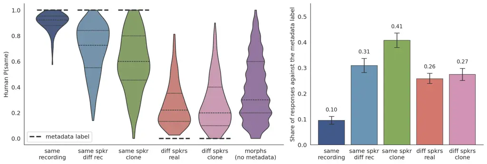

Figure 1: Left. Distribution of $`P(\mathrm{same})`$ for each stimulus
type over all 1,290 listeners. The thick dashed segment marks the
metadata label (“same” for the three same-speaker types and “different”
for the two different-speaker types), and the lines inside each violin
mark the quartiles. Right. Share of listener responses that contradict
the metadata label, with 95% bootstrap intervals over reference
speakers. The share is largest for same-speaker AI voice clones (41%).

|      |       | Judgments | SD of                | Split-half  |             | Responses     | Pairs with majority | Tied  |
| ---- | ----- | --------- | -------------------- | ----------- | ----------- | ------------- | ------------------- | ----- |
| Type | Pairs | per pair  | $`P(\mathrm{same})`$ | correlation | Reliability | against label | against label       | pairs |
| 1    | 100   | 36.8      | 0.07                 | 0.42        | 0.59        | 9.5%          | 0.0%                | 0.0%  |
| 2    | 400   | 40.0      | 0.19                 | 0.76        | 0.87        | 30.9%         | 17.3%               | 1.8%  |
| 3    | 400   | 10.1      | 0.23                 | 0.41        | 0.58        | 40.7%         | 26.0%               | 15.8% |
| 4    | 400   | 39.2      | 0.17                 | 0.74        | 0.85        | 25.8%         | 11.5%               | 0.5%  |
| 5    | 400   | 10.1      | 0.19                 | 0.35        | 0.52        | 27.4%         | 10.5%               | 8.5%  |
| 6    | 8,100 | 10.1      | 0.24                 | 0.49        | 0.66        | n/a           | n/a                 | 10.0% |

Table 10: Statistics of each stimulus type. The split-half correlation
is the mean over 100 random splits of the listeners, and the reliability
is its Spearman-Brown correction. The last three columns compare the
listener responses with the metadata label, which the morphs do not
have.

#### Noise-ceiling derivation.

We split the 1,290 listeners into two random halves, compute
$`P(\mathrm{same})`$ for every pair in each half, and take the Pearson
correlation $`r_{\mathrm{half}}`$ between the two sets of values. The
Spearman-Brown formula
$`\rho_{\mathrm{SB}}=2r_{\mathrm{half}}/(1+r_{\mathrm{half}})`$ gives
the reliability for the full number of listeners. The reported value of
0.705 is the mean over 100 random splits. A model that predicted the
$`P(\mathrm{same})`$ of an unlimited number of listeners exactly would
reach $`r=\sqrt{\rho_{\mathrm{SB}}}=0.84`$ and
$`R^{2}=\rho_{\mathrm{SB}}=0.705`$ against the observed
$`P(\mathrm{same})`$, so these values are the upper bounds of the two
metrics.

#### Task 2 calibration details.

Platt scaling fits, in each fold,

```math
\hat{p}=\sigma(\alpha\cdot c+\beta),\qquad\sigma(z)=\frac{1}{1+e^{-z}},
```

to the label $`y`$ of the pairs of the nine training folds, and the
$`\hat{p}`$ of a pair comes from the fold in which its reference speaker
is held out. The calibrated ECE uses 10 bins of $`\hat{p}`$ with equal
numbers of pairs,

```math
\mathrm{ECE}_{\mathrm{cal}}=\sum_{b=1}^{10}\frac{n_{b}}{N}\left|\bar{p}_{b}-\bar{y}_{b}\right|,
```

where $`n_{b}`$ is the number of pairs in bin $`b`$, $`N=9{,}800`$,
$`\bar{p}_{b}`$ is the mean $`\hat{p}`$ in bin $`b`$, and
$`\bar{y}_{b}`$ is the mean label in bin $`b`$. The raw ECE uses 10 bins
of $`c`$, and it replaces $`\bar{p}_{b}`$ with the mean $`c`$ and
$`\bar{y}_{b}`$ with the mean $`P(\mathrm{same})`$ of the bin. For seven
models, the mean $`c`$ is above the mean $`P(\mathrm{same})`$ in every
bin, so their raw ECE equals the mean $`c`$ minus the mean
$`P(\mathrm{same})`$ over all pairs (0.398). Figure 2 shows the
reliability diagrams after Platt scaling.

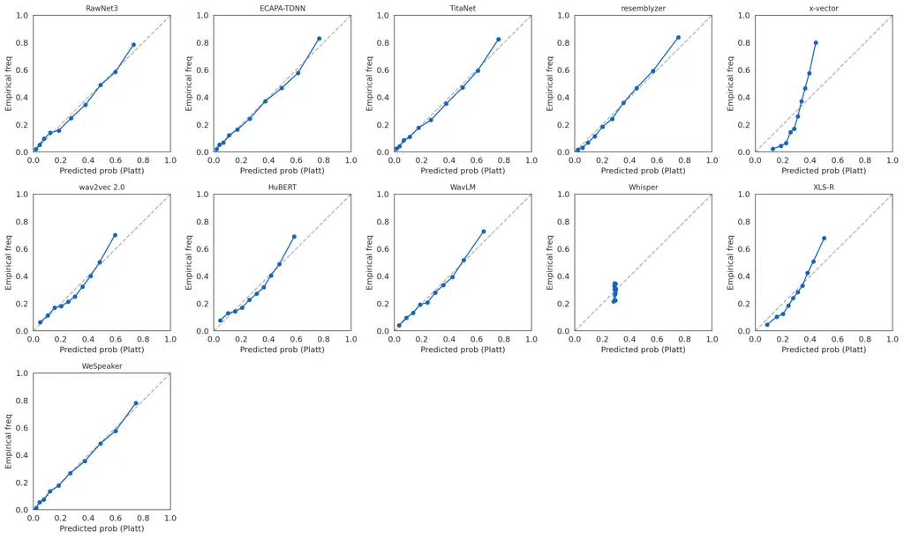

Figure 2: Reliability diagrams after Platt scaling. Each panel plots the
mean $`\hat{p}`$ of a bin against the share of pairs in the bin whose
majority answer is “same”, for 10 bins with equal numbers of pairs. A
model on the diagonal is perfectly calibrated. All models are close to
the diagonal except x-vector, whose calibrated ECE is 0.136.

#### Task 3 details and the symmetrized matrix.

The listener matrix has the entries $`1-\overline{P(\mathrm{same})}`$,
and the model matrix has the entries $`1-\overline{c}`$, where the mean
is over the two pairs of the reference speaker $`A`$ and the comparison
speaker $`B`$. Each matrix has 400 entries, because every reference
speaker is paired only with the four other speakers of its cell. We
leave out the same-speaker pairs. The mean listener dissimilarity is
0.09 to 0.41 for the three same-speaker types and 0.73 to 0.74 for the
two different-speaker types, so the same-speaker pairs would raise
$`\rho`$ through the difference between the two groups of pairs. The
permutation test shuffles the 400 model values 5,000 times, and the
$`p`$-value is the share of shuffles with $`|\rho|`$ at least as large
as the observed $`|\rho|`$. It is below 0.001 for ten models and 0.009
for Whisper. When we permute the speakers instead, so that entries with
a shared speaker move together, the $`p`$-value stays below 0.001 for
the ten models and is 0.031 for Whisper. Table 11 reports $`\rho`$ for
the symmetrized matrix, which averages the entries $`(A,B)`$ and
$`(B,A)`$ and has 200 entries. Every $`\rho`$ rises, by at most 0.07,
and the rank correlation between the two orderings of the models is
0.92. For the symmetrized matrix, the two tests give $`p=0.026`$ and
$`p=0.065`$ for Whisper and $`p<0.001`$ for the other models. Figures 3
and 4 show $`P(\mathrm{same})`$ and the cosine similarity along the
morph weight.

|                     |             |             |
| ------------------- | ----------- | ----------- |
| Model               | Directional | Symmetrized |
| _Supervised_        |             |             |
| resemblyzer         | 0.542       | 0.615       |
| x-vector            | 0.479       | 0.505       |
| WeSpeaker           | 0.389       | 0.439       |
| RawNet3             | 0.386       | 0.421       |
| TitaNet             | 0.379       | 0.433       |
| ECAPA-TDNN          | 0.339       | 0.350       |
| _SSL_               |             |             |
| WavLM               | 0.392       | 0.436       |
| HuBERT              | 0.383       | 0.442       |
| XLS-R               | 0.377       | 0.384       |
| wav2vec 2.0         | 0.357       | 0.379       |
| _Weakly supervised_ |             |             |
| Whisper             | 0.127       | 0.158       |

Table 11: Task 3 $`\rho`$ for the directional matrix (400 entries) and
the symmetrized matrix (200 entries).

#### Task 4 intervals.

Table 12 reports the difference
$`R^{2}_{\mathrm{oracle}}-R^{2}_{\mathrm{transfer}}`$ and the difference
between the two slopes,
$`\beta_{1}^{\mathrm{real}}-\beta_{1}^{\mathrm{synth}}`$, with 95%
intervals from the 2,000 resamples of the reference speakers. Both
intervals are above zero for every model.

|                     |                                                       |                                                          |
| ------------------- | ----------------------------------------------------- | -------------------------------------------------------- |
| Model               | $`R^{2}_{\mathrm{oracle}}-R^{2}_{\mathrm{transfer}}`$ | $`\beta_{1}^{\mathrm{real}}-\beta_{1}^{\mathrm{synth}}`$ |
| _Supervised_        |                                                       |                                                          |
| resemblyzer         | 0.082 \[0.056, 0.116\]                                | 0.56 \[0.43, 0.69\]                                      |
| ECAPA-TDNN          | 0.080 \[0.050, 0.118\]                                | 0.09 \[0.05, 0.13\]                                      |
| WeSpeaker           | 0.068 \[0.040, 0.104\]                                | 0.10 \[0.05, 0.15\]                                      |
| TitaNet             | 0.085 \[0.055, 0.124\]                                | 0.11 \[0.07, 0.15\]                                      |
| RawNet3             | 0.146 \[0.104, 0.195\]                                | 0.15 \[0.10, 0.20\]                                      |
| x-vector            | 0.171 \[0.127, 0.230\]                                | 4.14 \[3.40, 4.85\]                                      |
| _SSL_               |                                                       |                                                          |
| WavLM               | 0.092 \[0.057, 0.144\]                                | 0.63 \[0.49, 0.78\]                                      |
| wav2vec 2.0         | 0.147 \[0.107, 0.198\]                                | 0.73 \[0.58, 0.88\]                                      |
| HuBERT              | 0.140 \[0.102, 0.189\]                                | 0.68 \[0.53, 0.84\]                                      |
| XLS-R               | 0.182 \[0.131, 0.250\]                                | 2.32 \[1.93, 2.73\]                                      |
| _Weakly supervised_ |                                                       |                                                          |
| Whisper             | 0.191 \[0.147, 0.318\]                                | 12.00 \[1.76, 26.20\]                                    |

Table 12: Task 4 differences with 95% intervals from 2,000 resamples of
the reference speakers.

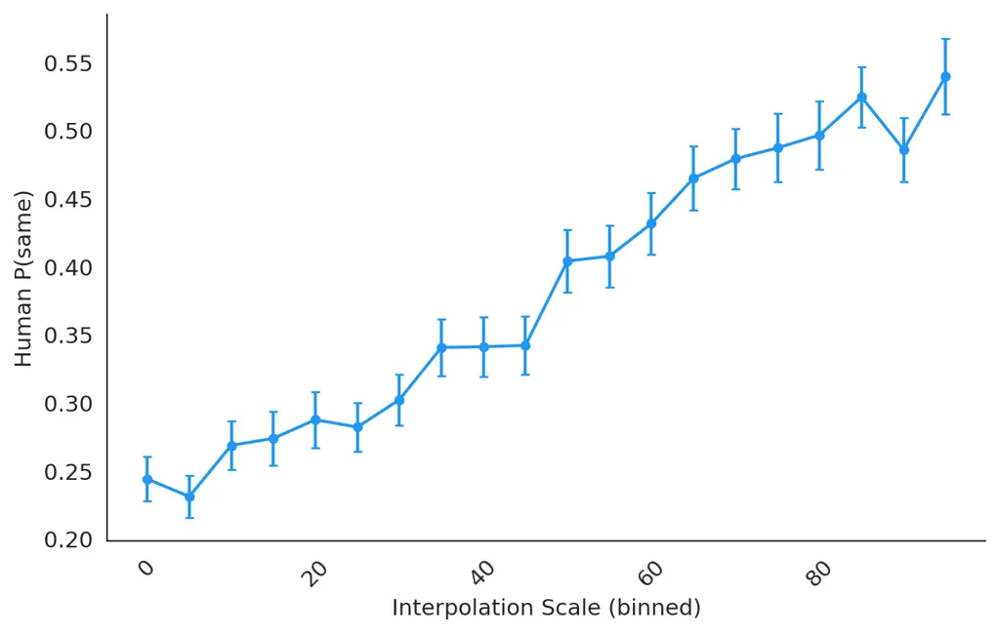

Figure 3: $`P(\mathrm{same})`$ as a function of the morph weight $`s`$
(in percent, binned). Error bars are 1.96$`\times`$ SEM in each bin.

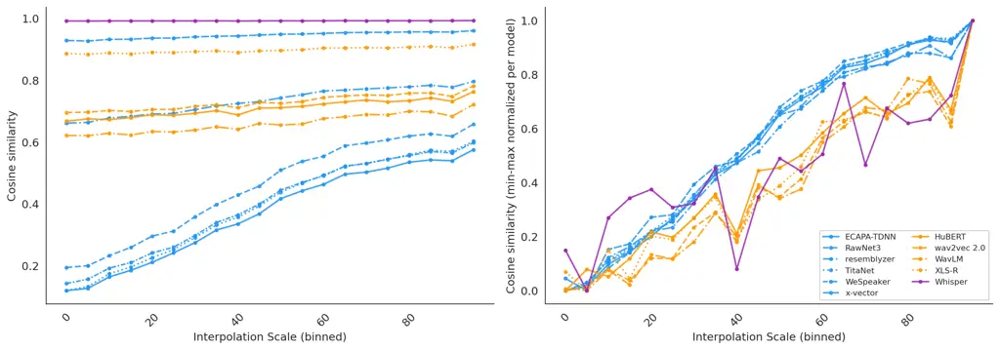

Figure 4: Cosine similarity of each model along the morph weight $`s`$.
Left. Raw cosine similarity. Right. Cosine similarity scaled to the
range from 0 to 1 within each model. The colors mark the type of the
model (blue for supervised, orange for SSL, and purple for weakly
supervised).

#### Layers of the SSL models.

Figure 5 shows Pearson $`r`$ with $`P(\mathrm{same})`$ at every layer of
the four SSL models, where layer 0 is the input to the first transformer
block. For all four models, $`r`$ is highest at layer 0 or 1 and lower
at later layers. XLS-R has $`r=0.47`$ at layer 1 and $`r=0.03`$ at
layer 24. The selected layer is the same in every fold for wav2vec 2.0,
WavLM, XLS-R, and Whisper, and HuBERT alternates between layers 0 and 1
(Table 13). When we select the layer with the metadata label instead
(Table 15), the selected layer is 0 in eight of the ten folds for
wav2vec 2.0 and HuBERT, 4 in every fold for WavLM, and 5 in every fold
for XLS-R.

| Model       | $`f_{1}`$ | $`f_{2}`$ | $`f_{3}`$ | $`f_{4}`$ | $`f_{5}`$ | $`f_{6}`$ | $`f_{7}`$ | $`f_{8}`$ | $`f_{9}`$ | $`f_{10}`$ |
| ----------- | --------- | --------- | --------- | --------- | --------- | --------- | --------- | --------- | --------- | ---------- |
| wav2vec 2.0 | 0         | 0         | 0         | 0         | 0         | 0         | 0         | 0         | 0         | 0          |
| HuBERT      | 1         | 0         | 1         | 0         | 0         | 1         | 0         | 0         | 1         | 0          |
| WavLM       | 0         | 0         | 0         | 0         | 0         | 0         | 0         | 0         | 0         | 0          |
| XLS-R       | 1         | 1         | 1         | 1         | 1         | 1         | 1         | 1         | 1         | 1          |
| Whisper     | 3         | 3         | 3         | 3         | 3         | 3         | 3         | 3         | 3         | 3          |

Table 13: The layer selected in each fold of the CV for the five models
with several layers. Column $`f_{k}`$ gives the layer that is selected
when fold $`k`$ is held out.

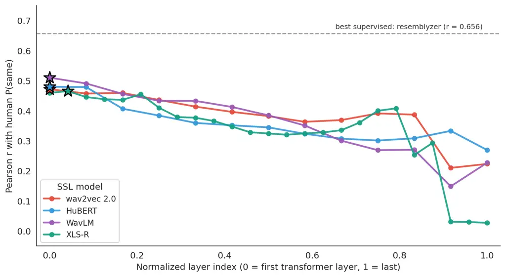

Figure 5: Pearson $`r`$ between the cosine similarity at a layer and
$`P(\mathrm{same})`$ for the four SSL models. The horizontal axis is the
layer index divided by the number of layers. Stars mark the layers
selected by CV, and the dashed line marks resemblyzer.

#### Pretrained checkpoints.

Table 14 lists the checkpoint and its source for every model in Table 3.

| Model       | Source               | Checkpoint identifier                       |
| ----------- | -------------------- | ------------------------------------------- |
| x-vector    | SpeechBrain          | speechbrain/spkrec-xvect-voxceleb           |
| ECAPA-TDNN  | SpeechBrain          | speechbrain/spkrec-ecapa-voxceleb           |
| RawNet3     | ESPnet               | espnet/voxcelebs12_rawnet3                  |
| TitaNet     | NVIDIA NeMo          | nvidia/speakerverification_en_titanet_large |
| resemblyzer | resemblyzer (pip)    | default voice encoder (GE2E pretrained)     |
| WeSpeaker   | pyannote.audio 3.4   | pyannote/wespeaker-voxceleb-resnet34-LM     |
| wav2vec 2.0 | Hugging Face         | facebook/wav2vec2-base                      |
| HuBERT      | Hugging Face         | facebook/hubert-base-ls960                  |
| WavLM       | Hugging Face         | microsoft/wavlm-base-plus                   |
| XLS-R       | Hugging Face         | facebook/wav2vec2-xls-r-300m                |
| Whisper     | OpenAI whisper (pip) | base (74M params, 512-dim encoder)          |

Table 14: Checkpoints and their sources for the eleven models. We load
every checkpoint with the loader of its package and do not fine-tune it.

#### Models on the metadata target.

We evaluate the eleven models against the metadata label of each pair on
three sets of pairs (Table 15). Set A has the 800 pairs with a real
comparison recording of the same speaker or of a different speaker, and
it is the set closest to a speaker verification benchmark. On Set A,
four supervised models have an equal error rate (EER) from 1.5% to 1.9%
(WeSpeaker, TitaNet, ECAPA-TDNN, and RawNet3). x-vector and resemblyzer
have 11.1% and 12.0%, the SSL models have 26% to 32%, and Whisper has
37.5%. Set B has the 800 pairs with a voice clone. The Set B EERs are
3.0% to 4.6% for the four best models, 15.2% and 16.0% for resemblyzer
and x-vector, 32% to 37% for the SSL models, and 43.1% for Whisper. The
EER of every model is higher on Set B than on Set A, by 1.4 to 7.3
percentage points, and the rank correlation between the two orderings is
0.97. Set C has the 1,700 pairs that are not morphs. The metadata target
and the perception target order the three types of models in the same
way, and they order the supervised models differently. Resemblyzer has
the highest $`r`$ in Task 1 and the highest EER of the six supervised
models on Set A. The rank correlation between the metadata AUC on Set C
and the $`r`$ with $`P(\mathrm{same})`$ on the same pairs is 0.84.

|                     |       |       |       |       |       |       |
| ------------------- | ----- | ----- | ----- | ----- | ----- | ----- |
|                     | EER   |       |       | AUC   |       |       |
| Model               | Set A | Set B | Set C | Set A | Set B | Set C |
| _Supervised_        |       |       |       |       |       |       |
| WeSpeaker           | 1.5%  | 3.5%  | 3.6%  | 0.998 | 0.994 | 0.995 |
| TitaNet             | 1.6%  | 3.0%  | 2.7%  | 0.999 | 0.995 | 0.997 |
| ECAPA-TDNN          | 1.6%  | 4.6%  | 3.1%  | 0.998 | 0.992 | 0.995 |
| RawNet3             | 1.9%  | 4.0%  | 3.5%  | 0.997 | 0.992 | 0.995 |
| x-vector            | 11.1% | 16.0% | 11.9% | 0.955 | 0.937 | 0.952 |
| resemblyzer         | 12.0% | 15.2% | 13.0% | 0.953 | 0.934 | 0.949 |
| _SSL_               |       |       |       |       |       |       |
| XLS-R               | 26.4% | 32.0% | 27.8% | 0.795 | 0.726 | 0.785 |
| WavLM               | 26.5% | 33.8% | 28.2% | 0.805 | 0.716 | 0.781 |
| HuBERT              | 31.1% | 34.8% | 31.2% | 0.747 | 0.715 | 0.760 |
| wav2vec 2.0         | 32.0% | 37.0% | 31.8% | 0.734 | 0.694 | 0.745 |
| _Weakly supervised_ |       |       |       |       |       |       |
| Whisper             | 37.5% | 43.1% | 40.2% | 0.673 | 0.603 | 0.654 |

Table 15: Metadata target on three sets of pairs. Set A has the pairs
with a real comparison recording of the same speaker or of a different
speaker (800 pairs). Set B has the pairs with a voice clone (800 pairs).
Set C has all pairs that are not morphs (1,700 pairs). For the SSL
models and Whisper, the layer is selected with the metadata label by the
CV over speakers. Models are sorted by the EER on Set A within each
type.

#### Task 1 figures.

Figure 6 shows $`r`$ for each model with 95% bootstrap confidence
intervals. Figure 7 shows the correlation between the cosine
similarities of every two models. Figure 8 shows the comparison of every
two models with the pairs resampled.

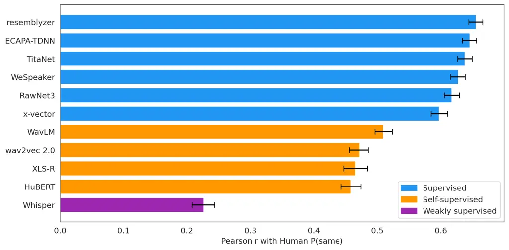

Figure 6: Pearson $`r`$ between the cosine similarity of each model and
$`P(\mathrm{same})`$ on all pairs, with 95% bootstrap confidence
intervals (1,000 resamples of the pairs). The SSL models and Whisper use
the layer selected by CV.

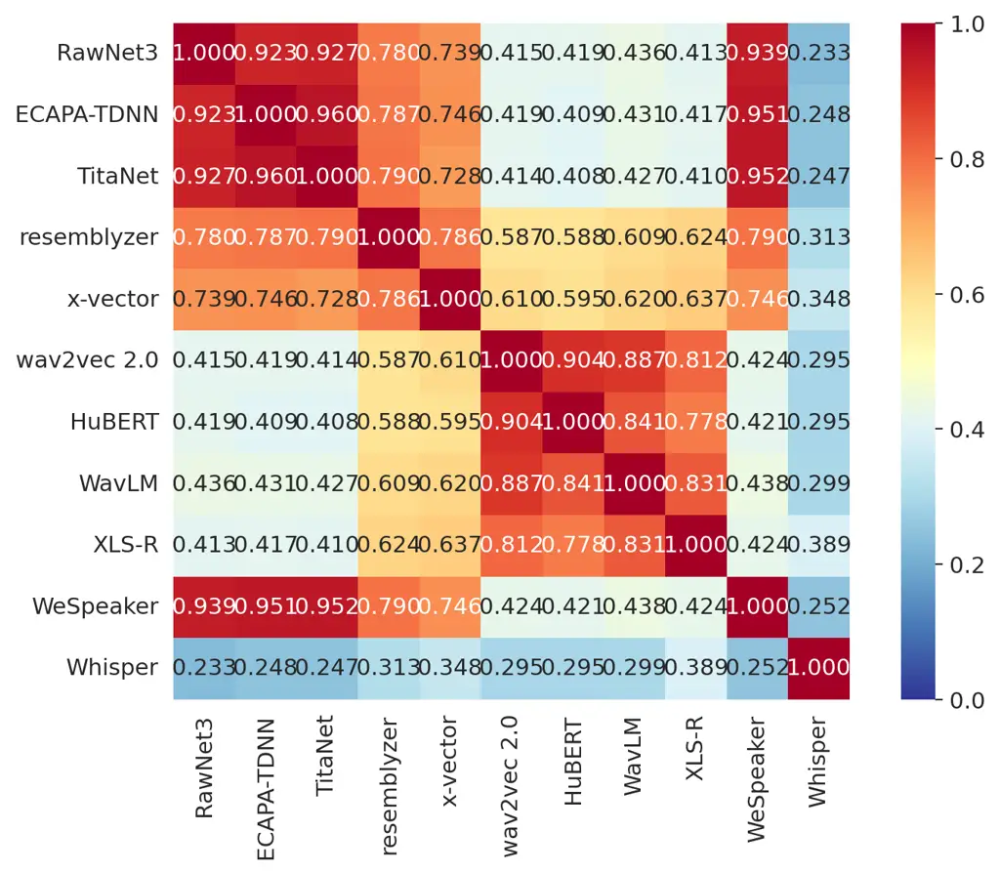

Figure 7: Pearson correlation between the cosine similarities of every
two models over the 9,800 pairs. Warmer colors mark higher correlations.
The correlation is 0.73 to 0.96 between two supervised models, 0.78 to
0.90 between two SSL models, and 0.41 to 0.64 between a supervised model
and an SSL model. Whisper has a correlation of 0.23 to 0.39 with the
other models.

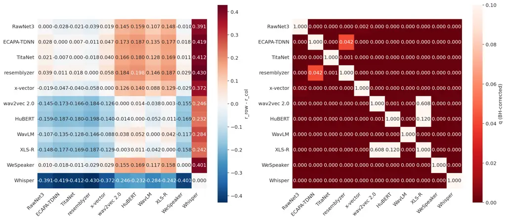

Figure 8: Comparison of every two models in Task 1 with the pairs
resampled 2,000 times, on the 9,799 pairs that every model can score,
with Benjamini-Hochberg correction across the 55 comparisons. Left. Mean
difference $`r_{\mathrm{row}}-r_{\mathrm{col}}`$ over the resamples,
which is red when the row model has the higher $`r`$. Right. Corrected
$`p`$-values ($`q`$), where darker cells have smaller values. Of the 55
comparisons, 53 are significant at 0.05. The two that are not
significant are wav2vec 2.0 with XLS-R ($`q=0.61`$) and HuBERT with
XLS-R ($`q=0.12`$).

#### Task 2 ROC curves.

Figure 9 shows the ROC curve of each model for the majority label.

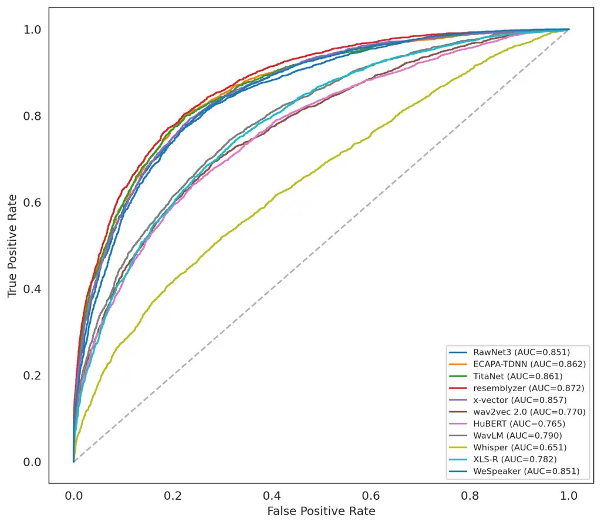

Figure 9: ROC curves of Task 2, with the majority answer of the
listeners as the label ($`P(\mathrm{same})>0.5`$, on the 8,884 pairs
without a tied vote). Each curve is one model. The supervised models
reach an AUC of 0.85 to 0.87, the SSL models 0.77 to 0.79, and Whisper
0.65. The dashed diagonal marks chance.

#### Individual human baseline.

For each of the 806 listeners with at least 10 trials, we compute the
share of the listener’s trials in which the answer agrees with the
majority of the other listeners on the pair. Pairs with a tied vote of
the other listeners are left out. We require 10 trials because the
agreement of a listener with fewer trials can take only a few values.
The mean agreement is 0.73 (median 0.74, SD 0.12, range 0.24 to 1.00).
For a model, we choose the cutoff on the cosine similarity that
maximizes Youden’s $`J`$ against the majority label, and the accuracy of
the model is its agreement with the majority of all listeners on the
8,884 pairs without a tied vote. A listener is therefore scored on the
pairs that the listener judged, against the other listeners, and a model
is scored on all pairs, against all listeners.

Table 16 reports the accuracy of each model and the share of listeners
below it for two cutoffs. The first cutoff is chosen on the pairs of the
nine training folds and applied to the held-out fold, and the main text
reports it. The second is chosen on all pairs, as in Figure 10. The
accuracy differs by at most 0.007 between the two cutoffs, and the share
of listeners by at most 2.9 percentage points. The order of the models
is the same, except that WeSpeaker and x-vector exchange places, and so
do WavLM and XLS-R, with differences in accuracy below 0.005.

For each model, we also correlated the distance of the cosine similarity
from the cutoff with the agreement among the listeners on the pair,
which we measure as 1 minus the entropy of the votes. The correlation is
0.34 for resemblyzer, 0.28 to 0.30 for the other supervised models, 0.21
to 0.24 for the SSL models, and 0.11 for Whisper.

|                     |                    |                 |                       |                 |
| ------------------- | ------------------ | --------------- | --------------------- | --------------- |
|                     | Cutoff from the CV |                 | Cutoff from all pairs |                 |
| Model               | Accuracy           | Listeners below | Accuracy              | Listeners below |
| _Supervised_        |                    |                 |                       |                 |
| resemblyzer         | 0.790              | 72.5%           | 0.797                 | 74.3%           |
| ECAPA-TDNN          | 0.784              | 70.1%           | 0.788                 | 71.7%           |
| TitaNet             | 0.782              | 69.4%           | 0.782                 | 69.6%           |
| RawNet3             | 0.778              | 68.9%           | 0.782                 | 69.6%           |
| x-vector            | 0.774              | 66.7%           | 0.774                 | 66.9%           |
| WeSpeaker           | 0.770              | 64.6%           | 0.775                 | 67.0%           |
| _SSL_               |                    |                 |                       |                 |
| HuBERT              | 0.718              | 38.7%           | 0.722                 | 40.2%           |
| wav2vec 2.0         | 0.710              | 36.0%           | 0.711                 | 36.5%           |
| XLS-R               | 0.703              | 33.0%           | 0.696                 | 30.1%           |
| WavLM               | 0.703              | 33.0%           | 0.704                 | 33.0%           |
| _Weakly supervised_ |                    |                 |                       |                 |
| Whisper             | 0.646              | 19.5%           | 0.643                 | 19.1%           |

Table 16: Accuracy of each model against the majority of all listeners,
and the share of the 806 listeners whose agreement is below it. The
cutoff on the cosine similarity is chosen with the CV over speakers or
on all pairs.

#### Consistency of the listeners.

No listener judged the same pair twice, so the judgments give no
test-retest agreement. The morphs give a close substitute. For each
reference speaker and comparison speaker, two morphs with the same
weight are made from different source recordings. In 6,332 cases, one
listener judged both morphs (118 listeners), and the two answers agreed
in 66% of the cases. Two different listeners would agree in 58% of the
cases, given the $`P(\mathrm{same})`$ of the two morphs. The 95%
interval of the difference is 0.01 to 0.19, from 2,000 resamples of the
listeners. The listeners also differ from each other in how often they
answer “same”. For each listener, we compute the mean difference between
the listener’s answer and the $`P(\mathrm{same})`$ of the pair,
separately in two random halves of the listener’s trials. The two values
have a correlation of 0.72 across the 393 listeners with at least 30
trials. On the pairs from one recording, the median listener answers
“different” in 4.5% of the trials (126 listeners with at least 5 such
trials).

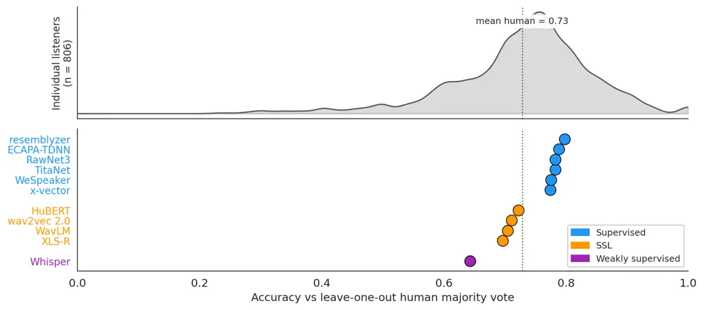

Figure 10: Top. Distribution of the agreement of the 806 listeners with
the majority of the other listeners. Bottom. Accuracy of each model
against the majority of all listeners, with the cutoff chosen on all
pairs. The dotted line marks the mean agreement of the listeners (0.73).

#### Demographic fairness.

Figure 11 shows the $`r`$ of Task 1 on the pairs of each gender and of
each sociophonetic group (Section 8).

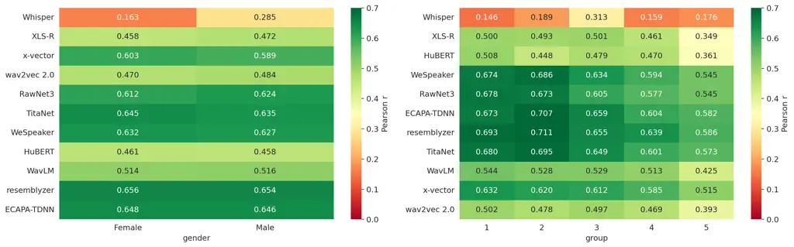

Figure 11: Pearson $`r`$ between the cosine similarity and
$`P(\mathrm{same})`$ on the pairs of each gender (left) and of each
sociophonetic group (right). The difference between female and male
speakers is at most 0.014 for every model except Whisper (0.12). The
difference between the highest and the lowest group is 0.11 to 0.17 for
every model.

#### Ranking with the reference speakers resampled.

The comparisons in Task 1 resample pairs, and the 98 pairs of a
reference speaker share its reference recording. We therefore also
resampled the 100 reference speakers with all their pairs 1,000 times
(Table 17). Every supervised model is above every SSL model, and every
SSL model is above Whisper, in all resamples. Resemblyzer has the
highest $`r`$ in 81.0% of the resamples, ECAPA-TDNN in 18.4%, and
TitaNet in 0.6%. With speakers resampled, 46 of the 55 comparisons
between models are significant. The nine that are not significant are
the three among resemblyzer, ECAPA-TDNN, and TitaNet, WeSpeaker with
TitaNet and with RawNet3, RawNet3 with x-vector, and the three among
wav2vec 2.0, XLS-R, and HuBERT.

|                     |       |                       |           |                          |
| ------------------- | ----- | --------------------- | --------- | ------------------------ |
| Model               | $`r`$ | 95% interval of $`r`$ | Mean rank | 95% interval of the rank |
| _Supervised_        |       |                       |           |                          |
| resemblyzer         | 0.656 | \[0.632, 0.679\]      | 1.26      | 1 to 3                   |
| ECAPA-TDNN          | 0.646 | \[0.619, 0.672\]      | 1.87      | 1 to 3                   |
| TitaNet             | 0.638 | \[0.611, 0.664\]      | 2.91      | 2 to 4                   |
| WeSpeaker           | 0.627 | \[0.600, 0.653\]      | 4.06      | 3 to 5                   |
| RawNet3             | 0.617 | \[0.586, 0.645\]      | 4.96      | 4 to 6                   |
| x-vector            | 0.597 | \[0.572, 0.623\]      | 5.94      | 5 to 6                   |
| _SSL_               |       |                       |           |                          |
| WavLM               | 0.510 | \[0.474, 0.543\]      | 7.00      | 7 to 7                   |
| wav2vec 2.0         | 0.471 | \[0.432, 0.508\]      | 8.38      | 8 to 10                  |
| XLS-R               | 0.465 | \[0.432, 0.497\]      | 8.99      | 8 to 10                  |
| HuBERT              | 0.458 | \[0.418, 0.496\]      | 9.63      | 8 to 10                  |
| _Weakly supervised_ |       |                       |           |                          |
| Whisper             | 0.226 | \[0.177, 0.268\]      | 11.00     | 11 to 11                 |

Table 17: Task 1 with the 100 reference speakers resampled 1,000 times.
The rank is the position of a model among the eleven models in a
resample.

#### Robustness of the Task 1 ranking.

Table 18 reports $`r`$ under four changes of the data. On the 900 pairs
of real recordings alone, the rank correlation with the full ranking is
0.98. Without the 8,100 morphs it is also 0.98, and $`r`$ is higher by
0.10 to 0.16 for every model except Whisper. With equal weight for each
of the six stimulus types, which is the mean of the six values of $`r`$
in Table 19, the rank correlation is 0.90, and RawNet3 falls below WavLM
and XLS-R. RawNet3 has a low $`r`$ on the pairs from one recording
(0.18), whose $`P(\mathrm{same})`$ values span a narrow range. Without
that type the rank correlation is 0.92, and every supervised model is
above every SSL model. The types with a real comparison recording have
37 to 40 judgments for each pair, and the other types have about 10.
When we reduce every pair of the former types to 10 judgments, the
ranking is identical to the full ranking in each of 20 random draws.

|                     |           |                 |                |              |              |
| ------------------- | --------- | --------------- | -------------- | ------------ | ------------ |
| Model               | All pairs | Real recordings | Without morphs | Equal weight | 10 judgments |
| _Supervised_        |           |                 |                |              |              |
| resemblyzer         | 0.656     | 0.859           | 0.804          | 0.506        | 0.650        |
| ECAPA-TDNN          | 0.646     | 0.855           | 0.791          | 0.442        | 0.640        |
| TitaNet             | 0.638     | 0.858           | 0.794          | 0.444        | 0.633        |
| WeSpeaker           | 0.627     | 0.847           | 0.784          | 0.430        | 0.622        |
| RawNet3             | 0.617     | 0.843           | 0.774          | 0.381        | 0.612        |
| x-vector            | 0.597     | 0.830           | 0.762          | 0.439        | 0.592        |
| _SSL_               |           |                 |                |              |              |
| WavLM               | 0.510     | 0.673           | 0.615          | 0.394        | 0.505        |
| wav2vec 2.0         | 0.471     | 0.639           | 0.573          | 0.352        | 0.468        |
| XLS-R               | 0.465     | 0.653           | 0.591          | 0.390        | 0.461        |
| HuBERT              | 0.458     | 0.626           | 0.568          | 0.339        | 0.454        |
| _Weakly supervised_ |           |                 |                |              |              |
| Whisper             | 0.226     | 0.213           | 0.203          | 0.057        | 0.224        |

Table 18: Task 1 $`r`$ on all pairs, on the 900 pairs of real
recordings, on the 1,700 pairs that are not morphs, with equal weight
for each of the six stimulus types, and with 10 judgments for each pair
(mean of 20 draws).

|                     |               |                |       |                   |       |       |
| ------------------- | ------------- | -------------- | ----- | ----------------- | ----- | ----- |
|                     | Same speaker  |                |       | Different speaker |       |       |
| Model               | One recording | Two recordings | Clone | Real              | Clone | Morph |
| _Supervised_        |               |                |       |                   |       |       |
| resemblyzer         | 0.286         | 0.650          | 0.513 | 0.520             | 0.463 | 0.607 |
| ECAPA-TDNN          | 0.348         | 0.581          | 0.453 | 0.365             | 0.306 | 0.598 |
| TitaNet             | 0.246         | 0.612          | 0.498 | 0.409             | 0.316 | 0.585 |
| WeSpeaker           | 0.341         | 0.550          | 0.407 | 0.375             | 0.332 | 0.572 |
| RawNet3             | 0.180         | 0.497          | 0.336 | 0.386             | 0.314 | 0.571 |
| x-vector            | 0.232         | 0.558          | 0.451 | 0.472             | 0.370 | 0.550 |
| _SSL_               |               |                |       |                   |       |       |
| WavLM               | 0.318         | 0.453          | 0.413 | 0.392             | 0.318 | 0.467 |
| wav2vec 2.0         | 0.247         | 0.403          | 0.360 | 0.364             | 0.305 | 0.435 |
| XLS-R               | 0.304         | 0.510          | 0.414 | 0.361             | 0.325 | 0.426 |
| HuBERT              | 0.173         | 0.414          | 0.366 | 0.342             | 0.320 | 0.417 |
| _Weakly supervised_ |               |                |       |                   |       |       |
| Whisper             | $`-0.084`$    | $`-0.007`$     | 0.064 | 0.063             | 0.090 | 0.216 |
| Reliability         | 0.59          | 0.87           | 0.58  | 0.85              | 0.52  | 0.66  |

Table 19: Task 1 $`r`$ inside each stimulus type. The last row gives the
reliability of $`P(\mathrm{same})`$ inside the type (Table 10).

#### Pairs outside VoxCeleb.

We matched the names of the 100 speakers against the speaker lists of
VoxCeleb 1 and VoxCeleb 2, and 26 speakers match (11 in VoxCeleb 1 and
15 in VoxCeleb 2). Of the 9,800 pairs, 5,580 have both speakers outside
VoxCeleb. Table 20 reports $`r`$ on these pairs and on the other 4,220
pairs. The rank correlation between the ranking on the 5,580 pairs and
the full ranking is 0.96, and the order of the three types of models is
the same. ECAPA-TDNN has the highest $`r`$ on the 5,580 pairs. The mean
$`r`$ of the supervised models is 0.166 above the mean $`r`$ of the SSL
models on the 5,580 pairs and 0.142 above it on the other pairs.

|                     |           |                  |                         |
| ------------------- | --------- | ---------------- | ----------------------- |
| Model               | All pairs | Outside VoxCeleb | With a VoxCeleb speaker |
| _Supervised_        |           |                  |                         |
| resemblyzer         | 0.656     | 0.664            | 0.642                   |
| ECAPA-TDNN          | 0.646     | 0.672            | 0.608                   |
| TitaNet             | 0.638     | 0.671            | 0.589                   |
| WeSpeaker           | 0.627     | 0.650            | 0.592                   |
| RawNet3             | 0.617     | 0.635            | 0.592                   |
| x-vector            | 0.597     | 0.619            | 0.574                   |
| _SSL_               |           |                  |                         |
| WavLM               | 0.510     | 0.515            | 0.494                   |
| wav2vec 2.0         | 0.471     | 0.486            | 0.443                   |
| XLS-R               | 0.465     | 0.464            | 0.459                   |
| HuBERT              | 0.458     | 0.477            | 0.432                   |
| _Weakly supervised_ |           |                  |                         |
| Whisper             | 0.226     | 0.252            | 0.192                   |

Table 20: Task 1 $`r`$ on all pairs, on the 5,580 pairs with both
speakers outside VoxCeleb, and on the 4,220 pairs with at least one
speaker in VoxCeleb.

#### Learned similarity functions.

We fitted three learned similarity functions with the CV over speakers.
The first is a diagonal Mahalanobis metric, which learns one weight for
each dimension of the embedding (Table 21, Figure 12). For the models
with more than 256 dimensions, we first reduce the embeddings to 50
principal components. The table compares the $`R^{2}`$ with learned
weights with the $`R^{2}`$ with equal weights on the same features. The
learned weights change $`R^{2}`$ by $`-0.03`$ to $`+0.01`$ for the
supervised models, by $`+0.02`$ to $`+0.03`$ for the SSL models, and by
$`+0.10`$ for Whisper. The second function is a ridge regression on all
products of two of the first 50 principal components of the difference
between the two normalized embeddings (1,275 features). The third is a
ridge regression on the features
$`[\,|\mathbf{e}_{\mathrm{ref}}-\mathbf{e}_{\mathrm{comp}}|,\ \mathbf{e}_{\mathrm{ref}}\odot\mathbf{e}_{\mathrm{comp}}\,]`$
of the normalized embeddings. Table 22 reports the $`r`$ between the
predictions for the held-out folds and $`P(\mathrm{same})`$. With the
third function, the supervised models have an $`r`$ from 0.60 to 0.68,
and the SSL models from 0.57 to 0.58. The difference between the weakest
supervised model and the strongest SSL model is 0.09 with the cosine
similarity, 0.04 with the second function, and 0.02 with the third.
Every supervised model is above every SSL model, and every SSL model is
above Whisper, for all three functions.

|                     |                          |                            |            |
| ------------------- | ------------------------ | -------------------------- | ---------- |
| Model               | $`R^{2}_{\mathrm{iso}}`$ | $`R^{2}_{\mathrm{mahal}}`$ | $`\Delta`$ |
| _Supervised_        |                          |                            |            |
| resemblyzer         | 0.435                    | 0.403                      | $`-0.032`$ |
| ECAPA-TDNN          | 0.357                    | 0.343                      | $`-0.014`$ |
| TitaNet             | 0.354                    | 0.353                      | $`-0.002`$ |
| RawNet3             | 0.341                    | 0.336                      | $`-0.005`$ |
| WeSpeaker           | 0.314                    | 0.304                      | $`-0.009`$ |
| x-vector            | 0.305                    | 0.319                      | $`+0.014`$ |
| _SSL_               |                          |                            |            |
| WavLM               | 0.175                    | 0.193                      | $`+0.019`$ |
| XLS-R               | 0.164                    | 0.198                      | $`+0.034`$ |
| wav2vec 2.0         | 0.157                    | 0.186                      | $`+0.028`$ |
| HuBERT              | 0.149                    | 0.181                      | $`+0.032`$ |
| _Weakly supervised_ |                          |                            |            |
| Whisper             | 0.023                    | 0.127                      | $`+0.104`$ |

Table 21: Diagonal Mahalanobis metric with the CV over speakers.
$`R^{2}_{\mathrm{iso}}`$ uses equal weights and
$`R^{2}_{\mathrm{mahal}}`$ uses learned weights on the same features,
and $`\Delta`$ is their difference. For x-vector, the SSL models, and
Whisper, the features are 50 principal components, so
$`R^{2}_{\mathrm{iso}}`$ differs from the $`R^{2}`$ in Table 4.

|                     |        |           |               |
| ------------------- | ------ | --------- | ------------- |
| Model               | Cosine | Quadratic | Pair features |
| _Supervised_        |        |           |               |
| resemblyzer         | 0.656  | 0.619     | 0.680         |
| ECAPA-TDNN          | 0.646  | 0.559     | 0.624         |
| TitaNet             | 0.638  | 0.574     | 0.601         |
| WeSpeaker           | 0.627  | 0.570     | 0.614         |
| RawNet3             | 0.617  | 0.575     | 0.605         |
| x-vector            | 0.597  | 0.576     | 0.642         |
| _SSL_               |        |           |               |
| WavLM               | 0.510  | 0.523     | 0.574         |
| wav2vec 2.0         | 0.471  | 0.488     | 0.567         |
| XLS-R               | 0.465  | 0.504     | 0.570         |
| HuBERT              | 0.458  | 0.515     | 0.584         |
| _Weakly supervised_ |        |           |               |
| Whisper             | 0.226  | 0.294     | 0.423         |

Table 22: Task 1 $`r`$ with the cosine similarity, with the ridge
regression on products of principal components of the embedding
difference (quadratic), and with the ridge regression on pair features.

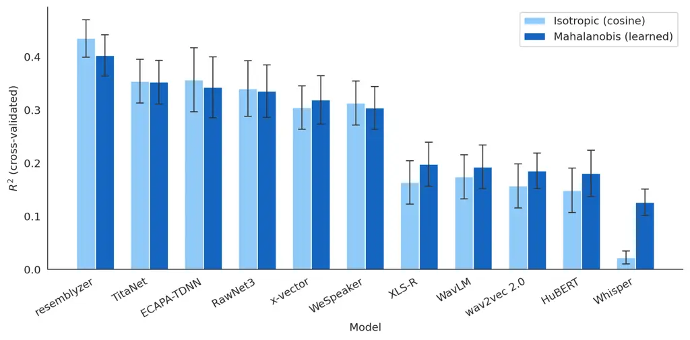

Figure 12: $`R^{2}`$ with $`P(\mathrm{same})`$ with equal weights (light
blue) and with the learned weights of the diagonal Mahalanobis metric
(dark blue), with the CV over speakers. Error bars are 95% confidence
intervals across the 10 folds.
