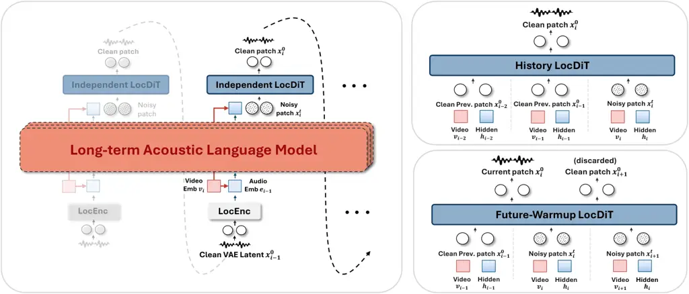

# LiveFoley: Dynamic Real-Time Video-to-Audio Generation for Immersive Interactive Worlds

Yusheng Dai    Vladimir Iashin Affiliation: Monash University  Nanjing
University  ShengShu Technology  Tampere University    Kangdi Wang   
Yuxuan Jiang Affiliation: Alibaba Token Hub, Alibaba Group  Tsinghua
University  ^(†)Corresponding author    Ilpo Viertola
Affiliation: Monash University  Nanjing University  ShengShu Technology
 Tampere University    Weiqiang Wang    Qiuhong Ke    Min Zhao   
Jianfei Cai

###### Abstract

Streaming video-to-audio (V2A) generation is essential for immersive
interactive applications. However, real-time constraints leave existing
streaming V2A methods far behind offline models: (1) visual frontends
shrink their receptive fields to cut look-ahead latency, severely
degrading audio-visual alignment; (2) causal autoregressive diffusion
backends denoise each audio patch in isolation, impairing audio quality.
To this end, we present LiveFoley, a streaming causal autoregressive
diffusion architecture that addresses both bottlenecks with
imperceptible latency. For the visual frontend, we introduce a Trailing
Sliding Window that converts non-causal segment-level encoders into
streaming modules without retraining. By simply realigning the window,
it preserves precise audio-visual alignment, while a configurable hop
size reduces the frontend look-ahead well below the human perceptual
threshold. Building on this tunable hop size, we propose the Unified
Varhop Framework to accommodate scenarios with diverse latency and
computation budgets. For the audio backend, we explore widening the
denoising window of the local diffusion transformer (LocDiT) head in two
temporal directions. History LocDiT adds past context to improve quality
at no latency cost and serves as our default. Alternatively,
Future-Warmup LocDiT breaks the autoregressive deadlock with an
approximate future condition, further improving generation quality at
the cost of an acceptable backend look-ahead. Extensive experiments
demonstrate that LiveFoley matches offline models in temporal alignment
and leads streaming systems in generation quality. Project page:
[https://dalision.github.io/livefoley-page/](https://dalision.github.io/livefoley-page/).

## 1 Introduction

In interactive virtual environments, real-time acoustic feedback to user
actions is crucial for immersion. While recent world models \[44, 24,
59\] have advanced synchronized audio-visual generation, their audio
synthesis is inherently coupled with their internal video generation,
rendering them incompatible with external visual pipelines such as game
engines, AR/VR, and live camera feeds. In contrast, streaming
video-to-audio (V2A) generation presents a versatile, source-agnostic
alternative by synthesizing audio on-the-fly from arbitrary live pixel
streams. Unlike turn-based systems (_e.g_., GPT-Realtime \[37\]),
streaming V2A requires continuous and precise temporal synchronization,
so visual encoding and audio synthesis must jointly execute within an
ultra-low latency budget to keep the audio-visual delay below the human
perceptual threshold.

Figure 1: (a) User study: the minimum audio delay at which participants
notice the sound lagging behind the video, for action sounds, speech,
and ambient sounds in free roaming (mean $`\pm`$ 95% CI). (b) Empirical
study of streaming visual frontends on the V-AURA \[54\] backbone: the
traditional chunked window (Figure 2a) cuts latency by shrinking the
window $`w`$ at a sharp cost in audio-visual alignment, while our
trailing sliding window (Figure 2b) shortens the hop $`s`$ and preserves
alignment.

To quantify this perceptual threshold, we conduct a user study
(Figure 1a; protocol in Appendix A), which reveals two key observations.
First, discrete action-sound events (_e.g_., impacts) are the most
sensitive: delays become perceptible at about 0.34 s¹¹ 1 In Appendix A,
we compare the difference from ITU-R BT.1359 \[21\] that our
reference-free protocol better reflects real interactive use., which
sets a strict latency budget for preserving immersion. Second, the
threshold varies sharply with context: delays in speech are perceived at
about 0.49 s, whereas ambient sounds during free roaming are only
perceived at about 0.85 s. These findings suggest that an ideal
streaming V2A system must (1) achieve high audio-visual alignment and
generation quality within an ultra-low latency budget, and (2)
dynamically adapt to different scenarios, trading allowable delay for
reduced computational load.

However, existing streaming V2A approaches cannot achieve imperceptible
latency, precise audio-visual alignment, and high audio quality at the
same time, owing to two core bottlenecks. The first bottleneck is the
look-ahead delay of the visual frontend. Precise audio-visual alignment
typically requires segment-level encoders (_e.g_., Synchformer \[20\]),
but their full segment encoding introduces a long look-ahead delay
(_e.g_., 0.64 s in V-AURA \[54\]). Conversely, frame-level encoders
(_e.g_., DINOv2 \[38\]), as adopted in SoundReactor \[45\], require only
a 0.08 s frontend look-ahead but severely degrade audio-visual
alignment. Our controlled experiment (Figure 1b) further reveals the
root cause: as the receptive field of Synchformer shrinks, the
audio-visual alignment of downstream generation degrades steadily,
showing that alignment hinges on the temporal context each segment
covers. The second bottleneck stems from the causal constraints of
continuous autoregressive generation. Unlike offline diffusion models
that jointly denoise all patches, existing streaming V2A systems \[45,
10\], built on autoregressive diffusion architectures \[29, 22, 61\],
denoise each patch in isolation with a local diffusion or flow-matching
head (LocDiT), attending to neither previous nor upcoming patches. As a
result, these streaming models significantly trail offline systems in
audio quality.

To address these challenges, we propose LiveFoley, a plug-and-play sound
engine for general vision-interactive applications that delivers
real-time, precisely synchronized, and high-quality acoustic feedback.
For the visual frontend, we introduce a simple yet effective mechanism,
the Trailing Sliding Window, that breaks the latency-alignment
trade-off. Rather than shrinking the receptive field, we anchor the tail
of the segment window to the current frame. Paired with first-frame
padding, this mechanism converts off-the-shelf non-causal segment-level
encoders into streaming modules, decoupling the frontend look-ahead from
the long window length and instead linking it to a small, configurable
hop size. Building on this tunable hop size, we further propose the
Unified Varhop Framework to accommodate the diverse latency and compute
budgets of different scenarios (_e.g_., free roaming vs. shooter games).
At its core, a Synchronizer module aligns the latent representations
across different latency modes, enabling a shared generation backbone to
adopt dynamic hop sizes.

For the audio backend, we explore widening the denoising window of
LocDiT beyond a single patch. Toward the past, History LocDiT adds
previously generated patches as context, improving quality at no latency
cost, and serves as our default. Toward the future, the upcoming patch
cannot simply join the current denoising window, as its condition
depends on the clean current patch, which is not yet available.
Future-Warmup LocDiT breaks this autoregressive deadlock by constructing
an approximate condition from the current hidden state and the next
visual token, enabling cross-patch collaborative denoising. As an
optional upgrade, it improves quality further with only 0.08 s of extra
backend look-ahead, keeping the end-to-end latency at an estimated
236 ms (with hop size $`s=1`$, Appendix E), below the human perceptual
threshold (Figure 1a).

Experiments show that LiveFoley is the first streaming V2A system to
match offline models in temporal alignment, with only a 0.08 s frontend
look-ahead, while delivering the best audio quality among streaming
systems. On a single A800 GPU, it achieves an end-to-end latency below
the human perceptual threshold. LiveFoley can thus serve as a
plug-and-play sound engine for interactive applications such as AR/VR
and video games.

## 2 Related Work

Figure 2: Streaming visual frontend. Each dot denotes the token at one
window position. (a) Chunked window: shrinking the window $`w`$ lowers
latency but also narrows the receptive field, which degrades
audio-visual alignment. (b) Trailing sliding window: anchoring the
window tail to the latest frame reduces look-ahead to one hop while
preserving the full receptive field $`w`$ and hence the alignment. Black
dots are emitted tokens at newly arrived frames. Gray and dashed dots
correspond to earlier frames and first-frame padding, respectively;
these frames provide context only within the encoder, and their tokens
are discarded. (c) Unified Varhop Framework: a Synchronizer maps tokens
from different hop sizes into a shared latent space, allowing a single
backend to switch among hop sizes.

#### Audio-Visual Alignment for Streaming V2A.

In offline video-to-audio (V2A) generation, visual representations have
evolved from coarse per-frame features, such as CLIP \[42, 48\], RGB,
and optical flow \[18\], to segment-level features like
Synchformer \[20\]. By substantially improving temporal alignment, this
advancement underpins leading offline systems (_e.g_., MMAudio \[4\],
HunyuanVideo-Foley \[47\]). In streaming, however, these non-causal
encoders introduce a latency-alignment trade-off: V-AURA \[54\] adopts
Synchformer at the cost of a 0.64 s look-ahead, whereas
SoundReactor \[45\] uses per-frame DINOv2 \[38\] features with minimal
look-ahead but weaker alignment. Concurrently, WorldSonus \[10\]
partially mitigates this trade-off by aligning its autoregressive
backbone to a frozen Synchformer teacher via a time-shifted contrastive
loss, improving alignment under chunk-level (100 ms) latency but still
trailing offline models (Section 4.2).

#### Generative Architectures for Streaming V2A.

While global bidirectional diffusion models dominate offline
generation \[4, 31, 47\], streaming applications necessitate
autoregressive (AR) architectures to bypass the dependency on
full-sequence video inputs. Early AR audio models rely on discrete codec
tokens, predicting RVQ token streams autoregressively \[27, 6, 35, 54\].
However, discrete tokens suffer from quantization loss and require
complex scheduling to manage intra-frame dependencies \[29, 6\]. Recent
approaches have therefore shifted toward continuous AR generation,
pairing a causal LM with a local flow-matching or diffusion head \[29,
22, 61, 30, 43, 45, 28, 10\]. By eliminating quantization bottlenecks,
this continuous paradigm can capture finer acoustic details. Yet
streaming V2A models built on this paradigm still fall short of offline
models in generation quality \[45, 10\]. We attribute this partly to
their local heads, which denoise each patch in isolation, see history
only through the AR hidden state, and cannot denoise jointly with
upcoming patches due to causality.

#### Other Online Audio Generation.

Beyond streaming V2A, the broader landscape of real-time interactive
audio encompasses joint audio-visual generation and acoustic scene
modeling. Joint generation models \[44, 24, 59, 50, 55\] synchronously
produce video and audio. However, their audio generation remains
strictly coupled to internal video generators, rendering them
inapplicable to pre-existing visual streams like game engines or camera
feeds. Alternatively, acoustic scene modeling systems \[23\] focus
purely on spatial rendering. These systems adjust the spatial
attenuation of static environmental sounds based on user pose, yet
cannot generate dynamic action sounds corresponding to transient visual
events. In contrast, streaming V2A offers a plug-and-play solution that
generates synchronized sound directly conditioned on arbitrary dynamic
pixel streams, providing maximum flexibility for interactive scenarios.

## 3 Method

### 3.1 Preliminaries: Synchformer

Synchformer \[20\] is a self-supervised audio-visual synchronization
model used as the temporal condition in V2A systems \[4, 54\]. It splits
a video into segments of 16 frames (0.64 s at 25 fps) and encodes each
segment with a visual encoder (Motionformer \[40\]) and an audio encoder
(AST \[13\]), yielding 8 visual tokens per segment, _i.e_., one every
0.08 s. The encoders are first pretrained with a segment-level
contrastive objective (Segment AVCLIP),

```math
\mathcal{L}_{\mathrm{AVCLIP}}=-\frac{1}{B}\sum_{i=1}^{B}\log\frac{\exp(\tilde{a}_{i}\cdot\tilde{v}_{i}/\kappa)}{\sum_{j=1}^{B}\exp(\tilde{a}_{i}\cdot\tilde{v}_{j}/\kappa)}, \tag{1}
```

where $`\tilde{a}_{i}`$ and $`\tilde{v}_{i}`$ are the audio and visual
features of segment $`i`$, $`B`$ is the batch size, and $`\kappa`$ is a
learnable temperature; the symmetric visual-to-audio term is omitted for
brevity. A lightweight transformer is then trained on the concatenated
segment features to classify the audio-visual offset with the encoders
frozen. LiveFoley adopts the frozen Segment AVCLIP visual encoder of
Synchformer as its frontend. Since attention within a segment is
bidirectional, a token becomes available only after its entire 16-frame
segment has arrived; removing this look-ahead without shrinking the
receptive field is the goal of Section 3.2.

### 3.2 Streaming Visual Frontend

#### Chunked Window.

Existing streaming V2A methods divide the video into fixed,
non-overlapping windows and feed them sequentially to the visual encoder
(Figure 2a). For Synchformer, a window of $`w`$ tokens spans $`2w`$
frames, all of which must be buffered before encoding, so the frontend
look-ahead grows linearly with $`w`$. Shrinking the window from 4 tokens
to 1 cuts it from 0.32 s to 0.08 s, but also narrows the temporal
receptive field, and downstream audio-visual alignment drops sharply
(Figure 1b). The chunked window thus trades alignment for latency.

#### Trailing Sliding Window.

The core challenge therefore lies in reducing latency without
sacrificing the receptive field $`w`$. To this end, LiveFoley introduces
a trailing sliding window (Figure 2b). Instead of shrinking $`w`$, we
anchor the tail of the window to the current frame $`f_{n}`$,
formulating the input sequence as
$`\mathcal{F}_{n}=[f_{n-2w+1},\dots,f_{n}]`$. By restricting the context
to strictly historical frames, this design avoids waiting for a full
window, decoupling the frontend look-ahead from $`w`$. Furthermore, when
$`n<2w`$, we pad the missing history by repeating the first frame, so
that the first output does not have to wait for a full window of $`2w`$
real frames to accumulate, thereby reducing the end-to-end latency.
Consequently, this formulation allows off-the-shelf non-causal
segment-level encoders to operate causally in streaming settings without
retraining, while preserving their bidirectional temporal attention.

In continuous streaming, the trailing window slides forward as new
frames arrive. We introduce a hop size $`s`$ that governs the sliding
frequency: as illustrated in Figure 2b with Synchformer, the window
advances every $`2s`$ frames, emitting exactly $`s`$ newly extracted
trailing tokens. By adjusting $`s`$, we can precisely control the
frontend look-ahead $`\tau`$ (_e.g_., $`s\in\{1,2,4\}`$ yields
$`\tau\in\{0.08,0.16,0.32\}`$ s). Unlike shrinking the window size
$`w`$, reducing the hop size $`s`$ keeps the full temporal context, so
latency drops while audio-visual alignment is preserved (orange line in
Figure 1b). The latency-alignment dilemma thus becomes a configurable
latency-compute trade-off.

### 3.3 Unified Varhop Framework

As shown in Figure 1a, the tolerable audio delay varies widely across
scenarios. Scenarios with strict audio-visual coupling (_e.g_., shooting
or rhythm games) require a minimal latency ($`\tau`$) and a small hop
size ($`s`$), whereas in ambient scenes (_e.g_., open-world roaming)
delays are only perceived at about 0.85 s, so a larger $`s`$ reduces the
frontend extraction frequency and saves computation without compromising
immersion.

Instead of training a separate expert model for each hop size, LiveFoley
introduces the Unified Varhop Framework (Figure 2c), which supports
multiple latency modes with a unified model. However, extracting
different numbers of trailing tokens from a fixed-size window shifts the
feature distribution across hop sizes, which can disrupt the downstream
audio backend. To map these tokens into a unified hidden space, we
introduce a Synchronizer module to bridge the frontend and backend.
Given the 8 tokens $`W\in\mathbb{R}^{8\times d}`$ of a Synchformer
window, the Synchronizer produces:

```math
V_{s}=\operatorname{Synchronizer}(W)[-s:]+e_{\mathrm{mode}}, \tag{2}
```

where $`\operatorname{Synchronizer}(\cdot)`$ is a two-layer transformer.
Rather than directly slicing the trailing tokens from the raw frontend
output, this module first incorporates positional embeddings and
aggregates intra-window context for global feature alignment. Only then
does it slice the final $`s`$ tokens and add a learnable latency-mode
embedding, $`e_{\mathrm{mode}}`$. The output is a constant-rate 12.5 Hz
token stream for every hop size, so the audio backend is mode-agnostic
and the hop size can be switched per scene at inference. During
training, the three hop sizes are rotated in equal proportion across
batches, so that a single set of weights learns all latency modes.

### 3.4 Audio Generation Backbone



Figure 3: Continuous autoregressive audio generation backbone. Left: at
each 12.5 Hz step, the causal LM fuses the current visual token
$`v_{i}`$ and the LocEnc embedding $`e_{i-1}`$ of the previous clean
patch $`x_{i-1}^{0}`$ into a hidden state $`h_{i}`$, on which
Independent LocDiT denoises the current patch $`x_{i}^{t}`$ in
isolation. Right: History LocDiT (top) adds clean patches
$`x_{i-2}^{0}`$ and $`x_{i-1}^{0}`$ as context without extra look-ahead.
Future-Warmup LocDiT (bottom) jointly denoises $`x_{i}^{t}`$ and a
warmup patch $`x_{i+1}^{t}`$, which is conditioned on $`h_{i}`$ and
$`v_{i+1}`$ and discarded at inference.

LiveFoley adopts an end-to-end autoregressive diffusion architecture
operating on continuous representations from a causal audio VAE. As
shown in Figure 3, the generation module consists of two components: a
causal language model (LM) and a local flow-matching transformer
(LocDiT). Operating at a 12.5 Hz autoregressive rate, _i.e_., one step
per visual sync token (0.08 s), the acoustic LM captures long-term
inter-patch dependencies to produce a coarse hidden state $`h_{i}`$.
Conditioned on $`h_{i}`$, LocDiT uses bidirectional attention to refine
intra-patch acoustic details. It acts as a local denoiser, transforming
a noise patch $`x_{i}^{1}=\epsilon`$ into a clean VAE latent patch
$`x_{i}^{0}`$, which is fed back to the LM for the next autoregressive
step. Superscripts denote flow time, and $`x_{i}`$ without one refers to
patch $`i`$. Our framework supports both 16 kHz and 48 kHz causal VAEs,
which share the same 12.5 Hz patch rate: the 16 kHz VAE outputs latent
frames at 25 Hz and groups $`P=2`$ frames into one patch, while the
48 kHz VAE outputs 50 Hz latents with $`P=4`$. We describe the 16 kHz
variant for simplicity.

#### Causal Acoustic Language Model.

Following VoxCPM2 \[61, 62\], we adopt the MiniCPM \[16, 36\]
architecture as the LM backbone and train it from scratch. To stabilize
the continuous autoregressive rollout, we employ a LocEnc module \[22,
61\] that compresses the $`P`$ latent frames of the previously generated
patch ($`x_{i-1}^{0}`$) into a single audio embedding $`e_{i-1}`$. Since
the sync tokens from our visual frontend are already at 12.5 Hz, they
are injected without temporal resampling. At step $`i`$, the current
sync token $`v_{i}`$ and the previous audio embedding $`e_{i-1}`$ are
linearly projected and concatenated along the channel dimension. The
fused representation is then passed through a linear layer and fed into
the LM to yield the hidden state $`h_{i}`$.

#### Local Flow-Matching Head.

LocDiT is a lightweight diffusion transformer responsible for generating
the clean audio VAE patch at the current step. For each denoised VAE
token, we construct a condition vector $`c_{i}`$ by concatenating the LM
hidden state $`h_{i}`$, the current visual sync token $`v_{i}`$, and the
timestep embedding $`\phi(t)`$:

```math
c_{i}=\mathrm{Concat}(h_{i},\,v_{i},\,\phi(t)). \tag{3}
```

This condition is injected into the LocDiT blocks via adaptive layer
normalization (adaLN) \[41\]. In prior streaming V2A work \[45, 10\],
LocDiT denoises each patch in isolation and sees history only through
$`h_{i}`$; we thus refer to this design as Independent LocDiT (Figure 3,
left). Without cross-patch interaction, its bidirectional attention is
confined to a single patch and lacks sufficient context, which leads to
less stable training and poor acoustic quality.

### 3.5 Widening the Denoising Window

Independent LocDiT and global bidirectional DiT (offline) mark the two
extremes of cross-patch interaction. Between these extremes, we explore
widening the denoising window of LocDiT toward the past and the future
(Figure 3, right).

#### Toward the Past: History LocDiT.

History LocDiT widens the window unidirectionally toward the past by
prepending the previously generated clean patches $`x_{i-2}^{0}`$ and
$`x_{i-1}^{0}`$ to the LocDiT input as context. This gives its
bidirectional attention more context and improves generation quality,
without introducing extra backend look-ahead. The interaction, however,
still flows only from past to present.

#### Toward the Future: Future-Warmup LocDiT.

Adding the upcoming patch $`x_{i+1}`$ to the window makes the
interaction between the current and upcoming patches bidirectional. This
inevitably requires $`v_{i+1}`$ and thus introduces a 0.08 s backend
look-ahead, which is affordable thanks to the trailing sliding window.
However, the fundamental obstacle is an autoregressive deadlock:
$`x_{i+1}`$ is conditioned on $`h_{i+1}`$, which depends on
$`\mathrm{LocEnc}(x_{i}^{0})`$ and thus cannot be computed while
$`x_{i}`$ is still being denoised in the same window. A direct
workaround, Low-Rate LocDiT, halves the autoregressive rate so that each
step denoises two patches jointly, but it also halves the temporal
resolution of the backbone and degrades alignment (Section 4.3).

To break the deadlock without lowering the autoregressive rate of the
LM, we construct an approximate condition for the future patch by
pairing the current LM hidden state $`h_{i}`$ with the future visual
token $`v_{i+1}`$:

```math
\displaystyle c_{i} \displaystyle=\mathrm{Concat}(h_{i},\,v_{i},\,\phi(t)), \tag{4}
```

```math
\displaystyle c_{i+1} \displaystyle=\mathrm{Concat}(h_{i},\,v_{i+1},\,\phi(t)).
```

This approximation resolves the circular dependency, so the upcoming
patch $`x_{i+1}`$ can join the current window for joint denoising.
Within this window, the two patches interact bidirectionally rather than
following a strictly past-to-future flow: the current patch aligns with
the acoustic trajectory of the future patch, while the future patch
benefits from the context already established by the current one. During
training, both $`x_{i}`$ and $`x_{i+1}`$ contribute to the loss. At
inference, $`x_{i+1}`$ serves only as a warmup: it is discarded and
regenerated at the next step with the true $`h_{i+1}`$.

|         |                      |                         |                                            |                                            |                                            |               |      |                    |      |
| ------- | -------------------- | ----------------------- | ------------------------------------------ | ------------------------------------------ | ------------------------------------------ | ------------- | ---- | ------------------ | ---- |
| Type    | Method               | Frontend Look-ahead (s) | Distribution Matching                      |                                            |                                            | Audio Quality |      | Modality Alignment |      |
|         |                      |                         | $`\mathrm{\textbf{FD}_{\textbf{PANNs}}}`$↓ | $`\mathrm{\textbf{FD}_{\textbf{PaSST}}}`$↓ | $`\mathrm{\textbf{KL}_{\textbf{PANNs}}}`$↓ | IS↑           | PQ↑  | DeSync↓            | IB↑  |
| Offline | Frieren \[57\]       | 8.00                    | 12.13                                      | 123.75                                     | 2.73                                       | 11.32         | 5.82 | 0.86               | 0.21 |
|         | AudioX \[51\]        | 10.00                   | 12.73                                      | 121.82                                     | 2.96                                       | 13.34         | 6.17 | 1.22               | 0.24 |
|         | MMAudio-L \[4\]      | 8.00                    | 8.48                                       | 74.16                                      | 2.18                                       | 11.62         | 6.18 | 0.47               | 0.31 |
| Online  | MMAudio (online)     | 0.64                    | 9.82                                       | 175.92                                     | 2.11                                       | 10.11         | 5.93 | 0.71               | 0.29 |
|         | V-AURA \[54\]        | 0.64                    | 16.43                                      | 245.25                                     | 2.28                                       | 10.82         | 5.74 | 0.69               | 0.28 |
|         | SoundReactor \[45\]  | 0.08                    | –                                          | 113.00                                     | 2.37                                       | –             | –    | 1.03               | 0.24 |
|         | WorldSonus \[10\]    | 0.10                    | 16.32                                      | 197.68                                     | 2.54                                       | 8.73          | 6.11 | 0.67               | 0.26 |
|         | LiveFoley-16k (ours) | 0.08                    | 9.56                                       | 92.48                                      | 2.24                                       | 11.30         | 6.14 | 0.50               | 0.29 |
|         | LiveFoley-48k (ours) | 0.08                    | 9.92                                       | 128.34                                     | 2.30                                       | 11.42         | 6.26 | 0.48               | 0.29 |

Table 1: System-level comparison on the VGGSound test set. Frontend
look-ahead is the duration of video that must be buffered before the
visual encoder can encode a new chunk or hop; offline models see the
entire clip before generating. MMAudio (online) is our training-free
online adaptation of MMAudio-L (Appendix D). Bold and underline mark the
best and second-best scores within each group (offline and online); gray
entries are quoted from the original paper (no official checkpoint) and
are not ranked. The frontend look-ahead of WorldSonus (0.10 s) equals
three frames at 30 fps. LiveFoley uses History LocDiT as the default
with $`s=1`$ for both the 16 kHz and 48 kHz variants.

#### Latency-Quality Trade-off.

History LocDiT adds no backend look-ahead and serves as our default,
while Future-Warmup LocDiT is an option for higher quality when latency
permits. Even with its extra 0.08 s backend look-ahead, the end-to-end
latency at $`s=1`$ is about 236 ms (the measured 156 ms plus the extra
look-ahead; Appendix E), still below the human perceptual threshold
(Figure 1a).

### 3.6 Training and Inference

#### Training.

The LM and LocDiT $`u_{\theta}`$ are jointly optimized via a conditional
rectified-flow objective \[32\]:

```math
\mathcal{L}(\theta)=\mathbb{E}\Big[\sum_{k\in\mathcal{T}_{i}}\big\|u_{\theta}\big(x_{\mathcal{T}_{i}}^{t};c_{\mathcal{T}_{i}},x_{\mathcal{H}_{i}}^{0}\big)_{k}-\big(\epsilon_{k}-x_{k}^{0}\big)\big\|_{2}^{2}\Big], \tag{5}
```

where the expectation is over training data, autoregressive steps $`i`$,
timesteps $`t`$, and noise $`\epsilon`$, and
$`x^{t}=(1-t)\,x^{0}+t\,\epsilon`$ defines the interpolation trajectory
($`t=0`$ for clean data, $`t=1`$ for pure noise). The target set
$`\mathcal{T}_{i}`$ and the context set $`\mathcal{H}_{i}`$ of clean
history patches are $`\{i\}`$ and $`\{i{-}2,i{-}1\}`$ for History
LocDiT, and $`\{i,i{+}1\}`$ and $`\{i{-}1\}`$ for Future-Warmup LocDiT,
whose $`c_{i+1}`$ is given in Eq. (4); $`(\cdot)_{k}`$ denotes the
output for patch $`k`$. The timestep $`t`$ is sampled from a
logit-normal distribution \[8\], and all target patches in the same
denoising window share a single $`t`$. To mitigate exposure bias during
long-form generation, we apply noise injection \[39, 43\]: the
historical latent patches fed to LocEnc are perturbed with
variance-preserving Gaussian noise during training; unlike CALM \[43\],
we also keep a small fixed noise level at inference (details in
Appendix C).

#### Inference.

To support streaming inference beyond the 9.92 s training sequences, we
adopt an attention sink mechanism \[58\] with a rolling KV cache. The
cache retains fixed initial tokens as attention sinks that stabilize
attention, while a rolling window bounds memory usage. Because KV
entries are stored without RoPE \[49\] and rotary embeddings are applied
dynamically based on relative distance, sliding the window reduces to
efficient pointer arithmetic and requires no recomputation of historical
entries.

## 4 Experiments

### 4.1 Experimental Setup

Figure 4: Subjective evaluation of LiveFoley against offline and online
baselines: mean opinion scores for audio quality (MOS-Q, left) and
audio-visual alignment (MOS-A, right). The dashed line separates offline
from online systems. Protocol details are given in Appendix G.

#### Training Data.

Our training corpus contains about 2,000 hours (745K clips) of
in-the-wild and egocentric video. In-the-wild clips come from
SoundAtlas \[7\], a VGGSound \[3\] and AudioSet \[11\] corpus filtered
for audio-visual consistency; egocentric clips come from
EPIC-Sounds \[17\] and Ego4D-Sounds \[14, 2\], where we keep clips with
high ImageBind \[12\] audio-visual similarity. The full composition and
preprocessing are given in Appendix B. Our main results are evaluated on
the standard VGGSound test set for comparability with prior work.
However, VGGSound contains many visually unaligned sounds (_e.g_.,
off-screen narration and background music) that obscure the differences
between visual frontends. We therefore construct VGGSound-Curated, a
1,485-clip evaluation subset with strict audio-visual alignment for
visual frontend ablation experiments. Candidates are drawn from
VGGSound-Sparse \[19\] and VisualSound \[54\] (ImageBind similarity
above 0.3); we exclude clips containing speech or visible faces and keep
only valid held-out test clips.

#### Evaluation Metrics.

We evaluate on 8 s clips with the av-benchmark toolkit \[4\] along four
dimensions. Distribution matching is measured by the Fréchet distance
between generated and ground-truth audio in the feature spaces of
PANNs \[25\] and PaSST \[26\] ($`\mathrm{FD}_{\mathrm{PANNs}}`$ and
$`\mathrm{FD}_{\mathrm{PaSST}}`$), and by the KL divergence between
PANNs predictions ($`\mathrm{KL}_{\mathrm{PANNs}}`$). Audio quality is
measured by the Inception Score (IS) \[46\] and the production quality
score of Audiobox Aesthetics (PQ) \[52\]. Semantic alignment between
video and audio is measured by the ImageBind score (IB) \[12\], and
temporal alignment by the desynchronization score predicted by
Synchformer (DeSync) \[20\]. For streaming systems, we further report
the frontend look-ahead $`\tau`$, _i.e_., the duration of video that
must be buffered before the visual encoder can encode a new chunk or
hop, which is independent of hardware. For LiveFoley, we also report the
end-to-end latency, _i.e_., the total wall-clock time from the arrival
of the first video frame to the output of the first playable audio
waveform.

#### Implementation Details.

The visual frontend is the frozen official Synchformer \[20\]. We train
two causal Oobleck VAEs \[9\], a 16 kHz mono one (25 Hz) and a 48 kHz
stereo one (50 Hz); with patch sizes of 2 and 4, respectively, the LM
runs at 12.5 Hz in both settings. The LM follows the 28-layer
MiniCPM \[16, 36\] architecture and is trained from scratch; LocEnc and
LocDiT are 12-layer transformers. Table 1 reports both variants; unless
otherwise stated, the ablation studies use the 16 kHz model with
$`s=2`$. Full architecture, training, and inference details are given in
Appendix C.

| Type    | Visual encoder     | $`\boldsymbol{\tau}`$ (s) | $`\mathrm{\textbf{FD}_{\textbf{PANNs}}}`$↓ | $`\mathrm{\textbf{FD}_{\textbf{PaSST}}}`$↓ | $`\mathrm{\textbf{KL}_{\textbf{PANNs}}}`$↓ | DeSync↓ |
| ------- | ------------------ | ------------------------- | ------------------------------------------ | ------------------------------------------ | ------------------------------------------ | ------- |
| Frame   | SigLIP2            | 0.08                      | 27.92                                      | 267.44                                     | 1.91                                       | 1.14    |
|         | DINOv2             | 0.08                      | 28.25                                      | 278.18                                     | 2.10                                       | 1.10    |
| Segment | VideoMAE-V2        | 0.64                      | 30.37                                      | 281.62                                     | 2.36                                       | 0.88    |
|         | Synchformer (ours) | 0.08                      | 28.10                                      | 263.04                                     | 2.01                                       | 0.61    |

Table 2: Visual frontend comparison on VGGSound-Curated. Only the visual
encoder changes; the V-AURA backbone, decoding, and training budget are
identical. $`\tau`$ is the look-ahead of each encoder. Bold and
underline mark the best and second-best scores.

### 4.2 Main Results

#### Quantitative Results.

Table 1 compares LiveFoley with offline and streaming V2A systems on the
full VGGSound test set. Alignment on par with offline models at a 0.08 s
frontend look-ahead: LiveFoley-48k reaches a DeSync of 0.48, on par with
the offline MMAudio-L (0.47) and far ahead of all streaming baselines
(0.67 to 1.03). Best audio quality among streaming systems:
LiveFoley-16k obtains the best $`\mathrm{FD}_{\mathrm{PANNs}}`$ (9.56)
and $`\mathrm{FD}_{\mathrm{PaSST}}`$ (92.48) among streaming systems,
and LiveFoley-48k the best IS (11.42) among streaming systems and the
highest PQ (6.26) of all systems, and the
$`\mathrm{FD}_{\mathrm{PaSST}}`$ of LiveFoley-16k is second only to
offline MMAudio-L (74.16). We attribute this mainly to the
continuous-latent backbone and the full-receptive-field visual
condition, with History LocDiT further improving
$`\mathrm{FD}_{\mathrm{PANNs}}`$ (Section 4.3). A gap to offline models
remains in generation quality: LiveFoley-16k still trails MMAudio-L in
$`\mathrm{FD}_{\mathrm{PaSST}}`$ (92.48 vs. 74.16),
$`\mathrm{FD}_{\mathrm{PANNs}}`$ (9.56 vs. 8.48),
$`\mathrm{KL}_{\mathrm{PANNs}}`$ (2.24 vs. 2.18), IS (11.30 vs. 11.62),
and IB (0.29 vs. 0.31). Offline models jointly denoise all patches with
global bidirectional attention, whereas a causal model must commit to
each sound from the frames observed so far. Although Future-Warmup
LocDiT further narrows this gap by bringing the upcoming patch into the
current denoising window (Table 4), closing it under the streaming
constraint remains an open direction.

#### Subjective Evaluation.

We further conduct a listening test on offline and online systems
(Figure 4; protocol in Appendix G). The results largely agree with the
objective metrics: LiveFoley leads the online systems in both audio
quality (MOS-Q 3.23) and audio-visual alignment (MOS-A 3.58), and
approaches MMAudio-L in alignment (3.79). The exception is MMAudio
(online), whose competitive $`\mathrm{FD}_{\mathrm{PANNs}}`$ and
$`\mathrm{KL}_{\mathrm{PANNs}}`$ do not carry over to listening, as the
seams of its training-free chunk-wise generation are clearly audible.

### 4.3 Ablation Studies

#### Streaming Visual Frontend.

In our experiments (Table 2), we compare different visual frontends for
streaming V2A in terms of generation performance and their theoretical
look-ahead. To isolate the visual frontend, we use V-AURA \[54\], a
widely adopted autoregressive V2A baseline, as the testbed on the
VGGSound-Curated subset, keeping all other components identical. Results
reveal a clear trade-off in existing methods. Frame-level encoders
(_e.g_., DINOv2 \[38\], SigLIP2 \[53\]) require almost no look-ahead but
yield poor audio-visual alignment (DeSync $`>`$ 1.0), despite SigLIP2
providing strong semantics. Conversely, segment-level encoders model
temporal context for better alignment; for instance, VideoMAE-V2 \[56\]
achieves a DeSync of 0.88 but incurs a high 0.64 s look-ahead. Our
proposed trailing sliding window breaks this trade-off, granting
Synchformer segment-level alignment at frame-level latency. With only
0.08 s look-ahead, it attains a superior DeSync of 0.61 while remaining
competitive in distribution matching (best
$`\mathrm{FD}_{\mathrm{PaSST}}`$ and second-best
$`\mathrm{FD}_{\mathrm{PANNs}}`$ and $`\mathrm{KL}_{\mathrm{PANNs}}`$).
Figure 1b further demonstrates the robustness of our method to latency
reduction. For the chunked window, we train a separate Synchformer for
each window size, and train the generation backend conditioned on the
features of each model. As the look-ahead drops from 0.32 s to 0.08 s,
DeSync degrades from 0.67 to 0.88 for the chunked window, whereas it
remains nearly unchanged for the trailing sliding window (0.60 to 0.61).

| $`\boldsymbol{s}`$ ($`\boldsymbol{\tau}`$) | Model            | $`\mathrm{\textbf{FD}_{\textbf{PANNs}}}`$↓ | $`\mathrm{\textbf{FD}_{\textbf{PaSST}}}`$↓ | $`\mathrm{\textbf{KL}_{\textbf{PANNs}}}`$↓ | DeSync↓ | IB↑  |
| ------------------------------------------ | ---------------- | ------------------------------------------ | ------------------------------------------ | ------------------------------------------ | ------- | ---- |
| 1 (0.08)                                   | Expert           | 17.07                                      | 140.22                                     | 1.78                                       | 0.47    | 0.33 |
|                                            | Unified (ours)   | 16.94                                      | 145.02                                     | 1.90                                       | 0.47    | 0.32 |
|                                            | w/o Synchronizer | 17.31                                      | 147.76                                     | 1.88                                       | 0.50    | 0.32 |
| 2 (0.16)                                   | Expert           | 16.36                                      | 139.88                                     | 1.83                                       | 0.45    | 0.32 |
|                                            | Unified (ours)   | 16.88                                      | 143.92                                     | 1.86                                       | 0.46    | 0.32 |
|                                            | w/o Synchronizer | 16.58                                      | 146.44                                     | 1.90                                       | 0.49    | 0.32 |
| 4 (0.32)                                   | Expert           | 17.04                                      | 143.38                                     | 1.83                                       | 0.45    | 0.32 |
|                                            | Unified (ours)   | 17.11                                      | 143.33                                     | 1.82                                       | 0.45    | 0.32 |
|                                            | w/o Synchronizer | 16.79                                      | 146.15                                     | 1.87                                       | 0.47    | 0.31 |

Table 3: Ablation of the Unified Varhop Framework on VGGSound-Curated.
At each hop size $`s`$, our unified model is compared with a single-hop
expert and with a unified variant trained without the Synchronizer.
$`\tau`$ is the frontend look-ahead.

#### Unified Varhop Framework.

Table 3 evaluates the Unified Varhop Framework across three predefined
hop sizes against independent single-hop experts and a Synchronizer-free
baseline. The unified model matches the experts in alignment with only
minor degradation in distribution metrics, so a single shared set of
weights can support multiple latency modes and switch hop sizes
dynamically during inference. Furthermore, since the visual frontend
runs once per window slide, setting $`s=4`$ reduces its computational
overhead by $`4\times`$ compared to $`s=1`$. Finally, omitting the
Synchronizer forces the model to naively slice the final $`s`$ tokens
from the raw frontend output, which degrades both DeSync (by about 0.03)
and $`\mathrm{FD}_{\mathrm{PaSST}}`$ at all hop sizes. This confirms the
necessity of the Synchronizer: raw trailing tokens lack the intra-window
position and context that its positional embedding and aggregation
layers provide.

#### Local Flow-Matching Head.

Table 4 compares four denoising windows. Widening toward the past helps:
History LocDiT clearly improves $`\mathrm{FD}_{\mathrm{PANNs}}`$
(21.08$`\to`$17.55) and IB (0.31$`\to`$0.32) over Independent LocDiT,
with comparable $`\mathrm{KL}_{\mathrm{PANNs}}`$, IS, and DeSync.
Widening toward the future helps further, at an affordable cost: both
Low-Rate and Future-Warmup LocDiT access the upcoming patch and thus
introduce an affordable backend look-ahead. With the same window length
as History LocDiT, Future-Warmup LocDiT achieves the best distribution
and quality scores (_e.g_., $`\mathrm{FD}_{\mathrm{PaSST}}`$
158.04$`\to`$143.92) and slightly improves DeSync (0.47$`\to`$0.46),
consistent with the extra visual token it sees. The full rate matters:
the halved temporal resolution of the backbone in Low-Rate LocDiT
degrades alignment (DeSync 0.54) and $`\mathrm{FD}_{\mathrm{PaSST}}`$
(180.52), both worse than Independent LocDiT.

| LocDiT window        | $`\mathrm{\textbf{FD}_{\textbf{PANNs}}}`$↓ | $`\mathrm{\textbf{FD}_{\textbf{PaSST}}}`$↓ | $`\mathrm{\textbf{KL}_{\textbf{PANNs}}}`$↓ | IS↑   | DeSync↓ | IB↑  |
| -------------------- | ------------------------------------------ | ------------------------------------------ | ------------------------------------------ | ----- | ------- | ---- |
| Independent LocDiT   | 21.08                                      | 154.62                                     | 1.94                                       | 12.01 | 0.47    | 0.31 |
| Low-Rate LocDiT      | 18.90                                      | 180.52                                     | 2.01                                       | 10.38 | 0.54    | 0.30 |
| History LocDiT       | 17.55                                      | 158.04                                     | 1.92                                       | 12.00 | 0.47    | 0.32 |
| Future-Warmup LocDiT | 16.88                                      | 143.92                                     | 1.86                                       | 12.13 | 0.46    | 0.32 |

Table 4: LocDiT ablation on VGGSound-Curated, comparing four denoising
window designs under the same backbone. Bold and underline mark the best
and second-best scores.

### 4.4 Deployment and Extensions

We further evaluate LiveFoley along two axes. End-to-end latency: at
$`s=1`$, LiveFoley achieves 156 ms on a single A800 GPU, and
Future-Warmup LocDiT adds 0.08 s (236 ms); both remain below the human
perceptual threshold (Figure 1a; Appendix E). Multimodal control:
LiveFoley extends to text prompts, with a single checkpoint
outperforming the state-of-the-art streaming system \[10\] in both
video-only and video-text modes (Appendix F).

## 5 Conclusion

We presented LiveFoley, a streaming V2A framework that matches offline
models in temporal alignment and narrows the gap in audio quality within
human perceptual latency limits. The trailing sliding window turns
non-causal segment-level encoders into streaming modules without
retraining, and the Unified Varhop Framework lets a single model trade
delay for computation. In the backend, History LocDiT adds past patches
to the denoising window at no latency cost, while the optional
Future-Warmup LocDiT brings in the upcoming patch, further improving
quality at a 0.08 s backend look-ahead that the low-latency frontend
makes affordable. With a 156 ms end-to-end latency on a single A800 GPU,
LiveFoley can serve as a plug-and-play sound engine for interactive
worlds.

## References

- \[1\] Haoxuan Che, Xuanhua He, Quande Liu, Cheng Jin, and Hao Chen.
  GameGen-X: Interactive open-world game video generation. In
  _ICLR_, 2025.
- \[2\] Changan Chen, Puyuan Peng, Ami Baid, Zihui Xue, Wei-Ning Hsu,
  David Harwath, and Kristen Grauman. Action2Sound: Ambient-aware
  generation of action sounds from egocentric videos. In _ECCV_, 2024.
- \[3\] Honglie Chen, Weidi Xie, Andrea Vedaldi, and Andrew Zisserman.
  VGGSound: A large-scale audio-visual dataset. In _ICASSP_, 2020.
- \[4\] Ho Kei Cheng, Masato Ishii, Akio Hayakawa, Takashi Shibuya,
  Alexander Schwing, and Yuki Mitsufuji. MMAudio: Taming multimodal
  joint training for high-quality video-to-audio synthesis. In
  _CVPR_, 2025.
- \[5\] Hyung Won Chung, Le Hou, Shayne Longpre, Barret Zoph, Yi Tay,
  William Fedus, Yunxuan Li, Xuezhi Wang, Mostafa Dehghani, Siddhartha
  Brahma, et al. Scaling instruction-finetuned language models. _Journal
  of Machine Learning Research_, 25(70):1–53, 2024.
- \[6\] Jade Copet, Felix Kreuk, Itai Gat, Tal Remez, David Kant,
  Gabriel Synnaeve, Yossi Adi, and Alexandre Défossez. Simple and
  controllable music generation. In _NeurIPS_, 2023.
- \[7\] Yusheng Dai, Zehua Chen, Yuxuan Jiang, Baolong Gao, Qiuhong Ke,
  Jianfei Cai, and Jun Zhu. Omni2Sound: Towards unified
  video-text-to-audio generation. _arXiv preprint
  arXiv:2601.02731_, 2026.
- \[8\] Patrick Esser, Sumith Kulal, Andreas Blattmann, et al. Scaling
  rectified flow transformers for high-resolution image synthesis. In
  _ICML_, 2024.
- \[9\] Zach Evans, Julian D. Parker, CJ Carr, Zack Zukowski, Josiah
  Taylor, and Jordi Pons. Stable audio open. In _ICASSP_, 2025.
- \[10\] Pengjun Fang, Jingyi Fa, Kam Man Wu, et al. Worldsonus:
  Bringing sound to worlds. _arXiv preprint arXiv:2610.08760_, 2026.
- \[11\] Jort F. Gemmeke, Daniel P. W. Ellis, Dylan Freedman, Aren
  Jansen, Wade Lawrence, R. Channing Moore, Manoj Plakal, and Marvin
  Ritter. Audio set: An ontology and human-labeled dataset for audio
  events. In _ICASSP_, 2017.
- \[12\] Rohit Girdhar, Alaaeldin El-Nouby, Zhuang Liu, Mannat Singh,
  Kalyan Vasudev Alwala, Armand Joulin, and Ishan Misra. ImageBind: One
  embedding space to bind them all. In _CVPR_, 2023.
- \[13\] Yuan Gong, Yu-An Chung, and James Glass. AST: Audio spectrogram
  transformer. In _Interspeech_, 2021.
- \[14\] Kristen Grauman, Andrew Westbury, Eugene Byrne, Zachary Chavis,
  Antonino Furnari, Rohit Girdhar, Jackson Hamburger, Hao Jiang, Miao
  Liu, Xingyu Liu, et al. Ego4D: Around the world in 3,000 hours of
  egocentric video. In _CVPR_, 2022.
- \[15\] Jonathan Ho and Tim Salimans. Classifier-free diffusion
  guidance. _arXiv preprint arXiv:2207.12598_, 2022.
- \[16\] Shengding Hu, Yuge Tu, Xu Han, et al. MiniCPM: Unveiling the
  potential of small language models with scalable training strategies.
  In _COLM_, 2024.
- \[17\] Jaesung Huh, Jacob Chalk, Evangelos Kazakos, Dima Damen, and
  Andrew Zisserman. EPIC-SOUNDS: A large-scale dataset of actions that
  sound. In _ICASSP_, 2023.
- \[18\] Vladimir Iashin and Esa Rahtu. Taming visually guided sound
  generation. In _BMVC_, 2021.
- \[19\] Vladimir Iashin, Weidi Xie, Esa Rahtu, and Andrew Zisserman.
  Sparse in space and time: Audio-visual synchronisation with trainable
  selectors. In _BMVC_, 2022.
- \[20\] Vladimir Iashin, Weidi Xie, Esa Rahtu, and Andrew Zisserman.
  Synchformer: Efficient synchronization from sparse cues. In
  _ICASSP_, 2024.
- \[21\] ITU-R. Recommendation ITU-R BT.1359-1: Relative timing of sound
  and vision for broadcasting. Technical report, International
  Telecommunication Union, 1998.
- \[22\] Dongya Jia, Zhuo Chen, Jiawei Chen, Chenpeng Du, Jian Wu, Jian
  Cong, Xiaobin Zhuang, Chumin Li, Zhen Wei, Yuping Wang, and Yuxuan
  Wang. DiTAR: Diffusion transformer autoregressive modeling for speech
  generation. In _ICML_, 2025.
- \[23\] Derong Jin, Xiyi Chen, Ming C. Lin, and Ruohan Gao. SonoWorld:
  From one image to a 3D audio-visual scene. In _CVPR_, 2026.
- \[24\] Lei Ke, Jiahao Pan, Zeyue Tian, et al. HelixWorld: A real-time
  interactive audio-visual world model. _arXiv preprint
  arXiv:2609.38123_, 2026.
- \[25\] Qiuqiang Kong, Yin Cao, Turab Iqbal, Yuxuan Wang, Wenwu Wang,
  and Mark D. Plumbley. PANNs: Large-scale pretrained audio neural
  networks for audio pattern recognition. _IEEE/ACM Transactions on
  Audio, Speech, and Language Processing_, 28:2880–2894, 2020.
- \[26\] Khaled Koutini, Jan Schlüter, Hamid Eghbal-Zadeh, and Gerhard
  Widmer. Efficient training of audio transformers with patchout. _arXiv
  preprint arXiv:2110.05069_, 2021.
- \[27\] Felix Kreuk, Gabriel Synnaeve, Adam Polyak, Uriel Singer,
  Alexandre Défossez, Jade Copet, Devi Parikh, Yaniv Taigman, and Yossi
  Adi. AudioGen: Textually guided audio generation. In _ICLR_, 2023.
- \[28\] Ke Lei, Yu Zhang, Changhao Pan, Xueyi Pu, Wenxiang Guo, Ruiqi
  Li, and Zhou Zhao. Towards streaming synchronized spatial audio
  generation via autoregressive diffusion transformer. In _ICML_, 2026.
- \[29\] Tianhong Li, Yonglong Tian, He Li, Mingyang Deng, and Kaiming
  He. Autoregressive image generation without vector quantization. In
  _NeurIPS_, 2024.
- \[30\] Shi Lian, Changtao Li, Bohan Li, Hankun Wang, Da Zheng, Junfeng
  Tian, Yufeng Ma, Colin Zhang, and Kai Yu. dots.tts technical report.
  _arXiv preprint arXiv:2606.07080_, 2026.
- \[31\] Huadai Liu, Kaicheng Luo, Jialei Wang, Wen Wang, Qian Chen,
  Zhou Zhao, and Wei Xue. ThinkSound: Chain-of-thought reasoning in
  multimodal large language models for audio generation and editing. In
  _NeurIPS_, 2025.
- \[32\] Xingchao Liu, Chengyue Gong, and Qiang Liu. Flow straight and
  fast: Learning to generate and transfer data with rectified flow. In
  _ICLR_, 2023.
- \[33\] Ilya Loshchilov and Frank Hutter. Decoupled weight decay
  regularization. In _ICLR_, 2019.
- \[34\] Andreas Lugmayr, Martin Danelljan, Andres Romero, Fisher Yu,
  Radu Timofte, and Luc Van Gool. RePaint: Inpainting using denoising
  diffusion probabilistic models. In _CVPR_, 2022.
- \[35\] Xinhao Mei, Varun Nagaraja, Gael Le Lan, Zhaoheng Ni, Ernie
  Chang, Yangyang Shi, and Vikas Chandra. FoleyGen: Visually-guided
  audio generation. _arXiv preprint arXiv:2309.10537_, 2023.
- \[36\] MiniCPM Team. MiniCPM4: Ultra-efficient LLMs on end devices.
  _arXiv preprint arXiv:2506.07900_, 2025.
- \[37\] OpenAI. Introducing gpt-realtime and Realtime API updates for
  production voice agents.
  [https://openai.com/index/introducing-gpt-realtime/](https://openai.com/index/introducing-gpt-realtime/), 2025.
- \[38\] Maxime Oquab, Timothée Darcet, Théo Moutakanni, Huy Vo, Marc
  Szafraniec, Vasil Khalidov, Pierre Fernandez, Daniel Haziza, Francisco
  Massa, Alaaeldin El-Nouby, et al. Dinov2: Learning robust visual
  features without supervision. _arXiv preprint arXiv:2304.07193_, 2023.
- \[39\] Marco Pasini, Javier Nistal, Stefan Lattner, and George
  Fazekas. Continuous autoregressive models with noise augmentation
  avoid error accumulation. In _NeurIPS Workshop on Audio Imagination:
  AI-Driven Speech, Music, and Sound Generation_, 2024.
- \[40\] Mandela Patrick, Dylan Campbell, Yuki M. Asano, Ishan Misra,
  Florian Metze, Christoph Feichtenhofer, Andrea Vedaldi, and João F.
  Henriques. Keeping your eye on the ball: Trajectory attention in video
  transformers. In _NeurIPS_, 2021.
- \[41\] William Peebles and Saining Xie. Scalable diffusion models with
  transformers. In _ICCV_, 2023.
- \[42\] Alec Radford, Jong Wook Kim, Chris Hallacy, et al. Learning
  transferable visual models from natural language supervision. In
  _ICML_, 2021.
- \[43\] Simon Rouard, Manu Orsini, Axel Roebel, Neil Zeghidour, and
  Alexandre Défossez. Continuous audio language models. In _ICLR_, 2026.
- \[44\] Runway. Introducing GWM Worlds 2.
  [https://runway.com/research/introducing-gwm-worlds-2](https://runway.com/research/introducing-gwm-worlds-2), 2026.
  Research preview, Sep. 2026.
- \[45\] Koichi Saito, Julian Tanke, Christian Simon, Masato Ishii,
  Kazuki Shimada, Zachary Novack, Zhi Zhong, Akio Hayakawa, Takashi
  Shibuya, and Yuki Mitsufuji. SoundReactor: Frame-level online
  video-to-audio generation. _arXiv preprint arXiv:2510.02110_, 2025.
- \[46\] Tim Salimans, Ian Goodfellow, Wojciech Zaremba, Vicki Cheung,
  Alec Radford, and Xi Chen. Improved techniques for training GANs. In
  _NeurIPS_, 2016.
- \[47\] Sizhe Shan, Qiulin Li, Yutao Cui, Miles Yang, Yuehai Wang, Qun
  Yang, Jin Zhou, and Zhao Zhong. HunyuanVideo-Foley: Multimodal
  diffusion with representation alignment for high-fidelity foley audio
  generation. _arXiv preprint arXiv:2508.16930_, 2025.
- \[48\] Roy Sheffer and Yossi Adi. I hear your true colors: Image
  guided audio generation. In _ICASSP_, 2023.
- \[49\] Jianlin Su, Murtadha Ahmed, Yu Lu, Shengfeng Pan, Wen Bo, and
  Yunfeng Liu. RoFormer: Enhanced transformer with rotary position
  embedding. _Neurocomputing_, 568:127063, 2024.
- \[50\] Yaofeng Su, Yuming Li, Zeyue Xue, Jie Huang, Siming Fu, Haoran
  Li, Ying Li, Zezhong Qian, Haoyang Huang, and Nan Duan. OmniForcing:
  Unleashing real-time joint audio-visual generation. In _ECCV_, 2026.
- \[51\] Zeyue Tian, Zhaoyang Liu, Yizhu Jin, Ruibin Yuan, Liumeng Xue,
  Xu Tan, Qifeng Chen, Wei Xue, and Yike Guo. AudioX: A unified
  framework for anything-to-audio generation. In _ICLR_, 2026.
- \[52\] Andros Tjandra, Yi-Chiao Wu, Baishan Guo, et al. Meta audiobox
  aesthetics: Unified automatic quality assessment for speech, music,
  and sound. _arXiv preprint arXiv:2502.05139_, 2025.
- \[53\] Michael Tschannen, Alexey Gritsenko, Xiao Wang, et al. SigLIP
  2: Multilingual vision-language encoders with improved semantic
  understanding, localization, and dense features. _arXiv preprint
  arXiv:2502.14786_, 2025.
- \[54\] Ilpo Viertola, Vladimir Iashin, and Esa Rahtu. Temporally
  aligned audio for video with autoregression. In _ICASSP_, 2025.
- \[55\] Jiahua Wang, Leqi Zheng, Jialong Wu, Yaoxin Mao, and Shijie
  Cheng. Audio-visual world models: Learning physically grounded
  multisensory dynamics. _arXiv preprint arXiv:2512.00883_, 2025.
- \[56\] Limin Wang, Bingkun Huang, Zhiyu Zhao, Zhan Tong, Yinan He, Yi
  Wang, Yali Wang, and Yu Qiao. VideoMAE V2: Scaling video masked
  autoencoders with dual masking. In _CVPR_, 2023.
- \[57\] Yongqi Wang, Wenxiang Guo, Rongjie Huang, Jiawei Huang, Zehan
  Wang, Fuming You, Ruiqi Li, and Zhou Zhao. Frieren: Efficient
  video-to-audio generation network with rectified flow matching. In
  _NeurIPS_, 2024.
- \[58\] Guangxuan Xiao, Yuandong Tian, Beidi Chen, Song Han, and Mike
  Lewis. Efficient streaming language models with attention sinks. In
  _ICLR_, 2024.
- \[59\] Songchun Zhang, Yaowei Li, Junhao Zhuang, et al. EchoWM: Open
  and enterable omnimodal world models. _arXiv preprint
  arXiv:2608.23189_, 2026.
- \[60\] Youliang Zhang, Zhaoyang Li, Duomin Wang, Jiahe Zhang, Deyu
  Zhou, Zixin Yin, Xili Dai, Gang Yu, and Xiu Li. SpeakerVid-5M: A
  large-scale high-quality dataset for audio-visual dyadic interactive
  human generation. _arXiv preprint arXiv:2507.09862_, 2025.
- \[61\] Yixuan Zhou, Guoyang Zeng, Xin Liu, et al. VoxCPM:
  Tokenizer-free TTS for context-aware speech generation and
  true-to-life voice cloning. _arXiv preprint arXiv:2509.24650_, 2025.
- \[62\] Yixuan Zhou, Guoyang Zeng, Xin Liu, et al. VoxCPM2 technical
  report. _arXiv preprint arXiv:2606.06928_, 2026.

## Appendix A User Study on Perceptual Delay Thresholds

#### Protocol.

This study quantifies the perceptual delay threshold reported in
Figure 1a, _i.e_., the minimum audio delay at which humans notice that
the sound lags behind the video. Starting from clips with naturally
synchronized sound and visuals, we progressively delay the audio stream
by a controlled offset $`D`$ and identify the threshold at which
participants begin to notice the mismatch. These thresholds serve as a
conservative latency budget for streaming V2A, under the premise that an
imperceptible delay does not disrupt user immersion. We examine three
acoustic categories spanning a wide range of temporal sensitivity:
action sounds synchronized with visible motion, speech, and ambient
sound during free roaming. Nine clips (7–8 s each) are selected across
these categories: three action clips (tennis rally, wood chopping, and
trumpet playing), three single-speaker talking-head clips, and three
free-roaming scenes, sourced from the VGGSound \[3\] test set,
SpeakerVid-5M \[60\], and OGameData \[1\], respectively.

Six participants complete the study with headphones, each adopting an
active, first-person perspective (imagining performing the on-screen
actions) and providing a binary response on whether the sound lagged
behind the video; actual delay values remain hidden. The perceptual
threshold is estimated via an independent adaptive staircase per clip,
where the delay increases after an unperceived lag and decreases after a
perceived one. Testing ranges are 0.1–0.5 s for action, 0.2–0.8 s for
speech, and 0.4–1.0 s for ambient scenes, with step sizes of 0.1–0.2 s.
Each staircase terminates after two directional reversals or a maximum
of eight trials, and trials from different clips are interleaved
randomly. A complete session involves 30–40 trials and lasts 7–15
minutes.

#### Metric and Results.

For each clip and participant, the perceptual threshold is defined as
the minimum delay at which the participant reports perceiving a lag. We
report the mean and standard deviation across clips and participants
within each category. Action sounds produce the lowest average threshold
at $`0.34\pm 0.09`$ s (95% CI over participant means $`\pm 0.03`$ s),
with the tennis rally at 0.27 s (attributed to the sharp transients of
ball impacts), wood chopping at 0.39 s, and trumpet playing at 0.42 s.
Speech follows at $`0.49\pm 0.12`$ s ($`\pm 0.10`$ s). Free-roaming
scenes are tolerated up to $`0.85\pm 0.16`$ s ($`\pm 0.10`$ s), though
in 7 of 18 clip-participant staircases the lag remains undetected even
at the 1.0 s maximum, so this value is a lower bound on the true
threshold. Paired $`t`$-tests confirm all pairwise category differences
are significant ($`p\leq 0.015`$).

#### Relation to Broadcast Standards.

ITU-R BT.1359 \[21\] reports a detectability threshold of about 125 ms
and an acceptability threshold of about 185 ms for audio lagging video.
These values are lower than ours, but the two studies measure different
quantities and complement rather than contradict each other. BT.1359
asks viewers to compare a delayed sequence against an undelayed
reference and rate the impairment of lip-synced speech, which yields a
strict bound for broadcast quality control. In interactive applications,
however, no synchronized reference is available, and users judge
synchrony from what they see and hear while engaged with the content.
Our protocol follows this setting: participants judge each clip without
a reference and report whether they notice a lag, and the content covers
action sounds, speech, and ambient scenes. As a reference makes small
offsets easier to spot, BT.1359 serves as a stricter bound, whereas our
results reflect when a lag becomes noticeable in natural viewing. The
default end-to-end latency of 156 ms is acceptable under both views: it
is below our measured thresholds and within the acceptability threshold
of BT.1359.

## Appendix B Dataset Details

Table 5 lists the composition of our training set. SoundAtlas \[7\]
contributes the VGGSound and AudioSet \[11\] portions, both filtered for
audio-visual consistency. EPIC-Sounds \[17\] and Ego4D-Sounds \[2\]
provide egocentric footage; from each we keep clips with high
audio-visual correspondence measured by ImageBind \[12\] similarity. All
videos are decoded at 25 fps and trimmed to 10 s, and clips are further
cropped to at most 9.92 s (124 patches at 12.5 Hz) during training. At
evaluation, all systems receive the same 25 fps videos, except
WorldSonus \[10\], which is run at 30 fps following its official setup.

| Source                | Domain      | Clips | Hours |
| --------------------- | ----------- | ----- | ----- |
| SoundAtlas (VGGSound) | in-the-wild | 146K  | 401   |
| SoundAtlas (AudioSet) | in-the-wild | 340K  | 929   |
| EPIC-Sounds           | egocentric  | 49K   | 134   |
| Ego4D-Sounds          | egocentric  | 210K  | 578   |
| Total                 |             | 745K  | 2,042 |

Table 5: Training data composition.

## Appendix C Implementation Details

Figure 5: Training-free online adaptation of MMAudio (first three ticks
shown). At each tick, the pretrained bidirectional flow-matching (FM)
model is rerun over its full 8 s window, conditioned only on the video
that has arrived. Committed audio chunks are pinned during denoising,
the next chunk is emitted after the run, and the remaining chunks are
discarded and regenerated at the next tick. Dashed arrows indicate that
the same initial noise is carried across ticks.

#### Architecture.

The visual frontend is the official Synchformer \[20\] checkpoint, kept
frozen during training. Both audio VAEs adopt the Oobleck architecture
of Stable Audio Open \[9\]: the 16 kHz mono VAE uses a temporal
downsampling factor of 640 (25 Hz, 64-d latents), and the 48 kHz stereo
VAE uses a factor of 960 with a causal transformer bottleneck (50 Hz,
64-d latents). Each VAE is first pretrained with the standard non-causal
recipe and then fine-tuned after replacing all convolutions with causal
ones to avoid look-ahead latency. With patch sizes of 2 and 4 latent
frames, respectively, the LM runs at 12.5 Hz in both settings. The LM
follows the 28-layer MiniCPM \[16, 36\] architecture with a hidden size
of 2048 and is trained from scratch; LocEnc and LocDiT are 12-layer
transformers with a hidden size of 1024 and 16 attention heads. At
inference, the streaming engine runs a three-stage asynchronous pipeline
(frontend, LM with LocDiT, and VAE decoding) on separate threads.

#### Training and Inference.

We train with AdamW \[33\] ($`\beta=(0.9,0.99)`$, weight decay 0.05), a
constant learning rate of $`10^{-4}`$ after 1K warmup steps, gradient
clipping at 1.0, and a batch size of 64 clips on 16 A800 GPUs for 200K
steps. Classifier-free guidance \[15\] is trained following DiTAR \[22\]
with a condition dropout of 0.1. As data augmentation, the visual
condition of LocDiT is dropped with probability 0.1. For the noise
injection in Section 3.6, each historical latent patch fed to LocEnc is
independently replaced, with probability 0.5, by a variance-preserving
mixture $`\tilde{x}=\sqrt{\gamma}\,\eta+\sqrt{1-\gamma}\,x^{0}`$, where
$`\gamma\sim\mathcal{U}(0,0.5)`$ and $`\eta\sim\mathcal{N}(0,I)`$; the
history patches and targets of LocDiT remain clean. At inference, each
generated patch is mixed with a fixed $`\gamma=0.15`$ before entering
LocEnc, which we find improves generation quality, and we use a guidance
scale of 6 and 20 Euler denoising steps. For long-form streaming, the LM
keeps a rolling KV cache of 124 tokens, matching the 9.92 s training
length at 12.5 Hz, plus 4 attention-sink tokens pinned at the beginning
of the stream \[58\]. Keys are cached without rotary embeddings, and
RoPE \[49\] is applied at attention time from the relative distance
between query and key, so evicting the oldest entries requires no
recomputation of the remaining cache.

## Appendix D Online Adaptation of MMAudio

MMAudio \[4\] is an offline flow-matching model that denoises an entire
8 s window at once with bidirectional attention, conditioned on the
CLIP \[42\] and Synchformer features of the whole clip. We convert the
pretrained MMAudio-L into a streaming baseline without retraining,
keeping the 8 s window and the Euler sampler unchanged; Figure 5
illustrates the procedure.

#### Causal Conditioning.

The video is consumed tick by tick, and at each tick only the frames
that have arrived are encoded. CLIP features are extracted per frame and
Synchformer features per 16-frame (0.64 s) segment; both are extracted
incrementally, so each tick encodes only the newly arrived frames and
segments. The conditioning sequence retains the length expected by the
model: positions corresponding to future frames are filled by repeating
the last available token, so no future information leaks in. Because the
first Synchformer segment is complete only after 16 frames, the first
tick waits 0.64 s, which is the frontend look-ahead reported in Table 1.

#### Committed Prefix with Pinned Denoising.

The window does not slide. Generation proceeds in ticks: the first tick
starts once 0.64 s of video has arrived, and each subsequent tick once a
further 0.5 s has arrived. At every tick, the sampler runs the full
Euler trajectory over the entire 8 s window, conditioned on the video
observed so far and starting from the same fixed initial noise. Latents
committed in earlier ticks are pinned in the style of RePaint \[34\]: at
each Euler step they are reset to the forward-noised version of the
committed audio at the current timestep, and at the final step to the
committed audio itself. After the run, only the latents corresponding to
the newly arrived video are committed and decoded, whereas the latents
beyond them, which were denoised under repeat-padded conditions, are
discarded and regenerated at the next tick. This process repeats until
the whole window is committed. Reusing the same initial noise across
ticks allows each tick to continue the same underlying sample, which
reduces discontinuities at chunk boundaries, although residual seams
remain audible in listening tests (Section 4.2).

## Appendix E End-to-End Latency Breakdown

|     Stage                                       |     Time       |
| ----------------------------------------------- | -------------- |
|     Frontend look-ahead ($`\tau`$, $`s=1`$)     |     80 ms      |
|     Visual frontend                             |     18 ms      |
|     LM step                                     |     17 ms      |
|     LocDiT denoise                              |     25 ms      |
|     Causal VAE decode                           |     8 ms       |
|     Pipeline overhead                           |     8 ms       |
|     End-to-end latency                          |     156 ms     |

Figure 6: Composition of the end-to-end latency in the default setting,
from the arrival of the first video frame to the output of the first
playable audio. The frontend buffers and encodes one hop of video, and
the backend runs one LM step, LocDiT denoising, and VAE decoding. The
video buffer is the frontend look-ahead $`\tau`$; the backend look-ahead
(dashed) is zero for History LocDiT and 80 ms for Future-Warmup LocDiT.
Block widths are not to scale.

Table 6: End-to-end latency breakdown on a single A800 GPU (default
setting: History LocDiT, hop $`s=1`$). The end-to-end latency is
measured with a real-time simulator that releases video frames at
25 fps.

Table 6 and Figure 6 decompose the end-to-end latency of LiveFoley on an
A800 GPU in the default setting. The frontend look-ahead $`\tau`$ is an
algorithmic wait that does not depend on hardware; the remaining compute
stages together take under 80 ms. Table 7 extrapolates the latency for
every hop size and both LocDiT variants from this measurement.

| LocDiT        | $`\boldsymbol{s=1}`$ | $`\boldsymbol{s=2}`$ | $`\boldsymbol{s=4}`$ |
| ------------- | -------------------- | -------------------- | -------------------- |
| History       | 0.08/0.00/156        | 0.16/0.00/236        | 0.32/0.00/396        |
| Future-Warmup | 0.08/0.08/236        | 0.16/0.08/316        | 0.32/0.08/476        |

Table 7: Frontend look-ahead, backend look-ahead, and end-to-end latency
for each hop size $`s`$, reported as frontend look-ahead (s) / backend
look-ahead (s) / end-to-end latency (ms). Only History LocDiT at $`s=1`$
(156 ms, bold) is measured; the other latencies are obtained by adding
the extra algorithmic look-ahead to this measurement, assuming the same
per-patch compute.

## Appendix F Text Conditioning Extension

The LiveFoley variant presented in the main paper operates purely on
video input. This video-only design reflects our target scenarios, which
are dynamic, interactive environments such as 3D game engines and
pre-rendered virtual worlds, where audio must be generated at the pace
of the rendered frames and no latency budget is available for an
external captioner (_e.g_., a VLM) to produce a text prompt at inference
time. In other content-generation settings, such as generation-based
world models, however, a text prompt is typically available in advance
and can provide useful semantic guidance at no latency cost. In this
section, we therefore extend LiveFoley with text as an optional
conditioning modality, so that a single checkpoint supports both a
video-only mode and a joint video-and-text mode.

#### Setup.

We train a text-conditioned variant of LiveFoley. Text supervision is
extracted from the per-clip captions provided by SoundAtlas \[7\]. Text
embeddings are produced by a frozen Flan-T5 \[5\] encoder and injected
into the generative backbone through cross-attention, similar to
WorldSonus \[10\]. Training mixes text-conditioned and video-only
samples, so a single checkpoint serves both modes. During inference,
each video clip is accompanied by its corresponding text prompt.

#### Results.

As shown in Table 8, LiveFoley maintains a clear lead over the
concurrent WorldSonus in both the video-only and the joint
video-and-text modes, on all metrics except
$`\mathrm{KL}_{\mathrm{PANNs}}`$ with text (1.58 and 1.61 vs. 1.51),
confirming that LiveFoley extends naturally to text as an optional
conditioning modality. For both models, the semantic guidance from text
mainly improves distribution matching (for LiveFoley,
$`\mathrm{FD}_{\mathrm{PANNs}}`$ 9.61$`\to`$7.30 and
$`\mathrm{KL}_{\mathrm{PANNs}}`$ 2.47$`\to`$1.58) at a mild cost in
audio-visual alignment (DeSync 0.47$`\to`$0.50). Informal listening
corroborates this trade-off: text yields more stable and semantically
coherent audio, while temporal alignment is slightly weakened.

| Method                        | $`\mathrm{\textbf{FD}_{\textbf{PANNs}}}`$↓ | $`\mathrm{\textbf{FD}_{\textbf{PaSST}}}`$↓ | $`\mathrm{\textbf{KL}_{\textbf{PANNs}}}`$↓ | IS↑   | PQ↑  | DeSync↓ | IB↑  |
| ----------------------------- | ------------------------------------------ | ------------------------------------------ | ------------------------------------------ | ----- | ---- | ------- | ---- |
| WorldSonus \[10\] w/o text    | 16.32                                      | 197.68                                     | 2.54                                       | 8.73  | 6.11 | 0.67    | 0.26 |
| WorldSonus \[10\] w/ text     | 9.96                                       | 193.75                                     | 1.51                                       | 9.89  | 6.19 | 0.76    | 0.26 |
| LiveFoley-16k w/o text (ours) | 9.61                                       | 90.54                                      | 2.47                                       | 11.36 | 6.44 | 0.47    | 0.29 |
| LiveFoley-16k w/ text (ours)  | 7.30                                       | 82.51                                      | 1.58                                       | 11.88 | 6.36 | 0.50    | 0.30 |
| LiveFoley-48k w/o text (ours) | 10.16                                      | 129.48                                     | 2.45                                       | 10.95 | 6.39 | 0.48    | 0.28 |
| LiveFoley-48k w/ text (ours)  | 7.34                                       | 122.86                                     | 1.61                                       | 11.21 | 6.38 | 0.49    | 0.29 |

Table 8: Text-conditioning comparison on the VGGSound test set. For each
of LiveFoley-16k and LiveFoley-48k, both rows come from the same
checkpoint, trained on a mixture of text-conditioned and video-only
samples and evaluated without and with per-clip text prompts. Their
w/o-text scores therefore differ from those in Table 1, whose LiveFoley
model is trained on video only. All other evaluation settings follow
Table 1; bold marks the best score in each column.

## Appendix G Subjective Evaluation

#### Protocol.

To complement the objective metrics in Table 1, we conduct a listening
test comparing LiveFoley against two offline systems (MMAudio-L and
AudioX \[51\]) and three online systems (MMAudio (online),
V-AURA \[54\], and WorldSonus \[10\]). SoundReactor \[45\] is excluded
because no official checkpoint is available. We select 16 clips from two
categories: eight in-the-wild clips from the VGGSound test set and eight
game-engine clips from YouTube covering both fast-paced action and
ambient open-world traversal. Each clip is trimmed to 10 s with the
original audio removed, so all systems process identical visual inputs
in a video-only setting, each in its streaming configuration. WorldSonus
uses its official checkpoint without a text prompt, and V-AURA runs in
streaming mode with a rolling KV cache and attention sinks, matching the
long-form streaming protocol described in Appendix C. The generated
audio is recombined with the source video, truncated to 8 s, and
loudness-normalized to $`-23`$ LUFS via linear gain to prevent volume
differences from biasing the evaluation. Six participants rate the
outputs on desktop browsers with headphones. For each clip, all six
systems are displayed side-by-side in anonymized, randomly shuffled
order (Model A through F). Participants may freely replay and compare
before scoring each output on a 5-point Likert scale (1:
poor/misaligned; 5: excellent/perfectly aligned) for the two criteria
defined below.

#### Metrics.

MOS-Q (audio quality). This metric evaluates intrinsic audio quality
independent of the video. Raters assess naturalness, clarity, mixing
comfort, and the absence of artifacts such as noise or distortion. MOS-A
(audio-visual alignment). This metric assesses how well the sound
matches the visual content, encompassing semantic and temporal
alignment. Semantically, acoustic sources must correspond to on-screen
elements (_e.g_., rain sounding like rain rather than traffic).
Temporally, sound events must synchronize precisely with visual actions,
such as a footstep aligning exactly with a foot strike, without
noticeable delay or early onset. In summary, MOS-Q measures standalone
audio fidelity, whereas MOS-A evaluates coherence between the audio and
visual modalities.

#### Results.

Figure 4 in the main paper summarizes the subjective evaluation results.
Among online systems, LiveFoley consistently outperforms the baselines
across both criteria, achieving a MOS-Q of 3.23 (compared to 2.79 for
MMAudio (online), 2.75 for V-AURA, and 3.04 for WorldSonus) and a MOS-A
of 3.58 (surpassing 3.15, 3.02, and 2.96, respectively). Notably,
WorldSonus operates at a comparable frontend look-ahead (0.10 s) yet
trails LiveFoley most clearly in alignment. Compared with offline
models, LiveFoley approaches MMAudio-L in audio-visual alignment (3.58
versus 3.79), though a gap in audio quality remains (3.23 versus 3.62).
While AudioX achieves an audio quality comparable to LiveFoley, it
receives the lowest alignment score (1.90), corroborating its high
DeSync (1.22) in Table 1. Overall, the subjective rankings are
consistent with the objective metrics: LiveFoley closes much of the
alignment gap with offline models while operating at a frontend
look-ahead well below the perceptual threshold of action sounds.
