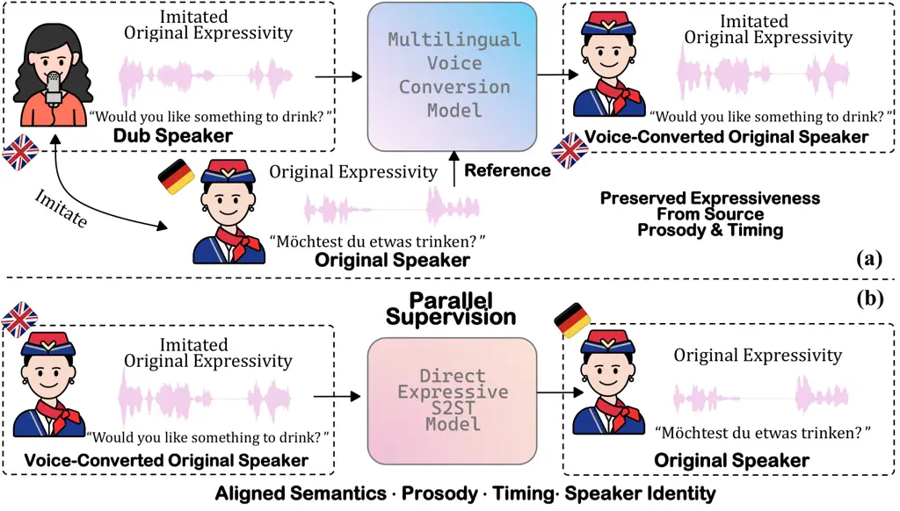
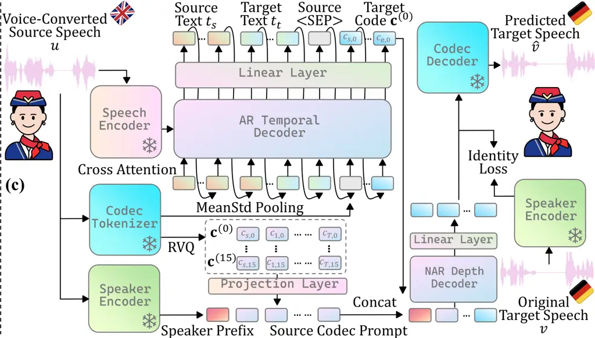

# Holistic Parallel Supervision for Expressive Speech to Speech Translation

Hao Zhang    Ismail Rasim Ulgen    Bismarck Bamfo Odoom    Rui Liu   
Zihan Zhang    Berrak Sisman    Philipp Koehn

###### Abstract

Expressiveness is central to speech-to-speech translation (S2ST), yet
existing datasets rarely align source and target speech jointly in
content, prosody, timing, and speaker identity. Consequently, current
systems often rely on indirect conditioning or transfer mechanisms. To
obtain this supervision, we introduce a training-data construction
strategy that combines professional dubbing, which provides
human-performed correspondence in content, prosody, and timing, with
multilingual voice conversion to reduce speaker mismatch. We evaluate
this supervision using existing expressive S2ST systems and DirectS2ST,
an end-to-end method developed in this work that predicts the complete
target-speech representation directly from source speech. Experiments on
English–German and English–Spanish show that holistic parallel
supervision improves expressive realization across all evaluated
systems. DirectS2ST exhibits the largest gains in content, prosody,
timing, speaker similarity, and human-rated expressiveness. To our
knowledge, this work provides the first systematic investigation of
holistic parallel supervision for expressive S2ST.

###### Index Terms: 

expressive speech-to-speech translation, holistic parallel supervision,
dubbing data, voice conversion

^(†)^(†)address: Center for Language and Speech Processing, Johns
Hopkins University, MD, USA^(†)^(†)footnotetext: Codes and
demo: https://hzted.github.io/truly-e2e-expressive-s2st-demo  
Due to licensing constraints, the dataset itself cannot be shared.

## 1 Introduction

Speech-to-speech translation (S2ST) should preserve not only what is
said but also how it is said \[22\]. Prosodic cues such as stress and
intonation convey meaning and intent \[6\], while vocal style and
speaker identity contribute to expressive communication \[9\]. However,
existing methods and resources largely emphasize lexical accuracy, which
alone cannot preserve these properties. Learning expressive translation
requires parallel speech pairs aligned in content, prosody, timing, and
speaker identity; semantically correct but expressively mismatched
targets do not demonstrate how the source expression should be realized
in another language.

Such holistic parallel data are scarce because collecting cross-lingual
recordings from the same speaker with corresponding expressive delivery
is costly. Existing resources therefore leave at least one dimension
unmatched. Synthetic speech can reproduce source-speaker identity but
may lack expressive delivery \[10\]; mined data provide semantic
parallelism at scale but often have very limited speaker and expressive
correspondence \[1\]; and professional dubbing provides strong semantic,
prosodic, and temporal correspondence but uses different speakers
\[25\]. Thus, existing S2ST systems rarely receive supervision aligned
across all four dimensions. As a result, expressive S2ST methods often
rely on indirect strategies, including replacing target-derived training
conditions with source-derived conditions at inference or transferring
speaker and prosodic information through separate mechanisms \[12, 23,
4, 3\]. Although effective, these approaches do not learn content and
expressive realization jointly through direct paired-speech supervision.

|                                                             |                                                             |
| ----------------------------------------------------------- | ----------------------------------------------------------- |
|  |  |

Figure 1: Overview of the holistic parallel supervision: (a) VC-Dub
Construction; (b) Parallel Supervision; (c) DirectS2ST.

In this work, we investigate holistic parallel supervision for
expressive S2ST. Because collecting such data from scratch is costly, we
combine professional dubbing with multilingual voice conversion (VC).
Dubbing provides human-performed correspondence in content, prosody, and
timing, while VC reduces speaker mismatch. We evaluate this supervision
using existing expressive S2ST methods and DirectS2ST, an end-to-end
model developed in this work that predicts the complete target-speech
representation directly from source speech. DirectS2ST tests whether
direct modeling can exploit holistic supervision more fully. Our
contributions are: (i) the first proof-of-concept study, to our
knowledge, of holistic parallel supervision for expressive S2ST; (ii) a
training-data construction strategy combining professional dubbing and
multilingual VC, evaluated using existing methods and DirectS2ST; and
(iii) consistent improvements in expressive preservation on En–De and
En–Es, supported by human evaluation.

## 2 holistic Parallel Supervision For S2ST

We instantiate our holistic parallel supervision hypothesis with two
components: (1) We construct holistic parallel cross-lingual speech
pairs matched in content, prosody, timing, and speaker identity for
training. (2) We study holistic parallel supervision in two settings:
existing expressive S2ST systems, and DirectS2ST, which examines whether
holistic paired supervision can be exploited more directly through
complete target-speech prediction, rather than through target-derived
training conditions or separate expressive-transfer mechanisms.

### 2.1 Training Dataset Construction Method: VC-Dub

Human-performed expressive correspondence. Professional dubbing renders
the original dialogue in another language while seeking to convey its
expressive intent within the same audiovisual context. Beyond translated
content, dubbed performances can reflect the original emphasis,
intonation, and temporal organization \[2\]. We therefore use
professional dubbing from entertainment television episodes spanning
multiple genres (e.g., drama, comedy, action) as human-performed
cross-lingual supervision rather than requiring identical pitch contours
or frame-level timing. The remaining limitation is speaker mismatch,
since the two performances are generally produced by different actors.

Pair preparation. We construct English-to-German and English-to-Spanish
pairs from German or Spanish original tracks and their English dubs. We
apply multiple preprocessing steps to make raw professional dubbing data
suitable for speech translation training, in terms of semantic accuracy,
speech quality and removal of background music/noise. We use Speech
Vecalign \[14\] to semantically align speech segments between the
corresponding original and dubbed audio tracks. Before VC, we process
both sides with ClearerVoice-Studio for speech enhancement and Demucs
for vocal separation to have single speaker utterances \[26, 21\]. We
then check the expected languages using MMS-LID, reject multi-speaker
segments using Sortformer \[17\], and filter low-quality pairs using the
speech-quality predictor DNSMOSPro \[5\]. All scripts, thresholds, and
implementation details are released.

Speaker matching and target supervision. Let $`x^{a,o}`$ denote a
cleaned original utterance in language $`a`$ spoken by speaker $`o`$,
and $`y^{b,d}`$ its cleaned dubbed counterpart in language $`b`$ spoken
by actor $`d`$. We apply multilingual zero-shot voice conversion,
instantiated with Seed-VC \[13\], to the dubbed side:

```math
\tilde{y}^{b,o}=\mathcal{V}_{\mathrm{multi}}\left(y^{b,d};x^{a,o}\right).\vskip-3.1298pt \tag{1}
```

Here, $`y^{b,d}`$ provides translated content and performed delivery,
while $`x^{a,o}`$ provides the speaker reference. Thus, VC reduces the
speaker mismatch. Since the VC method is designed to preserve the source
linguistic content and prosody \[13\], the semantic and expressive
parallelism is largely preserved.

We form the S2ST training pair in the reverse direction of the original
dubbing process:

```math
(u,v)=\left(\tilde{y}^{b,o},x^{a,o}\right)\in\mathcal{D}_{\mathrm{\textsc{VC-Dub}}}^{b\rightarrow a}.\vskip-3.41432pt \tag{2}
```

The VC applied English dub becomes the source, while the original German
or Spanish recording remains the target during supervision. Crucially,
the target retains the human performance without TTS or VC resynthesis,
so content, prosody, timing, and speaker identity are supervised jointly
to predict real speech distribution as target. Applying VC only to the
source avoids introducing VC-generated artifacts into target speech
supervision. Pair-level analysis verifies the intended correspondence
before we evaluate its effect on downstream S2ST (see Section 4).

### 2.2 DirectS2ST

DirectS2ST uses a Moshi-inspired temporal–depth architecture \[8\] to
test whether holistic parallel supervision can be exploited more fully
through direct source-to-target expressive learning. Given source speech
$`u`$, it predicts all 16 Mimi codec streams of the paired human
recording $`v`$. A frozen w2v-BERT 2.0 encoder \[1\] provides continuous
source memory through cross-attention. The autoregressive (AR) temporal
decoder generates source text, target text, and the first-level target
codec stream $`\mathbf{c}^{(0)}`$ with a shared output head. Inspired by
TransVIP \[12\], the \<SEP\> embedding at the text-to-codec boundary is
replaced with an acoustic prompt obtained by mean–standard-deviation
pooling of continuous Mimi features. Unlike TransVIP’s target-derived
training prompt, ours is extracted from the source speech.

The remaining streams are predicted by a shared non-autoregressive (NAR)
depth Transformer. Each level conditions on lower target codebooks and a
source codec prefix, with a projected embedding from a frozen CAMPPlus
speaker encoder \[24\] prepended as the speaker-identity condition. We
further apply a speaker-identity loss by projecting mean-pooled NAR
hidden states to the CAMPPlus space and matching them by cosine loss to
the paired target-speech embedding, reinforcing speaker learning in the
depth decoder.

Let $`\mathbf{z}`$ denote the AR sequence containing source text
$`t_{s}`$, target text $`t_{t}`$, and $`\mathbf{c}^{(0)}`$. Prediction
is factorized as

```math
\displaystyle p_{\mathrm{AR}}(\mathbf{z}\mid u) \displaystyle=\prod_{i}p(z_{i}\mid\mathbf{z}_{<i},u), \tag{3}
```

```math
\displaystyle p_{\mathrm{NAR}}(\mathbf{c}^{(1:15)}\mid u,\mathbf{c}^{(0)}) \displaystyle=\prod_{q=1}^{15}\prod_{t=1}^{T}p(c_{t,q}\mid\mathbf{c}^{(<q)},\mathbf{P}_{u}),
```

where $`u`$ is source speech and $`\mathbf{P}_{u}`$ denotes the source
codec and speaker prefix. The NAR stage predicts target frames in
parallel within each codebook while proceeding sequentially across
codebook levels. The predicted source and target text, $`t_{s},t_{t}`$
serve the purpose of helping semantic grounding and guidance for
translation while source speech condition $`u`$ guides all the aspects
including semantic, speaker identity, and prosody. Using source speech
as the only and direct condition while predicting all these aspects
realizes end-to-end and holistic parallel supervision during training.

## 3 Experimental Setup

Training Data. We compare VC-Dub with CVSS-T \[10\], a widely used S2ST
corpus with synthetic voice-transferred targets, using approximately
matched training-set sizes (Table 1). For Dub-S2ST, we also evaluate its
proposed speed-adapted CVSS-T variant (CVSS-T^(S)) \[4\], which improves
source–target speaking-rate correspondence but not other expressive
dimensions. To isolate the effect of speaker matching, we train
DirectS2ST on the same dubbed pairs without VC (Raw-Dub). Source and
target transcripts are generated using Whisper-large-v3 \[20\] and used
only as auxiliary training targets, not as inference-time inputs.

Evaluation Data. We evaluate on mExpresso \[16, 1\], an expressive
multilingual dataset independent of our training corpus. Each of the
En–De and En–Es evaluations contains 504 examples evenly distributed
across seven expressive conditions. Dub-S2ST is evaluated only on En–Es
because its mHuBERT unit representation does not support German.

Metrics. We evaluate content, prosody, timing, speaker identity, and
naturalness. ASR-BLEU uses Whisper-large-v3 transcripts and SacreBLEU
\[20, 19\], while BLASER2.0-QE measures source–output semantic
consistency \[7\]. AutoPCP (A.PCP) measures utterance-level prosody
similarity, and STOPES \[1\] measures speaking-rate correlation (Rate),
pause similarity (Pause), and speaker similarity (Vsim) between source
and translated speech. NISQA-TTS (NAT) estimates naturalness \[15\]. For
VC diagnostics, WER and CER between transcripts before and after VC
measure content preservation.

Human evaluation. Nine listeners proficient in English and Spanish rate
the expressiveness of outputs from six system configurations on a
5-point expressiveness MOS scale, considering emphasis, rhythm, timing,
and intonation. The test uses 10 En–Es source utterances sampled across
seven expressive conditions, with the source provided as reference.

S2ST Methods. In addition to DirectS2ST, we evaluate holistic parallel
supervision with TransVIP \[12\] and Dub-S2ST \[4\]. We train the
official TransVIP implementation on our data using its default settings.
For Dub-S2ST, whose original speech-to-unit module showed limited
generalization in preliminary experiments, we replace that module with
the S2U model of \[18\]. We train both the S2U and U2S components on our
data, with the U2S module initialized from Dub-S2ST’s pretrained
CosyVoice-based checkpoint rather than from scratch.

Training & Architecture Details. The temporal and depth Transformers
have 12 and 8 layers, respectively, with a shared configuration of 1024
hidden dimensions, 16 attention heads, 4096 feed-forward dimensions, and
0.1 dropout, yielding a 1.2B-parameter DirectS2ST model with randomly
initialized decoders. We use a direction-specific 8k SentencePiece
vocabulary \[11\], the first 16 codebooks of the frozen pretrained Mimi
codec (2,048 entries each), and a frozen CAMPPlus speaker encoder
\[24\]. Separate En–De and En–Es models are trained on one 141-GB NVIDIA
H200 GPU with a batch size of 8 for approximately 2–3 days each.
Source-text, target-text, $`C_{0}`$, and depth losses are weighted 0.4,
0.6, 1.0, and 3.0; training-only text-to-text, text-to-$`C_{0}`$, and
speaker-identity objectives are weighted 0.3, 0.5, and 0.1. We use a
polynomially decayed learning rate initialized at $`10^{-4}`$. At
inference, beam search with a beam size of 5 generates the unified
text–$`C_{0}`$ sequence, after which the depth decoder greedily predicts
$`C_{1}`$–$`C_{15}`$ in parallel over time and sequentially across
codebooks.

## 4 Results & Discussion

Training dataset analysis. Table 1 summarizes the training data. Table 2
shows that Raw-Dub already provides stronger content, prosody, and
timing correspondence than CVSS-T, while its main limitation is speaker
mismatch. Applying VC substantially improves Vsim and further increases
A.PCP, with smaller gains in Rate and Pause. Without manual transcripts,
we compare pre- and post-VC ASR outputs, obtaining approximately 8.3%
WER and 5.2% CER in both settings. The small changes in mean BLASER
suggest largely preserved cross-lingual semantic correspondence at the
corpus level. As a negative control, randomly shuffling the
source–target pairings in VC-Dub causes large drops in BLASER, A.PCP,
Rate, and Pause, indicating that the observed correspondence is
pair-specific rather than a corpus artifact. Together, professional
dubbing and VC yield our holistic parallel supervision across content,
prosody, timing, and speaker identity.

|       |         |         |          |          |           |               |
| ----- | ------- | ------- | -------- | -------- | --------- | ------------- | ------- |
| Pair  | Dataset | \#Pairs | Src. Hrs | Tgt. Hrs | Total Hrs | Avg. Dur. (s) |
| En-De | CVSS-T  | 127,250 | 128.19   | 122.16   | 250.35    | 3.63 $`       | `$ 3.46 |
|       | VC-Dub  | 131,399 | 127.40   | 135.82   | 263.22    | 3.49 $`       | `$ 3.72 |
| En-Es | CVSS-T  | 78,963  | 79.76    | 72.77    | 152.53    | 3.64 $`       | `$ 3.32 |
|       | VC-Dub  | 79,200  | 84.61    | 86.52    | 171.13    | 3.85 $`       | `$ 3.93 |

Table 1: Statistics of the speech-to-speech training data. Average
duration is reported as source $`|`$ target.

|                      |             |                    |                   |                  |                   |                  |                           |
| -------------------- | ----------- | ------------------ | ----------------- | ---------------- | ----------------- | ---------------- | ------------------------- | -------- |
| Dir.                 | Dataset     | BLASER$`\uparrow`$ | A.PCP$`\uparrow`$ | Rate$`\uparrow`$ | Pause$`\uparrow`$ | Vsim$`\uparrow`$ | DNSMOS\_(Pro)$`\uparrow`$ |
| En $`\downarrow`$ De | CVSS-T      | 3.405              | 2.505             | 0.365            | 0.524             | 0.208            | 3.160 $`                  | `$ 2.797 |
|                      | Raw-Dub     | 3.634              | 2.759             | 0.416            | 0.682             | 0.060            | 3.900 $`                  | `$ 3.684 |
|                      | VC-Dub      | 3.611              | 3.000             | 0.435            | 0.698             | 0.406            | 4.104 $`                  | `$ 3.684 |
|                      | w/ Shuffled | 2.285              | 2.218             | -0.009           | 0.394             | 0.025            | 4.104 $`                  | `$ 3.684 |
| En $`\downarrow`$ Es | CVSS-T      | 3.400              | 2.537             | 0.372            | 0.550             | 0.194            | 3.173 $`                  | `$ 2.780 |
|                      | Raw-Dub     | 3.632              | 2.920             | 0.417            | 0.676             | 0.046            | 3.913 $`                  | `$ 3.714 |
|                      | VC-Dub      | 3.606              | 3.183             | 0.436            | 0.686             | 0.362            | 4.091 $`                  | `$ 3.714 |
|                      | w/ Shuffled | 2.199              | 2.345             | -0.003           | 0.361             | 0.027            | 4.091 $`                  | `$ 3.714 |

Table 2: Pair-level correspondence and speech-quality results for
CVSS-T, Raw-Dub, and VC-Dub. Shuffled VC-Dub pairs provide a negative
control. DNSMOS\_(Pro) is reported as source (En) $`|`$ target (De/Es).

Effect of holistic parallel supervision on S2ST. As shown in Table 3,
VC-Dub improves expressive preservation across all three model families.
In particular, A.PCP and Vsim consistently improve for TransVIP,
Dub-S2ST, and DirectS2ST, with additional gains in timing and
naturalness depending on the architecture. Dub-S2ST’s speed adaptation
mainly improves Rate, whereas VC-Dub provides broader gains, supporting
the benefit of jointly matched supervision over matching a single
temporal attribute.

Absolute scores also reflect differences in model pretraining. TransVIP
retains stronger content performance, likely aided by its
SeamlessM4T-initialized speech-to-text translation backbone \[12\],
whereas DirectS2ST trains its translation and codec decoders from
scratch to test whether paired speech alone can support direct
expressive supervision. Despite this stricter setting, DirectS2ST+VC-Dub
achieves the best A.PCP and Pause scores in both directions, with
significant improvements over the strongest competing systems. Dub-S2ST
obtains stronger absolute naturalness and speaker similarity, plausibly
benefiting from its unit-to-speech synthesizer initialized from
CosyVoice-300M \[4\], which was trained with large-scale data;
nevertheless, replacing CVSS-T with VC-Dub still improves its A.PCP,
Vsim, and translation performance. These results support the conclusion
that holistic parallel supervision benefits different expressive S2ST
formulations. The larger expressive gains observed for DirectS2ST are
consistent with our direct-supervision hypothesis: because the model
learns the complete target speech representation directly from paired
speech, its expressive learning is especially responsive to the quality
of holistic source–target supervision.

|                      |            |            |                      |                    |                   |                  |                   |                  |                 |
| -------------------- | ---------- | ---------- | -------------------- | ------------------ | ----------------- | ---------------- | ----------------- | ---------------- | --------------- |
| Dir.                 | Model      | Train      | ASR-BLEU$`\uparrow`$ | BLASER$`\uparrow`$ | A.PCP$`\uparrow`$ | Rate$`\uparrow`$ | Pause$`\uparrow`$ | Vsim$`\uparrow`$ | NAT$`\uparrow`$ |
| En $`\downarrow`$ De | TransVIP   | CVSS-T     | 12.25                | 3.397              | 2.609             | 0.470            | 0.489             | 0.126            | 3.257           |
|                      | TransVIP   | VC-Dub     | 13.84                | 3.399              | 2.743^(†)         | 0.600^(†)        | 0.549^(†)         | 0.169^(†)        | 3.472^(†)       |
|                      | DirectS2ST | CVSS-T     | 6.01                 | 3.234              | 2.162             | 0.334            | 0.687             | 0.114            | 3.339           |
|                      | DirectS2ST | VC-Dub     | 10.52^(†)            | 3.373^(†)          | 2.905^(†,‡)       | 0.589^(†)        | 0.752^(†,‡)       | 0.217^(†,‡)      | 3.450^(†)       |
| En $`\downarrow`$ Es | TransVIP   | CVSS-T     | 15.53                | 3.354              | 2.664             | 0.601            | 0.494             | 0.138            | 3.092           |
|                      | TransVIP   | VC-Dub     | 18.96^(†)            | 3.433^(†)          | 2.803^(†)         | 0.671^(†)        | 0.562^(†)         | 0.158^(†)        | 3.407^(†)       |
|                      | Dub-S2ST   | CVSS-T     | 11.61                | 3.239              | 2.933             | 0.581            | 0.596             | 0.218            | 3.658           |
|                      | Dub-S2ST   | CVSS-T^(S) | 11.89                | 3.226              | 2.938             | 0.608            | 0.572             | 0.214            | 3.631           |
|                      | Dub-S2ST   | VC-Dub     | 15.21                | 3.321^(†)          | 3.012^(†)         | 0.595            | 0.612             | 0.238^(†)        | 3.759^(†)       |
|                      | DirectS2ST | CVSS-T     | 10.00                | 3.153              | 2.238             | 0.433            | 0.652             | 0.105            | 3.361           |
|                      | DirectS2ST | VC-Dub     | 14.22^(†)            | 3.259^(†)          | 3.091^(†,‡)       | 0.669^(†)        | 0.733^(†,‡)       | 0.205^(†)        | 3.466^(†)       |

Table 3: Expressive S2ST results on mExpresso in both translation
directions. ^(†) denotes significance between training sets within the
same model, and ^(‡) against the strongest baseline in the same language
direction. Significance is determined by two-sided paired randomization
tests with 10,000 permutations and Holm–Bonferroni correction
($`p_{\mathrm{adj}}<0.05`$).

|                     |         |                      |                    |                   |                  |                   |                  |                 |
| ------------------- | ------- | -------------------- | ------------------ | ----------------- | ---------------- | ----------------- | ---------------- | --------------- |
| Dir.                | Train   | ASR-BLEU$`\uparrow`$ | BLASER$`\uparrow`$ | A.PCP$`\uparrow`$ | Rate$`\uparrow`$ | Pause$`\uparrow`$ | Vsim$`\uparrow`$ | NAT$`\uparrow`$ |
| En$`\rightarrow`$De | VC-Dub  | 10.52                | 3.373              | 2.905^(†)         | 0.589^(†)        | 0.752             | 0.217^(†)        | 3.450           |
|                     | Raw-Dub | 9.37                 | 3.339              | 2.712             | 0.455            | 0.741             | 0.065            | 3.430           |
| En$`\rightarrow`$Es | VC-Dub  | 14.22                | 3.259              | 3.091^(†)         | 0.669^(†)        | 0.733             | 0.205^(†)        | 3.466           |
|                     | Raw-Dub | 14.53                | 3.266              | 2.824             | 0.555            | 0.730             | 0.058            | 3.470           |

Table 4: VC-Dub ablation of DirectS2ST on mExpresso.

|            |               |                  |                |          |          |
| ---------- | ------------- | ---------------- | -------------- | -------- | -------- |
| Model      | Training Data | MOS $`\uparrow`$ | 95% CI         | ICC(A,1) | ICC(A,9) |
| TransVIP   | CVSS-T        | 1.82             | \[1.62, 2.01\] | 0.445    | 0.878    |
| TransVIP   | VC-Dub        | 2.24^(†)         | \[2.03, 2.44\] |          |          |
| Dub-S2ST   | CVSS-T        | 2.88             | \[2.63, 3.12\] |          |          |
| Dub-S2ST   | VC-Dub        | 3.59^(†)         | \[3.34, 3.84\] |          |          |
| DirectS2ST | CVSS-T        | 2.13             | \[1.93, 2.33\] |          |          |
| DirectS2ST | VC-Dub        | 3.42^(†)         | \[3.20, 3.64\] |          |          |

Table 5: Expressiveness MOS with 95% confidence intervals and
inter-rater reliability (ICC). Significance is assessed using crossed
linear mixed-effects models with system configurations as a fixed effect
and listener and utterance as random effects, followed by
Holm–Bonferroni correction. $`{}^{\dagger}p_{\mathrm{adj}}<0.05`$.

Contribution of voice conversion. Table 4 compares DirectS2ST trained on
the same aligned dubbing pairs with and without VC. Raw-Dub already
provides effective expressive supervision but, as expected, does not
preserve speaker identity. VC substantially improves speaker similarity
and yields additional gains in A.PCP and Rate, while content, Pause, and
naturalness remain comparable. These results indicate that VC primarily
reduces speaker mismatch while preserving the other properties of the
dubbed speech.

Human evaluation. Table 5 reports human ratings of perceived
expressiveness. VC-Dub significantly improves MOS across all three model
families with high inter-rater reliability, confirming that the benefits
of holistic parallel supervision are also reflected in perceived
expressiveness. Among the evaluated systems, DirectS2ST shows the
largest MOS gain (+1.29), mirroring the automatic-metric results and
further suggesting that direct source-to-target modeling can exploit
holistic paired supervision particularly effectively.

## 5 Conclusion

We investigated holistic parallel supervision for expressive S2ST by
combining professional dubbing, which provides human-performed
correspondence in content, prosody, and timing, with multilingual voice
conversion to reduce speaker mismatch while preserving natural target
speech. Experiments on En–De and En–Es show improved expressive
preservation across multiple S2ST systems, supported by human
evaluation. The Raw-Dub ablation isolates the contribution of speaker
matching, while DirectS2ST achieves the largest relative gains in
content, prosody, timing, and perceived expressiveness, suggesting that
direct target-speech prediction particularly benefits from holistic
parallel supervision.

## References

- \[1\] L. Barrault, Y. Chung, M. C. Meglioli, et al. (2023) Seamless:
  multilingual expressive and streaming speech translation. arXiv
  preprint arXiv:2312.05187. Cited by: §1, §2.2, §3, §3.
- \[2\] W. Brannon, Y. Virkar, and B. Thompson (2023) Dubbing in
  practice: a large scale study of human localization with insights for
  automatic dubbing. Transactions of the Association for Computational
  Linguistics 11, pp. 419–435. External Links:
  [Link](https://aclanthology.org/2023.tacl-1.25/),
  [Document](https://dx.doi.org/10.1162/tacl%5Fa%5F00551) Cited by:
  §2.1.
- \[3\] S. Cheng, W. Bian, X. Wang, et al. (2026) UniSS: unified
  expressive speech-to-speech translation with your voice. In
  Proceedings of the Fourteenth International Conference on Learning
  Representations, External Links:
  [Link](https://openreview.net/forum?id=5o0ZvYzh6B) Cited by: §1.
- \[4\] J. Choi, J. Kim, and J. S. Chung (2025) Dub-s2st: textless
  speech-to-speech translation for seamless dubbing. In 2025 Findings of
  the Association for Computational Linguistics, EMNLP 2025,
  pp. 9871–9881. Cited by: §1, §3, §3, §4.
- \[5\] F. Cumlin, X. Liang, V. Ungureanu, C. K. A. Reddy, C. Schüldt,
  and S. Chatterjee (2024) DNSMOS Pro: A Reduced-Size DNN for
  Probabilistic MOS of Speech. In Interspeech 2024, pp. 4818–4822.
  External Links:
  [Document](https://dx.doi.org/10.21437/Interspeech.2024-478), ISSN
  2958-1796 Cited by: §2.1.
- \[6\] A. Cutler, D. Dahan, and W. Van Donselaar (1997) Prosody in the
  comprehension of spoken language: a literature review. Language and
  speech 40 (2), pp. 141–201. Cited by: §1.
- \[7\] D. Dale and M. R. Costa-jussà (2024) BLASER 2.0: a metric for
  evaluation and quality estimation of massively multilingual speech and
  text translation. In Findings of the Association for Computational
  Linguistics: EMNLP 2024, pp. 16075–16085. External Links:
  [Link](https://aclanthology.org/2024.findings-emnlp.943/),
  [Document](https://dx.doi.org/10.18653/v1/2024.findings-emnlp.943)
  Cited by: §3.
- \[8\] A. Défossez, L. Mazaré, M. Orsini, A. Royer, P. Pérez, H.
  Jégou, E. Grave, and N. Zeghidour (2024) Moshi: a speech-text
  foundation model for real-time dialogue. arXiv preprint
  arXiv:2410.00037. Cited by: §2.2.
- \[9\] Y. Jia, M. T. Ramanovich, T. Remez, and R. Pomerantz (2022)
  Translatotron 2: high-quality direct speech-to-speech translation with
  voice preservation. In Proceedings of the 39th International
  Conference on Machine Learning, Vol. 162, pp. 10120–10134. Cited by:
  §1.
- \[10\] Y. Jia, M. T. Ramanovich, Q. Wang, and H. Zen (2022) CVSS
  corpus and massively multilingual speech-to-speech translation. In
  Proceedings of the thirteenth language resources and evaluation
  conference, pp. 6691–6703. Cited by: §1, §3.
- \[11\] T. Kudo and J. Richardson (2018) SentencePiece: a simple and
  language independent subword tokenizer and detokenizer for neural text
  processing. In Proceedings of the 2018 Conference on Empirical Methods
  in Natural Language Processing: System Demonstrations, pp. 66–71.
  External Links: [Link](https://aclanthology.org/D18-2012/),
  [Document](https://dx.doi.org/10.18653/v1/D18-2012) Cited by: §3.
- \[12\] C. Le, Y. Qian, D. Wang, et al. (2024) TransVIP: speech to
  speech translation system with voice and isochrony preservation. In
  Advances in Neural Information Processing Systems, Vol. 37,
  pp. 89682–89705. Cited by: §1, §2.2, §3, §4.
- \[13\] S. Liu (2024) Zero-shot voice conversion with diffusion
  transformers. arXiv preprint arXiv:2411.09943. Cited by: §2.1, §2.1.
- \[14\] C. Meng and P. Koehn (2025) Speech vecalign: an embedding-based
  method for aligning parallel speech documents. In Proceedings of the
  2025 Conference on Empirical Methods in Natural Language Processing,
  pp. 16478–16494. External Links:
  [Link](https://aclanthology.org/2025.emnlp-main.833/),
  [Document](https://dx.doi.org/10.18653/v1/2025.emnlp-main.833), ISBN
  979-8-89176-332-6 Cited by: §2.1.
- \[15\] G. Mittag and S. Möller (2020) Deep Learning Based Assessment
  of Synthetic Speech Naturalness. In Interspeech 2020, pp. 1748–1752.
  External Links:
  [Document](https://dx.doi.org/10.21437/Interspeech.2020-2382), ISSN
  2958-1796 Cited by: §3.
- \[16\] T. A. Nguyen, W. Hsu, A. D’Avirro, et al. (2023) Expresso: a
  benchmark and analysis of discrete expressive speech resynthesis. In
  Proc. Interspeech 2023, pp. 4823–4827. Cited by: §3.
- \[17\] T. Park, I. Medennikov, K. Dhawan, W. Wang, et al. (2025)
  Sortformer: a novel approach for permutation-resolved speaker
  supervision in speech-to-text systems. In Proceedings of the 42nd
  International Conference on Machine Learning, Vol. 267,
  pp. 48153–48169. Cited by: §2.1.
- \[18\] S. Popuri, P. Chen, C. Wang, J. Pino, Y. Adi, J. Gu, W. Hsu,
  and A. Lee (2022) Enhanced Direct Speech-to-Speech Translation Using
  Self-supervised Pre-training and Data Augmentation. In Interspeech
  2022, pp. 5195–5199. External Links:
  [Document](https://dx.doi.org/10.21437/Interspeech.2022-11032), ISSN
  2958-1796 Cited by: §3.
- \[19\] M. Post (2018) A call for clarity in reporting BLEU scores. In
  Proceedings of the Third Conference on Machine Translation: Research
  Papers, pp. 186–191. External Links:
  [Link](https://aclanthology.org/W18-6319/),
  [Document](https://dx.doi.org/10.18653/v1/W18-6319) Cited by: §3.
- \[20\] A. Radford, J. W. Kim, T. Xu, et al. (2023) Robust speech
  recognition via large-scale weak supervision. In Proceedings of the
  40th International Conference on Machine Learning, Proceedings of
  Machine Learning Research, Vol. 202, pp. 28492–28518. Cited by: §3,
  §3.
- \[21\] S. Rouard, F. Massa, and A. Défossez (2023) Hybrid transformers
  for music source separation. In ICASSP 2023-2023 IEEE International
  Conference on Acoustics, Speech and Signal Processing (ICASSP),
  pp. 1–5. Cited by: §2.1.
- \[22\] I. Tsiamas, M. Sperber, A. Finch, and S. Garg (2024) Speech is
  more than words: do speech-to-text translation systems leverage
  prosody?. In Proceedings of the Ninth Conference on Machine
  Translation, pp. 1235–1257. Cited by: §1.
- \[23\] I. R. Ulgen, N. Liu, N. Sadoughi, et al. (2026) Direct transfer
  of prosody in speech-to-speech translation using disentangled speech
  tokens. In ICASSP 2026-2026 IEEE International Conference on
  Acoustics, Speech and Signal Processing (ICASSP), pp. 18372–18376.
  Cited by: §1.
- \[24\] H. Wang, S. Zheng, Y. Chen, L. Cheng, and Q. Chen (2023) CAM++:
  A Fast and Efficient Network for Speaker Verification Using
  Context-Aware Masking. In Interspeech 2023, pp. 5301–5305. External
  Links: [Document](https://dx.doi.org/10.21437/Interspeech.2023-1513),
  ISSN 2958-1796 Cited by: §2.2, §3.
- \[25\] H. Xie, I. R. Ulgen, S. Son, B. isman, and P. Koehn (2026) Is
  prosody lost in translation? fine-grained cross-lingual prosody
  similarity across languages. arXiv preprint arXiv:2608.27848. Cited
  by: §1.
- \[26\] S. Zhao, Z. Pan, and B. Ma (2025) ClearerVoice-studio: bridging
  advanced speech processing research and practical deployment. In Proc.
  Interspeech 2025, pp. 2980–2984. Cited by: §2.1.
