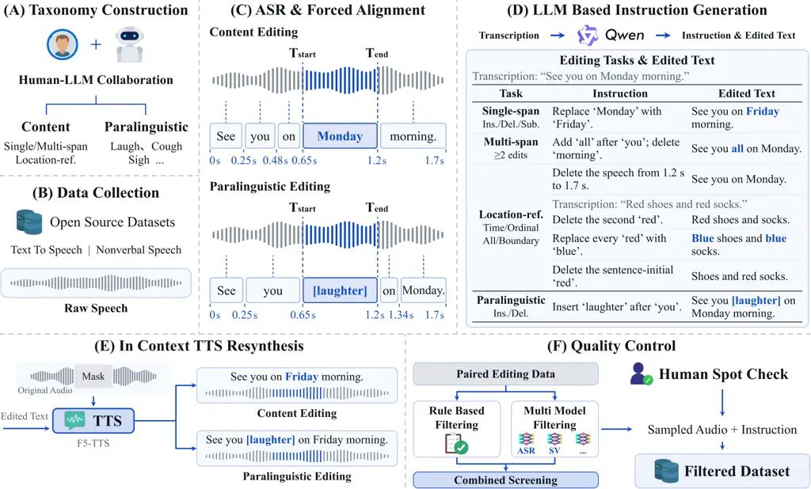
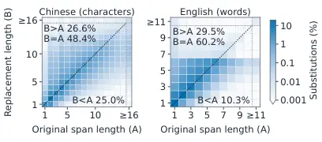

# VoxCanvas-41M: A Large-Scale Bilingual Dataset for Instruction-Based Speech Editing and Its Learning Dynamics

Zhikang Niu ^(†)^(†)thanks: Equal contribution. Affiliation: X-LANCE
Lab, Shanghai Jiao Tong University, China Affiliation: Shanghai
Innovation Institute, China    Wenming Tu¹¹footnotemark: 1
Affiliation: X-LANCE Lab, Shanghai Jiao Tong University, China
Affiliation: Beijing Institute for General Artificial Intelligence,
China    Yalin Li Affiliation: X-LANCE Lab, Shanghai Jiao Tong
University, China Affiliation: Shanghai Innovation Institute, China   
Yanru Huo Affiliation: X-LANCE Lab, Shanghai Jiao Tong University, China
Affiliation: Beijing Institute for General Artificial Intelligence,
China    Junxi Liu Affiliation: X-LANCE Lab, Shanghai Jiao Tong
University, China Affiliation: Shanghai Innovation Institute, China   
Tianrui Wang Affiliation: Tianjin University,
China[zhikangniu@sjtu.edu.cn](mailto:zhikangniu@sjtu.edu.cn);
[chenxie95@sjtu.edu.cn](mailto:chenxie95@sjtu.edu.cn)    Ruiqi Yan
Affiliation: X-LANCE Lab, Shanghai Jiao Tong University, China   
Junxuan Liang Affiliation: X-LANCE Lab, Shanghai Jiao Tong University,
China Affiliation: Shanghai Innovation Institute, China    Ziyang Ma
Affiliation: X-LANCE Lab, Shanghai Jiao Tong University, China
Affiliation: Shanghai Innovation Institute, China    Zilong Zheng
Affiliation: Beijing Institute for General Artificial Intelligence,
China    Xie Chen ^(†)^(†)thanks: Corresponding author.
Affiliation: X-LANCE Lab, Shanghai Jiao Tong University, China
Affiliation: Shanghai Innovation Institute, China

###### Abstract

Recent advances in speech generation have spurred the development of
speech editing techniques. However, achieving high-quality speech
editing remains challenging due to two key limitations. First, the major
hurdle is the lack of large-scale, high-quality speech editing datasets.
Constructing such datasets is costly, while open-source, scalable data
pipelines remain limited. Second, the learning dynamics of speech
editing models remain poorly understood. In particular, how models
acquire editing capabilities and the relationship between generation and
editing remain unclear. To address these challenges, we introduce
VoxCanvas-41M, a large-scale bilingual dataset comprising approximately
41 million speech editing pairs. VoxCanvas-41M covers two major
categories: content editing, including single-span, multi-span, and
location-reference editing, and paralinguistic editing, covering the
insertion and deletion of 39 classes of nonverbal events such as
laughter, sighs, and coughs. Building on VoxCanvas-41M, we train
VoxCanvas-Edit, an instruction-based speech editing model, demonstrating
the effectiveness of our dataset in improving editing performance.
Furthermore, we systematically investigate the learning dynamics of
speech editing, examining how models learn different editing operations
and how data scale, task interactions, and training strategies affect
editing performance. The dataset¹¹ 1 Dataset:
[huggingface.co/datasets/zkniu/VoxCanvas](https://huggingface.co/datasets/zkniu/VoxCanvas),
pipeline²² 2 Pipeline:
[github.com/ZhikangNiu/VoxCanvas](https://github.com/ZhikangNiu/VoxCanvas),
and demos³³ 3 Demo:
[zhikangniu.github.io/voxcanvas/](https://zhikangniu.github.io/voxcanvas/)
are publicly available.



Figure 1: Overview of the speech editing data construction pipeline.
ASR: automatic speech recognition; LLM: large language model; TTS:
text-to-speech.

## 1 Introduction

Speech editing aims to modify existing speech while preserving the
speaker identity, prosody, and acoustic environment of its unedited
regions (Jin et al., 2017; Peng et al., 2024; Yan et al., 2025b; Ma
et al., 2026a). It supports applications such as the post-production of
podcasts and audiobooks, video dubbing, and the correction of errors in
synthesized speech, all without regenerating the entire audio. Existing
speech editing methods can be broadly divided into two categories:
infilling-based methods (Peng et al., 2024; Wang et al., 2025; Zheng
et al., 2025) and instruction-based methods (Huang et al., 2024; Yan
et al., 2025b; Yan et al., 2025a; Ma et al., 2026a; Wang et al., 2026).

Representative infilling-based methods learn editing as in-context
masked infilling and achieve strong editing performance (Le et al.,
2023; Peng et al., 2024; Wang et al., 2025; Zheng et al., 2025; Chen
et al., 2025b; Han et al., 2026). During training, they randomly mask
spans of training speech and predict the masked spans from the
transcript and the unmasked audio context. Although this paradigm needs
no paired editing data for training, it requires the edited transcript
and the precise span of speech to regenerate at inference. To obtain
this span, these systems rely on external automatic speech recognition
(ASR) and forced alignment tools such as Whisper (Radford et al., 2023)
and MFA (McAuliffe et al., 2017). Instruction-based methods learn to
edit original speech from natural-language instructions without an
edited transcript and precise edit span. This paradigm not only removes
the need for external alignment tools but also enables flexible
combinations of multiple types of edits. However, these methods rely on
large-scale, high-quality paired editing data, which is often not
publicly available. Step-Audio-EditX (Yan et al., 2025b), Ming-UniAudio
(Yan et al., 2025a), dots.tts.edit (Wang et al., 2026), and AuK (Ma
et al., 2026a) all train with this paradigm on in-house editing data.
Among publicly available datasets, GigaEdit-L (Chen et al., 2026b)
provides approximately 2.1M English editing pairs (2.2k hours),
constructed through rule-based cutting and splicing. However,
larger-scale bilingual datasets covering flexible multi-span
instructions, location-reference editing, and paralinguistic editing
remain scarce.

Building a large-scale, high-quality dataset is challenging for three
reasons. First, paired speech editing data are scarce and cannot be
collected at scale. Even when one speaker reads both the original and
edited sentence, it is hard to keep the two speech samples consistent
outside the edited region because their prosody and acoustic environment
differ. Second, constructing paired data by cutting and splicing real
speech based on predefined rules avoids collecting new speech (Chen
et al., 2026b), but it restricts edits to words that the sample already
contains and can introduce abrupt transitions and discontinuous
background sound at the edit boundaries. Finally, constructing
high-quality editing pairs through speech synthesis requires accurate
edit localization and reliable quality control. Existing large-scale
speech datasets often lack word-level timestamps and nonverbal event
boundaries, making it difficult to precisely identify the edit regions.
Moreover, synthesized speech may contain content errors or speaker
inconsistencies, requiring additional verification to ensure the quality
of editing pairs.

To address these challenges, we build a scalable pipeline that leverages
advanced TTS models and a comprehensive quality control mechanism to
construct high-quality speech editing pairs from open-source speech
corpora (Figure 1). Using this pipeline, we construct VoxCanvas-41M, an
open-source bilingual speech editing dataset containing approximately
41M audio pairs, with roughly 20.5M pairs in each of Chinese and
English. VoxCanvas-41M covers both content and paralinguistic editing.
Content editing includes single-span editing, which inserts, deletes, or
substitutes words at one location; multi-span editing, which modifies
multiple locations with a single instruction. The dataset also includes
location-referenced editing that specifies edit positions by ordinal
position, time interval, sentence boundary, or all occurrences of a
word. Paralinguistic editing covers the insertion and deletion of 39
classes of nonverbal vocalizations, including laughter, sighs, and
coughs.

To validate the effectiveness of VoxCanvas-41M, we fine-tune AuK (Ma
et al., 2026a), a state-of-the-art speech editing model, using LoRA with
only approximately 1.3% trainable parameters relative to the original
model. The fine-tuned model consistently outperforms the original AuK on
SpeechEditBench (Zhang et al., 2026) and Ming-Freeform-Audio-Edit(Yan
et al., 2025a), demonstrating the effectiveness of VoxCanvas-41M in
improving speech editing performance through parameter-efficient
fine-tuning.

Beyond evaluating the effectiveness of VoxCanvas-41M, we systematically
investigate the learning dynamics of speech editing. Our analysis
reveals distinct convergence behaviors and interactions among editing
operations and examines how data scale and task composition affect their
learning. We further show that speech editing and generation provide
complementary learning signals, while curriculum learning and data
reversal offer effective strategies for improving complex editing and
preserving acoustic quality. Finally, we investigate the different
learning trajectories of content and paralinguistic editing
capabilities. Our contributions are as follows:

- •
  We release VoxCanvas-41M, to the best of our knowledge, the largest
  publicly available speech editing dataset, containing approximately
  41M audio pairs in Chinese and English. The dataset covers diverse
  content and paralinguistic editing tasks.
- •
  We open-source a scalable data pipeline to facilitate the development
  of speech editing datasets and advance research in this field. The
  pipeline can also serve as a reusable component for broader
  audio-visual applications, such as dubbing and joint editing.
- •
  We demonstrate the effectiveness of VoxCanvas-41M by fine-tuning AuK
  with LoRA, achieving consistent improvements over the original model
  on SpeechEditBench and Ming-Freeform-Audio-Edit.
- •
  We systematically investigate the learning dynamics of speech editing,
  revealing how different editing capabilities emerge and interact. Our
  findings provide practical insights into data design and training
  strategies for developing more effective speech editing models.

## 2 Related Work

### 2.1 Instruction-based Speech Editing Methods

Speech editing was first studied in the infilling-based setting, from
early splicing and masked-infilling methods (Jin et al., 2017; Tan
et al., 2021; Wang et al., 2022; Bai et al., 2022; Jiang et al., 2023)
to large speech generation models (Le et al., 2023; Peng et al., 2024;
Wang et al., 2025; Zheng et al., 2025; Chen et al., 2026b).
Instruction-based methods replace the edited transcript with an
instruction. InstructSpeech (Huang et al., 2024) follows editing
instructions with an LLM, and recent speech generation models follow
instructions to edit content (Yan et al., 2025a; Wang et al., 2026; Shen
et al., 2026; Ma et al., 2026a), emotion and speaking style (Yan et al.,
2025b; Yan et al., 2025a; Wang et al., 2026), and nonverbal
vocalizations (Yan et al., 2025b; Ma et al., 2026a). None of these
instruction-based methods release their training data, so they cannot be
retrained or compared on common training data.

Many instruction-based models also support speech editing and generation
within a unified framework (Yan et al., 2025b; Yan et al., 2025a; Shen
et al., 2026; Ma et al., 2026a), building on earlier multi-task speech
models (Wang et al., 2024; Yang et al., 2024). Recent studies further
demonstrate knowledge transfer between these tasks. CosyEdit(Chen
et al., 2026b) adapts a pretrained TTS model to speech editing, while
CosyEdit2(Chen et al., 2026a) shows that editing-oriented reinforcement
learning can improve TTS performance. Although task interactions and
learning dynamics have been explored in other fields (Standley et al.,
2020; Yu et al., 2020; Swayamdipta et al., 2020; Ren and Sutherland,
2024), existing speech editing studies primarily focus on the
performance of trained models. How different editing capabilities emerge
and interact during training, and how speech generation influences their
acquisition, remain largely unexplored.

### 2.2 Instruction-based Speech Editing Datasets

Large-scale paired editing datasets have enabled instruction-based
editing in other modalities. For image editing, InstructPix2Pix (Brooks
et al., 2023) and MagicBrush (Zhang et al., 2023) introduce synthetic
and manually annotated editing pairs, while UltraEdit (Zhao et al., 2024) and AnyEdit (Yu et al., 2025) scale data construction to millions
of samples. For general audio editing, AUDIT (Wang et al., 2023)
constructs instruction-based editing pairs from mixtures of sound
events.

In speech editing, publicly available datasets primarily serve as
evaluation benchmarks. RealEdit (Peng et al., 2024) evaluates
infilling-based content editing on real speech, while more recent
benchmarks cover content, emotion, style, paralinguistic, and
compositional editing (Yan et al., 2025a; Yan et al., 2025b; Wang
et al., 2026; Zhang et al., 2026; Ma et al., 2026b).

Publicly available training datasets remain limited in scale and task
coverage. GigaEdit-S and GigaEdit-L (Chen et al., 2026b) provide
approximately 0.5M and 2.1M content editing pairs, respectively,
constructed through cutting and splicing real speech. Although they
support basic content editing and multi-span operations, their
construction is restricted to existing speech segments and does not
provide natural-language editing instructions. ISSE (Chen et al., 2025a)
provides over 100K instruction-based speech style editing pairs, while
FineEdit (Zhou et al., 2026) focuses on prosody, emotion, and timbre
control without content editing. Meanwhile, large-scale training
datasets used by recent instruction-based speech editing models remain
largely in-house (Wang et al., 2026; Ma et al., 2026a). Existing
nonverbal vocalization datasets provide event annotations for
recognition and expressive speech synthesis but do not contain speech
editing pairs (Gong et al., 2022; Nguyen et al., 2023; Borisov et al.,
2025; Liao et al., 2025).

Overall, publicly available speech editing training datasets remain
limited in scale and diversity, particularly for location-reference
editing, flexible multi-span instructions, and paralinguistic editing.
To our knowledge, VoxCanvas-41M is the first large-scale, high-quality,
publicly available bilingual speech editing training dataset covering
both content and paralinguistic editing, with natural-language
instructions for every editing pair. We also open-source our scalable
data construction pipeline, incorporating multi-stage quality filtering
and human spot checks to facilitate reliable and reproducible dataset
construction.

## 3 VoxCanvas-41M

Each sample in VoxCanvas-41M is represented as an editing triplet
$`\langle x_{\mathrm{src}},c,x_{\mathrm{tgt}}\rangle`$, where
$`x_{\mathrm{src}}`$ denotes the source speech, $`c`$ is the editing
instruction, and $`x_{\mathrm{tgt}}`$ is the target edited speech. An
overview of our annotation pipeline is illustrated in Figure 1.

### 3.1 Editing Taxonomy

VoxCanvas-41M contains two major categories: content editing and
paralinguistic editing.

##### Content Editing.

Content editing is further divided into three subcategories: (a)
Single-span editing inserts, deletes, or substitutes words at a single
location in the speech. (b) Multi-span editing applies two to six edits
within a single instruction, where each edit can independently be an
insertion, deletion, or substitution. (c) Location-reference editing
specifies edit locations through occurrence-based references (ordinal
positions or all occurrences of a word), sentence-boundary references,
or time-based references (time points or intervals).

##### Paralinguistic Editing.

Paralinguistic editing covers the insertion and deletion of nonverbal
vocalizations (e.g., laughter, coughing, and sighing). Table 1 presents
example instructions and the number of pairs for each editing subset.

|                                                  |                                                     |                                     |             |
| ------------------------------------------------ | --------------------------------------------------- | ----------------------------------- | ----------- |
| Task                                             | English instruction                                 | Chinese instruction                 | \#Pairs     |
| _Single-span editing_                            |                                                     |                                     |             |
|   Insertion                                      | Add ‘all’ after ‘you’.                              | 在‘你们’后面加上‘都’。              | 10M         |
|   Deletion                                       | Delete ‘very’ before ‘good’.                        | 删除‘好’前面的‘很’。                | 10M         |
|   Substitution                                   | Replace ‘red’ with ‘blue’.                          | 把‘红色’改成‘蓝色’。                | 10M         |
| _Multi-span editing_ (2–6 edits per instruction) |                                                     |                                     |             |
|  Two edits                                       | Add ‘all’ after ‘you’; delete ‘very’ before ‘good’. |                                     | 10M         |
|                                                  | 在‘你们’后面加上‘都’；删除‘好’前面的‘很’。          |                                     |             |
| _Location-reference editing_                     |                                                     |                                     |             |
|   Ordinal                                        | Delete the second ‘the’.                            | 删除第二个‘的’。                    | 100K        |
|   All occurrences                                | Replace every ‘red’ with ‘blue’.                    | 把所有的‘红色’改成‘蓝色’。          | 100K        |
|   Sentence boundary                              | Delete the sentence-initial ‘so’.                   | 删除句首的‘所以’。                  | 100K        |
|   Time                                           | Delete the speech from 3 s to 5 s.                  | 删除第3秒到第5秒的语音。            | 100K        |
| _Paralinguistic editing_                         |                                                     |                                     |             |
|   Insertion                                      | Add ‘\[surprise-oh\]’ before ‘am allowed’.          | 在‘像蚊子哼哼’前面加上‘\[laugh\]’。 | 210K        |
|   Deletion                                       | Delete ‘\[surprise-oh\]’ before ‘am allowed’.       | 删除‘像蚊子哼哼’前面的‘\[laugh\]’。 | 210K        |
| Total                                            |                                                     |                                     | $`\sim`$41M |

Table 1: Editing tasks in VoxCanvas-41M, with example instructions in
English and Chinese and the total number of editing pairs across both
languages.

### 3.2 ASR & Forced Alignment

Both the content and the paralinguistic editing data of VoxCanvas-41M
are built from open-source speech corpora (Figure 1B). The content
editing data come from the Chinese and English subsets of Emilia (He
et al., 2024) and the paralinguistic editing data are constructed from
six existing nonverbal speech corpora (Liao et al., 2025; Bai et al.,
2026; Ye et al., 2025; Wu et al., 2025; Mai et al., 2026; Borisov
et al., 2025).

To obtain high-quality transcriptions and precise word-level timestamps,
we re-transcribe all source audio using Qwen3-ASR-1.7B and perform
forced alignment using Qwen3-ForcedAligner-0.6B (Shi et al., 2026)
(Figure 1C). Additional experiments in Appendix C demonstrate the
effectiveness of re-transcription in improving speech intelligibility
performance.

### 3.3 Instruction Generation

To construct single-span editing instructions, we first select an edit
region using predefined sampling rules. For insertion and substitution,
we employ Qwen3.6-35B-A3B (Qwen Team, 2026) to generate new content
conditioned on the source transcript and selected target (Figure 1D).
The model is instructed to ensure that the edited transcript remains
grammatically fluent and semantically coherent. For deletion, the
selected content is removed directly. The final editing instructions are
assembled using predefined templates. Detailed LLM prompts are provided
in Appendix A.

For multi-span editing, we first randomly sample the number of edits
from two to six. The model then generates the specified number of edits
in a single pass, with each operation independently selected from
insertion, deletion, and substitution. The edited regions are required
to be non-overlapping to avoid interference between edits.

To support more flexible and realistic editing requests, we additionally
construct location-reference editing data. Edit locations are specified
through occurrence-based references (e.g., the second occurrence of a
word), sentence-boundary references (e.g., the beginning of a sentence),
or time-based references (e.g., the interval from 3 to 5 seconds).

Figure 2: Dataset statistics of VoxCanvas-41M. From left to right:
source utterance duration distributions, multi-span complexity,
edit-span length distributions, and nonverbal event category
distributions.

### 3.4 Edited Paired Speech Generation

To modify only the intended edit regions while preserving the remaining
speech, we use the previously obtained word-level timestamps to locate
the edited regions. For content editing, these regions are determined by
the aligned words or insertion positions. For paralinguistic editing, we
infer the locations of nonverbal vocalizations from their annotations
and the timestamps of surrounding spoken words. We then employ F5-TTS
(Chen et al., 2025b) to regenerate the masked edited regions conditioned
on the edited transcript and the surrounding audio context (Figure 1E).
To avoid audible discontinuities at the edit boundaries, we extend each
masked region by 0.5 s on both sides, while keeping the audio outside
the extended regions unchanged.

To mitigate potential quality degradation caused by synthesized training
targets, we adopt a pair reversal strategy inspired by recent image and
video editing datasets (Winter et al., 2024; Wasserman et al., 2024; Zi
et al., 2026). For single-span, multi-span, and paralinguistic editing,
we reverse the editing pairs, using synthesized speech as the source,
real speech as the target, and the inverse edit as the instruction. For
location-reference editing, we retain the original editing direction
because location-dependent instructions cannot always be reliably
inverted. We further evaluate the effectiveness of this strategy in
preserving speech quality in Section 5.2.5.

### 3.5 Quality Control

To ensure the quality and reliability of synthesized editing pairs, we
apply three automatic filters followed by human spot checks (Figure 1F).
First, a rule-based filter removes samples with synthesized speech
longer than 30 s. Second, we transcribe the synthesized edited speech
using Qwen3-ASR-1.7B and compare their transcription with the expected
transcript. For English, we retain only samples with zero word error
rate (WER). For Chinese, we convert both transcripts into pinyin
sequences and require zero pinyin error rate (PER), avoiding penalties
for homophonous character differences in ASR outputs. For nonverbal
editing, the expected transcript excludes the annotated nonverbal
vocalizations, allowing the same ASR-based filter to verify the
preservation of spoken content. Third, we compute the speaker similarity
between the original and synthesized speech using WavLM-TDNN (Chen
et al., 2022) speaker embeddings, retaining only pairs with a similarity
above 0.5. Finally, human annotators conduct random spot checks on the
remaining pairs.

### 3.6 Dataset Statistics

VoxCanvas-41M contains approximately 41M editing pairs, with about 20.5M
pairs in each of Chinese and English (examples are in Table 1). Figure 2
presents the distributions of source utterance duration, multi-span
complexity, edit-span length, and nonverbal event categories. More
details can be found in Appendix D.

|                                           |                  |                           |            |            |          |                |
| ----------------------------------------- | ---------------- | ------------------------- | ---------- | ---------- | -------- | -------------- |
| Benchmark                                 | Model            | Metrics                   | Results    |            |          |                |
| SpeechEditBench Content \| Paralinguistic |                  |                           | Content-ZH | Content-EN | Avg.     | Paralinguistic |
|                                           | AuK              | ACC$`\uparrow`$           | 88.32      | 93.78      | 91.05    | 53.25          |
|                                           | AuK + GigaEdit-L |                           | –          | 94.22      | –        | –              |
|                                           | VoxCanvas-Edit   |                           | 93.66      | 96.78      | 95.22    | 54.50          |
| Ming-Freeform-Audio-Edit Semantic Editing |                  |                           | Basic-ZH   | Full-ZH    | Basic-EN | Full-EN        |
|                                           | AuK              | WER$`\downarrow`$         | 4.84       | 3.09       | 4.05     | 4.11           |
|                                           | AuK + GigaEdit-L |                           | –          | –          | 5.80     | 5.95           |
|                                           | VoxCanvas-Edit   |                           | 4.40       | 2.93       | 3.68     | 3.77           |
|                                           | AuK              | ACC$`\uparrow`$           | 92.03      | 91.05      | 85.93    | 85.69          |
|                                           | AuK + GigaEdit-L |                           | –          | –          | 83.94    | 83.50          |
|                                           | VoxCanvas-Edit   |                           | 92.62      | 91.58      | 87.51    | 86.84          |
|                                           | AuK              | SIM$`\uparrow`$           | 0.87       | 0.88       | 0.88     | 0.88           |
|                                           | AuK + GigaEdit-L |                           | –          | –          | 0.94     | 0.94           |
|                                           | VoxCanvas-Edit   |                           | 0.89       | 0.90       | 0.89     | 0.89           |
|                                           | AuK              | no-edit WER$`\downarrow`$ | 5.00       | 3.17       | 15.52    | 15.58          |
|                                           | AuK + GigaEdit-L |                           | –          | –          | 16.92    | 17.07          |
|                                           | VoxCanvas-Edit   |                           | 4.52       | 3.05       | 15.46    | 15.57          |

Table 2: Speech editing performance of AuK fine-tuned on different
datasets. Avg. denotes the average content editing accuracy across
Chinese and English on SpeechEditBench. GigaEdit-L contains only English
training data, so its Chinese results and bilingual averages are
omitted. Best results are highlighted in bold.

## 4 Experiments

### 4.1 Speech Editing Model

To evaluate the effectiveness of VoxCanvas-41M, we fine-tune AuK(Ma
et al., 2026a) with LoRA(Hu et al., 2021) on VoxCanvas-41M. We denote
the fine-tuned model as VoxCanvas-Edit. AuK consists of a frozen
Qwen2.5-Omni(Xu et al., 2025a) encoder, an audio VAE, and a
flow-matching Transformer. The Qwen2.5-Omni encoder extracts semantic
features from the source speech and editing instruction. The VAE encodes
the source speech into latents. The flow-matching Transformer combines
these features with noisy target latents through dual-stream MMDiT(Esser
et al., 2024) and single-stream DiT(Peebles and Xie, 2023) blocks. It
predicts the flow velocity to generate the edited speech latents.
Finally, the VAE decoder reconstructs the edited speech.

### 4.2 Evaluation Benchmark and Metrics

We evaluate speech editing performance on SpeechEditBench (Zhang et al., 2026) and Ming-Freeform-Audio-Edit(Yan et al., 2025a), following their
respective evaluation protocols. The original AuK serves as the
baseline.

For SpeechEditBench, we evaluate the Chinese and English content and
paralinguistic editing subsets and report editing accuracy (ACC),
corresponding to its joint success metric. For the learning dynamics
analysis, we denote content editing ACC as Edit Success (ES) and
additionally report Exact Match (EM). EM measures the proportion of
samples whose normalized transcriptions exactly match the target
transcripts, while ES measures whether the requested edit is
successfully performed.

For Ming-Freeform-Audio-Edit, we evaluate semantic editing under the
Basic and Full settings in both Chinese and English. We report WER,
editing accuracy (ACC), speaker similarity (SIM), and no-edit WER. For
ASR-based evaluation, edited speech is transcribed using
Whisper-Large-v3 (Radford et al., 2023) for English and Paraformer (Gao
et al., 2022) for Chinese.

For both the main experiments and the learning dynamics analysis, all
evaluations are conducted with three different random seeds, and the
reported results are averaged across the three runs. Detailed
definitions and computation procedures for the evaluation metrics are
provided in Appendix B.

### 4.3 Implementation Details

We fine-tune AuK (Ma et al., 2026a) using low-rank adaptation (LoRA) (Hu
et al., 2021), with approximately 20M trainable parameters. The LoRA
rank, alpha, and dropout are set to 16, 32, and 0, respectively. LoRA
adapters are applied to the attention projections, feed-forward layers,
adaptive normalization layers, and output projections. Training is
conducted for one epoch using AdamW with a learning rate of
$`5\times 10^{-4}`$, 500 warmup steps, and a total batch size of 2.24M
frames.

For the learning dynamics analysis in Section 5.2, we adopt a smaller
AuK-based model with approximately 278M trainable backbone parameters.
The backbone consists of 4 dual-stream MMDiT blocks and 8 single-stream
DiT blocks, with a hidden dimension of 1024 and 16 attention heads.
Unless otherwise specified, all experiments use English-only training
data, and the backbone is trained from scratch for 200K steps. Detailed
model and training configurations are provided in Appendix E.

During inference, we follow the AuK recommended settings: EMA weights,
32 Euler steps, a classifier-free guidance (CFG) scale of 2.0, and sway
sampling (Chen et al., 2025b) with a coefficient of $`-1`$.

## 5 Results and Learning Dynamics

### 5.1 Speech Editing Results

Table 2 presents the performance comparison between AuK and
VoxCanvas-Edit. With only approximately 1.3% of the original AuK
backbone parameters updated, VoxCanvas-Edit consistently improves speech
editing performance across both benchmarks. On SpeechEditBench,
VoxCanvas-Edit achieves higher accuracy in both content and
paralinguistic editing. On Ming-Freeform-Audio-Edit, it improves editing
accuracy and linguistic correctness across all Chinese and English
settings, while also achieving better speaker similarity and
preservation of unedited content. Compared with fine-tuning on
GigaEdit-L under the same setup, VoxCanvas-41M yields better content
editing performance, further demonstrating its effectiveness as training
data.

### 5.2 Learning Dynamics of Speech Editing

Beyond evaluating the effectiveness of VoxCanvas-41M, we systematically
investigate the learning dynamics of speech editing through eight
research questions, focusing on task-specific convergence, interactions
among editing tasks, data mixture ratios, the relationship between
editing and generation, and curriculum learning.

#### 5.2.1 Effect of Training Data Scale

##### Q1: Data Scale.

How does the scale of training data affect the learning dynamics of
speech editing? We investigate three data scales for each fundamental
editing operation(insertion, substitution and deletion): 50K, 500K, and
5M samples, approximately 100, 1,000, and 10,000 hours of speech,
respectively.

As shown in Figure 3, insertion and substitution benefit substantially
from increasing the training data from 50K to 500K samples, while
further scaling to 5M yields diminishing returns. In contrast, deletion
is less sensitive to data scale and achieves relatively strong
performance even with limited training data. Moreover, smaller datasets
exhibit performance degradation in later training stages, likely due to
overfitting. These findings suggest that editing operations can be
categorized into two groups: generation-intensive operations (insertion
and substitution), which benefit more from larger datasets, and
deletion, which can be learned effectively with much less data.

Figure 3: Effect of training data scale on the convergence of insertion,
deletion, and substitution.

#### 5.2.2 Convergence and Task Interactions

##### Q2: Task-specific Convergence.

How do insertion, deletion, and substitution differ in their learning
dynamics? Each editing operation is trained independently to compare its
convergence speed and performance.

As shown in Figure 4, the three operations exhibit distinct convergence
behaviors. Deletion converges the fastest, reaching relatively stable
performance within approximately 50K steps. In contrast, insertion and
substitution require more training steps to learn the generation of new
speech content. Insertion converges more slowly than substitution,
making it the most challenging operation among the three. These results
suggest that editing operations involving new content generation
generally require more training than deletion. Similar convergence
trends are observed in both Chinese and English, as detailed in
Appendix F. Therefore, subsequent learning dynamics analyses focus on
English.

Figure 4: Convergence curves of individual editing tasks under
single-operation training.


##### Q3: Task Interactions.

How do insertion, deletion, and substitution interact during joint
training? The experiments compare single-operation training, pairwise
training, and joint training of all three editing operations.

##### Pairwise Training.

As shown in Figure 5(a)–(c), the three operations exhibit asymmetric
interactions. Combining insertion with deletion substantially slows
insertion learning, while deletion remains largely unaffected. A similar
slowdown in substitution is observed when paired with deletion. However,
combining insertion with substitution accelerates the early learning of
insertion, although substitution converges more slowly. These results
suggest that deletion is relatively robust to task mixing, whereas
insertion and substitution are more sensitive to the accompanying task.

##### Joint Training.

Interestingly, the degradation of insertion observed under
insertion–deletion training largely disappears when all three operations
are jointly trained. Insertion achieves comparable or better performance
than single-operation training, while deletion remains stable and
substitution shows only a modest decline. This suggests that task
interactions depend on the overall task composition, and unfavorable
pairwise combinations do not necessarily lead to worse performance when
additional tasks are introduced.

Figure 5: Task interactions under pairwise and joint training. (a)–(c)
compare pairwise training with single-operation baselines, while (d)
shows joint training of all three operations. Solid and dashed lines
represent mixed and single-operation training, respectively.


##### Q4: Data Mixture Ratios.

How does the data balance between generation-intensive operations and
deletion affect editing performance? Building on the preceding findings,
we investigate the effects of varying the training data proportions
between generation-intensive operations (insertion and substitution) and
deletion. Specifically, we compare generation-intensive-to-deletion
ratios of 1:1 (1:1:2), 2:1 (1:1:1), and 10:1 (5:5:1), where the ratios
in parentheses correspond to insertion, substitution, and deletion,
respectively.

As shown in Figure 6, the 2:1 mixture, which allocates equal training
data to the three editing operations, achieves faster convergence and
competitive final performance. Increasing the proportion of deletion
reduces the performance of generation-intensive operations. Conversely,
allocating substantially more data to generation-intensive operations
(10:1) yields modest improvements in their final performance, at the
cost of deletion performance and slower early convergence. These
findings highlight the trade-off between the two operation groups,
suggesting that balanced training across individual editing operations
provides a favorable combination of convergence efficiency and overall
performance. Detailed learning curves are provided in Appendix H.

Figure 6: Effect of data mixture ratios on speech editing convergence.
The left and right panels show Exact Match (EM) and Edit Success (ES),
respectively. The ratios represent generation-intensive operations to
deletion, with the corresponding insertion:substitution:deletion ratios
shown in parentheses.


#### 5.2.3 Editing and Generation

##### Q5: Editing vs. Generation.

How do speech editing and generation influence each other during
training? We investigate their relationship through two strategies: (i)
joint training on editing and generation data and (ii) initializing
editing models from pretrained TTS checkpoints.

##### Edit and Generation Joint Training.

We investigate the effects of joint training on both editing and
generation. For editing, we compare editing-only training with
editing-to-generation ratios of 1:1 and 1:10. For generation, we compare
three configurations: generation-only training, joint training with a
1:1 ratio, and training with the same editing pairs treated as
additional generation data. The last configuration controls for the
effect of additional training data. The generation task follows the
zero-shot TTS training formulation of AuK (Ma et al., 2026a). We
evaluate generation performance on the Seed-TTS test-en(Anastassiou
et al., 2024) set following its evaluation protocol. Each checkpoint is
evaluated with three random seeds, and the results are averaged.

Effect on Editing. As shown in Figure 7, joint training substantially
accelerates editing convergence, particularly for insertion. This
suggests that the speech generation task provides transferable
capabilities for editing operations that require synthesizing new
content. However, excessive generation data reduces editing performance,
indicating that balancing generation and editing supervision is
important for effective joint training.

Figure 7: Effect of joint editing and generation training on editing
convergence. The left and right panels show Exact Match (EM) and Edit
Success (ES), respectively.

Effect on Generation. As shown in Figure 8, joint training of editing
and generation improves generation performance and learning efficiency
on the Seed-TTS test set compared with training on generation data
alone. To investigate this effect, we compare generation performance
under two conditions: (i) equal training steps and (ii) equal generation
data budget, measured by the cumulative hours of generation-task audio
seen during training. We consider three training strategies: training on
generation data alone, joint training of editing and generation, and
treating the additional editing pairs as generation data. The third
strategy controls for the effect of data diversity introduced by the
editing pairs. Under equal training steps, joint training achieves
faster convergence while maintaining comparable speaker similarity and
speech naturalness. Under an equal generation data budget, joint
training achieves faster improvements across all three metrics. Compared
with treating the same editing pairs as generation data, joint training
achieves faster convergence, indicating that its benefits extend beyond
additional data diversity. More broadly, speech editing can be viewed as
an _understanding-grounded generation_ task, as it involves recognizing
and grounding content in source speech. These results suggest that
understanding-grounded generation tasks can facilitate speech
generation.

Figure 8: Effect of editing supervision on generation performance on
Seed-TTS test-en, measured against training steps (left) and cumulative
generation-task audio exposure (right).


##### Generation Initialization.

As shown in Figure 9, initializing from a pretrained TTS checkpoint
substantially accelerates editing convergence, particularly for
insertion and substitution. This improvement may arise from the shared
speech synthesis requirements of both tasks. Speech editing requires
preserving most of the original content while generating new speech in
modified regions. TTS pretraining provides a strong generation prior,
allowing the model to focus on learning editing-specific capabilities.
Although training from scratch eventually achieves comparable
performance, these results demonstrate the effectiveness of transferring
speech generation capabilities to editing. Detailed task-level results
are provided in Appendix G.

Figure 9: Effect of TTS initialization on speech editing convergence.
Overall Exact Match (EM) and Edit Success (ES) are shown on the left and
right, respectively.


#### 5.2.4 Curriculum Learning

##### Q6: Curriculum Learning.

Does learning single-span editing before multi-span editing improve
editing performance? We compare three training strategies:(i)
Single-to-Multi, which trains on multi-span data starting from a
checkpoint pretrained on single-span editing;(ii) Multi-only, which
trains on multi-span data from scratch; and (iii) Joint Training, which
jointly trains on single-span and multi-span data with a 1:1 ratio from
scratch. To evaluate multi-span editing performance, we constructed an
evaluation set of 1,000 samples, with 200 samples for each edit count
from 2 to 6. In addition to the metrics used in SpeechEditBench, we also
introduce sub-edit success (subES), which measures the average
proportion of successfully executed sub-edits per sample. To reduce
transcription errors, we use Qwen3-ASR-1.7B for evaluation.

As shown in Figure 10, Single-to-Multi substantially accelerates
convergence and achieves the best overall performance, while joint
training converges more slowly than multi-span-only training. These
results suggest that learning fundamental single-span editing operations
provides a strong initialization for multi-span editing, allowing the
model to acquire combinations of previously learned operations more
efficiently. Furthermore, we also observe that the success rate
decreases as the number of editing operations increases, highlighting
the difficulty of multi-span editing. Detailed results across different
numbers of edits are provided in Appendix I.

Figure 10: Effect of curriculum learning on multi-span editing
convergence. Exact Match (EM) and Edit Success (ES) are shown on the
left and right, respectively.


#### 5.2.5 Effect of Data Reversal

##### Q7: Data Reversal.

How does data reversal affect speech quality in speech editing? We
compare three training strategies: (i) Forward, which predicts synthetic
speech from real speech; (ii) Reverse, which predicts real speech from
synthetic speech; and (iii) Mixed, which combines both directions with a
1:1 ratio. Following the findings in Section 5.2.3, all models are
initialized from the same pretrained TTS checkpoint and trained for 50K
steps on a balanced mixture of insertion, deletion, and substitution. We
evaluate speech quality using UTMOS and speaker similarity (SIM) to
measure naturalness and speaker consistency.

As shown in Figure 11, Reverse consistently achieves higher SIM and
UTMOS than Forward and Mixed training. This suggests that synthetic
targets may introduce acoustic artifacts into the learned generation
process, while using real recordings as targets provides cleaner
supervision and helps preserve speech quality. These findings support
data reversal as an effective strategy for mitigating quality
degradation in synthetic speech editing datasets.

Figure 11: Effect of data reversal on speech quality. Speaker similarity
(SIM) and UTMOS are shown on the left and right, respectively.


#### 5.2.6 Content vs. Paralinguistic Editing.

##### Content and Paralinguistic Editing Learning Progression.

How do content and paralinguistic editing capabilities differ in their
learning dynamics? We train Chinese content and paralinguistic editing
models separately for insertion and deletion, and compare their learning
dynamics at equal training steps. For paralinguistic editing, we select
four common vocalizations (breath, laugh, sigh, and cough), which
account for nearly 60% of the nonverbal events in our released dataset.
We construct a paired evaluation set of 100 utterances to minimize the
influence of edit localization. For each utterance, content and
paralinguistic edits share the same location anchor. A paired editing
example is shown below.

Existing ASR systems struggle to reliably recognize nonverbal
vocalizations, making paralinguistic editing difficult to evaluate. To
address this limitation, we formulate editing evaluation as a binary
classification task following the LLM-as-a-Judge paradigm. Specifically,
we use Qwen3-Omni-Instruct(Xu et al., 2025b) to determine whether the
target word or paralinguistic event is present at the specified
location. We also evaluate the judge on the reference target audio, with
the resulting accuracies shown as dashed lines in Figure 12.

Figure 12: Learning dynamics of content and paralinguistic editing for
insertion (left) and deletion (right).

As shown in Figure 12, linguistic and paralinguistic editing
capabilities exhibit different learning trajectories. For insertion,
paralinguistic editing develops faster, showing improvements shortly
after the model learns to generate intelligible speech. In contrast,
content insertion requires substantially more training, as the model
initially tends to reproduce the original speech without inserting new
words. For deletion, both capabilities follow similar learning
trajectories once the generated speech becomes intelligible. These
findings suggest that models may learn to manipulate acoustic events
faster than linguistic content, particularly for insertion.


## 6 Discussion

##### Is Multi-turn Editing Necessary for Content Editing?

Multi-turn editing enables users to iteratively refine speech through
successive instructions. However, for content editing involving
insertion, deletion, and substitution, multiple editing instructions can
often be consolidated into a single instruction covering one or more
spans. This raises the question of whether dedicated multi-turn training
data are necessary for content editing.

The main challenge arises when instructions depend on editing history,
such as reverting a previous edit or reusing an earlier operation. Such
cases require tracking previous instructions and intermediate versions.
A potential solution is to employ an LLM-based instruction planner that
leverages the editing history to resolve these dependencies and converts
multi-turn requests into explicit single-turn editing instructions.
Therefore, VoxCanvas-41M focuses on single-span and multi-span editing,
while the benefits of explicit multi-turn training remain an open
question.

## 7 Conclusion

In this paper, we introduce VoxCanvas-41M, a large-scale bilingual
dataset for instruction-based speech editing, along with a scalable data
construction pipeline. The dataset covers diverse content and
paralinguistic editing tasks. We further train VoxCanvas-Edit on
VoxCanvas-41M to demonstrate its effectiveness. Beyond dataset
construction, we systematically investigate the learning dynamics of
speech editing. Our experiments reveal that different editing operations
exhibit distinct convergence behaviors, with deletion converging faster
than insertion and substitution. We also observe asymmetric interactions
among editing tasks during joint training and find that incorporating
text-to-speech generation can accelerate the learning of editing
capabilities. We hope that VoxCanvas-41M and these findings will
facilitate future research on speech editing.

## Limitations

While VoxCanvas-41M covers content editing and paralinguistic editing in
Chinese and English, it does not yet include more diverse paralinguistic
editing tasks, such as emotion and speaking style modification, or
history-dependent multi-turn editing. Extending the dataset to these
scenarios remains a direction for future work.

## References

- Anastassiou et al. (2024) Philip Anastassiou, Jiawei Chen, Jitong
  Chen, Yuanzhe Chen, Zhuo Chen, Ziyi Chen, Jian Cong, Lelai Deng,
  Chuang Ding, Lu Gao, et al. 2024. Seed-TTS: A family of high-quality
  versatile speech generation models. _arXiv preprint arXiv:2406.02430_.
- Bai et al. (2026) Bingsong Bai, Qihang Lu, Wenbing Yang, Zihan Sun,
  Yueran Hou, Peilei Jia, Songbai Pu, Ruibo Fu, Yingming Gao, Ya Li,
  et al. 2026. Synparaspeech: Automated synthesis of paralinguistic
  datasets for speech generation and understanding. In _ICASSP 2026-2026
  IEEE International Conference on Acoustics, Speech and Signal
  Processing (ICASSP)_, pages 15527–15531. IEEE.
- Bai et al. (2022) He Bai, Renjie Zheng, Junkun Chen, Mingbo Ma,
  Xintong Li, and Liang Huang. 2022. A³T: Alignment-aware acoustic and
  text pretraining for speech synthesis and editing. In _Proceedings of
  the 39th International Conference on Machine Learning_, volume 162 of
  _Proceedings of Machine Learning Research_, pages 1399–1411.
- Borisov et al. (2025) Maksim Borisov, Egor Spirin, and Daria
  Diatlova. 2025. Nonverbaltts: A public english corpus of text-aligned
  nonverbal vocalizations with emotion annotations for text-to-speech.
  _arXiv preprint arXiv:2507.13155_.
- Brooks et al. (2023) Tim Brooks, Aleksander Holynski, and Alexei A.
  Efros. 2023. [InstructPix2Pix: Learning to follow image editing
  instructions](https://doi.org/10.1109/CVPR52729.2023.01764). In
  _Proceedings of the IEEE/CVF Conference on Computer Vision and Pattern
  Recognition (CVPR)_, pages 18392–18402.
- Chen et al. (2026a) Junyang Chen, Yuhang Jia, Hui Wang, Jiaming Zhou,
  Yongchang Gan, and Yong Qin. 2026a. CosyEdit2: Speech-editing-oriented
  reinforcement learning unlocks better zero-shot TTS. _arXiv preprint
  arXiv:2605.25930_.
- Chen et al. (2026b) Junyang Chen, Yuhang Jia, Hui Wang, Jiaming Zhou,
  and Yong Qin. 2026b. CosyEdit: Unlocking end-to-end speech editing
  capability from zero-shot text-to-speech models. _arXiv preprint
  arXiv:2601.05329_. Introduces the GigaEdit training data; the
  GigaEdit-S subset is released at
  https://huggingface.co/datasets/CJY/GigaEdit-S.
- Chen et al. (2022) Sanyuan Chen, Chengyi Wang, Zhengyang Chen, Yu Wu,
  Shujie Liu, Zhuo Chen, Jinyu Li, Naoyuki Kanda, Takuya Yoshioka, Xiong
  Xiao, Jian Wu, Long Zhou, Shuo Ren, Yanmin Qian, Yao Qian, Jian Wu,
  Michael Zeng, Xiangzhan Yu, and Furu Wei. 2022. WavLM: Large-scale
  self-supervised pre-training for full stack speech processing. _IEEE
  Journal of Selected Topics in Signal Processing_, 16(6):1505–1518.
- Chen et al. (2025a) Yun Chen, Qi Chen, Zheqi Dai, Arshdeep Singh,
  Philip J. B. Jackson, and Mark D. Plumbley. 2025a. ISSE: An
  instruction-guided speech style editing dataset and benchmark. _arXiv
  preprint arXiv:2509.24570_.
- Chen et al. (2025b) Yushen Chen, Zhikang Niu, Ziyang Ma, Keqi Deng,
  Chunhui Wang, Jian Zhao, Kai Yu, and Xie Chen. 2025b. [F5-TTS: A
  fairytaler that fakes fluent and faithful speech with flow
  matching](https://doi.org/10.18653/v1/2025.acl-long.313). In
  _Proceedings of the 63rd Annual Meeting of the Association for
  Computational Linguistics (Volume 1: Long Papers)_, pages 6255–6271,
  Vienna, Austria. Association for Computational Linguistics.
- Esser et al. (2024) Patrick Esser, Sumith Kulal, Andreas Blattmann,
  Rahim Entezari, Jonas Müller, Harry Saini, Yam Levi, Dominik Lorenz,
  Axel Sauer, Frederic Boesel, et al. 2024. Scaling rectified flow
  transformers for high-resolution image synthesis. In _Proceedings of
  the 41st International Conference on Machine Learning_.
- Gao et al. (2022) Zhifu Gao, Shiliang Zhang, Ian McLoughlin, and
  Zhijie Yan. 2022. Paraformer: Fast and accurate parallel transformer
  for non-autoregressive end-to-end speech recognition. _arXiv preprint
  arXiv:2206.08317_.
- Gong et al. (2022) Yuan Gong, Jin Yu, and James Glass. 2022.
  [VocalSound: A dataset for improving human vocal sounds
  recognition](https://doi.org/10.1109/ICASSP43922.2022.9746828). In
  _Proceedings of the IEEE International Conference on Acoustics, Speech
  and Signal Processing (ICASSP)_, pages 151–155.
- Han et al. (2026) Dawei Han, Shidong Li, Shijia Liao, Jiahua Liu,
  Songting Liu, Qingzheng Wang, Yuxuan Wang, Xin Chen, Yifan Cheng,
  Tianyu Li, et al. 2026. Fish audio drama 3 technical report. _arXiv
  preprint arXiv:2610.18010_.
- He et al. (2024) Haorui He, Zengqiang Shang, Chaoren Wang, Xuyuan Li,
  Yicheng Gu, Hua Hua, Liwei Liu, Chen Yang, Jiaqi Li, Peiyang Shi,
  Yuancheng Wang, Kai Chen, Pengyuan Zhang, and Zhizheng Wu. 2024.
  Emilia: An extensive, multilingual, and diverse speech dataset for
  large-scale speech generation. In _Proceedings of the IEEE Spoken
  Language Technology Workshop (SLT)_.
- Hu et al. (2021) Edward J Hu, Yelong Shen, Phillip Wallis, Zeyuan
  Allen-Zhu, Yuanzhi Li, Shean Wang, Lu Wang, and Weizhu Chen. 2021.
  Lora: Low-rank adaptation of large language models. _arXiv preprint
  arXiv:2106.09685_.
- Huang et al. (2024) Rongjie Huang, Ruofan Hu, Yongqi Wang, Zehan Wang,
  Xize Cheng, et al. 2024. InstructSpeech: Following speech editing
  instructions via large language models. In _Proceedings of the 41st
  International Conference on Machine Learning_, volume 235 of
  _Proceedings of Machine Learning Research_, pages 19886–19903.
- Jiang et al. (2023) Ziyue Jiang, Qian Yang, Jialong Zuo, Zhenhui Ye,
  Rongjie Huang, Yi Ren, and Zhou Zhao. 2023. [FluentSpeech:
  Stutter-oriented automatic speech editing with context-aware diffusion
  models](https://doi.org/10.18653/v1/2023.findings-acl.741). In
  _Findings of the Association for Computational Linguistics: ACL 2023_,
  pages 11655–11671, Toronto, Canada. Association for Computational
  Linguistics.
- Jin et al. (2017) Zeyu Jin, Gautham J. Mysore, Stephen DiVerdi,
  Jingwan Lu, and Adam Finkelstein. 2017. [VoCo: Text-based insertion
  and replacement in audio
  narration](https://doi.org/10.1145/3072959.3073702). _ACM Transactions
  on Graphics_, 36(4).
- Le et al. (2023) Matthew Le, Apoorv Vyas, Bowen Shi, Brian Karrer,
  Leda Sari, Rashel Moritz, Mary Williamson, Vimal Manohar, Yossi Adi,
  Jay Mahadeokar, and Wei-Ning Hsu. 2023. Voicebox: Text-guided
  multilingual universal speech generation at scale. In _Advances in
  Neural Information Processing Systems_, volume 36.
- Liao et al. (2025) Huan Liao, Qinke Ni, Yuancheng Wang, Yiheng Lu,
  et al. 2025. NVSpeech: An integrated and scalable pipeline for
  human-like speech modeling with paralinguistic vocalizations. _arXiv
  preprint arXiv:2508.04195_.
- Ma et al. (2026a) Ziyang Ma, Zhikang Niu, Wenming Tu, Tianrui Wang,
  Ruiqi Yan, et al. 2026a. AuK technical report: An open-source
  foundational model for speech generation and editing. _arXiv preprint
  arXiv:2609.08936_.
- Ma et al. (2026b) Ziyang Ma, Ruiqi Yan, Ruiyang Xu, Jie Fang, Zhikang
  Niu, et al. 2026b. MMAE: A massive multitask audio editing benchmark.
  _arXiv preprint arXiv:2606.07229_.
- Mai et al. (2026) Jialong Mai, Jinxin Ji, Xiaofen Xing, Chen Yang,
  Weidong Chen, Jingyuan Xing, and Xiangmin Xu. 2026. Mnv-17: A
  high-quality performative mandarin dataset for nonverbal vocalization
  recognition in speech. In _ICASSP 2026-2026 IEEE International
  Conference on Acoustics, Speech and Signal Processing (ICASSP)_, pages
  18312–18316. IEEE.
- McAuliffe et al. (2017) Michael McAuliffe, Michaela Socolof, Sarah
  Mihuc, Michael Wagner, and Morgan Sonderegger. 2017. [Montreal Forced
  Aligner: Trainable text-speech alignment using
  Kaldi](https://doi.org/10.21437/Interspeech.2017-1386). In
  _Proceedings of Interspeech_, pages 498–502.
- Meister et al. (2023) Aleksandr Meister, Matvei Novikov, Nikolay
  Karpov, Evelina Bakhturina, Vitaly Lavrukhin, and Boris
  Ginsburg. 2023. LibriSpeech-PC: Benchmark for evaluation of
  punctuation and capitalization capabilities of end-to-end ASR models.
  _arXiv preprint arXiv:2310.02943_.
- Nguyen et al. (2023) Tu Anh Nguyen, Wei-Ning Hsu, Antony D’Avirro,
  Bowen Shi, Itai Gat, et al. 2023. [EXPRESSO: A benchmark and analysis
  of discrete expressive speech
  resynthesis](https://doi.org/10.21437/Interspeech.2023-1905). In
  _Proceedings of Interspeech_, pages 4823–4827.
- Peebles and Xie (2023) William Peebles and Saining Xie. 2023. Scalable
  diffusion models with transformers. In _Proceedings of the IEEE/CVF
  International Conference on Computer Vision_, pages 4195–4205.
- Peng et al. (2024) Puyuan Peng, Po-Yao Huang, Shang-Wen Li,
  Abdelrahman Mohamed, and David Harwath. 2024. [VoiceCraft: Zero-shot
  speech editing and text-to-speech in the
  wild](https://doi.org/10.18653/v1/2024.acl-long.673). In _Proceedings
  of the 62nd Annual Meeting of the Association for Computational
  Linguistics (Volume 1: Long Papers)_, pages 12442–12462, Bangkok,
  Thailand. Association for Computational Linguistics.
- Qwen Team (2026) Qwen Team. 2026. Qwen3.6-35B-A3B.
  [https://huggingface.co/Qwen/Qwen3.6-35B-A3B](https://huggingface.co/Qwen/Qwen3.6-35B-A3B).
- Radford et al. (2023) Alec Radford, Jong Wook Kim, Tao Xu, Greg
  Brockman, Christine McLeavey, and Ilya Sutskever. 2023. Robust speech
  recognition via large-scale weak supervision. In _Proceedings of the
  40th International Conference on Machine Learning_.
- Ren and Sutherland (2024) Yi Ren and Danica J. Sutherland. 2024.
  Learning dynamics of LLM finetuning. _arXiv preprint
  arXiv:2407.10490_.
- Saeki et al. (2022) Takaaki Saeki, Detai Xin, Wataru Nakata, Tomoki
  Koriyama, Shinnosuke Takamichi, and Hiroshi Saruwatari. 2022. UTMOS:
  UTokyo-SaruLab system for VoiceMOS challenge 2022. In _Proceedings of
  Interspeech_.
- Shen et al. (2026) Feiyu Shen, Kun Xie, Yichen Wu, Ziqi Dai, Yichen
  Han, et al. 2026. FireRedTTS3: Unified speech generation and editing
  with semantically enriched speech representations. _arXiv preprint
  arXiv:2608.17492_.
- Shi et al. (2026) Xian Shi, Xiong Wang, Zhifang Guo, Yongqi Wang, Pei
  Zhang, Xinyu Zhang, Zishan Guo, Hongkun Hao, Yu Xi, Baosong Yang, Jin
  Xu, Jingren Zhou, and Junyang Lin. 2026. Qwen3-ASR technical report.
  _arXiv preprint arXiv:2601.21337_.
- Standley et al. (2020) Trevor Standley, Amir Zamir, Dawn Chen,
  Leonidas Guibas, Jitendra Malik, and Silvio Savarese. 2020. Which
  tasks should be learned together in multi-task learning? In
  _Proceedings of the 37th International Conference on Machine
  Learning_, volume 119 of _Proceedings of Machine Learning Research_,
  pages 9120–9132.
- Swayamdipta et al. (2020) Swabha Swayamdipta, Roy Schwartz, Nicholas
  Lourie, Yizhong Wang, Hannaneh Hajishirzi, Noah A. Smith, and Yejin
  Choi. 2020. [Dataset cartography: Mapping and diagnosing datasets with
  training dynamics](https://doi.org/10.18653/v1/2020.emnlp-main.746).
  In _Proceedings of the 2020 Conference on Empirical Methods in Natural
  Language Processing (EMNLP)_, pages 9275–9293, Online. Association for
  Computational Linguistics.
- Tan et al. (2021) Daxin Tan, Liqun Deng, Yu Ting Yeung, Xin Jiang,
  Xiao Chen, and Tan Lee. 2021. [EditSpeech: A text based speech editing
  system using partial inference and bidirectional
  fusion](https://doi.org/10.1109/ASRU51503.2021.9688051). In
  _Proceedings of the IEEE Automatic Speech Recognition and
  Understanding Workshop (ASRU)_, pages 626–633.
- Wang et al. (2026) Hankun Wang, Bohan Li, Shi Lian, Xiaoyu Gu, Jing
  Peng, et al. 2026. dots.tts.edit: Precisely controlled speech editing
  with a continuous autoregressive model. _arXiv preprint
  arXiv:2608.02673_. Introduces doteBench.
- Wang et al. (2025) Helin Wang, Meng Yu, Jiarui Hai, Chen Chen, Yuchen
  Hu, et al. 2025. SSR-Speech: Towards stable, safe and robust zero-shot
  text-based speech editing and synthesis. In _Proceedings of the IEEE
  International Conference on Acoustics, Speech and Signal Processing
  (ICASSP)_. ArXiv:2409.07556.
- Wang et al. (2022) Tao Wang, Jiangyan Yi, Ruibo Fu, Jianhua Tao, and
  Zhengqi Wen. 2022. [CampNet: Context-aware mask prediction for
  end-to-end text-based speech
  editing](https://doi.org/10.1109/TASLP.2022.3190717). _IEEE/ACM
  Transactions on Audio, Speech, and Language Processing_, 30:2241–2254.
- Wang et al. (2024) Xiaofei Wang, Manthan Thakker, Zhuo Chen, Naoyuki
  Kanda, Sefik Emre Eskimez, et al. 2024. [SpeechX: Neural codec
  language model as a versatile speech
  transformer](https://doi.org/10.1109/TASLP.2024.3419418). _IEEE/ACM
  Transactions on Audio, Speech, and Language Processing_, 32:3355–3364.
- Wang et al. (2023) Yuancheng Wang, Zeqian Ju, Xu Tan, Lei He, Zhizheng
  Wu, et al. 2023. AUDIT: Audio editing by following instructions with
  latent diffusion models. In _Advances in Neural Information Processing
  Systems_, volume 36.
- Wasserman et al. (2024) Navve Wasserman, Noam Rotstein, Roy Ganz, and
  Ron Kimmel. 2024. Paint by inpaint: Learning to add image objects by
  removing them first. _arXiv preprint arXiv:2404.18212_.
- Winter et al. (2024) Daniel Winter, Matan Cohen, Shlomi Fruchter, Yael
  Pritch, Alex Rav-Acha, and Yedid Hoshen. 2024. ObjectDrop:
  Bootstrapping counterfactuals for photorealistic object removal and
  insertion. _arXiv preprint arXiv:2403.18818_.
- Wu et al. (2025) Zhuojun Wu, Dong Liu, Juan Liu, Yechen Wang, Linxi
  Li, Liwei Jin, Hui Bu, Pengyuan Zhang, and Ming Li. 2025. [SMIIP-NV: A
  multi-annotation non-verbal expressive speech corpus in mandarin for
  llm-based speech synthesis](https://doi.org/10.1145/3746027.3758312).
  In _Proceedings of the 33rd ACM International Conference on
  Multimedia, MM 2025, Dublin, Ireland, October 27-31, 2025_, pages
  12564–12570. ACM.
- Xu et al. (2025a) Jin Xu, Zhifang Guo, Jinzheng He, Hangrui Hu, Ting
  He, et al. 2025a. Qwen2.5-Omni technical report. _arXiv preprint
  arXiv:2503.20215_.
- Xu et al. (2025b) Jin Xu, Zhifang Guo, Hangrui Hu, Yunfei Chu, Xiong
  Wang, Jinzheng He, Yuxuan Wang, Xian Shi, Ting He, Xinfa Zhu, Yuanjun
  Lv, Yongqi Wang, Dake Guo, He Wang, Linhan Ma, Pei Zhang, Xinyu Zhang,
  Hongkun Hao, Zishan Guo, and 19 others. 2025b. Qwen3-omni technical
  report. _arXiv preprint arXiv:2509.17765_.
- Yan et al. (2025a) Canxiang Yan, Chunxiang Jin, Dawei Huang, Haibing
  Yu, Han Peng, et al. 2025a. Ming-UniAudio: Speech LLM for joint
  understanding, generation and editing with unified representation.
  _arXiv preprint arXiv:2511.05516_. Introduces the
  Ming-Freeform-Audio-Edit benchmark.
- Yan et al. (2025b) Chao Yan, Boyong Wu, Peng Yang, Pengfei Tan,
  Guoqiang Hu, et al. 2025b. Step-Audio-EditX technical report. _arXiv
  preprint arXiv:2511.03601_. Introduces the Step-Audio-Edit-Benchmark.
- Yang et al. (2024) Dongchao Yang, Jinchuan Tian, Xu Tan, Rongjie
  Huang, Songxiang Liu, et al. 2024. UniAudio: Towards universal audio
  generation with large language models. In _Proceedings of the 41st
  International Conference on Machine Learning_, volume 235 of
  _Proceedings of Machine Learning Research_, pages 56422–56447.
- Ye et al. (2025) Runchuan Ye, Yixuan Zhou, Renjie Yu, Zijian Lin,
  Kehan Li, Xiang Li, Xin Liu, Guoyang Zeng, and Zhiyong Wu. 2025. A
  scalable pipeline for enabling non-verbal speech generation and
  understanding. _arXiv preprint arXiv:2508.05385_.
- Yu et al. (2025) Qifan Yu, Wei Chow, Zhongqi Yue, Kaihang Pan, Yang
  Wu, et al. 2025. [AnyEdit: Mastering unified high-quality image
  editing for any idea](https://doi.org/10.1109/CVPR52734.2025.02433).
  In _Proceedings of the IEEE/CVF Conference on Computer Vision and
  Pattern Recognition (CVPR)_, pages 26125–26135.
- Yu et al. (2020) Tianhe Yu, Saurabh Kumar, Abhishek Gupta, Sergey
  Levine, Karol Hausman, and Chelsea Finn. 2020. Gradient surgery for
  multi-task learning. In _Advances in Neural Information Processing
  Systems_, volume 33.
- Zhang et al. (2026) Hanlin Zhang, Daxin Tan, Dehua Tao, Xiao Chen,
  Haochen Tan, and Linqi Song. 2026. SpeechEditBench: A bilingual
  multi-attribute benchmark for instruction-guided speech editing.
  _arXiv preprint arXiv:2606.01804_.
- Zhang et al. (2023) Kai Zhang, Lingbo Mo, Wenhu Chen, Huan Sun, and
  Yu Su. 2023. MagicBrush: A manually annotated dataset for
  instruction-guided image editing. In _Advances in Neural Information
  Processing Systems (Datasets and Benchmarks Track)_, volume 36.
- Zhao et al. (2024) Haozhe Zhao, Xiaojian Ma, Liang Chen, Shuzheng Si,
  Rujie Wu, et al. 2024. UltraEdit: Instruction-based fine-grained image
  editing at scale. In _Advances in Neural Information Processing
  Systems (Datasets and Benchmarks Track)_, volume 37.
- Zheng et al. (2025) Zhisheng Zheng, Puyuan Peng, Anuj Diwan,
  Cong Phuoc Huynh, Xiaohang Sun, et al. 2025. VoiceCraft-X: Unifying
  multilingual, voice-cloning speech synthesis and speech editing. In
  _Proceedings of the 2025 Conference on Empirical Methods in Natural
  Language Processing (EMNLP)_.
- Zhou et al. (2026) Shuoyi Zhou, Yixuan Zhou, Peiji Yang, Yifan Hu,
  Yicheng Zhong, Zhisheng Wang, and Zhiyong Wu. 2026. FineCombo-TTS:
  Collaborative and precise controllable speech synthesis using text
  descriptions and reference speech. In _Proceedings of Interspeech_.
  Constructs the FineEdit paired dataset; accepted at Interspeech 2026;
  arXiv:2606.19209.
- Zi et al. (2026) Bojia Zi, Xiaoyan Yang, Yu Zhou, Ruijie Sun, Lihan
  Zhang, Bin Liang, Kam-Fai Wong, Haibin Huang, Chi Zhang, and Xuelong
  Li. 2026. RefVideo-6M: A reliable reference-based dataset for
  instructional video editing. _arXiv preprint arXiv:2608.26101_.

## Appendix A LLM Prompts for Content Editing

This section presents the LLM prompts used for insertion and
substitution in content editing. The target word or phrase is selected
in advance using predefined rules. For insertion, separate prompts are
used to generate content before or after the target. The LLM generates
only the inserted or replacement content, while all deletion operations
are performed without LLM intervention. The final editing instructions
are assembled using predefined templates.

The placeholders {raw_text} and {target} denote the original transcript
and the selected target word or phrase, respectively. The placeholder
{length_hint} provides soft guidance on the desired length of the
generated content. For substitution, the target length is sampled by
multiplying the original span length by a random factor between 0.5 and
3.0. For insertion, the target length is randomly sampled between 1 and 20. Lengths are measured in Chinese characters or English words,
respectively. For location-reference insertion, {direction} specifies
whether the content is inserted before or after the target, while
{direction_zh} provides the corresponding Chinese direction.

### A.1 Single-span Editing Prompts

For single-span editing, we use separate prompts for substitution,
insertion before the target, and insertion after the target.

##### Substitution.

The substitution prompt generates a replacement phrase for a selected
target span.

\# Task

You are given raw_text and a target word/phrase

that appears in it. Output exactly ONE new

word/phrase that will replace target.

\# Output Language

\- The replacement MUST be in the same language

as target.

\# Replacement Rules

\- The replacement must be non-empty, pronounceable,

and different from target.

\- It must produce a clearly audible pronunciation

change when spoken.

\- Avoid homophones, near-homophones, spelling-only,

case-only, and written-form variants.

\- Prefer changing an entity, number, object,

action, or attribute.

\- The replacement MUST NOT already appear

anywhere in raw_text.

\- Replacing target must yield grammatically

fluent and semantically coherent text.

\- Do not include leading or trailing punctuation,

symbols, or whitespace.

{length_hint}

\# Input

raw_text: {raw_text}

target: {target}

\# Output

Output ONLY the replacement word/phrase as a

single line of plain text.

Do not output explanations, reasoning, labels,

quotes, JSON, or the complete sentence.

##### Insertion.

Insertion uses two separate prompts for inserting content before or
after the selected target. Both require the inserted phrase to be
fluent, pronounceable, and unambiguously removable.

\# Task

You are given raw_text and a target word/phrase

that appears in it. Output exactly ONE short

new word/phrase that will be inserted

immediately BEFORE target.

\# Direction

The inserted phrase will appear BEFORE target.

The resulting text must be grammatically fluent.

\# Output Language

\- The inserted phrase MUST be in the same

language as target.

\# Insertion Rules

\- Generate non-empty, pronounceable content.

\- Keep the insertion a meaningful short fragment.

\- Do not generate a complete clause or sentence.

\- Avoid unfinished fragments or dangling endings.

\- The inserted phrase must read naturally

when placed before target.

\- The phrase MUST NOT already occur immediately

BEFORE target anywhere in raw_text.

\- The phrase MUST NOT contain target

as a substring.

\- Removing the inserted phrase must restore

the original raw_text exactly.

\- Do not include leading or trailing punctuation,

symbols, or whitespace.

{length_hint}

\# Input

raw_text: {raw_text}

target: {target}

\# Output

Output ONLY the inserted word/phrase as a

single line of plain text.

Do not output explanations, reasoning, labels,

quotes, JSON, or the complete sentence.

\# Task

You are given raw_text and a target word/phrase

that appears in it. Output exactly ONE short

new word/phrase that will be inserted

immediately AFTER target.

\# Direction

The inserted phrase will appear AFTER target.

The resulting text must be grammatically fluent.

\# Output Language

\- The inserted phrase MUST be in the same

language as target.

\# Insertion Rules

\- Generate non-empty, pronounceable content.

\- Keep the insertion a meaningful short fragment.

\- Do not generate a complete clause or sentence.

\- Avoid unfinished fragments or dangling endings.

\- The inserted phrase must read naturally

when placed after target.

\- The phrase MUST NOT already occur immediately

AFTER target anywhere in raw_text.

\- The phrase MUST NOT contain target

as a substring.

\- Removing the inserted phrase must restore

the original raw_text exactly.

\- Do not include leading or trailing punctuation,

symbols, or whitespace.

{length_hint}

\# Input

raw_text: {raw_text}

target: {target}

\# Output

Output ONLY the inserted word/phrase as a

single line of plain text.

Do not output explanations, reasoning, labels,

quotes, JSON, or the complete sentence.

### A.2 Location-reference Editing Prompts

For occurrence-based location-reference editing, the target word or
phrase is selected before LLM inference. The LLM generates only the
replacement or insertion content. The edits are subsequently applied to
the specified occurrences, and the final instructions are assembled
using predefined templates.

##### Global Substitution.

For global substitution, the LLM generates a single replacement phrase
that is applied to every occurrence of the target expression.

\# Task

You are given raw_text and a target word/phrase

that appears in it. Output exactly ONE new

word/phrase that will replace EVERY occurrence

of target.

\# Output Language

\- The replacement MUST be in the same language

as target.

\# Replacement Rules

\- The replacement must be non-empty,

pronounceable, and different from target.

\- It must produce a clearly audible

pronunciation change when spoken.

\- Avoid homophones, near-homophones,

spelling-only, case-only, and written-form

variants.

\- Prefer changing an entity, number, object,

action, or attribute.

\- Keep the replacement length roughly

comparable to target.

\- The replacement MUST NOT already appear

anywhere in raw_text.

\- Replacing EVERY occurrence of target must

yield fluent and natural text.

\- Do not include leading or trailing punctuation,

symbols, or whitespace.

\# Input

raw_text: {raw_text}

target: {target}

\# Output

Output ONLY the replacement word/phrase as a

single line of plain text.

Do not output explanations, reasoning, labels,

quotes, JSON, or the complete sentence.

##### Location-reference Insertion.

For occurrence-based insertion, a unified prompt generates a phrase to
be inserted before or after the selected target. The insertion direction
is specified by the input placeholders. The generated phrase must remain
appropriate at the designated occurrences.

\# Task

You are given raw_text, a target word/phrase,

and an insertion direction.

Output exactly ONE short new word/phrase

to insert {direction} target ({direction_zh}).

\# Direction

Insert the new phrase immediately {direction}

target. The resulting text must be fluent.

\# Output Language

\- The inserted phrase MUST be in the same

language as target.

\# Insertion Rules

\- Generate non-empty, pronounceable content.

\- Prefer 2-6 Chinese characters or

1-4 English words.

\- Do not generate a whole clause or sentence.

\- Avoid unfinished fragments and dangling

endings.

\- The inserted phrase must read naturally

when placed {direction} target, including

at repeated occurrences.

\- The phrase MUST NOT already occur

immediately {direction} target in raw_text.

\- The phrase MUST NOT contain target

as a substring.

\- Removing the inserted phrase must restore

the original raw_text exactly.

\- Do not include leading or trailing punctuation,

symbols, or whitespace.

\# Input

raw_text: {raw_text}

target: {target}

direction: {direction}

\# Output

Output ONLY the inserted word/phrase as a

single line of plain text.

Do not output explanations, reasoning, labels,

quotes, JSON, or the complete sentence.

## Appendix B Detailed Evaluation Metrics

This section provides additional details on the evaluation metrics used
in SpeechEditBench (Zhang et al., 2026) and Ming-Freeform-Audio-Edit
(Yan et al., 2025a).

### B.1 SpeechEditBench

##### Content Editing.

Exact Match (EM) requires the normalized ASR transcription to exactly
match the expected target transcript. Edit Success (ES) evaluates
whether the requested operation is successfully performed, without
requiring an exact match of the entire transcript. Specifically,
insertion requires the target content to appear after the specified
anchor when applicable; deletion requires the target content to be
absent; and substitution requires the replacement content to appear
while the original content is absent.

For content editing, SpeechEditBench defines Joint Success as Target
Success, which corresponds to ES in our learning dynamics analysis.
Given $`N`$ evaluation samples, the metrics are computed as

```math
\mathrm{EM}=\frac{1}{N}\sum_{i=1}^{N}\mathbb{I}\left[\mathcal{N}(y_{i})=\mathcal{N}(\hat{y}_{i})\right], \tag{1}
```

```math
\mathrm{ES}=\mathrm{ACC}=\frac{1}{N}\sum_{i=1}^{N}t_{i}, \tag{2}
```

where $`y_{i}`$ and $`\hat{y}_{i}`$ denote the target and predicted
transcripts, $`\mathcal{N}(\cdot)`$ denotes text normalization, and
$`t_{i}`$ indicates whether the requested edit succeeds.

##### Paralinguistic Editing.

SpeechEditBench evaluates the insertion and deletion of four nonverbal
vocalizations: breath, laugh, cough, and sigh. Since the original Gemini
2.5 Pro judge is no longer available, we use Gemini 3.1 Pro Preview
(gemini-3.1-pro-preview) as the audio judge, following the original
scoring protocol. Each event is assigned a score from 0 to 3. Insertion
is considered successful when the target event score is at least 2,
while deletion succeeds when the score is at most 1.

In addition, linguistic content preservation is verified using ASR-based
WER or CER, with a threshold of 10%. The reported ACC corresponds to
Joint Success, which requires both the target edit and linguistic
content preservation to succeed:

```math
\mathrm{ACC}=\frac{1}{N}\sum_{i=1}^{N}t_{i}p_{i}, \tag{3}
```

where $`t_{i}`$ and $`p_{i}`$ indicate target success and content
preservation success, respectively.

### B.2 Ming-Freeform-Audio-Edit

##### Editing Accuracy (ACC).

ACC measures the proportion of successfully executed editing operations.
The evaluator identifies the target edit region from the editing
instruction or the differences between the source and target
transcripts. For insertion and substitution, success requires the
expected content to appear at the designated position. For deletion,
success requires the original content at the target position to be
removed or changed. ACC is computed as the proportion of successful
edits across all evaluated samples.

##### WER and No-edit WER.

WER measures the transcription error rate against the expected edited
transcript. No-edit WER evaluates the preservation of linguistic content
outside the requested edit. Following the official implementation, the
evaluator constructs reference and hypothesis transcripts by handling
the edited spans according to the operation, then computes the error
rate over the resulting text sequences.

##### Speaker Similarity (SIM).

SIM measures speaker identity preservation between the source and edited
speech. Following the official benchmark, cosine similarity is computed
between WavLM-Large(Chen et al., 2022) speaker embeddings extracted from
the two utterances.

## Appendix C Effect of Re-transcription on Speech Generation

To evaluate the effect of re-transcription on speech generation, we
train two TTS models with identical architectures and training
configurations from scratch on Emilia (He et al., 2024), using either
the original transcripts or those generated by Qwen3-ASR-1.7B (Shi
et al., 2026). Both models are trained for 1.1M updates, with the
training transcripts being the only difference. We evaluate them on
Seed-TTS test-zh and test-en (Anastassiou et al., 2024) and
LibriSpeech-PC test-clean (Meister et al., 2023), using word error rate
(WER), speaker similarity (SIM), and UTMOS (Saeki et al., 2022).

As shown in Table 3, re-transcription reduces WER by 3.5%, 8.2%, and
0.9% relative on the three test sets, respectively, while SIM decreases
by at most 0.007 and UTMOS by at most 0.10. These results suggest that
re-transcription can improve the content accuracy of speech generation
with only minor reductions in speaker similarity and predicted
naturalness.

| Benchmark      | Transcripts | WER (%)$`\downarrow`$ | SIM$`\uparrow`$ | UTMOS$`\uparrow`$ |
| -------------- | ----------- | --------------------- | --------------- | ----------------- |
| Seed-TTS zh    | Original    | 1.462                 | 0.756           | 3.01              |
|                | Qwen3-ASR   | 1.411                 | 0.751           | 2.91              |
| Seed-TTS en    | Original    | 1.600                 | 0.669           | 3.76              |
|                | Qwen3-ASR   | 1.469                 | 0.662           | 3.66              |
| LibriSpeech-PC | Original    | 2.146                 | 0.664           | 3.93              |
|                | Qwen3-ASR   | 2.126                 | 0.657           | 3.88              |

Table 3: Effect of re-transcription on TTS performance. Both models are
trained from scratch for 1.1M updates on Emilia, differing only in the
training transcripts. Qwen3-ASR denotes Qwen3-ASR-1.7B.

## Appendix D Additional Dataset Statistics

Figure 13 presents the joint distribution of original and replacement
span lengths for substitution editing. Equal-length substitutions
account for 48.4% of Chinese and 60.2% of English samples.
Length-increasing substitutions account for 26.6% and 29.5%,
respectively, while length-decreasing substitutions account for 25.0%
and 10.3%. These statistics show that VoxCanvas-41M covers both
length-preserving and length-changing substitutions, with a higher
proportion of length-decreasing substitutions in Chinese.



Figure 13: Joint distributions of original span length ($`A`$) and
replacement span length ($`B`$) for substitution editing in Chinese and
English. The color scale indicates the percentage of samples on a
logarithmic scale.

## Appendix E Model Configuration for Learning Dynamics

For the learning dynamics experiments, we adopt a smaller AuK-based
model with approximately 278M trainable backbone parameters. The model
retains the original architecture while reducing the Transformer depth
and hidden dimension. Table 4 summarizes the architecture and training
configurations.

|                              |                  |                     |
| ---------------------------- | ---------------- | ------------------- |
| Configuration                | AuK              | Ours                |
| Transformer Backbone         |                  |                     |
| MMDiT blocks                 | 10               | 4                   |
| DiT blocks                   | 20               | 8                   |
| Hidden dimension             | 1536             | 1024                |
| Attention heads              | 24               | 16                  |
| FFN dimension                | 3072             | 2048                |
| Backbone parameters          | $`\sim`$1.5B     | 278.31M             |
| Shared Configuration         |                  |                     |
| Attention head dimension     | 64               |                     |
| FFN type                     | SwiGLU           |                     |
| Semantic encoder family      | Qwen2.5-Omni     |                     |
| Semantic encoder             | Frozen           |                     |
| Audio VAE                    | AuK-VAE (frozen) |                     |
| VAE latent dimension         | 64               |                     |
| Latent frame rate            | 50 Hz            |                     |
| Audio sample rate            | 24 kHz           |                     |
| Time sampling                | Logistic-normal  |                     |
| $`P_{\mathrm{mean}}`$        | $`-0.8`$         |                     |
| $`P_{\mathrm{std}}`$         | $`0.8`$          |                     |
| Training Configuration       |                  |                     |
| Semantic encoder             | –                | Qwen2.5-Omni-3B     |
| Optimizer                    | –                | AdamW (fused)       |
| Learning rate                | –                | $`1\times 10^{-4}`$ |
| Adam $`\beta_{1},\beta_{2}`$ | –                | $`(0.9,0.95)`$      |
| LR scheduler                 | –                | Warmup + constant   |
| Warmup steps                 | –                | 2,500               |
| Gradient clipping            | –                | 1.0                 |
| Gradient accumulation        | –                | 1                   |
| Number of GPUs               | –                | 16                  |
| Batch size per GPU           | –                | 18,000 frames       |
| Max. samples per GPU         | –                | 16                  |
| EMA decay                    | –                | 0.9999              |
| EMA update interval          | –                | 10 steps            |
| Training steps               | –                | 200K (default)      |

Table 4: Model architecture and training configurations for the learning
dynamics experiments. Shared architectural settings are merged. Training
hyperparameters are reported for our smaller model only.

## Appendix F Detailed Convergence Curves of Editing Tasks

Figure 14 presents the detailed convergence curves of insertion,
deletion, and substitution in both English and Chinese. Both languages
exhibit similar learning behaviors, with deletion converging the
fastest, followed by substitution and insertion. However, the absolute
performance differs between the two languages. Notably, the ES of
deletion saturates much earlier than EM, indicating that operation-level
success does not necessarily imply accurate reconstruction of the target
transcript.

Figure 14: Detailed convergence curves of individual editing tasks in
English (top) and Chinese (bottom). The three columns correspond to
insertion, deletion, and substitution. Each panel reports Exact Match
(EM), Edit Success (ES), and ASR error rate (WER for English and CER for
Chinese) over 200K training steps.

## Appendix G Detailed Analysis of TTS Initialization

Figure 15 presents the detailed convergence curves of editing models
trained from scratch and initialized from a pretrained TTS checkpoint.
TTS initialization accelerates convergence across all three editing
operations, with particularly pronounced improvements in insertion and
substitution. It also leads to a faster reduction in WER during early
training. As training progresses, the performance gap gradually narrows,
suggesting that TTS pretraining primarily improves learning efficiency
rather than the final editing performance.

Figure 15: Detailed convergence curves of speech editing models with and
without TTS initialization. Columns correspond to overall performance,
insertion, deletion, and substitution. Rows report Exact Match (EM),
Edit Success (ES), and Word Error Rate (WER), respectively.

## Appendix H Detailed Analysis of Data Mixture Ratios

Figure 16 presents the detailed learning curves under three
generation-intensive-to-deletion ratios: 1:1 (1:1:2), 2:1 (1:1:1), and
10:1 (5:5:1), where the ratios in parentheses correspond to insertion,
substitution, and deletion, respectively. The 2:1 mixture achieves the
best overall trade-off across EM, ES, and WER. Increasing the proportion
of deletion reduces insertion and substitution performance, while
substantially reducing deletion slows early convergence without
improving final performance. Notably, deletion ES remains close to
saturation across all configurations, making EM more informative for
comparing deletion performance. These results further demonstrate that
balancing task proportions is important for effective joint training.

Figure 16: Detailed learning curves under different data mixture ratios.
Columns correspond to overall performance, insertion, substitution, and
deletion. Rows report Exact Match (EM), Edit Success (ES), and Word
Error Rate (WER), respectively. The three
generation-intensive-to-deletion ratios are 1:1 (1:1:2), 2:1 (1:1:1),
and 10:1 (5:5:1), with the ratios in parentheses denoting insertion,
substitution, and deletion.

## Appendix I Detailed Analysis of Curriculum Learning

Figure 17 presents the convergence curves for multi-span editing with 2
to 6 editing operations. Across all three training strategies, both EM
and ES generally decrease as the number of edits increases, reflecting
the growing difficulty of correctly executing multiple operations within
a single instruction. Nevertheless, curriculum learning consistently
accelerates convergence across different edit counts, demonstrating that
previously learned single-span editing capabilities can facilitate the
learning of more complex editing instructions.

Figure 17: Detailed convergence curves of multi-span editing across
different numbers of edits. The five columns correspond to 2, 3, 4, 5,
and 6 edits, respectively. The top and bottom rows show Exact Match (EM)
and Edit Success (ES).
