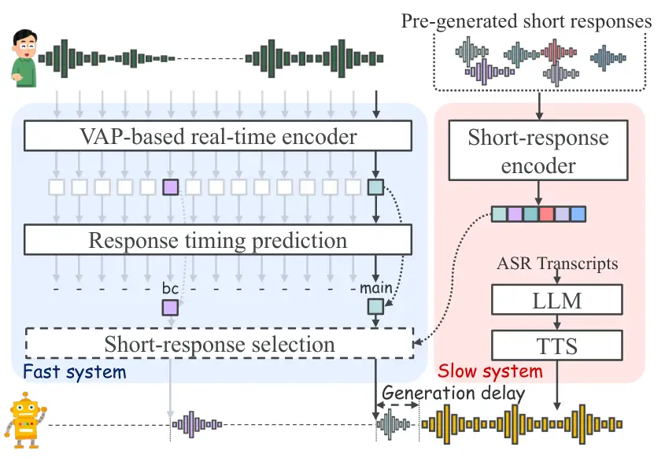
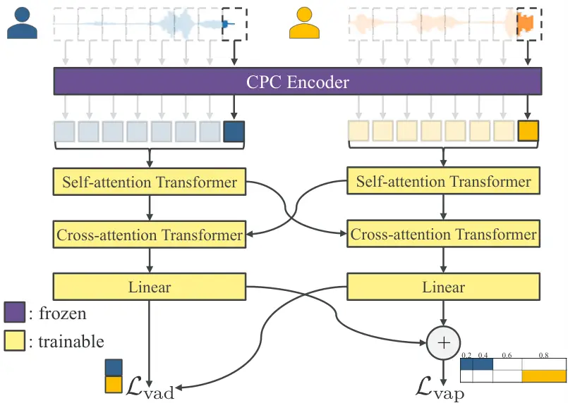

\mladdress

The University of Osaka, 1-3 Machikaneyama-cho, Toyonaka, Osaka,
560-8531, Japan \class3

# Real-time short-response selection for spoken dialogue systems

Hien Ohnaka¹ ^(†)^(†)thanks: h.ohnaka@dis.sys.es.osaka-u.ac.jp    Kazuyo
Onishi^(2,1)    and Koichiro Yoshino¹

###### Abstract

To realize spoken dialogue systems that can interact naturally with
users, it is important for the system to respond to user utterances at
appropriate timings. To achieve such natural turn-taking, the system
needs not only to predict appropriate response timings but also to mask
delays caused by language generation and speech synthesis so that they
are not perceived by the user. We propose a real-time short-response
selection task that can be integrated with existing turn-taking models
to mask generation delay. To address this task, the proposed model
learns the mapping between dialogue context and short responses using
contrastive learning. When a turn-taking event is detected, the system
selects a response from a set of pre-generated candidates. The selected
response is played while the main response is being generated.
Experimental results show that the proposed method learns to select
short responses based on dialogue context, outperforming random and
LLM-based baselines. Moreover, integrating response selection maintained
turn-taking prediction performance and added minimal processing
overhead.

###### Keywords: 

spoken dialogue systems, turn-taking, contrastive learning, voice
activity projection

## 1 Introduction

The quality of spoken dialogue systems has greatly improved with the
development of deep learning. In addition to context-aware response
generation using large language models (LLMs) \[40\], text-to-speech
(TTS) systems have also improved the naturalness and expressiveness of
synthetic speech \[44, 1\]. However, natural spoken dialogue requires
not only high-quality responses and speech but also appropriate
turn-taking between dialogue participants \[37\]. In modeling natural
turn-taking, the system needs to determine the appropriate timing of
speaker changes and use backchannels, which are brief responses that
indicate understanding or active listening during the other speaker’s
utterance. The interval before these responses begin affects the
impression of the responder \[39, 13\], and appropriate backchannels
also help the other speaker continue speaking \[36\]. Therefore, smooth
interaction in spoken dialogues requires not only better response
generation but also better temporal coordination.

In turn-taking modeling, several methods have been proposed to predict
turn-taking events from speech signals or their transcriptions \[21, 31,
33\]. More recently, lightweight and fast models with streaming
processing have enabled real-time detection of these events \[5, 9,
10\]. In practical cascaded spoken dialogue systems, an LLM and a TTS
system become the main bottlenecks before a response can begin. Even if
a turn-taking model quickly detects an appropriate response timing, the
generation systems cannot start responding until the response speech has
been generated. One possible approach is to start response generation
early enough to meet the predicted response timing \[3, 22\]. However,
the earlier generation starts, the more this approach has to rely on
partial automatic speech recognition (ASR) transcripts. As a result, the
response may not fully reflect the user’s intended meaning \[2\].
Moreover, when attempting to generate a response that sufficiently
reflects the user’s intent, there often remains a gap between the
appropriate response timing and the time when the generation modules can
actually output the response.

One approach to reducing this gap is to speed up the generation modules
themselves \[14, 43, 28\]. However, speeding up generation through model
compression or similar techniques may involve a trade-off with
generation quality. Another approach is to output a short utterance
before the main response through a separate processing path. Previous
studies \[34, 25\] have shown that outputting a pre-prepared filler such
as “Hmm…” can improve the user’s impression of the waiting time.
However, repeatedly outputting the same utterance may make the dialogue
monotonous and may result in responses that do not fit the context.

In recent years, several approaches have been proposed to address this
problem. One is a method called preface-generation \[26\]. It predicts
whether a response can be generated from partial recognition results of
the user’s utterance. Once a response is considered possible, it
generates a contextually appropriate response based on the available
context, separately from the main generation pathway, and outputs it at
the timing determined by the turn-taking model. Another is an LLM-based
filler selection strategy proposed by Liu et al. \[19\]. This approach
selects fillers based on partial recognition results of the user’s
utterance. These approaches may select or generate more natural fillers
than the naive filler output described above. However, their performance
remains dependent on the speed of the ASR model, the LLM, and the TTS
system.



Figure 1: Overview of the proposed real-time short-response selection.

In this study, we propose a real-time short-response selection task that
predicts the appropriate timing for the system to start speaking while
rapidly selecting contextually appropriate fillers or utterances
intended to take the floor. An overview of the proposed method is shown
in Fig. 1. Our method first extracts hidden representations from a set
of short responses. Here, as shown in the upper right of Fig. 1, the
short responses are defined as brief utterances such as “I see” and
“Um…” that can be produced before the main response. During inference,
short responses are selected whenever an event is triggered by the
continuously running turn-taking model. The selected response is
expected to match the latent dialogue context encoded in the turn-taking
features. Crucially, the selection process is independent of other
modules, such as ASR and LLMs, and can therefore be performed with low
latency. The selected response can be output to mask the latency of the
generation module and can also be used for backchannel events. Our
method is realized by adding a short-response encoder to the turn-taking
model. Specifically, in addition to the existing turn-taking objective,
we introduce a contrastive objective between the dialogue context and
short responses. Our method can also be viewed as an extension of
context–feedback embedding-based response ranking \[29\] to streaming,
timing-aware short-response selection.

In the evaluation experiments, we conducted a broad objective evaluation
as an initial validation. The results show that the method can select
responses based on dialogue context, learn short-response selection
without degrading timing prediction performance, and perform response
selection with almost no additional overhead. Finally, we discuss the
current limitations of our method and directions for future improvement.

## 2 Preliminary Definition

### 2.1 Spoken Dialogue Systems

In this research, we assume a two-speaker dialogue setting, following
previous work \[9\]. We denote the user speech as $`\bm{x}_{u}`$ and the
system speech as $`\bm{x}_{s}`$. The two speech signals are treated as
synchronized streams along the time axis. For speaker $`a\in\{u,s\}`$,
the speech history up to time frame $`t`$ is represented as follows:

```math
\displaystyle\bm{x}_{a}^{\leq t}=\{x_{a}(t^{\prime})\mid 0\leq t^{\prime}\leq t\}. \tag{1}
```

In a cascaded spoken dialogue system, an ASR module \[30, 18\] first
converts the user speech into text in a streaming manner as follows:

```math
\displaystyle\hat{\bm{y}}_{\mathrm{asr}}(t)=f_{\mathrm{asr}}\!\left(\bm{x}_{u}^{\leq t}\right). \tag{2}
```

Here, $`f_{\mathrm{asr}}`$ denotes a streaming ASR model \[17, 23\] that
outputs a partial text sequence $`\hat{\bm{y}}_{\mathrm{asr}}(t)`$. In
parallel with ASR, the turn-taking model sequentially predicts
turn-taking events, such as response timing and backchannels, from the
speech streams. The event prediction is represented as follows:

```math
\displaystyle\hat{\bm{e}}(t)=f_{\mathrm{tt}}\!\left(\bm{x}_{u}^{\leq t},\bm{x}_{s}^{\leq t}\right). \tag{3}
```

Here, $`f_{\mathrm{tt}}`$ denotes the turn-taking model, and
$`\hat{\bm{e}}(t)`$ denotes the event prediction at time $`t`$. Some
turn-taking models depend on ASR to use textual information \[33, 26\],
while others operate without ASR \[5, 9\]. In this study, we focus on
the latter type and treat it as a module that can operate in parallel
with ASR.

Let $`t_{e}`$ denote the time frame when a turn-taking event is
detected. The response generation module then generates a response text
using the recognition results obtained up to that time. Let $`p`$ denote
the prompt given to the LLM. The generated response text is represented
as follows:

```math
\displaystyle\hat{\bm{y}}_{\mathrm{llm}}=f_{\mathrm{llm}}\!\left(\hat{\bm{y}}_{\mathrm{asr}}(t_{e}),p\right). \tag{4}
```

Here, $`f_{\mathrm{llm}}`$ denotes a large language model (LLM) \[40\].
Finally, a text-to-speech (TTS) system \[44, 1\] converts the generated
response text into speech:

```math
\displaystyle\hat{\bm{x}}_{s}=f_{\mathrm{tts}}\!\left(\hat{\bm{y}}_{\mathrm{llm}}\right), \tag{5}
```

Here, $`f_{\mathrm{tts}}`$ denotes the TTS system, and
$`\hat{\bm{x}}_{s}`$ denotes the response speech output by the system.

Cascaded spoken dialogue systems offer high flexibility because their
modules operate independently. As a result, each module in Eqs. (2),
(3), (4), and (5) can be optimized separately and readily replaced at
inference time. However, the connections between these modules can
introduce delay. Another approach is an end-to-end spoken dialogue
model \[4\]. It avoids this problem caused by combining multiple modules
by handling the process from speech input to speech output within a
single model. These systems have no explicit boundaries between modules.
Therefore, they may handle mismatches in processing timing across
modules in an integrated manner. For this reason, they have attracted
attention from the perspective of natural turn-taking. However, they
require large-scale training data and computational resources \[24\]. In
addition, compared with cascaded systems, where individual modules can
be independently replaced and optimized, controlling and customizing
each component is less straightforward.

### 2.2 Turn-taking modeling

In this section, we focus on two-channel Voice Activity Projection
(VAP) \[5, 9\], which serves as the turn-taking model in our method.
Rather than directly predicting specific turn-taking events, VAP
sequentially predicts the future speech activity of two speakers.

We consider the speech activity of speaker $`a\in\{u,s\}`$ over the next
two seconds at time frame $`t`$. In VAP, this interval is divided into
four windows with durations $`\bm{d}=(0.2,0.4,0.6,0.8)`$ seconds. The
binary speech activity label of speaker $`a`$ in the $`k`$-th window is
defined as follows:

```math
\displaystyle b_{a,k}(t)\in\{0,1\}.\quad k\in\{1,2,3,4\} \tag{6}
```

By concatenating the four labels for each of the two speakers, the
future speech activity at $`t`$ is represented as follows:

```math
\displaystyle\bm{b}(t)=(b_{u,1}(t),\ldots,b_{u,4}(t),b_{s,1}(t),\ldots,b_{s,4}(t))\in\{0,1\}^{8} \tag{7}
```

We regard these 8-bit combinations as a codebook
$`\mathcal{C}=\{0,1\}^{8}`$. A discrete class can then be assigned to
the speech activity at each time step as follows:

```math
\displaystyle c(t)=\operatorname{code}(\bm{b}(t))\in\{1,\ldots,256\}, \tag{8}
```

Here, $`\operatorname{code}(\cdot)`$ denotes a function that maps an
8-bit pattern to a class index.

VAP takes only the speech histories of the two speakers observed up to
time frame $`t`$ as input. Let $`f_{\mathrm{vap}}`$ denote the streaming
model that extracts the two speakers’ features. Figure 2 shows the
architecture of the model. The streaming model consists of
self-attention and cross-attention Transformer blocks \[42\].

```math
\displaystyle\bigl(\bm{z}_{u}(t),\bm{z}_{s}(t)\bigr) \displaystyle=f_{\mathrm{vap}}\!\left(\bm{x}_{u}^{\leq t},\bm{x}_{s}^{\leq t}\right), \tag{9}
```

```math
\displaystyle\bm{z}(t) \displaystyle=\bm{z}_{u}(t)+\bm{z}_{s}(t). \tag{10}
```

Here, $`\bm{z}_{u}(t)`$ and $`\bm{z}_{s}(t)`$ denote the user and system
features, respectively. Let $`h_{\mathrm{vap}}`$ and
$`h_{\mathrm{vad}}`$ denote the VAP state head and the voice activity
detection (VAD) head, respectively. The model solves this multi-class
classification problem in a streaming manner as follows:

```math
\displaystyle\hat{\bm{p}}_{\mathrm{vap}}(t) \displaystyle=h_{\mathrm{vap}}\!\left(\bm{z}(t)\right)\in[0,1]^{256}, \tag{11}
```

```math
\displaystyle\quad\sum_{c=1}^{256}\hat{p}_{\mathrm{vap},c}(t) \displaystyle=1. \tag{12}
```

Here, $`h_{\mathrm{vap}}`$ is the projection head for the probability of
the VAP state. In the pretraining, the prediction loss for the VAP state
is defined as the cross-entropy loss for the ground-truth class at each
time step:

```math
\displaystyle\mathcal{L}_{\mathrm{vap}}=-\frac{1}{T}\sum_{t=1}^{T}\log\hat{p}_{\mathrm{vap},c(t)}(t). \tag{13}
```

In addition, an auxiliary VAD head $`h_{\mathrm{vad}}`$ predicts the
current speech activity of each speaker. The VAD head uses each
speaker’s features as follows:

```math
\displaystyle\hat{p}_{\mathrm{vad},u}(t) \displaystyle=h_{\mathrm{vad}}\!\left(\bm{z}_{u}(t)\right), \tag{14}
```

```math
\displaystyle\hat{p}_{\mathrm{vad},s}(t) \displaystyle=h_{\mathrm{vad}}\!\left(\bm{z}_{s}(t)\right). \tag{15}
```

The VAD loss is defined as follows:

```math
\displaystyle\mathcal{L}_{\mathrm{vad}}=\frac{1}{2T}\sum_{t=1}^{T}\sum_{a\in\{u,s\}}\ell_{\mathrm{bce}}\!\left(y_{a}(t),\hat{p}_{\mathrm{vad},a}(t)\right). \tag{16}
```

Here, $`y_{a}(t)\in\{0,1\}`$ is the ground-truth label for speaker
$`a`$, $`\ell_{\mathrm{bce}}`$ is the binary cross-entropy loss, and
$`\hat{p}_{\mathrm{vad},a}(t)`$ is the predicted probability. The
original VAP pretraining objective is a weighted sum of these two
losses:

```math
\displaystyle\mathcal{L}_{\mathrm{tt}}=\mathcal{L}_{\mathrm{vap}}+w_{\mathrm{vad}}\mathcal{L}_{\mathrm{vad}}. \tag{17}
```



Figure 2: Original VAP architecture used to initialize the turn-taking
backbone. The contrastive predictive coding (CPC) encoder \[32\] is used
as the feature extractor that converts each speaker’s waveform into
frame-level features.

VAP is designed to operate with low computational cost and high
processing speed. However, detecting an event quickly does not
necessarily mean that the system can actually output a response at the
detected time. The proposed real-time short-response selection addresses
this gap by selecting a response that can be output immediately in
parallel with the generation modules.

## 3 Task and Method

### 3.1 Latency Mitigation with Real-Time Response Selection

We introduce real-time short-response selection. We first define the set
of short-response candidates $`\mathcal{R}_{s}`$ that can be output by
the system speaker $`s`$ as follows:

```math
\displaystyle\mathcal{R}_{s}=\{\bm{r}_{s,1},\bm{r}_{s,2},\ldots,\bm{r}_{s,N_{s}}\} \tag{18}
```

Here, $`\bm{r}_{s,n}`$ denotes the speech waveform of the $`n`$-th
candidate, and $`N_{s}`$ denotes the number of candidates. These
utterances are generated by TTS before the dialogue begins.

Next, we describe the specific processing flow of the proposed model. We
add two heads sharing the streaming feature $`\bm{z}(t)`$ from Eq. (10):

```math
\displaystyle\hat{p}_{\mathrm{tim}}(t) \displaystyle=\sigma\!\left(h_{\mathrm{tim}}(\bm{z}(t))\right), \tag{19}
```

```math
\displaystyle\hat{p}_{\mathrm{cls}}(t) \displaystyle=\sigma\!\left(h_{\mathrm{cls}}(\bm{z}(t))\right), \tag{20}
```

where $`\sigma`$ denotes the sigmoid function. The timing head
$`h_{\mathrm{tim}}`$ detects a turn-taking event at time $`t`$ when the
probability rises above the threshold within one time frame:

```math
\displaystyle e(t)=\begin{cases}1&\text{if }\hat{p}_{\mathrm{tim}}(t)\geq\theta_{\mathrm{tim}}\text{ and }\hat{p}_{\mathrm{tim}}(t-1)<\theta_{\mathrm{tim}},\\
0&\text{otherwise.}\end{cases} \tag{21}
```

Here, $`\theta_{\mathrm{tim}}`$ is the detection threshold, and
$`e(t)=1`$ indicates a rising edge (i.e., a response should begin one
time frame after $`t`$). The event time $`t_{e}`$ is the frame at which
$`e(t_{e})=1`$. In parallel, $`\bm{z}(t)`$ is fed into the context
encoder $`g_{\mathrm{ctx}}`$ to obtain the dialogue context feature:

```math
\displaystyle\bm{h}_{\mathrm{ctx}}(t)=g_{\mathrm{ctx}}\!\left(\bm{z}(t)\right)\in\mathbb{R}^{D} \tag{22}
```

Each candidate short response is converted before the dialogue begins
using the short-response encoder $`g_{\mathrm{resp}}`$:

```math
\displaystyle\bm{h}_{\mathrm{resp},n}=g_{\mathrm{resp}}\!\left(\bm{r}_{s,n}\right)\in\mathbb{R}^{D},\quad n\in\{1,\ldots,N_{s}\} \tag{23}
```

When a turn-taking event is detected at time $`t_{e}`$, the cosine
similarity between the dialogue context feature and each candidate
response is computed as:

```math
\displaystyle s_{n}(t_{e})=\operatorname{cos}\!\left(\bm{h}_{\mathrm{ctx}}(t_{e}),\bm{h}_{\mathrm{resp},n}\right) \tag{24}
```

All candidates are then ranked according to this score, and the top-1
candidate is selected:

```math
\displaystyle n^{*}(t_{e})=\mathop{\arg\max}_{n\in\{1,\ldots,N_{s}\}}s_{n}(t_{e}) \tag{25}
```

The selected speech $`\bm{r}_{s,n^{*}(t_{e})}`$ is output at $`t_{e}+1`$
independently of the main generation modules. Finally, the
classification head outputs $`\hat{p}_{\mathrm{cls}}(t_{c})`$ in
Eq. (20) at the end of the selected short response $`t_{c}`$ to
determine whether the main response follows the short response. Here,
$`\theta_{\mathrm{cls}}`$ is the classification threshold: the main
response is judged to follow if
$`\hat{p}_{\mathrm{cls}}(t_{c})\geq\theta_{\mathrm{cls}}`$, and
otherwise the short response is treated as a backchannel.

### 3.2 Proposed Method

The proposed model is trained with the short-response selection
objective in addition to the response timing prediction objective. For
training, we use the start times of main responses and backchannels in
two-speaker dialogues, together with their actual response speech. For
main responses, we extract short responses from the first utterance
interval after each speaker change by using an external VAD
model \[35\]. For backchannels, we use each utterance interval.

Let $`t_{i}`$ denote the start time frame of the $`i`$-th response. To
select a short response before its onset, we use
$`\tilde{t}_{i}=t_{i}-1`$ as the target time, consistent with Eq. (21).
We pair the dialogue context features at this frame with the positive
short response $`\bm{r}_{i}^{+}`$. For each positive example, we
randomly sample $`K`$ negative examples
$`\{\bm{r}_{i,k}^{-}\}_{k=1}^{K}`$. These are sampled from the response
pool for the same speaker in the same session.

We use the InfoNCE loss \[41\] to train short-response selection. We
define the scores for positive and negative examples as follows:

```math
\displaystyle s_{i}^{+} \displaystyle=\operatorname{cos}\!\left(\bm{h}_{\mathrm{ctx}}(\tilde{t}_{i}),g_{\mathrm{resp}}(\bm{r}_{i}^{+})\right), \tag{26}
```

```math
\displaystyle s_{i,k}^{-} \displaystyle=\operatorname{cos}\!\left(\bm{h}_{\mathrm{ctx}}(\tilde{t}_{i}),g_{\mathrm{resp}}(\bm{r}_{i,k}^{-})\right). \tag{27}
```

The response selection loss is then given as follows:

```math
\displaystyle\mathcal{L}_{\mathrm{sel}}=-\frac{1}{M}\sum_{i=1}^{M}\log\frac{\exp(s_{i}^{+}/\tau)}{\exp(s_{i}^{+}/\tau)+\sum_{k=1}^{K}\exp(s_{i,k}^{-}/\tau)}. \tag{28}
```

Here, $`M`$ denotes the number of positive examples in a minibatch and
$`\tau`$ the temperature parameter.

Response timing prediction is realized by combining the following two
subtasks. The first subtask predicts when a response should begin. Let
$`y_{\mathrm{tim}}(t)\in[0,1]`$ denote the training target. We use the
binary cross-entropy loss $`\ell_{\mathrm{bce}}`$ for timing prediction.
The loss is given as follows:

```math
\displaystyle\mathcal{L}_{\mathrm{tim}} \displaystyle=\frac{1}{T}\sum_{t=1}^{T}\ell_{\mathrm{bce}}\!\bigl(y_{\mathrm{tim}}(t),\hat{p}_{\mathrm{tim}}(t)\bigr). \tag{29}
```

The second subtask is event classification conditioned on a rising edge
in the timing prediction. The training target $`y_{\mathrm{cls}}(t)`$ is
1 for main responses and 0 for backchannels. The interval used for
training is $`[t_{i},e_{i})`$. The interval end is
$`e_{i}=t_{i}+\min(f_{\mathrm{r}},L_{i})`$, where $`f_{\mathrm{r}}`$ is
the frame rate (frames per second), so that $`f_{\mathrm{r}}`$ frames
correspond to one second, and $`L_{i}`$ is the short-response length
measured in the time frames. The event classification loss is given as
follows:

```math
\displaystyle\mathcal{L}_{\mathrm{cls}} \displaystyle=\frac{1}{\lvert\mathcal{T}_{\mathrm{cls}}\rvert}\sum_{t\in\mathcal{T}_{\mathrm{cls}}}\ell_{\mathrm{bce}}\!\bigl(y_{\mathrm{cls}}(t),\hat{p}_{\mathrm{cls}}(t)\bigr). \tag{30}
```

Here, $`\mathcal{T}_{\mathrm{cls}}`$ denotes the set of target frames.

The total loss is a weighted sum of the short-response selection, timing
prediction, and event classification losses:

```math
\displaystyle\mathcal{L}_{\mathrm{total}}={} \displaystyle\lambda_{\mathrm{sel}}\mathcal{L}_{\mathrm{sel}}+\lambda_{\mathrm{tim}}\mathcal{L}_{\mathrm{tim}}+\lambda_{\mathrm{cls}}\mathcal{L}_{\mathrm{cls}}. \tag{31}
```

Here, $`\lambda_{\mathrm{sel}}`$, $`\lambda_{\mathrm{tim}}`$, and
$`\lambda_{\mathrm{cls}}`$ are the loss weights.

## 4 Experimental Evaluation

### 4.1 Experimental Setup

| Partition | Sessions | Speakers | Target responses | Duration \[h\] |
| --------- | -------- | -------- | ---------------- | -------------- |
| Train     | 195      | 170      | 98,329           | 69.09          |
| Valid     | 14       | 10       | 8,094            | 4.52           |
| Test      | 38       | 31       | 18,103           | 12.19          |

Table 1: Total duration and numbers of sessions, unique speakers, and
target responses in each partition.

For training and evaluation, we extracted two-speaker dialogues from the
Corpus of Everyday Japanese Conversation (CEJC) \[15\]. For each
dialogue, we used separate audio recordings and utterance interval
annotations. We grouped sessions by recording contributor ID and divided
the groups into training, validation, and test sets with target
proportions of $`80`$%, $`5`$%, and $`15`$%, respectively, so that each
group was assigned to only one set. Table 1 shows the total duration and
the numbers of sessions, unique speakers, and utterances targeted for
short-response extraction in each set. The utterance counts include both
speakers. Since either speaker in a dialogue can play the system role,
we randomly swapped the user and system roles of the two speakers with a
probability of $`50`$% during training, and evaluated both role
assignments for each dialogue at test time.

We created response labels by processing utterance intervals in order of
their start times. For an utterance by a speaker other than the current
main speaker, we labeled it as a backchannel if it ended within $`1.0`$
second of the end of the most recent main utterance, and otherwise as a
main response, which was treated as a speaker change. For short-response
selection, we used these backchannels and the first main response after
each speaker change as positive examples, detecting the first speech
segment in each target utterance with Silero VAD \[35\] and extracting a
continuous segment of up to $`2.0`$ seconds as the short response.

We initialized the turn-taking model with a pretrained Japanese VAP
model \[11, 20\], using the $`10`$ Hz version with a context length of
$`3.0`$ seconds for each attention module. For the response encoder, we
concatenated features pre-extracted from layers $`6`$, $`18`$, and
$`24`$ of the Japanese HuBERT model \[7, 12\] at each time step to
obtain $`3\text{,}072`$-dimensional features, projected them to $`512`$
dimensions, and fed them into a three-layer Transformer. The outputs
were averaged over valid frames and projected to $`128`$ dimensions. The
context encoder $`g_{\mathrm{ctx}}`$ consisted of a three-layer MLP with
a hidden dimension of $`512`$ and a projection layer to $`128`$
dimensions. Dropout \[38\] with a probability of $`0.1`$ was applied to
all heads in the model.

We froze the CPC \[32\] extractor and HuBERT, the front ends of the
turn-taking model and response encoder, respectively. We trained the VAP
model, the two binary heads, and the short-response encoders. In
preliminary experiments, propagating the response selection loss to the
turn-taking model slightly degraded the timing prediction performance.
We therefore detached the VAP features in Eq. (22) used for response
selection, so that the response selection loss does not update the
turn-taking model. For response selection, we used four negative
examples per positive example and set the InfoNCE temperature to
$`\tau=0.07`$.

In preliminary experiments with actual model inference, dialogue
breakdowns frequently occurred because the prediction probabilities
failed to rise during long silences. To prevent this, we applied silence
augmentation to the timing prediction task during training only. For
each main response and backchannel of the system speaker that starts
within a training segment, we replaced its speech with silence with a
probability of $`50`$%, independently for each event. For the silenced
events, the timing target was set to 1 from the response onset until the
end of the original utterance or $`2.0`$ seconds after the onset,
whichever came first, so that the model keeps predicting the response
while no speech is observed. The event classification loss was excluded
over the silenced utterance interval.

To address data imbalance on the timing prediction task, we applied two
techniques. First, we assigned soft labels of $`0.2,0.4,0.6`$, and
$`0.8`$ to the four frames immediately preceding the ground-truth label.
Second, we applied inverse-frequency weighting \[8\] to the loss in
Eq. (29). The positive-class weight was approximately 6.50. The loss
weights in Eq. (31) were $`\lambda_{\mathrm{sel}}=5.0`$,
$`\lambda_{\mathrm{tim}}=1.0`$, and $`\lambda_{\mathrm{cls}}=1.0`$. We
used AdamW with a maximum learning rate of $`5\times 10^{-5}`$,
increasing it linearly from $`1\times 10^{-10}`$ during the first
$`10`$% of all update steps and then keeping it constant. We used a
batch size of $`16`$, updated the parameters after each batch, and
trained for $`10`$ epochs using mixed precision with ‘bfloat16’.

### 4.2 Results

#### 4.2.1 Response Selection Performance

| Type | Chance rate | Proposed | LLM  |
| ---- | ----------- | -------- | ---- |
| Main | 0.54        | 4.52     | 1.62 |
| BC   | 8.39        | 19.51    | 9.55 |
| All  | 6.41        | 15.72    | 7.55 |

Table 2: Text Top-1 accuracy (%) of short-response selection on 14,446
test events. A selection is correct when its text matches that of the
target response. BC denotes backchannel.

| Type | 1%   | 5%    | 10%   | 25%   | 50%   |
| ---- | ---- | ----- | ----- | ----- | ----- |
| Main | 7.55 | 24.32 | 39.25 | 62.17 | 83.98 |
| BC   | 4.72 | 18.50 | 31.55 | 58.60 | 83.23 |
| All  | 5.41 | 19.97 | 33.50 | 59.50 | 83.42 |

Table 3: Speech ranking accuracy (%) of the proposed method on 14,446
test events. Top-$`k`$% is the rate at which the target speech ranks
within the top $`k`$% of the candidate pool. The chance rate of
Top-$`k`$% is $`k`$%. BC denotes backchannel.

| Candidate type | Min | Max | $`\mu\pm\sigma`$     |
| -------------- | --- | --- | -------------------- |
| Speech         | 29  | 985 | $`365.71\pm 262.09`$ |
| Text           | 23  | 488 | $`182.63\pm 106.90`$ |

Table 4: Number of response candidates per test event ($`N=14{,}446`$).

We evaluated response selection performance using two metrics. Top-1
accuracy (text) counts a selection as correct when the text of the
selected candidate matches that of the target response, because
candidates with the same text cannot be distinguished by the LLM, which
takes only text as input. Top-$`k`$% accuracy \[29\] measures whether
the target speech itself ranks within the top $`k`$% of the speech
candidate pool. Since the LLM outputs a single candidate ID and no
ranking, we report Top-$`k`$% only for the proposed method, and Top-1
accuracy (text) is the only metric comparable between the two methods.
We adopted two baseline methods. One is the chance rate, which
represents the expected value when responses are selected at random. The
other is LLM-based selection, inspired by Liu et al. \[19\]. We used
Gemma 4 E2B-it \[6\] as the LLM for response selection. The English
prompt ¹¹ 1 The actual prompts and examples were given in Japanese. for
selecting the short response is described as follows:

> \[Example 1, user message\]  
> Recent conversation:  
> Other speaker: \[utterance 1\]  
> Other speaker: \[utterance 2\]  
> Responder: \[utterance 3\]  
> \[...\]  
> Candidate IDs and utterances:  
> 128: \[candidate transcription\]  
> 135: \[candidate transcription\]  
> \[...\]  
> \[same selection instruction as below\]  
> \[Example 1, assistant message\]  
> 135  
> \[Example 2, user: same format\]  
> \[Example 2, assistant: correct ID\]  
> \[Test, user message\]  
> Recent conversation:  
> \[history\]  
> Candidate IDs and utterances:  
> \[options\]  
> Considering the conversation above, select the ID of the most
> appropriate candidate as the \[response\] from the given response
> candidates. Reply with only the numeric candidate ID.

Here, \[history\] contains up to eight recent utterances labeled as the
other speaker or responder. \[options\] lists candidate IDs and their
text sequences, one per line. For backchannels, we used the ground-truth
sequences provided in the dataset, and for main responses, we used the
ASR transcriptions of the short responses. We also removed duplicate
short responses in the text domain. Table 4 summarizes the statistics of
the short-response candidate pools. For \[response\], we used “next
response” for a main response or “backchannel to the current utterance”
for a backchannel.

Tables 2 and 3 show the text Top-1 accuracy and the speech ranking
results, respectively. Comparing the proposed method with the chance
rate shows that the proposed method achieved higher scores on all
metrics. This result suggests that the proposed method selects responses
based on the dialogue context. The proposed method also achieved higher
scores than LLM-based selection. Our analysis showed that the LLM tended
to favor candidates near the beginning of the list. When the number of
candidates was large, this selection bias \[45, 27\] may have adversely
affected the LLM’s performance. The proposed method is not affected by
the order in which candidates are presented, making it a better choice
in this respect.

#### 4.2.2 Impact on Turn-Taking Prediction

|           |             | $`\epsilon`$ (s) |       |       |         |
| --------- | ----------- | ---------------- | ----- | ----- | ------- |
| Metric    | Method      | 0.2              | 0.5   | 1.0   | MAE (s) |
| Precision | Timing only | 60.81            | 78.14 | 88.68 | \-      |
|           | Proposed    | 67.04            | 82.45 | 91.15 | \-      |
| Recall    | Timing only | 54.83            | 78.48 | 90.93 | \-      |
|           | Proposed    | 50.35            | 74.42 | 88.31 | \-      |
| F1        | Timing only | 57.66            | 78.31 | 89.79 | 0.488   |
|           | Proposed    | 57.51            | 78.23 | 89.71 | 0.477   |

Table 5: Event-wise response-onset timing scores (%) and mean absolute
error (MAE). $`\epsilon`$ is the absolute timing tolerance in seconds.

| Method      | Main  | BC    | Macro |
| ----------- | ----- | ----- | ----- |
| Timing only | 79.95 | 85.73 | 82.84 |
| Proposed    | 79.61 | 86.20 | 82.90 |

Table 6: Event-classification F1 scores (%). BC is the event of
backchannels.

We conducted an objective evaluation of the timing prediction to confirm
that adding response selection does not degrade its performance. To
assess timing prediction accuracy, we used the following metrics focused
on prediction triggers. Let $`\epsilon`$ denote the timing tolerance. We
count the first trigger as $`N_{\mathrm{on}}`$ if it falls within
$`\pm\epsilon`$ of the target. Earlier, later, and missing triggers are
counted as $`N_{\mathrm{early}}`$, $`N_{\mathrm{late}}`$, and
$`N_{\mathrm{miss}}`$, respectively. We define precision, recall, and F1
as follows:

```math
\displaystyle P \displaystyle=\frac{N_{\mathrm{on}}}{N_{\mathrm{on}}+N_{\mathrm{early}}}, \tag{32}
```

```math
\displaystyle R \displaystyle=\frac{N_{\mathrm{on}}}{N_{\mathrm{on}}+N_{\mathrm{late}}+N_{\mathrm{miss}}}, \tag{33}
```

```math
\displaystyle F_{1} \displaystyle=\frac{2PR}{P+R}. \tag{34}
```

Additionally, MAE is computed relative to the shifted target time over
events with a detected trigger.

Table 5 shows the timing prediction results. The proposed method
achieved F1 scores comparable to those of the model trained without the
response-selection objective, while showing a slightly better MAE. These
results indicate that timing prediction performance can be maintained
while incorporating response selection. The substantial differences in
precision and recall between the two methods arise from the different
operating points selected by maximizing the F1 score on the validation
set.

Next, for event classification, we used the ground-truth onset times in
the test set as the reference. We evaluated all $`113\text{,}247`$
frames from response onset until the response ended or $`1.0`$ second
had elapsed. Table 6 shows the F1 scores for main responses and
backchannels, along with macro F1. These results show that integrating
response selection did not worsen overall event classification
performance.

#### 4.2.3 Processing Time

We evaluated the speed of the proposed response selection method to
assess its real-time performance. The evaluation covered the response
selection process, the response prediction module in the
preface-generation baseline \[26\], and the VAP model \[20\], which
serves as the backbone of the proposed method. For reference, we also
measured streaming ASR \[23\] under the same conditions. Each
measurement was repeated 30 times on a MacBook Air equipped with an
Apple M5 chip.

|                                 |                                 |                       |
| ------------------------------- | ------------------------------- | --------------------- |
| Case                            | $`\mu\pm\sigma`$ (ms)           | P95 (ms)              |
| Proposed                        | $`9.3749\pm 0.0672`$            | 9.4883                |
| +Select. ($`N=10^{1}`$)         | $`0.0231\pm 0.0007`$            | 0.0246                |
| +Select. ($`N=10^{2}`$)         | $`0.0281\pm 0.0008`$            | 0.0292                |
| +Select. ($`N=10^{3}`$)         | $`0.0332\pm 0.0009`$            | 0.0347                |
| +Select. ($`N=10^{4}`$)         | $`0.0765\pm 0.0009`$            | 0.0785                |
| Preface-gen. \[26\]             | $`4.3265\pm 0.1175`$            | 4.6139                |
| Nemotron ASR \[23\]             | $`36.6975\pm 5.9689`$           | 46.8798               |
| LLM select. (Gemma 4 E2B) \[6\] |                                 |                       |
| $`N=10^{1}`$                    | $`249.4189\pm 1.1605`$          | 250.5442              |
| $`N=10^{2}`$                    | $`718.4107\pm 0.6725`$          | 719.4658              |
| $`N=10^{3}`$                    | $`(5.66\pm 0.37)\times 10^{4}`$ | $`6.33\times 10^{4}`$ |
| $`N=10^{4}`$                    | Out-of-memory                   |                       |

Table 7: Processing times of each method. The upper and lower sections
show measurements on the CPU and Metal Performance Shaders (MPS),
respectively. $`N`$ denotes the number of selection candidates. The
proposed method operates at 10 Hz, and Nemotron ASR operates at 3.125
Hz. The preface-generation result covers only the response readiness
estimation module. Note that subsequent LLM and TTS processing adds
further latency in practice.

Table 7 shows the speed evaluation results. The VAP model runs in 9 ms
per inference, well within the 100 ms available at 10 Hz. The response
selection process adds almost no overhead, even with $`10\text{,}000`$
candidates. These results show that our method can be introduced without
compromising the real-time performance of the turn-taking model. Unlike
LLM-based filler selection \[19\], our method requires no online LLM
inference for selecting a short response. The selection step added only
$`0.076`$ ms with $`10\text{,}000`$ candidates on the evaluated CPU.
Preface-generation also runs very quickly, but it relies on recognized
text and is therefore affected by the ASR process. Moreover, because it
requires subsequent generation by an LLM and TTS system, the size of the
modules that can be used is limited. Therefore, our method can select a
response with minimal overhead, independently of ASR, LLM, and TTS
latency.

## 5 Discussion

One-to-many mapping between dialogue contexts and short responses. Our
method learns to associate dialogue context features based on causal
inputs to the VAP model with short-response features. As shown in
Table 2, the results demonstrate the effectiveness of this approach.
However, the model has a limitation in capturing real dialogue. A causal
input does not always determine a unique response. For example, several
responses may be appropriate to “What do you think?” The choice may
remain open until the speaker’s intent becomes clear. Our method does
not account for this one-to-many mapping. Addressing this limitation is
an important direction for future work.

Consistency between the two output paths. A major limitation of our
method is that the selected short response can be inconsistent with the
main response generated afterward. For example, dialogue quality can
suffer if our method selects a positively toned response and the LLM
then generates a negative one. One possible approach is to provide the
context of the selected response to the main LLM. However, persona
information is generally handled by the main LLM, so having a smaller
LLM used for response selection \[19\] determine the response strategy
is not ideal. We leave the development of a method that improves
consistency with the main response while preserving real-time
performance to future work.

Domain mismatch between training and inference. Our method is trained on
short responses extracted from real conversations, whereas synthetic
speech is used for short responses at inference time. Differences in
acoustic features, such as prosody, and in the distribution of the
short-response pool can lead to degraded performance. Future work should
explore approaches such as post-training with a reward model \[16\] to
mitigate this mismatch.

## 6 Conclusion

We proposed a real-time short-response selection task for cascaded
spoken dialogue systems. The method uses contrastive learning to
associate streaming VAP features with short spoken responses. It selects
pre-generated speech independently of ASR, LLM, and TTS processing.
Experiments on CEJC showed better selection performance than random
ranking. Timing prediction and overall event classification performance
remained comparable to those without response selection. On the
evaluated Apple M5 CPU, selection took only $`0.076`$ ms with $`10,000`$
candidates. These results support integrating short-response selection
into turn-taking models with minimal processing overhead.

## Acknowledgments

A part of this research was conducted by AIST and sub-contract entity,
The University of Osaka, under FRONTia, a Japanese national program led
by the Ministry of Economy, Trade and Industry of Japan (METI) and the
New Energy and Industrial Technology Development Organization (NEDO),
aimed at developing a domestic multimodal foundation model for AI robots
and physical AI.

## Declaration of generative AI use

Generative AI tools (Claude Code and Codex) were used as supplementary
aids for English proofreading and for implementing the experimental
code. The authors reviewed all outputs and take full responsibility for
the content of this paper.

## References

- \[1\] Y. Chen, Z. Niu, Z. Ma, K. Deng, C. Wang, J. Zhao, K. Yu, and X.
  Chen (2025) F5-TTS: A Fairytaler that Fakes Fluent and Faithful Speech
  with Flow Matching. In Proceedings of ACL, pp. 6255–6271. External
  Links: [Document](https://dx.doi.org/10.18653/V1/2025.ACL-LONG.313)
  Cited by: §1, §2.1.
- \[2\] Y. Chiba and R. Higashinaka (2025) Investigating the impact of
  incremental processing and voice activity projection on spoken
  dialogue systems. In Proceedings of COLING, pp. 3687–3696. Cited by:
  §1.
- \[3\] Y. Chiba, K. Mitsuda, A. Lee, and R. Higashinaka (2024) The
  remdis toolkit: building advanced real-time multimodal dialogue
  systems with incremental processing and large language models. In
  Proceedings of IWSDS, pp. 1–6. Cited by: §1.
- \[4\] A. Défossez, L. Mazaré, M. Orsini, A. Royer, P. Pérez, H.
  Jégou, E. Grave, and N. Zeghidour (2024) Moshi: a speech-text
  foundation model for real-time dialogue. External Links: 2410.00037,
  [Link](https://arxiv.org/abs/2410.00037) Cited by: §2.1.
- \[5\] E. Ekstedt and G. Skantze (2022) Voice activity projection:
  self-supervised learning of turn-taking events. In Proceedings of
  Interspeech, pp. 5190–5194. Cited by: §1, §2.1, §2.2.
- \[6\] Google Google/gemma-4-e2b-it. Hugging Face. Note:
  https://huggingface.co/google/gemma-4-E2B-it Cited by: §4.2.1, Table 7.
- \[7\] W. Hsu, B. Bolte, Y. H. Tsai, K. Lakhotia, R. Salakhutdinov,
  and A. Mohamed (2021) HuBERT: Self-Supervised Speech Representation
  Learning by Masked Prediction of Hidden Units. IEEE/ACM Transactions
  on Audio, Speech, and Language Processing 29, pp. 3451–3460. Cited by:
  §4.1.
- \[8\] C. Huang, Y. Li, C. C. Loy, and X. Tang (2016) Learning deep
  representation for imbalanced classification. In Proceedings of CVPR,
  pp. 5375–5384. Cited by: §4.1.
- \[9\] K. Inoue, B. Jiang, E. Ekstedt, T. Kawahara, and G.
  Skantze (2024) Multilingual turn-taking prediction using voice
  activity projection. In Proceedings of LREC-COLING, pp. 11873–11883.
  Cited by: §1, §2.1, §2.1, §2.2.
- \[10\] K. Inoue, D. Lala, G. Skantze, and T. Kawahara (2025) Yeah, un,
  oh: continuous and real-time backchannel prediction with fine-tuning
  of voice activity projection. In Proceedings of NAACL, pp. 7171–7181.
  Cited by: §1.
- \[11\] K. Inoue, Y. Okafuji, J. Baba, Y. Ohira, K. Hyodo, and T.
  Kawahara (2025) A noise-robust turn-taking system for real-world
  dialogue robots: a field experiment. In Proceedings of IROS,
  pp. 874–879. Cited by: §4.1.
- \[12\] Intelligent Media Processing Research Team, AIST
  Imprt/kushinada-hubert-large. Hugging Face. Note:
  https://huggingface.co/imprt/kushinada-hubert-large Cited by: §4.1.
- \[13\] T. Itoh, N. Kitaoka, and R. Nishimura (2009) Subjective
  Experiments on Influence of Response Timing in Spoken Dialogues. In
  Proceedings of Interspeech, pp. 1835–1838. External Links:
  [Document](https://dx.doi.org/10.21437/Interspeech.2009-534), ISSN
  2958-1796 Cited by: §1.
- \[14\] B. Jacob, S. Kligys, B. Chen, M. Zhu, M. Tang, A. G. Howard, H.
  Adam, and D. Kalenichenko (2018) Quantization and training of neural
  networks for efficient integer-arithmetic-only inference. In
  Proceedings of CVPR, pp. 2704–2713. External Links:
  [Document](https://dx.doi.org/10.1109/CVPR.2018.00286) Cited by: §1.
- \[15\] H. Koiso, H. Amatani, Y. Den, Y. Iseki, Y. Ishimoto, W.
  Kashino, Y. Kawabata, K. Nishikawa, Y. Tanaka, Y. Usuda, and Y.
  Watanabe (2022) Design and evaluation of the corpus of everyday
  Japanese conversation. In Proceedings of LREC, pp. 5587–5594. External
  Links: [Link](https://aclanthology.org/2022.lrec-1.599/) Cited by:
  §4.1.
- \[16\] H. Lee, S. Phatale, H. Mansoor, T. Mesnard, J. Ferret, K.
  Lu, C. Bishop, E. Hall, V. Carbune, A. Rastogi, and S. Prakash (2024)
  RLAIF vs. RLHF: scaling reinforcement learning from human feedback
  with AI feedback. In Proceedings of ICML, Vol. 235, pp. 26874–26901.
  External Links: [Link](https://proceedings.mlr.press/v235/lee24t.html)
  Cited by: §5.
- \[17\] B. Li, S. Chang, T. N. Sainath, R. Pang, Y. He, T. Strohman,
  and Y. Wu (2020) Towards fast and accurate streaming end-to-end ASR.
  In Proceedings of ICASSP, pp. 6069–6073. External Links:
  [Document](https://dx.doi.org/10.1109/ICASSP40776.2020.9054715) Cited
  by: §2.1.
- \[18\] J. Li (2022) Recent advances in end-to-end automatic speech
  recognition. APSIPA Transactions on Signal and Information Processing
  11 (1). Cited by: §2.1.
- \[19\] Y. Liu, S. Guo, and C. Mousas (2026) Don’t just fill the
  silence: exploring conversational filler strategies in embodied
  virtual agents. ACM Transactions on Applied Perception 23(4). Cited
  by: §1, §4.2.1, §4.2.3, §5.
- \[20\] MaAI-Kyoto Maai-kyoto/vap_mc_jp. Hugging Face. Note:
  https://huggingface.co/maai-kyoto/vap_mc_jp/blob/main/vap_mc_state_dict_jp_10hz_3000msec.pt
  Cited by: §4.1, §4.2.3.
- \[21\] A. Maier, J. Hough, and D. Schlangen (2017) Towards deep
  end-of-turn prediction for situated spoken dialogue systems. In
  Proceedings of Interspeech, F. Lacerda (Ed.), pp. 1676–1680. External
  Links: [Document](https://dx.doi.org/10.21437/INTERSPEECH.2017-1593)
  Cited by: §1.
- \[22\] K. Mori, S. Kawano, A. G. Contreras, and K. Yoshino (2025)
  Dialogue Response Prefetching Based on Semantic Similarity and
  Prediction Confidence of Language Model. In Proceedings of
  Interspeech, pp. 3045–3049. External Links:
  [Document](https://dx.doi.org/10.21437/Interspeech.2025-600), ISSN
  2958-1796 Cited by: §1.
- \[23\] NVIDIA Nvidia/nemotron-3.5-asr-streaming-0.6b. Hugging Face.
  Note: https://huggingface.co/nvidia/nemotron-3.5-asr-streaming-0.6b
  Cited by: §2.1, §4.2.3, Table 7.
- \[24\] A. Ohashi, S. Iizuka, J. Jiang, and R. Higashinaka (2025)
  Towards a japanese full-duplex spoken dialogue system. In Proceedings
  of Interspeech, pp. 1783–1787. External Links:
  [Document](https://dx.doi.org/10.21437/INTERSPEECH.2025-2564) Cited
  by: §2.1.
- \[25\] N. Ohshima, K. Kimijima, J. Yamato, and N. Mukawa (2015) A
  Conversational Robot with Vocal and Bodily Fillers for Recovering from
  Awkward Silence at Turn-Takings. In Proceedings of RO-MAN, Vol. ,
  pp. 325–330. External Links:
  [Document](https://dx.doi.org/10.1109/ROMAN.2015.7333677) Cited by:
  §1.
- \[26\] Y. Okafuji, K. Inoue, and Y. Ohira (2026) Low-latency
  turn-taking via context-aware preface generation in a real-world
  dialogue robot. In Companion Publications of ICMI, pp. 116–120.
  External Links: ISBN 9798400723193,
  [Link](https://doi.org/10.1145/3776591.3832513),
  [Document](https://dx.doi.org/10.1145/3776591.3832513) Cited by: §1,
  §2.1, §4.2.3, Table 7.
- \[27\] P. Pezeshkpour and E. Hruschka (2024) Large language models
  sensitivity to the order of options in multiple-choice questions. In
  Findings of NAACL, Mexico City, Mexico, pp. 2006–2017. External Links:
  [Link](https://aclanthology.org/2024.findings-naacl.130/),
  [Document](https://dx.doi.org/10.18653/v1/2024.findings-naacl.130)
  Cited by: §4.2.1.
- \[28\] W. Ping, K. Peng, and J. Chen (2019) ClariNet: parallel wave
  generation in end-to-end text-to-speech. In Proceedings of ICLR,
  External Links: [Link](https://openreview.net/forum?id=HklY120cYm)
  Cited by: §1.
- \[29\] L. Qian and G. Skantze (2024) Joint learning of context and
  feedback embeddings in spoken dialogue. In Proceedings of Interspeech,
  pp. 2955–2959. External Links:
  [Document](https://dx.doi.org/10.21437/Interspeech.2024-1082), ISSN
  2958-1796 Cited by: §1, §4.2.1.
- \[30\] A. Radford, J. W. Kim, T. Xu, G. Brockman, C. McLeavey, and I.
  Sutskever (2023) Robust speech recognition via large-scale weak
  supervision. In Proceedings of ICML, Vol. 202, pp. 28492–28518. Cited
  by: §2.1.
- \[31\] S. Z. Razavi, B. Kane, and L. K. Schubert (2019) Investigating
  linguistic and semantic features for turn-taking prediction in
  open-domain human-computer conversation. In Proceedings of
  Interspeech, pp. 4140–4144. External Links:
  [Document](https://dx.doi.org/10.21437/INTERSPEECH.2019-3152) Cited
  by: §1.
- \[32\] M. Riviere, A. Joulin, P. Mazaré, and E. Dupoux (2020)
  Unsupervised Pretraining Transfers Well Across Languages. In
  Proceedings of ICASSP, pp. 7414–7418. Cited by: Figure 2, §4.1.
- \[33\] M. Roddy and N. Harte (2020) Neural generation of dialogue
  response timings. In Proceedings of ACL, pp. 2442–2452. Cited by: §1,
  §2.1.
- \[34\] T. Shiwa, T. Kanda, M. Imai, H. Ishiguro, and N. Hagita (2008)
  How quickly should communication robots respond?. In Proceedings of
  HRI, pp. 153–160. Cited by: §1.
- \[35\] Silero Team (2024) Silero VAD: pre-trained enterprise-grade
  voice activity detector (vad), number detector and language
  classifier. Note: https://github.com/snakers4/silero-vad Cited by:
  §3.2, §4.1.
- \[36\] C. Simon (2018) The Functions of Active Listening Responses.
  Behavioural Processes 157, pp. 47–53. Cited by: §1.
- \[37\] G. Skantze (2021) Turn-taking in Conversational Systems and
  Human-Robot Interaction: A Review. Computer Speech & Language 67,
  pp. 101178. Cited by: §1.
- \[38\] N. Srivastava, G. E. Hinton, A. Krizhevsky, I. Sutskever,
  and R. Salakhutdinov (2014) Dropout: a simple way to prevent neural
  networks from overfitting. Journal of Machine Learning Research 15
  (1), pp. 1929–1958. External Links:
  [Link](https://dl.acm.org/doi/10.5555/2627435.2670313),
  [Document](https://dx.doi.org/10.5555/2627435.2670313) Cited by: §4.1.
- \[39\] E. M. Templeton, L. J. Chang, E. A. Reynolds, M. D. Cone
  LeBeaumont, and T. Wheatley (2022) Fast Response Times Signal Social
  Connection in Conversation. Proceedings of the National Academy of
  Sciences 119 (4). Cited by: §1.
- \[40\] H. Touvron, T. Lavril, G. Izacard, X. Martinet, M. Lachaux, T.
  Lacroix, B. Rozière, N. Goyal, E. Hambro, F. Azhar, A. Rodriguez, A.
  Joulin, E. Grave, and G. Lample (2023) LLaMA: Open and Efficient
  Foundation Language Models. External Links: 2302.13971,
  [Link](https://arxiv.org/abs/2302.13971) Cited by: §1, §2.1.
- \[41\] A. van den Oord, Y. Li, and O. Vinyals (2018) Representation
  learning with contrastive predictive coding. External Links:
  1807.03748, [Link](https://arxiv.org/abs/1807.03748) Cited by: §3.2.
- \[42\] A. Vaswani, N. Shazeer, N. Parmar, J. Uszkoreit, L.
  Jones, A. N. Gomez, L. Kaiser, and I. Polosukhin (2017) Attention is
  All you Need. In Proceedings of NeurIPS, pp. 5998–6008. Cited by:
  §2.2.
- \[43\] H. Wang, S. Ma, L. Ma, L. Wang, W. Wang, L. Dong, S. Huang, H.
  Wang, J. Xue, R. Wang, Y. Wu, and F. Wei (2025) BitNet: 1-bit
  pre-training for large language models. Journal of Machine Learning
  Research 26, pp. 125:1–125:29. External Links:
  [Link](https://jmlr.org/papers/v26/24-2050.html) Cited by: §1.
- \[44\] Y. Wang, R. J. Skerry-Ryan, D. Stanton, Y. Wu, R. J. Weiss, N.
  Jaitly, Z. Yang, Y. Xiao, Z. Chen, S. Bengio, Q. V. Le, Y.
  Agiomyrgiannakis, R. Clark, and R. A. Saurous (2017) Tacotron: Towards
  End-to-End Speech Synthesis. In Proceedings of Interspeech,
  pp. 4006–4010. Cited by: §1, §2.1.
- \[45\] C. Zheng, H. Zhou, F. Meng, J. Zhou, and M. Huang (2024) Large
  language models are not robust multiple choice selectors. In
  Proceedings of ICLR, External Links:
  [Link](https://openreview.net/forum?id=shr9PXz7T0) Cited by: §4.2.1.
