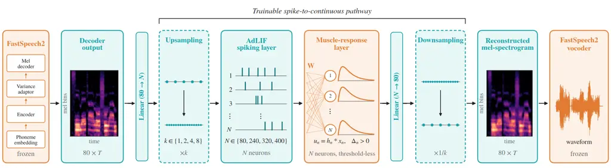
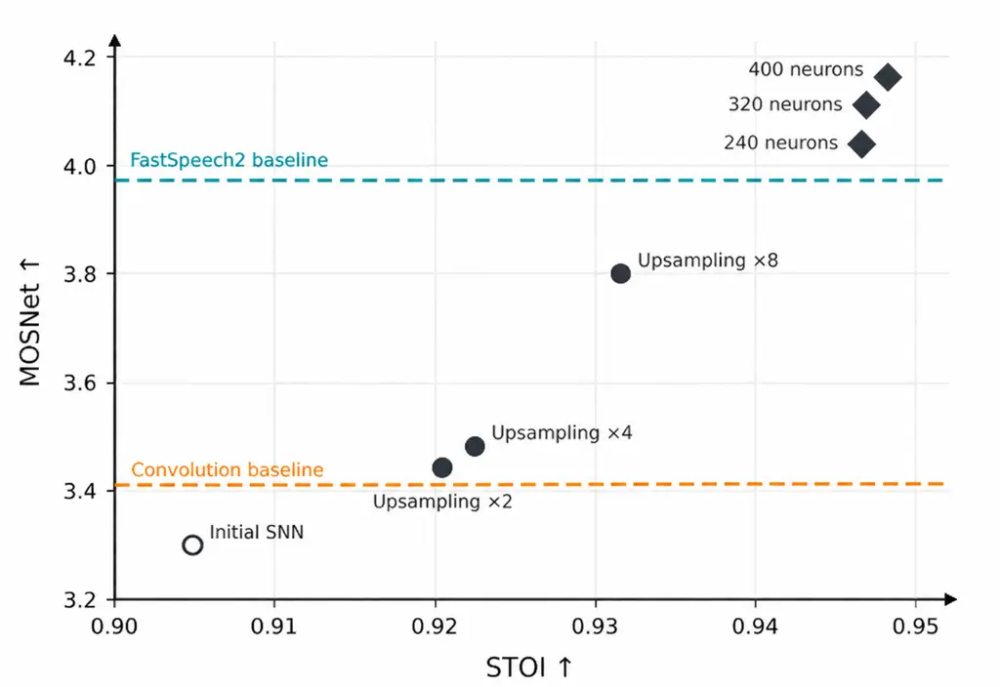
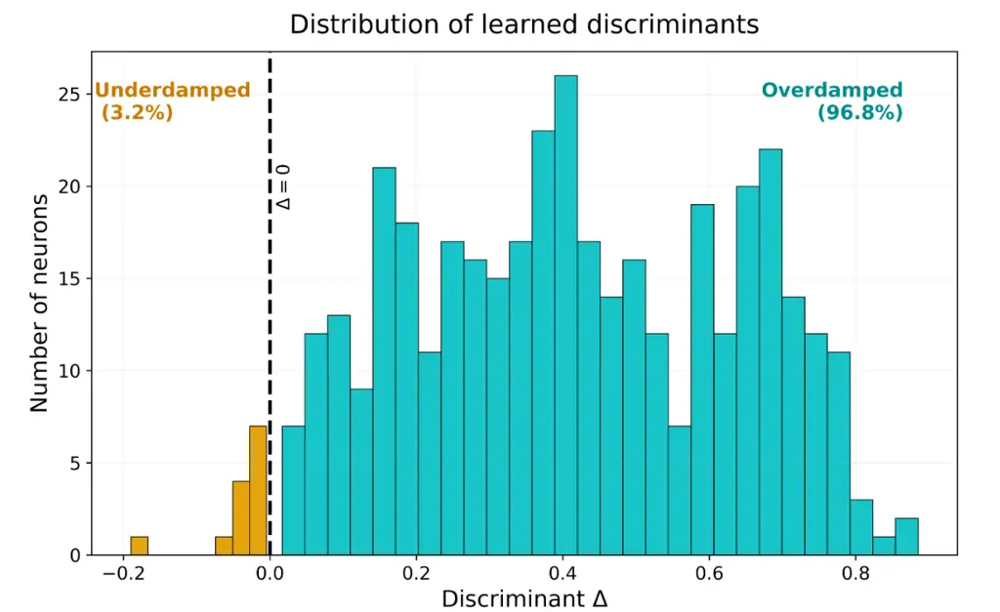
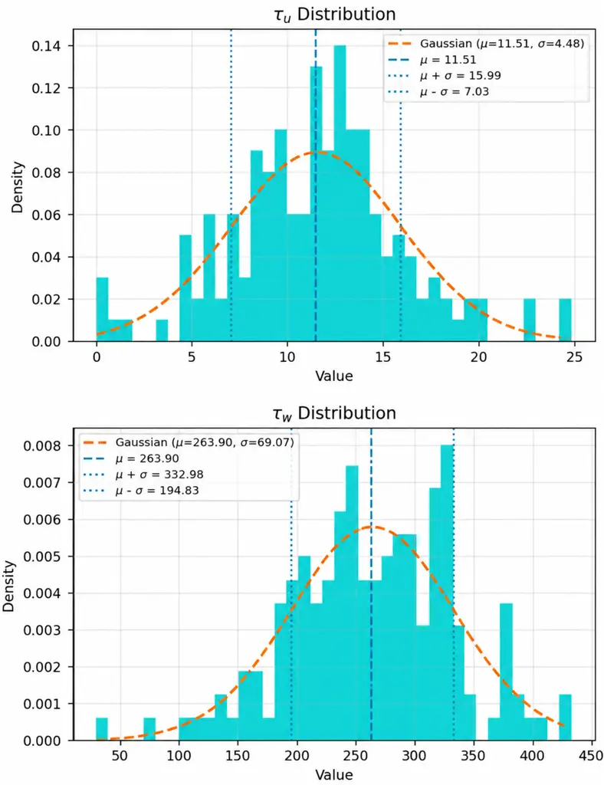

# Bridging Spiking and Continuous Dynamics in Spiking Neural Networks: A Muscle-Inspired Model

Maryam Soltani¹² and Philip N. Garner¹ Affiliation: ¹Idiap Research
Institute, Martigny, Switzerland Affiliation: ²École Polytechnique
Fédérale de Lausanne (EPFL), Lausanne, Switzerland  
Email: maryam.soltani@epfl.ch, phil.garner@idiap.ch Affiliation: 

###### Abstract

Transforming the spike trains produced by spiking neural networks (SNNs)
into continuous signals through biologically inspired mechanisms remains
an open challenge in generative and regression tasks. In biological
systems, a similar transformation occurs when muscles integrate neural
spikes to produce smooth, coordinated movements. Inspired by this
mechanism, we introduce a muscle-response model, a biologically
motivated dynamical layer that converts spike trains into continuous
representations. Our approach uses second-order dynamics to model the
temporal integration of spiking activity. We investigate how the number
of spiking neurons and temporal resolution affect the quality of the
generated signals in a text-to-speech task, showing that increasing
representational capacity has a greater impact than increasing temporal
resolution under the evaluated configurations. Furthermore, an analysis
of the learned dynamics reveals that, without explicit constraints on
the response type, most neurons converge toward non-oscillatory
behavior. These results demonstrate the potential of biologically
inspired dynamical decoders for bridging spiking neural computation and
continuous signal generation.

###### Index Terms: 

Spiking neural networks, spike-to-continuous conversion, biologically
inspired decoder, second-order filters, temporal dynamics, speech
synthesis

## I Introduction

The nervous system communicates almost exclusively through discrete
spikes \[1\], yet the behavior it produces is continuous. Nowhere is
this more evident than in speech. Spike trains from motor neurons drive
the muscles of larynx, tongue, and lips \[2, 3\], which integrate these
discrete events into smooth articulatory movements \[4\] and a rich
continuous acoustic signal. The body therefore provides a compelling
biological example of a transformation that remains relatively
under-explored in artificial spiking systems: reconstructing structured
continuous signals from sparse, discrete events through biologically
inspired dynamics. Understanding and emulating this spike-to-continuous
transformation is a key step if spiking neural networks (SNNs) are to
move beyond recognition and toward generation.

SNNs have achieved competitive performance on a growing range of
recognition tasks, from image classification \[5\] to speech command
recognition \[7, 6\]. In these settings, the network output need only
support a discrete decision, and the conversion from spikes to a final
answer is comparatively forgiving. Both classification and regression
require an interface between spike-based computation and continuous
outputs; however, the requirements are more demanding for regression
tasks. Unlike classification where the final objective is a discrete
decision, regression requires accurate reconstruction of
continuous-valued signals while preserving their temporal and structural
characteristics. The interface that maps sparse spike trains back to
continuous values has received little dedicated attention. This
interface, we believe, is not a peripheral detail but a central
bottleneck for spike-based generation models.

Beyond their biological appeal, SNNs offer the potential for
substantially improved energy efficiency on neuromorphic hardware \[8\],
making them attractive candidates for future generative models, which
are currently computationally expensive. Existing approaches to
extracting continuous-valued information from spike trains include
neural coding strategies, such as rate and temporal coding \[9\], as
well as trainable readouts, including convolutional layers \[10\]. While
these approaches can effectively recover continuous representations,
they do not necessarily incorporate an explicit, biologically inspired
dynamical model of how individual spike events are integrated over time.

We instead view spike-to-continuous conversion as a dynamical
representation problem: individual spike events must be integrated over
time into smooth trajectories without discarding the information carried
by their timing. Following the biological principle outlined above, we
propose a muscle-response bridge that performs this integration through
threshold-less second-order temporal filtering. This formulation is
closely related to the Spike Response Model (SRM) \[11\]. In the SRM,
the membrane potential of a neuron is written as a weighted
superposition of stereotyped kernels, each triggered by an incoming
spike. Postsynaptic kernels in this framework typically take a smooth
rise-and-decay form, such as a difference of two exponentials. While the
SRM describes how incoming spikes shape neuronal membrane potentials,
our approach extends the principle of spike-triggered temporal responses
to the reconstruction of continuous, high-dimensional outputs from a
spiking network.

Filtering spike-like commands through muscle models also has a precedent
in speech prosody. In the generalized command-response (GCR) model, the
intonation contour is represented as a superposition of muscle responses
to spike commands. Marelli et al. \[12\] embedded trainable second-order
filters in a neural network to generate the log-F0 contour, restricting
their poles to complex-conjugate pairs and thereby favoring underdamped
dynamics. However, their command signals were generated by a
conventional recurrent network and encouraged to be sparse through
temporal L1 regularization, rather than produced by genuine spiking
neurons. Moreover, their model targeted a single low-dimensional
prosodic contour. Here, we extend this principle to a genuine spiking
network, using trainable second-order dynamics to reconstruct
high-dimensional acoustic representations without prescribing a
particular damping regime.

To evaluate this bridge, we use speech synthesis as a testbed for
continuous reconstruction. Its outputs are high-dimensional, temporally
structured, and perceptually sensitive to fine detail. Specifically, we
insert a spiking layer followed by the proposed bridge between the
decoder and vocoder of FastSpeech2 \[13\], a widely used text-to-speech
model, so that the reconstructed representation can be compared directly
against the original non-spiking one. To the best of our knowledge, this
is the first work to use a muscle-inspired dynamical layer as the
spike-to-continuous interface of an SNN. Our main contributions are: (1)
We propose a biologically inspired spike-to-continuous interface based
on trainable, thresholdless second-order dynamics that integrates spike
trains into continuous acoustic representations. (2) We systematically
investigate the effects of temporal resolution and representational
capacity on reconstruction quality, demonstrating that both are
important, with representational capacity having a greater impact under
the evaluated configurations. (3) We show that, with sufficient
representational capacity, the spiking pathway fully recovers the
degradation introduced by the spiking bottleneck, reaching an objective
quality comparable to the original non-spiking FastSpeech2 output. We
further show that, with increased temporal resolution and capacity, the
proposed spiking pathway outperforms a variant using a conventional
convolutional readout at the baseline configuration. (4) We show that,
without explicitly constraining the damping regime, the learned
second-order responses predominantly converge to the overdamped regime,
suggesting that non-oscillatory dynamics are favored by the speech
reconstruction objective. Together, these findings provide architectural
and dynamical design principles for extending SNNs toward continuous
regression and generative tasks.

## II Background: Spiking Neuron Model

SNNs, as opposed to conventional artificial neural networks, use spikes
to process information, allowing for energy-efficient computing and the
native handling of sequential and temporal data \[14\]. Various models
have been proposed to describe spiking neuron dynamics. Among them, the
leaky integrate-and-fire (LIF) model originally proposed by Lapicque
\[15\] is one of the most widely used neuron models due to its
simplicity and computational efficiency. The adaptive leaky
integrate-and-fire (AdLIF) model extends the conventional LIF model by
incorporating an adaptation mechanism, enabling it to capture
biologically relevant dynamics such as spike-frequency adaptation (SFA)
\[1\]. In this study, we employ the AdLIF neuron model, as previous work
has demonstrated the benefits of incorporating adaptation compared with
conventional LIF neurons, particularly for processing temporally complex
signals such as speech \[16\].

### II-A Leaky Integrate-and-Fire Neuron

The LIF dynamics are given by

```math
\tau_{m}\frac{du}{dt}=-u+R\,I(t), \tag{1}
```

where $`u`$ is the membrane potential, $`\tau_{m}=RC`$ is the membrane
time constant, $`R`$ is the membrane resistance, and $`I(t)`$ is the
input current. A spike is emitted when the membrane potential reaches a
threshold $`\vartheta_{\mathrm{th}}`$, after which the potential is
reset to $`u_{r}`$. The spiking train can be expressed in continuous
time as $`s(t)=\sum_{f}\delta(t-t^{f})`$, where $`t^{f}`$ denotes the
firing times.

### II-B Adaptive LIF Neuron

To capture SFA, an additional adaptation current is introduced. Using a
continuous-time formulation with Dirac impulses avoids explicit reset
rules and preserves computational efficiency compared to detailed models
such as Hodgkin–Huxley \[17\]. After parameter reduction, the model
becomes \[18\]:

```math
\displaystyle\tau_{u}\dot{u}(t) \displaystyle=-u(t)-w(t)+I(t)-\tau_{u}\sum_{f}\delta(t-t^{f}), \tag{2}
```

```math
\displaystyle\tau_{w}\dot{w}(t) \displaystyle=a\,u(t)-w(t)+\tau_{w}b\sum_{f}\delta(t-t^{f}), \tag{3}
```

where $`w(t)`$ represents the adaptation current, and $`\tau_{u}`$ and
$`\tau_{w}`$ denote the membrane and adaptation time constants,
respectively. This formulation provides a favorable trade-off between
computational complexity and biological realism.

The AdLIF neuron is thus characterized by four parameters: the membrane
and adaptation time constants $`\tau_{u}`$ and $`\tau_{w}`$, and the
adaptation parameters $`a`$ and $`b`$. For numerical implementation, the
continuous-time dynamics are discretized using a first-order exponential
integration scheme. Defining

```math
\alpha=\exp\!\left(-\frac{\Delta t}{\tau_{u}}\right),\qquad\beta=\exp\!\left(-\frac{\Delta t}{\tau_{w}}\right), \tag{4}
```

the resulting discrete-time dynamics are given by

```math
\displaystyle u_{t} \displaystyle=\alpha\,(u_{t-1}-s_{t-1})+(1-\alpha)\,(I_{t}-w_{t-1}), \tag{5}
```

```math
\displaystyle w_{t} \displaystyle=\beta\,(w_{t-1}+b\,s_{t-1})+(1-\beta)\,a\,u_{t-1}, \tag{6}
```

```math
\displaystyle s_{t} \displaystyle=\mathbb{I}(u_{t}\geq 1), \tag{7}
```

where $`I_{t}`$ is the input and in discrete time, the emitted spike is
represented by the binary variable $`s_{t}\in\{0,1\}`$. In (7), the
threshold is normalized to $`\vartheta_{\mathrm{th}}=1`$, and the reset
is implemented by subtraction through the term $`-s_{t-1}`$ in (5), the
discrete counterpart of the Dirac term in (2). All four parameters are
learned during training and constrained to the biologically plausible
ranges reported in \[1, 18, 19\], namely $`\tau_{u}\in[1,25]`$ ms,
$`\tau_{w}\in[30,450]`$ ms, $`a\in[-0.5,5]`$, and $`b\in[0,2]`$.

### II-C Training with Surrogate Gradients

The non-differentiable nature of spike generation in (7) makes it
impossible to directly apply gradient-based optimization methods. To
address this problem, surrogate gradient methods have been widely used
\[20\], in which the derivative of the step function is replaced by a
smooth approximation during the backward pass. In this work, we use a
boxcar surrogate function \[6\].

## III Proposed Muscle-Response Model

Biological motor systems provide a natural example of
spike-to-continuous transformation. Discrete neural commands are
integrated by the neuromuscular system into smooth, non-oscillatory
rise-and-decay responses. Inspired by this principle, we introduce a
muscle-response model, a dynamical readout that transforms sparse spike
trains into continuous representations through second-order temporal
filtering. In the following, we first motivate the second-order
formulation and derive the model from the AdLIF neuron (Section III-A),
and then analyze its damping regimes, which we later use to examine
whether the learned dynamics remain non-oscillatory (Section III-B).

### III-A Muscle Responses as Second-Order Systems

Second-order linear systems have a long history as models of the
muscular response to neural commands in speech. In the command–response
model of Fujisaki \[21\], the fundamental-frequency contour is produced
by laryngeal mechanisms driven by discrete phrase and accent commands,
and each mechanism is modeled as a critically damped second-order linear
system. This idea was later generalized to a superposition of muscle
responses to spike commands, with trainable second-order filters
embedded in a neural network \[12\].

The key observation underlying our readout is that the subthreshold
dynamics of the AdLIF neuron already form such a system. In the absence
of spikes, eliminating the adaptation variable $`w`$ from (2)–(3) yields
a single second-order equation for the membrane potential,

```math
\tau_{u}\tau_{w}\,\ddot{u}(t)+(\tau_{u}+\tau_{w})\,\dot{u}(t)+(1+a)\,u(t)=I(t)+\tau_{w}\dot{I}(t), \tag{8}
```

which is the equation of a damped mass–spring system, where the synaptic
input current plays the role of an external driving force, i.e., the
same class of spring–damper–mass models used for muscle responses
\[12\]. In a spiking neuron, this smooth second-order response remains
hidden, because the threshold and reset convert it into discrete events.
Obtaining a muscle model therefore requires no additional component and
it suffices to remove the threshold, and to use the membrane potential
itself as a continuous output. The spiking layer and its readout thus
share a single neuron model with the same parameterization; one emits
discrete events, while the other integrates them into a continuous
trajectory.

In discrete time, removing the threshold corresponds to setting
$`s_{t}\equiv 0`$ in (5)–(6). The membrane potential $`u_{n}(t)`$ is
updated as

```math
\displaystyle u_{n}(t)=\alpha_{n}u_{n}(t-\Delta t) \displaystyle+(1-\alpha_{n})\big(-w_{n}(t-\Delta t)
```

```math
\displaystyle+x_{n}(t)\big), \tag{9}
```

where the first term represents a leaky memory of the previous state,
controlled by $`\alpha_{n}`$, the second term introduces an inhibitory
contribution through the adaptive variable $`w_{n}`$, and the third term
corresponds to the external input $`x_{n}(t)`$. As a result, the
membrane potential integrates past activity, adaptive suppression, and
current input into a unified continuous state. The adaptive variable
$`w_{n}(t)`$ evolves according to

```math
w_{n}(t)=\beta_{n}w_{n}(t-\Delta t)+(1-\beta_{n})\,a_{n}u_{n}(t-\Delta t), \tag{10}
```

where $`\beta_{n}`$ determines the time scale of the adaptive dynamics
and $`a_{n}`$ controls its coupling to the membrane state. As in (4),
$`\alpha_{n}=\exp(-\Delta t/\tau_{u,n})`$ and
$`\beta_{n}=\exp(-\Delta t/\tau_{w,n})`$, where $`\tau_{u,n}`$ and
$`\tau_{w,n}`$ are learned per neuron. The parameters are trainable and
only constrained to predefined ranges, rather than being fixed.

Unlike standard spiking neurons, this module does not include a
thresholding mechanism and therefore does not generate spikes. Since no
thresholding or spike generation is applied, the continuous membrane
potential $`u_{n}(t)`$ is used directly as the output.

### III-B Second-Order Dynamics and Damping Regime

The interaction between $`u_{n}(t)`$ and the slower adaptive state
$`w_{n}(t)`$ produces the second-order temporal response of the system.
To make this explicit, we collect the two states into
$`\mathbf{z}_{n}(t)=[u_{n}(t),\,w_{n}(t)]^{\top}`$. Equations (9)–(10)
then form a linear state-space system,

```math
\mathbf{z}_{n}(t)=\mathbf{A}_{n}\,\mathbf{z}_{n}(t-\Delta t)+\mathbf{B}_{n}\,x_{n}(t), \tag{11}
```

with

```math
\mathbf{A}_{n}=\begin{bmatrix}\alpha_{n}&-(1-\alpha_{n})\\
(1-\beta_{n})\,a_{n}&\beta_{n}\end{bmatrix},\quad\mathbf{B}_{n}=\begin{bmatrix}1-\alpha_{n}\\
0\end{bmatrix}. \tag{12}
```

Because $`\mathbf{A}_{n}`$ is a $`2\times 2`$ matrix, each neuron acts
as a second-order filter. In contrast to a single leaky integrator (a
first-order filter), whose impulse response consists of an exponential
decay, the coupled second-order dynamics can produce smoother,
rise-and-decay responses through the interaction of two temporal states.

The eigenvalues $`\lambda_{1,2}`$ of $`\mathbf{A}_{n}`$ are the roots of
the characteristic equation

```math
\lambda^{2}-\operatorname{tr}(\mathbf{A}_{n})\,\lambda+\det(\mathbf{A}_{n})=0. \tag{13}
```

Their nature is determined by the discriminant

```math
\displaystyle\Delta_{n} \displaystyle=\operatorname{tr}(\mathbf{A}_{n})^{2}-4\det(\mathbf{A}_{n})
```

```math
\displaystyle=(\alpha_{n}-\beta_{n})^{2}-4\,a_{n}(1-\alpha_{n})(1-\beta_{n}). \tag{14}
```

Three regimes follow:

- •
  $`\Delta_{n}>0`$ (_overdamped_): $`\lambda_{1,2}`$ are real and
  distinct, and the impulse response is a weighted sum of two decaying
  exponentials, $`\lambda_{1}^{k}`$ and $`\lambda_{2}^{k}`$, giving a
  single rise-and-decay peak (a double-exponential kernel). Since
  $`\operatorname{tr}(\mathbf{A}_{n})>0`$, both eigenvalues are positive
  whenever $`\det(\mathbf{A}_{n})>0`$, so the response does not
  alternate in sign.
- •
  $`\Delta_{n}=0`$ (_critically damped_): a repeated real eigenvalue,
  giving the fastest non-oscillatory response.
- •
  $`\Delta_{n}<0`$ (_underdamped_): $`\lambda_{1,2}`$ are complex
  conjugates, and each spike produces a decaying oscillation.

Equation (14) also gives an intuitive reading of the overdamped
condition. Since $`(1-\alpha_{n})(1-\beta_{n})>0`$, the system is
overdamped if and only if

```math
a_{n}<\frac{(\alpha_{n}-\beta_{n})^{2}}{4\,(1-\alpha_{n})(1-\beta_{n})}. \tag{15}
```

Thus, non-oscillatory behavior arises when the coupling $`a_{n}`$
between the two states is weak relative to the separation of their
timescales. In particular, any neuron with $`a_{n}\leq 0`$ is always
overdamped, while oscillations require strong positive coupling between
states with similar timescales.

For spike-to-continuous conversion, non-oscillatory responses are
desirable, as the readout should integrate discrete spike events into
smooth continuous trajectories without introducing additional
oscillations. Both overdamped and critically damped systems can provide
such responses, whereas underdamped dynamics introduce oscillatory
components that may distort the reconstructed signal. We do not impose
$`\Delta_{n}>0`$ during training; consequently, $`\Delta_{n}`$ and the
resulting damping regime emerge from the learned parameters. The
dynamical parameters are learned within predefined ranges, allowing us
to investigate whether non-oscillatory, muscle-like dynamics emerge
naturally from the speech reconstruction objective.

## IV Experimental Setup and Results

### IV-A Dataset and Features

To investigate this representation problem, we selected
FastSpeech2\[13\] implemented with the SpeechBrain toolkit \[22\] as a
strong speech-synthesis baseline, enabling direct comparison with a
text-to-speech (TTS) system. Speech synthesis provides an ideal
benchmark because it requires accurate reconstruction of highly
structured continuous signals while preserving fine temporal
dependencies, making it particularly suitable for investigating temporal
processing in spiking neural networks. Experiments were conducted on the
LJSpeech dataset, which contains approximately 24 hours of
single-speaker English speech comprising 13,100 audio recordings and
their corresponding transcripts with 1,310 utterances reserved for
evaluation. The audio recordings are sampled at 22.05 kHz and were
represented using 80-dimensional mel-spectrograms for training and
evaluation. Mel-spectrograms were extracted using an FFT frame size of
1024 and a frame period of 256 samples. The SPARSE framework \[6\] was
used to implement the spiking layers.

### IV-B Training

In all experiments, the pretrained FastSpeech2 model, including its
decoder and vocoder, is kept frozen. Only the parameters of the
spike-to-continuous pathway are optimized: the weights and neuron
parameters of the AdLIF layer, and the readout weights $`W_{nj}`$
together with the dynamical parameters $`(\alpha_{n},\beta_{n},a_{n})`$
of the muscle-response model. The pathway is trained to reconstruct the
mel-spectrogram produced by the frozen FastSpeech2 decoder and is
optimized for 100 epochs using Adam optimizer with a learning rate of
$`5\times 10^{-4}`$, a weight decay of $`10^{-6}`$, and a batch size of 48. Because FastSpeech2 is frozen, any difference in output quality can
be attributed solely to the spiking bottleneck.

### IV-C System Configuration



Fig. 1: Overview of the proposed architecture. Linear layers map the 80
mel channels to the $`N`$ spiking neurons and the $`N`$ muscle-response
outputs back to 80 channels. Dashed boxes indicate the additional
upsampling and downsampling operations used to investigate the effect of
temporal resolution.

As illustrated in Fig. 1, an AdLIF spiking layer followed by the
proposed muscle-response model was inserted between the FastSpeech2
decoder and vocoder. This configuration enables direct comparison
between the original decoder representation and the representation
reconstructed after the spiking transformation. In the initial
experiment to check the general possibility of using membrane potential
as a smooth output, both the spiking and muscle-response layers
contained 80 neurons, matching the 80-channel mel-spectrogram produced
by the FastSpeech2 decoder.

As shown in Fig. 2, the initial spiking configuration already produced
intelligible speech (STOI $`\approx 0.90`$), supporting our hypothesis
that SNNs can be used for continuous acoustic reconstruction. However,
the substantial degradation in reconstruction quality compared with the
non-spiking baseline indicates that the initial configuration is not
sufficient to preserve acoustic information with high fidelity.

This observation revealed two key design constraints, temporal
resolution and representational capacity, which form the focus of the
following investigation. To isolate the effect of each factor, temporal
resolution and representational capacity were investigated
independently, with the other factor held constant in each experiment.
This experimental design allows us to assess their individual
contributions to reconstruction quality. Our first design question is,
does increasing temporal resolution facilitate spike-to-continuous
conversion? The second question is whether increasing the number of
spiking neurons, and thus the representational capacity of the spiking
layer, improves the quality of the reconstructed acoustic features.

The first question was inspired by the oversampling principle of
sigma-delta digital-to-analog converters. We expected that increasing
temporal resolution before spike generation would provide more
opportunities for spike-based encoding of the acoustic features, thereby
improving mel-spectrogram reconstruction quality. So, in the first part
of the experiments as shown in Fig. 1, we increased the temporal
resolution before spike generation by linearly interpolating the
mel-spectrogram along the time axis, using upsampling factors of 2, 4,
and 8. For the second question, we further expected that the initial
80-neuron spiking layer was insufficient to faithfully encode the rich
temporal and spectral structure of speech, motivating the investigation
of larger spiking layers with greater representational capacity and in
part of the experiments, we increased the number of spiking neurons.

To assess whether the proposed muscle-response model provides an
advantage over a conventional learned readout, we additionally replaced
the muscle-model layer with a convolutional readout while keeping the
preceding spiking representation unchanged. The convolutional baseline
consisted of two one-dimensional convolutional layers with a kernel size
of 9 and same padding, separated by a Tanh activation. This provides a
direct comparison between the proposed dynamical spike-to-continuous
mechanism and a conventional trainable temporal readout.



Fig. 2: MOSNet and STOI performance across different spike-to-continuous
configurations. Dashed lines indicate the FastSpeech2 and
convolutional-readout baselines.

### IV-D Results of Evaluation Metrics

Fig. 2 summarizes the performance of the proposed muscle-response model
across different architectural configurations using two objective
metrics: MOSNet \[23\], which estimates perceived speech quality, and
STOI \[24\], which assesses speech intelligibility relative to a
reference signal. Here, the reference is the waveform synthesized by the
vocoder from the non-spiking FastSpeech2 mel-spectrogram, so STOI
measures how faithfully the spiking pathway preserves the FastSpeech2
output. MOSNet, in contrast, is reference-free. Higher values indicate
better performance for both metrics. All configurations were evaluated
on the same set of test utterances to ensure a consistent comparison
across models. Since this study primarily investigates the feasibility
of spike-based speech generation and the influence of architectural
parameters on output quality, we rely on objective metrics for
consistent comparisons across configurations, rather than conducting
subjective listening tests. Introducing the spiking layer initially
reduced the MOSNet score from 3.973 for FastSpeech2 to 3.300,
demonstrating the difficulty of reconstructing continuous acoustic
representations from spike trains. As an additional baseline, the
proposed muscle-response layer was replaced with the convolutional
readout described above. This conventional readout achieved a MOSNet
score of 3.417. At the matched baseline configuration, the convolutional
readout performs slightly better than the muscle-response model (3.417
vs. 3.300). However, with increased temporal resolution or capacity, the
muscle-response pathway clearly exceeds it, while using a compact,
interpretable, and biologically grounded readout. Evaluating the
convolutional readout under the same enlarged configurations is left for
future work.

By investigating the first design question, increasing the temporal
resolution through 8× upsampling recovered most of the degradation
(MOSNet = 3.801), highlighting the importance of temporal resolution for
spike-based speech synthesis. A consistent improvement is also observed
as the upsampling factor increases from $`2\times`$ to $`4\times`$ and
$`8\times`$, confirming that finer temporal resolution facilitates
spike-based representation of the acoustic features.

Investigating the second design question showed that expanding the
spiking layer from 80 to 400 neurons increased the MOSNet score to
4.163, surpassing the original FastSpeech2 baseline. Since the pathway
is trained to reconstruct the FastSpeech2 mel-spectrogram, this should
not be interpreted as an improvement over its target; rather, it
indicates that the spiking bottleneck no longer degrades the estimated
quality, while the small residual deviation from the reference (STOI
$`\approx`$ 0.95) may reflect a mild smoothing effect that MOSNet
favors. More importantly, performance improves consistently as the
number of spiking neurons is increased from 80 to 240, 320, and 400.
This trend indicates that representational capacity plays a stronger
role than temporal oversampling in preserving the acoustic information
encoded by the continuous representation. Interestingly, the variation
in MOSNet scores is consistent with that observed in STOI. Consequently,
the best-performing configurations are concentrated in the upper-right
region, corresponding to simultaneously high MOSNet and STOI scores.

Motivated by the relatively small number of muscle groups involved in
speech articulation, we also conducted preliminary experiments to
investigate whether the muscle-response model could operate with a
substantially reduced number of neurons for muscle-response layer.
However, reducing the number of neurons led to a degradation in speech
quality, suggesting that the required model dimensionality cannot be
directly inferred from the number of articulatory muscles in this step.
A systematic investigation of this relationship is left for future work.

### IV-E Analysis of the Learned Dynamics

Using the discriminant $`\Delta_{n}`$ in (14), we examined the damping
regime of each learned muscle-response neuron. Although no constraint on
the damping regime was imposed during training, 96.8% of the neurons
fall within the overdamped region ($`\Delta_{n}>0`$), some of them close
to the critical-damping boundary (Fig. 3). Each spike therefore evokes a
smooth, single-peaked, double-exponential-like response, which is well
suited to integrating sparse spike events into continuous
representations and is consistent with the muscle-like behavior that
motivated the model.



Fig. 3: Distribution of muscle response neurons across different regimes
for the 400-neuron configuration.



Fig. 4: Distribution of the learned membrane and adaptation time
constants of the muscle-response neurons

After training, we also examined the distribution of the learned time
constants (Fig. 4). The learned membrane time constants are concentrated
around $`\tau_{u}\approx 11`$ ms, close to the frame-level temporal
resolution commonly used in speech processing, whereas the adaptation
time constants are centered around $`\tau_{w}\approx 264`$ ms,
approaching the timescale associated with syllabic structure. This
suggests that the learned dynamics operate on speech-relevant timescales
rather than arbitrary parameter values.

## V Conclusion

In this work, we investigated the problem of reconstructing continuous
representations from sparse spiking activity and proposed a biologically
inspired muscle-response model as a spike-to-continuous interface. Using
speech synthesis as a challenging continuous reconstruction task, we
showed that both temporal resolution and representational capacity play
important roles in preserving information through a spiking bottleneck.
Increasing temporal resolution progressively improved reconstruction
quality, while increasing the number of spiking neurons produced a
substantially larger improvement. Furthermore, the muscle-response
readout, with only three dynamical parameters per neuron, outperformed a
conventional convolutional readout evaluated at the baseline
configuration once sufficient capacity or temporal resolution was
provided.

Analysis of the learned muscle-response dynamics further showed that,
despite imposing no explicit constraint on the damping regime, the large
majority of neurons converged to the overdamped region, producing
non-oscillatory responses. These findings suggest that successful
spike-to-continuous conversion depends not only on the temporal
resolution of spike trains, but also critically on sufficient
representational capacity and appropriate continuous temporal dynamics.
Overall, the proposed approach provides a biologically motivated
interface between discrete spiking computation and continuous-valued
representations, supporting the development of spiking models for
continuous and generative tasks.

## Acknowledgment

This work was supported by the Swiss National Science Foundation (SNSF)
under SpiDeR [grant number
10004827](https://data.snf.ch/grants/grant/10004827). The authors would
like to thank Prof. Wulfram Gerstner for his insightful comments and
suggestions during an earlier presentation of this research direction.

## References

- \[1\] W. Gerstner and W. M. Kistler, Spiking Neuron Models: Single
  Neurons, Populations, Plasticity. Cambridge, U.K.: Cambridge
  University Press, 2002, doi:
  [10.1017/CBO9780511815706](https://doi.org/10.1017/CBO9780511815706).
- \[2\] F. H. Guenther, Neural Control of Speech. Cambridge, MA, USA:
  MIT Press, 2016.
- \[3\] K. E. Bouchard, N. Mesgarani, K. Johnson, and E. F. Chang,
  “Functional organization of human sensorimotor cortex for speech
  articulation,” Nature, vol. 495, no. 7441, pp. 327–332, 2013, doi:
  [10.1038/nature11911](https://doi.org/10.1038/nature11911).
- \[4\] C. J. Heckman and R. M. Enoka, “Motor unit,” Compr. Physiol.,
  vol. 2, no. 4, pp. 2629–2682, 2012, doi:
  [10.1002/cphy.c100087](https://doi.org/10.1002/cphy.c100087).
- \[5\] W. Fang, Z. Yu, Y. Chen, T. Masquelier, T. Huang, and Y. Tian,
  “Incorporating learnable membrane time constant to enhance learning of
  spiking neural networks,” in Proc. IEEE/CVF Int. Conf. Computer Vision
  (ICCV), 2021, pp. 2661–2671, doi:
  [10.1109/ICCV48922.2021.00266](https://doi.org/10.1109/ICCV48922.2021.00266).
- \[6\] A. Bittar and P. N. Garner, “A surrogate gradient spiking
  baseline for speech command recognition,” Front. Neurosci., vol. 16,
  Art. no. 865897, 2022, doi:
  [10.3389/fnins.2022.865897](https://doi.org/10.3389/fnins.2022.865897).
- \[7\] A. Bittar and P. N. Garner, “Surrogate gradient spiking neural
  networks as encoders for large vocabulary continuous speech
  recognition,” arXiv preprint arXiv:2212.01187, 2022, doi:
  [10.48550/arXiv.2212.01187](https://doi.org/10.48550/arXiv.2212.01187).
- \[8\] K. Roy, A. Jaiswal, and P. Panda, “Towards spike-based machine
  intelligence with neuromorphic computing,” Nature, vol. 575, no. 7784,
  pp. 607–617, 2019, doi:
  [10.1038/s41586-019-1677-2](https://doi.org/10.1038/s41586-019-1677-2).
- \[9\] A. Fono, M. Singh, E. Araya, P. C. Petersen, H. Boche, and
  G. Kutyniok, “Mathematical foundations of spiking neural networks:
  Strengths, challenges, and computational paradigm potential,” IEEE
  Signal Process. Mag., vol. 43, no. 2, pp. 64–76, Mar. 2026, doi:
  [10.1109/MSP.2025.3597033](https://doi.org/10.1109/MSP.2025.3597033).
- \[10\] K. Wang, J. Zhang, Y. Ren, M. Yao, D. Shang, B. Xu, and G. Li,
  “SpikeVoice: High-quality text-to-speech via efficient spiking neural
  network,” in Proc. 62nd Annu. Meeting Assoc. Comput. Linguistics
  (ACL), Vol. 1: Long Papers, 2024, pp. 7927–7940, doi:
  [10.18653/v1/2024.acl-long.429](https://doi.org/10.18653/v1/2024.acl-long.429).
- \[11\] R. Jolivet, T. J. Lewis, and W. Gerstner, “The spike response
  model: A framework to predict neuronal spike trains,” in Artificial
  Neural Networks and Neural Information Processing – ICANN/ICONIP 2003,
  ser. Lecture Notes in Computer Science, vol. 2714. Berlin, Germany:
  Springer, 2003, pp. 846–853, doi:
  [10.1007/3-540-44989-2_101](https://doi.org/10.1007/3-540-44989-2_101).
- \[12\] F. Marelli, B. Schnell, H. Bourlard, T. Dutoit, and
  P. N. Garner, “An end-to-end network to synthesize intonation using a
  generalized command response model,” in Proc. IEEE Int. Conf. Acoust.,
  Speech Signal Process. (ICASSP), 2019, pp. 7040–7044, doi:
  [10.1109/ICASSP.2019.8683815](https://doi.org/10.1109/ICASSP.2019.8683815).
- \[13\] Y. Ren, C. Hu, X. Tan, T. Qin, S. Zhao, Z. Zhao, and T.-Y. Liu,
  “FastSpeech 2: Fast and high-quality end-to-end text to speech,” in
  Proc. Int. Conf. Learning Representations (ICLR), 2021.
- \[14\] P. Majumdar, “Spiking neural networks: A comprehensive review
  of diverse applications, research progress, challenges and future
  research directions,” Evolving Syst., vol. 16, no. 4, Art. no. 125,
  2025, doi:
  [10.1007/s12530-025-09755-0](https://doi.org/10.1007/s12530-025-09755-0).
- \[15\] L. Lapicque, “Recherches quantitatives sur l’excitation
  électrique des nerfs traitée comme une polarisation,” J. Physiol.
  Pathol. Gén., vol. 9, pp. 620–635, 1907.
- \[16\] M. Baronig, R. Ferrand, S. Sabathiel, and R. Legenstein,
  “Advancing spatio-temporal processing through adaptation in spiking
  neural networks,” Nature Commun., vol. 16, Art. no. 5776, 2025, doi:
  [10.1038/s41467-025-60878-z](https://doi.org/10.1038/s41467-025-60878-z).
- \[17\] A. L. Hodgkin and A. F. Huxley, “A quantitative description of
  membrane current and its application to conduction and excitation in
  nerve,” J. Physiol., vol. 117, no. 4, pp. 500–544, 1952, doi:
  [10.1113/jphysiol.1952.sp004764](https://doi.org/10.1113/jphysiol.1952.sp004764).
- \[18\] A. Bittar and P. N. Garner, “Exploring neural oscillations
  during speech perception via surrogate gradient spiking neural
  networks,” Front. Neurosci., vol. 18, Art. no. 1449181, 2024, doi:
  [10.3389/fnins.2024.1449181](https://doi.org/10.3389/fnins.2024.1449181).
- \[19\] M. Augustin, J. Ladenbauer, and K. Obermayer, “How adaptation
  shapes spike rate oscillations in recurrent neuronal networks,” Front.
  Comput. Neurosci., vol. 7, Art. no. 9, 2013, doi:
  [10.3389/fncom.2013.00009](https://doi.org/10.3389/fncom.2013.00009).
- \[20\] E. O. Neftci, H. Mostafa, and F. Zenke, “Surrogate gradient
  learning in spiking neural networks,” IEEE Signal Process. Mag., vol.
  36, no. 6, pp. 51–63, 2019, doi:
  [10.1109/MSP.2019.2931595](https://doi.org/10.1109/MSP.2019.2931595).
- \[21\] H. Fujisaki and K. Hirose, “Analysis of voice fundamental
  frequency contours for declarative sentences of Japanese,” J. Acoust.
  Soc. Jpn. (E), vol. 5, no. 4, pp. 233–242, 1984, doi:
  [10.1250/ast.5.233](https://doi.org/10.1250/ast.5.233).
- \[22\] M. Ravanelli, T. Parcollet, A. Moumen, S. de Langen,
  C. Subakan, P. Plantinga, Y. Wang, P. Mousavi, L. Della Libera,
  A. Ploujnikov, F. Paissan, D. Borra, S. Zaiem, Z. Zhao, S. Zhang,
  G. Karakasidis, S.-L. Yeh, P. Champion, A. Rouhe, R. Braun, F. Mai,
  J. Zuluaga-Gomez, S. M. Mousavi, A. Nautsch, H. Nguyen, X. Liu,
  S. Sagar, J. Duret, S. Mdhaffar, G. Laperrière, M. Rouvier,
  R. De Mori, and Y. Estève, “Open-source conversational AI with
  SpeechBrain 1.0,” J. Mach. Learn. Res., vol. 25, no. 333, pp.
  1–11, 2024.
- \[23\] C.-C. Lo, S.-W. Fu, W.-C. Huang, X. Wang, J. Yamagishi,
  Y. Tsao, and H.-M. Wang, “MOSNet: Deep learning-based objective
  assessment for voice conversion,” in Proc. Interspeech, 2019, pp.
  1541–1545, doi:
  [10.21437/Interspeech.2019-2003](https://doi.org/10.21437/Interspeech.2019-2003).
- \[24\] C. H. Taal, R. C. Hendriks, R. Heusdens, and J. Jensen, “An
  algorithm for intelligibility prediction of time–frequency weighted
  noisy speech,” IEEE Trans. Audio, Speech, Lang. Process., vol. 19, no.
  7, pp. 2125–2136, 2011, doi:
  [10.1109/TASL.2011.2114881](https://doi.org/10.1109/TASL.2011.2114881).
