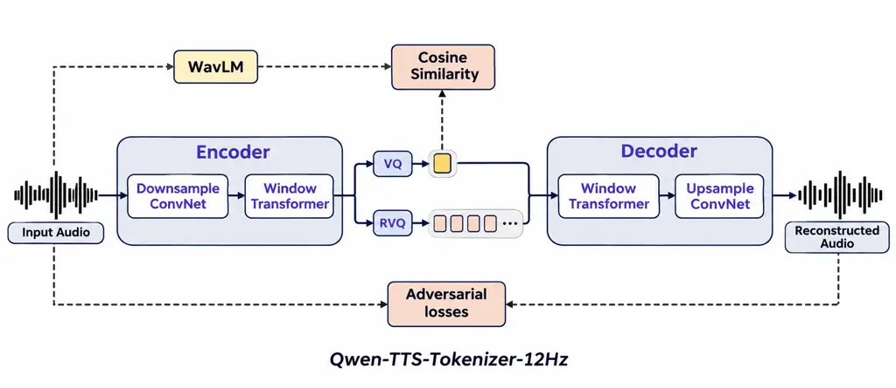
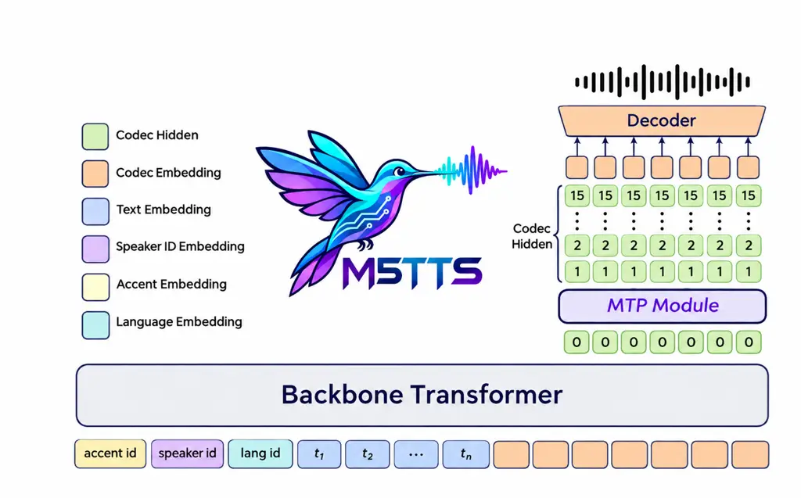
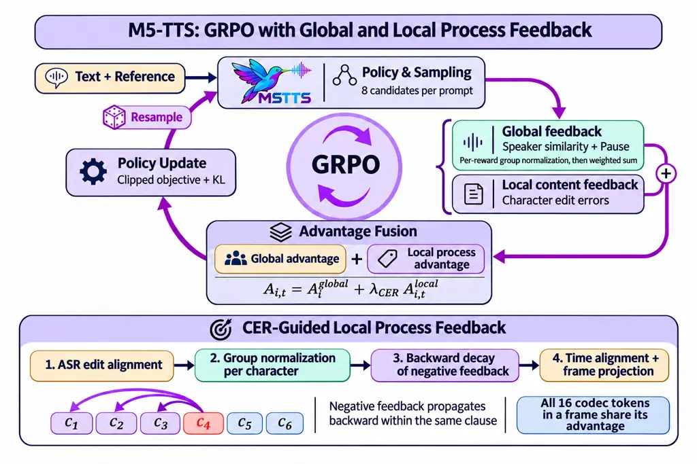

![[Uncaptioned
image]](arxiv-2611-10162v1--4481426d54f2.figures/figure-1.webp)

# M5-TTS: A Mini-Scale Multilingual and Multi-Dialect Text-to-Speech Language Model with Multi-Token Prediction

Wenhao Li Affiliation: Audio, Speech and Language Processing Group
(ASLP@NPU), School of Computer Science, Northwestern Polytechnical
University    Jingbin Hu Affiliation: Audio, Speech and Language
Processing Group (ASLP@NPU), School of Computer Science, Northwestern
Polytechnical University    Shengming Ling Affiliation: Audio, Speech
and Language Processing Group (ASLP@NPU), School of Computer Science,
Northwestern Polytechnical University    Xiaming Ren Affiliation: Audio,
Speech and Language Processing Group (ASLP@NPU), School of Computer
Science, Northwestern Polytechnical University    Haoyu Zhang
Affiliation: Audio, Speech and Language Processing Group (ASLP@NPU),
School of Computer Science, Northwestern Polytechnical University   
Jinrui Liang Affiliation: Audio, Speech and Language Processing Group
(ASLP@NPU), School of Computer Science, Northwestern Polytechnical
University    Hanke Xie Affiliation: Audio, Speech and Language
Processing Group (ASLP@NPU), School of Computer Science, Northwestern
Polytechnical University    Qirui Zhan Affiliation: Audio, Speech and
Language Processing Group (ASLP@NPU), School of Computer Science,
Northwestern Polytechnical University    Guobin Ma Affiliation: Audio,
Speech and Language Processing Group (ASLP@NPU), School of Computer
Science, Northwestern Polytechnical University    Huakang Chen
Affiliation: Audio, Speech and Language Processing Group (ASLP@NPU),
School of Computer Science, Northwestern Polytechnical University   
Chunbo Hao Affiliation: Audio, Speech and Language Processing Group
(ASLP@NPU), School of Computer Science, Northwestern Polytechnical
University    Jianguo Zheng Affiliation: Audio, Speech and Language
Processing Group (ASLP@NPU), School of Computer Science, Northwestern
Polytechnical University    Wenkang Hou Affiliation: Audio, Speech and
Language Processing Group (ASLP@NPU), School of Computer Science,
Northwestern Polytechnical University    Dake Guo Affiliation: Audio,
Speech and Language Processing Group (ASLP@NPU), School of Computer
Science, Northwestern Polytechnical University    Yuepeng Jiang
Affiliation: Audio, Speech and Language Processing Group (ASLP@NPU),
School of Computer Science, Northwestern Polytechnical University   
Linhan Ma Affiliation: Audio, Speech and Language Processing Group
(ASLP@NPU), School of Computer Science, Northwestern Polytechnical
University    Yunxiang Chen Affiliation: Shenzhen Pimei Technology Co.,
Ltd.    Houdun Liu Affiliation: Shenzhen Pimei Technology Co., Ltd.   
Su Feng Affiliation: Shenzhen Pimei Technology Co., Ltd.    Chuang Ding
Affiliation: Moonstep AI    Pengcheng Zhu Affiliation: WeNet Open Source
Community    Liumeng Xue Affiliation: Audio, Speech and Language
Processing Group (ASLP@NJU), School of Intelligence Science and
Technology, Nanjing University    Lei Xie Affiliation: Audio, Speech and
Language Processing Group (ASLP@NPU), School of Computer Science,
Northwestern Polytechnical University

###### Abstract

We present M5-TTS, a compact text-to-speech system supporting
multilingual and Chinese multi-dialect synthesis, zero-shot voice
cloning, speaker-specific multilingual generation, and CPU streaming.
Its 50M-parameter language model, excluding the speech codec, combines a
temporal backbone with a local multi-token prediction module over 16
codebooks. GRPO post-training normalizes speaker-similarity and pause
rewards separately within each group before weighting, then adds
CER-guided local process feedback derived from character-level errors,
with backward propagation within each clause and projection onto codec
frames. M5-TTS achieves 1.37% CER on Seed-ZH and 2.91% WER on Seed-EN,
corresponding to relative error reductions of 62.2% and 35.3% over
MOSS-TTS-Nano with half the language-model parameters. It also achieves
lower content error rates in five of six evaluated MiniMax languages,
while difficult Chinese inputs remain a limitation. On four Intel Xeon
Gold 6530 cores, it achieves a real-time factor of 0.653 and a warm
first-chunk latency of 225 ms. VoiceJudge, our internal model for
assessing speech naturalness and expressiveness, prefers M5-TTS over
MOSS-TTS-Nano in 84.89% and 86.50% of naturalness comparisons under the
two A/B presentation orders. We will release inference code, together
with voice-cloning and speaker-specific checkpoints, to support
reproducible research on compact speech generation for on-device voice
interaction.

>

|                                                                                |                                                                                                            |
| ------------------------------------------------------------------------------ | ---------------------------------------------------------------------------------------------------------- |
|                                                                                | [https://github.com/ASLP-lab/M5-TTS](https://github.com/ASLP-lab/M5-TTS)                                   |
|                                                                                | [https://huggingface.co/ASLP-lab/M5-TTS](https://huggingface.co/ASLP-lab/M5-TTS)                           |
| ![[Uncaptioned image]](arxiv-2611-10162v1--4481426d54f2.figures/figure-2.webp) | [https://aslp-lab.github.io/M5-TTS-Demo-Page](https://aslp-lab.github.io/M5-TTS-Demo-Page)                 |
| ![[Uncaptioned image]](arxiv-2611-10162v1--4481426d54f2.figures/figure-3.webp) | [https://huggingface.co/spaces/ASLP-lab/M5-TTS-Space](https://huggingface.co/spaces/ASLP-lab/M5-TTS-Space) |

¹¹footnotetext: These authors contributed equally to this
work.²²footnotetext: Corresponding authors.

## 1 Introduction

Speech generation is a key component of spoken interaction for embodied
agents, personal assistants, and intelligent devices. In these settings,
a speech synthesizer needs to produce intelligible and natural speech,
maintain a consistent voice, and begin playback with a short delay.
Multilingual and dialectal capabilities further allow a single device to
communicate with users across linguistic communities. Local inference
can reduce dependence on network connectivity and give developers
greater control over the speech generation pipeline. These requirements
motivate compact text-to-speech (TTS) systems that balance synthesis
quality, linguistic coverage, voice flexibility, and streaming
efficiency under limited computational resources.

Neural TTS research has explored diverse generation architectures. Early
end-to-end approaches, such as VITS Kim et al. (2021), combine
variational inference and adversarial learning for waveform generation,
while non-autoregressive models such as FastSpeech 2 Ren et al. (2021)
improve synthesis efficiency through parallel acoustic modeling and
explicit duration, pitch, and energy conditioning. However, point-wise
acoustic regression objectives used in some non-autoregressive systems
can encourage over-smoothing Ren et al. (2022), reducing acoustic and
prosodic variation. Richer generative models aim to capture this
variation more effectively.

Language-model-based TTS approaches use speech tokens as intermediate
representations Wang et al. (2023), enabling autoregressive speech
generation through sequence modeling. Subsequent studies have explored
diverse speech representations and generation paradigms. CosyVoice 2 Du
et al. (2024) combines autoregressive language modeling with conditional
flow matching, while Qwen3-TTS Hu et al. (2026) employs multi-codebook
tokens for multilingual and streaming synthesis. Recent work has also
explored continuous speech generation without relying on conventional
discrete tokens. DiTAR Jia et al. (2025) combines an autoregressive
language model that captures dependencies across speech patches with a
local diffusion Transformer that generates continuous acoustic features
within each patch. VoxCPM2 Zhou et al. (2026) further explores
tokenizer-free diffusion autoregressive modeling for multilingual speech
generation and controllable voice cloning. Despite these advances, the
substantial model sizes and inference costs of these systems can make
low-latency streaming challenging on resource-constrained edge devices,
particularly under CPU-only inference.

The growing demand for on-device voice interaction and embodied
intelligence therefore creates a pressing need for compact TTS models
that preserve naturalness and expressiveness while supporting efficient,
responsive streaming synthesis. Recent compact TTS systems have further
advanced on-device speech generation. MOSS-TTS-Nano OpenMOSS Team (2026)
explores lightweight language-model-based speech generation with
discrete codec tokens, while Pocket TTS Rouard et al. (2026)
demonstrates efficient CPU-based inference with compact continuous
models. Other lightweight projects, including Audio8-TTS Preview Audio8
Team (2026), Kokoro-TTS hexgrad (2025), Hojo-TTS-Light HojoAI (2026),
TinyTTS Lê (2026), and sanoTTS Thapa (2026), further investigate
reducing model complexity and computational requirements for
resource-constrained speech synthesis.

Combining broad language and dialect coverage, zero-shot voice cloning,
and CPU streaming within a 50M-parameter language model remains a
challenging design objective. We study this combination under a shared,
compact generation architecture.

We present M5-TTS, a Mini-scale Multilingual and Multi-dialect TTS
language Model with Multi-token prediction (MTP), built around 50M
parameters excluding the speech codec. A temporal backbone and a local
Transformer jointly generate a 16-codebook speech representation.
Language and accent conditioning support linguistic control, while
reference speech enables zero-shot cloning and speaker-specific
fine-tuning provides a dedicated multilingual voice. To refine
synthesis, we use Group Relative Policy Optimization (GRPO) Shao et al.
(2024) with two complementary feedback paths. Global SIM and pause
rewards assess overall speaker resemblance and phrasing; each reward is
normalized within its candidate group before weighted aggregation.
CER-guided local process feedback compares character edit counts across
candidate utterances, propagates negative advantages backward within a
clause, and projects them onto codec frames. The resulting local process
advantage is added to the global advantage and shared by all codec
tokens in each frame, providing content feedback for the generation
decisions associated with each text region.

Our experiments examine synthesis quality and streaming performance,
with MOSS-TTS-Nano OpenMOSS Team (2026) as the main comparison among
lightweight language-model-based TTS systems. Using half as many
language-model parameters, M5-TTS achieves 1.37% CER on Seed-ZH and
2.91% WER on Seed-EN, compared with 3.62% and 4.50% for MOSS-TTS-Nano,
respectively. On four cores of an Intel Xeon Gold 6530, M5-TTS achieves
a real-time factor of 0.653 and a warm first-chunk latency of 225 ms.

To support repeated perceptual comparisons without collecting new human
ratings for every experiment, we introduce VoiceJudge, an internal
reward model combining self-supervised speech representations with a
Transformer-based scoring module. It is trained on approximately 100,000
human-annotated preference pairs and supports multidimensional A/B
assessment, including naturalness and expressiveness. Here we use its
naturalness dimension on a strictly deduplicated test set that does not
overlap with its training data. VoiceJudge prefers M5-TTS over
MOSS-TTS-Nano in 84.89% and 86.50% of 311 valid comparisons under
original and reversed A/B orders, with 92.60% agreement on the winning
system across orders.

We will release inference code, together with zero-shot voice-cloning
and speaker-specific checkpoints, and plan to release VoiceJudge model
weights and inference code to support further community development.
With this work, we aim to provide a practical speech generation
component for on-device applications and embodied voice interaction.

## 2 Architecture

### 2.1 Tokenizer

We adopt Qwen-TTS-Tokenizer-12Hz from Qwen3-TTS Hu et al. (2026) to
convert speech into discrete representations at 12.5 frames per second.
Each frame contains 16 codebook indices, comprising one semantic
codebook and 15 acoustic codebooks. The encoder consists of a
downsampling convolutional network followed by a windowed Transformer.
Its latent features are quantized through a semantic VQ branch and a
15-stage acoustic RVQ branch, which represents complementary acoustic
information. A windowed Transformer and an upsampling convolutional
network then reconstruct the waveform from the quantized
representations.



Figure 1: Qwen-TTS-Tokenizer-12Hz Hu et al. (2026) adopted by M5-TTS: a
semantic VQ branch and an acoustic RVQ branch provide 16 codec tokens
per frame for causal waveform reconstruction.

In the tokenizer’s original training framework Hu et al. (2026),
WavLM Chen et al. (2021) provides teacher features for semantic
distillation of the first codebook using a cosine-similarity objective.
Adversarial training encourages perceptually faithful reconstruction,
while a multi-scale mel-spectrogram loss constrains spectral
consistency. Both the encoder and decoder operate causally: speech
tokens are extracted without look-ahead, and the corresponding waveform
is reconstructed incrementally. This combination of a low frame rate and
causal reconstruction provides M5-TTS with a compact speech
representation suited to streaming generation.

### 2.2 Backbone

Following the hierarchical Transformer organization of Marvis-TTS Canuma
& Newman (2025) and the multi-codebook prediction scheme of Qwen3-TTS Hu
et al. (2026), M5-TTS uses a compact language-modeling architecture with
50M parameters, excluding the speech codec. The architecture comprises a
causal backbone Transformer for temporal modeling and a lightweight
local Transformer serving as the MTP module. The conditioning interface
orders accent, speaker, and language IDs before the text sequence; the
speaker ID is used in speaker-specific fine-tuning, whereas pre-training
uses accent and language IDs. For each historical audio frame,
codebook-specific embeddings of its 16 codec tokens are summed into a
single frame-level input, allowing the backbone to model speech at the
codec frame rate.



Figure 2: M5-TTS architecture. The temporal backbone predicts codebook
0; the local MTP module generates codebooks 1–15 within each frame,
which are then decoded into speech.

Generation follows a hierarchical codebook prediction scheme. At each
time step, the backbone summarizes the conditioning sequence and
previously generated audio frames into a hidden state. A dedicated
output head first predicts the zeroth codebook token. The backbone state
and this token’s embedding are projected to the MTP input space. The MTP
module then autoregressively generates codebooks 1–15, with each
prediction conditioned on the preceding codebooks within the same frame.
The completed frame is aggregated and fed back to the backbone for the
next temporal step.

During inference, the backbone retains its attention cache across audio
frames, while the MTP cache is reset for each new frame. This
factorization separates temporal modeling from within-frame acoustic
refinement and avoids expanding all 16 codebooks into separate backbone
time steps. Completed codec frames are passed to the causal waveform
decoder for incremental reconstruction, supporting streaming synthesis.

## 3 Methods

Our method consists of three components: pre-training, post-training,
and efficiency optimization. We first establish multilingual and
multidialect speech generation through basic pre-training, followed by
continued pre-training on curated data to strengthen acoustic quality,
expressiveness, and pronunciation robustness. Post-training combines
GRPO, which adds CER-guided local process feedback to global
speaker-similarity and pause feedback, with speaker-specific fine-tuning
for dedicated multilingual voices. Finally, efficiency optimization
improves inference execution, cache reuse, and streaming scheduling to
support low-latency speech synthesis on CPUs.

### 3.1 Pre-training

#### 3.1.1 Basic Pre-training

M5-TTS is pre-trained on approximately 400,000 hours of speech. The
corpus combines the multilingual Emilia and Emilia-YODAS collections He
et al. (2024); He et al. (2025), approximately 160,000 hours of in-house
recordings, and WenetSpeech4TTS, WenetSpeech-Yue, and
WenetSpeech-Chuan Ma et al. (2024); Li et al. (2026); Dai et al. (2025).
Together, these sources cover Chinese, English, German, French,
Japanese, and Korean, as well as regional Chinese speech.

Pre-training conditions on the accent ID, language ID, and target text,
in that order. Speaker IDs are introduced during speaker-specific
fine-tuning. Speech is represented by 16 codebook tokens per codec
frame. Supervised training learns text–speech correspondences under the
hierarchical autoregressive factorization: the temporal backbone
predicts the zeroth codebook, and the local MTP module predicts the
remaining codebooks conditioned on the backbone state and preceding
within-frame tokens. Teacher forcing supplies the observed speech
history during likelihood training. This establishes a general
speech-generation policy for subsequent refinement of pronunciation,
speaker consistency, and speaker-specific synthesis.

#### 3.1.2 Continued Pre-training

To improve acoustic quality, expressiveness, and pronunciation
robustness in multilingual and multidialectal synthesis, we perform
continued pre-training (CPT) on a curated subset of the pre-training
corpus. This subset comprises approximately 65,000 hours of speech, with
selection prioritizing high-quality recordings, expressive speech, and
challenging samples involving complex pronunciation patterns. The corpus
covers Chinese, English, German, French, Japanese, and Korean, together
with dialect data including Cantonese and Sichuanese. Language and
dialect tags are encoded alongside the target text to provide explicit
conditioning for speech generation.

### 3.2 Post-training

#### 3.2.1 Group Relative Policy Optimization

We use Group Relative Policy Optimization (GRPO) Shao et al. (2024) to
combine overall synthesis feedback with local feedback on content
errors. For the same target text and reference speech, the rollout
policy samples $`G`$ candidate utterances. Each candidate receives an
utterance-level score for speaker similarity and pausing, together with
character-level feedback derived from ASR errors. The global advantage
is shared across the utterance; CER-guided local process feedback adds a
frame-specific advantage to it. All codec tokens within the same frame
share the resulting advantage. Figure 3 summarizes this two-branch
procedure.

##### Global feedback.

Speaker similarity measures resemblance to the reference voice. The
pause reward measures whether aligned inter-character gaps satisfy the
duration constraints for ordinary and punctuation-associated boundaries.
We obtain timestamps with Qwen3-ForcedAligner Shi et al. (2026); the
pause-score definition is given in Appendix A.3. We normalize each
reward separately within the candidate group before combining the
resulting component advantages:

```math
\displaystyle A_{i}^{k} \displaystyle=\frac{R_{i}^{k}-\mu_{k}}{\sigma_{k}+\varepsilon},\qquad k\in\{\mathrm{SIM},\mathrm{pause}\}, \tag{1}
```

```math
\displaystyle A_{i}^{\mathrm{global}} \displaystyle=\lambda_{\mathrm{SIM}}A_{i}^{\mathrm{SIM}}+\lambda_{\mathrm{pause}}A_{i}^{\mathrm{pause}},
```

where $`R_{i}^{\mathrm{SIM}}=\mathrm{SIM}_{i}`$, and $`\mu_{k}`$ and
$`\sigma_{k}`$ are the mean and standard deviation of reward $`k`$ over
the $`G`$ candidates for the same prompt. The constant $`\varepsilon`$
ensures numerical stability. We use $`\lambda_{\mathrm{SIM}}=1.0`$ and
$`\lambda_{\mathrm{pause}}=0.5`$. The weighted sum is used directly as
the global advantage, without further normalization. A reward that is
identical across the group contributes zero advantage. Sentence-level
CER is not broadcast as an additional global reward; content feedback
enters through the local branch below.

##### CER-guided local process feedback.

We align each candidate’s ASR transcript with the target text using edit
alignment. Let $`e_{i,j}`$ be the number of edit operations assigned to
target character $`j`$ in candidate $`i`$. Substitutions and deletions
are assigned to the affected character; insertions are assigned to the
following target character, or to the last character for trailing
insertions. These are character edit counts, not CER values computed for
individual codec tokens. At each target position, we compare the edit
counts across the $`G`$ candidates:

```math
a_{i,j}=\frac{\mu_{j}-e_{i,j}}{\sigma_{j}+\varepsilon}, \tag{2}
```

where $`\mu_{j}`$ and $`\sigma_{j}`$ are the group mean and standard
deviation of the edit counts at position $`j`$. Fewer errors than the
group mean produce positive local feedback; more errors produce negative
feedback. If all candidates have the same edit count at a position, its
unpropagated local advantage is zero.

An error may depend on generation decisions made before its audible
location. We therefore propagate negative character advantages backward
within the same clause, with exponential decay over character distance:

```math
\widetilde{a}_{i,j}=a_{i,j}+\sum_{k\in\mathcal{C}_{j}^{+}}\exp\!\bigl(-(k-j)\bigr)\min(a_{i,k},0), \tag{3}
```

where $`\mathcal{C}_{j}^{+}`$ contains the characters after $`j`$ in its
clause. Only negative advantages are propagated. Earlier characters can
thus receive attenuated feedback from a later error, even when they were
recognized correctly.

##### Projection onto codec frames.

Forced alignment provides timestamps for the recognized text, and edit
alignment associates these intervals with target characters. We project
the propagated advantages onto codec frames. For a character with an
acoustic interval, its projection weight $`w_{i,t,j}`$ is the overlap
duration with frame $`t`$, divided by the frame duration. If the weights
within a frame sum to more than one, they are normalized by that sum. A
frame entirely inside one character interval therefore receives the full
character advantage, rather than a share divided by the number of frames
in that interval. Deletions have no spoken interval, so their feedback
is attached to an available following boundary decision or the terminal
decision. The projection weights also encode these deletion-to-boundary
assignments.

The resulting local process advantage is added to the global advantage:

```math
\displaystyle A_{i,t}^{\mathrm{local}} \displaystyle=\sum_{j}w_{i,t,j}\,\widetilde{a}_{i,j}, \tag{4}
```

```math
\displaystyle A_{i,t} \displaystyle=A_{i}^{\mathrm{global}}+\lambda_{\mathrm{CER}}A_{i,t}^{\mathrm{local}},\qquad\lambda_{\mathrm{CER}}=0.5.
```

All 16 codec tokens in a frame share $`A_{i,t}`$. Thus, every generated
decision receives the global synthesis feedback, while the local branch
adds position-dependent content feedback.



Figure 3: GRPO with global feedback and CER-guided local process
feedback. Utterance-level speaker-similarity and pause rewards are
normalized separately within each candidate group, then weighted and
summed to obtain a shared global advantage. ASR edit alignment yields
per-character group-relative advantages; negative advantages propagate
backward within a clause before temporal projection onto codec frames.
The local process advantage is added to the global advantage, and all 16
codec tokens in a frame share the resulting advantage for the policy
update.

##### Policy optimization.

For codebook token $`o_{i,t,c}`$ with conditioning context
$`h_{i,t,c}`$, the importance ratio compares the current policy with the
rollout policy that generated the candidate:

```math
r_{i,t,c}(\theta)=\frac{\pi_{\theta}(o_{i,t,c}\mid h_{i,t,c})}{\pi_{\mathrm{old}}(o_{i,t,c}\mid h_{i,t,c})}. \tag{5}
```

We minimize a PPO-style clipped policy loss Schulman et al. (2017) with
KL regularization:

```math
\displaystyle\ell_{i,t,c}(\theta) \displaystyle=-\min\!\left\{r_{i,t,c}(\theta)A_{i,t},\,\operatorname{clip}\!\left(r_{i,t,c}(\theta),1-\epsilon_{-},1+\epsilon_{+}\right)A_{i,t}\right\}, \tag{6}
```

```math
\displaystyle\mathcal{L}_{\mathrm{GRPO}}(\theta) \displaystyle=\mathcal{L}_{\mathrm{clip}}(\theta)+\beta\mathcal{L}_{\mathrm{KL}}(\theta),\qquad\beta=0.01.
```

Here $`\epsilon_{-}`$ and $`\epsilon_{+}`$ are the clipping margins, and
$`\mathcal{L}_{\mathrm{clip}}`$ aggregates the token losses
$`\ell_{i,t,c}`$. Ratios and clipping are computed separately for each
codebook. The KL term constrains deviation from a frozen supervised
reference policy $`\pi_{\mathrm{ref}}`$, which is distinct from
$`\pi_{\mathrm{old}}`$. Advantages and reference predictions are
detached during optimization. Loss aggregation and the rollout
configuration are described in Appendices A.3 and A.4.

#### 3.2.2 Speaker-Specific Fine-Tuning

Speaker-specific fine-tuning adapts the shared model to curated
recordings of a designated speaker. A speaker identifier is added
between the accent and language identifiers, retaining the hierarchical
token-prediction objective. Curated recordings from the M2VoC Challenge
2021 Xie et al. (2021) provide speaker-specific supervision.

This setting evaluates an adapted voice rather than matching a supplied
reference speaker at inference time. We therefore report custom-voice
and zero-shot voice-cloning results separately.

### 3.3 Efficiency Optimization

To enable low-latency streaming speech synthesis on both CPUs and GPUs,
we optimize the inference pipeline of M5-TTS without modifying its
hierarchical autoregressive architecture. Our optimizations focus on
four aspects: computation graph optimization, stateful inference and
cache reuse, adaptive streaming scheduling, and hardware-aware runtime
optimization.

#### 3.3.1 Computation Graph Optimization

We reduce inference overhead by restructuring the execution graphs of
the backbone and depth decoder. After the backbone predicts the first
codebook, we encapsulate prediction and sampling of the remaining 15
codebooks within a single local-decoder frame graph, reducing
Python-level iteration and runtime invocation overhead. Autoregressive
dependencies among these codebooks are preserved.

We further fuse the query, key, and value projections in attention
layers, as well as the gate and up projections in feed-forward layers,
to reduce redundant operations and intermediate memory accesses. In
addition, we precompute the linear projections of audio embeddings,
replacing repeated embedding projection operations with efficient
lookup-table accesses.

#### 3.3.2 Stateful Inference and Cache Reuse

To eliminate redundant computation during autoregressive generation, we
introduce explicit KV-cache management for both the backbone and depth
decoder. On CPUs, these states are explicitly passed between ONNX
Runtime ONNX Runtime developers (2018) inference calls, enabling
incremental decoding and independent ONNX deployment.

We also implement a two-level reference caching mechanism. Reference
audio is first encoded into reusable codec tokens, while the CPU
inference pipeline additionally caches decoder states associated with
complete reference inputs. A bounded LRU policy controls cache memory
usage.

For streaming waveform generation, we implement a stateful codec decoder
that maintains causal convolution histories, transposed-convolution
overlap states, and sliding-window attention KV caches. This allows
subsequent decoding steps to process newly generated codec tokens while
reusing historical states, reducing redundant computation across
overlapping audio chunks.

#### 3.3.3 Adaptive Streaming Scheduling

We adopt a latency-aware streaming strategy that separates initial-chunk
generation from subsequent decoding. A smaller initial chunk is used to
reduce time to first audio, while larger decoding batches improve
throughput during continuous generation.

For CPU inference, the decoding batch size is dynamically selected from
4, 8, and 16 frames according to the amount of generated audio available
ahead of playback. This adaptive scheduling strategy balances
first-chunk latency, overall real-time factor, and playback continuity.

#### 3.3.4 Hardware-Aware Runtime Optimization

We apply hardware-specific execution optimizations to improve inference
efficiency across CPU and GPU platforms.

For CPU inference, we optimize ONNX Runtime execution through
physical-core affinity, intra-operation thread tuning, single-threaded
inter-operation scheduling, sequential execution, and graph
optimization. We additionally reduce resource overhead through idle
thread-pool suspension, memory-mapped embeddings, and preallocated
generation buffers. The execution graph is selected according to the CPU
and threading configuration.

For GPU inference, the TTS model operates in BF16 precision, while the
codec decoder remains in FP32 to preserve numerical stability. We
compile the depth-frame computation graph and codec decoding operations
using torch.compile Ansel et al. (2024), with separate compiled codec
graphs for fixed input-window shapes.

Finally, we reduce CPU–GPU synchronization and memory allocation
overhead by accumulating EOS indicators within each decoding chunk and
checking them at chunk boundaries, while preallocating codec-token,
single-frame input, and positional buffers. The fast inference
configuration additionally employs scaled dot-product attention (SDPA)
for efficient attention computation.

## 4 Experiments

### 4.1 Benchmarks and Metrics

Table 1 summarizes the evaluation benchmarks. We evaluate on Seed-TTS
Eval ByteDance Speech (2024), the MiniMax
TTS-Multilingual-Test-Set Zhang et al. (2025), and the Cantonese and
Sichuanese benchmarks from WenetSpeech-Yue and WenetSpeech-Chuan Li
et al. (2026); Dai et al. (2025).

Content accuracy is measured by character error rate (CER), word error
rate (WER), or mixed error rate (MER), according to the benchmark. Each
error rate is $`100(S+D+I)/N`$, where $`S`$, $`D`$, and $`I`$ denote
substitutions, deletions, and insertions, and $`N`$ is the number of
reference units. We use CER for Mandarin, Japanese, Korean, and
Sichuanese, and WER for English, German, and French. For Cantonese, we
report MER, treating Chinese characters and English words as evaluation
units, following WenetSpeech-Yue Li et al. (2026). All error rates are
reported in percent. Speaker similarity (SIM) measures consistency with
the reference voice, and higher values are preferred.

For Seed-TTS Eval, we follow the official evaluation scripts ByteDance
Speech (2024), using Paraformer-zh Gao et al. (2022) for Mandarin
transcription and Whisper-large-v3 Radford et al. (2022) for English
transcription. Seed-TTS SIM is the cosine similarity between embeddings
extracted by WavLM-large fine-tuned for speaker verification Chen et al.
(2021).

For MiniMax, Mandarin speech is transcribed with a locally loaded
SeACo-Paraformer Shi et al. (2023), without auxiliary voice activity
detection (VAD) or punctuation-restoration models. For English, German,
French, Japanese, and Korean, we use OpenAI Whisper-large-v3 with the
target language explicitly specified. SIM uses the same WavLM-large
model and cosine-similarity procedure as in Seed-TTS Eval.

##### Systems and settings.

We distinguish Voice Cloning and Custom Voice configurations throughout.
The latter uses a specific speaker configuration and is not a matched
zero-shot cloning comparison. Additional lightweight baselines are
included where measurements are available. Missing entries indicate
unavailable or unreported measurements; they do not establish that a
capability is unsupported. Bold model names identify M5-TTS.

Benchmark Subset Language(s) Content metric $`\downarrow`$ Speaker
metric $`\uparrow`$ Seed Seed-ZH ZH CER (%) SIM Seed-EN EN WER (%) SIM
Seed-Hard ZH CER (%) SIM MiniMax Multilingual ZH, JA, KO CER (%) SIM
Multilingual EN, DE, FR WER (%) SIM WenetSpeech Chuan Sichuanese CER (%)
SIM Yue Cantonese MER (%) SIM

_Notes._ ZH: Chinese; EN: English; DE: German; FR: French; JA: Japanese;
KO: Korean.

Table 1: Structure of the evaluation benchmarks. CER, WER, and MER are
reported in percent.

### 4.2 Objective Results

##### Seed-TTS evaluation.

Table 2 shows that M5-TTS (GRPO) achieves 1.37% CER on Seed-ZH and 2.91%
WER on Seed-EN, compared with 3.62% and 4.50% for MOSS-TTS-Nano. These
correspond to relative error reductions of 62.2% and 35.3%,
respectively, with half the language-model parameters. SIM is also
higher on these subsets, at 0.65/0.53 versus 0.64/0.50. MOSS-TTS-Nano
retains an advantage on Seed-Hard, with lower CER (15.77% vs. 17.48%)
and higher SIM (0.63 vs. 0.59). Compared with the 170M-parameter
Audio8-TTS Preview baseline, M5-TTS achieves lower Seed-Hard CER (17.48%
vs. 19.63%), but has higher error rates on Seed-ZH and Seed-EN and lower
SIM on all three subsets.

Model Main Model Parameters (M) Setting Seed-ZH Seed-EN Seed-Hard
CER$`\downarrow`$ SIM$`\uparrow`$ WER$`\downarrow`$ SIM$`\uparrow`$
CER$`\downarrow`$ SIM$`\uparrow`$ M5-TTS (CPT) 50 Voice Cloning 1.70
0.64 3.60 0.53 20.92 0.57 M5-TTS (GRPO) 50 Voice Cloning 1.37 0.65 2.91
0.53 17.48 0.59 M5-TTS 50 Custom Voice 1.26 — 1.88 — 18.19 — Audio8-TTS
Preview 170 Voice Cloning 1.21 0.68 1.96 0.57 19.63 0.63 MOSS-TTS-Nano
100 Voice Cloning 3.62 0.64 4.50 0.50 15.77 0.63 Pocket TTS 100 Voice
Cloning — — 1.86 0.47 — — Hojo-TTS-Light 80 Voice Cloning 2.15 0.40 3.63
0.17 21.10 0.36 Pocket TTS 100 Custom Voice^(a) — — 1.90 — — —
Kokoro-TTS 82 Custom Voice^(b) 1.40 — 2.04 — 6.33 — Hojo-TTS-Light 40
Custom Voice^(c) 1.78 — 2.97 — 22.70 — Sano TTS 2.27 Custom Voice^(d)
2.42 — 2.40 — 7.08 — Tiny TTS 1.6 Custom Voice — — 3.30 — — —

_Notes._ — denotes an unavailable result or an unspecified setting.
Setting distinguishes Voice-Cloning and Custom-Voice configurations. For
models with multiple preset voices, Custom-Voice results are obtained
using one selected voice per language, as specified below. Unmarked
Custom-Voice models use a single fixed voice. The Audio8-TTS row uses
the Preview-0.1B checkpoint Audio8 Team (2026). Parameter counts are
reported in millions and exclude speech codecs.

^(a) The English voice is recorded as alba; this spelling is preserved
from the evaluation record.

^(b) The Chinese and English voices are recorded as zf_xiaobei and
af_heart, respectively.

^(c) The Chinese and English voices are recorded as hojo_zh_f_01 and
hojo_en_m_02, respectively.

^(d) The Chinese and English voices are recorded as Xiaoya and Amy
large, respectively.

Table 2: Results on Seed-TTS Eval. CER and WER are reported in percent.
Lower CER/WER and higher SIM indicate better performance.

##### Multilingual voice cloning.

On MiniMax (Table 3), M5-TTS (GRPO) achieves lower content error rates
than MOSS-TTS-Nano in five of six languages. The relative reductions are
42.7%, 65.9%, 56.3%, 75.9%, and 64.9% for English, German, French,
Japanese, and Korean, respectively. The largest reduction is observed in
Japanese, where CER decreases from 40.22% to 9.70%. Chinese remains a
gap, with 2.05% CER versus 1.80% for MOSS-TTS-Nano. SIM is higher in
German, French, and Japanese, but lower in Chinese, English, and Korean.
Pocket TTS achieves lower error rates in its reported English, German,
and French voice-cloning evaluations, while M5-TTS has higher SIM in
English and German and matches French SIM at the reported precision.

Model Setting ZH EN DE FR JA KO CER$`\downarrow`$ SIM$`\uparrow`$
WER$`\downarrow`$ SIM$`\uparrow`$ WER$`\downarrow`$ SIM$`\uparrow`$
WER$`\downarrow`$ SIM$`\uparrow`$ CER$`\downarrow`$ SIM$`\uparrow`$
CER$`\downarrow`$ SIM$`\uparrow`$ M5-TTS (CPT) Voice Cloning 2.54 0.70
3.67 0.62 4.60 0.63 8.15 0.51 12.71 0.72 3.10 0.66 M5-TTS (GRPO) Voice
Cloning 2.05 0.71 3.06 0.63 3.81 0.63 8.14 0.53 9.70 0.72 2.88 0.66
M5-TTS Custom Voice 1.16 — 2.24 — 0.70 — 5.33 — 10.27 — 2.09 —
MOSS-TTS-Nano Voice Cloning 1.80 0.73 5.34 0.65 11.18 0.54 18.64 0.51
40.22 0.70 8.21 0.67 Pocket TTS Voice Cloning — — 2.41 0.61 3.50 0.54
6.71 0.53 — — — — Pocket TTS Custom Voice^(a) — — 1.99 — 4.14 — 7.88 — —
— — — Sano TTS Custom Voice^(b) 1.41 — 1.85 — 3.18 — 8.91 — — — — —
Kokoro-TTS Custom Voice^(c) 1.03 — 2.58 — — — 4.79 — 3.72 — — —

Notes. — denotes an unavailable result or an unspecified setting. ZH,
JA, and KO use CER; EN, DE, and FR use WER. All values are rounded to
two decimal places. Setting distinguishes Voice-Cloning and Custom-Voice
configurations. For models with multiple preset voices, Custom-Voice
results are obtained using one selected voice per language, as specified
below. Unmarked Custom-Voice models use a single fixed voice.

^(a) The English, German, and French voices are recorded as alba,
juergen, and estelle, respectively.

^(b) The Chinese, English, German, and French voices are recorded as
Xiaoya, Amy large, Thorsten, and Siwis, respectively.

^(c) The Chinese, English, French, and Japanese voices are recorded as
zf_xiaobei, af_heart, ff_siwis, and jf_alpha, respectively.

Table 3: Multilingual results on MiniMax. CER and WER are reported in
percent. Lower CER/WER and higher SIM indicate better performance.

##### Effect of GRPO post-training.

Relative to CPT, GRPO reduces error rates on all three Seed subsets:
CER/WER decreases from 1.70% to 1.37% on Seed-ZH, from 3.60% to 2.91% on
Seed-EN, and from 20.92% to 17.48% on Seed-Hard. The corresponding
relative reductions are 19.4%, 19.2%, and 16.4%. On MiniMax, error rates
decrease in all six languages, with the largest relative reduction in
Japanese (23.7%); French changes only marginally, from 8.15% to 8.14%
WER. Across both benchmarks, SIM is maintained or improved at the
displayed precision. These comparisons evaluate the complete
post-training recipe; they do not isolate the effects of the pause
reward or CER-guided local process feedback.

##### Speaker-specific synthesis.

The custom-voice variant achieves 1.26% CER on Seed-ZH and 1.88% WER on
Seed-EN. Compared with the GRPO voice-cloning variant, it also has lower
content error rates in five of six MiniMax languages, including 0.70%
WER in German. The GRPO voice-cloning variant performs better on
Seed-Hard and MiniMax Japanese. Custom-voice results reflect dedicated
speaker configurations and are reported separately from zero-shot voice
cloning.

##### Dialect synthesis.

Table 4 evaluates Cantonese and Sichuanese, using the same ASR evaluator
for all systems within each dialect. We use U2pp-Conformer-Yue Li et al.
(2026) for Cantonese and FireRedASR-AED Xu et al. (2025) for Sichuanese.
For Cantonese, M5-TTS achieves the lowest MER among the compared systems
on both subsets, at 8.55% on Easy and 8.70% on Hard. Relative to
CosyVoice2-Yue Du et al. (2024); Li et al. (2026), these correspond to
reductions of 17.2% and 8.3%; relative to Llasa-1B-Yue Ye et al. (2025);
Li et al. (2026), the reductions are 21.5% and 31.9%. Its SIM is lower
than both baselines on both subsets, indicating a remaining gap in
speaker preservation. For Sichuanese, M5-TTS reduces Hard CER from 8.78%
to 7.78% relative to CosyVoice2-WSC Du et al. (2024); Dai et al. (2025),
an 11.4% relative reduction, but has higher Easy CER (5.08% vs. 4.28%)
and lower SIM on both subsets. These results demonstrate strengths in
content accuracy on Cantonese and the Sichuanese Hard subset, alongside
remaining limitations in speaker similarity.

Dialect TTS Model ASR Model Easy Hard Error$`\downarrow`$
SIM$`\uparrow`$ Error$`\downarrow`$ SIM$`\uparrow`$ Yue M5-TTS (GRPO)
U2pp-Conformer-Yue 8.55 0.47 8.70 0.51 CosyVoice2-Yue U2pp-Conformer-Yue
10.33 0.62 9.49 0.67 Llasa-1B-Yue U2pp-Conformer-Yue 10.89 0.51 12.78
0.55 Chuan M5-TTS (GRPO) FireRedASR-AED 5.08 0.58 7.78 0.59
CosyVoice2-WSC FireRedASR-AED 4.28 0.64 8.78 0.65

Table 4: Results on the Easy and Hard subsets for Cantonese (Yue) and
Sichuanese (Chuan). Yue uses MER and Chuan uses CER; both are reported
in percent.

### 4.3 VoiceJudge-Based Naturalness Evaluation

##### A learned proxy for human assessment.

VoiceJudge is an internally developed reward model trained on
approximately 100,000 human-annotated speech preference pairs. Its
architecture combines self-supervised learning (SSL) speech
representations with a Transformer-based scoring module. The model
supports multidimensional A/B assessment, including naturalness and
expressiveness, allowing repeated comparisons without collecting new
listener ratings for every experiment. Internal evaluations indicate
good agreement with human judgments. In this experiment, we use only the
naturalness dimension. The evaluation audio is strictly deduplicated
against the preference training data, with no overlap between the two
sets. We plan to release VoiceJudge model weights and inference code.

##### Paired evaluation protocol.

We evaluate 311 pairs of M5-TTS and MOSS-TTS-Nano outputs generated from
the same target text within each pair. Each pair is assessed in two
presentation orders: first with MOSS-TTS-Nano as A and M5-TTS as B, and
then with the order reversed. A/B decisions are mapped back to the
actual system identities before aggregation.

|                            |                               |                              |
| -------------------------- | ----------------------------- | ---------------------------- |
| Metric                     | Original order A: MOSS; B: M5 | Swapped order A: M5; B: MOSS |
| Evaluated pairs            | 311                           | 311                          |
| M5-TTS wins                | 264 (84.89%)                  | 269 (86.50%)                 |
| MOSS-TTS-Nano wins         | 47 (15.11%)                   | 42 (13.50%)                  |
| Ties                       | 0                             | 0                            |
| Mean reward: M5-TTS        | 0.2586                        | 0.3231                       |
| Mean reward: MOSS-TTS-Nano | $`-0.6542`$                   | $`-0.6234`$                  |

Table 5: VoiceJudge-based naturalness preferences on the same 311 audio
pairs under two presentation orders. Reward values are scalar outputs of
VoiceJudge.

##### Naturalness preferences and order consistency.

As shown in Table 5, VoiceJudge prefers M5-TTS in 264 of 311 pairs
(84.89%) in the original order and 269 pairs (86.50%) after swapping the
order. The corresponding mean rewards are 0.2586 and 0.3231 for M5-TTS,
versus $`-0.6542`$ and $`-0.6234`$ for MOSS-TTS-Nano. The M5-TTS win
rate increases by 1.61 percentage points after swapping. The preferred
system remains unchanged for 288 of 311 pairs (92.60%): 255 pairs favor
M5-TTS in both orders and 33 favor MOSS-TTS-Nano in both orders
(Table 6). The other 23 pairs (7.40%) change preference. Thus, the
aggregate preference favors M5-TTS under both tested orders, although
some individual decisions change under order reversal.

|                                  |                    |       |            |
| -------------------------------- | ------------------ | ----- | ---------- |
| Original preference              | Swapped preference | Pairs | Percentage |
| M5-TTS                           | M5-TTS             | 255   | 81.99%     |
| MOSS-TTS-Nano                    | MOSS-TTS-Nano      | 33    | 10.61%     |
| MOSS-TTS-Nano                    | M5-TTS             | 14    | 4.50%      |
| M5-TTS                           | MOSS-TTS-Nano      | 9     | 2.89%      |
| Same preferred system (subtotal) |                    | 288   | 92.60%     |

Table 6: Joint VoiceJudge preferences after mapping A/B choices to
system identities. The first four rows partition the 311 audio pairs;
the final row summarizes agreement across orders.

### 4.4 Efficiency Evaluation

We evaluate the inference efficiency of M5-TTS using two key metrics:
first-chunk latency and real-time factor (RTF). First-chunk latency
measures the elapsed time from the initiation of speech generation to
the availability of the first audio chunk, reflecting the system’s
responsiveness in streaming synthesis. RTF is defined as the ratio of
total synthesis time to the duration of the generated speech, measuring
the overall computational efficiency of speech generation. An RTF below
1 indicates that speech can be synthesized faster than its playback
duration, a key requirement for real-time applications.

On four cores of an Intel Xeon Gold 6530, M5-TTS achieves an RTF of
0.653 and a warm first-chunk latency of 225 ms. This corresponds to
approximately 1.53 seconds of generated speech per second of
computation. The timing excludes model loading and warmup and
demonstrates faster-than-real-time streaming in the evaluated server-CPU
configuration; it does not establish performance on mobile or ARM
devices.

## 5 Limitations and Future Work

The current 16-codebook speech representation introduces considerable
inference overhead in the local autoregressive decoder. Repeated
codebook-generation steps require frequent model-weight and cache
accesses and can place substantial demands on memory bandwidth, limiting
CPU inference efficiency despite the compact LM. We plan to investigate
inference with eight codebooks to reduce local decoding overhead, while
evaluating the resulting trade-off between computational efficiency and
acoustic fidelity.

Audio quality also remains a limitation. The current system supports
only 24 kHz output, and highly expressive synthesis can exhibit voice
breaks and hoarse or muted segments. These artifacts reduce perceived
audio quality and indicate that expressive acoustic generation requires
further refinement. Future work will extend the system to support 48 kHz
output and improve the robustness of acoustic generation under
expressive speaking conditions.

Intelligibility remains challenging on difficult inputs. M5-TTS (GRPO)
achieves a CER of 17.48% on Seed-Hard, compared with 15.77% for
MOSS-TTS-Nano, indicating that its pronunciation robustness under
challenging conditions is still insufficient. Addressing this gap
requires continued refinement of the data pipeline and training-data
mixture. We will improve data quality control, expand coverage of
challenging pronunciation patterns, and refine sampling proportions
across general and difficult examples to strengthen robustness while
preserving performance on standard multilingual inputs.

We also plan to introduce explicit control over emotion, paralinguistic
expressions, and speaking style, including controllable emotional
delivery and nonverbal vocalizations such as laughter and sighs. These
extensions aim to enable more expressive and context-appropriate speech
generation for on-device applications and embodied voice interaction.

## 6 Conclusion

We presented M5-TTS, a compact speech generation framework built around
a 50M-parameter language model, excluding the speech codec. Its
hierarchical architecture combines a 16-codebook speech representation
with multi-token prediction. The system supports multilingual and
multi-dialect synthesis, reference-based zero-shot voice cloning, and
speaker-specific multilingual generation. GRPO post-training combines
separately group-normalized speaker-similarity and pause advantages with
CER-guided local process feedback. Character edit counts yield
group-relative advantages; negative feedback propagates backward within
a clause before projection onto codec frames. The resulting local
process advantage is added to the global advantage and shared by all
codec tokens in a frame for policy optimization.

Experiments demonstrate strong content accuracy within this compact
parameter budget. Using half the LM parameters of MOSS-TTS-Nano, M5-TTS
achieves relative error reductions of 62.2% on Seed-ZH and 35.3% on
Seed-EN, and lower content error rates in five of the six MiniMax
languages. Compared with CPT, GRPO reduces content error rates across
the reported Seed and MiniMax subsets while maintaining or improving
speaker similarity at the reported precision. Dialect evaluations
further show lower Cantonese MER than both compared baselines and
improved performance on the Sichuanese Hard subset, although challenging
Chinese utterances and dialectal speaker preservation remain areas for
improvement.

We also introduced VoiceJudge, an SSL–Transformer reward model trained
on approximately 100,000 human-annotated preference pairs, for scalable
model-based perceptual assessment. On 311 audio pairs disjoint from
VoiceJudge’s preference-training data, its naturalness dimension prefers
M5-TTS over MOSS-TTS-Nano in 84.89% and 86.50% of comparisons under two
A/B orders, with 92.60% agreement on the winning system across orders.
We plan to release VoiceJudge model weights and inference code for
further validation and community use.

On four cores of an Intel Xeon Gold 6530, M5-TTS achieves an RTF of
0.653 and a warm first-chunk latency of 225 ms, demonstrating
faster-than-real-time synthesis with responsive streaming output in the
evaluated CPU configuration. These results support M5-TTS as a compact
speech generation component for interactive applications and motivate
further deployment and evaluation on resource-constrained edge devices
for embodied voice interaction.

## 7 Ethics Statement

Voice cloning and speaker-specific synthesis can support accessibility,
language learning, and personalized interfaces, but can also facilitate
impersonation, fraud, harassment, or misleading recordings. Use of
M5-TTS should require appropriate authorization from the represented
speaker and respect applicable identity, publicity, and
intellectual-property rights. Synthetic speech should be disclosed where
listeners could otherwise reasonably mistake it for an authentic
recording. The system should not be used to attribute statements to a
person deceptively or to evade identity verification.

Training data and reference recordings raise separate licensing and
privacy concerns. Data use and redistribution should follow the
permissions and restrictions of each source, including those governing
derived checkpoints. Reference audio, transcripts, and speaker
representations should be handled as potentially identifying
information, with collection, retention, and sharing limited to their
stated purpose. Local inference can reduce transmission to external
services, but does not by itself guarantee privacy.

Coverage and synthesis quality may differ across languages, dialects,
accents, and speaker groups. The reported benchmark results should not
be treated as proof of equal performance or suitability for
consequential applications.

## Appendix A Implementation and Reproducibility Details

### A.1 Conditioning and Codebook Dependencies

In the speaker-specific setting, the conditioning prefix orders accent,
speaker, and language identifiers before the text. Pre-training omits
the speaker field. The following listing preserves the special-token
spellings; line breaks are removed when concatenating the prefix. Braced
fields denote values to substitute, rather than literal text to
synthesize.

\<\|accent_begin\|\>{accent id}\<\|accent_end\|\>

\<\|speaker_start\|\>{speaker id}\<\|speaker_end\|\>

\<\|lang_begin\|\>{lang id}\<\|lang_end\|\>{text}

This prefix specifies the ordering of the three controls; it does not
specify the full serialization of reference speech for voice cloning.
Identifier inventories, text normalization, and reference-prompt
construction should accompany the released inference implementation. No
additional codec boundary tokens are implied by this notation.

Let $`q_{t,c}`$ denote codebook $`c`$ at audio frame $`t`$, with
$`c\in\{0,\ldots,15\}`$. The temporal backbone consumes the conditioning
sequence and completed earlier frames. Within a historical frame, the 16
codebook embeddings are summed into one frame-level input. Its hidden
state $`h_{t}`$ first predicts $`q_{t,0}`$; the local MTP Transformer
subsequently generates $`q_{t,1},\ldots,q_{t,15}`$ sequentially:

```math
p(\mathbf{q}_{t}\mid h_{t})=p(q_{t,0}\mid h_{t})\prod_{c=1}^{15}p(q_{t,c}\mid h_{t},q_{t,0:c-1}). \tag{7}
```

Thus, the residual codebooks are not 15 independent parallel
predictions. The backbone cache persists across frames, whereas the
local cache is reset for each new frame. The local Transformer predicts
codec indices; the separate speech-codec decoder reconstructs the
waveform. The 50M parameter count refers to the LM component and
excludes that codec.

### A.2 Pre-training and Continued Pre-training Hyperparameters

Table 7 summarizes the configurations used for pre-training and
continued pre-training (CPT). Both stages share the same backbone, local
decoder, tokenizer, and 16-codebook speech representation, and use BF16
precision on CUDA. CPT uses lower learning rates, a shorter
learning-rate schedule, and a larger maximum token budget. We use the
Llama 3 text tokenizer Grattafiori et al. (2024), recorded as llama3 in
the configuration. The speech tokenizer is described in Section 2.

|                     |                     |                     |
| ------------------- | ------------------- | ------------------- |
| Hyperparameter      | Pre-training        | CPT                 |
| backbone_flavor     | llama-30M           | llama-30M           |
| decoder_flavor      | llama-20M           | llama-20M           |
| tokenizer           | llama3              | llama3              |
| audio_num_codebooks | 16                  | 16                  |
| learning_rate       | $`1\times 10^{-4}`$ | $`1\times 10^{-5}`$ |
| min_lr              | $`1\times 10^{-5}`$ | $`1\times 10^{-6}`$ |
| scheduler_steps     | 1,000,000           | 150,000             |
| num_warmup_steps    | 4,000               | 1,000               |
| save_every          | 500,000             | 15,000              |
| max_tokens          | 13,000              | 25,000              |
| max_batch_size      | 999                 | 999                 |
| pad_multiple        | 16                  | 16                  |
| decoder_fraction    | 0.125               | 0.125               |
| lambda_depth        | 1.0                 | 1.0                 |
| device              | cuda                | cuda                |
| precision           | bf16                | bf16                |

Table 7: Hyperparameter configurations for pre-training and CPT. Field
names follow the training configuration.

### A.3 GRPO Reward and Loss Details

##### Pause score.

For adjacent aligned characters, let $`s_{i,j}`$ and $`u_{i,j}`$ denote
the start and end timestamps of character $`j`$ in candidate $`i`$. The
gap is $`d_{i,j}=\max(0,s_{i,j+1}-u_{i,j})`$. Ordinary boundaries and
boundaries associated with punctuation use different duration
constraints:

```math
r_{i,j}^{\mathrm{pause}}=\begin{cases}\mathbb{I}(d_{i,j}\leq\tau_{\mathrm{intra}}),&j\in\mathcal{B}_{i,\mathrm{intra}},\\
\mathbb{I}(\tau_{\mathrm{punct}}^{-}\leq d_{i,j}\leq\tau_{\mathrm{punct}}^{+}),&j\in\mathcal{B}_{i,\mathrm{punct}}.\end{cases} \tag{8}
```

The utterance score averages these indicators over the valid aligned
boundaries $`\mathcal{B}_{i}`$:

```math
R_{i}^{\mathrm{pause}}=\frac{1}{|\mathcal{B}_{i}|}\sum_{j\in\mathcal{B}_{i}}r_{i,j}^{\mathrm{pause}}. \tag{9}
```

The thresholds define the allowed intra-sentence gap and the acceptable
punctuation-pause range. This score is an utterance-level reward; local
content feedback is constructed separately from character edit counts.

##### Illustrative credit propagation.

Consider four characters in one clause with unpropagated advantages
$`(a_{i,1},a_{i,2},a_{i,3},a_{i,4})=(0,0,-1,0)`$. Equation 3 gives
$`\widetilde{\mathbf{a}}_{i}=(-e^{-2},-e^{-1},-1,0)`$. For frames fully
contained in the respective character intervals, the local contributions
added to the global advantage are approximately
$`(-0.068,-0.184,-0.5,0)`$ at $`\lambda_{\mathrm{CER}}=0.5`$. The first
two characters receive attenuated feedback from the third, although
their original local advantages were zero. The fourth character receives
no local contribution in this example. This illustrates credit
propagation; the values are not measured training results.

##### Multi-codebook loss aggregation.

The first-codebook policy loss is normalized by the number of generated
decisions. Local-decoder losses are weighted across codebooks on sampled
frames and normalized by the sampled-frame count. The two components are
added, and the same aggregation is applied to the token-wise KL
estimates. Valid reference-prefix positions have zero policy advantage
and contribute only to KL regularization. No length-based scaling or
additional clipping is applied to the local process advantage, as
recorded in Table 8.

### A.4 GRPO Hyperparameters

Table 8 summarizes the GRPO configuration. Each global batch contains 32
prompts, with eight candidates generated per prompt, yielding 256
candidate utterances. All eight candidates are retained without rollout
selection. Utterance-level SIM and pause rewards are normalized
separately within each prompt group, then weighted by 1.0 and 0.5,
respectively, and summed without further normalization. Utterance-level
CER broadcasting is disabled; the projected local process advantage is
added separately with a weight of 0.5, following Equation 4. The KL
regularization coefficient is 0.01. The token_cer.\* fields retain their
implementation names and configure this CER-guided local process
feedback: errors are compared at text-character positions and projected
onto codec frames, whose 16 codec tokens share an advantage.

|                                      |          |
| ------------------------------------ | -------- |
| Hyperparameter                       | Value    |
| Rewards and optimization             |          |
| reward_weight.cer_reward             | 0.0      |
| reward_weight.sim_reward             | 1.0      |
| reward_weight.pause_reward           | 0.5      |
| token_cer.enabled                    | true     |
| token_cer.mode                       | char_exp |
| token_cer.weight                     | 0.5      |
| token_cer.length_scale               | false    |
| token_cer.advantage_clip             | null     |
| token_cer.ambiguous                  | use_path |
| use_gdpo                             | false    |
| kl_weight                            | 0.01     |
| Batching and rollout                 |          |
| batch_size                           | 32       |
| batch_size_scope                     | global   |
| batch_size_per_rank                  | 16       |
| num_answers_per_question             | 8        |
| rollout_micro_batch_size             | 8        |
| rollout_selection.enabled            | false    |
| rollout_selection.keep_per_group     | 8        |
| rollout_mode                         | remote   |
| async_rollout                        | true     |
| max_policy_lag                       | 1        |
| resample_max_attempts                | 3        |
| Generation settings                  |          |
| generation_conf.temperature          | 1.0      |
| generation_conf.topk                 | 50       |
| generation_conf.max_audio_length_ms  | 40,000   |
| generation_conf.max_seq_len          | 2,048    |
| Reward execution and reproducibility |          |
| async_reward                         | true     |
| reward_workers                       | 8        |
| reward_max_inflight                  | 16       |
| reward_timeout                       | 300      |
| seed                                 | 10,086   |

Notes. Reward workers are HTTP threads per actor. Rollout selection is
disabled, so its configured selection method is inactive.

Table 8: Hyperparameters for GRPO post-training. Field names follow the
training configuration.

## References

- Ansel et al. (2024) Jason Ansel, Edward Yang, Horace He, Natalia
  Gimelshein, Animesh Jain, Michael Voznesensky, Bin Bao, Peter Bell,
  David Berard, Evgeni Burovski, et al. PyTorch 2: Faster machine
  learning through dynamic python bytecode transformation and graph
  compilation. In _Proceedings of the 29th ACM International Conference
  on Architectural Support for Programming Languages and Operating
  Systems, Volume 2_, pp. 929–947. Association for Computing
  Machinery, 2024. doi: 10.1145/3620665.3640366. URL
  [https://doi.org/10.1145/3620665.3640366](https://doi.org/10.1145/3620665.3640366).
- Audio8 Team (2026) Audio8 Team. Audio8-TTS-Preview-0.1B. Hugging Face
  model repository, 2026. URL
  [https://huggingface.co/Edge0/Audio8-TTS-Preview-0.1b](https://huggingface.co/Edge0/Audio8-TTS-Preview-0.1b).
- ByteDance Speech (2024) ByteDance Speech. Seed-TTS-Eval. GitHub
  repository, 2024. URL
  [https://github.com/BytedanceSpeech/seed-tts-eval](https://github.com/BytedanceSpeech/seed-tts-eval).
- Canuma & Newman (2025) Prince Canuma and Lucas Newman. Marvis-tts:
  Efficient real-time voice cloning with streaming speech synthesis.
  GitHub repository, 2025. URL
  [https://github.com/Neywa-Labs/marvis-tts](https://github.com/Neywa-Labs/marvis-tts).
- Chen et al. (2021) Sanyuan Chen, Chengyi Wang, Zhengyang Chen, Yu Wu,
  Shujie Liu, Zhuo Chen, Jinyu Li, Naoyuki Kanda, Takuya Yoshioka, Xiong
  Xiao, Jian Wu, Long Zhou, Shuo Ren, Yanmin Qian, Yao Qian, Jian Wu,
  Michael Zeng, Xiangzhan Yu, and Furu Wei. WavLM: Large-scale
  self-supervised pre-training for full stack speech processing, 2021.
  URL
  [https://arxiv.org/abs/2110.13900](https://arxiv.org/abs/2110.13900).
- Dai et al. (2025) Yuhang Dai, Ziyu Zhang, Shuai Wang, Longhao Li, Zhao
  Guo, Tianlun Zuo, Shuiyuan Wang, Hongfei Xue, Chengyou Wang, Qing
  Wang, Xin Xu, Hui Bu, Jie Li, Jian Kang, Binbin Zhang, and Lei Xie.
  Wenetspeech-chuan: A large-scale sichuanese corpus with rich
  annotation for dialectal speech processing. _CoRR_,
  abs/2509.18004, 2025. doi: 10.48550/ARXIV.2509.18004. URL
  [https://doi.org/10.48550/arXiv.2509.18004](https://doi.org/10.48550/arXiv.2509.18004).
- Du et al. (2024) Zhihao Du, Yuxuan Wang, Qian Chen, Xian Shi, Xiang
  Lv, Tianyu Zhao, Zhifu Gao, Yexin Yang, Changfeng Gao, Hui Wang, Fan
  Yu, Huadai Liu, Zhengyan Sheng, Yue Gu, Chong Deng, Wen Wang, Shiliang
  Zhang, Zhijie Yan, and Jingren Zhou. Cosyvoice 2: Scalable streaming
  speech synthesis with large language models. _CoRR_,
  abs/2412.10117, 2024. doi: 10.48550/ARXIV.2412.10117. URL
  [https://doi.org/10.48550/arXiv.2412.10117](https://doi.org/10.48550/arXiv.2412.10117).
- Gao et al. (2022) Zhifu Gao, Shiliang Zhang, Ian McLoughlin, and
  Zhijie Yan. Paraformer: Fast and accurate parallel transformer for
  non-autoregressive end-to-end speech recognition, 2022. URL
  [https://arxiv.org/abs/2206.08317](https://arxiv.org/abs/2206.08317).
- Grattafiori et al. (2024) Aaron Grattafiori, Abhimanyu Dubey, Abhinav
  Jauhri, Abhinav Pandey, Abhishek Kadian, Ahmad Al-Dahle, Aiesha
  Letman, Akhil Mathur, Alan Schelten, Alex Vaughan, et al. The Llama 3
  herd of models, 2024. URL
  [https://arxiv.org/abs/2407.21783](https://arxiv.org/abs/2407.21783).
- He et al. (2024) Haorui He, Zengqiang Shang, Chaoren Wang, Xuyuan Li,
  Yicheng Gu, Hua Hua, Liwei Liu, Chen Yang, Jiaqi Li, Peiyang Shi,
  Yuancheng Wang, Kai Chen, Pengyuan Zhang, and Zhizheng Wu. Emilia: An
  extensive, multilingual, and diverse speech dataset for large-scale
  speech generation. In _IEEE Spoken Language Technology Workshop, SLT
  2024, Macao, December 2-5, 2024_, pp. 885–890. IEEE, 2024. doi:
  10.1109/SLT61566.2024.10832365. URL
  [https://doi.org/10.1109/SLT61566.2024.10832365](https://doi.org/10.1109/SLT61566.2024.10832365).
- He et al. (2025) Haorui He, Zengqiang Shang, Chaoren Wang, Xuyuan Li,
  Yicheng Gu, Hua Hua, Liwei Liu, Chen Yang, Jiaqi Li, Peiyang Shi,
  Yuancheng Wang, Kai Chen, Pengyuan Zhang, and Zhizheng Wu. Emilia: A
  large-scale, extensive, multilingual, and diverse dataset for speech
  generation. _IEEE Transactions on Audio, Speech and Language
  Processing_, 33:4044–4054, 2025. doi: 10.1109/TASLPRO.2025.3612835.
  URL
  [https://arxiv.org/abs/2501.15907](https://arxiv.org/abs/2501.15907).
- hexgrad (2025) hexgrad. Kokoro. GitHub repository, 2025. URL
  [https://github.com/hexgrad/kokoro](https://github.com/hexgrad/kokoro).
- HojoAI (2026) HojoAI. Hojo-tts-light. GitHub repository, 2026. URL
  [https://github.com/HojoAI/Hojo-TTS-Light](https://github.com/HojoAI/Hojo-TTS-Light).
- Hu et al. (2026) Hangrui Hu, Xinfa Zhu, Ting He, Dake Guo, Bin Zhang,
  Xiong Wang, Zhifang Guo, Ziyue Jiang, Hongkun Hao, Zishan Guo, Xinyu
  Zhang, Pei Zhang, Baosong Yang, Jin Xu, Jingren Zhou, and Junyang Lin.
  Qwen3-tts technical report. _CoRR_, abs/2601.15621, 2026. doi:
  10.48550/ARXIV.2601.15621. URL
  [https://doi.org/10.48550/arXiv.2601.15621](https://doi.org/10.48550/arXiv.2601.15621).
- Jia et al. (2025) Dongya Jia, Zhuo Chen, Jiawei Chen, Chenpeng Du,
  Jian Wu, Jian Cong, Xiaobin Zhuang, Chumin Li, Zhen Wei, Yuping Wang,
  and Yuxuan Wang. Ditar: Diffusion transformer autoregressive modeling
  for speech generation. In Aarti Singh, Maryam Fazel, Daniel Hsu, Simon
  Lacoste-Julien, Felix Berkenkamp, Tegan Maharaj, Kiri Wagstaff, and
  Jerry Zhu (eds.), _Forty-second International Conference on Machine
  Learning, ICML 2025, Vancouver, BC, Canada, July 13-19, 2025_, volume
  267 of _Proceedings of Machine Learning Research_. PMLR, 2025. URL
  [https://proceedings.mlr.press/v267/jia25a.html](https://proceedings.mlr.press/v267/jia25a.html).
- Kim et al. (2021) Jaehyeon Kim, Jungil Kong, and Juhee Son.
  Conditional variational autoencoder with adversarial learning for
  end-to-end text-to-speech. In Marina Meila and Tong Zhang (eds.),
  _Proceedings of the 38th International Conference on Machine Learning,
  ICML 2021, 18-24 July 2021, Virtual Event_, volume 139 of _Proceedings
  of Machine Learning Research_, pp. 5530–5540. PMLR, 2021. URL
  [http://proceedings.mlr.press/v139/kim21f.html](http://proceedings.mlr.press/v139/kim21f.html).
- Lê (2026) Trọng Hiếu Lê. Tinytts. GitHub repository, 2026. URL
  [https://github.com/tronghieuit/tiny-tts](https://github.com/tronghieuit/tiny-tts).
- Li et al. (2026) Longhao Li, Zhao Guo, Hongjie Chen, Yuhang Dai, Ziyu
  Zhang, Hongfei Xue, Tianlun Zuo, Chengyou Wang, Shuiyuan Wang, Xin Xu,
  Hui Bu, Jie Li, Jian Kang, Binbin Zhang, Ruibin Yuan, Ziya Zhou, Wei
  Xue, and Lei Xie. Wenetspeech-yue: A large-scale cantonese speech
  corpus with multi-dimensional annotation. In Sven Koenig, Chad
  Jenkins, and Matthew E. Taylor (eds.), _Fortieth AAAI Conference on
  Artificial Intelligence, Thirty-Eighth Conference on Innovative
  Applications of Artificial Intelligence, Sixteenth Symposium on
  Educational Advances in Artificial Intelligence, AAAI 2026, Singapore,
  January 20-27, 2026_, pp. 31627–31635. AAAI Press, 2026. doi:
  10.1609/AAAI.V40I37.40429. URL
  [https://doi.org/10.1609/aaai.v40i37.40429](https://doi.org/10.1609/aaai.v40i37.40429).
- Ma et al. (2024) Linhan Ma, Dake Guo, Kun Song, Yuepeng Jiang, Shuai
  Wang, Liumeng Xue, Weiming Xu, Huan Zhao, Binbin Zhang, and Lei Xie.
  Wenetspeech4tts: A 12,800-hour mandarin TTS corpus for large speech
  generation model benchmark. In Itshak Lapidot and Sharon Gannot
  (eds.), _25th Annual Conference of the International Speech
  Communication Association, Interspeech 2024, Kos, Greece, September
  1-5, 2024_. ISCA, 2024. doi: 10.21437/INTERSPEECH.2024-2343. URL
  [https://doi.org/10.21437/Interspeech.2024-2343](https://doi.org/10.21437/Interspeech.2024-2343).
- ONNX Runtime developers (2018) ONNX Runtime developers. ONNX Runtime.
  Software, 2018. URL [https://onnxruntime.ai](https://onnxruntime.ai).
- OpenMOSS Team (2026) OpenMOSS Team. Moss-tts-nano.
  [https://github.com/OpenMOSS/MOSS-TTS-Nano](https://github.com/OpenMOSS/MOSS-TTS-Nano), 2026.
- Radford et al. (2022) Alec Radford, Jong Wook Kim, Tao Xu, Greg
  Brockman, Christine McLeavey, and Ilya Sutskever. Robust speech
  recognition via large-scale weak supervision, 2022. URL
  [https://arxiv.org/abs/2212.04356](https://arxiv.org/abs/2212.04356).
- Ren et al. (2021) Yi Ren, Chenxu Hu, Xu Tan, Tao Qin, Sheng Zhao, Zhou
  Zhao, and Tie-Yan Liu. Fastspeech 2: Fast and high-quality end-to-end
  text to speech. In _9th International Conference on Learning
  Representations, ICLR 2021, Virtual Event, Austria, May 3-7, 2021_.
  OpenReview.net, 2021. URL
  [https://openreview.net/forum?id=piLPYqxtWuA](https://openreview.net/forum?id=piLPYqxtWuA).
- Ren et al. (2022) Yi Ren, Xu Tan, Tao Qin, Zhou Zhao, and Tie-Yan Liu.
  Revisiting over-smoothness in text to speech. In _Proceedings of the
  60th Annual Meeting of the Association for Computational Linguistics
  (Volume 1: Long Papers)_, pp. 8197–8213. Association for Computational
  Linguistics, 2022. doi: 10.18653/v1/2022.acl-long.564. URL
  [https://aclanthology.org/2022.acl-long.564/](https://aclanthology.org/2022.acl-long.564/).
- Rouard et al. (2026) Simon Rouard, Manu Orsini, Axel Roebel, Neil
  Zeghidour, and Alexandre Défossez. Continuous audio language models.
  In Carl Vondrick, Bharath Hariharan, Colin Raffel, Lerrel Pinto, Diyi
  Yang, and Aleksandra Faust (eds.), _The Fourteenth International
  Conference on Learning Representations, ICLR 2026, Rio de Janeiro,
  Brazil, April 23-27, 2026_. proceedings.iclr.cc, 2026. URL
  [https://proceedings.iclr.cc/paper_files/paper/2026/hash/dd51dbce305433cd60910dc5b0147be4-Abstract-Conference.html](https://proceedings.iclr.cc/paper_files/paper/2026/hash/dd51dbce305433cd60910dc5b0147be4-Abstract-Conference.html).
- Schulman et al. (2017) John Schulman, Filip Wolski, Prafulla Dhariwal,
  Alec Radford, and Oleg Klimov. Proximal policy optimization
  algorithms, 2017. URL
  [https://arxiv.org/abs/1707.06347](https://arxiv.org/abs/1707.06347).
- Shao et al. (2024) Zhihong Shao, Peiyi Wang, Qihao Zhu, Runxin Xu,
  Junxiao Song, Xiao Bi, Haowei Zhang, Mingchuan Zhang, Y. K. Li, Y. Wu,
  and Daya Guo. Deepseekmath: Pushing the limits of mathematical
  reasoning in open language models. _arXiv preprint
  arXiv:2402.03300_, 2024. URL
  [https://arxiv.org/abs/2402.03300](https://arxiv.org/abs/2402.03300).
- Shi et al. (2023) Xian Shi, Yexin Yang, Zerui Li, Yanni Chen, Zhifu
  Gao, and Shiliang Zhang. SeACo-Paraformer: A non-autoregressive asr
  system with flexible and effective hotword customization
  ability, 2023. URL
  [https://arxiv.org/abs/2308.03266](https://arxiv.org/abs/2308.03266).
- Shi et al. (2026) Xian Shi, Xiong Wang, Zhifang Guo, Yongqi Wang, Pei
  Zhang, Xinyu Zhang, Zishan Guo, Hongkun Hao, Yu Xi, Baosong Yang, Jin
  Xu, Jingren Zhou, and Junyang Lin. Qwen3-ASR technical report, 2026.
  URL
  [https://arxiv.org/abs/2601.21337](https://arxiv.org/abs/2601.21337).
- Thapa (2026) Ashish Thapa. sanotts: The smallest real-time neural tts
  on a general-purpose microcontroller, 2026. URL
  [https://arxiv.org/abs/2608.21378](https://arxiv.org/abs/2608.21378).
- Wang et al. (2023) Chengyi Wang, Sanyuan Chen, Yu Wu, Ziqiang Zhang,
  Long Zhou, Shujie Liu, Zhuo Chen, Yanqing Liu, Huaming Wang, Jinyu Li,
  Lei He, Sheng Zhao, and Furu Wei. Neural codec language models are
  zero-shot text to speech synthesizers. _CoRR_, abs/2301.02111, 2023.
  doi: 10.48550/ARXIV.2301.02111. URL
  [https://doi.org/10.48550/arXiv.2301.02111](https://doi.org/10.48550/arXiv.2301.02111).
- Xie et al. (2021) Qicong Xie, Xiaohai Tian, Guanghou Liu, Kun Song,
  Lei Xie, Zhiyong Wu, Hai Li, Song Shi, Haizhou Li, Fen Hong, Hui Bu,
  and Xin Xu. The multi-speaker multi-style voice cloning
  challenge 2021. In _IEEE International Conference on Acoustics, Speech
  and Signal Processing, ICASSP 2021, Toronto, ON, Canada, June 6-11,
  2021_, pp. 8613–8617. IEEE, 2021. doi:
  10.1109/ICASSP39728.2021.9414001. URL
  [https://doi.org/10.1109/ICASSP39728.2021.9414001](https://doi.org/10.1109/ICASSP39728.2021.9414001).
- Xu et al. (2025) Kai-Tuo Xu, Feng-Long Xie, Xu Tang, and Yao Hu.
  Fireredasr: Open-source industrial-grade mandarin speech recognition
  models from encoder-decoder to llm integration, 2025. URL
  [https://arxiv.org/abs/2501.14350](https://arxiv.org/abs/2501.14350).
- Ye et al. (2025) Zhen Ye, Xinfa Zhu, Chi-Min Chan, Xinsheng Wang,
  Xu Tan, Jiahe Lei, Yi Peng, Haohe Liu, Yizhu Jin, Zheqi Dai, et al.
  Llasa: Scaling train-time and inference-time compute for llama-based
  speech synthesis. _arXiv preprint arXiv:2502.04128_, 2025.
- Zhang et al. (2025) Bowen Zhang, Congchao Guo, Geng Yang, Hang Yu,
  Haozhe Zhang, Heidi Lei, Jialong Mai, Junjie Yan, Kaiyue Yang, Mingqi
  Yang, Peikai Huang, Ruiyang Jin, Sitan Jiang, Weihua Cheng, Yawei Li,
  Yichen Xiao, Yiying Zhou, Yongmao Zhang, Yuan Lu, and Yucen He.
  MiniMax-Speech: Intrinsic zero-shot text-to-speech with a learnable
  speaker encoder, 2025. URL
  [https://arxiv.org/abs/2505.07916](https://arxiv.org/abs/2505.07916).
- Zhou et al. (2026) Yixuan Zhou, Guoyang Zeng, Xin Liu, Xiang Li,
  Renjie Yu, Jiancheng Gui, Jiaheng Wu, Ziyang Wang, Xudong Shen,
  Runchuan Ye, Zhisheng Zhang, Jiuyang Zhou, Bingsong Bai, Weiyue Sun,
  Mengyuan Deng, Qundong Shi, Zhiyong Wu, and Zhiyuan Liu. Voxcpm2
  technical report. _CoRR_, abs/2606.06928, 2026. doi:
  10.48550/ARXIV.2606.06928. URL
  [https://doi.org/10.48550/arXiv.2606.06928](https://doi.org/10.48550/arXiv.2606.06928).
