# Guidance at Pure Noise Erodes Speaker Similarity in Few-Step Token-Conditioned Flow-Matching TTS

Jaeho Lee    Han-Lim Choi ^(†)^(†)thanks: This work has been submitted
to the IEEE for possible publication. Copyright may be transferred
without notice, after which this version may no longer be
accessible.^(†)^(†)thanks: Jaeho Lee is with the Department of Aerospace
Engineering, KAIST, Daejeon, Republic of Korea.
16jhlee@kaist.ac.kr^(†)^(†)thanks: Han-Lim Choi is with the Department
of Aerospace Engineering, KAIST, Daejeon, Republic of Korea.
hanlimc@kaist.ac.kr

###### Abstract

Text-to-speech systems built from a language model and a flow-matching
mel decoder now run the decoder with two to four Euler steps instead of
the official ten or more. At two steps the word error rate (WER) is
unchanged, but speaker similarity (SIM) drops by one to six points. This
paper shows that most of this loss comes from classifier-free guidance
on the first step. At pure noise the network can only return the
conditional mean, so guidance shifts every trajectory by nearly the same
vector. Later steps do not remove this shift, and its size grows with
the length of the first step, so it is negligible with ten or more steps
and accounts for most of the loss with two. Two training-free samplers
are derived from this analysis. First-step unguided sampling (FSU)
leaves the first step unguided and recovers $`84`$–$`91\%`$ of the
two-step SIM loss on CosyVoice 2/3 with no significant WER increase.
FSU-Mid replaces the two Euler steps by one midpoint step with an
unguided first evaluation, recovers $`77`$–$`85\%`$ on IndexTTS-2 and
matches the ten-step teacher on CosyVoice 2 and GLM-TTS. Both use three
network function evaluations, one fewer than the official two-step
sampler, and FSU-Mid gives the highest mean recovery among eight
published guidance rules re-run at two steps on four decoders.

###### Index Terms: 

Text-to-speech, flow matching, classifier-free guidance, few-step
sampling, speaker similarity, zero-shot voice cloning.

## I Introduction

Most zero-shot text-to-speech (TTS) systems now share a two-stage
design \[1, 2, 3\]. An autoregressive language model (LM) emits discrete
speech tokens \[4, 5, 6, 7\], and a flow-matching decoder \[8, 9\] turns
the tokens and a speaker prompt into a mel-spectrogram with an Euler
solver and classifier-free guidance (CFG) \[10, 11, 12, 13, 14\]. The
official decoders run ten or more steps with two network evaluations per
step, and under concurrent requests the decoder is the component that
fills the GPU \[15\]. Production systems therefore reduce the decoder to
two to four evaluations, typically through distillation \[16, 17, 18,
19, 20, 21\]. Fig. 1 shows the trade-off on CosyVoice 2 together with
first-step unguided (FSU) sampling, the rule proposed in this paper.
Going from ten to two Euler steps shortens the first audio packet by
$`27\%`$ but lowers speaker similarity (SIM) by about six points while
word error rate (WER) stays unchanged, and FSU recovers most of this
loss at the same latency. Every few-step system surveyed reports the
same loss \[19, 20, 21, 22, 23\] and accepts it as a cost of
acceleration, and no published work explains its cause.

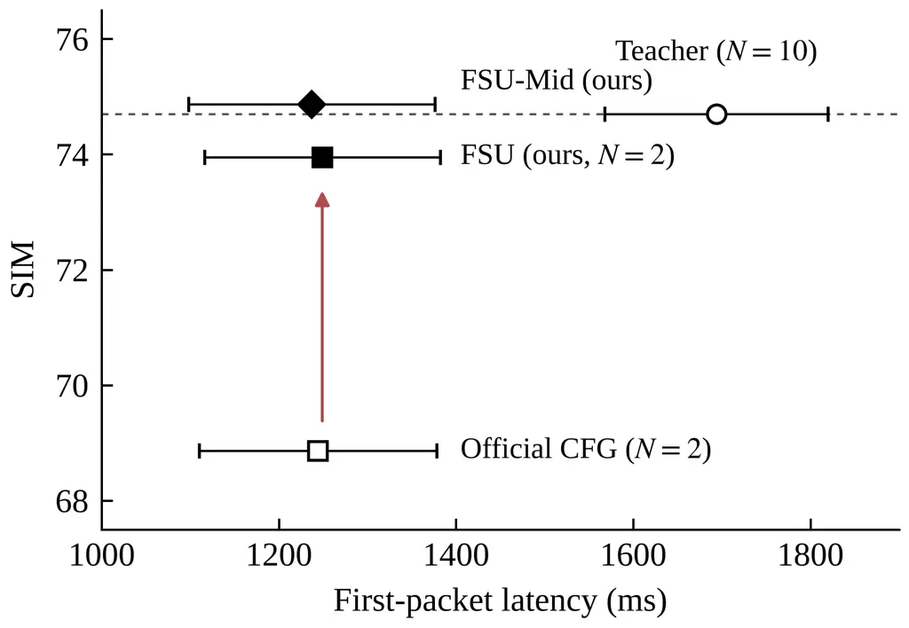

Fig. 1: First-packet latency and SIM on the official CosyVoice 2
streaming pipeline (test-en, 50 requests). The dashed line marks the
ten-step teacher. FSU and FSU-Mid recover most of the two-step loss at
the same latency.

That early guidance can be harmful is known in image synthesis.
Restricting guidance to an interval of noise levels \[24\], lowering it
early in sampling \[25, 26\], rescaling, projecting or damping it \[27,
28, 29, 30\], replacing the unconditional branch \[31\] and annealing
the condition \[32\] all improve sample quality, and analyses of simple
models show that guidance at high noise does not sample the intended
distribution \[33, 34\]. These works operate at five to 250 steps and
explain the gain through mode dropping \[24\] or norm growth \[25\].
None of them isolates the guidance of a single step, relates its effect
to the step length, or studies speech. In speech, Selective-CFG \[35\],
the ZipVoice solver \[21\] and JRR-CFG \[36\] vary guidance over time at
ten or more steps, and all keep it on the first step, where conditioning
is commonly thought to be established \[37, 38\].

This paper traces the few-step SIM loss of token-conditioned decoders to
CFG on the step that starts at pure noise. At that point the network can
only predict the average output for the given tokens and prompt, so
guidance pushes every trajectory past this average by nearly the same
amount (Fig. 2). The distribution of outputs over noise seeds is
therefore shifted rather than blurred, and later steps do not remove the
shift. Because the shift grows with the length of the first step, it is
negligible with tens of steps and accounts for most of the loss with
two. FSU leaves that step unguided and removes the shift with no
training or tuning and with one network evaluation fewer. The analysis
is stated for the state after the first step, and its consequences for
the output are measured on four token-conditioned decoders.

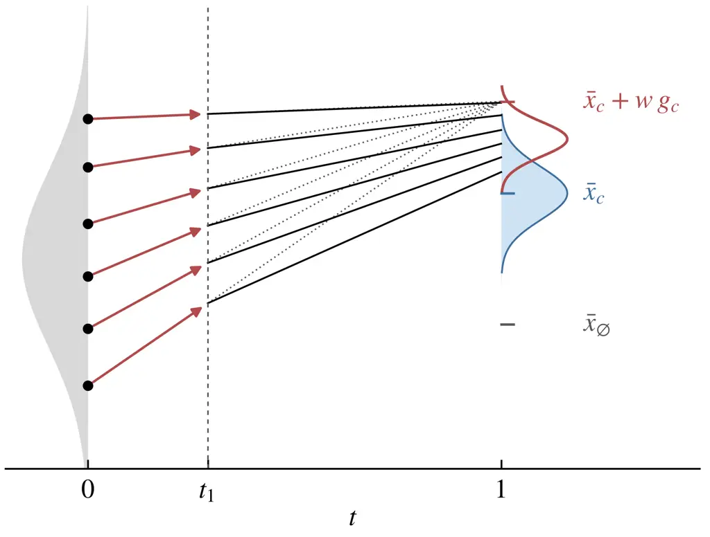

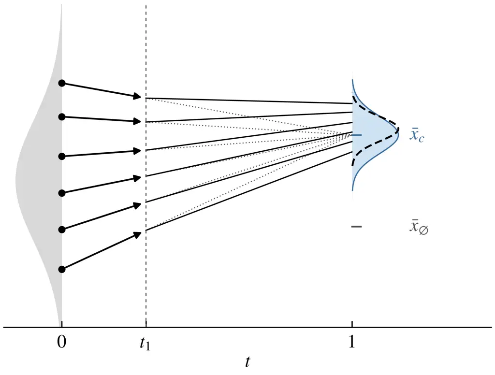

Fig. 2: Two Euler steps from noise ($`t=0`$) to data ($`t=1`$) in one
dimension. Left, a guided first step sends every trajectory toward
$`\bar{x}_{c}+w\,g_{c}`$, beyond the conditional mean $`\bar{x}_{c}`$,
and shifts the output (red) off the conditional distribution (blue).
Right, with FSU the trajectories head for $`\bar{x}_{c}`$ and the output
(dashed) stays on it. $`g_{c}=\bar{x}_{c}-\bar{x}_{\emptyset}`$.

The evidence comes from four token-conditioned decoders and two
text-conditioned controls. A direct test of the one-step closed form in
mel space and controls that switch guidance on and off step by step
attribute the loss to the first step, since guiding that step alone is
worse than using no guidance at all. FSU recovers $`84`$–$`91\%`$ of the
two-step SIM loss on CosyVoice 2/3 without a significant WER increase on
Seed-TTS-eval. Its midpoint variant FSU-Mid recovers $`77`$–$`85\%`$ on
IndexTTS-2 and matches or exceeds the ten-step teacher on CosyVoice 2
and GLM-TTS. Both use three network evaluations, against twenty for the
teacher. The analysis also delimits where the rule applies. The loss is
large when the unconditional branch erases the speech tokens, whereas in
text-conditioned decoders first-step guidance establishes the alignment
and should be kept. Eight published guidance rules re-evaluated at two
steps on the same four decoders recover more SIM the more first-step
guidance they remove, and FSU-Mid gives the highest mean recovery among
them.

At two steps the first step covers the first $`29\%`$ of the trajectory,
so FSU coincides with the high-noise end of the guidance interval
of \[24\]. The analysis explains why that end carries the whole few-step
effect, why the effect appears only in token-conditioned decoders, and
why the low-noise end, which costs speech $`0.2`$–$`0.9`$ SIM at ten
steps, should not be adopted. No distilled token-conditioned decoder has
public weights, so the experiments run the public teachers with few
Euler steps, and distilled students are left to future work. Official
implementations evaluate the conditional and unconditional branches in
one batch, so removing one branch evaluation saves computation but
leaves the wall-clock time nearly unchanged, and FSU improves quality at
the same latency.

## II Background

### II-A Flow-Matching Decoders and Classifier-Free Guidance

A flow-matching decoder \[8, 9, 39, 40\] maps Gaussian noise
$`\epsilon`$ to a mel-spectrogram $`x`$ that is consistent with a
conditioning $`c=(\tau,s)`$, where $`\tau`$ denotes the speech tokens
and $`s`$ the speaker part, a speaker embedding together with a prompt
mel. Time $`t\in[0,1]`$ runs from noise ($`t=0`$) to data ($`t=1`$), the
state on the linear path is $`z_{t}=tx+(1-t)\epsilon`$, and the network
learns the conditional velocity
$`u^{c}_{t}(z)=\mathbb{E}[x-\epsilon\mid z_{t}=z,c]`$. Sampling
integrates $`\dot{z}_{t}=u^{c}_{t}(z_{t})`$ from $`z_{0}=\epsilon`$ to
$`t=1`$. Classifier-free guidance \[10\] also evaluates an unconditional
velocity $`u^{\emptyset}_{t}`$, obtained by erasing part of $`c`$, and
follows

```math
\tilde{u}_{t}=u^{c}_{t}+w\,(u^{c}_{t}-u^{\emptyset}_{t}), \tag{1}
```

where $`w`$ is the guidance weight ($`w=0.7`$ in CosyVoice 2/3 and
GLM-TTS). Papers that write
$`\tilde{u}=u^{\emptyset}+g\,(u^{c}-u^{\emptyset})`$ use the guidance
scale $`g=1+w`$, and every external rule in this paper is converted to
$`w`$.

Decoders differ in what the unconditional branch erases. The all-null
branch erases the tokens, the speaker embedding and the prompt mel, the
speaker-null branch erases only the speaker part, and the token-null
branch erases only the tokens. Text-conditioned decoders use a text-null
branch, which erases the text and keeps the speech prompt.

The sampler takes $`N`$ Euler steps on a grid
$`0=t_{0}<t_{1}<\dots<t_{N}=1`$,

```math
z_{t_{k}}=z_{t_{k-1}}+h_{k}\,\tilde{u}_{t_{k-1}}(z_{t_{k-1}}),\qquad h_{k}=t_{k}-t_{k-1}, \tag{2}
```

with weight $`w_{k}`$ in step $`k`$. The first step has length
$`\Delta t_{1}=t_{1}`$ and weight $`w_{1}`$. CosyVoice and GLM-TTS use
the cosine grid $`t_{k}=1-\cos(\frac{\pi}{2}\frac{k}{N})`$ and
IndexTTS-2 a uniform grid. Cost is counted in network function
evaluations (NFEs), two for a guided step and one for an unguided step.

### II-B Few-Step Decoding in Deployment

Streaming TTS is judged by the delay before the first audio packet, and
the decoder is on the critical path of every chunk. A guided Euler step
costs two network evaluations, so the decoder cost grows linearly with
the number of steps. The cost matters most when the LM runs on a server
and the decoder and vocoder run on the user’s device, since the time of
each step then depends on that device rather than on server hardware.
Production systems therefore target two to four network
evaluations \[19, 20, 21, 23, 22\], and the SIM loss described in
Section I appears in exactly this range. On the official CosyVoice 2
streaming pipeline, the decoder takes $`37.7\%`$ of GPU time at ten
steps and $`19.4\%`$ at two, which shortens the first packet by $`27\%`$
and raises throughput by $`1.21\times`$ at a concurrency of one and by
$`1.44\times`$ at sixteen. In the unaccelerated setup measured here the
LM accounts for most of the remaining latency, and the decoder share
grows again once the LM is accelerated \[15\]. Table IV in Appendix A
gives the full measurements, including the cost of FSU. The analysis
holds for any step count. One step is the limiting case, in which the
first step spans the whole trajectory.

### II-C Guidance Rules and Few-Step TTS

Guidance intervals \[24\], stage-wise CFG \[25\], CFG-Zero^(∗) \[27\],
MAMBO-G \[28\] and terminal-fitted repair \[41\] reshape guidance over
time in image synthesis and explain their gains by mode dropping or norm
growth. Proposition 1 of Section III is elementary and implicit in
Gaussian analyses \[25, 33\]. The contribution here lies in its use. It
identifies a nearly seed-invariant displacement with unchanged spread,
is tested in mel space, and is tied to the step length and the
conditioning branch. In speech, Selective-CFG \[35\], the ZipVoice
solver \[21\] and JRR-CFG \[36\] operate at ten or more steps and keep
first-step guidance. Distilled decoders \[19, 20, 21, 22\] report the
SIM loss without identifying its cause, and prompt-consistency
inference \[23\] addresses prompt drift. DMOSpeech \[42, 43\] reports F0
mode shrinkage under distribution matching, which is the observation
closest to the output geometry studied in Section VI-B. Table II re-runs
these rules at two steps.

## III Analysis of First-Step Guidance

### III-A Localizing the Few-Step Loss

Fig. 3 reduces the number of Euler steps of two token-conditioned
decoders from different groups, CosyVoice 2 and IndexTTS-2, and compares
three samplers on each. With the official guidance, CosyVoice 2 loses
only $`0.5`$ SIM points at four steps, then $`1.4`$ at three and $`5.8`$
at two, and IndexTTS-2 loses $`2.9`$ points at four and $`6.2`$ at two.
WER stays between $`1.9`$ and $`2.7\%`$ at every step count (Fig. 3,
right). The tokens fix the content and the rhythm, so the speaker is the
only unconstrained attribute. In the text-conditioned F5-TTS, whose
content is not fixed in advance, WER rises instead.

The two other samplers show where the loss comes from. Turning guidance
off on every step does not help, and its SIM stays three to six points
below the teacher at every step count, so guidance itself is needed.
Turning guidance off on the first step only, which is FSU, recovers most
of the loss. At two steps it raises SIM from $`68.5`$ to $`73.7`$ on
CosyVoice 2 and from $`70.8`$ to $`74.2`$ on IndexTTS-2, and it reaches
the teacher with about half as many steps as the official sampler. The
loss is therefore caused neither by guidance as such nor by the small
number of steps alone, but by guidance on the first step, the step that
starts at pure noise.


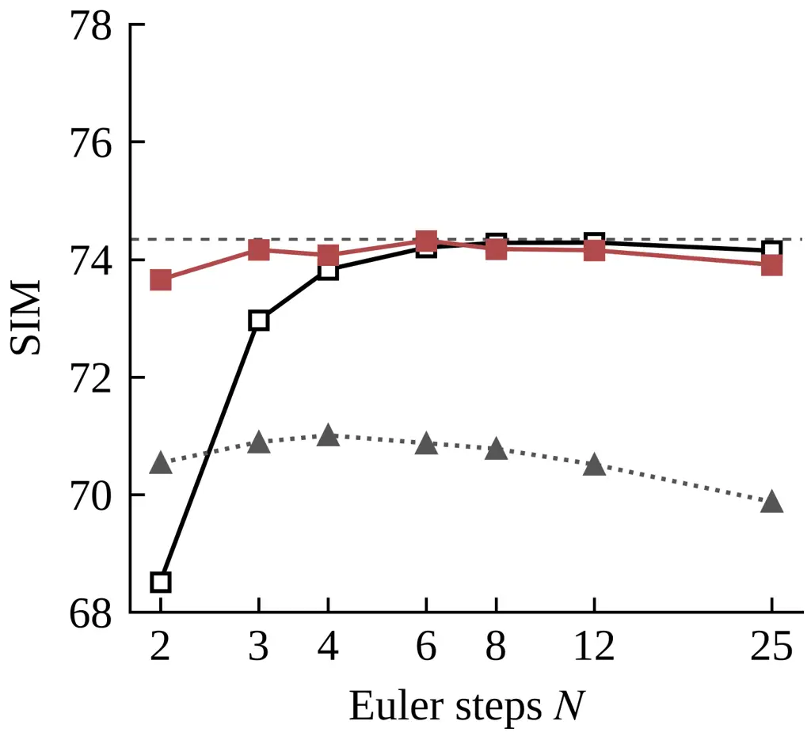

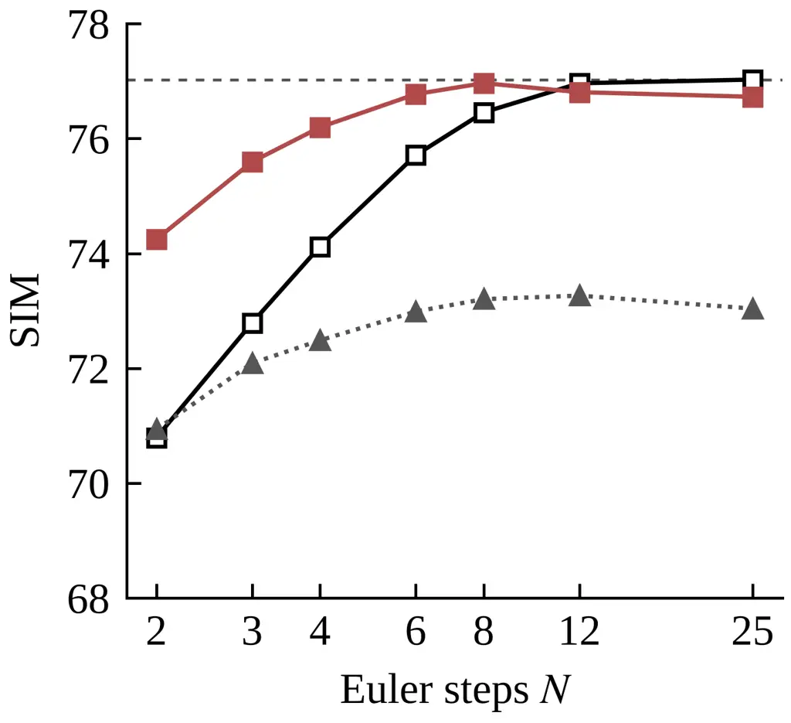

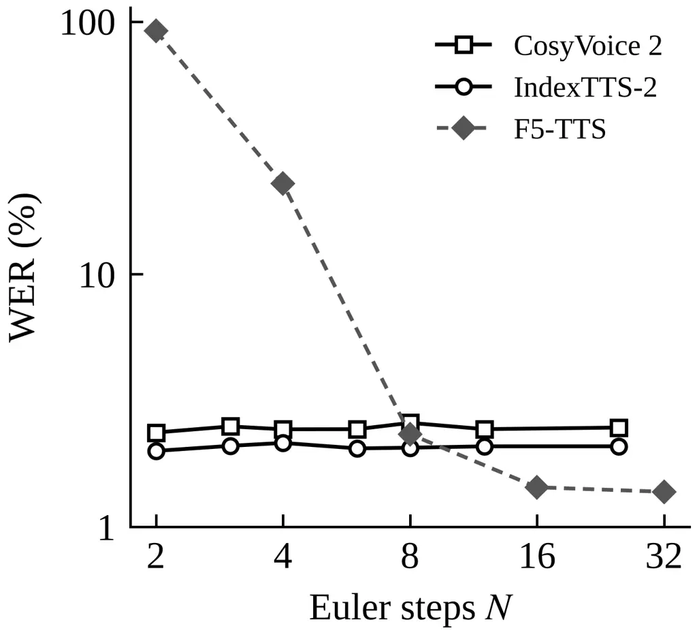

Fig. 3: SIM and WER against the number of Euler steps (test-en, analysis
subset). Left and middle, SIM of CosyVoice 2 and IndexTTS-2 with the
official CFG, without guidance and with FSU, and the teacher (dashed).
Right, WER with the official CFG, including the text-conditioned F5-TTS.

### III-B First-Step Translation

Write $`\bar{x}_{c}=\mathbb{E}[x\mid c]`$ and
$`\bar{x}_{\emptyset}=\mathbb{E}[x\mid\emptyset]`$ for the conditional
and unconditional means, $`g_{c}=\bar{x}_{c}-\bar{x}_{\emptyset}`$ for
the guidance direction, and
$`r_{c}^{2}=\mathbb{E}[\|x-\bar{x}_{c}\|^{2}\mid c]`$ for the spread of
the conditional distribution. The first Euler step starts at
$`z_{0}=\epsilon`$, which carries no information about the output. The
network can then return only the average output for the given tokens and
prompt, and guidance pushes every trajectory away from the unconditional
average by the same vector (Fig. 2). The following proposition
formalizes this for a network that returns the exact velocities.

###### Proposition 1 (First-step translation).

If the network returns the exact velocities $`u^{c}_{t}`$ and
$`u^{\emptyset}_{t}`$, the state after a first Euler step of length
$`t_{1}`$ with weight $`w_{1}`$ is

```math
z^{w_{1}}_{t_{1}}(\epsilon)=z^{0}_{t_{1}}(\epsilon)+t_{1}w_{1}g_{c} \tag{3}
```

for every noise sample $`\epsilon`$. Its root-mean-square distance from
the conditional paths $`(1-t)\epsilon+tx`$, $`x\sim p(x\mid c)`$,
through the same $`\epsilon`$ is

```math
D(w_{1})=t_{1}\sqrt{r_{c}^{2}+w_{1}^{2}\|g_{c}\|^{2}}. \tag{4}
```

###### Proof.

Since $`z_{0}=\epsilon`$ is independent of $`(x,c)`$,

```math
u^{c}_{0}(\epsilon)=\mathbb{E}[x-\epsilon\mid z_{0}=\epsilon,c]=\bar{x}_{c}-\epsilon,\qquad u^{\emptyset}_{0}(\epsilon)=\bar{x}_{\emptyset}-\epsilon, \tag{5}
```

so $`u^{c}_{0}-u^{\emptyset}_{0}=g_{c}`$ for every $`\epsilon`$. The
Euler update gives
$`z^{w_{1}}_{t_{1}}=\epsilon+t_{1}(\bar{x}_{c}-\epsilon+w_{1}g_{c})`$,
which is (3). The difference from the conditional path is
$`t_{1}(\bar{x}_{c}+w_{1}g_{c}-x)`$, and its mean square is
$`t_{1}^{2}(r_{c}^{2}+w_{1}^{2}\|g_{c}\|^{2})`$ because
$`\mathbb{E}[x-\bar{x}_{c}\mid c]=0`$ removes the cross term. ∎

The proposition establishes four facts about the first-step state.
First, guidance adds the same vector to every trajectory, so it moves
the whole distribution of $`z_{t_{1}}`$ without changing its spread, a
displacement rather than a blur. Second, the size of this displacement,

```math
E_{1}=|w_{1}|\,\|g_{c}\|\,\Delta t_{1}, \tag{6}
```

is proportional to the length of the first step. On the cosine grid
$`\Delta t_{1}`$ is $`0.29`$ at two steps and $`0.01`$ at ten, so the
same weight moves the first state about twenty-five times farther at two
steps, which explains why the loss appears only at low step counts.
Third, (4) splits the deviation into an averaging term $`r_{c}`$,
present in any one-step prediction, and a guidance term
$`|w_{1}|\,\|g_{c}\|`$, which vanishes exactly at $`w_{1}=0`$ and grows
for any other weight, positive or negative. Their ratio

```math
\kappa_{c}=r_{c}/\|g_{c}\| \tag{7}
```

gives the share of the deviation that guidance is responsible for.
Fourth, the size of $`g_{c}`$ depends on what the unconditional branch
erases. For nested conditioning $`c=(\tau,s)`$,

```math
\mathbb{E}\|\bar{x}_{\tau,s}-\bar{x}_{\emptyset}\|^{2}=\mathbb{E}\|\bar{x}_{\tau,s}-\bar{x}_{\tau}\|^{2}+\mathbb{E}\|\bar{x}_{\tau}-\bar{x}_{\emptyset}\|^{2}, \tag{8}
```

since $`\mathbb{E}[\bar{x}_{\tau,s}-\bar{x}_{\tau}\mid\tau]=0`$, so an
all-null branch adds a token component to $`g_{c}`$ that a speaker-null
branch does not have.

Three further claims lie outside the proposition and are supported
empirically rather than proven. The proposition concerns the state after
the first step, and whether the displacement survives to the output
depends on the later steps of the trained network. It is expected to
survive, as the recovery in Fig. 3 suggests, and Section VI-F measures
it directly. The proposition also gives a distance in mel space rather
than an effect on the speaker, and the displacement is expected to move
the output toward another voice because the tokens leave the speaker as
the only free attribute. Finally, removing first-step guidance is
expected to help only when the guidance term dominates the averaging
term ($`\kappa_{c}<1`$). When the averaging term dominates, as in
text-conditioned decoders whose first step must still decide the
alignment, first-step guidance contributes to the alignment, and
removing it should raise WER. The proposition motivates this boundary,
and Section VI-E locates it empirically.

## IV First-Step Unguided Sampling

FSU. Section III-B suggests the simplest remedy, since the guidance term
vanishes exactly when the first step is unguided. FSU evaluates only the
conditional network on every step whose start time $`t_{k-1}`$ lies
below a threshold $`t^{*}`$ and applies (1) on the remaining steps. FSU
needs no training and saves one network evaluation per unguided step.

Threshold. For exact velocities, Proposition 1 holds exactly at $`t=0`$,
where the state carries no information about the output. As $`t`$ grows
the state starts to determine the output, and the guidance difference
shrinks and begins to depend on the seed. The threshold $`t^{*}`$ marks
the end of this noise-dominated regime. It is set to $`t^{*}=0.1`$,
where the guidance magnitude along teacher paths has fallen to about a
third of its value at noise in all four decoders (Section VI-D). The
rule is applied to start times, so the number of unguided steps follows
from the grid. On the cosine grid the start times below $`0.1`$ are
$`t_{0}`$ at two and three steps ($`t_{1}=0.29`$ and $`0.13`$),
$`t_{0}`$ and $`t_{1}=0.08`$ at four steps and $`t_{0}`$, $`t_{1}=0.01`$
and $`t_{2}=0.05`$ at ten steps, so FSU leaves step 1, steps 1–2 and
steps 1–3 unguided. On the uniform grid of IndexTTS-2 it leaves step 1
unguided at two steps and steps 1–3 ($`t_{2}=0.08`$) at 25. At two steps
every grid gives the same rule, an unguided first step. A ramp
$`w_{k}=w\min(1,t_{k-1}/0.2)`$ gives the same results within seed noise.

FSU-Mid. FSU removes the guidance term, but the ordinary two-step Euler
error remains and can be large, especially on a uniform grid whose first
step spans half of the trajectory. FSU-Mid replaces the two Euler steps
by one midpoint step. It evaluates $`u^{c}`$ at $`t=0`$ without
guidance, takes a half step to $`t=0.5`$, evaluates (1) there and takes
the full step with that velocity. This costs three evaluations, the same
as FSU and one fewer than the guided two-step baseline.

Applicability. FSU suits decoders whose unguided SIM barely changes with
the number of steps (CosyVoice, GLM-TTS), and FSU-Mid suits decoders
with a large truncation error (IndexTTS-2, Appendix B). Both target the
two- to four-step regime of token-conditioned decoders
($`\kappa_{c}<1`$). At one step the first step is the whole trajectory,
and the official guidance is kept there (Appendix C). A negative
first-step weight is not recommended (Section VI-D). If first-step
guidance must be kept, an unconditional branch that keeps the tokens
reduces the loss by itself, following (8). This holds for
token-conditioned decoders only. In F5-TTS and ZipVoice the branch that
erases only the speech prompt retains $`0.8`$ of the all-null magnitude
(Table V), because without tokens the prompt is what fixes the content.

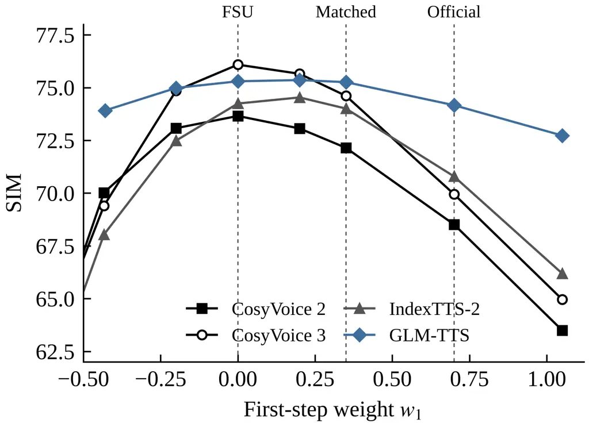

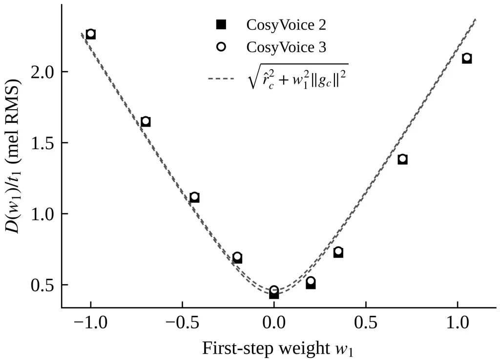

Fig. 4: First-step weight $`w_{1}`$ swept with $`w_{2}=0.7`$ (test-en,
two steps). Left, SIM of four decoders, with vertical lines at FSU
($`0`$), the weight matched to the teacher’s early guidance ($`0.35`$)
and the official CFG ($`0.7`$). Right, measured first-step deviation
$`D(w_{1})/t_{1}`$ (markers) and the closed form (4) (dashed).

## V Experimental Setup

All experiments use public checkpoints and change only the sampler.¹¹ 1
Code and audio samples are available at
[https://github.com/16jhlee/FSU](https://github.com/16jhlee/FSU).
Table I lists the decoders. The analysis covers four token-conditioned
decoders, and the text-conditioned F5-TTS and ZipVoice serve as controls
for the boundary of Section VIII. Every few-step configuration is
compared with the official decoder at its official step count, called
the teacher.

| Decoder            | Condition | Grid    | Steps | Uncond. branch |
| ------------------ | --------- | ------- | ----- | -------------- |
| CosyVoice 2 \[11\] | tokens    | cosine  | 10    | all-null       |
| CosyVoice 3 \[44\] | tokens    | cosine  | 10    | all-null       |
| IndexTTS-2 \[12\]  | tokens    | uniform | 25    | all-null       |
| GLM-TTS \[13\]     | tokens    | cosine  | 10    | speaker-null   |
| F5-TTS \[45\]      | text      | sway    | 32    | all-null       |
| ZipVoice \[21\]    | text      | t-shift | 16    | text-null      |

TABLE I: Decoders. Steps is the official step count, used by the
teacher. Sway and t-shift are the nonuniform grids of F5-TTS and
ZipVoice.

The evaluation sets are Seed-TTS-eval \[46\] (test-en 1,088, test-zh
2,020 and hard 400 utterances) and LibriSpeech-PC test-clean \[47, 48\]
(1,127 prompt–target pairs), complemented by multilingual, noisy-prompt
and streaming sets, and the analysis experiments use a fixed subset of
300/300/100 Seed-TTS-eval utterances. SIM is the cosine similarity
($`\times 100`$) between ERes2Net \[49\] speaker embeddings of the
output and the prompt, WER (CER for Chinese) is measured with the
Seed-TTS-eval ASR \[50, 51\], and naturalness with five objective
predictors \[52, 53, 54, 55\]. Every comparison is paired at the
utterance level, with identical LM tokens, length and noise seed. The
seed noise $`\varepsilon`$ of a metric is its utterance-level standard
deviation across eight noise seeds of the teacher ($`0.42`$ for SIM),
that is, the variation caused by the noise seed alone. Differences
smaller than $`\varepsilon`$ are referred to as _within seed noise_.
Appendix A describes the data, metrics, statistical tests and seed noise
in full.

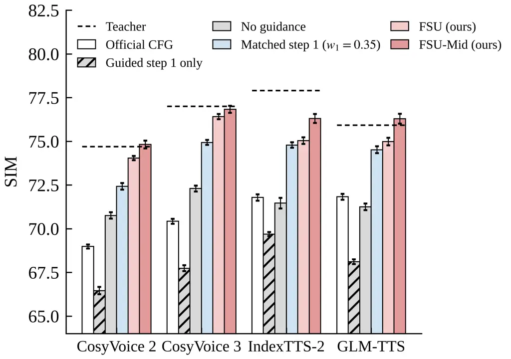

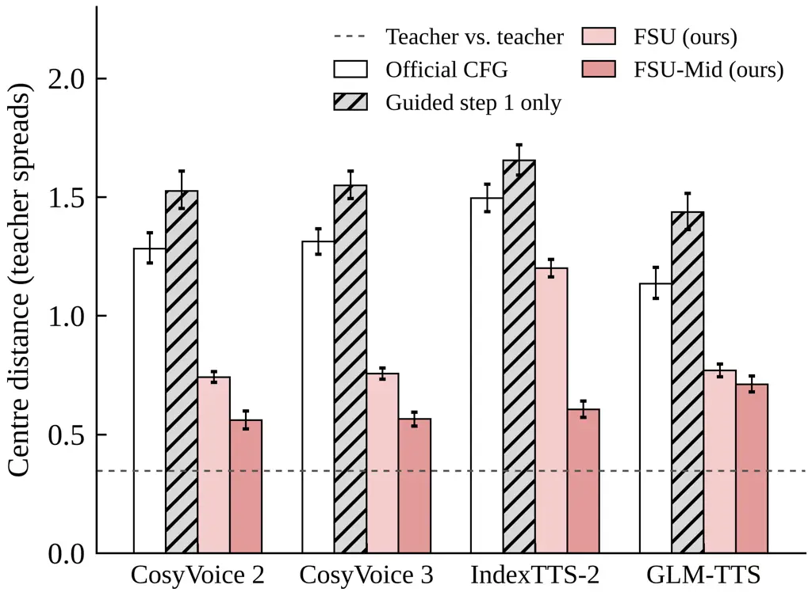

Fig. 5: Two-step samplers that differ only in where guidance is applied
(test-en, 100 utterances, eight seeds, mean and s.d.). Left, SIM, with
the teacher as dashed segments. Right, distance between the output and
teacher centers, with the teacher-versus-teacher floor (dashed). GLM-TTS
uses the all-null branch.

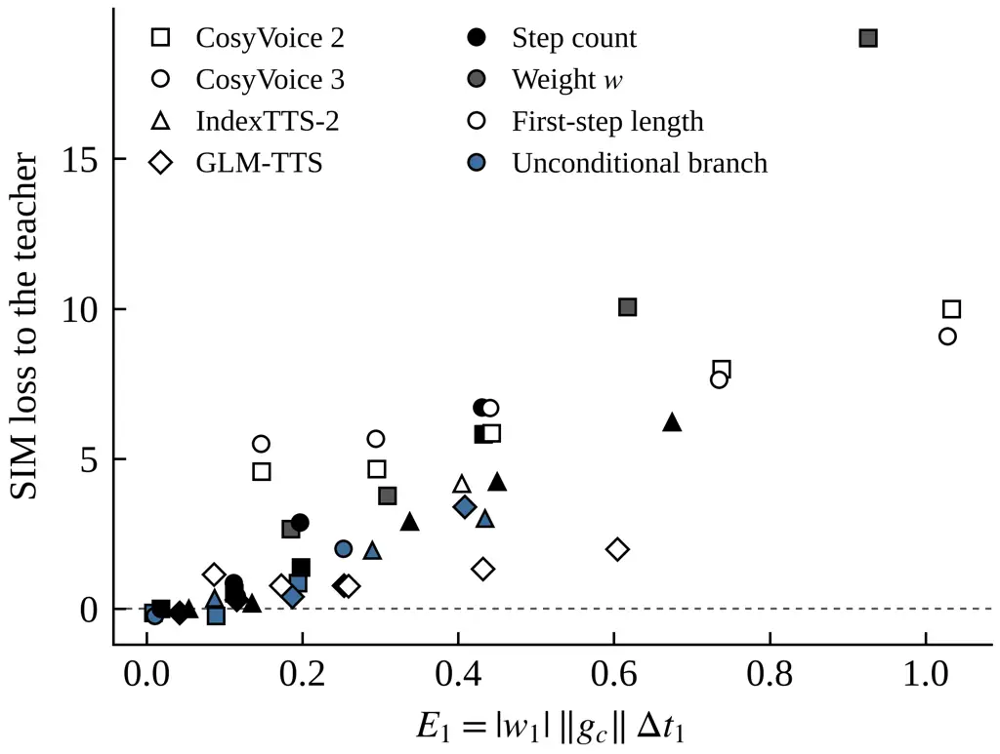

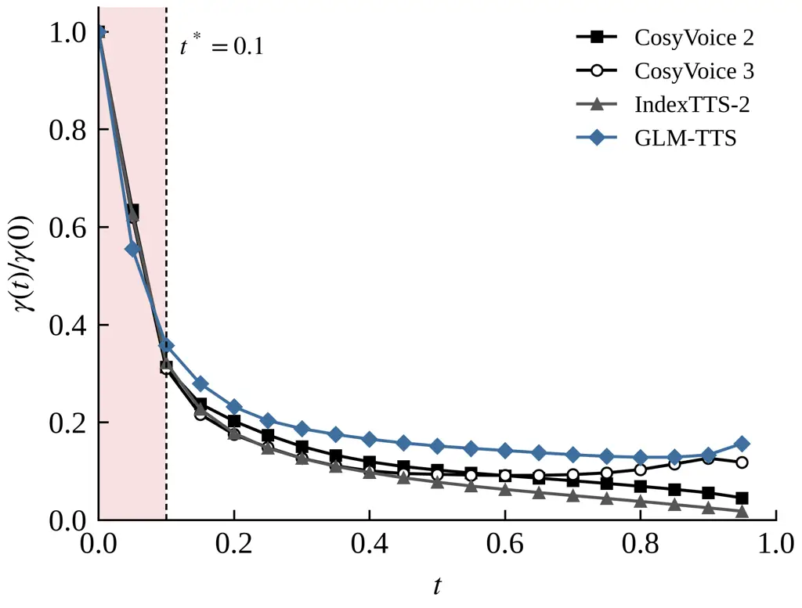

Fig. 6: Left, SIM loss to the teacher against $`E_{1}`$ for every
manipulation of step count, weight, first-step length and branch (marker
shape gives the decoder, fill the manipulation). Right, guidance
magnitude $`\gamma(t)`$ along teacher trajectories, relative to $`t=0`$,
with the region below $`t^{*}=0.1`$ shaded.

## VI Verification of the Analysis

This section tests the claims of Section III-B in the order they were
made. Section VI-A tests the assumption of Proposition 1. Section VI-B
tests the first claim, a translation without change of spread, together
with the expected move toward another voice. Sections VI-C, VI-D
and VI-E test the second, third and fourth claims, namely the
step-length dependence, the optimum at $`w_{1}=0`$ and the effect of the
branch, and Section VI-E also tests the boundary $`\kappa_{c}<1`$.
Section VI-F tests the expected persistence of the shift. Appendix B
gives the measurements behind each subsection.

### VI-A Closed Form in Mel Space

The trained networks satisfy the assumption of Proposition 1 closely. At
$`t=0`$ their guidance difference has cosine $`0.96`$–$`0.98`$ with an
independent estimate of $`g_{c}`$ and nearly the same direction for
every noise seed, and the measured first-step deviation follows (4) with
a slope of $`0.99\|g_{c}\|`$ in all four decoders (Fig. 4, right).

### VI-B Output Distribution Geometry

For each utterance, eight noise seeds give a set of speaker embeddings,
hereafter a cloud, for the teacher and one for the few-step sampler. The
variance ratio compares their spreads, and $`\Delta d_{\rm cond}`$ is
the mean distance of the few-step samples to the teacher center minus
the teacher’s own leave-one-out distance, which is negative when the
cloud is averaged and positive when it is translated. At two steps the
official CFG cloud on CosyVoice 2 contracts (variance ratio $`0.60`$)
and moves away from the teacher ($`\Delta d_{\rm cond}=+0.043`$) while
the embedding norm is unchanged. Its center lies $`1.3`$–$`1.8`$ teacher
spreads from the teacher center on CosyVoice and IndexTTS-2. The shift
points toward another voice. Speaker directions are spanned by the
outputs for the same tokens under eight different prompts, and on
CosyVoice 2 they carry $`29\%`$ of the energy of the first-step
displacement, 24 times the share of the teacher’s seed-to-seed
difference. FSU returns $`\Delta d_{\rm cond}`$ to the teacher’s level
without changing the variance ratio, which is the signature of a
translation, and guiding only the first step moves the center farthest
(Fig. 5, right). The cloud also remains somewhat narrower than the
teacher’s, an effect outside the first-step analysis that FSU-Mid
reduces (Appendix B).

### VI-C Step-Length Dependence

The left panel of Fig. 6 places every manipulation that changes
$`E_{1}`$ on one axis, namely the step count, the weight, the first-step
length and the unconditional branch. Within each decoder the loss is
monotone in $`E_{1}`$ (Spearman $`0.75`$–$`0.98`$), and it vanishes as
$`E_{1}\to 0`$. In these manipulations the total guidance over all steps
co-varies with $`E_{1}`$, and Section VI-D separates the two.

### VI-D First-Step Attribution

On all four decoders the SIM at $`w_{1}=0`$ is the maximum or within
seed noise of it (Fig. 4, left). Negative weights, which extrapolate
toward the unconditional mean, damage SIM more than positive ones
although the mel deviation is symmetric. Guiding the first step alone is
worse than using no guidance at all on all four decoders and in each of
the eight seeds (on GLM-TTS by $`3.1/1.9`$ SIM, en/zh). A first step
matched to the teacher’s early guidance also stays below FSU in all
eight seeds (Fig. 5, left). The loss therefore follows guidance applied
from pure noise, not the total amount. FSU-Mid lies above FSU on every
decoder and in every seed and reaches the teacher’s level on CosyVoice
and GLM-TTS. The guidance magnitude falls to a third of its value at
noise by $`t=0.1`$ in all four decoders (Fig. 6, right), which sets the
threshold $`t^{*}`$, and the residual left by FSU is the ordinary
truncation error that FSU-Mid targets.

### VI-E Unconditional Branch

Erasing the tokens enlarges $`\|g_{c}\|`$ by $`1.6`$–$`2.2`$ times and
moves the branch points in the left panel of Fig. 6 to larger $`E_{1}`$,
and on CosyVoice 2 the all-null branch loses $`5.8`$ SIM at two steps
against $`0.9`$ for the speaker-null branch. On GLM-TTS, whose released
branch is speaker-null, switching the same network to all-null raises
the loss from $`0.4/0.9`$ to $`2.8/2.7`$ points ($`3.4`$ on the hard
set), FSU recovers $`95/79\%`$ of it ($`70\%`$ on hard), and FSU-Mid
exceeds the teacher on all three sets. The ratio $`\kappa_{c}`$ is
$`0.21`$–$`0.49`$ for the token-conditioned decoders and
$`1.09`$–$`1.97`$ for the text-conditioned ones, where removing
first-step guidance raises WER (Section VIII).

### VI-F Persistence Across Steps

With the noise fixed, following a guided and an unguided first step with
$`1`$ to $`15`$ identical later steps leaves a final mel distance of
$`1.17`$–$`1.24`$ on CosyVoice 2, so the later steps do not remove the
shift. Persistence is thus an empirical property of the trained
networks, and the loss vanishes with many steps only because
$`\Delta t_{1}\to 0`$.

|                                   |     |                  |                   |                 |                   |         |                 |
| --------------------------------- | --- | ---------------- | ----------------- | --------------- | ----------------- | ------- | --------------- |
| Method                            | NFE | CosyVoice 2      | CosyVoice 3       | IndexTTS-2      | GLM-TTS           | Mean    | $`\Delta`$UTMOS |
| Official CFG                      | 4   | 0 / 0            | 0 / 0             | 0 / 0           | 0 / 0             | 0       | –               |
| Guidance interval \[24\]^(⋆)      | 3   | 88 / 85          | 91 / 82           | 55 / 57         | 78 / 69           | 76      | +0.13           |
| Selective-CFG (default) \[35\]    | 4   | 4 / 16           | 2 / 6             | $`-`$9 / $`-`$9 | 2 / $`-`$6        | 1       | $`-`$0.05       |
| Selective-CFG (input-text) \[35\] | 4   | 85 / 86          | 70 / 56           | 52 / 51         | 63 / 52           | 64      | $`-`$0.06       |
| CFG-Zero^(∗) scale \[27\]         | 4   | 9 / 5            | 3 / $`-`$2        | 8 / 2           | $`-`$5 / $`-`$3   | 2       | +0.04           |
| CFG-Zero^(∗) zero-init \[27\]     | 2   | coll. / coll.    | coll. / coll.     | coll. / coll.   | coll. / coll.     | coll.   | $`-`$2.05       |
| TV-CFG (released) \[25\]          | 4   | coll. / coll.    | coll. / coll.     | coll. / coll.   | coll. / coll.     | coll.   | $`-`$2.12       |
| TV-CFG (corrected) \[25\]^(†)     | 4   | 74 / 65          | 73 / 71           | 82 / 72         | 61 / 56           | 69      | +0.01           |
| TV-CFG step-up \[25\]             | 4   | 26 / 18          | $`-`$8 / 16       | $`-`$44 / 3     | $`-`$15 / $`-`$8  | $`-`$1  | $`-`$0.28       |
| MAMBO-G \[28\]                    | 4   | 70 / 65          | 73 / 66           | 36 / 39         | 58 / 46           | 57      | +0.25           |
| Terminal-fitted repair \[41\]     | 4   | 35 / 32          | 30 / 32           | 2 / 22          | $`-`$11 / $`-`$28 | 14      | +0.15           |
| JRR-CFG \[36\]                    | 8   | $`-`$18 / $`-`$8 | $`-`$17 / $`-`$17 | $`-`$7 / 0      | $`-`$17 / $`-`$2  | $`-`$11 | $`-`$0.34       |
| Prompt-consistency \[23\]         | 4   | 14 / 13          | 0 / 2             | n/a / n/a       | $`-`$9 / $`-`$6   | 2       | +0.01           |
| FSU (ours)                        | 3   | 88 / 85          | 91 / 82           | 55 / 57         | 78 / 69           | 76      | +0.13           |
| FSU-Mid (ours)                    | 3   | 104 / 109        | 99 / 96           | 77 / 79         | 112 / 123         | 100     | $`-`$0.10       |

TABLE II: Published guidance rules at two steps on four decoders
(analysis subset, seed 0). Cells give the recovery in percent, en / zh,
and Mean averages the eight cells. GLM-TTS uses the all-null branch and
its own all-null teacher. Bold marks the best few-step value, and coll.
marks SIM below 60 or WER above $`30\%`$. ^(⋆)Identical to FSU at two
steps. ^(†)Normalization of the released code corrected. n/a, undefined
for IndexTTS-2.

## VII Results

### VII-A Comparison with Guidance Rules

Table II compares FSU and FSU-Mid with the published inference-time
guidance rules discussed in Section II-C, all run at two Euler steps on
the four decoders under the same protocol and with the hyperparameters
used on CosyVoice. FSU-Mid gives the highest mean recovery ($`100\%`$)
and the highest value in seven of the eight cells, with three network
evaluations. FSU reaches $`76\%`$ on average, the same as the guidance
interval of \[24\], which coincides with FSU at two steps because its
high-noise cutoff falls inside the first step. The only rule above
FSU-Mid in any cell is the corrected TV-CFG on IndexTTS-2 in English
($`82\%`$ against $`77\%`$). On the uniform two-step grid of IndexTTS-2
its schedule sets the first-step weight to zero and raises the second to
$`1.4`$, so it acts as FSU with a stronger second step, whereas on the
cosine grid of the other decoders its first weight is $`-0.15`$ and it
stays below FSU. This rule therefore also removes first-step guidance.
Appendix C gives how each rule was ported and the SIM behind every cell.

The best rule that keeps first-step guidance, Selective-CFG
(input-text), reaches $`64\%`$ on average by shrinking $`\|g_{c}\|`$
through its speaker-null branch, and the rules that leave the first-step
term unchanged recover at most $`16\%`$ in any cell. Two released
implementations collapse on every decoder, and JRR-CFG falls below the
official CFG while doubling the evaluations. On CosyVoice, recovery
follows how much first-step guidance each rule leaves (Fig. 7, Spearman
$`-0.77`$ on CosyVoice 2 and $`-0.88`$ on CosyVoice 3). The published
rules and the $`w_{1}`$ sweep follow a single decreasing trend, and FSU
and FSU-Mid lie at its upper end, where the first-step term is zero. The
exception is terminal-fitted repair, which also leaves the first step
unguided at two steps but modifies the last step and recovers only
$`32`$–$`35\%`$.

|                                  |               |                                    |              |                  |                 |               |
| -------------------------------- | ------------- | ---------------------------------- | ------------ | ---------------- | --------------- | ------------- |
| Method (NFE)                     | SIM en / zh   | Recovery en / zh                   | SIM hard     | SIM LSPC         | WER / CER       | UTMOS en / zh |
| CosyVoice 2                      |               |                                    |              |                  |                 |               |
| Official CFG (4)                 | 68.86 / 76.63 | 0% / 0%                            | 73.05        | 68.62            | 2.77 / 1.23     | 3.79 / 3.10   |
| TV-CFG (corrected) \[25\] (4)    | 72.93 / 79.47 | 70% / 66%                          | 77.03 (83%)  | 71.82 (62%)      | 2.85 / 1.28     | 4.05 / 3.22   |
| Sel.-CFG (input-text) \[35\] (4) | 74.15 / 80.49 | 91% / 90%                          | 77.52 (94%)  | 74.06 (105%)     | 2.77 / 1.29     | 3.97 / 3.21   |
| MAMBO-G \[28\] (4)               | 72.96 / 79.51 | 70% / 67%                          | 76.47 (72%)  | 72.31 (71%)      | 2.78 / 1.23     | 4.21 / 3.57   |
| FSU (ours) (3)                   | 73.95 / 80.37 | 87% / 87%                          | 77.39 (91%)  | 73.23 (89%)      | 2.94 / 1.21     | 4.17 / 3.44   |
| FSU-Mid (ours) (3)               | 74.87 / 81.27 | 103% / 108%                        | 78.87 (122%) | 74.49 (113%)     | 2.91 / 1.26     | 3.98 / 3.11   |
| Teacher (20)                     | 74.70 / 80.93 | 100% / 100%                        | 77.82        | 73.80            | 2.89 / 1.26     | 4.17 / 3.48   |
| CosyVoice 3                      |               |                                    |              |                  |                 |               |
| Official CFG (4)                 | 70.15 / 77.75 | 0% / 0%                            | 75.43        | 71.17            | 2.38 / 1.23     | 3.72 / 3.24   |
| TV-CFG (corrected) \[25\] (4)    | 75.02 / 81.96 | 72% / 73%                          | 80.14 (82%)  | 75.44 (68%)      | 2.45 / 1.10     | 3.87 / 3.12   |
| Sel.-CFG (input-text) \[35\] (4) | 74.77 / 81.19 | 68% / 59%                          | 78.71 (57%)  | 75.17 (64%)      | 2.35 / 1.12     | 3.77 / 3.09   |
| MAMBO-G \[28\] (4)               | 74.99 / 81.64 | 71% / 67%                          | 79.28 (67%)  | 75.31 (66%)      | 2.41 / 1.09     | 4.05 / 3.45   |
| FSU (ours) (3)                   | 76.21 / 82.58 | 89% / 84%                          | 80.29 (85%)  | 76.61 (87%)      | 2.39 / 1.11     | 3.99 / 3.30   |
| FSU-Mid (ours) (3)               | 76.76 / 83.36 | 97% / 97%                          | 81.63 (108%) | 77.69 (104%)     | 2.52 / 1.09     | 3.72 / 2.94   |
| Teacher (20)                     | 76.96 / 83.53 | 100% / 100%                        | 81.17        | 77.42            | 2.34 / 1.13     | 3.97 / 3.32   |
| IndexTTS-2                       |               |                                    |              |                  |                 |               |
| Official CFG (4)                 | 70.76 / 73.46 | 0% / 0%                            | 71.00        | 68.07            | 2.40 / 0.98     | 3.45 / 2.72   |
| TV-CFG (corrected) \[25\] (4)    | 75.98 / 79.11 | 81% / 73%                          | 76.77 (69%)  | 74.69 (80%)      | 2.40 / 0.94     | 3.44 / 2.43   |
| Sel.-CFG (input-text) \[35\] (4) | 74.22 / 77.47 | 54% / 52%                          | 75.23 (50%)  | 67.08 ($`-`$12%) | 2.48 / 1.00     | 3.34 / 2.45   |
| MAMBO-G \[28\] (4)               | 72.93 / 76.57 | 34% / 40%                          | 74.43 (41%)  | 70.99 (35%)      | 2.42 / 0.99     | 3.58 / 2.70   |
| FSU (ours) (3)                   | 74.31 / 77.91 | 55% / 57%                          | 75.47 (53%)  | 72.59 (54%)      | 2.44 / 0.97     | 3.43 / 2.47   |
| FSU-Mid (ours) (3)               | 75.74 / 79.65 | 77% / 80%                          | 77.78 (81%)  | 75.17 (85%)      | 2.48 / 0.97     | 3.41 / 2.45   |
| Teacher (50)                     | 77.19 / 81.23 | 100% / 100%                        | 79.41        | 76.38            | 2.54 / 1.01     | 3.65 / 3.00   |
| GLM-TTS                          |               |                                    |              |                  |                 |               |
| Official CFG (4)                 | 74.65 / 80.13 | $`+0.00^{\lx@sectionsign}`$ / 0%   | 77.78        | 74.16            | 2.55 / 0.96     | 3.84 / 3.07   |
| TV-CFG (corrected) \[25\] (4)    | 75.60 / 80.90 | $`+0.95^{\lx@sectionsign}`$ / 81%  | 78.75 (64%)  | 75.10 (164%)     | 2.50 / 0.98     | 3.90 / 3.13   |
| MAMBO-G \[28\] (4)               | 74.72 / 80.14 | $`+0.06^{\lx@sectionsign}`$ / 1%   | 77.85 (5%)   | 74.05 ($`-`$19%) | 2.47 / 0.96     | 4.02 / 3.30   |
| FSU (ours) (3)                   | 75.47 / 80.79 | $`+0.82^{\lx@sectionsign}`$ / 70%  | 78.49 (47%)  | 74.88 (125%)     | 2.50 / 0.97     | 3.99 / 3.26   |
| FSU-Mid (ours) (3)               | 76.32 / 81.96 | $`+1.67^{\lx@sectionsign}`$ / 195% | 80.44 (175%) | 75.87 (297%)     | 2.66 / 1.06^(∗) | 3.80 / 2.94   |
| All-null CFG (4)                 | 72.21 / 78.34 | 0% / 0%                            | 75.87        | 72.09            | 2.47 / 0.97     | 3.93 / 3.25   |
| All-null + FSU (ours) (3)        | 74.92 / 80.51 | 95% / 79%                          | 78.28 (70%)  | 74.25 (82%)      | 2.37 / 1.01     | 4.10 / 3.34   |
| All-null + FSU-Mid (ours) (3)    | 76.35 / 82.03 | 145% / 135%                        | 80.61 (138%) | 75.79 (140%)     | 2.54 / 1.04     | 3.85 / 2.93   |
| Teacher (20)                     | 75.06 / 81.07 | $`+0.41^{\lx@sectionsign}`$ / 100% | 79.30        | 74.73            | 2.62 / 1.11     | 3.72 / 2.97   |

TABLE III: Full evaluation sets at two steps (Seed-TTS-eval test-en,
test-zh and hard, LibriSpeech-PC). Recovery is (method $`-`$
official)/(teacher $`-`$ official), in parentheses for hard and LSPC.
Bold marks the best few-step SIM per decoder with its official branch.
All SIM differences to the official CFG are significant
($`p\leq 10^{-3}`$, Holm) except MAMBO-G on GLM-TTS. ^(§)Gap below seed
noise, so the gain is given. ^(∗)CER worse than the official CFG
($`p=0.01`$).

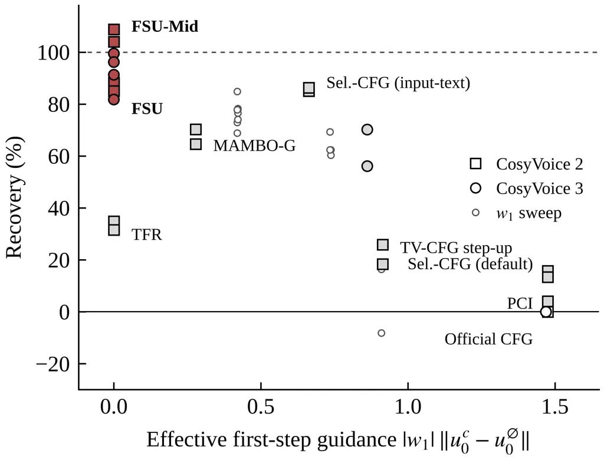

Fig. 7: Recovery against the guidance left on the first step,
$`|w_{1}|\,\|u^{c}_{0}-u^{\emptyset}_{0}\|`$, on CosyVoice 2 and 3 at
two steps. Red markers are FSU and FSU-Mid, gray markers the published
rules and small circles the $`w_{1}`$ sweep.

### VII-B Full Evaluation Sets

Table II compares the methods with the published rules on the
300-utterance analysis subset and one noise seed. Table III reports the
official CFG, FSU and FSU-Mid on the complete Seed-TTS-eval test sets
(test-en, test-zh and hard) and on LibriSpeech-PC for all four decoders
at two steps, with WER and UTMOS, which is the standard reporting
setting of zero-shot TTS. FSU recovers $`84`$–$`89\%`$ of the loss on
CosyVoice 2 and 3 with no significant WER or CER increase and with UTMOS
at the teacher’s level. On IndexTTS-2, FSU-Mid recovers $`77/80\%`$,
improving on FSU ($`55/57\%`$) on this uniform grid. On GLM-TTS, whose
released speaker-null branch already keeps the loss small, both methods
still raise SIM. FSU-Mid matches or exceeds the ten-step teacher on
CosyVoice 2 and GLM-TTS on every set, with three network evaluations
against twenty. The gains hold on the hard set ($`91\%`$ and $`85\%`$
recovery on CosyVoice 2 and 3) and on LibriSpeech-PC ($`89\%`$ and
$`87\%`$ on CosyVoice 2 and 3). On LibriSpeech-PC, FSU leaves WER
unchanged on CosyVoice 2, IndexTTS-2 and GLM-TTS ($`p\geq 0.06`$), and
on CosyVoice 3 its WER stays at the teacher’s level.

The three best published rules of Table II, run on the same full sets
with the same hyperparameters, keep their subset recovery on CosyVoice
and IndexTTS-2 to within $`6`$ points. Selective-CFG (input-text) is
omitted for GLM-TTS, where it equals the official speaker-null branch.
FSU-Mid has the highest SIM in seven of the eight test-en and test-zh
cells and in every hard and LibriSpeech-PC cell, and the exception is
again the corrected TV-CFG on IndexTTS-2 in English ($`+0.24`$).
Selective-CFG (input-text) is the strongest rule against FSU. It is
level with FSU on CosyVoice 2 ($`+0.20/+0.12`$, below seed noise) but
$`1.4`$ below it on CosyVoice 3, and on LibriSpeech-PC with IndexTTS-2
it falls below the official CFG. With the all-null branch on GLM-TTS,
FSU-Mid exceeds the speaker-null teacher on all three Seed-TTS-eval sets
and on LibriSpeech-PC.

### VII-C Robustness and Deployment

Table VI tests both samplers in sixteen conditions outside the analysis
set. On CosyVoice, FSU recovers most of the loss across languages
($`65`$–$`100\%`$), with prompts from one to ten seconds and with noisy
prompts at $`20`$ and $`10`$ dB SNR ($`86`$–$`113\%`$), and on long
inputs ($`68`$–$`82\%`$), where the official streaming mode keeps most
of the gain of offline decoding. FSU-Mid reaches or exceeds the ten-step
teacher on every long-input and prompt condition ($`98`$–$`117\%`$) and
recovers $`87`$–$`95\%`$ on German, where FSU alone recovers
$`65`$–$`68\%`$. On GLM-TTS German, FSU recovers $`59\%`$ and FSU-Mid
$`88\%`$ with the all-null branch, and FSU-Mid exceeds FSU with the
released branch, whose loss is already small. No condition shows a
significant WER increase for either sampler.

The three best published rules were run in the same sixteen conditions.
FSU-Mid lies above FSU in fourteen of them, the other two being within
seed noise, and has the highest few-step SIM in twelve. MAMBO-G and the
corrected TV-CFG stay below FSU in every condition but one and below
FSU-Mid in all of them. Selective-CFG (input-text) is level with FSU in
most conditions and ahead of it in four multilingual ones, where FSU-Mid
closes most of the gap and exceeds it on CosyVoice 3. These gains come
at the same wall-clock time as the official CFG (Table IV).

## VIII Applicability and Evaluation

The analysis predicts where FSU should fail and why FSU-Mid is needed.
This section examines both predictions and the aspects of the output
that SIM alone does not capture.

### VIII-A Text-Conditioned Decoders

As the analysis predicts, text-conditioned decoders behave differently.
They have $`\kappa_{c}>1`$, so the conditional mean over all alignments
is far from any single utterance and first-step guidance fixes the
alignment. Removing it raises WER on F5-TTS from $`2.33`$ to $`6.37`$ at
eight steps and on ZipVoice from $`1.54`$ to $`2.45`$ at four, with
mixed SIM changes. For these decoders the official first-step guidance
is best kept. Their official grids make the guided first step very
short. With a uniform grid the F5-TTS baseline collapses at eight steps
(WER $`80.6\%`$) and FSU repairs most of it (WER $`18.9\%`$), so a long
guided first step from pure noise is harmful there as well.

### VIII-B Truncation-Dominated Decoders

The uniform grid of IndexTTS-2 makes the first step half of the
trajectory, so this step carries both the first-step shift and part of
the useful guidance. FSU alone recovers more than half of the loss, with
a drop in predicted MOS (UTMOS and NISQA) in Chinese. FSU-Mid restores a
guided evaluation at $`t=0.5`$, recovers $`77`$–$`85\%`$ and reduces
this quality cost (Appendix C), which makes it the recommended sampler
for such decoders.

### VIII-C Evaluation Beyond Speaker Similarity

A SIM close to the teacher’s does not show that the teacher’s
distribution is reproduced. On CosyVoice 2 at two steps,
Selective-CFG+FSU comes within seed noise of the teacher’s SIM, yet its
displacement $`\Delta d_{\rm cond}`$ stays at $`0.018`$ against
$`0.001`$ for FSU and its embedding, F0 and speaking-rate variance
ratios ($`0.49/0.41/0.55`$) stay at the level of Selective-CFG alone,
and FSU-Mid exceeds the teacher’s SIM with a slightly wider cloud. Among
these samplers only FSU returns $`\Delta d_{\rm cond}`$ to the teacher’s
level while recovering most of the SIM loss, and the geometry of
Section VI-B and the right panel of Fig. 5 are therefore reported
alongside SIM. On quality, FSU is within seed noise of the teacher on
UTMOS, UTMOSv2 and DNSMOS for the CosyVoice decoders and close to it on
NISQA-TTS (within $`0.21`$ MOS, Appendix C).

## IX Conclusion

Token-conditioned flow-matching TTS decoders lose speaker similarity at
two or three steps mainly because of classifier-free guidance on the
step that starts at pure noise. The resulting shift is nearly the same
for every noise sample, persists through the remaining steps and scales
with the first-step length. This offers an explanation for the
speaker-similarity loss reported by few-step systems and for why
guidance schedules designed for many steps do not remove it. In
practice, few-step token-conditioned decoders can skip guidance on the
first step, using FSU when the truncation error is small and FSU-Mid
otherwise, with no training and one network evaluation fewer than the
official two-step sampler. The conditioning branch and the ratio
$`\kappa_{c}`$ indicate where this rule applies, and text-conditioned
decoders, whose first step still sets the alignment, should keep the
official guidance.

The experiments run public teachers with few Euler steps, and extending
the analysis to distilled token-conditioned students \[16, 17\] is left
for when such checkpoints become public. Persistence of the first-step
shift is established by measurement (Appendix B), and quality is
assessed with five objective predictors rather than a listening test.
The analysis itself depends only on the first Euler step starting at
pure noise, so the same displacement should arise in any guided flow or
diffusion sampler whose first step is long, and testing it on image and
video generators is a natural next step.

## Appendix A Experimental Details

Models and data. CosyVoice 2-0.5B uses a conformer-UNet decoder,
IndexTTS-2 a DiT on a uniform grid, and GLM-TTS its own 1.5B LM with a
flow DiT \[56\] and the HiFT vocoder and CAM++ encoder \[57\] of
CosyVoice 2. The reproduced Fun-CosyVoice3-0.5B is $`2.2`$ SIM below the
published value on test-en, so every comparison involving it is paired
within the same pipeline. Robustness uses the MiniMax multilingual sets
for ko/ja/de (100 each), LibriSpeech prompts of 1, 3 and 10 s with MUSAN
noise \[58\], and three-sentence concatenations for streaming. The
analysis subset (300/300/100) agrees with the full sets to within
$`2.4`$ percentage points of recovery ($`4`$ for GLM-TTS zh), and three
noise seeds on the main cells (SIM s.d. $`\leq 0.17`$) change no
ranking.

Statistics and seed noise. Comparisons are paired with identical LM
tokens, length and noise seed, the seed being derived from the utterance
identifier and the seed index. Intervals are 95% bootstrap intervals
(10k resamples), tests are Wilcoxon signed-rank tests, and stars denote
$`p<0.05`$ after Holm correction within each table. SIM removes the
prompt region before embedding, and WavLM-SV \[59\]
($`\varepsilon=1.06`$) and ECAPA \[60\] ($`0.71`$) agree in sign with
ERes2Net ($`0.42`$) in every comparison. The seed noise of the quality
predictors is $`0.06`$–$`0.16`$ (UTMOS), $`0.16`$–$`0.20`$ (UTMOSv2),
$`0.05`$–$`0.10`$ (DNSMOS), $`0.14`$–$`0.26`$ (NISQA) and
$`0.19`$–$`0.31`$ (NISQA-TTS). A recovery is reported only when the
teacher–official gap is at least $`\varepsilon`$, and otherwise the gain
is reported. The teacher WER differs from published values by at most
$`0.3`$, so all WER claims are paired, and because utterance-level WER
differences are heavy-tailed the bootstrap interval of the mean and the
Wilcoxon test are both reported (for FSU on CosyVoice 2 en,
$`2.77\to 2.94`$, interval $`[-0.05,0.44]`$, $`p=0.60`$).

Deployment. Table IV gives the latency of the official CosyVoice 2
streaming pipeline. Each chunk is solved once from noise, so the
first-step effect does not accumulate across chunks, the recovery does
not depend on the chunk size and no artifacts appear at chunk
boundaries. FSU and FSU-Mid run within $`2\%`$ of the wall-clock time of
the official CFG.

| Config              | NFE | First packet (ms) | Decoder share | Thr. $`c{=}1`$ | $`c{=}4`$ | $`c{=}16`$ |
| ------------------- | --- | ----------------- | ------------- | -------------- | --------- | ---------- |
| teacher, 10 steps   | 20  | $`1694\pm 126`$   | 37.7%         | 1.29           | 1.64      | 1.35       |
| baseline, 2 steps   | 4   | $`1244\pm 134`$   | 19.4%         | 1.57           | 2.17      | 1.95       |
| FSU (ours), 2 steps | 3   | $`1249\pm 133`$   | 19.4%         | 1.57           | 2.13      | 1.94       |
| FSU-Mid (ours)      | 3   | $`1237\pm 139`$   | 19.4%         | 1.59           | 2.12      | 1.93       |

TABLE IV: Official CosyVoice 2 streaming pipeline (RTX 4080 S, 50
requests). Throughput is in audio seconds per second at concurrency
$`c`$. FSU-Mid throughput is scaled from FSU by their measured ratio
($`1.00\pm 0.01`$).

## Appendix B Verification Details

This appendix gives the measurements behind Sections IV and VI.

Closed form (Section VI-A). The network’s guidance difference at $`t=0`$
is compared with $`\hat{g}_{c}`$, the mean of eight teacher samples
minus the mean of eight unconditional samples at $`N=10`$. Its direction
has cosine $`0.96`$–$`0.98`$ with $`\hat{g}_{c}`$, its norm is within
$`7`$–$`10\%`$, and it varies little across seeds (mean cosine
$`0.986`$–$`0.998`$). On 100 CosyVoice 2 utterances with eight seeds,
the unguided one-step output lies $`0.31`$ mel RMS from the teacher
mean, inside the teacher’s own spread of $`0.41`$, and depends on the
seed one tenth as much as the teacher. At the official $`w=0.7`$ it lies
$`1.36`$ away, and at $`w=1.5`$ it lies $`3.03`$ away, beyond the
unconditional mean at $`2.27`$.

Center distance (Section VI-B). For each utterance, $`\mu_{f}`$ and
$`\mu_{t}`$ are the means of eight few-step and eight teacher embeddings
and $`\sigma_{t}^{2}`$ the mean squared distance of the teacher
embeddings to $`\mu_{t}`$. The center distance
$`\delta^{2}=\max\{0,\|\mu_{f}-\mu_{t}\|^{2}/\sigma_{t}^{2}-(\sigma_{f}^{2}+\sigma_{t}^{2})/(8\sigma_{t}^{2})\}`$
removes the expected contribution of the two center estimates, and two
random halves of the teacher’s seeds give the floor $`\delta=0.35`$.

Geometry of each sampler. At two steps the official CFG has variance
ratio $`0.60/0.59`$, $`\Delta d_{\rm cond}=+0.043/+0.026`$ and
$`\delta=1.28/1.34`$ on CosyVoice 2 (en/zh), with similar values on
CosyVoice 3 and $`\delta`$ up to $`1.77`$ on IndexTTS-2. FSU returns
$`\Delta d_{\rm cond}`$ to $`0.001`$–$`0.002`$ on CosyVoice with the
variance ratio unchanged and $`\delta`$ at $`0.74`$–$`0.83`$, and
FSU-Mid comes closest to the teacher center ($`\delta=0.56`$–$`0.89`$ on
all four decoders) with a variance ratio of $`1.0`$–$`1.2`$. The
residual after FSU does not lie along the teacher’s own guidance
direction. With $`a`$ the vector from the unguided to the guided
ten-step center, the residual has $`1.5`$–$`11\%`$ of its energy along
$`a`$, against $`21`$–$`58\%`$ for the unguided two-step sampler.

Direction. Fig. 8 decomposes each displacement in a per-utterance basis
built from outputs for the same tokens under eight prompts. The
first-step displacement puts $`29\%`$ of its energy in speaker
directions, 24 times the share of the teacher’s seed-to-seed difference
and about $`60\%`$ of a genuine change of speaker.

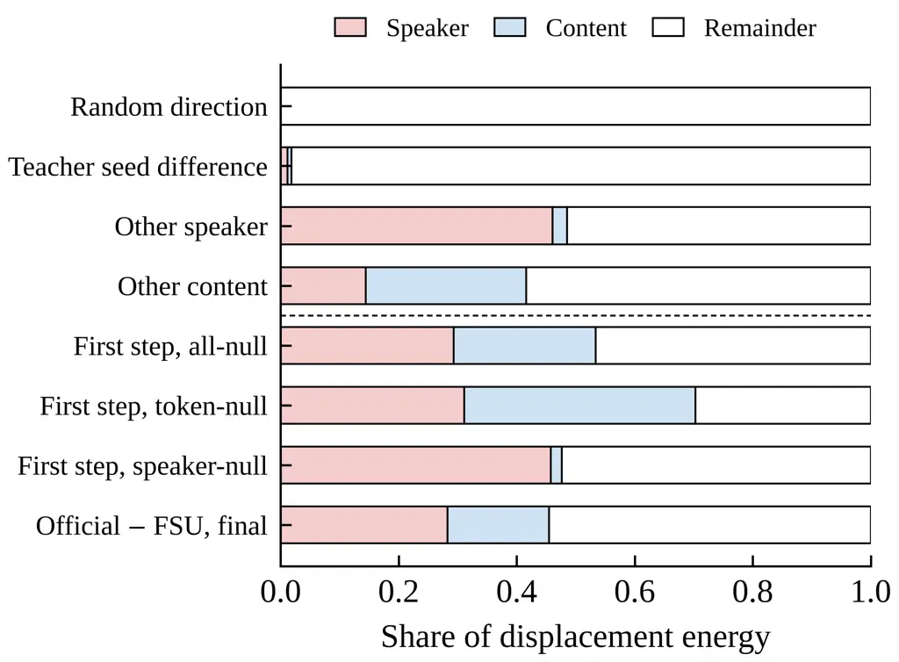

Fig. 8: Energy share of each displacement in speaker, content and
remaining directions (CosyVoice 2, 100 utterances). Rows above the
dashed line are controls.

Step length (Section VI-C). The Spearman correlation of loss and
$`E_{1}`$ is $`0.88`$, $`0.97`$, $`0.98`$ and $`0.75`$ for CosyVoice 2,
CosyVoice 3, IndexTTS-2 and GLM-TTS. On CosyVoice 2 the FSU gain grows
with the first-step length ($`-0.1`$, $`+3.1`$, $`+5.2`$, $`+7.4`$ and
$`+7.8`$ for $`t_{1}=0.1,\dots,0.7`$). In $`8/8`$ model and language
pairs, the list of cross-lingual prompts (prompt and target in different
languages) with the larger $`\|g_{c}\|`$ had the larger loss and the
larger gain ($`p<10^{-6}`$).

Attribution and threshold (Section VI-D). On CosyVoice 2, removing
guidance from the first step recovers $`88/85\%`$ of the loss (en/zh),
from both steps $`35/32\%`$, and lowering both weights to $`0.3`$
recovers $`54/48\%`$. The guidance magnitude $`\gamma(t)`$ falls to
$`0.31`$–$`0.36`$ of its value at noise by $`t=0.1`$ and to
$`0.08`$–$`0.15`$ by $`t=0.5`$ in all four decoders. The threshold
$`t^{*}=0.1`$ is not tuned to the results. A sweep over $`t^{*}`$ puts
it within $`0.1`$ SIM of the best value in all twelve cells of three
decoders and four step counts. Consistently, FSU gains nothing on the
grid $`[0,0.1,1]`$, where the guided second step starts at
$`0.31\gamma(0)`$ and lasts $`0.9`$, and at four steps leaving steps 1
and 2 unguided, both starting below $`t^{*}`$, gains $`+0.24/+0.67`$
where step 1 alone gains nothing.

Two components of the loss. The unguided sampler measures the Euler
truncation error alone. From two steps to the official count its SIM
changes by $`-0.7/+0.7`$ on CosyVoice 2 and $`+0.7/+1.8`$ on GLM-TTS but
by $`+2.1/+3.3`$ on IndexTTS-2, whose uniform grid takes a first step of
length $`0.5`$. Of the two-step loss of $`6.2/7.6`$ on IndexTTS-2, FSU
removes $`3.5/4.3`$, against $`5.1/3.6`$ of $`5.8/4.2`$ on CosyVoice 2,
and this larger residual is what FSU-Mid targets.

Branch and $`\kappa_{c}`$ (Section VI-E). On one-step outputs of the
official samplers (en 100 $`\times`$ 2 seeds), $`\hat{r}_{c}`$ is the
distance of the $`w=0`$ output to the nearest of eight teacher samples
and $`\|\hat{g}_{c}\|`$ the RMS of the $`w=1`$ output minus the $`w=0`$
output (Table V). Absolute distances are in different feature spaces, so
only the ratio $`\kappa_{c}=\hat{r}_{c}/\|\hat{g}_{c}\|`$ is compared,
and it changes by at most $`10.5\%`$ with the number of teacher samples.
For (8), $`\|g^{\rm all}\|^{2}`$ is $`15\%`$ below the sum of its two
components on CosyVoice, and the order all-null $`\approx`$ token-null
$`\gg`$ speaker-null holds in all decoders.

|                 |          |            |              |                 |                 |                         |
| --------------- | -------- | ---------- | ------------ | --------------- | --------------- | ----------------------- |
| Decoder         | all-null | token-null | speaker-null | $`\hat{r}_{c}`$ | $`\kappa_{c}`$  | 2-step loss             |
| CosyVoice 2     | 2.11     | 1.98       | 0.95         | 0.44            | 0.21            | 5.8                     |
| CosyVoice 3     | 2.10     | 1.94       | 1.23         | 0.47            | 0.23            | 6.7                     |
| IndexTTS-2      | 1.93     | 1.94       | 1.24         | 0.54            | 0.29            | 6.2                     |
| GLM-TTS         | 1.99     | 2.26       | 1.23         | 0.55            | 0.49 (0.28^(†)) | 0.8 (3.4^(†))           |
| F5-TTS (text)   | 1.52     | 0.89       | 1.25         | 1.58            | 1.09            | WER $`+4.4^{\ddagger}`$ |
| ZipVoice (text) | 1.58     | 0.85       | 1.29         | 1.58            | 1.97            | WER $`+0.7^{\ddagger}`$ |

^(†)with the all-null branch patched in. For the text-conditioned
decoders, token-null is text-null (text erased, speech prompt kept) and
speaker-null is audio-null (prompt erased, text kept). ^(‡)WER change
when first-step guidance is removed, mean of en and zh (§VIII).

TABLE V: First-step guidance magnitude by unconditional branch (mel
RMS), averaging term $`\hat{r}_{c}`$, ratio $`\kappa_{c}`$ for the
official branch (bold) and two-step loss.

Persistence (Section VI-F). At two steps the outputs with and without
first-step guidance are the last-step prediction at two states $`E_{1}`$
apart, so a bound on their distance needs $`h_{2}\tilde{L}<1`$ for the
Lipschitz constant $`\tilde{L}`$ of the guided field. Finite differences
on CosyVoice 2 teacher paths give $`h_{2}\tilde{L}=2.26`$, because the
velocity of a straight-path flow contains a $`1/(1-t)`$ factor, so the
bound is vacuous and persistence is measured instead.

## Appendix C Additional Results

Guidance rules (Section VII-A). All rules are written in the convention
of (1). None of the official implementations runs on a TTS decoder as
is, and Selective-CFG, TFR, PCI and JRR-CFG have no public code, so each
equation was ported into the CosyVoice sampler and then to IndexTTS-2
and GLM-TTS with the CosyVoice hyperparameters. With default settings
every patched sampler reproduces the unpatched output within run-to-run
GPU nondeterminism. PCI is undefined on IndexTTS-2, whose prompt region
is held at zero and enters only as a separate input.

The released TV-CFG scheduler sets the last step’s $`\Delta t`$ to zero
in its normalization and gives per-step scales of $`5.80`$ and $`13.93`$
at two steps, and the corrected normalization gives $`0.85`$ and
$`2.05`$. As a check of the porting, PCI on ZipVoice-Distill reproduces
the published gain at four and eight steps (WavLM SIM $`+0.30`$ to
$`+1.09`$ against a published $`+0.4`$ to $`+1.4`$). The rules keep
their subset recovery on the full sets to within $`6`$ points.

Objective quality. On the full sets, FSU is within $`0.04`$ of the
teacher on UTMOS and within $`0.13`$ on UTMOSv2 and DNSMOS for
CosyVoice 2 and 3, with NISQA-TTS residuals of $`0.10`$–$`0.21`$, and
the official two-step CFG is $`0.26`$–$`0.41`$ below the teacher on
UTMOS and UTMOSv2. On GLM-TTS both samplers exceed the teacher on UTMOS
($`+0.08`$ to $`+0.29`$). On IndexTTS-2 FSU is $`0.22`$–$`0.65`$ below
the teacher on UTMOS and up to $`1.0`$ on NISQA, and FSU-Mid reduces the
NISQA-TTS residual to $`0.34`$–$`0.35`$.

Robustness (Section VII). Table VI gives the sixteen robustness
conditions with both samplers and the three best published rules.
FSU-Mid exceeds FSU significantly on both German sets, on all four
long-input conditions and with the ten-second prompt ($`+0.8`$ to
$`+1.9`$, Holm $`p\leq 0.003`$), and is within seed noise of it on the
short and noisy prompts, where the teacher–official gap is itself
$`1.8`$–$`6.5`$. No sampler raises WER significantly over the official
CFG in any condition where the language is supported, and with short and
noisy prompts $`\Delta d_{\rm cond}\leq 0.009`$ after FSU in every cell.

|                    |          |        |           |         |            |                |         |           |                 |
| ------------------ | -------- | ------ | --------- | ------- | ---------- | -------------- | ------- | --------- | --------------- |
| Condition          | Official | TV-CFG | Sel.-CFG  | MAMBO-G | FSU (ours) | FSU-Mid (ours) | Teacher | Rec.      | WER             |
| CosyVoice 2        |          |        |           |         |            |                |         |           |                 |
| ko                 | 74.59    | 78.67  | 81.41     | 79.60   | 80.08      | 81.60          | 80.30   | 96%       | 3.95 / 3.08     |
| ja                 | 79.81    | 83.58  | 85.60     | 84.26   | 84.81      | 85.60          | 84.81   | 100%      | 10.53 / 10.58   |
| de                 | 67.75    | 71.26  | 74.13     | 71.18   | 71.56      | 73.34          | 73.62   | 65%       | 63.4 / 81.6^(‡) |
| long en, offline   | 72.54    | 77.14  | 77.70     | 76.91   | 77.90      | 79.45          | 79.09   | 82%       | 2.54 / 2.75     |
| long zh, offline   | 78.83    | 81.45  | 82.04     | 81.42   | 82.12      | 83.87          | 83.15   | 76%       | 1.46 / 1.37     |
| long en, streaming | 73.94    | 77.60  | 78.10     | 77.57   | 78.52      | 80.21          | 80.04   | 75%       | 2.51 / 2.90     |
| long zh, streaming | 79.74    | 81.60  | 82.72     | 81.81   | 82.54      | 84.40          | 83.85   | 68%       | 1.50 / 1.31     |
| prompt 1 s         | 52.98    | 54.29  | 55.08     | 54.59   | 54.90      | 54.72          | 54.73   | 110%      | 6.84 / 7.39     |
| prompt 3 s         | 67.82    | 70.86  | 72.22     | 71.05   | 72.21      | 72.57          | 72.35   | 97%       | 5.20 / 4.04     |
| prompt 10 s        | 74.06    | 77.80  | 79.96     | 78.54   | 79.66      | 80.42          | 80.58   | 86%       | 7.75 / 8.32     |
| 3 s, 20 dB         | 65.47    | 68.02  | 69.56     | 68.54   | 69.77      | 69.66          | 69.29   | 113%      | 3.60 / 4.21     |
| 3 s, 10 dB         | 61.71    | 63.33  | 64.84     | 64.26   | 65.13      | 65.52          | 65.45   | 91%       | 4.14 / 3.93     |
| CosyVoice 3        |          |        |           |         |            |                |         |           |                 |
| ko                 | 72.90    | 80.15  | 79.96     | 79.64   | 80.78      | 81.51          | 81.43   | 92%       | 2.68 / 2.42     |
| ja                 | 80.32    | 84.13  | 85.98     | 84.72   | 85.04      | 85.92          | 85.99   | 83%       | 56.0 / 56.0^(‡) |
| de                 | 76.73    | 78.47  | 79.43     | 79.21   | 79.80      | 80.66          | 81.23   | 68%       | 0.96 / 1.26     |
| GLM-TTS            |          |        |           |         |            |                |         |           |                 |
| de                 | 76.81    | 76.63  | 76.81^(§) | 76.23   | 76.54      | 77.22          | 77.32   | $`-0.27`$ | 126 / 100^(‡)   |
| GLM-TTS (all-null) |          |        |           |         |            |                |         |           |                 |
| de                 | 72.38    | 74.58  | 76.81^(§) | 75.11   | 75.28      | 76.73          | 77.32   | 59%       | 78.2 / 77.9^(‡) |

TABLE VI: Robustness at two steps (ERes2Net SIM, 100 utterances per
condition, seed 0). TV-CFG is the corrected version and Sel.-CFG the
input-text version. Rec. is the recovery of FSU, with the gain given
where the official loss is below seed noise. WER is official / FSU. Bold
marks the highest few-step SIM. ^(§)Selective-CFG (input-text) uses the
speaker-null branch, which is the official branch of GLM-TTS, so it
equals the official CFG of the speaker-null row. ^(‡)The decoder or its
LM does not handle the language (WER or CER above $`55\%`$ for every
sampler, the teacher included), so WER is not compared.

One step. At one step, where leaving the first step unguided removes
guidance altogether, the unguided sampler still gains $`4.0`$–$`6.6`$
SIM on CosyVoice and $`2.2`$–$`3.2`$ on IndexTTS-2 over the guided
one-step sampler but loses $`2.6`$–$`3.0`$ on GLM-TTS, so the official
guidance is kept there.

## Acknowledgment

The authors used Claude Fable 5.1 (Anthropic) to check the grammar of
this manuscript. The authors reviewed all content and take full
responsibility for it. This research was partly supported by the
InnoCORE program of the Ministry of Science and ICT(#N10260008) grant
funded by the Korea Government(MSIT) and Korea Institute for Advancement
of Technology(KIAT) grant funded by the Korea Government(MOTIR)
(RS-2026-25585869, HRD Program for Industrial Innovation).

## References

- \[1\] Z. Borsos, R. Marinier, D. Vincent, E. Kharitonov, O. Pietquin,
  M. Sharifi, D. Roblek, O. Teboul, D. Grangier, M. Tagliasacchi, and
  N. Zeghidour, “Audiolm: A language modeling approach to audio
  generation,” _IEEE/ACM Transactions on Audio, Speech, and Language
  Processing_, vol. 31, pp. 2523–2533, 2023.
- \[2\] H. Liu, Y. Yuan, X. Liu, X. Mei, Q. Kong, Q. Tian, Y. Wang,
  W. Wang, Y. Wang, and M. D. Plumbley, “Audioldm 2: Learning holistic
  audio generation with self-supervised pretraining,” _IEEE/ACM
  Transactions on Audio, Speech, and Language Processing_, vol. 32, pp.
  2871–2883, 2024.
- \[3\] D. Yang, S. Liu, R. Huang, C. Weng, and H. Meng, “Instructtts:
  Modelling expressive tts in discrete latent space with natural
  language style prompt,” _IEEE/ACM Transactions on Audio, Speech, and
  Language Processing_, vol. 32, pp. 2913–2925, 2024.
- \[4\] W.-N. Hsu, B. Bolte, Y.-H. H. Tsai, K. Lakhotia,
  R. Salakhutdinov, and A. Mohamed, “Hubert: Self-supervised speech
  representation learning by masked prediction of hidden units,”
  _IEEE/ACM Transactions on Audio, Speech, and Language Processing_,
  vol. 29, pp. 3451–3460, 2021.
- \[5\] N. Zeghidour, A. Luebs, A. Omran, J. Skoglund, and
  M. Tagliasacchi, “Soundstream: An end-to-end neural audio codec,”
  _IEEE/ACM Transactions on Audio, Speech, and Language Processing_,
  vol. 30, pp. 495–507, 2022.
- \[6\] C. Wang _et al._, “Neural codec language models are zero-shot
  text to speech synthesizers,” _arXiv preprint arXiv:2301.02111_, 2023.
- \[7\] Z. Du _et al._, “Cosyvoice: A scalable multilingual zero-shot
  text-to-speech synthesizer based on supervised semantic tokens,”
  _arXiv preprint arXiv:2407.05407_, 2024.
- \[8\] Y. Lipman, R. T. Q. Chen, H. Ben-Hamu, M. Nickel, and M. Le,
  “Flow matching for generative modeling,” in _International Conference
  on Learning Representations_, 2023.
- \[9\] X. Liu, C. Gong, and Q. Liu, “Flow straight and fast: Learning
  to generate and transfer data with rectified flow,” in _International
  Conference on Learning Representations_, 2023.
- \[10\] J. Ho and T. Salimans, “Classifier-free diffusion guidance,” in
  _Advances in Neural Information Processing Systems_, 2021.
- \[11\] Z. Du _et al._, “Cosyvoice 2: Scalable streaming speech
  synthesis with large language models,” _arXiv preprint
  arXiv:2412.10117_, 2024.
- \[12\] S. Zhou _et al._, “Indextts2: A breakthrough in emotionally
  expressive and duration-controlled auto-regressive zero-shot
  text-to-speech,” in _Proceedings of the AAAI Conference on Artificial
  Intelligence_, 2026.
- \[13\] Zhipu AI, “Glm-tts technical report,” _arXiv preprint
  arXiv:2512.14291_, 2025. \[Online\]. Available:
  [https://github.com/zai-org/GLM-TTS](https://github.com/zai-org/GLM-TTS)
- \[14\] Y. Wang _et al._, “Maskgct: Zero-shot text-to-speech with
  masked generative codec transformer,” in _International Conference on
  Learning Representations_, 2025.
- \[15\] vLLM team, “Engineering tts inference in vllm-omni,” Blog post,
  and RFC “CosyVoice 2/3 performance acceleration,” vllm-omni issue
  6870, 2026.
- \[16\] T. Salimans and J. Ho, “Progressive distillation for fast
  sampling of diffusion models,” in _International Conference on
  Learning Representations_, 2022.
- \[17\] Y. Song, P. Dhariwal, M. Chen, and I. Sutskever, “Consistency
  models,” in _International Conference on Machine Learning_, 2023.
- \[18\] Z. Geng, M. Deng, X. Bai, J. Z. Kolter, and K. He, “Mean flows
  for one-step generative modeling,” _arXiv preprint
  arXiv:2505.13447_, 2025.
- \[19\] dots.tts team, “dots.tts technical report,” _arXiv preprint
  arXiv:2606.07080_, 2026.
- \[20\] FlashTTS authors, “Flashtts: Fast streaming tts with mtp
  acceleration and x-pred mean flow distillation,” _arXiv preprint
  arXiv:2606.09141_, 2026.
- \[21\] H. Zhu _et al._, “Zipvoice: Fast and high-quality zero-shot
  text-to-speech with flow matching,” in _IEEE Automatic Speech
  Recognition and Understanding Workshop (ASRU)_, 2025.
- \[22\] IntMeanFlow authors, “Intmeanflow: Few-step speech generation
  with integral velocity distillation,” _arXiv preprint
  arXiv:2510.07979_, 2025.
- \[23\] Zadorozhnyy _et al._, “Prompt-consistency inference,” _arXiv
  preprint arXiv:2610.04757_, 2026.
- \[24\] T. Kynkäänniemi _et al._, “Applying guidance in a limited
  interval improves sample and distribution quality in diffusion
  models,” in _Advances in Neural Information Processing Systems_, 2024.
- \[25\] C. Jin, Q. Shi, and Y. Gu, “Stage-wise dynamics of
  classifier-free guidance in diffusion models,” in _International
  Conference on Learning Representations_, 2026.
- \[26\] X. Wang, N. Dufour, N. Andreou, M.-P. Cani, V. F. Abrevaya,
  D. Picard, and V. Kalogeiton, “Analysis of classifier-free guidance
  weight schedulers,” _Transactions on Machine Learning Research_, 2024.
- \[27\] W. Fan _et al._, “Cfg-zero^(∗): Improved classifier-free
  guidance for flow matching models,” _arXiv preprint
  arXiv:2503.18886_, 2025.
- \[28\] S. Zhu _et al._, “Mambo-g: Magnitude-aware mitigation for
  boosted guidance,” in _International Conference on Machine
  Learning_, 2026.
- \[29\] S. Sadat, O. Hilliges, and R. M. Weber, “Eliminating
  oversaturation and artifacts of high guidance scales in diffusion
  models,” in _International Conference on Learning
  Representations_, 2025.
- \[30\] H. Chung, J. Kim, G. Y. Park, H. Nam, and J. C. Ye, “Cfg++:
  Manifold-constrained classifier free guidance for diffusion models,”
  in _International Conference on Learning Representations_, 2025.
- \[31\] T. Karras, M. Aittala, T. Kynkäänniemi, J. Lehtinen, T. Aila,
  and S. Laine, “Guiding a diffusion model with a bad version of
  itself,” in _Advances in Neural Information Processing Systems_, 2024.
- \[32\] S. Sadat, J. Buhmann, D. Bradley, O. Hilliges, and R. M. Weber,
  “Cads: Unleashing the diversity of diffusion models through
  condition-annealed sampling,” in _International Conference on Learning
  Representations_, 2024.
- \[33\] A. Bradley and P. Nakkiran, “Classifier-free guidance is a
  predictor-corrector,” _arXiv preprint arXiv:2408.09000_, 2024.
- \[34\] M. Chidambaram, K. Gatmiry, S. Chen, H. Lee, and J. Lu, “What
  does guidance do? a fine-grained analysis in a simple setting,” in
  _Advances in Neural Information Processing Systems_, 2024.
- \[35\] Zheng and Maleki, “Selective classifier-free guidance for
  zero-shot text-to-speech,” _arXiv preprint arXiv:2509.19668_, 2025.
- \[36\] R. Shi _et al._, “Joint residual reweighting for
  classifier-free guidance in flow-matching zero-shot tts,” _arXiv
  preprint arXiv:2606.25672_, 2026.
- \[37\] A. Castillo _et al._, “Adaptive guidance: Training-free
  acceleration of conditional diffusion models,” in _Proceedings of the
  AAAI Conference on Artificial Intelligence_, 2025.
- \[38\] H. Zhang, J. Zhang, and X. Wan, “How much to guide: Revisiting
  adaptive guidance in classifier-free guidance text-to-vision diffusion
  models,” _arXiv preprint arXiv:2506.08351_, 2025.
- \[39\] M. Le _et al._, “Voicebox: Text-guided multilingual universal
  speech generation at scale,” in _Advances in Neural Information
  Processing Systems_, 2023.
- \[40\] S. Mehta, R. Tu, J. Beskow, É. Székely, and G. E. Henter,
  “Matcha-tts: A fast tts architecture with conditional flow matching,”
  in _IEEE International Conference on Acoustics, Speech and Signal
  Processing (ICASSP)_, 2024.
- \[41\] S. Zhang, “Guidance breaks the fitted operator: A
  terminal-fitted repair for classifier-free guidance,” _arXiv preprint
  arXiv:2607.07665_, 2026.
- \[42\] Y. A. Li _et al._, “Dmospeech: Direct metric optimization via
  distilled diffusion model in zero-shot speech synthesis,” in
  _International Conference on Machine Learning_, 2025.
- \[43\] ——, “Dmospeech 2: Reinforcement learning for duration
  prediction in metric-optimized speech synthesis,” in _Proceedings of
  the AAAI Conference on Artificial Intelligence_, 2026.
- \[44\] Z. Du _et al._, “Cosyvoice 3: Towards in-the-wild speech
  generation via scaling-up and post-training,” _arXiv preprint
  arXiv:2505.17589_, 2025.
- \[45\] Y. Chen _et al._, “F5-tts: A fairytaler that fakes fluent and
  faithful speech with flow matching,” in _Proceedings of the
  Association for Computational Linguistics_, 2025.
- \[46\] P. Anastassiou _et al._, “Seed-tts: A family of high-quality
  versatile speech generation models,” _arXiv preprint
  arXiv:2406.02430_, 2024.
- \[47\] V. Panayotov, G. Chen, D. Povey, and S. Khudanpur,
  “Librispeech: An asr corpus based on public domain audio books,” in
  _IEEE International Conference on Acoustics, Speech and Signal
  Processing (ICASSP)_, 2015.
- \[48\] A. Meister, M. Novikov, N. Karpov, E. Bakhturina, V. Lavrukhin,
  and B. Ginsburg, “Librispeech-pc: Benchmark for evaluation of
  punctuation and capitalization capabilities of end-to-end asr models,”
  in _IEEE Automatic Speech Recognition and Understanding Workshop
  (ASRU)_, 2023.
- \[49\] Y. Chen _et al._, “An enhanced res2net with local and global
  feature fusion for speaker verification,” in _Interspeech_, 2023.
- \[50\] A. Radford, J. W. Kim, T. Xu, G. Brockman, C. McLeavey, and
  I. Sutskever, “Robust speech recognition via large-scale weak
  supervision,” in _International Conference on Machine Learning_, 2023.
- \[51\] Z. Gao, S. Zhang, I. McLoughlin, and Z. Yan, “Paraformer: Fast
  and accurate parallel transformer for non-autoregressive end-to-end
  speech recognition,” in _Interspeech_, 2022.
- \[52\] T. Saeki _et al._, “Utmos: Utokyo-sarulab system for voicemos
  challenge 2022,” in _Interspeech_, 2022.
- \[53\] K. Baba _et al._, “The t05 system for the voicemos challenge
  2024: Transfer learning from deep image classifier to naturalness mos
  prediction of high-quality synthetic speech,” in _IEEE Spoken Language
  Technology Workshop (SLT)_, 2024.
- \[54\] C. K. A. Reddy, V. Gopal, and R. Cutler, “Dnsmos p.835: A
  non-intrusive perceptual objective speech quality metric to evaluate
  noise suppressors,” in _IEEE International Conference on Acoustics,
  Speech and Signal Processing (ICASSP)_, 2022.
- \[55\] G. Mittag _et al._, “Nisqa: A deep cnn-self-attention model for
  multidimensional speech quality prediction with crowdsourced
  datasets,” in _Interspeech_, 2021.
- \[56\] W. Peebles and S. Xie, “Scalable diffusion models with
  transformers,” in _Proceedings of the IEEE/CVF International
  Conference on Computer Vision_, 2023.
- \[57\] H. Wang, S. Zheng, Y. Chen, L. Cheng, and Q. Chen, “Cam++: A
  fast and efficient network for speaker verification using
  context-aware masking,” in _Interspeech_, 2023.
- \[58\] D. Snyder, G. Chen, and D. Povey, “Musan: A music, speech, and
  noise corpus,” _arXiv preprint arXiv:1510.08484_, 2015.
- \[59\] S. Chen _et al._, “Wavlm: Large-scale self-supervised
  pre-training for full stack speech processing,” _IEEE Journal of
  Selected Topics in Signal Processing_, vol. 16, no. 6, pp.
  1505–1518, 2022.
- \[60\] B. Desplanques, J. Thienpondt, and K. Demuynck, “Ecapa-tdnn:
  Emphasized channel attention, propagation and aggregation in tdnn
  based speaker verification,” in _Interspeech_, 2020.
